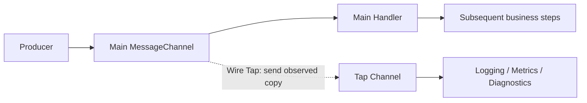
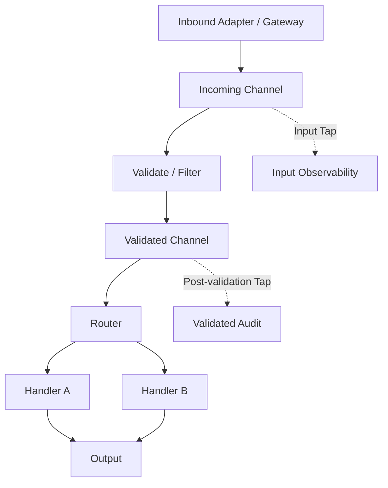
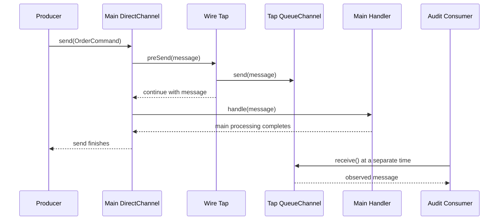
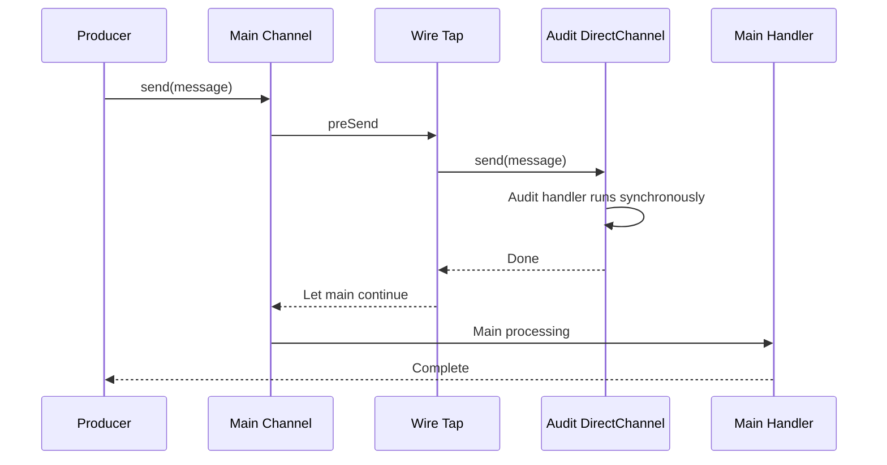
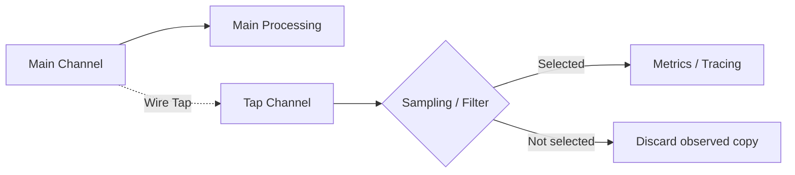
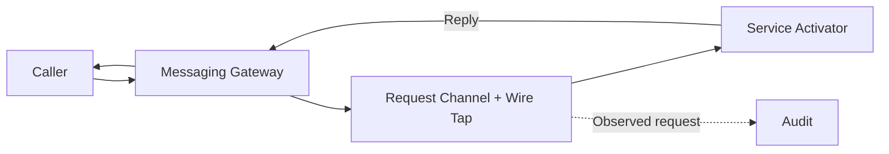

# Wire Tap Observing Messages Without Changing the Main Flow with Spring Integration

## 1. Scenario: needing to observe messages without interfering with processing

An order management system has the following flow:

1. Receive an order creation command.
2. Validate data and business rules.
3. Send the request to the order processing system.
4. Return the result or an error notification.

The operations team wants to know where each message has reached, the QA team wants to verify input contents, and the development team needs an observation point when investigating failures. If audit recording, logging, or metric emission is placed directly inside the business handler, every observability change can complicate the main flow; a failure in the audit store could also cause order processing to fail.

**Wire Tap** is an Enterprise Integration Pattern that allows **sending a copy of a message to a secondary observation branch** while the original message continues along the main processing path. In Spring Integration, Wire Tap is commonly implemented as a `ChannelInterceptor` or via the Java DSL `wireTap(...)`.

The lesson **Wire Tap Observing Messages Without Changing the Main Flow** belongs to the **Wire tap** chapter of the **SPRING_INTEGRATION_PATTERN** module. The module focuses on implementing Router, Filter, Transformer, Splitter, Aggregator, Gateway, retry, error channel, and correlation patterns to build message flows that are loosely coupled, extensible, testable, and observable.

After this lesson, you will be able to:

- Understand precisely what Wire Tap observes and what it does not do.
- Distinguish Wire Tap from Bridge, Publish–Subscribe Channel, Router, and Transformer.
- Add an observation branch to a channel using Spring Integration.
- Test messages on both the main branch and the tap branch.
- Understand why Wire Tap **does not automatically guarantee** that the main branch is completely isolated from failures in the secondary branch.
- Design logging, metrics, and auditing safely, with bounded resources and without exposing sensitive data.

## 2. What Is Wire Tap?

In Enterprise Integration Patterns, Wire Tap creates a **secondary branch** to monitor a message flow. A message traveling along the main processing path is still delivered to the primary consumer, while an observed copy is sent to a separate channel.



In Spring Integration, the common approach is to attach a Wire Tap to a channel. When a message is sent through that channel, the interceptor sends the message to the tap channel and lets the message continue through the main channel.

**Core point:** Wire Tap must not be used to compute new business results, filter out messages on the main path, or decide to change the destination of the main flow.

### Observation does not mean transformation

For example, a message created before entering the Wire Tap:

```text
payload:
  orderId: O-42
  sku: BOOK-01
  quantity: 2

headers:
  businessCorrelationId: req-42
  source: checkout-service
```

The tap branch may record:

```text
operation=order-submission
orderId=O-42
correlationId=req-42
observedAt=...
```

while the main handler still receives the `OrderCommand("O-42", "BOOK-01", 2)` payload along with the required headers.

However, **Wire Tap does not deep-copy the payload by default**. It may pass the exact same message object or payload reference to the secondary branch. If the audit branch directly mutates a mutable object, the message seen by the main handler can be affected. Design immutable DTOs and treat the observation branch as **read-only**.

## 3. What "Does Not Change the Main Flow" Means — and What It Does Not Mean

The phrase "does not change the main flow" is often understood at two different levels:

| Level | Meaning | Does Wire Tap guarantee it automatically? |
|---|---|---|
| **Business semantics** | Does not modify the payload, does not reroute, and does not drop messages on the main path | Yes, by Wire Tap's responsibility; other components can still alter the message |
| **Operational isolation** | A failing or slow audit branch must not slow down or fail the main flow | **Not by default**; depends on the tap channel, threads, queue, error handling, and load level |

If the tap channel is a `DirectChannel` and the audit handler takes three seconds to write to a database, the send call to the main channel can be delayed by synchronous audit processing. If the audit handler throws an exception, the error can affect the message send operation on the main flow, depending on configuration.

If the tap channel is a bounded `QueueChannel`, sending to the tap typically only enqueues into an in-memory queue, decoupling audit write time from the main handler. However, the queue can still become **full** or lose data when the process stops if stored only in memory.

Therefore, the right goal is:

> **Keep the business content and main journey unchanged by Wire Tap; proactively design resource isolation and error handling if you want the secondary branch not to affect the primary experience.**

## 4. Placement of Wire Tap in the Topology

Wire Tap should be placed at a point where the observed information is meaningful.



Placing a tap on the **incoming channel** tells you the message entered the system, but does not prove that validation or downstream processing succeeded.

Placing a tap **after a Filter** tells you the message passed the filter, but still does not prove that side effects in an external system were committed.

Placing a tap **before an HTTP outbound adapter** tells you the request is about to be sent, but is not proof that the partner received or executed it.

This is a critical principle when using Wire Tap for auditing: **an observation point only proves the state at that observation point**, not that every subsequent step has completed.

### Choosing a tap point based on operational questions

| Question | Appropriate tap location |
|---|---|
| Which messages were received from the source? | Right after the inbound adapter or on the request channel |
| Which messages passed validation? | After the Filter/validation handler |
| Which requests were routed to processing branch A? | Branch A's channel after the Router |
| What is the actual incoming load per second? | Input channel or endpoint metrics |
| Which replies were generated? | Reply channel or the step after the reply-producing handler |
| Did the transaction commit successfully? | Do not rely solely on an input Wire Tap; audit at the transaction boundary |

## 5. Comparing Wire Tap with Related EIPs

| Pattern / component | Purpose | How does it differ from Wire Tap? |
|---|---|---|
| **Wire Tap** | Sends a copy of the message to a secondary observation branch | The main flow continues; the tap is supplemental |
| **Bridge** | Connects two channels on the main path | Forwards the main message, with no independent observation branch by default |
| **Publish–Subscribe Channel** | Broadcasts messages to multiple subscribers | Fan-out is the primary distribution model; each subscriber can be business logic |
| **Recipient List Router** | Selects a list of recipient destinations | Conditional distribution based on routing logic, not merely observation |
| **Content-Based Router** | Selects a branch based on payload/headers | Can change the path of the main message |
| **Filter** | Accepts or drops messages | Can discard messages on the main path |
| **Transformer** | Changes payload/headers/data types | Intended to transform the message |
| **Gateway** | Bridges method calls ↔ messaging flow | May require replies and timeouts |
| **LoggingHandler** | Logs messages | An observation handler; can be placed after a tap channel, but is not synonymous with Wire Tap |
| **ChannelInterceptor** | Intercepts send/receive operations of a channel | Wire Tap is a specialized interceptor form for an observation branch |

A flow with a `PublishSubscribeChannel` and two subscribers can also produce behavior similar to "main + audit", but it is not identical in intent or configuration. Wire Tap explicitly communicates that **the observation branch is secondary**, while primary processing continues along its own channel.

## 6. Wire Tap Mechanism in Spring Integration

Conceptually:

1. The producer calls `mainChannel.send(message)`.
2. The Wire Tap attached to the channel observes the message at send time.
3. The Wire Tap sends that message to `tapChannel`.
4. The message continues to be delivered according to `mainChannel`'s semantics.
5. The consumer of `tapChannel` processes it independently in business terms, such as recording metrics.



The diagram illustrates a topology using a `DirectChannel` on the main path and a `QueueChannel` for the tap. If a `DirectChannel` is used for the tap, the audit consumer may run immediately when the Wire Tap sends the secondary copy, before the main handler begins processing.

### Are headers preserved?

In a simple in-process case, Wire Tap sends the message with the payload and headers as observed on that channel. Fields such as `businessCorrelationId`, `traceId`, `id`, or `timestamp` are not intentionally transformed into new data by Wire Tap just for logging.

However, another interceptor on the channel, a transformer before the tap, or an adapter over HTTP/Kafka can change the message or headers. When investigating discrepancies, distinguish between:

- **Before the tap**: what values did the message have?
- **At the tap**: which exact channel is the Wire Tap observing?
- **After the tap**: which interceptor/handler could create a new message?
- **At external transport**: does a serializer/mapper drop or alter headers?

Do not blindly forward all Spring Integration headers to external systems: `replyChannel` and `errorChannel` may be objects only valid within the JVM, while `Authorization`/API keys must be protected.

## 7. Java Example: Wire Tap Observing OrderCommand

We will build a pure Spring Integration configuration within a single `ApplicationContext`:

- `ordersIngress`: `DirectChannel`, the main processing path.
- `auditTapChannel`: bounded `QueueChannel`, receiving observed messages.
- `processedOrders`: `QueueChannel`, receiving main processing results.
- `WireTap`: interceptor attached to `ordersIngress`.
- `IntegrationFlow`: main handler transforming `OrderCommand` into `ProcessedOrder`.

The example targets Java 17+, Spring Integration 6.x, Spring Framework, and JUnit 5 compatibility. No real broker is needed to demonstrate the basic topology.

### 7.1. Business records

```java
// OrderCommand.java
package com.example.wiretap;

public record OrderCommand(
        String orderId,
        String sku,
        int quantity
) {
}
```

```java
// ProcessedOrder.java
package com.example.wiretap;

public record ProcessedOrder(
        String orderId,
        String result
) {
}
```

Using records with simple fields helps avoid the risk of the tap branch mutating the same mutable payload object. In real systems, records containing mutable collections or objects still need nested protection.

### 7.2. Configuring channels and the Wire Tap interceptor

```java
// WireTapConfiguration.java
package com.example.wiretap;

import org.springframework.beans.factory.annotation.Qualifier;
import org.springframework.context.annotation.Bean;
import org.springframework.context.annotation.Configuration;
import org.springframework.integration.channel.DirectChannel;
import org.springframework.integration.channel.QueueChannel;
import org.springframework.integration.channel.interceptor.WireTap;
import org.springframework.integration.config.EnableIntegration;
import org.springframework.integration.dsl.IntegrationFlow;

@Configuration
@EnableIntegration
public class WireTapConfiguration {

    @Bean
    public QueueChannel auditTapChannel() {
        // Bounded in-memory queue to prevent unbounded growth.
        return new QueueChannel(100);
    }

    @Bean
    public DirectChannel ordersIngress(
            @Qualifier("auditTapChannel") QueueChannel tapChannel) {

        DirectChannel main = new DirectChannel();

        // Forward the observed message copy to the secondary branch.
        main.addInterceptor(new WireTap(tapChannel));

        return main;
    }

    @Bean
    public QueueChannel processedOrders() {
        return new QueueChannel(100);
    }

    @Bean
    public IntegrationFlow processOrdersFlow() {
        return IntegrationFlow.from("ordersIngress")
                .handle(
                    OrderCommand.class,
                    (command, headers) -> {
                        if (command.quantity() <= 0) {
                            throw new IllegalArgumentException(
                                    "Quantity must be positive");
                        }

                        return new ProcessedOrder(
                                command.orderId(), "ACCEPTED");
                    })
                .channel("processedOrders")
                .get();
    }
}
```

Key takeaways:

1. `WireTap` is attached to the **input channel**; it does not replace the main handler.
2. `QueueChannel(100)` temporarily holds observed messages for the audit consumer to pull later.
3. The main flow still receives `OrderCommand` and processes it according to its contract.
4. `ProcessedOrder` is produced by the **main handler**, not by Wire Tap.
5. Nothing in this example guarantees durable auditing across restarts.
6. If the tap branch is overloaded or tap sending fails, you must determine the impact on the main flow; a bounded queue is not a complete isolation solution.

In a production system, an observation point should generally not place entire sensitive payloads into an audit queue. The audit consumer can be implemented to emit only metadata, or a deliberate redaction/sampling layer can be placed.

### 7.3. Sending a message

```java
// Example code inside a service injected with the ordersIngress channel.
import org.springframework.messaging.Message;
import org.springframework.messaging.support.MessageBuilder;

OrderCommand command =
        new OrderCommand("O-42", "BOOK-01", 2);

Message<OrderCommand> message = MessageBuilder
        .withPayload(command)
        .setHeader("businessCorrelationId", "req-42")
        .setHeader("source", "checkout-service")
        .build();

boolean acceptedByChannel = ordersIngress.send(message);
```

`acceptedByChannel` reflects sending to the channel according to the channel's semantics. It is not proof that all downstream operations, such as payment or database writes in async branches, have been committed.

### 7.4. Testing both the main path and the tap branch

```java
// WireTapConfigurationTest.java
package com.example.wiretap;

import static org.junit.jupiter.api.Assertions.*;

import org.junit.jupiter.api.Test;
import org.springframework.beans.factory.annotation.Autowired;
import org.springframework.beans.factory.annotation.Qualifier;
import org.springframework.integration.channel.DirectChannel;
import org.springframework.integration.channel.QueueChannel;
import org.springframework.messaging.Message;
import org.springframework.messaging.support.MessageBuilder;
import org.springframework.test.context.junit.jupiter.SpringJUnitConfig;

@SpringJUnitConfig(WireTapConfiguration.class)
class WireTapConfigurationTest {

    @Autowired
    @Qualifier("ordersIngress")
    DirectChannel ordersIngress;

    @Autowired
    @Qualifier("auditTapChannel")
    QueueChannel auditTapChannel;

    @Autowired
    @Qualifier("processedOrders")
    QueueChannel processedOrders;

    @Test
    void tapObservesInputAndMainFlowStillProducesResult() {
        OrderCommand command =
                new OrderCommand("O-42", "BOOK-01", 2);

        Message<OrderCommand> original = MessageBuilder
                .withPayload(command)
                .setHeader("businessCorrelationId", "req-42")
                .build();

        assertTrue(ordersIngress.send(original));

        Message<?> observed = auditTapChannel.receive(1000);
        Message<?> mainResult = processedOrders.receive(1000);

        assertNotNull(observed);
        assertNotNull(mainResult);

        // The tap sees the original input data, not ProcessedOrder.
        assertEquals(command, observed.getPayload());
        assertEquals(
                "req-42",
                observed.getHeaders().get("businessCorrelationId"));

        // No transformation occurred in the Wire Tap itself.
        assertEquals(
                original.getHeaders().getId(),
                observed.getHeaders().getId());

        // This result is created by the main handler, not by Wire Tap.
        assertEquals(
                new ProcessedOrder("O-42", "ACCEPTED"),
                mainResult.getPayload());
    }
}
```

This test proves **under this specific configuration**:

- The producer sends a message to the main channel.
- The tap queue receives the message with the expected payload and headers.
- The main flow still produces its own output from the main handler.
- Wire Tap does not transform `OrderCommand` into `ProcessedOrder`.

The test does not prove that the tap branch **never affects performance** under all conditions. To verify that, you need additional tests for full queues, audit failures, throughput, latency, and shutdown/restart.

### 7.5. Java DSL `wireTap(...)` configuration

Besides adding an interceptor directly, Spring Integration Java DSL can configure a Wire Tap at a point in a flow:

```java
@Bean
public IntegrationFlow alternativeWireTapFlow() {
    return IntegrationFlow.from("ordersIngress")
            .wireTap("auditTapChannel")
            .handle(
                OrderCommand.class,
                (command, headers) ->
                    new ProcessedOrder(command.orderId(), "ACCEPTED"))
            .channel("processedOrders")
            .get();
}
```

This is an **alternative approach**, not a bean to register simultaneously alongside `processOrdersFlow()` in section 7.2. When using the DSL, carefully place and identify the channel to which `wireTap(...)` applies, especially when the flow has multiple channels or endpoints.

Both approaches use an observation branch and do not turn the tap into a Router or Transformer.

## 8. Reading Messages from the Tap Channel for Safe Logging

In the example above, the tap channel is a `QueueChannel`. A poller/consumer can read messages from the queue and record operational metadata.

**Alternative for consumer tests**: when the real application has an audit consumer, do not let a test simultaneously compete to read from the same queue as the audit poller, because each message can be consumed by whichever side reads it first.

Example Service Activator on a PollableChannel:

```java
// Illustrates only the audit-side consumer.
import org.springframework.integration.annotation.Poller;
import org.springframework.integration.annotation.ServiceActivator;
import org.springframework.messaging.Message;
import org.springframework.stereotype.Component;

@Component
public class AuditObserver {

    @ServiceActivator(
            inputChannel = "auditTapChannel",
            poller = @Poller(
                    fixedDelay = "500",
                    maxMessagesPerPoll = "10"
            )
    )
    public void observe(Message<OrderCommand> message) {
        OrderCommand command = message.getPayload();

        // In a real project, use a logger + appropriate redaction.
        System.out.printf(
                "tap orderId=%s correlation=%s%n",
                command.orderId(),
                message.getHeaders().get("businessCorrelationId")
        );
    }
}
```

In production environments, a logging framework is typically used and only approved fields are logged; never print raw payloads or headers containing tokens/credentials. Logging `orderId` in the example is only valid if the system's data protection policy permits it.

### The audit branch needs its own policy

- What to store: event ID, event type, observation timestamp, correlation ID?
- Where to write: logs, a metrics backend, or a durable audit store?
- Data retention period: how long is it kept and who is allowed to read it?
- If the queue is full or the audit store is unavailable: drop samples, write to a fallback, or block the main flow?
- When messages contain PII/credentials: where does redaction happen before writing?
- If compliance auditing is required: does an in-memory Wire Tap meet durability requirements?

If **every business operation must have a durable audit record that cannot be lost**, do not rely solely on Wire Tap + an in-memory queue. Consider a transactional outbox or writing the audit record within the same transaction as the business change, then publishing audit events with controlled delivery.

## 9. Synchronous and Asynchronous Tap Branches

### 9.1. Tapping to a DirectChannel

If Wire Tap sends to a `DirectChannel`, the tap channel's handler may run immediately on the original message-sending thread. This is easy to test and has low thread-switching overhead, but a slow audit handler will slow down the message-sending path.



Therefore, the statement "Wire Tap does not affect the main flow" only describes the **intent regarding routing and content changes**, not a guarantee about timing or errors.

### 9.2. Tapping to a QueueChannel

`QueueChannel` creates a buffer between Wire Tap and the audit consumer. While the queue has capacity, the audit send operation can finish quickly and the poller processes it later.

However, you need to monitor:

- Queue capacity, average size, and peak depth.
- Policy when the queue is full.
- Consumer processing rate versus message production rate.
- Message loss on process restart if stored only in memory.
- Whether multiple pollers are reading concurrently.
- Count of dropped records or records waiting too long.

An in-memory queue **is not a durable audit log**. If observation requirements are best-effort, sampling or dropping under high load may be acceptable, but that decision must be explicitly documented.

### 9.3. Tapping to an ExecutorChannel

An `ExecutorChannel` can offload audit work to a thread pool. However, a full executor queue or rejected tasks can still cause backpressure or failures. This requires proper sizing, rejection policies, monitoring, and load testing.

At the same time, multithreaded processing can cause log/audit events to complete out of input order. If audit ordering per aggregate is required, appropriate keyed sequencing or versioning is needed.

### 9.4. Choosing the right strategy

| Goal | Design direction |
|---|---|
| Simple debugging in local environment | Tap DirectChannel + filtered logs |
| Best-effort metrics without storing every message | Observe metadata only, sampling, and bounded impact |
| Deferred audit processing under moderate load | Tap QueueChannel + poller, explicit capacity and fallback |
| Audit potentially under high load | Durable queue/broker, throughput limits, lag monitoring |
| Mandatory audit that must not be lost | Transactional/outbox mechanism, not Wire Tap alone |
| Audit ordering per entity required | Correlation/sequence/version and keyed processing |

## 10. Filtering or Sampling the Observation Branch

Not every message needs detailed logging. For example, an API handling tens of thousands of requests per second might only need to:

- Count total requests.
- Sample a percentage of messages for tracing.
- Log details for failed messages or slow processing paths.
- Always record minimal traces for permitted security events.

You can selectively filter the **tap branch** using a selector or a Filter step in the audit flow, depending on the Spring Integration API and version. The key is **never to drop messages from the main path** just because they were not selected for observation.



If the audit flow uses a Filter, it only affects messages **that have already entered the secondary branch**. Do not design tap logic that mutates a mutable object's state while the main handler is still using it.

### Sampling does not replace mandatory auditing

Sampling is suitable for performance observability or statistical debugging; it is not suitable if regulations require recording **every single transaction**. Distinguish best-effort telemetry from compliance audit events right from the start.

## 11. Protecting Data in Wire Tap

Wire Tap can accidentally duplicate **places where sensitive data appears**. A message may contain customer details, order codes, user identifiers, or credentials in headers.

Common leak locations:

1. `LoggingHandler` printing the entire `Message<?>`.
2. HTTP debug logs of an audit exporter.
3. Trace spans storing payloads and headers.
4. Queues/DLQs holding unredacted failed messages.
5. Test reports/snapshots containing fake tokens or real user data.
6. Consoles/monitoring tools allowing too many roles to view logs.

### Do not log raw messages without data classification

```java
// Avoid if payload or headers may contain sensitive data.
log.info("Tapped message: {}", message);
```

Preferred example:

```java
log.info(
    "Observed order eventType={} correlationId={} outcome={}",
    eventType,
    correlationId,
    outcome
);
```

Also validate the source of this metadata. Caller-supplied correlation IDs or custom tags may require validation/sanitization to prevent log injection or sensitive data from entering logs.

### Controlling headers

Certain headers should not be propagated externally:

- `Authorization`, `Proxy-Authorization`, `Cookie`, `X-API-Key`.
- Secrets or tokens in custom headers.
- `replyChannel` and `errorChannel` containing internal channel references.
- Unfiltered exception messages or stack traces.
- Trace baggage containing unapproved identifying data.

If sending audit events out to Kafka/HTTP, use a **dedicated audit projection** with an approved schema and an adapter with a header allowlist. Wire Tap does not automatically strip secrets before a message reaches the tap channel.

## 12. Error Handling: Are Tap Branch Errors Truly Independent?

Separating the observation branch on a diagram does not mean complete isolation of failure domains.

### Risks

- A synchronous audit handler throws an exception while Wire Tap is sending.
- The tap queue is full or sending fails.
- The executor runs out of threads/slots.
- Serialization of the audit payload fails.
- The audit storage broker is unavailable.
- The log exporter is blocked or runs out of disk space.

These errors can occur at the moment the tap copy is sent or later when the audit consumer processes it. Depending on the channel type and interceptor, an error can slow down the main send, fail it, or be reported only through a separate error flow.

### Error-isolation strategies

For **best-effort telemetry**:

- Use bounded buffers and an approved drop/downsampling policy.
- Separate worker threads and bound tap branch resources.
- Emit `tap_dropped` or `tap_failed` metrics.
- Do not retry the same observation message indefinitely.
- Do not leak payloads/credentials in error logs.

For **mandatory auditing**:

- Never silently drop messages.
- Choose a durable store or transaction/outbox meeting requirements.
- Define how the main flow should react when auditing cannot be recorded.
- Test restarts, crashes, full queues, and replays.
- Define when an audit event is considered committed.

**No single policy fits both goals.** What matters is stating clearly whether the observation branch only supports operations or is part of business correctness/compliance.

## 13. Wire Tap with Gateway, Router, Splitter, and Aggregator

### 13.1. Request–Reply Gateway

A Gateway can send requests through a channel that has a Wire Tap:



The tap only helps observe requests on the channel. It **does not generate replies**, does not eliminate the need for timeout handling, and does not prove that a reply was returned to the caller.

If you want to monitor **replies**, place a separate observation point on the appropriate response path. A tap on the request channel only records inbound requests.

### 13.2. Router

If a Router directs messages to VN/EU branches, a Wire Tap before the Router reflects all incoming messages. A Wire Tap on the VN branch channel reflects only messages routed to VN.

Choose the tap point that matches your question: total requests, requests per region, or successfully processed requests.

### 13.3. Filter

If Wire Tap is placed **before a Filter**, the audit sees messages later rejected by the Filter as well. If placed **after the Filter**, the audit sees only accepted messages. Never mistake an observation before a Filter for proof that the message was valid.

### 13.4. Splitter

When a Splitter divides one message into multiple parts, a tap before the Splitter observes the **original request**; a tap after the Splitter observes the **child messages**. The number of tapped messages can exceed the number of original requests.

Carry appropriate correlation IDs and sequence information to link parts back to the original request. Printing the entire payload of every child message can cause log volume to explode.

### 13.5. Aggregator

A tap before an Aggregator can observe each individual item; a tap after the Aggregator observes the output when the group is released. If a group is incomplete or times out, there may be no message on the post-Aggregator tap.

Therefore, a missing audit event on the post-Aggregator tap is **not enough** to conclude the original request never arrived; check correlation, release strategy, and error flows.

## 14. Ordering, Concurrency, and Mutable Payloads

Wire Tap is not responsible for ordering messages. With a tap queue and multiple consumers, the order of **audit processing completion** may differ from the order of receipt, even if the main flow processes according to channel order.

When reconciliation is needed:

- Use `eventId` to identify each message.
- Use `businessCorrelationId` to link parts of the same workflow.
- Use `sequenceNumber` or a business version when sequence matters.
- Record the **observation** timestamp separately from the **successful processing** timestamp.
- Use idempotency when the audit exporter performs retries/redelivery.

### Mutable payload risk

Suppose the payload is an `ArrayList<OrderLine>`. Both the tap branch and main branch receive a reference to the same list. If the audit consumer removes an element to "hide information", the main handler may receive the modified list.

**Correct approach:** do not mutate the original object inside the tap. If redaction is required, create a new audit DTO or an independent copy on the secondary branch after the message is handed to the tap channel. Prefer immutable payloads from the start.

## 15. Wire Tap Testing Strategy

Do not only verify that a message appears on the tap; test the main path, non-mutation, and failure isolation according to your goals.

| Scenario | What to verify |
|---|---|
| A valid message | Tap receives original data; main flow still produces expected result |
| Correlation header | Tap branch sees required IDs at the observation point |
| Main handler changes payload | Tap is not mistaken as the source of the change |
| Input to Filter | Pre-Filter and post-Filter taps see different message sets as designed |
| Tap queue full | Clear handling policy exists; impact on main flow is measured |
| Slow audit consumer | Main latency and tap queue depth stay within budget |
| Audit consumer throws error | Error path/metrics trigger; errors are not silently swallowed uncontrollably |
| Mutable payload | Audit does not alter data used by the main handler |
| Multiple concurrent messages | Correlation is not mixed up and global ordering is not assumed |
| Restart while tap queue has data | Risk of losing observations is understood if queue is in-memory |
| Adding HTTP/Kafka audit adapter | Headers/payloads are filtered per schema and security policy |
| Audit exporter retries | Idempotency is implemented or duplicates are explicitly accepted |

### Testing that the tap does not trigger extra business execution

When the main branch performs side effects, count invocations of the business handler. Sending one message should make Wire Tap produce **one observation copy**, not invoke the business handler a second time. If a topology allows audit messages to loop back into the main input, that is likely a misconfigured topology loop.

### Security testing

Use dummy credentials in tests, never production secrets. Verify audit records do not contain `Authorization` or unauthorized fields; assert only redacted metadata.

## 16. When Should You Not Use Wire Tap?

**1. Need to transform the payload before sending.** Use an appropriate Transformer or Header Filter; do not assign transformation responsibilities to Wire Tap.

**2. Need to route requests to one of several services.** Use a Router; Wire Tap is only an observation branch.

**3. Need an audit record that is never lost alongside a business transaction.** Use a transactional outbox or appropriate transactional persistence; a tap can only serve as an additional secondary observation point.

**4. Need a result from the secondary branch to drive main processing.** That is no longer pure telemetry; design an explicit request–reply, Aggregator, or orchestration flow.

**5. Want to log all payloads/headers in production.** Security and storage risks are rarely worth it. Separate metadata, apply sampling, and enforce access control.

**6. Only want throughput/latency metrics.** You can use Micrometer/observation and endpoint/channel metrics without sending a full payload copy through a tap, depending on requirements.

## 17. Common Pitfalls

**Pitfall 1 — "Wire Tap definitely never affects the main flow."** It does not actively change the business path, but a synchronous, slow, or failing tap handler can still affect timing and exceptions.

**Pitfall 2 — "Wire Tap deep-copies messages."** It is not a deep-copy mechanism. Mutable payloads can share references.

**Pitfall 3 — "A tap on the request channel proves processing succeeded."** The tap only sees the message at observation time; it does not verify downstream commits.

**Pitfall 4 — "A QueueChannel audit is a durable log."** An in-memory queue can lose data on restart and fill up when the consumer is slow.

**Pitfall 5 — "LoggingHandler and Wire Tap are the same thing."** Wire Tap creates the observation branch; LoggingHandler is a consumer that can be used on that branch.

**Pitfall 6 — "With a tap, tracing/correlation isn't needed."** When flows branch, correlation and sequence help make sense of related events.

**Pitfall 7 — "Replace Wire Tap with a Router."** A Router can change the main destination rather than simply adding an observation path.

**Pitfall 8 — "Audit can print any header."** Headers can contain tokens, cookies, internal channels, or sensitive data.

**Pitfall 9 — "Tap failures should always be ignored."** For best-effort telemetry, dropping samples may be acceptable; for compliance auditing, never drop silently.

**Pitfall 10 — "The tap sees the original message everywhere."** If placed after a Transformer, the tap sees the **post-transformation** message at that location, not the system-wide initial payload.

## 18. Wire Tap Design Process for a Project

1. **Define the goal:** debugging, metrics, tracing, or mandatory auditing?
2. **Choose the observed channel:** before/after Filter, Router, Transformer, or remote adapter?
3. **Define minimal data:** which metadata is sufficient, and which payloads must not be stored?
4. **Choose the tap channel:** DirectChannel, QueueChannel, ExecutorChannel, or durable broker?
5. **Set bounds:** capacity, concurrency, latency, rate limits, and retries.
6. **Define failure policy:** how do tap errors affect the main flow?
7. **Define retention:** how long are logs/audits kept, and who has read access?
8. **Protect immutability:** the tap branch does not mutate shared payloads/main headers.
9. **Add correlation/tracing:** which IDs allow correlating events and detecting duplicates?
10. **Write tests:** main result, tap observation, full queue, errors, and security.
11. **Monitor the tap branch itself:** queue depth, dropped count, processing lag, failures.
12. **Reconcile business state:** never infer a successful commit solely from an "observed" event.

## 19. Review Questions

1. What additional path does Wire Tap create in a topology that a Bridge does not?
2. Why does Wire Tap not automatically guarantee the main flow won't slow down when the audit handler is slow?
3. What is the difference between sending a tap to a DirectChannel versus a QueueChannel?
4. Why does observing a message before a Filter not prove it passed validation?
5. How can a tap branch accidentally mutate the main payload when the payload is a mutable object?
6. How does Wire Tap differ from Publish–Subscribe Channel and Router in intended usage?
7. When a Gateway expects a reply, does a Wire Tap on the request channel automatically produce a reply?
8. How do the observed message counts differ between a tap before a Splitter and a tap after a Splitter?
9. With an Aggregator, what could cause a missing event on the output tap?
10. When is a transactional outbox needed instead of using Wire Tap alone for auditing?
11. Which headers should not be logged verbatim, and why?
12. What test demonstrates that the tap branch does not cause the main handler to execute a second time?
13. If the audit queue is full, how should it be handled for best-effort telemetry versus mandatory auditing?
14. How do correlation ID, event ID, and sequence/version help investigate issues on the tap branch?

## 20. Implementation Checklist

- [ ] Determined whether Wire Tap is used for best-effort telemetry or mandatory auditing.
- [ ] Chose the right channel point to observe and understood the meaning of the data at that point.
- [ ] Main flow still receives messages according to its contract after adding the tap.
- [ ] Tap does not mutate shared mutable payloads or headers.
- [ ] Queue/executor bounds and handling for a slow tap branch are in place.
- [ ] Policy defined for when tap sends or the audit consumer fails.
- [ ] Business success is not inferred solely from an observed message.
- [ ] Schema/allowlist exists for audit metadata and payload/header redaction.
- [ ] Correlation/event IDs exist to reconcile events and detect duplicates.
- [ ] Metrics exist for tap backlog, lag, failures, and dropped count if applicable.
- [ ] If auditing requires durability, a transaction/outbox or durable design is in place.
- [ ] Tests verify both the main branch and tap branch, including exceptions and load.
- [ ] Router/Filter/Splitter/Aggregator flows have clear observation points and sequencing.

**Remember:** Wire Tap in Spring Integration lets you **observe messages on a channel via a secondary branch**, while the main handler continues processing according to its topology. Wire Tap is not meant to transform payloads, does not replace a Router or Transformer, and does not automatically provide durability, retries, or complete error isolation. To reliably "observe without affecting the main flow", combine Wire Tap with proper channel design, resource bounds, data protection, error handling, and testing.
