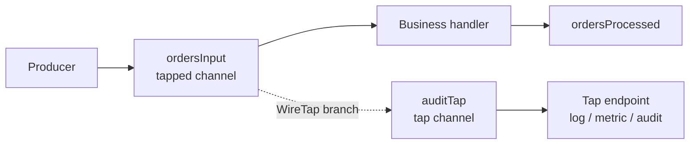
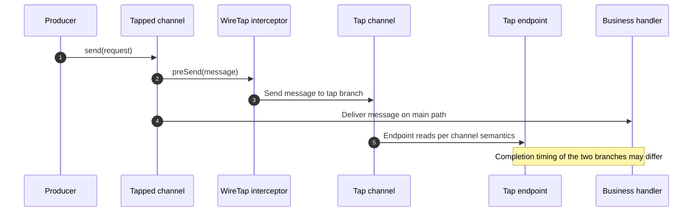
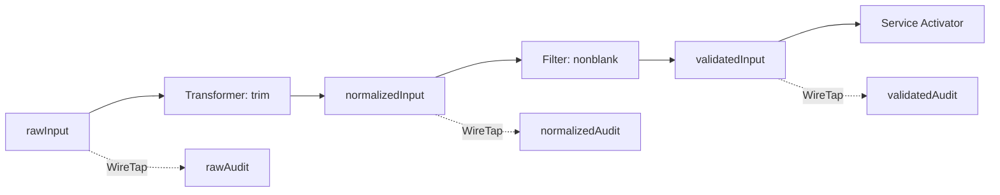
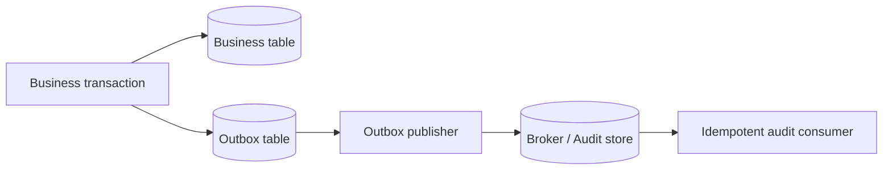

# Wire Tap — Tap Channel and Tap Endpoint in Spring Integration

## Learning Objectives

After this lesson, you will be able to:

- Explain how **Wire Tap** creates an observation branch from a `MessageChannel` while letting messages continue along the main business flow.
- Distinguish between the **tapped channel**, the **tap channel** (the channel receiving the observation branch), and the **tap endpoint** (the component that consumes/records data from the tap channel).
- Implement `WireTap` as a `ChannelInterceptor` and configure the Java DSL `.wireTap(...)` alternative.
- Test payloads, the `correlationId` header, and observation points before/after a Transformer, Filter, or Router; distinguish a tapped message from completed business processing.
- Evaluate the impact of synchronous and asynchronous taps on latency, backpressure, errors, error channels, retries, security, and durability.

This lesson belongs to the **Wire tap** chapter of the **SPRING_INTEGRATION_PATTERN** module. The module practices Enterprise Integration Patterns with Spring Integration to build loosely coupled and extensible message flows, combining Router, Filter, Transformer, Splitter, Aggregator, Gateway, retry, error channel, correlation, testing, and branch monitoring. In a multi-endpoint system, Wire Tap lets you observe messages at chosen points without forcing business handlers to call loggers or monitoring services directly.

## 1. Problem: Tracking Messages Without Mixing In Business Logic

Suppose a system receives order processing requests:

```text
ordersInput -> Normalize -> Validate -> Process -> Reply
```

The operations team wants to record the timestamp and correlation ID as soon as a request enters the channel, or send an observed copy to an audit system. If every handler calls `auditService.record(...)` directly, monitoring logic becomes scattered, hard to toggle on or off, and introduces coupling between business logic and observability infrastructure.

**Wire Tap** is an Enterprise Integration Pattern used to "branch off" a copy/observation of a message at a point along the path. The main path can continue processing messages normally:



The two branches serve different purposes:

- **Main path**: delivers the request to a Filter, Transformer, Service Activator, Gateway, or another business endpoint.
- **Tap path**: receives information at the tapped point for logging, metrics, auditing, or diagnostics, according to published observability rules.

A tap must not be interpreted as "the business handler processed this successfully". A message can be observed at the start of the flow and then rejected by a Filter, routed elsewhere by a Router, or fail at a subsequent step.

## 2. "Tap Channel" and "Tap Endpoint" Are Two Distinct Roles

In Spring Integration, `WireTap` is essentially a **`ChannelInterceptor`** that can be attached to a channel. It intercepts the message send step on the monitored channel and forwards the message to another `MessageChannel`.

| Component | Role | Example |
| --- | --- | --- |
| Tapped channel | Where main-flow messages pass through; WireTap is attached here | `ordersInput` |
| `WireTap` interceptor | Creates the branch sending to the tap channel at the chosen point | `new WireTap(auditTap)` |
| **Tap channel** | Destination receiving the observed message | `auditTap` as a `QueueChannel` |
| **Tap endpoint** | Consumer reading from the tap channel and performing secondary work | `@ServiceActivator(inputChannel = "auditTap")` |
| Business endpoint | Consumer of the main channel, continuing business processing | `ordersFlow` |



Documentation and source code often use names like `tapChannel` or `loggingChannel`. **There is no special mandatory Java type named "TapChannel" or "TapEndpoint"**: a tap channel can be a regular `MessageChannel`, and a tap endpoint can be a Service Activator or another handler.

### Tap is not equivalent to Transformer, Router, or PublishSubscribeChannel

- **Transformer** is used when you need to change the payload or representation of a business message.
- **Router** decides which business path will receive the message.
- **PublishSubscribeChannel** distributes messages to subscribers of that channel itself. It is the right choice if fan-out is the **primary semantics of the flow**.
- **Wire Tap** adds a secondary branch from an **observation point** on a channel, while the main handler still receives the message per that channel's configuration.

Wire Tap is useful when the goal is logging/tracing/auditing and you want to manage observation points independently of business logic. It does not by itself define a durable delivery contract over a network.

## 3. Choosing the Tap Location: Before or After an Endpoint?

The observation point determines **what data you see**. Consider the flow:

```text
                   tap A                       tap B
                    |                           |
request -> rawInput -> Transformer -> normalizedInput -> Filter -> processed
```

- A tap on `rawInput` sees the payload **before the Transformer**: for example, the string `"  ORD-42  "`.
- A tap on `normalizedInput` sees the payload **after the Transformer**, such as `"ORD-42"`, but may still include messages that the Filter will later drop.
- A tap after the Filter only observes messages **that passed the Filter** at the point where the tap is placed.
- A tap before a Router does not tell you which branch a message was routed to. To know the routing outcome, observe the corresponding output channel or a downstream point after the Router.

Design example:



**Choose a tap point that answers the specific question you need.** Attaching taps to every channel increases log volume, makes it harder to distinguish observation counts from actual request counts, and can leak un-sanitized data before cleansing steps. When multiple taps are needed to trace a journey, preserve `eventId`/`correlationId` and add an observation-point identifier.

## 4. Complete Example: WireTap on a Channel with a Dedicated Tap Endpoint

Problem: the application receives order IDs via `ordersInput`, processes them with a Transformer, and produces an `ACCEPTED` status. At the same time, Wire Tap forwards the input message to `auditTap`. This channel is separated from the main processing path so tests can read observed messages without modifying the business handler.

The example uses Java 17, Spring Boot/Spring Integration with components in `spring-boot-starter-integration`, JUnit 5, and Spring Test:

```groovy
dependencies {
    implementation 'org.springframework.boot:spring-boot-starter-integration'
    testImplementation 'org.springframework.boot:spring-boot-starter-test'
}
```

### 4.1. Configuring the two channels and WireTap

`WireTapConfiguration.java`:

```java
import org.springframework.beans.factory.annotation.Qualifier;
import org.springframework.context.annotation.Bean;
import org.springframework.context.annotation.Configuration;
import org.springframework.integration.annotation.EnableIntegration;
import org.springframework.integration.channel.DirectChannel;
import org.springframework.integration.channel.QueueChannel;
import org.springframework.integration.channel.interceptor.WireTap;
import org.springframework.integration.dsl.IntegrationFlow;
import org.springframework.messaging.MessageChannel;

@Configuration
@EnableIntegration
public class WireTapConfiguration {

    @Bean("auditTap")
    public QueueChannel auditTap() {
        return new QueueChannel(100);
    }

    @Bean("ordersInput")
    public DirectChannel ordersInput(
            @Qualifier("auditTap") MessageChannel tapChannel) {
        DirectChannel input = new DirectChannel();

        // Intercept all messages sent through ordersInput.
        input.addInterceptor(new WireTap(tapChannel));
        return input;
    }

    @Bean("ordersProcessed")
    public QueueChannel ordersProcessed() {
        return new QueueChannel(100);
    }

    @Bean
    public IntegrationFlow ordersFlow() {
        return IntegrationFlow.from("ordersInput")
            .transform(String.class, String::trim)
            .filter(String.class, orderId -> !orderId.isBlank())
            .handle(String.class, (orderId, headers) ->
                "ACCEPTED:" + orderId)
            .channel("ordersProcessed")
            .get();
    }
}
```

The roles are very specific:

1. `ordersInput` is the **tapped channel**: the WireTap interceptor is attached using `addInterceptor(...)`.
2. `auditTap` is the **tap channel**: `QueueChannel(100)` holds up to 100 messages waiting to be read.
3. `ordersFlow` is the **business path**: normalizes, validates, and produces output to `ordersProcessed`.
4. `ordersProcessed` is the **output channel of the business handler**, not a tap channel.
5. A **tap endpoint** will read from `auditTap` in the variant that logs or publishes observation events; the tests first receive directly from the queue to verify the content.

With this configuration, the audit tap receives the message **before** `ordersFlow`'s Transformer/Filter runs. Therefore, the observed payload is the raw input, while the business output is the processed result. You should not mutate the observed payload and expect the main path to automatically use that modified version.

### 4.2. Producer sending a request

`OrderIngress.java`:

```java
import org.springframework.beans.factory.annotation.Qualifier;
import org.springframework.messaging.MessageChannel;
import org.springframework.messaging.support.MessageBuilder;
import org.springframework.stereotype.Component;

@Component
public class OrderIngress {

    private final MessageChannel ordersInput;

    public OrderIngress(
            @Qualifier("ordersInput") MessageChannel ordersInput) {
        this.ordersInput = ordersInput;
    }

    public void submit(String orderId, String correlationId) {
        boolean accepted = ordersInput.send(
            MessageBuilder.withPayload(orderId)
                .setHeader("correlationId", correlationId)
                .setHeader("eventType", "order.requested")
                .build()
        );
        if (!accepted) {
            throw new IllegalStateException("Input channel rejected request");
        }
    }
}
```

Calling `submit("  ORD-42  ", "req-42")` sends the message down both the main path and the observation branch. The business result is `ACCEPTED:ORD-42`, while the audit branch sees the raw payload `"  ORD-42  "`. `correlationId` is an application header used to link logs; it does not mean the framework has persisted a trace to a durable store.

### 4.3. Real tap endpoint receiving and recording metadata

In operation, the tap channel needs a consumer; otherwise `auditTap` simply accumulates messages until the queue fills up. Here is an example of a **polling tap endpoint**:

`AuditTapEndpoint.java`:

```java
import org.springframework.integration.annotation.Poller;
import org.springframework.integration.annotation.ServiceActivator;
import org.springframework.messaging.Message;
import org.springframework.stereotype.Component;

@Component
public class AuditTapEndpoint {

    @ServiceActivator(
        inputChannel = "auditTap",
        poller = @Poller(
            fixedDelay = "200",
            maxMessagesPerPoll = "10"
        )
    )
    public void record(Message<?> tapped) {
        // Example prints only metadata; do not log payloads or sensitive tokens.
        Object correlationId = tapped.getHeaders().get("correlationId");
        Object eventType = tapped.getHeaders().get("eventType");
        System.out.println(
            "tap eventType=" + eventType
            + " correlationId=" + correlationId
        );
    }
}
```

When using Spring Boot component scanning, the `AuditTapEndpoint` bean is created and its poller can read from `auditTap`. **Do not run this polling endpoint alongside tests that manually receive from `auditTap`**, because both sides will compete to consume messages. In the testing section, `@SpringJUnitConfig(WireTapConfiguration.class)` loads only the specified configuration class and does not scan `@Component` beans outside it; therefore, the queue can be tested deterministically.

`record(...)` returns `void`, making it a **one-way observation consumer** that does not emit a normal reply to the request's `replyChannel` header. Never use a tap endpoint to mutate order state, create payments, or confirm business completion. If auditing is a legal/compliance requirement, use a durable recording path and an independent confirmation policy instead of relying on an in-RAM queue.

## 5. Testing Wire Tap and the Business Path

The tests below use Spring Test and JUnit 5 to demonstrate:

- The same request sent through `ordersInput` is observed at `auditTap`.
- The main flow continues through the Transformer, Filter, and Service Activator to `ordersProcessed`.
- The `correlationId` header is preserved on the tap branch.
- A message rejected by the Filter **still appears in a tap placed before the Filter**, while producing no business output.

`WireTapIntegrationTest.java`:

```java
import static org.junit.jupiter.api.Assertions.assertEquals;
import static org.junit.jupiter.api.Assertions.assertNotNull;
import static org.junit.jupiter.api.Assertions.assertNull;
import static org.junit.jupiter.api.Assertions.assertTrue;

import org.junit.jupiter.api.Test;
import org.springframework.beans.factory.annotation.Autowired;
import org.springframework.beans.factory.annotation.Qualifier;
import org.springframework.integration.channel.QueueChannel;
import org.springframework.messaging.Message;
import org.springframework.messaging.MessageChannel;
import org.springframework.messaging.support.MessageBuilder;
import org.springframework.test.context.junit.jupiter.SpringJUnitConfig;

@SpringJUnitConfig(WireTapConfiguration.class)
class WireTapIntegrationTest {

    @Autowired
    @Qualifier("ordersInput")
    MessageChannel ordersInput;

    @Autowired
    @Qualifier("auditTap")
    QueueChannel auditTap;

    @Autowired
    @Qualifier("ordersProcessed")
    QueueChannel ordersProcessed;

    @Test
    void observesOriginalRequestWhileBusinessFlowContinues() {
        Message<String> request = MessageBuilder
            .withPayload("  ORD-42  ")
            .setHeader("correlationId", "req-42")
            .setHeader("eventType", "order.requested")
            .build();

        assertTrue(ordersInput.send(request));

        Message<?> observed = auditTap.receive(1_000);
        Message<?> result = ordersProcessed.receive(1_000);

        assertNotNull(observed);
        assertNotNull(result);
        assertEquals("  ORD-42  ", observed.getPayload());
        assertEquals("req-42",
            observed.getHeaders().get("correlationId"));
        assertEquals("order.requested",
            observed.getHeaders().get("eventType"));
        assertEquals("ACCEPTED:ORD-42", result.getPayload());
    }

    @Test
    void observesMessageEvenIfFilterRejectsItLater() {
        assertTrue(ordersInput.send(
            MessageBuilder.withPayload("   ")
                .setHeader("correlationId", "req-empty")
                .build()
        ));

        Message<?> observed = auditTap.receive(1_000);
        assertNotNull(observed);
        assertEquals("   ", observed.getPayload());
        assertEquals("req-empty",
            observed.getHeaders().get("correlationId"));

        // The Filter after the tap discards blank strings.
        assertNull(ordersProcessed.receive(0));
    }
}
```

These tests verify **routing and observation placement**; they do not prove durability across restarts, the correctness of a production logger, or behavior when the tap channel is overloaded. For example, `QueueChannel(100)` still has plenty of capacity here, so the full-queue policy is not exercised.

### What else should be tested?

| Scenario | Expected check |
| --- | --- |
| Tap before Transformer | Tap sees the payload before normalization |
| Tap after Transformer | Tap sees the transformed payload if WireTap is attached on a channel after the Transformer |
| Filter rejection | A tap before the Filter still sees the request; a tap after the Filter does not see the discarded message |
| Business handler throws an exception | Observation at the input channel already occurred, while the business outcome is an error |
| Slow tap endpoint | Tap backlog grows; metrics and an overload policy are needed |
| Tap endpoint fails | Ensure error handling aligns with channel type, threads, and audit priority |
| Multiple concurrent requests | Tap preserves the right `correlationId`; observation outcomes may arrive out of business-processing order |
| Late reply arrives | Compare gateway timeout timing against tap/handler processing time; do not infer from the tap that the caller received a reply |

## 6. Java DSL `.wireTap(...)` Configuration and Tap Placement

Besides attaching `new WireTap(...)` to a `DirectChannel`, Spring Integration's Java DSL provides the `.wireTap("tapChannel")` operator to define a tap point inside an `IntegrationFlow`.

Example **alternative approach**, used when the `ordersInput` channel **does not have a manual interceptor attached** as in section 4:

```java
@Bean
public IntegrationFlow ordersFlow() {
    return IntegrationFlow.from("ordersInput")
        .wireTap("auditTap")
        .transform(String.class, String::trim)
        .filter(String.class, orderId -> !orderId.isBlank())
        .handle(String.class, (orderId, headers) ->
            "ACCEPTED:" + orderId)
        .channel("ordersProcessed")
        .get();
}
```

You still need to declare the `ordersInput`, `auditTap`, and `ordersProcessed` channel beans as shown earlier, while removing `input.addInterceptor(...)` if using this variant to avoid duplicate tapping. The DSL inserts the tap point into the flow's path and keeps business responsibilities in subsequent steps.

To see the **payload after the Transformer**, a transparent design is to place a named channel between steps and attach the WireTap interceptor to that intermediate channel:

```java
@Bean("normalizedOrders")
public DirectChannel normalizedOrders(
        @Qualifier("normalizedAudit") MessageChannel audit) {
    DirectChannel channel = new DirectChannel();
    channel.addInterceptor(new WireTap(audit));
    return channel;
}

@Bean
public IntegrationFlow normalizationFlow() {
    return IntegrationFlow.from("ordersInput")
        .transform(String.class, String::trim)
        .channel("normalizedOrders")
        .filter(String.class, value -> !value.isBlank())
        .handle(String.class, (value, headers) -> "ACCEPTED:" + value)
        .channel("ordersProcessed")
        .get();
}
```

This is also a **standalone configuration option**: you must declare `normalizedAudit` as well and remove the old flow with the same name/path when testing; do not register two competing subscribers on `ordersInput` at the same time. The benefit of an intermediate channel is that anyone reading the configuration knows for certain the tap observes **after** the Transformer and **before** the Filter.

## 7. Choosing Tap Channel and Tap Endpoint Types

The channel used as the tap determines whether the observation branch can affect the main path:

| Tap channel | How the consumer runs | Impacts to watch out for |
| --- | --- | --- |
| `DirectChannel` | Tap endpoint processes synchronously on the sending thread, by default | A slow or failing tap can delay or affect the main flow's send |
| Bounded `QueueChannel` | Messages are enqueued; the tap endpoint polls independently | Decouples processing time; a full queue can block/timeout/error; data in RAM can be lost |
| `ExecutorChannel` | Dispatches to another thread via an executor | Separates threads, but pool size, queue capacity, and error policy must be bounded |
| `PublishSubscribeChannel` | Multiple tap endpoints subscribe to the same channel | Suits multiple observers, but fan-out increases load and failure risk |
| Adapter sending to a broker | Tap endpoint/flow publishes externally | Requires header serialization, publisher confirms, retries, and durable storage if needed |

### 7.1. Does a synchronous tap truly "never affect" the main flow?

There is no such unconditional guarantee. `WireTap` operates when the channel dispatches a message. If the tap channel is a `DirectChannel` and the subscriber makes a slow call, sending on the secondary branch can hold the thread or surface errors depending on configuration and execution point.

With a `QueueChannel`, enqueuing is usually fast while space remains, but when full the producer can experience backpressure, blocking, or errors. Timeout/exception behavior also depends on `WireTap`, `MessageChannel`, and version/configuration. Therefore:

- Avoid slow HTTP or slow DB calls directly from a synchronous tap on a latency-sensitive path.
- Use a tap channel with clear bounds; measure backlog, drop/reject rate, and main-path latency.
- Specify whether the tap is **best effort** or **mandatory**. If mandatory audit, use a durable mechanism with acknowledgments and an explicit failure policy.
- Do not assume that just because Wire Tap is "observation", all exceptions are automatically ignored or the main path is guaranteed unaffected.

### 7.2. Tap channel full: lose logs or cause backpressure?

Suppose `auditTap` has a capacity of 100, the source emits 200 messages/second, and the tap endpoint can only write 20 messages/second. The backlog grows by nearly 180 messages/second and can fill up in about 100 / 180 ≈ **0.56 seconds** if the queue starts empty and the rate is steady.

When the queue is full, choose an option that fits requirements:

- Reduce/sample tap traffic, log only essential metadata, and limit generated events.
- Scale up tap endpoint throughput within cost limits.
- If monitoring is non-mandatory, choose **controlled observation dropping** and emit drop metrics, ensuring the drop policy is actually implemented rather than relying on default assumptions.
- If auditing is mandatory, move to a durable store, outbox, or broker with acknowledgment protocols; avoid silent event loss.
- Avoid creating a feedback loop where the tap endpoint sends back into the tapped channel itself: this can cause messages to be tapped repeatedly and trigger recursion.

**The fullness of an audit queue does not represent the fullness of a business queue.** The two branches need separate metrics to detect tap overload even while business processing continues.

## 8. Selecting Observed Data: Headers, Payloads, and Security

A tap at the start of a pipeline may receive the **raw payload** before validation, redaction, or tokenization. If the entire message is written to logs or a broker, sensitive data may be copied to places that lack equivalent protection.

A minimal observation contract:

| Field | Should it be observed? | Notes |
| --- | --- | --- |
| `eventId` | Yes, if provided | Identifies a specific event for dedup/investigation |
| `correlationId` / trace ID | Yes, if valid | Links information across branches and request–reply |
| `eventType` | Yes | Categorizes the message |
| Channel/endpoint name | Yes | Identifies where the message was tapped |
| Observation timestamp | Yes | Distinct from business commit or reply-success timestamp |
| Raw payload | Depends on contract | Must check PII, secrets, size, and retention |
| `authorization`, cookie, token | Usually no | Strictly avoid logging access secrets |
| `replyChannel` / `errorChannel` | Do not serialize as objects | These are internal addresses, not general audit metadata |

**Tap does not automatically create a safe deep copy of the payload.** Spring messages and headers are immutable at the message wrapper level, but the payload can be a mutable Java object. If the tap endpoint mutates that object, other branches can observe unexpected side effects. The tap endpoint should be **read-only** and construct an independent audit DTO containing only selected/sanitized fields.

Example audit payload to construct in the endpoint:

```json
{
  "type": "channel_observed",
  "channel": "ordersInput",
  "eventType": "order.requested",
  "correlationId": "req-42",
  "observedAt": "2026-11-21T05:00:00Z"
}
```

This is an **application-defined JSON format**, not a payload automatically constructed by `WireTap`. If multiple tap points are used, add `tapPoint` to distinguish `rawInput` from `validatedInput`.

## 9. Error Channels, Retries, and Correlation When the Tap Fails

### 9.1. Does the error channel track every tap failure?

Do not assume so by default. With a `DirectChannel` and a synchronous tap endpoint, exceptions may surface in the message-sending call stack. With a `QueueChannel` or `ExecutorChannel`, errors when the tap endpoint consumes a message can happen after the main flow has already moved on; observing them depends on an error handler/error channel or the endpoint's configured monitoring.

`errorChannel` serves `ErrorMessage` instances for mechanisms configured to publish errors to a channel. It does not mean every exception in every endpoint is automatically routed to the same error channel.

If the tap endpoint only logs, make logging **idempotent or tolerant of duplicates**, and prevent it from accidentally returning a business reply. If the tap endpoint publishes to a broker and retries, keep `eventId` stable across attempts so one event does not generate endless audit records.

### 9.2. Tap and Request–Reply

A request from `@MessagingGateway` may carry a `replyChannel` header pointing to a temporary reply channel. Wire Tap at the beginning of the flow observes the request, but:

- It does **not** automatically produce a normal reply for the Gateway.
- The reply must be produced by the actual business handler endpoint or reply flow.
- A `void` tap endpoint avoids emitting an extra result message that could confuse the reply path.
- The caller may time out while the worker continues processing, causing a **late reply**; an input tap only confirms the request passed the observation point.
- When multiple requests run concurrently, `correlationId` helps locate the right execution chain; a tap does not guarantee branch completion order.

In distributed systems, the `replyChannel` header holds an internal `MessageChannel` reference that cannot be serialized intact over Kafka/RabbitMQ. When forwarding observations to a broker, map only safe headers defined by the audit contract and do not send channel objects externally.

### 9.3. Tap is not an exactly-once guarantee tool

Even if the business path succeeds, an audit message in an in-RAM `QueueChannel` can still be lost if the process crashes. If a tap endpoint writes to a DB and crashes before acking on a consumer/broker, the event may be redelivered and written twice.

For mandatory auditing, explicitly define transaction boundaries and durability, for example:



Writing business data and the outbox entry in the same DB transaction ensures evidence of the event does not depend on whether an in-RAM tap queue flushed in time. Publishers/consumers still require retries and idempotency. Wire Tap remains useful for **observing the message path**, whereas outbox is a mechanism for **guaranteeing business event emission**.

## 10. Measurement and Operational Testing

Useful metrics to track **per tap point**:

| Metric | Meaning |
| --- | --- |
| `tap_observed_total` | Number of messages passing the observation point |
| `tap_forwarded_total` | Number of messages accepted by the tap channel under its semantics |
| `tap_drop_total` | Number of observed messages dropped, if a drop policy exists |
| `tap_queue_depth` | Backlog of a buffered tap channel |
| `tap_endpoint_error_total` | Write/publish errors in the tap endpoint |
| `tap_processing_latency` | Latency of the observation endpoint |
| Business success/failure | Actual business outcome, **different** from tapped message count |

These names are **suggested metrics**, not claims that the framework emits these exact names automatically. Appropriate observation/Micrometer/wire-tap endpoint instrumentation must be configured to collect them.

Additional integration tests should focus on:

1. **Placing taps at two locations:** one before the Transformer and one after the Filter, verifying the observed data differs as expected.
2. **Tap endpoint failure:** simulate the audit writer throwing an exception and determine the real impact on the main path per channel type.
3. **Full tap channel:** use a small bounded queue and generate a burst; inspect latency, failures, and handling policy.
4. **Tap does not produce replies:** set `replyChannel` on the request; verify only the business handler returns the normal reply.
5. **Multithreading:** send multiple requests and correlate tap records via `correlationId`; do not assume tap completion order matches reply order.
6. **Security:** inject a mock token in headers and confirm the audit system does not log that token.
7. **Crash/retry:** verify whether audit messages are durably persisted and deduplicable; if using only an in-RAM queue, document that limitation clearly.
8. **Broker integration:** verify the mapper strips internal `replyChannel`/`errorChannel`, preserves `eventId`/`correlationId`, and handles retries/redeliveries.

## 11. Common Pitfalls

| Pitfall | Consequence | Fix |
| --- | --- | --- |
| Treating the tap channel as the business handler's destination | Business path is confused with audit path | Use distinct names `ordersProcessed` and `auditTap`, and test both |
| Tapping before a Filter and treating it as valid-message count | Audit metric is mistaken for business success count | Place taps at the right points and name metrics by stage |
| Using a `QueueChannel` tap without a tap endpoint | Queue fills up and blocks sending or loses observations | Configure a poller, capacity, and overload policy |
| Synchronous tap calling a slow external service | Business latency increases | Decouple the observation endpoint or use controlled buffering |
| Using only a log statement for mandatory auditing | Logs get lost or aren't atomic with the business transaction | Use an outbox, durable broker/DB, and idempotency |
| Tap endpoint mutating a mutable payload | Can corrupt data on the main path | Read only and build an independent observation DTO |
| Logging the entire request at the start of the flow | Leaks tokens, PII, and sensitive payloads | Allowlist metadata, sanitize, and enforce retention policies |
| Accidentally attaching multiple WireTaps to the same channel | One message creates multiple observation copies | Pick either interceptor or DSL configuration, and verify copy count |
| Using a tap instead of an error channel | Misses asynchronous errors | Configure an error handler/error channel and dedicated metrics |
| Assuming a successful tap means the consumer committed | Reports inaccurate completion status | Track business result/acks independently |
| Creating a feedback loop from audit back to the tapped channel | Can loop infinitely or cause recursion | Keep the tap path unidirectional; never route back to the source channel |

## 12. Hands-On Exercises

**Exercise 1 — Basic tap channel.** Run `WireTapConfiguration` and send `"  ORD-42  "`. Verify that `auditTap` receives the raw payload, `ordersProcessed` receives `ACCEPTED:ORD-42`, and both branches carry `correlationId=req-42` at the appropriate points.

**Exercise 2 — Tap endpoint.** Add `AuditTapEndpoint` polling `auditTap`, logging only `correlationId` and `eventType`. Explain why you should not run manual queue-receiving tests concurrently with this endpoint.

**Exercise 3 — Changing placement.** Attach WireTap to a channel after the Transformer. Send a request with whitespace and an empty-string request; confirm that observations reflect the position relative to the Filter.

**Exercise 4 — Synchronous vs. asynchronous tap.** Compare a `DirectChannel` tap channel with a `QueueChannel`. Make the tap endpoint take 500 ms to process; measure `ordersInput.send()` duration and identify the impact on the main flow.

**Exercise 5 — Overloaded observation branch.** Use a tap queue with capacity 2 and do not start the tap consumer. Send multiple messages and observe behavior when full; propose policies for best-effort auditing versus mandatory auditing.

**Exercise 6 — Request–Reply.** Create a `@MessagingGateway` calling the handler after the tap, defining replies and correlation. Prove that the tap endpoint does not return a normal reply and the Gateway only receives the business branch's result.

**Exercise 7 — Durable auditing.** Design an outbox for the `OrderAccepted` event. Compare the operational properties of an outbox against a Wire Tap using an in-RAM `QueueChannel`, especially if the process dies immediately after DB commit.

**Completion criteria:** identify the tapped channel, tap channel, tap endpoint, content observed at the tap location, and actual outcome of the business branch; include tests proving the two paths are not confused.

## 13. Key Takeaways

- **Wire Tap** adds an observation branch to a `MessageChannel`; the **tap channel** receives observed messages, and the **tap endpoint** consumes messages from that channel.
- It can be configured via `ChannelInterceptor` (`new WireTap(...)`) or Java DSL `.wireTap(...)`. Avoid accidentally configuring it twice on the same path.
- Tap placement determines observed content: before a Transformer, after a Filter, or on a Router branch will yield different data and metric meanings.
- A tap is an observation point; it does not automatically become a business result, a Gateway reply, or a durable audit guarantee.
- To run safely, control latency, queue capacity, error channels, correlation, sensitive data, and the guarantee boundaries between the main path and the tap path.
