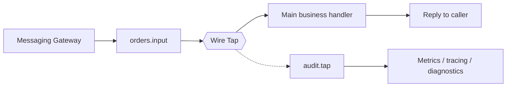
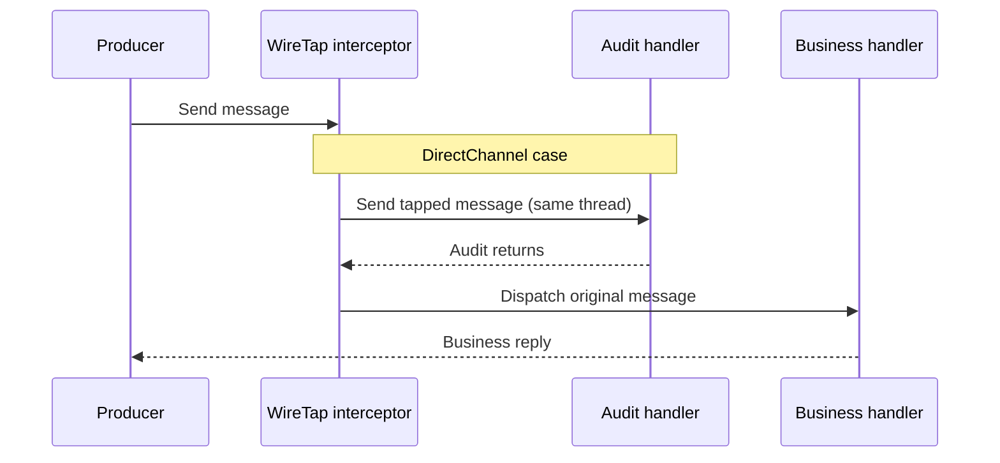
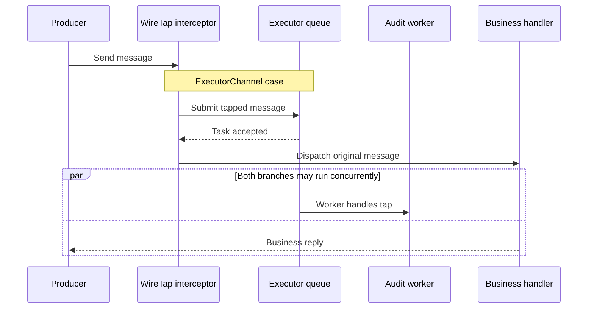

# Synchronous and Asynchronous Taps

## 1. Problem: Observing the Message Flow While Still Processing Business Logic

In a Spring Integration flow, messages may pass through a `Messaging Gateway` or `Channel Adapter`, and then be processed by a `Transformer`, `Filter`, `Router`, `Service Activator`, or other endpoints. When you need to measure latency, record traces, or inspect diagnostic information at a point in the flow, embedding observation logic directly inside each handler couples business logic to logging/metrics.

**Wire Tap** is an Enterprise Integration Pattern (EIP) for **branching off a message observation copy** as a message passes through a channel. The message continues to the business consumer, while the forwarded copy sent to the tap channel serves observation or auxiliary processing. In Spring Integration, `WireTap` is a `ChannelInterceptor`; the Java DSL supports the `wireTap(...)` operation.

You must decide between a **synchronous or asynchronous tap**. If the tap channel is a `DirectChannel` and the observation handler is slow, processing time on the main branch can increase. If the tap channel offloads work to an `ExecutorChannel`, observation typically runs on another thread, reducing direct waiting time, but raising questions about queue congestion, error handling, and data loss if the process stops.

This lesson belongs to the **Wire tap** chapter of the `SPRING_INTEGRATION_PATTERN` module: learning to implement Enterprise Integration Patterns with Spring Integration to create loosely coupled and extensible message flows, combining Router, Filter, Transformer, Splitter, Aggregator, Gateway, retry, error channel, correlation, testing, and branch monitoring.

After this lesson, you will be able to:

- Explain the placement of Wire Tap in an integration flow and compare it with `PublishSubscribeChannel`, `RecipientListRouter`, and standard logging handlers.
- Analyze differences in threading, latency, processing order, and error propagation when the tap channel is a `DirectChannel` versus an `ExecutorChannel`.
- Build Spring Integration Java DSL examples using the same business flow while changing how the tap branch executes.
- Choose backpressure strategies, limit observed data, sanitize payloads, and monitor the tap branch.
- Test effects on the main flow along with slow-handler, failure, executor-saturation, and restart scenarios.

## 2. Wire Tap Placement and Message Path

Suppose a service receives a `SubmitOrder` command. Whenever a message enters `orders.input`, the system needs to collect observation signals while still calling the order processing handler.



The diagram has two logical branches: the **main branch** for computing business results and the **tap branch** for observation. Wire Tap sends a message to a secondary channel at the configured point; it is **not responsible for generating business replies**, does not automatically make a durable copy, and does not automatically record transaction history.

### 2.1. Fundamental properties

| Property | Design implications |
| --- | --- |
| Attachment point | A channel or step in `IntegrationFlow` with an interceptor/tap attached. |
| Message | Wire Tap forwards the message for the tap consumer to observe; it does not transform the payload on its own. |
| Main branch | Still receives the message via the main channel's dispatch mechanism. |
| Tap branch | Chooses its own `MessageChannel` and handler; synchronous/asynchronous behavior depends on the channel type and executor. |
| Timing | Tap observes the message **at the point it passes through the channel**; it is not automatically proof that downstream business processing succeeded. |
| Delivery | No durable/exactly-once guarantee comes simply from adding Wire Tap. |
| Replies | The tap branch is typically one-way; the tap handler's result is not the response to the business gateway. |

**Key distinction:** `DirectChannel` delivers to a single subscriber according to its dispatch policy. Wire Tap is an interceptor that creates an auxiliary observation path; it does not merely add a second subscriber and hope both receive the message. If you want to fan out to multiple peer branches under publish–subscribe semantics, consider `PublishSubscribeChannel` or an appropriate router.

### 2.2. A tap is not "after successful commit"

If Wire Tap is attached before the order-processing handler, the tap branch may record `OrderSubmitted` **before** the handler calls the DB and commits. If the handler fails or the transaction rolls back, the tap signal may still have been sent and observed. Therefore, name events semantically: `order-request-received` differs from `order-committed`.

A system requiring compliance auditing or guaranteed business events must use mechanisms tied closely to the commit (such as writing the audit record in the same DB transaction or a **transactional outbox**) rather than inferring that a sent tap means the transaction completed.

## 3. Synchronous vs. Asynchronous: The Difference Lies in the Target Channel

**Wire Tap is invoked at the message-send boundary; whether the tap branch runs synchronously or asynchronously depends primarily on the target channel and its dispatch mechanism.** The word "tap" itself does not specify a threading model.

| Criterion | Tap to `DirectChannel` | Tap to `ExecutorChannel` |
| --- | --- | --- |
| Dispatch mechanism | The tap handler typically runs immediately on the sending thread. | The tap handler is handed to a `TaskExecutor` to run on another thread once accepted by the executor. |
| Main-path latency | May include the full execution time of the tap handler. | Typically incurs enqueue/dispatch cost; can still be impacted when the executor is overloaded. |
| Relative ordering | The synchronous tap handler completes before the send call proceeds past the interception point. | The tap handler may finish before or after main processing; do not assume completion order. |
| Exceptions | Errors on the tap branch occur on the synchronous send path; exact impact depends on the interceptor/channel error handling mechanism. | Errors on worker threads must be observed via the executor's or adapter's error handling and logging/metrics; they may not propagate directly to the caller. |
| Thread-bound context | Can share the same thread-bound context if staying on the same thread. | `ThreadLocal`, MDC, and transactions do not automatically transfer to the new thread. |
| Durability | Not guaranteed by `DirectChannel` alone. | An in-memory task queue is not a durable queue. |
| Suitability | Very fast checks or observations, or intentional immediate coupling. | Metrics, trace enrichment, auxiliary logging that should not block business logic. |

`ExecutorChannel` does not mean "never blocks". An executor with a bounded queue can reject tasks when full; a policy like `CallerRunsPolicy` can execute the handler directly on the caller thread under saturation. When the audit sink is slow, even an async tap can exert pressure on CPU, RAM, threads, and wait times.

### 3.1. Comparison by timeline





These timelines illustrate typical flows and do not replace testing behavior for your specific framework version, channel configuration, and error policies. In particular, if auditing is executed by multiple workers, consecutive messages may finish **out of receipt order**.

## 4. Java DSL Example: Synchronous Tap with DirectChannel

This example uses Java 17+, Spring Boot 3.x, and Spring Integration 6.x. A `Messaging Gateway` receives an order ID; the main branch returns `ACCEPTED:...`, while the tap branch simply increments an observation counter. Simple counting keeps the focus on the difference between the two channel types; real systems can replace it with Micrometer, a trace exporter, or a sink with sensitive-data controls.

### 4.1. Business component and observation counter

```java
import java.util.concurrent.atomic.AtomicLong;

import org.springframework.stereotype.Component;
import org.springframework.stereotype.Service;

@Service
public class OrderService {
    public String accept(String orderId) {
        if (orderId == null || orderId.isBlank()) {
            throw new IllegalArgumentException("Order ID must not be blank");
        }
        return "ACCEPTED:" + orderId.trim();
    }
}

@Component
public class TapObserver {
    private final AtomicLong observed = new AtomicLong();

    public void onTap(String orderId) {
        // Count events only; do not log order IDs/PII in this example.
        observed.incrementAndGet();
    }

    public long observedCount() {
        return observed.get();
    }
}
```

`TapObserver` uses `AtomicLong` so the counter remains thread-safe when switching the channel to a multithreaded executor. It demonstrates an observation signal, **not a durable audit log**. Because both classes in the snippet are `public`, place `OrderService` and `TapObserver` in separate Java files when putting them into a project.

### 4.2. Declaring channels and two independent flows

```java
import org.springframework.context.annotation.Bean;
import org.springframework.context.annotation.Configuration;
import org.springframework.integration.annotation.IntegrationComponentScan;
import org.springframework.integration.channel.DirectChannel;
import org.springframework.integration.config.EnableIntegration;
import org.springframework.integration.dsl.IntegrationFlow;
import org.springframework.messaging.MessageChannel;

@Configuration
@EnableIntegration
@IntegrationComponentScan
public class WireTapConfiguration {

    @Bean("orders.input")
    MessageChannel ordersInput() {
        return new DirectChannel();
    }

    @Bean("audit.tap")
    MessageChannel auditTap() {
        return new DirectChannel();
    }

    @Bean
    IntegrationFlow orderFlow(OrderService orders) {
        return IntegrationFlow.from("orders.input")
                .wireTap("audit.tap")
                .handle(String.class,
                        (orderId, headers) -> orders.accept(orderId))
                .get();
    }

    @Bean
    IntegrationFlow auditFlow(TapObserver observer) {
        return IntegrationFlow.from("audit.tap")
                .handle(String.class, (orderId, headers) -> {
                    observer.onTap(orderId);
                    return null; // One-way observation branch.
                })
                .get();
    }
}
```

`.wireTap("audit.tap")` attaches the tap at the specified position in `orderFlow`. In this example, `orders.input` is declared as a `DirectChannel`, and `audit.tap` is also a `DirectChannel`. When a message enters the flow, the tap branch runs synchronously according to the channel's dispatch behavior; the main branch proceeds to call `OrderService.accept(...)`.

`auditFlow` is designed **not to return a reply**. Do not send observation results back to the business gateway, because a single business message must not have two branches competing to send replies.

### 4.3. Gateway to verify behavior

```java
import org.springframework.integration.annotation.Gateway;
import org.springframework.integration.annotation.MessagingGateway;

@MessagingGateway(defaultRequestChannel = "orders.input")
public interface OrdersGateway {

    @Gateway(replyTimeout = "3000")
    String submit(String orderId);
}
```

With `submit(" ORD-42 ")`, the main handler returns `ACCEPTED:ORD-42`; the tap counter increments for the message passing the interceptor point. Because the tap is synchronous, the duration of `TapObserver.onTap(...)` typically sits on the send path before the gateway call completes.

If `onTap` is replaced with a REST call or blocking I/O logging taking 2 seconds, the main processing path may be prolonged accordingly. This is a **performance impact** to account for as soon as you choose `DirectChannel`.

## 5. Asynchronous Variant: ExecutorChannel + Thread Pool

Keep `orderFlow`, `auditFlow`, and `OrdersGateway` from section 4 unchanged. Only **replace the `audit.tap` bean** with an `ExecutorChannel` using a dedicated executor to isolate observation resources. Do not declare two beans named `audit.tap` simultaneously in the same application context.

```java
import org.springframework.context.annotation.Bean;
import org.springframework.integration.channel.ExecutorChannel;
import org.springframework.messaging.MessageChannel;
import org.springframework.scheduling.concurrent.ThreadPoolTaskExecutor;

@Bean("auditExecutor")
ThreadPoolTaskExecutor auditExecutor() {
    ThreadPoolTaskExecutor executor = new ThreadPoolTaskExecutor();
    executor.setCorePoolSize(2);
    executor.setMaxPoolSize(4);
    executor.setQueueCapacity(200);
    executor.setThreadNamePrefix("audit-tap-");
    return executor;
}

@Bean("audit.tap")
MessageChannel auditTap(ThreadPoolTaskExecutor auditExecutor) {
    return new ExecutorChannel(auditExecutor);
}
```

The snippet above consists of **replacement bean methods** placed inside the `@Configuration` class, not a standalone Java file that compiles without a class wrapper. Spring manages initialization and shutdown of `ThreadPoolTaskExecutor` according to bean lifecycle. In an application with multiple `ThreadPoolTaskExecutor` beans, use `@Qualifier("auditExecutor")` to select the right bean.

How it operates:

1. A message arrives at `orders.input` and Wire Tap sends the observation request to `audit.tap`.
2. `ExecutorChannel` hands off the work to the executor, typically returning once the task is accepted.
3. The main branch continues processing and creates the reply; an audit worker runs `TapObserver.onTap` on another thread.
4. The tap branch may finish **after** the business reply. If the process dies before the worker runs, observation data still in the in-memory queue may be lost.

**Never use an unbounded executor without measuring traffic.** Pool size, queue capacity, audit processing duration, full-queue behavior, and load limits must be designed around real demand. A dedicated pool for the tap prevents the observation branch from exhausting business threads, though it can still contend for CPU, memory, and network connections.

### 5.1. Policies when the executor saturates

| Scenario | Possible impact | Mitigation approach |
| --- | --- | --- |
| Slow task processing, queue still has space | Auditing is delayed; pending messages grow. | Monitor queue depth, task age, latency, and sink health. |
| Executor out of threads and queue full | Tasks may be rejected, returning errors on submit or triggering a rejection policy. | Choose a rejection policy and test the error path; do not assume silent drops. |
| `CallerRunsPolicy` | The caller may execute the audit task when the pool is full. | Easily introduces large latency spikes into the business path despite being called an "async" tap. |
| Restart/crash while queue holds tasks | Unprocessed work in memory is lost. | For mandatory auditing, use an outbox or durable broker. |
| Multiple audit workers | Messages may be processed/completed out of receipt order. | Choose a serial worker or key-based partitioning if ordering matters. |

The tap branch does not automatically have backpressure independent of the main branch. A policy that drops **non-critical diagnostic metrics** may be appropriate, provided drop counts are measured; never apply that approach to mandatory audit obligations.

### 5.2. QueueChannel: another option to decouple execution timing

Instead of `ExecutorChannel`, you can send tapped messages to a `QueueChannel` and consume them with a poller. Messages are buffered and processed periodically. However, `QueueChannel` defaults to in-memory storage, requires a consumer poller, and needs controlled full-queue behavior.

```text
WireTap
  -> audit.tap (QueueChannel, bounded capacity)
      -> polling auditFlow
          -> metrics / tracing sink
```

Do not treat `QueueChannel` or `ExecutorChannel` as persisted messages. If the tap serves as a source of durable business events, a truly durable resource is required.

## 6. Latency, Ordering, and Observation Semantics

### 6.1. Response time

For `DirectChannel`, an approximation to understand the impact is:

```text
T_request ≈ T_upstream + T_tap_sync + T_business + T_reply
```

For `ExecutorChannel` when unsaturated:

```text
T_request ≈ T_upstream + T_submit_tap + T_business + T_reply
T_audit   ≈ T_wait_executor_queue + T_audit_handler
```

These expressions are for analysis only, not runtime guarantees. CPU contention, GC, locks, I/O, and rejection policies can increase `T_request` even when the tap is async. In particular, a gateway with `replyTimeout` may still wait on a blocked synchronous handler, and **`replyTimeout` does not automatically interrupt** I/O running on that same thread.

### 6.2. Do not infer business order from log order

With a synchronous tap placed before a handler, the event "message passed input channel" can be logged before business processing. That **does not mean the order has committed**.

With an asynchronous tap, message A may finish main processing before audit A is recorded; audit for message B may even finish before audit A if the executor has multiple workers. Therefore:

- Use source identifiers such as `eventId` or `correlationId` to correlate logs/traces; do not rely solely on timestamps or arrival order.
- Explicitly label observed events as `received`, `validated`, `attempted`, or `committed`.
- When strict per-aggregate ordering is required, use partition/key ordering or a flow with explicit ordering rules; Wire Tap does not guarantee global ordering.

### 6.3. Headers, MDC, and mutable payloads

Wire Tap forwards the message at its attachment point; the message carries its payload and headers such as `correlationId`, `replyChannel`, `errorChannel`, or tracing metadata. For standard handlers, the tap branch can read headers to stay linked with the main flow.

However:

- `MessageHeaders` is designed to be immutable, but **the payload may be a mutable object**. Forwarding a message to a tap does not deep-copy the object graph by default. Never mutate shared payloads from an audit handler.
- `MDC`, security context, and other `ThreadLocal` values **do not automatically propagate** from the sender thread to an executor thread. If trace context is needed, use a propagation mechanism configured on the executor/instrumentation.
- Do not log all headers unconditionally: they may contain internal data, `replyChannel` objects, or sensitive metadata.
- If a Transformer before/after the tap point creates a new message, the observed values are a **logical snapshot at the tap location**, not every state of the message across the entire pipeline.

## 7. Error Handling: Should Tap Errors Affect Business Logic?

Never assume by default that the tap branch is always safe or shares the exact same semantics as the main branch. Exception propagation depends on where errors are caught, `ChannelInterceptor`, channel type, error handler, and framework version. With `DirectChannel`, the tap handler runs on the synchronous send path and a slow failure can directly affect latency; with `ExecutorChannel`, worker exceptions typically need handling in the async infrastructure because the caller has already moved on.

**The error policy must depend on the tap's purpose:**

| Purpose | Tolerance for lost records | Appropriate policy |
| --- | --- | --- |
| Auxiliary metrics, debugging samples | Acceptable if drop counts are measured. | Prioritize main flow; bound queues, sample, and alert on broken sinks. |
| Traces for investigation | Minimize loss, though sampling/retention may apply. | Attach correlation and trace context; monitor export failures and queue backlog. |
| Mandatory business auditing | Zero tolerance for losing compliance records. | Write in the same DB transaction or use a transactional outbox/durable broker. |
| Events used to trigger other business actions | Must not be treated as arbitrary diagnostic copies. | Use an event publication/delivery pattern with retries, idempotency, and DLQ. |

### 7.1. Why `try/catch` and logging alone may not be enough

Suppose the tap branch calls an audit service over HTTP. If that service fails and the handler only logs the error, the business caller may still succeed. That can be **right** for optional metrics, yet **wrong** for mandatory auditing. Conversely, forcing the main flow to fail whenever a metrics exporter fails lets an auxiliary fault cause cascading outages.

Document the contract explicitly: which events require guaranteed delivery and which are best-effort; when sending fails, whether to drop, retry, buffer, or fail; and whether tap processing is allowed to affect the main outcome.

### 7.2. Error channel and transactions

In Spring Integration, `errorChannel` receives `ErrorMessage` instances when an appropriate error-publishing mechanism is configured. Not every exception from every endpoint is automatically routed to a single global error channel. On synchronous paths, errors can propagate directly to the caller/listener; with executors, errors can be handled asynchronously via other mechanisms.

Wire Tap does not make:

- A JDBC transaction on the main branch cover a task running later on an executor thread.
- An inbound adapter's JMS/Kafka acknowledgment wait for async auditing to complete.
- Publishing to an audit sink and committing business data part of one atomic transaction.
- Sending a message to a tap replayable after a crash if the queue is only in memory.

If the goal is **"audit only when the DB commit succeeds"**, one solution is writing an audit/outbox record **in the same DB transaction** as the business update; a relay can publish afterward, and the audit consumer must be idempotent if the relay redelivers. Wire Tap is useful for observation, not as a substitute for atomic commits across multiple resources.

## 8. Choosing Tap Placement and Avoiding Loops

### 8.1. Tap before or after a Transformer?

An order ID from a gateway might pass through a `Transformer` for normalization, and then a `Filter` for validation:

```text
orders.input
   -> WireTap A: observe incoming request
   -> Transformer: trim / normalize
   -> Filter: validate
   -> WireTap B: observe valid message
   -> Business handler
```

**Tap A** may see messages that are later rejected; **Tap B** only sees messages that actually reach the point after validation. In a real system, exact placement must be defined per flow/channel and verified by tests. If you need to know whether business state committed, neither A nor B is sufficient when placed before the commit.

### 8.2. Never tap the tap channel itself

A misconfiguration can create a loop:

```text
main.channel --WireTap--> audit.tap
audit.tap    --WireTap--> main.channel
```

Messages can then multiply infinitely, loop on the same thread, or cause queues to explode. Avoid overly broad interceptor patterns that match observation channels too. When configuring global channel interceptors, specify exact patterns and exclude audit, error, and DLQ channels as needed.

### 8.3. Responsible filtering and sampling

Not every message needs full-payload logging. You can choose to tap only high-level events, collect metadata only, or sample according to rate/trace policies. Spring Integration provides `MessageSelector` and interceptor configuration options; filter choices must match your version and flow contract.

Never use sampling to drop events that are mandatory to record. For metrics/tracing, measure both sampling/drop rates and correlation consistency to avoid misreading dashboards.

## 9. Testing Synchronous, Asynchronous, and Error Scenarios

A test that only checks `auditFlow` ran at least once is not enough. You must prove **the business path remains correct** and that tap behavior is understood when switching channel types.

### 9.1. Synchronous test with DirectChannel and WireTap

You can test at the messaging layer with JUnit 5 without starting the full application:

```java
import java.util.ArrayList;
import java.util.List;

import org.junit.jupiter.api.Test;
import org.springframework.integration.channel.DirectChannel;
import org.springframework.integration.channel.interceptor.WireTap;
import org.springframework.messaging.support.MessageBuilder;

import static org.junit.jupiter.api.Assertions.assertEquals;

class SynchronousWireTapTest {

    @Test
    void directTapObservesMessageBeforeBusinessHandler() {
        DirectChannel main = new DirectChannel();
        DirectChannel tap = new DirectChannel();
        List<String> sequence = new ArrayList<>();

        tap.subscribe(message -> sequence.add("tap"));
        main.addInterceptor(new WireTap(tap));
        main.subscribe(message -> sequence.add("business"));

        main.send(MessageBuilder.withPayload("ORD-42").build());

        assertEquals(List.of("tap", "business"), sequence);
    }
}
```

This test verifies the synchronous dispatch path of `DirectChannel` at the interceptor point. It does not prove DB commits, does not measure production latency, and does not verify the async variant's behavior. When applying in real projects, pay attention to API/configuration differences across Spring Integration versions.

### 9.2. Asynchronous tests using latches, not sleep guesswork

For `ExecutorChannel`, a reliable testing technique uses `CountDownLatch`:

- The tap handler signals `started.countDown()` and waits on a `release` latch before finishing.
- Send a message into the main flow and confirm the business branch can complete while the tap worker is still waiting.
- Then call `release.countDown()` and wait on `tapDone.await(...)` with a finite timeout to avoid hanging tests.
- Check thread names/identities if the goal is to prove execution on a different thread.
- Run additional tests with a small executor queue and specific rejection policy to see how saturation affects the send/caller.

**Do not use `Thread.sleep(...)` and infer that async works**: scheduling varies across machines and makes tests flaky. Also use finite timeouts and shut down the executor when tests finish.

### 9.3. Test scenario matrix

| Scenario | Execution path | Expected assertion |
| --- | --- | --- |
| Fast tap | DirectChannel | Tap observes the message and business still returns the right reply. |
| Intentionally slow tap | DirectChannel | Main send-path latency is impacted, measured with controlled timing. |
| Fast tap | ExecutorChannel | Business returns reply independently of tap handler completion while executor is healthy. |
| Blocked tap | ExecutorChannel | Tap task may still be running after business finishes; do not infer audit success from reply. |
| Saturated executor | Bounded-queue ExecutorChannel | Rejection/backpressure behaves per configured policy and alert metrics increment. |
| Tap handler throws exception | Both variants | Error path is recorded accurately; verify whether business is affected or isolated per contract. |
| Business handler fails | Both variants | Early-flow tap signal may already have been sent; do not label it "committed". |
| Mutable payload | Both variants | Tap branch does not alter data received by the business handler. |
| Correlation header | Both variants | Expected correlation data is passed through; async MDC propagates properly if required. |
| Crash while tap queue holds tasks | ExecutorChannel | Recognize risk of losing in-memory observations; use outbox if durable audit is required. |
| Overly broad tap | Global interception | No loop or uncontrolled audit duplication occurs. |
| Multiple consecutive messages | Multi-worker executor | Do not expect audit completion order; if ordering is needed, test a dedicated policy. |

## 10. Operational Observability and Safe Optimization

The Wire Tap branch itself also needs to be observed. Useful metrics include:

- Number of messages passing the tap point, messages successfully sent to the tap channel, and failed/dropped sends (with appropriate instrumentation).
- Tap processing latency and error rate of the observation sink.
- `active threads`, queue depth, queue wait time, rejected task count, and drain time of `auditExecutor`.
- End-to-end latency of business requests before/after enabling the tap, especially p95/p99.
- Sampling rate, log volume generated, and storage/export cost.
- Percentage of tapped messages with complete trace/correlation; avoid putting per-message IDs into metric labels that cause high cardinality.

**Data protection:** restrict copying PII, auth tokens, payment info, or sensitive content into taps. Prefer logging only event type, outcome, latency, and permitted IDs; apply appropriate masking/redaction before exporting to logs, tracing, or third-party systems.

**Do not let observation become a bottleneck:** if the audit sink makes network calls or slow storage writes, avoid executing them directly on the `DirectChannel` of critical requests. Use a bounded executor, suitable batching/exporters, intentional sampling, and measure failed/dropped observations.

## 11. Checklist for Choosing a Tap Mode per Goal

Before finalizing a Spring Integration flow with Wire Tap, answer:

1. **Purpose:** does the tap serve diagnostics/metrics, tracing, or mandatory business auditing?
2. **Placement:** before/after which step is the tap attached; does the observed event mean `received`, `validated`, or `committed`?
3. **Synchronicity:** is the tap channel Direct, Executor, Queue, or an outbound adapter? How do threads and latency change?
4. **Tap errors:** if the sink fails or the queue fills up, can the main path continue; who handles/monitors incidents?
5. **Backpressure:** does the executor have bounded pool/queue sizes, a rejection policy, alerts, and capacity planning?
6. **Data:** are sensitive payloads masked, full-header dumps avoided, and mutable payloads left untouched?
7. **Correlation:** are message IDs and tracing context propagated properly across new threads?
8. **Ordering:** is ordering required across multiple workers; is sequencing/partitioning needed?
9. **Transaction/durability:** if post-commit proof is required, are appropriate storage/transaction/outbox mechanisms used?
10. **Testing:** have slowness, failures, overload, crashes, replies, and concurrency been tested without arbitrary sleeps?

**Synchronous Wire Tap** fits a very fast observation branch or an auxiliary step that must intentionally run on the send path. **Asynchronous Wire Tap** is better when observation latency must be isolated from the business path, provided thread pools, queues, error handling, and unpersisted task loss risks are controlled. In both cases, Wire Tap is a fork for seeing messages—not a guarantee that downstream processing succeeded or was durably saved.
