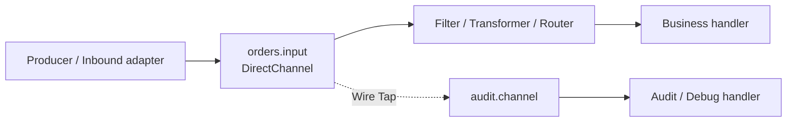
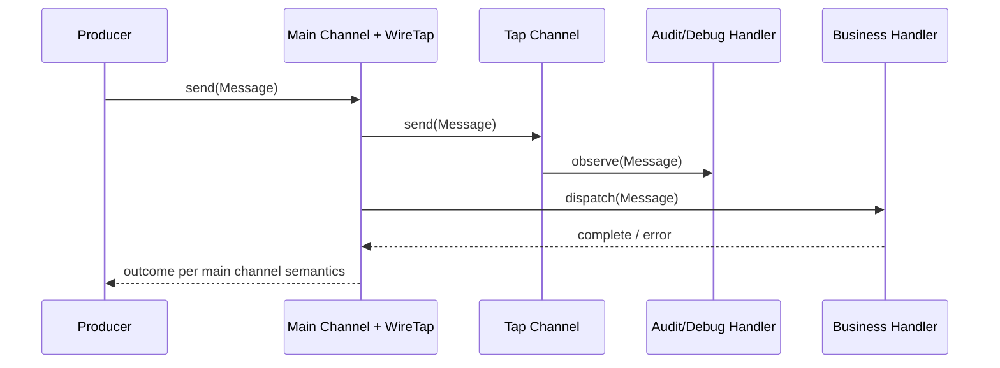
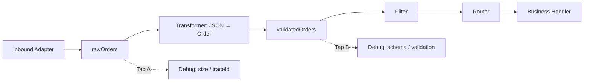
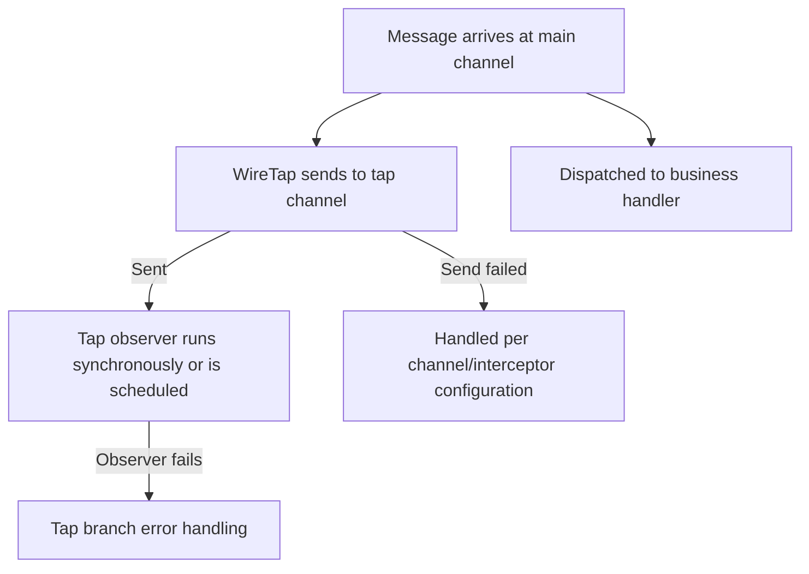
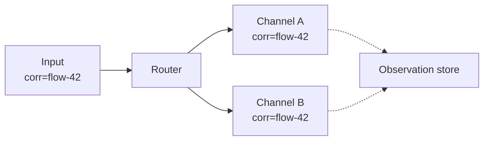

# Wire Tap for Auditing or Debugging in Spring Integration

## 1. What Need Does Wire Tap Solve?

In an integration flow, messages typically pass through multiple stages: receiving data from an adapter, filtering, transforming, routing, and then invoking business logic. When an order loses information, gets routed to the wrong branch, or throws an error, operators need to know **where the message traveled and what metadata it carried at that moment**. Inserting log statements directly into every handler mixes business processing with observation and makes changes harder.

**Wire Tap** is an Enterprise Integration Pattern that allows **observing a forwarded copy of a message** as it passes through a channel. In Spring Integration, you can attach `WireTap` as a `ChannelInterceptor` on the source channel; the interceptor sends the message to a separate **tap channel** for logging, metrics, investigation, or audit recording. The message continues along its **main flow**.



The lesson **"Wire Tap for Auditing or Debugging"** belongs to the **Wire tap** chapter of the **SPRING_INTEGRATION_PATTERN** module. This topic complements Router, Filter, Transformer, Splitter, Aggregator, Gateway, retry, error channel, and correlation techniques: we can observe messages as they cross key boundaries without duplicating monitoring logic in every endpoint.

### Learning objectives

After this lesson, you will be able to:

- Explain what Wire Tap is, where it observes messages, and how the tap branch relates to the main flow.
- Configure `WireTap` on a `DirectChannel` using Java Configuration and handle the observation with `@ServiceActivator`.
- Distinguish **debugging/observability** from **business auditing with reliability requirements**.
- Design log fields, correlation IDs, sensitive-data redaction rules, and audit retention.
- Evaluate performance, blocking, error, and delivery impacts of the tap channel.
- Test that messages on the main flow still reach their target destination and that the tap branch receives the expected information.

## 2. How Wire Tap Works

### 2.1. Forwarding messages to an observation channel

When using `WireTap` as a channel interceptor, as a producer calls `send(message)` to a tapped channel:

1. The interceptor gets an opportunity to observe the message during the channel send, typically in the `preSend` phase.
2. Wire Tap sends the message to its configured **tap channel**.
3. The original channel continues dispatching the message to the main-flow handler.
4. The tap channel's handler can log metadata, compute metrics, or forward data to an audit system.



The diagram illustrates a **synchronous tap channel** such as `DirectChannel`. With asynchronous or queue-backed channels, processing on the tap branch may occur later; never assume both branches always finish in the order shown in the diagram.

**Important:** "Copying a message" here means **creating a forwarding branch**, not that Spring Integration always deep-copies the entire payload. `Message<?>` has an essentially immutable envelope, but the payload or objects inside headers may be mutable objects. If both consumers mutate the same mutable object, they can interfere with each other.

### 2.2. Where should Wire Tap be placed?

The tap placement determines what data is visible:

| Tap placement | Can observe | Does not prove by itself |
| --- | --- | --- |
| On the input channel | Message reached the entry point, initial payload and headers | Business logic processed successfully |
| After a Transformer | Data after transformations prior to the tap | Data will be persisted successfully |
| Before a Router | Information used as the routing basis | Downstream branch completed |
| After a business step | Message passed the channel after that step, if the flow emits one | Entire cross-service workflow committed |
| On an error flow | `ErrorMessage` and error metadata entered the error branch | Retry succeeded or full recovery occurred |

Because Wire Tap observes **messages on a channel**, seeing a message there generally confirms only that it reached **that observation point**. If you want to audit a *successful payment*, record the **actual success event** from the component that knows the outcome—do not infer it from a payment message passing through the input channel.

### 2.3. Comparison with other EIP endpoints

| Component | Question it answers | Purpose |
| --- | --- | --- |
| **Wire Tap** | "Did this message pass through here?" | Sends the message to an observation branch alongside the main flow |
| **Filter** | "Is this message allowed to proceed?" | Blocks or passes messages based on a condition |
| **Transformer** | "What form should the payload change into?" | Converts data and/or headers |
| **Router** | "Which branch should this message go to?" | Routes conditionally |
| **Bridge** | "How to connect two compatible channels?" | Forwards between channels without changing business logic |
| **Gateway** | "How to send a request and get a response?" | Request–reply communication |

Wire Tap typically plays an **auxiliary observation** role and does not replace endpoints that decide flow behavior.

## 3. Auditing and Debugging Do Not Share the Same Contract

A tap channel can serve multiple purposes, but the requirements for **debugging** and **auditing** differ significantly.

| Criterion | Debug / observability | Business audit |
| --- | --- | --- |
| Goal | Investigate, root-cause errors, trace paths | Answer who did what, when, and with what outcome |
| Data | Technical metadata, safe payload samples, trace IDs | Structured event records with verified provenance |
| Completeness | Sampling or log throttling allowed under high load | Must explicitly define which events are mandatory to record |
| Failures | Usually prioritizes keeping the business flow running | Needs an explicit handling policy when auditing fails |
| Retention | Short, based on troubleshooting needs | Follows business, legal, and security policies |
| Traceability | Message ID, correlation ID, span/trace ID | Actor, action, entity, outcome, timestamp, correlation |
| Reliability | Losing some observations may be acceptable depending on system | Requires durable, consistent, and verifiable design |

**Wire Tap is a collection point**, not an audit system with built-in storage guarantees. If an audit record must exist corresponding to a transaction, add a consistency mechanism—such as writing the audit record in the same database transaction where appropriate, or using a transactional outbox for reliable event publication.

### Example of two different meanings

- Debug branch logs: "Message `ORDER-42` entered `orders.input` at 10:05".
- Success audit logs: "Account X confirmed order `ORDER-42`; status update transaction committed".

The first record only indicates **the message passed through the channel**. You cannot rename it "order succeeded" if the system has not confirmed the outcome.

## 4. Hands-On Example: WireTap Recording Metadata on Order Receipt

Suppose a Spring Boot application receives order messages via `ordersInputChannel`. The main business logic prints the order ID; the tap channel records the **message ID, correlation ID, and payload type**, avoiding logging the full payload containing sensitive information.

The example uses Java 17+ and Spring Boot dependency management within the compatible Spring Integration ecosystem.

### 4.1. Dependencies

With Maven, add:

```xml
<dependencies>
    <dependency>
        <groupId>org.springframework.boot</groupId>
        <artifactId>spring-boot-starter-integration</artifactId>
    </dependency>
</dependencies>
```

This exercise does not require a broker or database because it focuses on observing messages on an internal channel.

### 4.2. Configuring WireTap with ChannelInterceptor

Create `WireTapConfiguration.java` in a package scanned by Spring Boot:

```java
package com.example.integration;

import org.springframework.beans.factory.annotation.Qualifier;
import org.springframework.context.annotation.Bean;
import org.springframework.context.annotation.Configuration;
import org.springframework.integration.annotation.ServiceActivator;
import org.springframework.integration.channel.DirectChannel;
import org.springframework.integration.channel.interceptor.WireTap;
import org.springframework.integration.config.EnableIntegration;
import org.springframework.messaging.MessageChannel;
import org.springframework.messaging.MessageHandler;

@Configuration
@EnableIntegration
public class WireTapConfiguration {

    // Channel dedicated to observation.
    @Bean
    public MessageChannel auditChannel() {
        return new DirectChannel();
    }

    // Attach WireTap to the channel entering the business flow.
    @Bean
    public MessageChannel ordersInputChannel(
            @Qualifier("auditChannel") MessageChannel auditChannel) {

        DirectChannel input = new DirectChannel();
        input.addInterceptor(new WireTap(auditChannel));
        return input;
    }

    // The main business flow still receives messages from ordersInputChannel.
    @Bean
    @ServiceActivator(inputChannel = "ordersInputChannel")
    public MessageHandler orderHandler() {
        return message -> {
            String orderId = String.valueOf(message.getPayload());
            System.out.println("[BUSINESS] received order=" + orderId);
        };
    }

    // The tap branch records only safe metadata for investigation.
    @Bean
    @ServiceActivator(inputChannel = "auditChannel")
    public MessageHandler auditObserver() {
        return message -> System.out.printf(
            "[TAP] messageId=%s, correlationId=%s, payloadType=%s%n",
            message.getHeaders().getId(),
            message.getHeaders().get("correlationId"),
            message.getPayload().getClass().getSimpleName()
        );
    }
}
```

Add the runner class `WireTapApplication.java`:

```java
package com.example.integration;

import org.springframework.beans.factory.annotation.Qualifier;
import org.springframework.boot.CommandLineRunner;
import org.springframework.boot.SpringApplication;
import org.springframework.boot.autoconfigure.SpringBootApplication;
import org.springframework.context.annotation.Bean;
import org.springframework.messaging.MessageChannel;
import org.springframework.messaging.support.MessageBuilder;

@SpringBootApplication
public class WireTapApplication {

    public static void main(String[] args) {
        SpringApplication.run(WireTapApplication.class, args);
    }

    @Bean
    public CommandLineRunner sendSample(
            @Qualifier("ordersInputChannel") MessageChannel channel) {
        return args -> {
            boolean accepted = channel.send(
                MessageBuilder.withPayload("ORDER-1001")
                    .setHeader("correlationId", "trace-1001")
                    .build()
            );

            System.out.println("[PRODUCER] accepted=" + accepted);
        };
    }
}
```

Start the application via `mvn spring-boot:run` in a Maven project configured with Spring Boot, or run the main class from your IDE.

The logs may look like:

```text
[TAP] messageId=<uuid>, correlationId=trace-1001, payloadType=String
[BUSINESS] received order=ORDER-1001
[PRODUCER] accepted=true
```

The example uses two `DirectChannel`s, so the tap observer and main handler are invoked synchronously on the send path. Observed log order depends on interceptors, schedulers, and actual configuration; never treat log ordering as a business protocol.

### 4.3. Role of each component

- `ordersInputChannel` is the main channel where the producer sends messages and the business handler receives them.
- `new WireTap(auditChannel)` creates an interceptor that forwards messages to the observation branch when they pass through the source channel.
- `auditChannel` is a separate channel; the business handler does not manually call an audit method.
- `@ServiceActivator(inputChannel = "auditChannel")` registers the observer. In this example, the observer only logs metadata and does not print order contents.
- The `correlationId` header is set by the producer to link logs. `MessageHeaders.getId()` is the technical ID of the message, distinct from the business order key.

Observing a message via a tap proves it **reached the monitored channel**; it does not prove it was committed in a database, sent to another broker, or completely processed.

## 5. Tap Placement and Selecting Observed Data

Suppose a flow moves an order through these steps:



**Tap A** helps identify whether the initial message arrived at the application. **Tap B** shows that after the Transformer, a message reached the transformed-data channel. If you want to know which branch the Router actually chose, place observation on the branch output channels or use router metrics/tracing.

Avoid attaching taps indiscriminately to every channel and logging full payloads. Doing so creates extra traffic, makes querying harder, can duplicate records, and exposes unnecessary data.

### 5.1. Fields to consider recording

A technical observation record may include:

| Field | Meaning |
| --- | --- |
| `messageId` | Spring Messaging identifier of the observed message |
| `correlationId` | Links messages across a business flow or request |
| `traceId` / `spanId` | Links with a distributed tracing system if present |
| `channel` or `stage` | Observation point, e.g., `orders.input` |
| `eventTime` | Timestamp recorded by the observer |
| `eventType` | Event category, e.g., `OrderReceived` |
| `payloadType` / `payloadSize` | Type or size for debugging without exposing contents |
| `outcome` | Record only if the event-emitting component truly knows the result |

These fields must be **taken from an authoritative source**. If a message lacks `correlationId`, do not assume it is always present; set it at the appropriate boundary. If using `messageId` for tracing, understand that endpoints may create new messages with new IDs during transformations.

### 5.2. Minimizing sensitive data

Do not print raw payloads by default, especially for personal data, payment details, tokens, passwords, session IDs, or security-sensitive fields. A safer approach is selecting approved fields or logging masked values:

```java
String correlation = String.valueOf(
    message.getHeaders().getOrDefault("correlationId", "unknown")
);
String payloadType = message.getPayload().getClass().getSimpleName();

logger.info("tap channel={} correlationId={} payloadType={}",
        "orders.input", correlation, payloadType);
```

The snippet illustrates **recording metadata**, assuming `message` and `logger` are already in scope. When auditing is required, use a dedicated DTO with an explicit schema instead of persisting the entire `Message<?>` to long-term storage.

## 6. Can Wire Tap Slow Down or Break the Main Flow?

**Yes, it can.** This is the most important design risk when adding a monitoring branch.

In the example above, `auditChannel` is a `DirectChannel`: the tap observer typically executes **synchronously** inside the forwarding call from the interceptor. If the observer writes slowly to a database, makes a slow HTTP call, or throws an unhandled exception, the send duration or error behavior of the main flow can be impacted.

| Tap channel type | Typical impact | Must be controlled |
| --- | --- | --- |
| `DirectChannel` | Observer usually runs synchronously on the send path | Execution time, exceptions, slow I/O |
| `ExecutorChannel` | Hands work to an executor; observer may run on another thread | Pool/queue sizing, task rejection, error handling |
| `QueueChannel` | Enqueues messages for a consumer to poll later | Capacity, poller, backlog, full queue, data loss on restart |
| Durable broker or store | Can decouple and store messages out-of-process | Send confirms, retries, duplicates, transactions, operational policy |

**No option automatically guarantees "zero impact on the main flow".** Even with `ExecutorChannel`, task submission can be rejected when the executor is full; sending to `QueueChannel` can also hit capacity limits. Define how the application responds when the tap branch is slow or unavailable.

### 6.1. Designing for best-effort debugging

If losing a few debug log lines is acceptable:

1. Limit the message types and fields collected.
2. Choose an observation branch with clear resource bounds.
3. Have a strategy when the observation branch is overloaded: reduce sampling, drop debug logs, or route into a dedicated observability pipeline.
4. Measure dropped events, latency, and tap errors.

Sampling or drop policies must be intentional and never applied accidentally to mandatory audit records.

### 6.2. Designing for mandatory auditing

If audit records must never be lost, ask:

- Where is an audit record considered **accepted**: memory queue, local database, broker, or audit store?
- Must the audit record and the business change commit together?
- What will the system do when the audit store is temporarily unavailable?
- How do you deduplicate when a producer resends a message or a consumer reprocesses it?
- Can every record be traced by correlation ID and business key?

In many systems, the solution is **producing a business audit event after the outcome is determined**, then writing it in the same transaction or using a **transactional outbox** to publish events. Wire Tap can still help trace message travel, but should not be assigned guarantees it is not configured to provide.

## 7. Errors, Retries, and Error Channels

A Wire Tap branch can fail independently from a business perspective, but **how errors propagate** depends on the target channel, executor, and where errors are caught.



The diagram separates responsibilities for analysis; with a **synchronous** tap, failures at B or C can affect whether execution reaches F. With an **asynchronous** tap, errors may surface only after the main send flow has finished and require a dedicated error-reporting path.

### 7.1. Retries can create duplicate observations

For example, if an adapter re-reads a message on retry or a handler fails and reprocesses, the same business operation may pass through the tapped channel **multiple times**. Therefore:

- Debug logs may contain multiple observations with the same correlation ID.
- Audit records must distinguish an **attempt** from a **business outcome**.
- If the audit store requires business-level deduplication, define an idempotency key and deduplication strategy.

Do not rely on `messageId` alone to promise exactly-once behavior: a message can be recreated with a new ID even when representing the same business transaction.

### 7.2. An error channel does not turn a tap into reliable auditing

Spring Integration provides `errorChannel` and retry/transaction advice mechanisms, but having an error channel does not mean every tap-send failure is retried or every error returns to the caller. You must test the failure point, execution thread, and error policy of each channel/endpoint.

For debugging, dropping observations under heavy load may be acceptable; for mandatory auditing, explicitly decide whether to fail the business action or compensate when auditing cannot be recorded.

## 8. Wire Tap and Correlation in a Multi-Branch Flow

When a Router splits messages across branches or a Splitter breaks one message into multiple parts, a single business transaction can generate many technical messages. Relying solely on the current message's ID makes it hard to stitch them into one coherent story.

Recommended practices:

- Set a **correlation ID** at the start of the flow and propagate it across relevant steps.
- Use **message ID** to see where a specific message appeared.
- With Splitter/Aggregator, track correlation and sequence aligned with the aggregation strategy.
- Record **channel/stage name**, along with the outcome when confirmed by a handler, to distinguish "observed" from "processed".
- When transformations create new messages, verify which headers are preserved or recreated.



If you need to know **which branch actually executed**, place taps on each branch's channel or use endpoint metrics/tracing. A tap before the Router only confirms the message reached the Router, not the final route taken.

## 9. Other Ways to Use Wire Tap

Besides `new WireTap(auditChannel)`, Spring Integration supports declaring Wire Tap in **Java DSL** or XML. The examples below are **alternative configuration options** and should not be configured simultaneously for the same tap to avoid duplicate observations.

### 9.1. Java DSL

In a DSL flow, you can use the `wireTap` operator to send messages to an observation channel:

```java
@Bean
public IntegrationFlow ordersFlow() {
    return IntegrationFlow.from("ordersInput")
        .wireTap("auditChannel")
        .handle(message -> {
            // Business processing receives the message on the main flow.
            processOrder(message.getPayload());
        })
        .get();
}
```

The snippet illustrates the concept, assuming `auditChannel` already exists and `processOrder(...)` is an application-defined business method. Import `IntegrationFlow` from `org.springframework.integration.dsl`. For applications that already attach a `WireTap` interceptor directly on the channel, pick **one** appropriate tap configuration to avoid unintended duplicate observations.

### 9.2. XML

In projects using Spring Integration XML configuration, you can attach a wire-tap interceptor on a channel:

```xml
<int:channel id="ordersInput">
    <int:interceptors>
        <int:wire-tap channel="auditChannel"/>
    </int:interceptors>
</int:channel>

<int:channel id="auditChannel"/>
```

The example requires the `int` namespace and corresponding Spring Integration schema in a complete XML file. The handler consuming `auditChannel` must be configured separately.

### 9.3. Filtering messages to tap

Not every message needs to be tracked. For instance, in production you might observe only `OrderRejected` messages or collect metadata only at a specific stage. You can use a message selector/filter on the tap branch to limit monitoring data volume. If records are dropped by policy, verify that the policy applies to **debugging** and does not accidentally discard **mandatory audit** events.

## 10. Testing a Wire Tap Properly

Tests must verify **both branches**: the message still reaches the business handler, while the tap observer sees the expected information without accidentally mutating data.

| Scenario | Outcome to verify |
| --- | --- |
| Send a normal message | Business handler receives payload; tap observer receives expected metadata |
| Message with `correlationId` | Both branches see the same matching correlation value |
| Payload with sensitive info | Tap logs do not print forbidden data |
| Slow tap observer | Measure impact on main-flow latency with the chosen tap channel type |
| Tap observer throws exception | Verify selected error policy and actual impact on the main flow |
| Retried message | Observe tap count; distinguish attempts from outcomes |
| High load | Check backlog, executor rejections, sampling/rate limits, and metrics |
| Restart | Verify required audit data actually persists per design |

### 10.1. Measuring the right milestones

Instead of asserting only log line counts, integration tests should capture events:

1. Producer sends a message onto the tapped channel.
2. Tap observer receives the information to observe.
3. Business handler is invoked and finishes or fails.

You can use a `CountDownLatch` or a test collector to wait for events with a timeout. With an asynchronous branch, avoid assuming the tap log always appears before the business handler log.

### 10.2. What is verified, and what is not?

A test proving the tap observer received a message is not enough to prove the audit record was durably persisted. A test proving logs contain a correlation ID is not enough to prove the system properly protects sensitive data. For those requirements, separately test the audit repository, retention, access controls, idempotency, and crash/retry cases.

## 11. Common Misconceptions

**"Wire Tap never affects the main flow."** False. With a synchronous tap channel, a slow or failing observer can delay or affect the main send path. With an asynchronous channel, overload or task rejections can still occur.

**"Wire Tap deep-copies messages."** Do not assume so. The tap branch may see the same mutable payload object; mutating it can cause hard-to-trace bugs. Prefer immutable payloads and create a separate audit DTO if needed.

**"Seeing a message in the tap means business processing succeeded."** A tap on the input channel observes the **channel arrival** event. Business success must be recorded where the outcome is confirmed.

**"Logging the full payload makes debugging faster."** Excessive logging incurs cost, exposes data, and adds noise. Selective metadata paired with correlation/tracing is usually far more useful.

**"Having a message ID guarantees exactly-once auditing."** Retries, redeliveries, or message transformations can cause one business action to appear multiple times or with different IDs. Reliable auditing requires business keys, idempotency, and durable storage.

**"Reliable auditing only needs a QueueChannel."** An in-memory queue can lose data on restart. Durability, transactions, and recovery mechanisms must be designed explicitly.

## 12. Self-Check Questions

1. How does a message seen by a Wire Tap attached before a Transformer differ from a tap attached after a Transformer?
2. With a `DirectChannel` as the tap channel, what can happen if the observer writing audits to a database becomes slow?
3. Why does a message appearing in debug logs not prove the order was committed?
4. In a flow with a Splitter and Router, how would you use `correlationId` and stage names to trace execution?
5. When should you use Wire Tap to capture metadata for observability, and when do you need to add a transactional outbox or durable audit store?

**Remember:** Wire Tap lets you observe messages structurally decoupled from business logic, yet **the latency, errors, and reliability of the tap branch remain part of system design**. For debugging, prioritize minimal data and cost control; for auditing, define the event source, outcome, durability, traceability, and access permissions.

**References:** [Spring Integration Reference](https://docs.spring.io/spring-integration/reference/) — sections *Wire Tap*, *Message Channels*, and *Channel Interceptors*; [Enterprise Integration Patterns — Wire Tap](https://www.enterpriseintegrationpatterns.com/patterns/messaging/WireTap.html).
