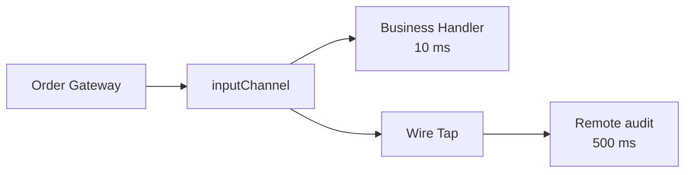
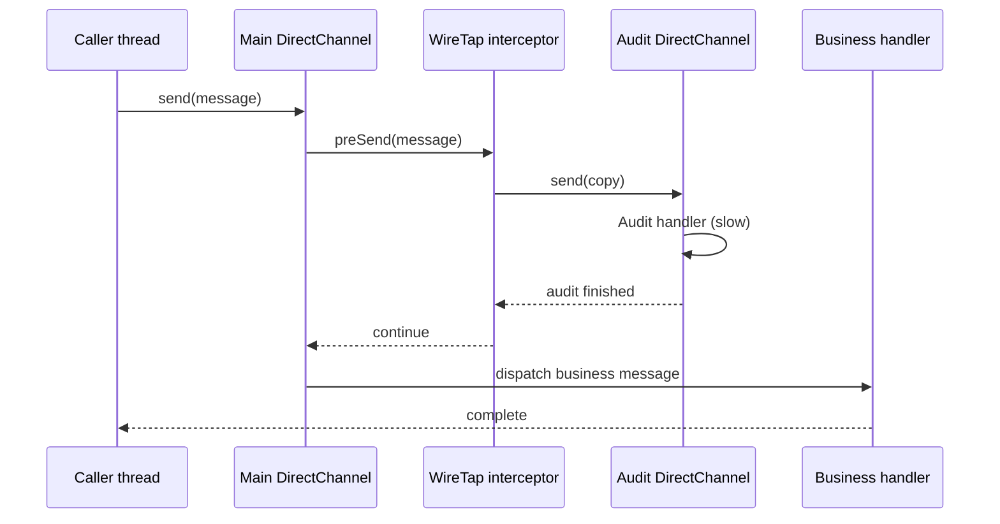
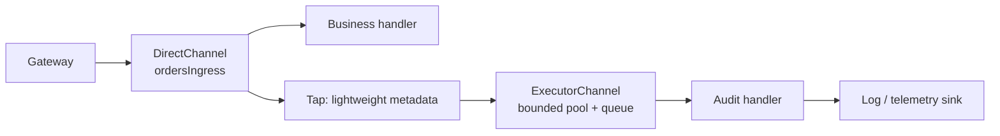
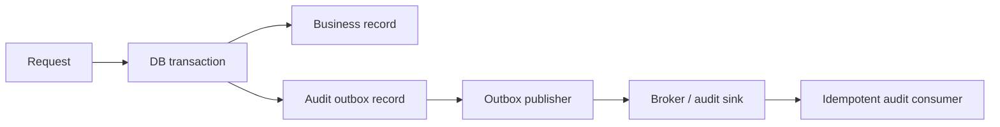
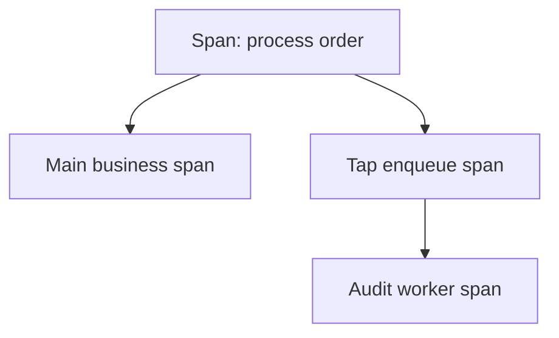

# Preventing Taps from Slowing Down the Main Flow in Spring Integration

## 1. Problem: Adding Observation Without Increasing Business Latency

In the **Wire tap** chapter of the **SPRING_INTEGRATION_PATTERN** module, we use **Enterprise Integration Patterns** with Spring Integration to connect loosely coupled, extensible, and observable message flows. Patterns such as Router, Filter, Transformer, Splitter, Aggregator, Gateway, retry, error channel, and correlation often form a processing chain. When a system needs to observe this chain, **Wire Tap** is a way to send a copy of the message to a secondary branch for auditing, logging, tracing, or metric collection.

Problems arise when the observation branch is slower than the business branch. For example, an order is validated in 10 ms, while the tap calls an audit service that takes 500 ms. If the tap runs synchronously on the sending thread, API response time can increase by hundreds of milliseconds even though the main business flow does not need to wait for auditing.



**Design requirement:** logging/observation that is less critical than the business operation must not increase tail latency or cause primary requests to fail just because the audit sink is temporarily overloaded. At the same time, if auditing is a mandatory obligation, we must guarantee durable persistence and handle errors differently instead of losing audit trails.

After this lesson, you will be able to:

1. Explain where Wire Tap runs along the message-sending path and why a tap can block the caller.
2. Use `ExecutorChannel` for the tap, bound resources, and understand behavior when the executor rejects tasks.
3. Design a **best-effort tap** with a fail-open policy, drop metrics, and minimal payloads.
4. Distinguish observability auditing from mandatory durable auditing; choose an outbox/broker when guarantees are required.
5. Test main-flow latency, fault isolation, backpressure, sampling, retries, and correlation.

## 2. Where Does Wire Tap Actually Sit?

### 2.1. Principle

Wire Tap is a pattern that copies a message so a secondary branch can observe or process it without altering the primary business path. In Spring Integration, Wire Tap is typically implemented as a **`ChannelInterceptor`**; it is invoked when a message passes through the intercepted channel.

```text
                       +--> tapChannel --> Audit / Monitoring
                       |
producer --> mainChannel +--> Main handler --> Business outcome
```

To place a tap properly, distinguish:

- **Main channel:** the channel carrying the business flow to monitor.
- **Tap interceptor:** the operation copying/forwarding the message at the channel boundary.
- **Tap channel:** the channel receiving the copy on the secondary branch.
- **Tap handler:** code doing the actual work such as logging, emitting metrics, calling HTTP, or sending to a broker.
- **Business handler:** the original business processing that still runs according to the main channel's topology.

Tap does not replace a Router, Transformer, or Service Activator. It is a supplemental observation branch; whether that branch succeeds or fails requires its own policy.

### 2.2. Attaching a tap does not mean asynchronous

Consider the case where both main and tap use `DirectChannel`:



In this topology, the tap can hold the sending thread before the business handler is even invoked. For example, if auditing takes 500 ms and business logic takes 10 ms, caller latency increases by the audit duration. If the audit handler throws an exception while sending through the channel, that error can also affect the main send path depending on the interceptor and error-handling configuration.

**Conclusion:** Wire Tap only creates a secondary branch; if that branch must not wait on heavy work, you must choose an **asynchronous execution boundary** for the tap and define how to handle overload at that boundary.

### 2.3. Three levels of "decoupling" to distinguish

| Level | What happens | Limitations |
| --- | --- | --- |
| Tap via `DirectChannel` | Audit handler typically runs on the sending thread | Can increase latency and propagate exceptions |
| Tap via `ExecutorChannel` | Audit work is handed off to an executor | Enqueue/dispatch still runs on the sending thread; can reject, fill the queue, or trigger caller-runs |
| Tap via broker/outbox | Audit records can be persisted durably and processed later | Requires designing publish confirmations, transactions, retries, and consumer idempotency |

There is no "zero-time" solution: creating metadata, copying messages, acquiring locks, or enqueueing all carry overhead. The practical goal is **moving heavy operations off the critical path, bounding latency growth, and handling overload deliberately**.

## 3. Risks When a Tap Sits on the Critical Path

A tap can slow down the main flow due to:

- **Synchronous I/O:** writing logs over the network, calling an audit API, or publishing to a broker directly inside the interceptor.
- **Heavy payload serialization:** converting a large object to JSON right inside `preSend`.
- **Waiting for capacity:** a full `QueueChannel`, saturated thread pool, or a channel type with blocking send behavior.
- **Executor using `CallerRunsPolicy`:** when resources run out, the audit handler runs on the caller thread.
- **Contended locks:** logging appenders, high-cardinality counters, or shared resources causing contention.
- **Direct exceptions/retries:** the audit branch retries HTTP multiple times before returning control.
- **Sharing pools with business logic:** auditing consumes threads, queues, CPU, or connection pools that business processing also needs.

```text
Illustrative latency example:

Main business:                     15 ms
Synchronous audit HTTP call:      450 ms
Observed caller time:            ~465 ms + overhead

Audit offloaded to executor:
Main business:                     15 ms
Audit handoff:                      1 ms (illustrative only)
Observed caller time:             ~16 ms + overhead

If executor queue is full:
Handoff may reject or wait; 1 ms is no longer guaranteed.
```

These numbers are illustrative only. Measure p50/p95/p99 under realistic load, especially when the audit sink is slow or failing.

## 4. Architecture Design: Separating the Business Path from the Observation Path

A common structure for non-mandatory auditing:



The business flow and audit flow have two different resource policies:

- **Business:** correctness, transactions, and response contract as required.
- **Best-effort audit:** never block business logic when the sink breaks; drop or sample per policy while counting dropped events.
- **Mandatory audit:** persist a durable intent record in the same transaction or equivalent mechanism, then publish/consume from the durable store.

Separating threads with `ExecutorChannel` is a helpful step, but pool and queue sizes must be bounded. An unbounded queue can turn "slow audit" into **silent RAM growth and rising latency**.

## 5. Basic Example: DSL Wire Tap and ExecutorChannel

The example uses Java 17+, Spring Integration Java DSL, and Spring Boot for bean management. Place the public classes in separate Java files when integrating into a project.

### 5.1. Business interface

```java
public record OrderCommand(
    String eventId,
    String orderId,
    long amountCents
) {}
```

```java
import org.springframework.integration.annotation.MessagingGateway;

@MessagingGateway(defaultRequestChannel = "ordersIngress")
public interface OrderGateway {
    void submit(OrderCommand command);
}
```

The goal here is **isolating the audit branch**; the main business handler may remain synchronous. `void submit` does not by itself imply durable delivery or completed side effects in an external system.

### 5.2. Defining the executor and audit channel

```java
import java.util.concurrent.ThreadPoolExecutor;

import org.springframework.context.annotation.Bean;
import org.springframework.context.annotation.Configuration;
import org.springframework.integration.channel.ExecutorChannel;
import org.springframework.messaging.MessageChannel;
import org.springframework.scheduling.concurrent.ThreadPoolTaskExecutor;

@Configuration
public class AuditChannelsConfig {

    @Bean
    public ThreadPoolTaskExecutor auditExecutor() {
        ThreadPoolTaskExecutor executor = new ThreadPoolTaskExecutor();
        executor.setCorePoolSize(2);
        executor.setMaxPoolSize(4);
        executor.setQueueCapacity(200);
        executor.setThreadNamePrefix("audit-tap-");
        executor.setRejectedExecutionHandler(
            new ThreadPoolExecutor.AbortPolicy()
        );
        return executor;
    }

    @Bean("auditChannel")
    public MessageChannel auditChannel(
            ThreadPoolTaskExecutor auditExecutor) {
        return new ExecutorChannel(auditExecutor);
    }
}
```

- `auditChannel` uses `ExecutorChannel`, so running the audit handler is generally offloaded to a worker.
- The pool has bounded threads and queue capacity; under overload, `AbortPolicy` can throw an exception on dispatch.
- Therefore, **using `ExecutorChannel` alone is not enough to guarantee auditing is always harmless to the main flow**. You must specify the policy when enqueueing is rejected.
- Switching to `CallerRunsPolicy` can execute auditing directly on the caller thread when saturated. For latency-isolation goals, that policy is usually unsuitable.

### 5.3. Attaching Wire Tap to the flow

```java
import org.springframework.context.annotation.Bean;
import org.springframework.context.annotation.Configuration;
import org.springframework.integration.config.EnableIntegration;
import org.springframework.integration.annotation.IntegrationComponentScan;
import org.springframework.integration.dsl.IntegrationFlow;

@Configuration
@EnableIntegration
@IntegrationComponentScan
public class BasicWireTapFlow {

    @Bean
    public IntegrationFlow orderFlow(OrderBusinessHandler business) {
        return IntegrationFlow
            .from("ordersIngress")
            .wireTap("auditChannel")
            .handle(business, "process")
            .get();
    }

    @Bean
    public IntegrationFlow auditFlow(AuditHandler auditHandler) {
        return IntegrationFlow
            .from("auditChannel")
            .handle(auditHandler, "record")
            .get();
    }
}
```

```java
import org.springframework.stereotype.Component;

@Component
public class OrderBusinessHandler {
    public void process(OrderCommand command) {
        // Validate + commit business state per actual transaction.
    }
}

@Component
public class AuditHandler {
    public void record(OrderCommand command) {
        // Time-consuming audit task executed on the audit executor.
        // Avoid printing entire sensitive payloads.
    }
}
```

`.wireTap("auditChannel")` declares the observation branch right in the DSL. When the flow sends through the tap, the audit branch receives the message with its original payload. This works well for illustration, but **is not the optimal production default**: the executor queue may retain large payloads or sensitive data, and rejections at the dispatch boundary can impact the main path without an explicit error-handling strategy.

To prevent the tap from blocking business logic when the sink is overloaded, the next section proactively trims audit data **before enqueueing** and handles handoff failures under a best-effort policy.

## 6. Bounded Best-Effort Tap: Sending Only Small Metadata

In many systems, observational auditing only needs `eventId`, `eventType`, stage name, and timestamp. There is no need to retain full objects containing addresses, payment details, or document contents.

Set these goals:

1. Never perform audit I/O from a business thread.
2. Never serialize large payloads inside the interceptor.
3. Keep queue and thread pool **bounded**.
4. When an audit item cannot be accepted, increment a **drop counter** and let the main message proceed.
5. Avoid logging in a loop on every drop, which adds load.
6. Never turn "enqueued" into a claim of "audit persisted successfully".

### 6.1. Defining a minimal audit event

```java
public record AuditEvent(
    String eventId,
    String eventType,
    String stage,
    long observedAtMillis
) {}
```

This is an **observation record**, not the original message. When observation data is mandatory for regulatory compliance or financial reconciliation, such a best-effort record is insufficient; see the outbox section.

### 6.2. Fail-open interceptor with drop counting

Standard Spring Integration Wire Tap is an interceptor; in this example we use **a custom `ChannelInterceptor` acting as a tap** to explicitly control data filtering and handoff error handling.

```java
import io.micrometer.core.instrument.Counter;
import org.springframework.messaging.Message;
import org.springframework.messaging.MessageChannel;
import org.springframework.messaging.support.ChannelInterceptor;
import org.springframework.messaging.support.MessageBuilder;

public final class BestEffortAuditTap implements ChannelInterceptor {

    private final MessageChannel auditChannel;
    private final Counter auditDropped;
    private final Counter auditAccepted;

    public BestEffortAuditTap(
            MessageChannel auditChannel,
            Counter auditDropped,
            Counter auditAccepted) {
        this.auditChannel = auditChannel;
        this.auditDropped = auditDropped;
        this.auditAccepted = auditAccepted;
    }

    @Override
    public Message<?> preSend(
            Message<?> message,
            MessageChannel channel) {

        // This boundary accepts only OrderCommand.
        OrderCommand command = (OrderCommand) message.getPayload();

        AuditEvent audit = new AuditEvent(
            command.eventId(),
            "OrderCommand",
            "ORDERS_RECEIVED",
            System.currentTimeMillis()
        );

        try {
            boolean queued = auditChannel.send(
                MessageBuilder.withPayload(audit).build(),
                0L
            );

            if (queued) {
                auditAccepted.increment();
            } else {
                auditDropped.increment();
            }
        } catch (RuntimeException dispatchFailure) {
            // Best-effort: audit branch failure does not reject business logic.
            auditDropped.increment();
        }

        return message;
    }
}
```

Key points to understand:

- `preSend` still runs on the sending thread. Creating a small record and calling `send` still costs CPU; keep work here **lightweight and bounded**.
- `send(message, 0L)` requests no waiting when the channel supports send timeouts; it **does not guarantee a hard execution time bound** across all channel or executor types.
- Catching exceptions wraps only **forwarding the audit event to the channel**. It does not catch exceptions occurring later on a worker; the worker must have its own error flow.
- The `auditAccepted` counter means the audit branch **accepted the event for the next step**, not that the audit was stored at the sink.
- `auditDropped` measures how often the tap could not hand off an observation record per policy; do not add unbounded dynamic tags.
- `catch (RuntimeException)` is a decision **strictly for best-effort auditing**. Do not apply it to business errors or mandatory auditing.

In real systems, validate the payload type or scope the interceptor to a channel with an explicit contract; the example casts directly because `ordersIngress` accepts only `OrderCommand`. If multiple message types exist, supply a tested extractor or use an appropriate selector.

### 6.3. Attaching the interceptor to the business channel

```java
import io.micrometer.core.instrument.MeterRegistry;
import org.springframework.beans.factory.annotation.Qualifier;
import org.springframework.context.annotation.Bean;
import org.springframework.context.annotation.Configuration;
import org.springframework.integration.channel.DirectChannel;
import org.springframework.messaging.MessageChannel;

@Configuration
public class BestEffortTapConfiguration {

    @Bean("ordersIngress")
    public MessageChannel ordersIngress(
            @Qualifier("auditChannel") MessageChannel auditChannel,
            MeterRegistry meterRegistry) {

        DirectChannel channel = new DirectChannel();

        channel.addInterceptor(new BestEffortAuditTap(
            auditChannel,
            meterRegistry.counter(
                "app.audit.tap.dropped", "flow", "orders"
            ),
            meterRegistry.counter(
                "app.audit.tap.accepted", "flow", "orders"
            )
        ));

        return channel;
    }
}
```

When using this configuration, remove `.wireTap("auditChannel")` from `BasicWireTapFlow.orderFlow(...)` in section 5.3; keeping both creates **two tap branches** on the same flow, doubling audits and increasing load. The audit executor and `auditFlow` configuration can still be reused.

A topology applying this approach looks like:

```text
OrderGateway
  -> ordersIngress (DirectChannel + BestEffortAuditTap)
      -> metadata AuditEvent -> auditChannel (ExecutorChannel)
                                     -> AuditHandler
      -> OrderBusinessHandler (main path)
```

### 6.4. Audit-side handler receiving AuditEvent

```java
import org.springframework.stereotype.Component;

@Component
public class AuditSinkHandler {

    private final AuditStore store;

    public AuditSinkHandler(AuditStore store) {
        this.store = store;
    }

    public void record(AuditEvent audit) {
        store.write(audit);
    }
}

public interface AuditStore {
    void write(AuditEvent event);
}
```

`AuditStore` is an application contract to implement for the audit destination. If replacing `AuditHandler` in section 5.3 with `AuditSinkHandler`, update the `auditFlow` bean to point to the new handler; do not register two competing subscribers on an `ExecutorChannel` unless you intentionally want workload distribution.

**Explicit limitation:** this pattern can drop audit records when the queue is overloaded, the process crashes, or a worker fails. It suits **telemetry where partial loss is tolerable**, not mandatory compliance evidence.

## 7. Sizing the Thread Pool and Bounding Tap Latency

### 7.1. Based on arrival rate and service rate

Suppose:

- The main flow receives roughly 2,000 messages/second.
- One audit worker processes roughly 200 records/second.
- With 4 workers, auditing can process nearly 800 records/second under ideal conditions.
- A deficit of 1,200 records/second causes the queue to grow rapidly.

With a queue capacity of 200, the backlog fills very quickly. A larger queue only postpones the problem; if input consistently exceeds processing capacity, the queue will still fill up eventually.

```text
arrivalRate   = 2,000 audit records/s
serviceRate   =   800 audit records/s
backlogGrowth = 1,200 records/s

queueCapacity = 200 records
queueFillTime (estimated from empty queue) ≈ 200 / 1,200 = 0.167 s
```

This is an illustrative calculation assuming steady rates, ignoring bursts and overhead. For best-effort telemetry, **measured dropping** may be better than blocking business requests. For mandatory auditing, the architecture must change to provide durable persistence and sufficient capacity.

### 7.2. Choosing a rejection policy

| Policy | When executor is full | Impact on main flow |
| --- | --- | --- |
| `AbortPolicy` | Throws exception on dispatch | Can be treated as a drop if caught by interceptor; clear boundary |
| `CallerRunsPolicy` | May execute audit task on caller thread | Risks significantly slowing down the main flow |
| `DiscardPolicy` | Silently drops task without error | Hard to measure lost records; easy to mistake as accepted |
| `DiscardOldestPolicy` | May drop oldest task and retry submitting new one | Risks losing hard-to-trace events; affects ordering |

For a best-effort tap that needs drop tracking, `AbortPolicy` plus rejection handling in the interceptor is usually easier to operate than silent discards. Never put a catch-all on the main business branch—only isolate failures on the observation branch.

### 7.3. Keep audit resources independent

Separate:

- `auditExecutor` from business executors.
- Connection pools to the audit sink from primary transaction connection pools where possible.
- Audit retries/timeouts from business deadlines.
- Quotas, rate limits, and heap budgets for auditing.
- Audit error handling and alerts from the main flow's exception contract.

If both branches share a pool or queue and auditing slows down, "making it async" can still bottleneck business processing through **resource contention**.

### 7.4. Sampling and rate limiting

For observational traces/logs, not every event needs full recording. You can use:

- Fixed-ratio sampling for very high-volume flows.
- Head-based sampling by `traceId` so spans in the same trace make a consistent decision.
- Rate limiting per event type to prevent log storms.
- Always retaining severe error events, while still capping volume during system-wide outages.
- Preferring aggregated metrics over per-message logs for normal success paths.

Sampling is a **decision about observational completeness**. Never use sampling for mandatory auditing that requires full coverage, such as financial operations where regulations require recording every transaction.

## 8. Payloads and Headers: Tap Must Not Mutate Main-Flow Data

Spring `Message` objects have a payload and headers; messages are generally treated as immutable at the container level, yet **payload objects may contain mutable state**.

If the tap keeps the same object reference and the audit handler modifies the payload:

```text
Main flow:  Message(payload = mutable Order)
Tap flow:   Message(payload = same mutable Order)
```

Both branches can interfere with each other or encounter data races. Therefore:

1. Treat the original payload as **read-only** on the tap branch.
2. Prefer immutable DTOs/records, or construct a small snapshot with only needed fields.
3. Do not turn the audit handler into a step that "cleans" or mutates business data.
4. When copying headers, select safe fields; never leak `Authorization`, cookies, tokens, passwords, personal data, or sensitive contents.
5. If snapshotting large payloads is required, evaluate serialization/copy costs on the critical path and queue memory footprint.

A metadata-level tap like `AuditEvent` greatly reduces the risk of mutable-payload contention and data leakage.

### Correlation and identity

Distinguish:

| Field | Purpose | Changes across retries? |
| --- | --- | --- |
| `eventId` | Identifies a logical event for deduplication | No |
| `correlationId` | Links processing branches within the same workflow | Per contract |
| `traceId` | Traces a single execution journey | May differ per attempt |
| `messageId` | Identifies a Spring message instance | May change if a new message is built |
| `auditAttempt` | Audit send/write attempt count | May increment |

If an audit record must link to a committed business outcome, recording `eventId` at tap time alone does not prove commit. Separate stages such as `RECEIVED`, `VALIDATED`, and `COMMITTED`; emit the final stage only where **proof of business completion** exists.

## 9. Error Handling: Should the Tap Fail-Open or Fail-Closed?

This is a business decision, not an implicit property of Wire Tap.

### 9.1. Best-effort telemetry — fail-open

Use when logs/traces serve diagnostics and partial loss is acceptable:

- Tap quickly enqueues into a bounded queue.
- If the queue is full, drop the audit item and increment `auditDropped`.
- If the audit worker throws an exception, record a dedicated metric/error flow.
- The main flow does not have to retry business logic simply because the audit sink failed.
- Dashboards display the observation drop rate so operators know telemetry quality has degraded.

An error **after handoff** on an audit worker does not automatically become an exception on the caller thread. Spring Integration may emit an `ErrorMessage` through an error handler at the async boundary, depending on channel/endpoint configuration. Verify the error path in your version and ensure audit errors are surfaced via metrics.

### 9.2. Mandatory auditing — fail-closed or durable persistence before acceptance

If business/legal rules require every decision to have an audit record, dropping audits when the executor is full is a **contract violation**. Two design options:

1. **Write the audit in the same transaction as the side effect** into a durable database/outbox, then let a publisher/consumer forward it to the separate audit system.
2. **Reject new incoming work** when the audit intent cannot be durably recorded, if business policy requires it.



A transactional outbox eliminates the audit gap between business DB commit and broker publishing by writing **business state and outbox event in the same transaction**. The publisher may resend when an ack/confirm is lost, so the consumer needs idempotency keyed by `eventId`.

Key point: **an outbox does not mean the audit has reached its destination the moment the transaction commits**. It guarantees the audit intent is durably persisted for delivery; monitoring backlog, retries, dead-letter queues, and final audit sink health remains an operational responsibility.

### 9.3. Policy comparison

| Criterion | Best-effort tap | Mandatory audit via outbox |
| --- | --- | --- |
| Keep main latency low | Achievable with lightweight work and overload drops | Incurs DB write cost inside the transaction |
| Tolerates event loss | Yes, per policy | Never drops committed audit intent |
| Requires durability | Not necessarily | Yes |
| When audit sink is down | Drops/counts or briefly buffers | Outbox accumulates backlog and retries later |
| Needs deduplication | Helpful | Mandatory due to possible republishing |
| When queue is full | Drop with metrics | Backpressure or reject intake per policy |
| Suitable for compliance | Insufficient if full recording is required | Better suited when designed/tested properly |

## 10. Retries, Error Channels, and Interactions with Other EIPs

### 10.1. Tap error channel

An audit branch can throw exceptions from database, HTTP, or serialization calls. With `ExecutorChannel`, exceptions on workers must be handled at the **asynchronous boundary**. A handler receiving `ErrorMessage` can extract the error, original message, and correlation:

```java
import org.springframework.integration.annotation.ServiceActivator;
import org.springframework.messaging.MessagingException;
import org.springframework.messaging.Message;
import org.springframework.messaging.support.ErrorMessage;
import org.springframework.stereotype.Component;

@Component
public class AuditErrorObserver {

    @ServiceActivator(inputChannel = "auditErrors")
    public void observe(ErrorMessage errorMessage) {
        Throwable error = errorMessage.getPayload();
        Message<?> original = errorMessage.getOriginalMessage();

        if (original == null && error instanceof MessagingException me) {
            original = me.getFailedMessage();
        }

        // Log errorCode, stage, eventId (if present), attempt.
        // Do not perform heavy I/O or infinite retries inside the observer.
    }
}
```

This snippet defines only a **consumer for the `auditErrors` channel**; it does not automatically route every exception there. You must wire the ExecutorChannel/endpoint error handler or error flow per your Spring Integration version and test it. An error flow that only logs does not guarantee recovery.

### 10.2. Retry audits only for appropriate errors

If the audit sink experiences transient timeouts, bounded retries can help, provided backoff is used to avoid piling up load. For best-effort telemetry, retrying too long inside workers can fill queues and thread pools and increase drops. When auditing is mandatory, persist the intent first and retry from durable storage.

Do not retry:

- Audit data with invalid schemas that only a code fix can parse.
- Access denied due to bad credentials.
- Non-idempotent writes with uncertain outcomes unless protected by a business key.

When retrying, keep the same `eventId` or audit record ID; generating a new ID per attempt can cause downstream duplicate audit logs.

### 10.3. Router, Filter, Transformer

A tap can sit before or after EIP processing steps:

```text
Input --> [Tap A] --> Filter --> Transformer --> Router --> Handler
                                                    |
                                               [Tap B]
```

- **Tap A before Filter**: sees messages that are later discarded too.
- **Tap B after Router**: observes messages on a specific branch.
- **Tap after Transformer**: data may have changed types/schemas.
- **Tap before Aggregator**: sees individual component messages; a tap after Aggregator sees the grouped result.

Place taps based on the question you want to answer. "Entered the flow" differs from "passed validation", and both differ from "business state committed".

### 10.4. Splitter/Aggregator and cardinality

If a Splitter breaks one message into 50 parts, a tap on the branch after the Splitter may produce **50 audit items** for one original event. Downstream, an Aggregator may emit one consolidated message.

Define metrics clearly by **logical event** or **message attempt**, preserve correlation across branches, and avoid miscounting 50 parts as 50 business transactions. If each part has its own audit record, add `partIndex`/`sequenceSize` or a stable key, without putting dynamic IDs into metric tags.

### 10.5. Gateway and request–reply

If a tap sits on a Messaging Gateway's request channel, the caller can incur extra latency when the tap is synchronous. If the gateway times out, auditing may still be running or vice versa. `replyTimeout` governs waiting for a reply under gateway semantics; it is **not a tool to bound all Wire Tap I/O**. Timeouts and resource limits must be configured where the tap executes.

## 11. Observing Tap Quality with Metrics and Tracing

A well-designed tap measures both **its impact on the main flow** and **the proportion of observations actually persisted**.

### 11.1. Essential metrics

| Logical metric | Meaning | Interpretation |
| --- | --- | --- |
| `tap_attempted_total` | Attempts to create an audit record | Incoming observation demand |
| `tap_accepted_total` | Records accepted into the async branch | Not equivalent to persisted |
| `tap_dropped_total` | Records unable to enqueue or dropped by policy | Telemetry quality degradation |
| `tap_completed_total` | Records confirmed complete by the audit sink | Compare with accepted to gauge backlog |
| `tap_failed_total` | Audit failures after handoff | Requires root-cause categorization |
| `tap_queue_depth` | Records waiting in the queue | Signals the audit sink is falling behind |
| `tap_executor_active` | Active audit threads | Checks saturation |
| `main_latency_p95/p99` | Primary business processing latency | Measures indirect impact of the tap |

These names are **illustrative metric conventions**; Spring Integration/Micrometer does not automatically emit all of these exact names. In practice, check registered meters and enforce consistent naming/tagging conventions.

### 11.2. Limiting metric cardinality

Good labels: `flow="orders"`, `stage="ingress"`, `outcome="dropped"`. Avoid using `eventId`, `orderId`, `traceId`, user IDs, or full URLs as metric labels.

Dynamic message IDs belong in traces/logs with sampling and retention policies. A metric with millions of unique label values can exert more memory/cost pressure than the main flow itself.

### 11.3. Tracing across both branches



When tracing across thread pools, trace context does not propagate automatically without executor/instrumentation support. You can carry `traceId`/`correlationId` in message headers or use Micrometer Observation/Tracing appropriately—and test it. Never keep a business span open just waiting on non-essential audit telemetry.

An example timeline:

```text
10:00:00.000 eventId=evt-11 stage=RECEIVED
10:00:00.001 eventId=evt-11 stage=AUDIT_ACCEPTED
10:00:00.014 eventId=evt-11 stage=BUSINESS_COMMITTED
10:00:00.230 eventId=evt-11 stage=AUDIT_COMPLETED
```

Auditing completing after business logic is not a bug when the contract only requires asynchronous telemetry. Conversely, if auditing must be persisted before business commit, change the topology to write durably inside the transaction.

## 12. Testing: Proving the Tap Does Not Affect the Main Flow

A unit test checking for a `WireTap` bean does not prove latency isolation or fault isolation. Test with a slow audit sink, an overloaded executor, and a measurable business path.

### 12.1. Test matrix

| Scenario | Setup | Expected outcome |
| --- | --- | --- |
| Synchronous tap | `DirectChannel` audit handler waits 500 ms | Main flow latency rises accordingly; demonstrates the risk |
| Normal async tap | `ExecutorChannel` has available capacity | Main flow returns without waiting for the audit sink to finish |
| Hung audit sink | Worker waits on a latch with timeout | Main handler is still called and finishes per primary contract |
| Full executor | Queue/workers saturated with `AbortPolicy` | Tap drop metric increments; main message is still processed |
| Caller-runs executor | Intentionally configure `CallerRunsPolicy` | Test detects auditing can run on the caller thread |
| Audit handler throws exception | Induce error after handoff | Main flow does not receive worker's exception; audit error metric increments |
| Large payload | Send messages of many KB/MB | Small snapshot keeps queue footprint controlled |
| Mutable payload | Tap and main share a mutable object | Tap does not mutate business object; no tap-induced race |
| Slow logging sink | Increase sink latency | Queue/backlog/dropped counts rise in a controlled manner |
| Message burst | Send faster than audit capacity | No unbounded RAM growth; main-flow p99 stays within SLO |
| Audit retry | Temporary audit store outage | Bounded retries; preserves the same audit ID |
| Duplicate business event | Resend the same event ID | Audit distinguishes attempts and business logic avoids duplicate side effects |
| Process stop/restart | Pending audit items in queue | Assess durability limits; do not claim items were saved |
| Mandatory outbox | Business transaction commits | Business record and audit intent persist or roll back together |
| Tracing | Emit event with correlation ID | Main and audit traces link per configuration |

### 12.2. Using CountDownLatch instead of sleep

To verify auditing does not block the main flow, build a test audit handler:

```java
import java.util.concurrent.CountDownLatch;
import java.util.concurrent.TimeUnit;

public final class BlockingAuditHandler {
    final CountDownLatch started = new CountDownLatch(1);
    final CountDownLatch release = new CountDownLatch(1);
    final CountDownLatch done = new CountDownLatch(1);

    public void record(AuditEvent event) throws InterruptedException {
        started.countDown();
        try {
            if (!release.await(5, TimeUnit.SECONDS)) {
                throw new IllegalStateException("Audit not released");
            }
        } finally {
            done.countDown();
        }
    }
}
```

Test scenario:

1. Start the flow with an active worker on the audit executor.
2. Call the Gateway on the test/secondary thread; wait for `started` to confirm the audit handler began.
3. While `release` is still closed, verify the business handler ran and the gateway call finished (if allowed by the main contract).
4. Then open `release` so the test thread isn't held.
5. Repeat when the audit executor is full; verify `tap_dropped` increments and the main flow does not fail.
6. Measure latency repeatedly under realistic load; compare p95/p99 with tap enabled, disabled, slow sink, and saturated.

Use `try/finally` to release latches even when assertions fail, avoiding hung test suites. If tests must prove absolute performance, run dedicated benchmark/soak tests rather than relying on a few isolated runs in CI.

### 12.3. Verifying the audit-loss policy

For a best-effort tap, verify count identities:

```text
attempted = accepted + dropped   (in the same window, if counted accurately every time)
accepted = completed + failed + pending   (after processing and reconciliation)
```

These are **desired application-defined invariants**, not formulas automatically guaranteed for every metric. They hold meaningfully only without double counting, with consistent time windows, and with disjoint states. If workers retry or records are in-flight, account for intermediate states accurately.

For mandatory auditing, besides metrics, test transactions: a crash after business commit but before publish must leave an outbox record for the publisher to recover; an idempotent consumer must not double-write on republish.

## 13. Runbook When the Main Flow Suddenly Slows Down After Adding a Tap

**Step 1 — Identify the boundary.** Which channel is the tap attached to? Is the tap channel a `DirectChannel`, `ExecutorChannel`, or `QueueChannel`? Does any I/O handler actually run on the caller thread?

**Step 2 — Observe threads.** Log thread names in `preSend`, the business handler, and the audit handler. If auditing runs on the caller thread during saturation, check the executor rejection policy, especially `CallerRunsPolicy`.

**Step 3 — Inspect backlog.** Check active threads, queue capacity, queue depth, drop count, audit completion time, and sink error rate.

**Step 4 — Evaluate data.** Is the tap serializing/copying large payloads or logging sensitive data inside `preSend`? Is another channel interceptor also blocking the thread?

**Step 5 — Isolate resources.** Verify auditing does not share pools/connections/locks with business processing; enforce separate timeouts, retries, and concurrency limits.

**Step 6 — Apply the right policy.** For best-effort telemetry, use small metadata, a bounded executor, and fail-open with metrics; for mandatory auditing, persist intent durably and size capacity appropriately.

**Step 7 — Re-test.** Compare main p50/p95/p99 latency and error rates before and after changes, under normal load and when the audit sink loses connectivity.

### Misleading symptoms

| Symptom | Hasty conclusion | What to verify |
| --- | --- | --- |
| Tap uses `ExecutorChannel` | Tap definitely cannot block main | Enqueue cost, rejection, caller-runs, shared pools |
| Gateway returns normally | Audit saved successfully | Worker completion and sink outcome |
| No error logs | No audits lost | Drop metrics, rejected tasks, sampling |
| Main business runs fast under low load | Design handles heavy load | Saturation tests and p99 latency |
| Queue depth is 0 | No audit issues | Records may have been dropped or workers failed |
| Audit has event ID | Business committed | Stage and transaction evidence |
| Increased queue capacity | Overload solved | Long-term arrival rate vs. service rate |

## 14. Common Mistakes

**Attaching Wire Tap and calling a REST audit endpoint in a `DirectChannel` handler.** The secondary branch runs right on the critical path, potentially slowing down every request.

**Believing ExecutorChannel automatically protects the main flow from all errors.** Under saturation, dispatch can reject; an unisolated rejection can propagate to the main path.

**Using `CallerRunsPolicy` to "never lose audits" while still promising low main latency.** When the pool fills up, auditing can run on the caller thread.

**Silently discarding tasks without measuring.** You lose visibility into how many observations were dropped, skewing dashboards.

**Putting the entire payload onto the audit queue.** Wastes RAM, raises serialization cost, and creates data-exposure risks; prefer minimal snapshots.

**Letting the audit handler modify a mutable payload.** Both branches may share the object, causing race conditions or corrupting main-flow data.

**Using `eventId` as a metric label.** Cardinality grows uncontrollably, harming the observability backend.

**Retrying infinitely inside a worker.** When the sink is broken, queues fill and drops spike; faults can starve main-flow resources.

**Treating a best-effort tap as mandatory compliance auditing.** In-memory mechanisms can lose events on crash/rejection; use a durable outbox or another guaranteed design.

**Only testing that a log appeared.** You must test main latency, saturation, drop/retry, post-handoff audit errors, and crashes.

## 15. Practice Exercises

1. Build a simple flow: `ordersIngress → BusinessHandler`. Measure latency without any tap.
2. Attach a Wire Tap to a `DirectChannel` with a slow audit handler; confirm main latency rises.
3. Switch the tap channel to an `ExecutorChannel` with a bounded pool and queue; verify the audit handler runs on a worker thread.
4. Add `BestEffortAuditTap` creating a small record. When the executor is full, catch rejections and increment the drop counter.
5. Intentionally use `CallerRunsPolicy`; observe when the audit handler runs on the caller thread and analyze the consequences.
6. Configure the sink to throw exceptions on a worker. Check the error flow and metrics instead of expecting the caller to receive that exception.
7. Try a mutable payload; make the audit handler read-only and replace the audit payload with an immutable record.
8. Send thousands of events at increasing rates; measure main p95/p99 latency, audit queue depth, and drop counts.
9. Attach taps before a Filter and after a Transformer; explain the difference in observed message counts between the two points.
10. Design a **mandatory audit** variant using a transactional outbox; simulate a crash after DB commit before publishing and verify recovery.
11. Write a runbook with alert thresholds for `tap_dropped`, audit backlog, error rate, and main latency.

**Self-assessment question:** A Wire Tap uses an `ExecutorChannel` with queue capacity 200. When the audit sink hangs, the queue fills up and the executor begins rejecting tasks. How do you design the flow so primary business logic continues meeting its SLO, you still know how many audit records were lost, and when must you switch from best-effort to a durable outbox?

## Key Takeaways

- **Wire Tap** copies messages to a secondary branch, but a tap itself is not asynchronous by default.
- Tapping via `DirectChannel` can block the caller; tapping via `ExecutorChannel` typically shifts handler execution to a worker, yet **handoff still has cost and can be rejected**.
- To protect the main flow, use small audit payloads, bounded executors, fail-open/drop policies with metrics, and resource isolation from business processing.
- `CallerRunsPolicy` can pull audit work back onto the sending thread; it conflicts with low-latency commitments when the sink is overloaded.
- Best-effort telemetry can accept measured partial loss; **mandatory auditing** requires durable intent persistence, recovery, and idempotency.
- Measure main latency, audit acceptance, completion, failure, drops, and queue saturation; use correlation IDs for tracing without creating high metric cardinality.
- Only testing under slow, failing, and overloaded audit conditions proves the tap is truly isolated from the main flow.
