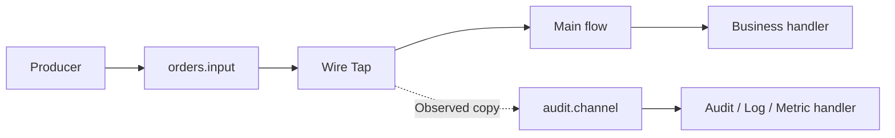
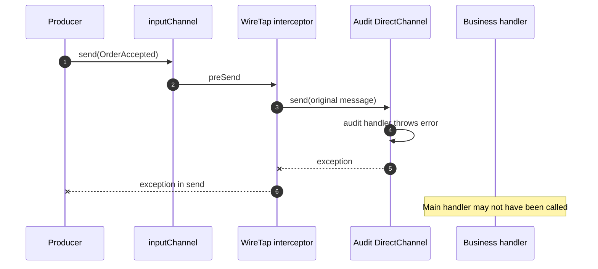
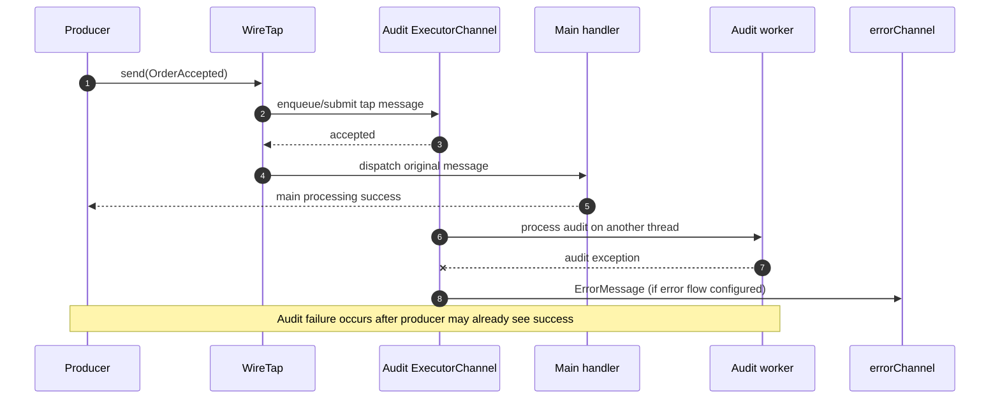
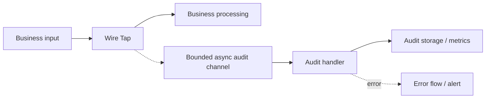
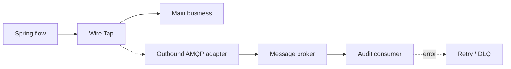

# Tap Errors and Their Impact on the Flow in Spring Integration

## Learning Objectives

After this lesson, you will be able to:

- Explain how the **Wire Tap pattern** sends a message to an observation branch without replacing the main business branch.
- Distinguish **synchronous tap errors**, **asynchronous tap errors**, and **errors when handing off a message to the tap channel**.
- Predict the impact of `DirectChannel`, `ExecutorChannel`, and `QueueChannel` on latency, exception propagation, and main-flow availability.
- Build Spring Integration flows using Java DSL `.wireTap(...)`, `@ServiceActivator`, and `errorChannel` to test failures in a controlled way.
- Design taps for auditing, logging, and metrics without exposing sensitive data or accidentally mutating business payloads.
- Test audit failures, executor overload, delayed messages, retries, and correlation by `requestId`.

This lesson belongs to the **Wire tap** chapter of the **SPRING_INTEGRATION_PATTERN** module. The module practices *Enterprise Integration Patterns* with Spring Integration to build loosely coupled and extensible message flows. As messages travel through Router, Filter, Transformer, Splitter, Aggregator, Gateway, retry, error channel, and correlation, Wire Tap is often used to observe branches. However, when a tap fails, it can become a source of slowness or even cause the main processing path to fail: **a tap is not automatically isolated from the business flow**.

## 1. What Is Wire Tap and Why Do Tap Errors Matter?

**Wire Tap** is a flow branch that sends a copy of a message to a secondary channel for auditing, emitting metrics, or observation. The message still travels along the main path; a tap is neither a Router changing the destination nor a Filter deciding whether the message should continue.



For example, an `OrderAccepted(orderId=O-101)` message needs to be delivered to the invoice processor while also sending an audit trail to the audit system. If auditing is slow or unavailable, we must decide **whether invoicing should still be allowed to proceed**. Two common policies:

1. **Fail-fast / mandatory auditing:** recording the audit is part of the business or compliance requirement; if auditing fails, the transaction may need to stop or roll back in an appropriate transaction.
2. **Best-effort / non-blocking observation:** logs, metrics, or tracing must not disrupt business logic when the observation branch malfunctions; the risk of losing observation data must be accepted and tracked with drop metrics.

Which policy is right depends on business requirements. **Simply configuring `.wireTap(...)` does not establish either policy automatically**; the outcome depends on the tap channel type, dispatch mechanism, and error handling.

### 1.1. "Copying a message" does not mean deep copying

Wire Tap passes a message for the secondary branch to use. For in-process messages, the tap and the main flow may share references to the **payload object** or objects inside headers. Do not:

- Let an audit handler directly mutate a mutable DTO and expect the main flow to remain unaffected.
- Log or transmit full payloads containing passwords, tokens, card numbers, or personal data to another logging system.
- Assume every object in the payload has been deep-cloned so each branch can mutate it independently.

Use immutable payloads, select only the fields needed for auditing, or construct an audit event with its own schema via a well-designed Transformer/adapter.

## 2. Three Distinct Sources of Errors Around a Tap

| Error source | Examples | Potential impact |
| --- | --- | --- |
| **Tap handler** | Handler saving audit throws `IllegalStateException`, audit database fails | With a synchronous tap, may block or propagate errors to the producer; with an async tap, errors usually happen after the main flow proceeds |
| **Handoff to the tap channel** | No subscriber, executor rejects task, queue is full | Can fail right while Wire Tap is sending, **even when** the audit handler is intended to run asynchronously |
| **External observation system** | Log broker disconnects, HTTP audit times out, serialization fails | Depends on outbound adapter, confirms, timeouts, retries, and error flows; can slow down or fail the tap branch |

Key point: **an asynchronous tap does not guarantee every error is asynchronous**. For example, if an `ExecutorChannel`'s executor is full and rejects `execute()` during dispatch, the task-submission error can appear on the producer thread before the business flow receives the message.

### 2.1. Ordering and observation limits

With a Wire Tap attached to a `DirectChannel`, placing the message onto the tap branch occurs while the channel is sending the message. When the tap uses a `DirectChannel`, the observation handler is typically called synchronously. If that handler throws an exception at that point, sending to the source channel may fail and normal dispatch to the business handler may not happen.

With a tap using `ExecutorChannel`, the calling thread generally only hands off the task and continues dispatching the original message. However, there is no guarantee whether the audit handler runs before or after the business handler; both may observe different points in time. If ordering or committing auditing before business execution is required, design a workflow with explicit transactions/acks instead of a best-effort tap.

## 3. Case A: A Synchronous Tap Can Propagate Errors Back to the Producer

Suppose both the main path and the tap path are `DirectChannel`s:



This is an example where **the tap becomes part of the synchronous execution path**. When a `DirectChannel` dispatches to an audit subscriber that throws an exception, the exception can bubble up to the caller, typically wrapped by Spring Messaging/Integration in a `MessagingException` or subclass. A business-flow error handler might not even be invoked because the message may never reach the business endpoint.

**Conclusion:** a synchronous tap fits when you want the audit branch to be part of `send()`'s success condition, or when auditing is ultra-lightweight and reliable. It is unsuitable when the requirement is "audit failures must never slow down or break the transaction" without isolation mechanisms.

## 4. Case B: An Asynchronous Tap Isolates Processing Errors, Not All Risks



If `ExecutorChannel` accepts the task, exceptions from the audit handler happen on the worker thread; they **are not automatically thrown back through the already-completed `send()` call**. Spring Integration can create an `ErrorMessage` and send it to a configured error channel or the global `errorChannel` according to the endpoint/channel's error-handling mechanism.

However, three operational conditions are needed:

- **Executor can accept work:** bounded threads/queue and a full-queue policy. A rejection during dispatch can still affect the main flow.
- **Error flow has a consumer:** the error channel must have a handler that logs/alerts, not merely exist on a diagram.
- **Audit data can be lost:** in-memory executors/queues do not provide durability after JVM shutdown or process crash.

With a `QueueChannel` as the tap channel, Wire Tap can enqueue into the queue and let the main flow continue while a `PollingConsumer` reads audits later. However, a full queue can block or reject sends; when the consumer fails, whether retries occur or messages return to the queue depends on transactions and error handling, not on Wire Tap itself.

## 5. Hands-On Java Spring Integration Example

The following example uses **Java 17+, Spring Boot 3.x, and Spring Integration 6.x**. There are two independent flows:

- `syncTapIngress → wireTap(syncAudit) → syncBusiness`: the audit tap intentionally throws a synchronous error.
- `asyncTapIngress → wireTap(asyncAudit) → asyncBusiness`: auditing runs on an executor, and errors go to a `QueueChannel` named `tapErrors` for testing.

Place `public class` and `record` definitions in separate Java files in the same package. Compatible Spring Boot Integration, Spring Integration core, and Spring Boot Test dependencies are required.

### 5.1. Immutable message type

```java
// OrderAccepted.java
public record OrderAccepted(
        String eventId,
        String orderId,
        long amountMinorUnit
) {}
```

`eventId` identifies an event emission, and `orderId` is the business key. `amountMinorUnit` holds currency in integer minor units. This data illustrates channel mechanics; in production, avoid sending complete financial details or PII to observation systems just for logging.

### 5.2. Declaring the two flows and channels

```java
// WireTapErrorConfiguration.java
import org.springframework.beans.factory.annotation.Qualifier;
import org.springframework.context.annotation.Bean;
import org.springframework.context.annotation.Configuration;
import org.springframework.integration.channel.DirectChannel;
import org.springframework.integration.channel.ExecutorChannel;
import org.springframework.integration.channel.QueueChannel;
import org.springframework.integration.config.EnableIntegration;
import org.springframework.integration.dsl.IntegrationFlow;
import org.springframework.messaging.MessageChannel;
import org.springframework.scheduling.concurrent.ThreadPoolTaskExecutor;

@Configuration
@EnableIntegration
public class WireTapErrorConfiguration {
    @Bean("syncTapIngress")
    public MessageChannel syncTapIngress() {
        return new DirectChannel();
    }

    @Bean("syncAudit")
    public MessageChannel syncAudit() {
        return new DirectChannel();
    }

    @Bean("syncBusiness")
    public MessageChannel syncBusiness() {
        return new DirectChannel();
    }

    @Bean
    public IntegrationFlow syncTapFlow() {
        return IntegrationFlow.from("syncTapIngress")
            .wireTap("syncAudit")
            .channel("syncBusiness")
            .get();
    }

    @Bean("auditExecutor")
    public ThreadPoolTaskExecutor auditExecutor() {
        ThreadPoolTaskExecutor pool = new ThreadPoolTaskExecutor();
        pool.setCorePoolSize(2);
        pool.setMaxPoolSize(4);
        pool.setQueueCapacity(20);
        pool.setThreadNamePrefix("audit-tap-");
        return pool;
    }

    @Bean("asyncTapIngress")
    public MessageChannel asyncTapIngress() {
        return new DirectChannel();
    }

    @Bean("asyncAudit")
    public MessageChannel asyncAudit(
            @Qualifier("auditExecutor") ThreadPoolTaskExecutor executor) {
        return new ExecutorChannel(executor);
    }

    @Bean("asyncBusiness")
    public MessageChannel asyncBusiness() {
        return new DirectChannel();
    }

    @Bean("tapErrors")
    public QueueChannel tapErrors() {
        return new QueueChannel(20);
    }

    @Bean
    public IntegrationFlow asyncTapFlow() {
        return IntegrationFlow.from("asyncTapIngress")
            .wireTap("asyncAudit")
            .channel("asyncBusiness")
            .get();
    }
}
```

In both flows, `.wireTap(...)` declares the observation branch at its corresponding position in the message pipeline. `.channel(...)` specifies the main path. `Wire Tap` does not create a transaction spanning both handlers and does not wait for async auditing to succeed before returning to the caller.

### 5.3. Business and audit handlers

```java
// OrderBusinessHandler.java
import java.util.Set;
import java.util.concurrent.ConcurrentHashMap;
import org.springframework.integration.annotation.ServiceActivator;
import org.springframework.stereotype.Component;

@Component
public class OrderBusinessHandler {
    private final Set<String> handled =
            ConcurrentHashMap.newKeySet();

    @ServiceActivator(inputChannel = "syncBusiness")
    public void syncHandle(OrderAccepted order) {
        handled.add(order.eventId());
    }

    @ServiceActivator(inputChannel = "asyncBusiness")
    public void asyncHandle(OrderAccepted order) {
        handled.add(order.eventId());
    }

    public boolean wasHandled(String eventId) {
        return handled.contains(eventId);
    }
}

// FailingAuditHandler.java
import org.springframework.integration.annotation.ServiceActivator;
import org.springframework.stereotype.Component;

@Component
public class FailingAuditHandler {
    @ServiceActivator(inputChannel = "syncAudit")
    public void auditSynchronously(OrderAccepted order) {
        throw new IllegalStateException(
            "AUDIT_SYNC_FAILED eventId=" + order.eventId());
    }

    @ServiceActivator(inputChannel = "asyncAudit")
    public void auditAsynchronously(OrderAccepted order) {
        throw new IllegalStateException(
            "AUDIT_ASYNC_FAILED eventId=" + order.eventId());
    }
}
```

Both audit handlers fail **intentionally**. This is an exercise in error propagation paths, not a real audit implementation. The business handler simply records IDs for testing; real applications need transactions and idempotency if side effects occur.

### 5.4. Producer attaching an error channel for the async case

```java
// OrderEventPublisher.java
import org.springframework.beans.factory.annotation.Qualifier;
import org.springframework.integration.channel.QueueChannel;
import org.springframework.messaging.MessageChannel;
import org.springframework.messaging.MessageHeaders;
import org.springframework.messaging.support.MessageBuilder;
import org.springframework.stereotype.Component;

@Component
public class OrderEventPublisher {
    private final MessageChannel syncTapIngress;
    private final MessageChannel asyncTapIngress;
    private final QueueChannel tapErrors;

    public OrderEventPublisher(
            @Qualifier("syncTapIngress") MessageChannel syncTapIngress,
            @Qualifier("asyncTapIngress") MessageChannel asyncTapIngress,
            @Qualifier("tapErrors") QueueChannel tapErrors) {
        this.syncTapIngress = syncTapIngress;
        this.asyncTapIngress = asyncTapIngress;
        this.tapErrors = tapErrors;
    }

    public boolean sendSync(String eventId) {
        return syncTapIngress.send(
            MessageBuilder.withPayload(
                new OrderAccepted(eventId, "ORDER-" + eventId, 120_000L))
                .setHeader("eventId", eventId)
                .build());
    }

    public boolean sendAsync(String eventId) {
        return asyncTapIngress.send(
            MessageBuilder.withPayload(
                new OrderAccepted(eventId, "ORDER-" + eventId, 120_000L))
                .setHeader("eventId", eventId)
                .setHeader(MessageHeaders.ERROR_CHANNEL, tapErrors)
                .build());
    }
}
```

`MessageHeaders.ERROR_CHANNEL` is set explicitly so exceptions from the async audit branch have a destination in this example. Because this flow's main handler uses `DirectChannel` and does not throw errors, the test can isolate the audit error. In a real multi-branch flow, **the error channel header may be shared by multiple endpoints processing the same message**; classify by failed message/endpoint rather than assuming every `ErrorMessage` arriving on `tapErrors` came from the tap.

A header holding a `MessageChannel` object works **within the same JVM**. When crossing AMQP/JMS/Kafka, use proper mapping and reply/error destinations; never serialize a Java channel object directly.

## 6. Test 1: Synchronous Tap Exposes Errors to `send()`

Spring Boot integration test:

```java
// WireTapErrorFlowTest.java
import static org.assertj.core.api.Assertions.assertThat;
import static org.assertj.core.api.Assertions.catchThrowable;

import org.junit.jupiter.api.Test;
import org.springframework.beans.factory.annotation.Autowired;
import org.springframework.boot.test.context.SpringBootTest;

@SpringBootTest
class WireTapErrorFlowTest {
    @Autowired
    private OrderEventPublisher publisher;

    @Autowired
    private OrderBusinessHandler business;

    private static Throwable rootCause(Throwable error) {
        Throwable current = error;
        while (current.getCause() != null &&
                current.getCause() != current) {
            current = current.getCause();
        }
        return current;
    }

    @Test
    void synchronousTapFailureReachesSender() {
        String eventId = "SYNC-101";
        Throwable failure = catchThrowable(() -> publisher.sendSync(eventId));

        assertThat(failure).isNotNull();
        assertThat(rootCause(failure))
            .isInstanceOf(IllegalStateException.class)
            .hasMessageContaining("AUDIT_SYNC_FAILED");

        // In the synchronous tap setup, the error in preSend happens
        // before the business handler receives the message.
        assertThat(business.wasHandled(eventId)).isFalse();
    }
}
```

The test expresses the **fail-fast contract** of this configuration. Because the tap failed before the main handler was dispatched, the business handler never records `SYNC-101`. If a different policy is needed, change the channel type or place an error handler on the tap branch; do not simply add a `catch` and treat auditing as unrelated.

Note that the actual exception type may include Spring Integration wrappers. The test inspects the **root cause** to avoid coupling too tightly to a specific wrapper.

## 7. Test 2: Asynchronous Tap Reports Errors via `ErrorMessage`

Add these imports to the same `WireTapErrorFlowTest.java`:

```java
import org.springframework.beans.factory.annotation.Qualifier;
import org.springframework.integration.channel.QueueChannel;
import org.springframework.messaging.Message;
import org.springframework.messaging.support.ErrorMessage;
```

Add the following field and test method to the test class:

```java
@Autowired
@Qualifier("tapErrors")
private QueueChannel tapErrors;

@Test
void asynchronousTapFailureDoesNotStopMainHandler() {
    String eventId = "ASYNC-201";

    boolean accepted = publisher.sendAsync(eventId);
    assertThat(accepted).isTrue();
    assertThat(business.wasHandled(eventId)).isTrue();

    Message<?> error = tapErrors.receive(5_000);
    assertThat(error).isInstanceOf(ErrorMessage.class);
    Throwable failure = ((ErrorMessage) error).getPayload();

    assertThat(rootCause(failure))
        .isInstanceOf(IllegalStateException.class)
        .hasMessageContaining("AUDIT_ASYNC_FAILED");
}
```

With `ExecutorChannel` on the audit branch, the worker can fail **after** the main path has succeeded. Therefore, the test verifies both facts: the business handler still receives the message, and the error flow receives the audit failure. The test does not claim auditing is durably persisted, does not prove safe broker publishing, and does not guarantee all exceptions across different channel types always land in a queue exactly like this setup.

For test stability when running concurrently, use unique `eventId` values and verify the ID in the failed/original message (if available), or provide a dedicated error channel per test case. Do not pull the first `ErrorMessage` from a shared queue and assume it belongs to the message just sent.

### 7.1. When test results don't match expectations

| Symptom | What to check |
| --- | --- |
| `sendAsync()` throws immediately | Executor rejected task, channel lacks subscribers, or error occurred before handoff; this is not an isolated audit-worker failure |
| Main handler never receives message | Wire Tap failed during dispatch, or main routing/channel is wrong |
| No `ErrorMessage` appears | Wrong `errorChannel` header, inactive error flow, worker hasn't run yet, or handler caught and swallowed the error |
| `ErrorMessage` lacks request ID | Header wasn't preserved, payload was replaced, or failed message cannot be inspected; standardize correlation |
| Test runs unusually slowly | Pool/CI overload, queue backlog, blocking handler; distinguish from business errors |

## 8. When Auditing Is Mandatory: Fail-Fast Is Not Enough for Consistency

Suppose company policy states **never create an invoice unless an audit record is saved**. Using a synchronous tap can stop the main flow when auditing throws an error. However, that **does not create an atomic transaction** between the audit database and the invoice database:

```text
Case A:
  write audit -> fail
  business did not run                (easy to observe)

Case B:
  write audit -> commit succeeds
  business -> fail                    (audit exists, invoice does not)

Case C:
  business committed in an earlier step
  write audit in later step -> fail   (invoice exists, audit missing)
```

When auditing is truly a consistency and durability requirement, consider:

1. Writing the audit record in the same transaction as business data if both live in the same transaction-capable resource.
2. Using a **transactional outbox** to write business state and the audit event in the same local transaction; a relay publishes the event to a broker afterward.
3. If coordinating multiple systems, defining sagas/compensation or reconciliation rather than expecting Wire Tap to provide a distributed transaction.
4. Storing stable business keys and processing state; audit retries must be **idempotent**.

If auditing is strictly for operational observation, a best-effort tap is usually more appropriate. For business requirements mandating trail preservation, swallowing every audit exception can violate the system contract.

## 9. Best-Effort Design: Isolated Yet Observable Loss

A best-effort architecture typically separates the audit branch from the main thread using dedicated channels/workers and resource bounds:



Key design rules:

- **Keep the main path independent of audit handler latency:** use `ExecutorChannel`, `QueueChannel` with a poller, or external infrastructure as required.
- **Avoid unbounded queues:** cap capacity, concurrency, and retry attempts; monitor rejected tasks.
- **Choose a full-tap policy:** fail business logic, drop audit samples with metrics, or write to a durable buffer; document the policy as a contract and test it.
- **Never silently swallow errors:** asynchronous audit errors must be recorded to support recovery and alerting.
- **Avoid duplicate side effects on retry:** resending audits can create duplicate records without an `eventId`/`operationId` for deduplication.
- **Never claim async equals durable:** in-memory `ExecutorChannel` and `QueueChannel` do not replace a broker or outbox.

If the requirement is "auditing must never affect the main flow under any circumstances", simply adding `ExecutorChannel` is **not enough** because task submission failures can happen synchronously. You must establish a boundary that tolerates losing audits or a dedicated handling/recovery mechanism, and test full queues, rejected tasks, process crashes, and outages. Any configuration that can "drop logs to keep the flow running" must be approved under compliance/security requirements.

### 9.1. Filtering and sampling data before storing

Not every message needs to be recorded in full. Spring Integration Wire Tap can be configured with an appropriate selector/filter to observe only selected messages; the audit branch can then use a Transformer to produce a minimal DTO:

```text
OrderAccepted(orderId, customerData, paymentInfo)
          |
        Wire Tap
          |
      Audit projection / Transformer
          |
OrderAuditEvent(eventId, orderId, status, occurredAt)
```

The goal is **data minimization**: keep only the fields needed for metrics/reconciliation, and mask or remove sensitive data before storage. Because the tap may share the payload object reference, do not mutate the input object to "hide data"; construct a **new audit payload** with a restricted schema.

## 10. Correlation, Reply Channels, and Complex Message Branches

When a message is inside a request–reply flow, a wire tap can observe either the request or the reply:

```text
Caller -> Messaging Gateway -> requestChannel -> Wire Tap -> Service Activator
                                     |
                                     v
                                Audit channel

Business reply -> Gateway's replyChannel -> Caller
```

Bridge, Router, Filter, Transformer, Splitter, and Aggregator may all appear in a flow. For each message:

| Header / ID | Used for | What the tap must watch out for |
| --- | --- | --- |
| Business `requestId` | Tracing requests and reconciling results | Use a stable identifier; avoid exposing sensitive payloads |
| `MessageHeaders.ID` | Identifying a specific message | Do not assume it is the cross-system business request ID |
| `MessageHeaders.CORRELATION_ID` | Grouping Splitter/Aggregator messages | Record only if relevant; may differ from broker correlation ID |
| `SEQUENCE_NUMBER` / `SEQUENCE_SIZE` | Group order/size | Useful for finding processing groups missing replies |
| `replyChannel` | Returning results to Gateway | Do not use a tap as a reply handler if it is only for auditing |
| `errorChannel` | Routing errors from supporting endpoints | May be shared across branches; distinguish the error source |
| `traceId` / `spanId` | Distributed tracing | Do not use directly as an idempotency key |

If a tap emits an unexpected reply to the Gateway's reply channel, the caller can receive the wrong result. **An observation tap must not become a business responder** unless the flow contract explicitly requires it and uses proper correlation/release strategies.

With Splitter/Aggregator, one request can spawn many child messages. A tap only logs individual messages; it does not increase the reply count awaited by the Aggregator, decide the release strategy, or modify correlation groups. If the tap's error flow drops metadata, reconciliation can fail even while the business flow continues working.

### 10.1. An error channel is not a reply channel

An `ErrorMessage` containing an exception does not automatically become a business reply. If the Gateway needs a result within a deadline, an error handler on the main branch may need to build a structured error response so the caller receives the right `requestId`. Conversely, failures in best-effort auditing should typically be recorded via dedicated audit-failure metrics/alerts, **never tricking the Gateway into thinking the business operation failed** when the main handler succeeded.

When a shared `errorChannel` is placed on a message, you must be able to distinguish whether an error originated from auditing or the business handler. Use endpoint metadata, the failed message, and trace context; do not equate "received an ErrorMessage" with "business transaction failed".

## 11. Tapping to a Broker: Publish Errors and Consumer Errors Happen in Different Phases



When using RabbitMQ/Kafka/JMS on the tap branch:

1. **Mapping/publish errors:** can happen right inside the outbound adapter or later via confirms/callbacks; main-path impact depends on whether the tap channel is synchronous or asynchronous.
2. **Broker accepted, consumer fails:** consumer errors in another process do not flow back into the producer's Wire Tap; dedicated retries/dead-lettering and monitoring are needed.
3. **Redelivery/duplicates:** the consumer may reprocess the same audit event. Use `eventId` to avoid duplicate writes per policy.
4. **Data and headers:** Spring Integration `Message<?>` does not automatically cross the network as raw Java objects. The adapter must serialize payloads and map needed headers; do not forward internal `replyChannel` objects directly.
5. **Consistency:** broker confirm/ACK reflects only that specific send/receive step, not that the audit record was successfully committed.

If auditing is mandatory for legal/operational reasons, consider an outbox instead of relying solely on a best-effort tap to a broker.

## 12. Testing Edge Cases Before Production

| Test case | How to reproduce | What must be verified |
| --- | --- | --- |
| `DirectChannel` tap throws | Audit handler throws exception | Producer sees error; verify whether business handler is called |
| `ExecutorChannel` tap throws | Audit worker throws exception | Main flow still processes; `ErrorMessage` is recorded |
| Executor rejects task | Full pool/queue with controlled rejection policy | Dispatch failure can affect main flow; policy must be tested |
| Tap queue full | Tap to a small-capacity `QueueChannel` | Verify blocking, timeout, error, or drop behavior per policy |
| Slow audit | Audit handler delays for several seconds | Measure main-flow latency; verify best-effort truly isolates |
| Business handler fails | Make business handler throw exception | Distinguish business errors from audit errors on shared error channel |
| Mutable payload | Audit modifies a mutable DTO | Test proves main data is not mutated via shared reference |
| Audit broker disconnected | Stop broker or mock adapter failure | Observe publish failures, retries, DLQ, and main-flow impact |
| Duplicate audit event | Resend same `eventId` | Audit store applies idempotency if required by contract |
| Restart while audit pending | Stop process before worker processes queue | System does not claim durability without durable storage |
| Multiple concurrent requests | Interleave request IDs | Audits/errors from one request are never attributed to another |

**Do not run academic tests based on assumptions:** an in-process test with `ExecutorChannel` does not prove broker reliability; a synchronous tap test does not prove a distributed transaction. When the architecture uses a broker or database, run integration tests against real behavior or test containers.

## 13. Metrics and Tracing to Measure Tap Impact

Name channels/endpoints clearly and measure separately:

| Metric | Meaning |
| --- | --- |
| `main.processing.count` / `main.processing.errors` | Business outcomes |
| `tap.accepted.count` | Volume handed to the tap per channel semantics |
| `tap.handler.success` / `tap.handler.errors` | Actual execution of the audit consumer |
| `tap.dispatch.rejected` | Executor/queue stopped accepting messages |
| `tap.queue.depth` / `tap.queue.oldest.age` | Audit lag and backlog |
| `tap.handler.latency` | Time to write audit/metrics |
| `main.end_to_end.latency` | Business latency from producer to main handler |
| `errorChannel.unhandled` | Unconsumed audit or business errors |
| `audit.duplicate.suppressed` | Events skipped due to deduplication |
| `broker.publish.failure` / `deadletter.count` | Failures in external systems |

Specifically, if `main.end_to_end.latency` rises when audit storage slows down, the tap may still sit on the synchronous path or saturate shared threads/CPU/connection pools. Checking `send() == true` alone is not enough; track **when auditing completes**, **when business processing completes**, and the error rate of each branch.

Include `requestId`, `eventId`, and `traceId` where appropriate while keeping payloads containing personal data out of logs. Alerting thresholds should reflect potential audit data loss or SLA-breaching lag, not just raw exception counts.

## 14. Checklist for Selecting a Wire Tap Error Policy

1. **What is the tap for?** Mandatory auditing, best-effort logging, metrics, or tracing?
2. **If the tap fails, may business processing continue?** Has this rule been agreed upon with business/compliance owners?
3. **What is the tap channel?** Direct, Executor, Queue, or outbound adapter? Are executors/queues bounded?
4. **When dispatch is rejected?** Is there an explicit fail-fast, durable buffer, or metered drop policy?
5. **Where does `ErrorMessage` go?** Are there error consumers, alerts, and correlation to distinguish tap errors from main-flow errors?
6. **What data is recorded?** Are PII, shared mutable references, and sensitive headers avoided?
7. **Are there retries?** Are deduplication by `eventId`/`operationId`, attempt limits, and backoff designed?
8. **If external systems go down?** Are there recovery policies for brokers, audit databases, process restarts, and late events?
9. **Have failure modes been tested?** Handler exceptions, executor rejections, full queues, broker outages, and concurrent requests?

## Conclusion

**Errors in a tap can directly affect the main flow** if Wire Tap sends to a synchronous channel or handler: audit exceptions, latency, and overload can all propagate back to the producer. Using `ExecutorChannel` or `QueueChannel` decouples audit execution timing from the business handler, yet does not by itself guarantee dispatch cannot fail, messages are durably saved, or errors are captured. Proper design starts from the **fail-fast vs. best-effort** contract, then selects channels, resource bounds, `errorChannel` handling, correlation, retries/idempotency, and independent monitoring. A well-designed Wire Tap illuminates the system; an uncontrolled Wire Tap can become the reason that very system goes down.
