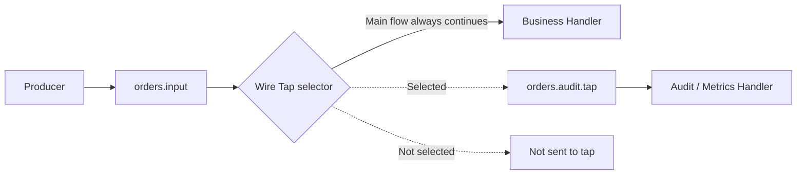
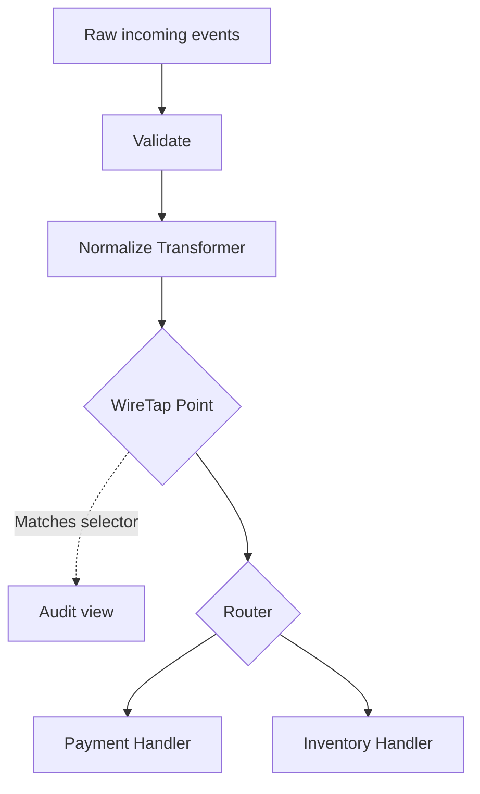
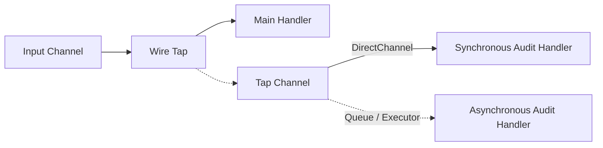
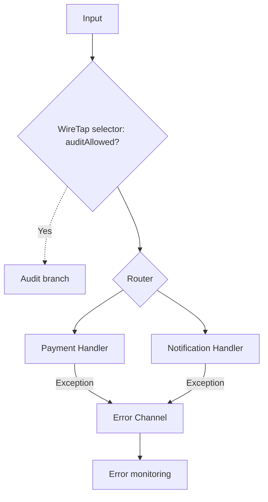
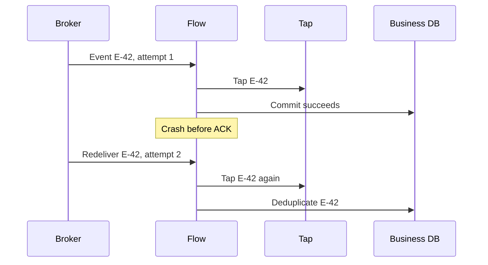

# Filtering Messages Before Tapping

In the **Wire tap** chapter of the **SPRING_INTEGRATION_PATTERN** module, we learn how to observe or copy part of a message flow while preserving the primary business processing intent. The module uses Spring Integration to implement **Enterprise Integration Patterns** such as Router, Filter, Transformer, Splitter, Aggregator, Gateway, retry, error channel, and correlation, while testing and monitoring branches. With **Wire Tap**, the practical problem is often not "how to send another copy", but: **which messages are permitted and necessary to enter the tap branch?**

For instance, an ordering flow receives thousands of events per minute, yet the operations team only wants to record `ORDER_ACCEPTED` events carrying an audit-enabled flag. Copying every message to the audit channel before discarding unwanted ones imposes unnecessary load and risks exposing sensitive data on the observation branch.

**Filtering messages before tapping** means applying a selection condition *before the message is emitted to the tap channel*, typically via **WireTap's MessageSelector**. This condition must be designed so that unselected messages **still travel through the main flow**, unless business logic intentionally filters the main flow as well.

After this lesson, you will be able to:

- Explain when WireTap evaluates its condition and distinguish a tap selector from a main-flow **Filter**.
- Configure Spring Integration Java DSL to tap events selectively by type, header, tenant, or business criteria.
- Design a safe tap branch: minimize data, strip sensitive information, and avoid slowing down the main branch.
- Account for synchronous/asynchronous callbacks, channel capacity, tap errors, retries, and delivery semantics.
- Write tests verifying that eligible messages are tapped and messages excluded from the tap are **not** dropped from business processing.

## 1. Where Does Wire Tap Operate in the Message Flow?

In EIP, **Wire Tap** sends an extra copy of a message passing a point in a flow to a secondary channel, such as for auditing, metrics, or diagnostics. In Spring Integration, WireTap is typically attached as a **ChannelInterceptor**; the Java DSL offers a convenient `.wireTap(...)` declaration.



Solid lines represent the primary business path; dashed lines represent the secondary branch. A message **that fails the tap selector** is still delivered to the business handler. That is the crucial difference between *filtering the tap branch* and *filtering the entire message flow*.

Because WireTap attaches to a channel, channel placement determines which messages are candidates for tapping. Attached before a Router, messages for all routes can be evaluated. Attached on a channel exclusive to the `priority.orders` branch, the tap sees only messages reaching that branch.

**Semantics note:** WireTap forwards a `Message<?>` to the secondary channel; it does not automatically deep-copy the entire payload object graph. Spring Messages generally have container-level immutable headers, but the payload may be a mutable Java object. Handlers on the tap branch must never directly mutate a shared payload, or they can affect the main branch.

## 2. Three Easily Confused Ways to "Filter Before Tapping"

| Placement of condition | Do non-matching messages continue on the main flow? | Sent to the tap? | When to use? |
| --- | --- | --- | --- |
| **Filter before WireTap in main flow** | **No**, unless separate discard/recovery is configured | No, because it was dropped before reaching the tap point | Business logic truly does not process that message type |
| **Selector directly on WireTap** | **Yes** | **No** | Selecting a subset of messages solely for auditing/metrics/debugging |
| **Filter inside the tap branch after WireTap** | **Yes** | **Yes, already sent to the tap channel**, then filtered | When additional processing/checks are needed in the audit branch, or sharing a common tap channel |

Compare the three diagrams:

**A. Main-flow Filter:**

```text
orders.input -> Filter(accepted?) -> WireTap -> Business
                    |
                    +-- rejected: dropped from the entire main flow
```

Placing a Filter like this just to reduce logging can cause the business to **silently lose valid requests**.

**B. WireTap Selector:**

```text
orders.input -> WireTap(selector = auditAllowed?)
                      | yes -> audit.tap
                      | no  -> not sent to tap
             -> Business (both yes and no arrive here)
```

This is usually the right solution for "tap only permitted messages".

**C. Filter inside the tap branch:**

```text
orders.input -> WireTap -> Business
                   |
                   +-> audit.tap -> Filter(auditAllowed?) -> AuditSink
```

In approach C, discarded messages have already crossed a tap boundary and may have been queued or passed through tap-channel interceptors. If the goal is reducing load or keeping sensitive messages out of the secondary branch, filtering **right at WireTap** is usually preferable.

## 3. Defining Selector Criteria

A selector returns a boolean based on the **current message**, such as inspecting headers or payload. Criteria should be simple, cheap, deterministic, and trustworthy enough to execute on the flow's hot path.

Example event contract:

```json
{
  "eventId": "evt-2026-001",
  "type": "ORDER_ACCEPTED",
  "orderId": "O-100",
  "tenantId": "tenant-a",
  "totalAmount": 280000
}
```

The message carries internal headers:

```text
eventType = ORDER_ACCEPTED
auditAllowed = true
source = order-service
traceId = ... (if present)
```

We only tap when:

```text
eventType == "ORDER_ACCEPTED"
AND auditAllowed == true
```

This rule denotes **audit eligibility**, not access authorization or source authentication. If `auditAllowed` comes from an untrusted system and could be spoofed, recompute it at a trusted validation/identity step before the selector reads it. Never base security decisions entirely on a partner-supplied header.

### When to select by header?

- Event type, tenant, or classification has already been verified by the system.
- Audit/trace flags were computed internally.
- Business state was normalized before passing the tap point.

### When to select by payload?

- The flow lacks suitable headers, yet the payload is already parsed/validated.
- Selection depends on a domain field such as `OrderEvent.status()`.

Avoid expensive selectors: do not query a database, make HTTP requests, or re-parse large JSON payloads per message if normalization can happen earlier. The selector runs on the channel's send/intercept path and can increase main-branch latency.

## 4. Java DSL Example: Tapping Only Selected Messages

The example uses Java 17+, Spring Integration Core, and Java DSL. The business flow processes all events; a **selector restricts only the audit branch**.

### 4.1. Contract and gateway sending messages

```java
package example.orders;

public record OrderEvent(
    String eventId,
    String orderId,
    String type,
    String tenantId
) {}
```

A Messaging Gateway lets callers send messages without depending directly on channels:

```java
package example.orders;

import org.springframework.integration.annotation.Gateway;
import org.springframework.integration.annotation.MessagingGateway;
import org.springframework.messaging.handler.annotation.Header;

@MessagingGateway
interface OrderIngress {
    @Gateway(requestChannel = "orders.input")
    void publish(
        OrderEvent event,
        @Header("eventType") String eventType,
        @Header("auditAllowed") boolean auditAllowed
    );
}
```

In real applications, `auditAllowed` should be determined by server-side policy rather than copied verbatim from an unauthenticated request. Here, the gateway illustrates setting explicit headers for the selector to inspect.

### 4.2. Defining the flow with a WireTap selector

```java
package example.orders;

import org.springframework.context.annotation.Bean;
import org.springframework.context.annotation.Configuration;
import org.springframework.integration.annotation.IntegrationComponentScan;
import org.springframework.integration.config.EnableIntegration;
import org.springframework.integration.dsl.IntegrationFlow;

@Configuration
@EnableIntegration
@IntegrationComponentScan
class OrderWireTapFlow {

    @Bean
    IntegrationFlow orderMainFlow(OrderService orderService) {
        return IntegrationFlow.from("orders.input")
            .wireTap("orders.audit.tap", tap -> tap.selector(
                message ->
                    "ORDER_ACCEPTED".equals(
                        message.getHeaders().get("eventType")
                    )
                    && Boolean.TRUE.equals(
                        message.getHeaders().get("auditAllowed")
                    )
            ))
            .handle(OrderEvent.class, (event, headers) -> {
                orderService.process(event);
                return null; // One-way event flow.
            })
            .get();
    }

    @Bean
    IntegrationFlow orderAuditFlow(AuditSink auditSink) {
        return IntegrationFlow.from("orders.audit.tap")
            .transform(OrderEvent.class, event -> new AuditRecord(
                event.eventId(),
                event.orderId(),
                event.type()
            ))
            .handle(AuditRecord.class, (record, headers) -> {
                auditSink.record(record);
                return null;
            })
            .get();
    }
}

// Application-provided business components as beans.
interface OrderService {
    void process(OrderEvent event);
}

record AuditRecord(String eventId, String orderId, String eventType) {}

interface AuditSink {
    void record(AuditRecord record);
}
```

Reading the configuration:

1. `IntegrationFlow.from("orders.input")` opens the flow receiving business data.
2. `.wireTap("orders.audit.tap", ...)` places the tap point along the flow.
3. `tap.selector(...)` decides which messages **are sent to the audit channel**.
4. `.handle(OrderEvent.class, ...)` processes every message arriving on the main flow, unaffected by the tap selector.
5. `orderAuditFlow` transforms the event into a minimal `AuditRecord` before passing it to the audit sink.

This code illustrates common Spring Integration Java DSL APIs; the project must supply the corresponding dependencies and `OrderService`, `AuditSink` beans. If your framework version differs in `wireTap` or `selector` overloads, check your project's API version to adjust declarations, while keeping **selector semantics** focused strictly on selecting messages for the tap branch.

**Avoid logging the entire `OrderEvent`** or calling `event.toString()` unconditionally. The audit record contains only event ID, order ID, and event type; if these fields still require protection, apply corresponding masking, retention, and access controls.

### 4.3. Expected outcomes

| Message | `eventType` | `auditAllowed` | Main handler | Audit sink |
| --- | --- | --- | --- | --- |
| A | `ORDER_ACCEPTED` | `true` | Yes | Yes |
| B | `ORDER_ACCEPTED` | `false` | Yes | No |
| C | `ORDER_REJECTED` | `true` | Yes | No |
| D | Missing header | `true` | Yes | No |
| E | `ORDER_ACCEPTED` | `"true"` as String | Yes | No, because selector requires boolean `Boolean.TRUE` |

Strict header typing prevents accidentally enabling auditing when upstream sends a malformed schema. Missing or wrongly typed headers can be tracked via metrics or a validation branch; do not rely solely on audit counts to detect all business errors.

## 5. Using a Standalone MessageSelector for Complex Conditions

When multiple flows share a policy, extracting the predicate into a standalone **MessageSelector** makes it easy to unit test:

```java
package example.orders;

import org.springframework.integration.core.MessageSelector;
import org.springframework.messaging.Message;

final class OrderAuditSelector implements MessageSelector {
    @Override
    public boolean accept(Message<?> message) {
        Object allowed = message.getHeaders().get("auditAllowed");
        Object type = message.getHeaders().get("eventType");

        return Boolean.TRUE.equals(allowed)
            && "ORDER_ACCEPTED".equals(type);
    }
}
```

In tap configuration, you can declare the equivalent selector inline with a lambda or register the selector bean and pass it to `WireTap` using the API supported by your Spring Integration version.

```text
inputChannel
    -> WireTap(
         tapChannel = "orders.audit.tap",
         selector = OrderAuditSelector::accept
       )
    -> business flow
```

The pseudocode above illustrates how the two components connect, not valid Java syntax for instantiating `WireTap`. Actual executable code must use the supported Java DSL or `ChannelInterceptor` configuration.

### Combining multiple conditions

If the requirement is "tap all `ORDER_ACCEPTED` messages from permitted tenants, except payloads with overly sensitive classifications", you can write:

```java
boolean shouldTap(
        Message<?> message,
        java.util.Set<String> allowedTenants) {

    Object type = message.getHeaders().get("eventType");
    Object tenant = message.getHeaders().get("tenantId");
    Object classification = message.getHeaders().get("dataClass");

    return "ORDER_ACCEPTED".equals(type)
        && tenant instanceof String tenantId
        && allowedTenants.contains(tenantId)
        && "PUBLIC".equals(classification);
}
```

Never trust an external `tenantId` or classification claim without prior authentication/normalization. Keep `allowedTenants` updated per deployment policy; avoid synchronous network lookups inside the selector.

## 6. Placing the Tap Before or After a Transformer, Router, or Filter?

The tap attachment point determines **which data and message subset** the tap can see. This is a design choice affecting both cost and security.



| Placement | What the tap sees | Pros | Risks |
| --- | --- | --- | --- |
| **Before validation** | Both valid and unverified messages | Diagnoses ingress errors | Easily leaks raw/malformed/sensitive data into audit |
| **After Transformer** | Normalized DTOs | Cheaper and more consistent selector | Misses pre-Transformer errors unless another error channel exists |
| **After business Filter** | Only messages passing the Filter | Fewer events, exact processed set | Loses visibility into Filter-rejected messages |
| **Before Router** | Branches passing through a single tap point | Single measurement/audit point | May need an added tag for intended route |
| **After Router** | Messages reaching each branch channel | Route-accurate observation | May require multiple WireTaps or distinct selectors |

If the goal is **auditing accepted operations**, usually place the tap after validation and normalization. If the goal is **investigating malformed inputs**, design a dedicated quarantine/error channel with restricted access instead of unconditionally tapping raw payloads.

### Error-prone confusion

```java
// Filtering on the main flow: non-matching messages never reach the business handler.
.filter(OrderEvent.class, e -> "ORDER_ACCEPTED".equals(e.type()))
.wireTap("orders.audit.tap")
```

This is correct only if the business truly does not process other events. If you want to continue processing all events while auditing only a subset, use a selector on WireTap:

```java
.wireTap("orders.audit.tap", tap -> tap.selector(
    m -> "ORDER_ACCEPTED".equals(m.getHeaders().get("eventType"))
))
```

## 7. Filtering Messages Does Not Mean Data Is Automatically Safe

A selector specifies **which messages are copied**, not which sensitive payload fields are masked. If a selected event contains an email, phone number, or token, the initial tap branch can still see that data.

A secure audit design requires multiple layers:

1. **Limit messages:** select only necessary events right at the selector.
2. **Limit data:** inside the tap branch, project the payload into an `AuditRecord` containing only truly needed fields.
3. **Limit destinations:** send only reduced records to external logging/monitoring systems.
4. **Limit access and retention:** configure ACLs, masking, retention, and policy-driven deletion.
5. **Limit tags:** never use emails, order IDs, or access tokens as Micrometer tags; keep cardinality low and prevent leaks.

Example minimal audit flow:

```text
WireTap selector (only ORDER_ACCEPTED/auditAllowed)
    -> Internal trusted tap channel
    -> Transformer: OrderEvent -> AuditRecord(eventId, orderId, type)
    -> Outbound adapter / Audit sink
```

Do not send raw messages straight from the tap channel to an external broker or log service hoping the receiver will scrub fields. The audit branch can be subject to security requirements just as strict as the main flow.

**Note on mutable payloads:** if an audit handler strips sensitive fields by directly mutating a payload object shared by both branches, the main flow may receive altered data. Construct a **new audit DTO** or copy safely instead of mutating a shared payload.

## 8. Selectors Must Be Fast and Observable

Because a selector can execute on the message send path, expensive conditions add overhead to every message—including those never tapped.

| Condition type | Typical cost | How to reduce cost |
| --- | --- | --- |
| Normalized header comparison | Low | Prefer whenever possible |
| Inspecting parsed DTO fields | Low to moderate | Avoid re-deserializing |
| Regex on large payloads | Grows with payload size | Parse/normalize once earlier, then inspect fields |
| Database queries | Potentially slow/unstable | Move decision to a cached/policy step before the tap point |
| Calling external HTTP/services | Variable latency, timeout risk | Never make synchronous calls inside a tap selector |
| Percentage sampling | Low with stable hashing | Use deterministic hashing on event ID |

If sampling 1% of events, deterministic hashing on `eventId` keeps the same tap decision across redeliveries instead of rolling random dice on every attempt. Document the sampling rate and rules, and define clear handling for events missing an ID.

Example:

```java
static boolean sampleOnePercent(String eventId) {
    if (eventId == null || eventId.isBlank()) {
        return false;
    }

    int bucket = Math.floorMod(eventId.hashCode(), 100);
    return bucket == 0; // Deterministic ~1% sample for uniformly distributed IDs.
}
```

This is approximate sampling based on key distribution, not a guarantee of exactly 1 out of every 100 events. Never use sampling for mandatory audit requirements where regulations/processes require recording every event.

### Metrics to observe how the selector behaves

- `tap_eligible_total`: messages matching the selector.
- `tap_skipped_total`: messages not selected.
- `tap_delivered_total`: messages actually reaching the tap consumer (when instrumented).
- `tap_failed_total`: send/processing failures on the tap branch.
- `tap_selector_duration`: condition evaluation duration, when benchmarking.
- `main_processed_total`: messages processed by business logic.

Do not treat `tap_eligible_total` as proof that the audit sink durably persisted records. Distinguish *eligible*, *sent to tap*, and *audit persisted*.

## 9. Synchronous, Asynchronous, and Tap Branch Impact on the Main Flow

WireTap does **not create a new worker thread simply by being attached to a channel**. Synchronicity depends on the tap channel type and downstream handlers:



### When tap channel is DirectChannel

A slow audit handler can increase `send()` duration on the source flow because dispatching to the subscriber can occur synchronously. If the audit sink makes network calls and times out, the main flow can suffer latency spikes and exception propagation.

### When tap channel is ExecutorChannel or QueueChannel

Audit consumption can be decoupled from main processing time. However, messages can sit in queues/executors, hit **backpressure**, be dropped per policy when full, or be lost on application restart if backed only by in-memory queues.

Depending on configuration, tap errors may propagate to the sender or be handled on the secondary branch. **Never assume WireTap always ignores send failures**, and never assume every tap error always fails the main flow. Verify exact send behavior, `ignoreSendFailures` if supported by your version, timeout/error channels, and business policy.

### Mandatory auditing differs from diagnostic logging

If auditing is **business-mandatory**, a pure WireTap into a best-effort channel may not satisfy durability requirements. Consider a transactional outbox, storing audit state alongside business data, or a durable reconciled recording system.

If the tap is strictly for **diagnostics/metrics**, dropping samples under overload to protect the main flow may be acceptable, provided sample loss is measured and reported. These two requirements should not share one error policy.

## 10. WireTap, Filter, and Router in Multi-Branch Flows

A common question is: "I want to tap all messages passing through a Router, but only log messages that fail downstream."

There are two separate strategies:

- **Tap before the Router:** select using data known at that time, such as event type or priority header. You cannot select on a processing outcome *that has not happened yet*.
- **Tap/error flow after processing:** select messages or `ErrorMessage`s that already have a failure outcome and send them to the appropriate monitoring channel.



WireTap cannot "see the future" of a message. If a handler downstream of WireTap fails, the earlier tap branch may have already recorded a "received" event; never reinterpret it as "processed successfully".

With error channels, distinguish synchronous exceptions thrown back to the caller from asynchronous errors wrapped in `ErrorMessage`. Monitoring should include request/event ID, error severity, and processing location; avoid storing full stack traces alongside unguarded sensitive payloads.

## 11. Correlation, Retries, and Redelivery: Avoiding Double-Counting Events

A message may arrive again due to broker redelivery or application retries while WireTap sits along that processing path. If the selector checks only event type, the same event can be tapped multiple times.



Therefore:

- Use a durable `eventId` or `requestId` to link deliveries, not `MessageHeaders.ID` alone.
- If auditing records **each attempt**, key records by `(eventId, attemptId)` and explicitly label them as attempts.
- If auditing records **one business event**, apply idempotency/deduplication by `eventId` at the audit sink.
- Do not equate tap count with successful business execution count; distinguish `RECEIVED`, `ACCEPTED`, `COMMITTED`, and `FAILED`.
- When observing Splitter/Aggregator flows, distinguish message-group correlation IDs from business request IDs.

A tap selector does not replace Retry Advice, acknowledge brokers, or guarantee exactly-once delivery. Those responsibilities belong to other boundaries of the flow.

## 12. Testing: Filter Conditions Affect Only the Tap Branch

Tests must confirm **two things simultaneously**: only matching messages reach the tap, and **all required messages still proceed through the main flow**.

### 12.1. Test matrix

| Case | Input | Main handler | Tap handler |
| --- | --- | --- | --- |
| Valid, permitted | `ORDER_ACCEPTED`, `auditAllowed=true` | 1 time | 1 time |
| Not permitted | `ORDER_ACCEPTED`, `auditAllowed=false` | 1 time | 0 times |
| Wrong event type | `ORDER_REJECTED`, `auditAllowed=true` | 1 time | 0 times |
| Missing header | No `eventType` | 1 time or validated per policy | 0 times |
| Wrong header type | `auditAllowed="true"` as String | 1 time or validated per policy | 0 times |
| Concurrent messages | Mix of conditions | All events | Only selector-matching events |
| Audit sink failure | Audit handler throws exception | Per tap isolation policy | Metrics/error path triggered |
| Redelivery | Same `eventId` arrives twice | Idempotent business logic | Counts attempts or deduplicates per contract |
| Mutable payload | Tap attempts to mutate payload | Main content unchanged with immutable DTO | Shared object not mutated |
| Sensitive data | Event contains email/token | Business processed per policy | Forbidden fields never leaked to sink/logs |

### 12.2. Unit testing the selector without starting a Spring context

Extracting `OrderAuditSelector` into a plain class makes boolean logic easy to test:

```java
package example.orders;

import static org.assertj.core.api.Assertions.assertThat;

import org.junit.jupiter.api.Test;
import org.springframework.messaging.support.MessageBuilder;

class OrderAuditSelectorTest {

    private final OrderAuditSelector selector = new OrderAuditSelector();

    @Test
    void acceptsOnlyApprovedOrderAccepted() {
        var selected = MessageBuilder.withPayload("event")
            .setHeader("eventType", "ORDER_ACCEPTED")
            .setHeader("auditAllowed", true)
            .build();

        var rejected = MessageBuilder.withPayload("event")
            .setHeader("eventType", "ORDER_ACCEPTED")
            .setHeader("auditAllowed", false)
            .build();

        assertThat(selector.accept(selected)).isTrue();
        assertThat(selector.accept(rejected)).isFalse();
    }

    @Test
    void missingHeadersDoNotOptIn() {
        var message = MessageBuilder.withPayload("event").build();
        assertThat(selector.accept(message)).isFalse();
    }
}
```

This is a JUnit 5/AssertJ example for a project with matching dependencies; the lesson does not execute unit tests. A selector unit test **is not enough**: you need integration tests sending messages through the channel with WireTap and asserting on both main and tap branches.

### 12.3. Integration testing at the flow boundary

```text
Given:
  orders.input has a WireTap selector
  main handler and audit sink are independent spies
When:
  publish(A: ORDER_ACCEPTED, auditAllowed=true)
  publish(B: ORDER_ACCEPTED, auditAllowed=false)
  publish(C: ORDER_REJECTED, auditAllowed=true)
Then:
  main handler processes A, B, C
  audit sink receives only AuditRecord for A
  audit sink receives no sensitive payload
  selected count = 1; skipped = 2
```

If the tap channel is asynchronous, tests should wait on observable conditions with timeouts (e.g., `CountDownLatch` or Awaitility) rather than fixed sleeps. For mandatory audit taps, add failure, backpressure, restart, and replay tests. For best-effort diagnostic taps, test that tap failures do not interrupt the main flow **if that is the chosen and configured policy**.

## 13. Common Pitfalls

**Using a main-flow Filter just to filter logs.** Messages failing the Filter will not reach the business handler. To trim audit data only, use a WireTap selector.

**Filtering after sending data out to an external logging system.** Raw data has already left the trust boundary. Filter and minimize data before exporting.

**Assuming a selector anonymizes payloads.** It only selects messages; you need a dedicated Transformer/masking step on the tap branch.

**Calling a database or HTTP inside a selector.** Slow predicates slow down every message send and introduce network-dependency failures onto the main path.

**Assuming taps never affect latency.** Tapping to a `DirectChannel` with a slow handler increases send duration; benchmark and pick an appropriate channel type/decoupling strategy.

**Believing WireTap always ignores errors.** When a tap channel fails to accept a message or a handler throws an exception, the outcome depends on send/ignore-failures configuration and topology. Test actual error paths.

**Logging entire payloads.** Leaks PII/secrets, increases cost, and distorts observability results.

**Tapping before schema and permissions are validated.** Selectors reading self-reported external headers can be abused. Normalize at the boundary.

**Counting tap events as successful transactions.** An event may be retried/redelivered; auditing must clarify whether it records an attempt or a business outcome.

**Not tracking skipped message counts.** An overly strict selector can silently starve auditing; track eligible/skipped ratios alongside total main-flow volume.

## 14. Implementation Checklist

1. Define tap purpose: mandatory auditing, metrics, or sampleable debugging.
2. Choose the **tap point** after required validation/transformation and before/or after Router matching the scope you want to observe.
3. Write a selector relying only on trusted data that is cheap to evaluate on the hot path.
4. Use WireTap's selector when you want to **filter the tap branch without filtering the main flow**.
5. Separate audit DTOs from business payloads; mask/truncate sensitive fields before exporting externally.
6. Choose `DirectChannel`/`ExecutorChannel`/`QueueChannel` for the tap based on latency, durability, and backpressure needs.
7. Define policies for tap-channel errors or overload; separate mandatory auditing from best-effort diagnostics.
8. Use business IDs to link correlation, retries/redeliveries, and choose idempotency or attempt logging.
9. Measure main throughput/latency and tap selected/skipped/delivered/failed counts while bounding tag cardinality.
10. Test matching/non-matching messages, missing/wrongly typed headers, audit failures, concurrency, and sensitive data protection.
11. Double-check that no main-flow Filter accidentally discards business messages.
12. If auditing cannot lose data, design durable storage/reconciliation rather than relying solely on an in-memory WireTap.

## Conclusion

**Filtering messages before tapping** constrains the observation branch so only relevant messages are copied while main business processing continues normally. In Spring Integration, **WireTap's selector** is usually the right tool for this requirement; a **Filter before WireTap in the main flow** can accidentally drop business messages, whereas a **Filter inside the tap branch** runs only after a copy has already been sent to the secondary branch. Combining smart tap placement, fast selectors, minimized audit data, explicit error/latency policies, and tests across both branches ensures Wire Tap enhances observability without becoming a risk to the message flow.
