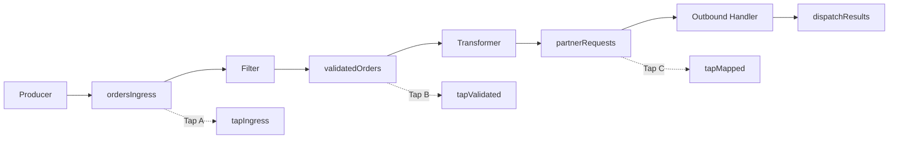
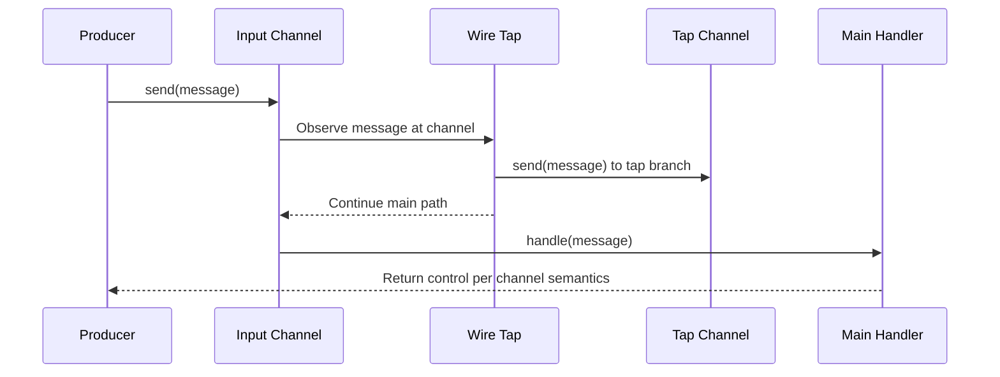
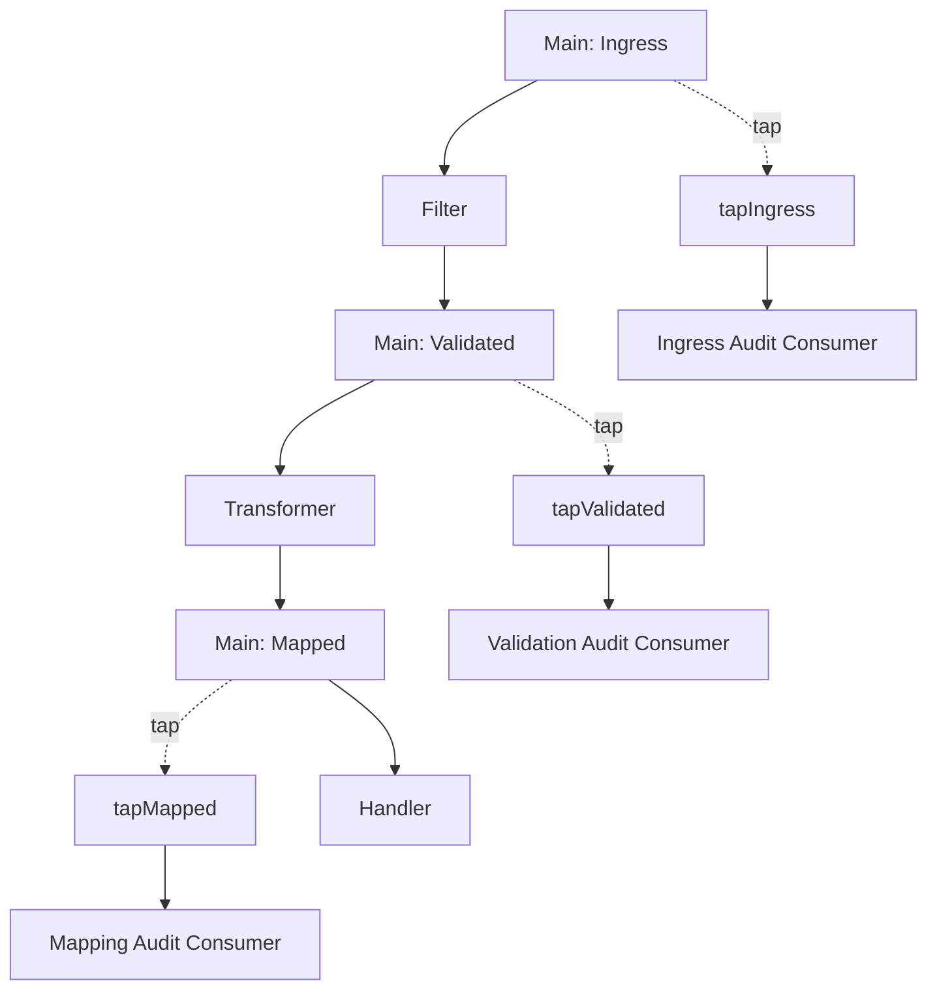
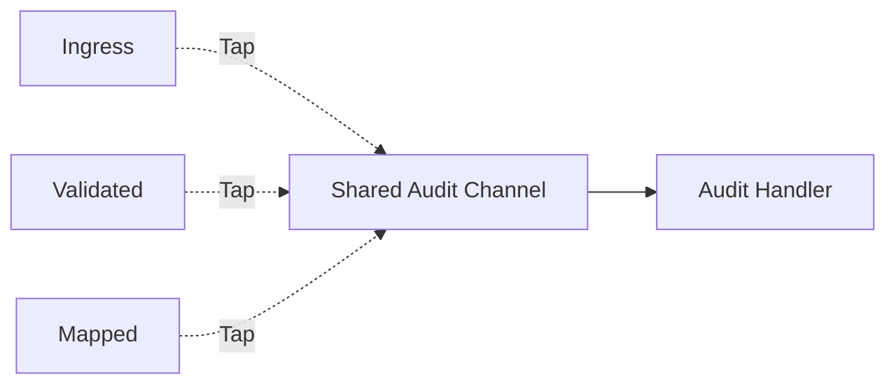
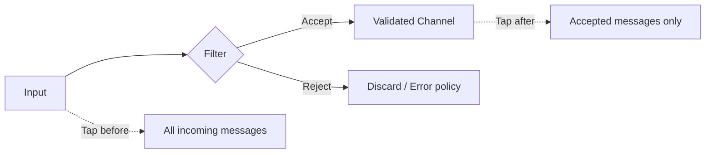
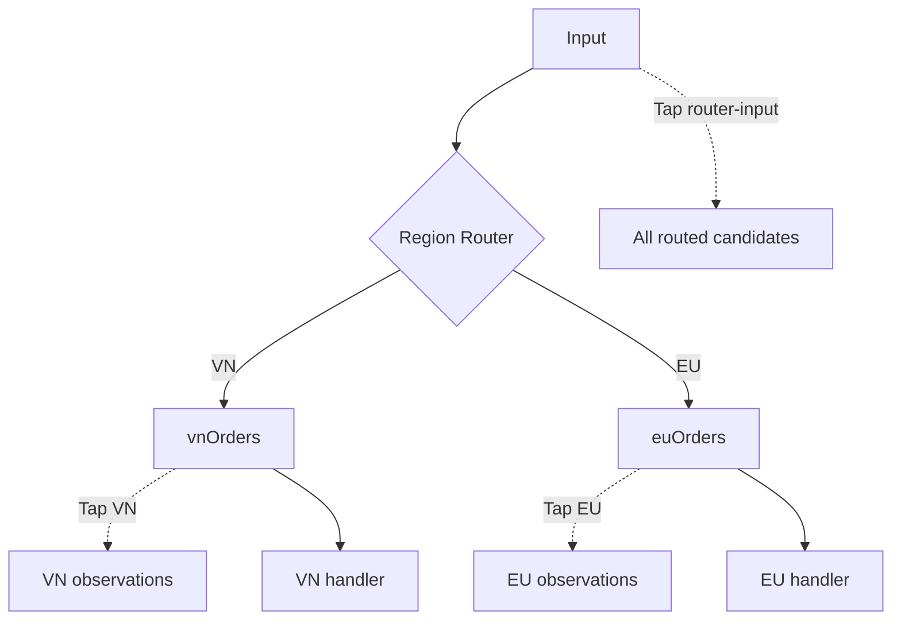
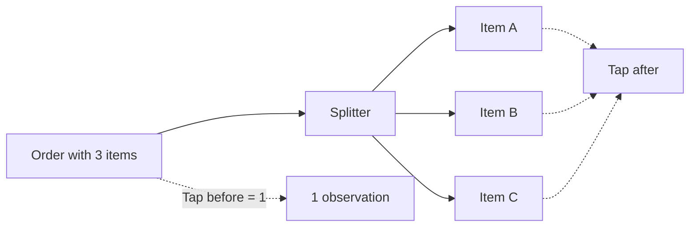
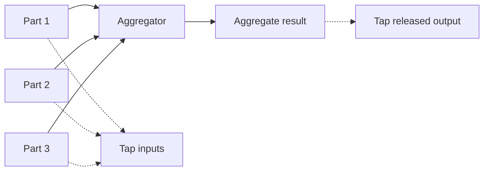
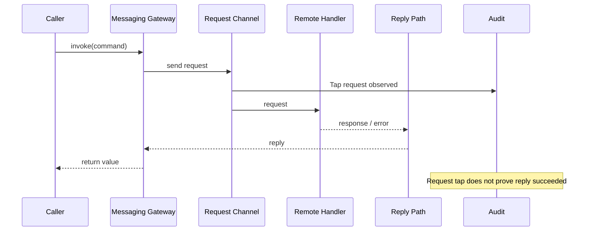

# Tapping Multiple Points in a Flow with Spring Integration

## 1. Problem: One Wire Tap Is Not Enough to Understand the Whole Integration Flow

An order-processing application typically has multiple steps:

1. Receive a request from a REST API or a message broker.
2. Validate structure and business rules.
3. Filter out invalid requests.
4. Transform internal DTOs into the partner's contract.
5. Choose a processing route or call an external service.
6. Receive the result and record completion status.

If you place a single **Wire Tap** right at the ingress, you know the message entered the application, but not whether it passed the Filter or Transformer. If you tap only before the outbound adapter, you see the outgoing request, but have no proof that the partner processed it successfully.

**Tapping multiple points in a flow** is the technique of placing Wire Taps at meaningful channels or processing boundaries to observe **intermediate states of the same request** without forcing the main business flow to perform extra observation work.

This lesson belongs to the **Wire tap** chapter of the **SPRING_INTEGRATION_PATTERN** module, where learners implement Enterprise Integration Patterns with Spring Integration to create loosely coupled, extensible, testable, and observable flows. Patterns such as Filter, Transformer, Router, Splitter, Aggregator, Gateway, retry, error channel, and correlation will be used to explain the meaning of each tap point.

After this lesson, you will know how to:

- Choose tap locations based on operational questions rather than attaching taps arbitrarily.
- Distinguish messages that are **received**, **accepted**, **mapped**, **dispatched to a handler**, and **successfully processed**.
- Configure multiple Wire Taps with dedicated tap channels using Spring Integration.
- Correlate observation records using a business identifier across the flow.
- Test both the main path and intermediate observation points.
- Control cost, errors, backpressure, ordering, sensitive data, and audit lifecycle.

## 2. Each Tap Answers a Different Question

Consider a simple flow:



| Tap point | What can be observed? | What must not be inferred |
|---|---|---|
| **Tap A — Ingress** | Message reached the input channel | Passed validation or finished processing |
| **Tap B — Validated** | Message passed the Filter before that channel | Downstream Transformer and outbound call are guaranteed to succeed |
| **Tap C — Mapped** | Request was created by the Transformer and sent to the corresponding channel | Remote service received or committed successfully |
| **Tap D — Result** (if added) | Handler produced a result sent to the result channel | All external side effects committed, unless guaranteed by the handler contract |

Critical distinction: **Wire Tap records an event at the channel it observes, not the success status of the entire workflow**.

For example, for order `O-42`:

```text
tapIngress:   O-42, OrderCommand, received
tapValidated: O-42, OrderCommand, passed-filter
tapMapped:    O-42, PartnerOrderRequest, ready-for-handler
```

These three observations represent **three different milestones**, not necessarily three independent business events. Summing them all as "order count" would triple-count a single request.

### Choosing semantic stage names

Instead of `tap1`, `tap2`, `tap3`, use:

- `ingress`: arrived at the input channel.
- `validated`: passed validation/filter.
- `mapped`: created payload per downstream receiver contract.
- `routed-vn` or `routed-eu`: routed to a specific branch.
- `reply-created`: business response was generated.
- `failure-observed`: an error event was received on an error path.

These names must reflect **where the observation happened**, never claiming `completed` or `committed` without real confirmation.

## 3. Wire Tap Mechanism in Spring Integration

Spring Integration can attach a Wire Tap to a `MessageChannel` as a `ChannelInterceptor`. When a message is sent through the channel, Wire Tap sends an observation copy to a separate tap channel; the message on the main path continues to the primary consumer per that channel's semantics.



Wire Tap by itself:

- Does not automatically convert `OrderCommand` into `PartnerOrderRequest`.
- Does not alter business content or Filter decisions.
- Does not automatically generate replies for a Messaging Gateway.
- Does not automatically guarantee durable audit persistence.
- Does not automatically guarantee tap-branch errors or latency will not affect the main path.
- Does not deep-copy payloads by default.

When placing **multiple taps**, all of these limitations still apply at **each** point. Three taps mean three places creating additional observation work and memory usage.

### Messages and headers across stages

A `Message<?>` carries a `payload` and `headers`. Across different stages, the payload type may change via a Transformer, while a business correlation ID can be preserved across steps.

Example:

```text
Ingress:
  payload: OrderCommand(orderId="O-42", sku="BOOK-01", quantity=2)
  headers.businessTraceId: "trace-order-42"

Validated:
  payload: OrderCommand(orderId="O-42", sku="BOOK-01", quantity=2)
  headers.businessTraceId: "trace-order-42"

Mapped:
  payload: PartnerOrderRequest(ref="O-42", product="BOOK-01", units=2)
  headers.businessTraceId: "trace-order-42"
```

Here, the payload changes **because of the Transformer**, not Wire Tap. An integration component may construct a new message wrapper with a different `id`/`timestamp`, so **never use `MessageHeaders.ID` as an identifier across all stages**. Set a stable business `businessTraceId` or `correlationId` with clear rules for creation and propagation.

## 4. Two Common Architectures for Multiple Tap Points

### Approach A — Separate tap channel per stage



**Pros:** each queue/channel already identifies the stage. The consumer can create audit records tagged `stage=ingress`, `stage=validated`, or `stage=mapped` **without modifying headers on the main message**.

**Cons:** the number of channels and consumers grows with the number of observation points; capacities must be monitored separately.

### Approach B — Tapping into a shared audit channel



**Pros:** one place to consume and emit logs/metrics.

**Risk:** if multiple taps send **the same payload and headers** to a shared channel, the audit consumer may **not know which stage an observation came from**. Wire Tap does not automatically add `stage` to metadata.

To share a channel safely, ensure the stage is identified using **one of these deliberate techniques**:

1. Each tap branch goes through its own audit adapter that wraps an `AuditEnvelope(stage, metadata)` before sending to the shared sink.
2. Use separate observation subflows that enrich headers **only on the audit copy**, leaving the main message unchanged.
3. Structure routing/sinks that know the source stage from topology or another defined contract.

Avoid adding a `stage` header directly onto every business message solely for auditing if doing so leaks metadata or breaks downstream contracts.

**The hands-on example below uses Approach A** to keep observation points unambiguous.

## 5. Hands-On Example: Tapping at Ingress, After Filter, and After Transformer

We build an in-JVM Spring Integration application:

- `ordersIngress`: receives `OrderCommand` before validation.
- `validatedOrders`: receives messages that passed the Filter.
- `partnerRequests`: receives DTOs after the Transformer.
- `dispatchResults`: receives simulated output from the main handler.
- Three distinct `QueueChannel`s to hold observations for testing.

The sample code aligns with Java 17+, Spring Framework 6.x, and Spring Integration 6.x. Check exact APIs against your project's version when integrating in production. This runs inside a single application context, **without real brokers or HTTP calls yet**.

### 5.1. Internal business DTO and partner-facing DTO

```java
// OrderCommand.java
package com.example.multitap;

public record OrderCommand(
        String orderId,
        String sku,
        int quantity
) {
}
```

```java
// PartnerOrderRequest.java
package com.example.multitap;

public record PartnerOrderRequest(
        String reference,
        String productCode,
        int units
) {
}
```

```java
// DispatchResult.java
package com.example.multitap;

public record DispatchResult(
        String orderId,
        String status
) {
}
```

These three types serve different purposes. Learners will notice that the ingress tap carries an `OrderCommand` payload, while the post-Transformer tap carries a `PartnerOrderRequest` payload.

### 5.2. Declaring multiple Wire Taps on named channels

```java
// MultiTapConfiguration.java
package com.example.multitap;

import org.springframework.beans.factory.annotation.Qualifier;
import org.springframework.context.annotation.Bean;
import org.springframework.context.annotation.Configuration;
import org.springframework.integration.channel.DirectChannel;
import org.springframework.integration.channel.QueueChannel;
import org.springframework.integration.channel.interceptor.WireTap;
import org.springframework.integration.config.EnableIntegration;
import org.springframework.integration.dsl.IntegrationFlow;

@Configuration
@EnableIntegration
public class MultiTapConfiguration {

    @Bean
    public QueueChannel tapIngress() {
        return new QueueChannel(20);
    }

    @Bean
    public QueueChannel tapValidated() {
        return new QueueChannel(20);
    }

    @Bean
    public QueueChannel tapMapped() {
        return new QueueChannel(20);
    }

    @Bean
    public QueueChannel dispatchResults() {
        return new QueueChannel(20);
    }

    @Bean
    public DirectChannel ordersIngress(
            @Qualifier("tapIngress") QueueChannel tap) {

        DirectChannel channel = new DirectChannel();
        channel.addInterceptor(new WireTap(tap));
        return channel;
    }

    @Bean
    public DirectChannel validatedOrders(
            @Qualifier("tapValidated") QueueChannel tap) {

        DirectChannel channel = new DirectChannel();
        channel.addInterceptor(new WireTap(tap));
        return channel;
    }

    @Bean
    public DirectChannel partnerRequests(
            @Qualifier("tapMapped") QueueChannel tap) {

        DirectChannel channel = new DirectChannel();
        channel.addInterceptor(new WireTap(tap));
        return channel;
    }

    @Bean
    public IntegrationFlow orderProcessingFlow() {
        return IntegrationFlow.from("ordersIngress")
                .filter(
                    OrderCommand.class,
                    command ->
                        command.orderId() != null
                        && !command.orderId().isBlank()
                        && command.sku() != null
                        && !command.sku().isBlank()
                        && command.quantity() > 0)
                .channel("validatedOrders")
                .transform(
                    OrderCommand.class,
                    command -> new PartnerOrderRequest(
                            command.orderId(),
                            command.sku(),
                            command.quantity()))
                .channel("partnerRequests")
                .handle(
                    PartnerOrderRequest.class,
                    (request, headers) ->
                        new DispatchResult(
                                request.reference(), "READY"))
                .channel("dispatchResults")
                .get();
    }
}
```

**Milestone breakdown:**

1. `ordersIngress` has its own Wire Tap: sees every message reaching input, including those later rejected by the Filter.
2. `filter(...)` allows only valid requests to proceed.
3. `validatedOrders` has its own Wire Tap: sees messages **after passing the Filter**.
4. `transform(...)` converts the internal DTO to the partner's contract.
5. `partnerRequests` has its own Wire Tap: sees the DTO **after the Transformer**, before the handler.
6. `handle(...)` simulates successful processing and creates `DispatchResult`.
7. `dispatchResults` is an in-memory result channel, not a tap point.

Each tap channel uses `QueueChannel(20)` so tests can inspect observations after the main flow runs. The queue is bounded, yet still **in-memory**, not a durable audit log.

**Scope limitation:** these channels operate within a single application. For production, add error handling, resource bounds, data policies, and real observation storage.

### 5.3. Sending a valid request

```java
import org.springframework.messaging.Message;
import org.springframework.messaging.support.MessageBuilder;

OrderCommand command =
        new OrderCommand("O-42", "BOOK-01", 2);

Message<OrderCommand> original = MessageBuilder
        .withPayload(command)
        .setHeader("businessTraceId", "trace-order-42")
        .build();

ordersIngress.send(original);
```

In this snippet, `ordersIngress` is injected into the producer. Because the main path uses `DirectChannel` and synchronous handlers, the send call traverses the processing steps synchronously before returning, unless a downstream component alters synchronicity.

Expected three observations:

| Tap channel | Payload type | Example content |
|---|---|---|
| `tapIngress` | `OrderCommand` | `("O-42", "BOOK-01", 2)` |
| `tapValidated` | `OrderCommand` | `("O-42", "BOOK-01", 2)` |
| `tapMapped` | `PartnerOrderRequest` | `("O-42", "BOOK-01", 2)` under new fields |

Even though the three field values match, **the data types and stage semantics differ**.

### 5.4. Testing all three taps and main output with JUnit

```java
// MultiTapConfigurationTest.java
package com.example.multitap;

import static org.junit.jupiter.api.Assertions.*;

import org.junit.jupiter.api.Test;
import org.springframework.beans.factory.annotation.Autowired;
import org.springframework.beans.factory.annotation.Qualifier;
import org.springframework.integration.channel.DirectChannel;
import org.springframework.integration.channel.QueueChannel;
import org.springframework.messaging.Message;
import org.springframework.messaging.support.MessageBuilder;
import org.springframework.test.annotation.DirtiesContext;
import org.springframework.test.context.junit.jupiter.SpringJUnitConfig;

@SpringJUnitConfig(MultiTapConfiguration.class)
@DirtiesContext(classMode = DirtiesContext.ClassMode.AFTER_EACH_TEST_METHOD)
class MultiTapConfigurationTest {

    @Autowired
    @Qualifier("ordersIngress")
    DirectChannel ordersIngress;

    @Autowired
    @Qualifier("tapIngress")
    QueueChannel tapIngress;

    @Autowired
    @Qualifier("tapValidated")
    QueueChannel tapValidated;

    @Autowired
    @Qualifier("tapMapped")
    QueueChannel tapMapped;

    @Autowired
    @Qualifier("dispatchResults")
    QueueChannel dispatchResults;

    @Test
    void observesInputValidatedAndMappedStages() {
        OrderCommand order =
                new OrderCommand("O-42", "BOOK-01", 2);

        Message<OrderCommand> original = MessageBuilder
                .withPayload(order)
                .setHeader("businessTraceId", "trace-order-42")
                .build();

        assertTrue(ordersIngress.send(original));

        Message<?> atInput = tapIngress.receive(1000);
        Message<?> afterFilter = tapValidated.receive(1000);
        Message<?> afterTransform = tapMapped.receive(1000);
        Message<?> mainResult = dispatchResults.receive(1000);

        assertNotNull(atInput);
        assertNotNull(afterFilter);
        assertNotNull(afterTransform);
        assertNotNull(mainResult);

        assertEquals(order, atInput.getPayload());
        assertEquals(order, afterFilter.getPayload());

        assertEquals(
                new PartnerOrderRequest("O-42", "BOOK-01", 2),
                afterTransform.getPayload());

        assertEquals(
                new DispatchResult("O-42", "READY"),
                mainResult.getPayload());

        for (Message<?> snapshot :
                new Message<?>[]{atInput, afterFilter, afterTransform}) {
            assertEquals(
                    "trace-order-42",
                    snapshot.getHeaders().get("businessTraceId"));
        }
    }

    @Test
    void rejectedOrderAppearsOnlyAtIngressTap() {
        Message<OrderCommand> invalid = MessageBuilder
                .withPayload(
                        new OrderCommand("O-42", "BOOK-01", 0))
                .setHeader("businessTraceId", "trace-invalid")
                .build();

        assertTrue(ordersIngress.send(invalid));

        assertNotNull(tapIngress.receive(1000));
        assertNull(tapValidated.receive(0));
        assertNull(tapMapped.receive(0));
        assertNull(dispatchResults.receive(0));
    }
}
```

Key takeaways from the results:

- A valid input appears at all three observation points, while still producing **only one business result** on `dispatchResults`.
- An input rejected by the Filter appears only at `tapIngress`; its absence from post-Filter taps is expected behavior.
- The payload type on `tapMapped` changed due to the Transformer.
- `businessTraceId` links the observations into a single logical journey.

**Never equate total audit records with processing executions.** In this example, one valid request produces three observations, not three order-processing commands.

The test uses separate queues and a fresh Spring context per test method so leftover messages from an earlier test do not affect results. These tests prove only the behavior of this topology, not durable auditing or production performance isolation.

## 6. Choosing the Right Tap Placement with Filter and Transformer

### Tapping before and after a Filter

A Filter can discard messages that fail criteria. Placed before the Filter, a tap still observes rejected requests. A tap after the Filter sees only requests that passed that step's condition.



**Note:** `Tap before - Tap after` is **not sufficient to accurately infer failed request counts** in all systems. Besides rejection, messages can encounter exceptions, retries, redeliveries, or alternate routes. To count rejections accurately, observe the Filter's `discardChannel` or error-reporting mechanism per design.

### Tapping before and after a Transformer

A Transformer alters payload or headers. Tapping on both sides helps compare:

- Input DTO vs. output DTO.
- Before–after data types/formats.
- Cases where the Transformer throws an exception.
- Cases where the Transformer produces a message rejected downstream.
- Which metadata is preserved or dropped per contract.

Do not rely on default `MessageHeaders` IDs to expect pre- and post-Transformer messages to share the same ID. When a component builds a new message, ID/timestamp can change. Use a stable business correlation ID.

**Security concern:** input payloads sometimes hold more sensitive information than transformed payloads. Placing a tap before a Transformer can collect data beyond audit requirements. Select only authorized stages and use redacted observation DTOs.

## 7. Tapping Before and After a Router

A Router selects a branch based on content or metadata. Depending on your operational question, you can tap at:

- The channel before the Router: total messages needing routing.
- The input channel of each branch after the Router: messages entering a specific branch.
- The merged channel after branches: outputs reaching the convergence point.



If the Router has a `defaultOutputChannel` or `resolutionRequired`, monitor default/error branches too. Tapping before the Router does not prove the Router successfully selected a branch.

**Do not confuse with Recipient List Router:** one message can be sent to multiple branches, so total post-Router observations can exceed input message count. Distinguish **logical messages** from **endpoint deliveries**.

### Multiple tap channels or one shared channel?

With a Router, having separate `vnTap` and `euTap` channels tells you where a message was routed. Sending both to a single `auditTapChannel` without adding stage metadata on the audit branch makes it impossible to tell which route was taken.

## 8. Tapping Around Splitter and Aggregator

### 8.1. Splitter changes cardinality

A message containing five order lines can be split by a Splitter into five child messages.

```text
Before Splitter: 1 request with 5 items
After Splitter:  5 item messages
```

Tapping before the Splitter observes the **original request**. Tapping on the channel after the Splitter observes **each item**.



Looking only at total post-Splitter taps can mislead you into thinking the system received three independent requests. For reconciliation, carry:

- Original request ID.
- Group correlation ID.
- Sequence number and sequence size.
- Per-item event ID if items trigger side effects or retries.
- Observed stage name.

### 8.2. Aggregator combines multiple messages into one result

An Aggregator typically holds messages in a group and emits output when its release strategy triggers.



Tapping at the Aggregator's input may see three items, while tapping at its output may see only **one** message once the group releases. If a group is incomplete or times out, the output tap may receive nothing.

A mismatch between pre- and post-Aggregator tap counts is not automatically an error. It is the natural effect of a **cardinality-changing pattern**.

**Key point:** correlation IDs group messages belonging to the same set; they do not automatically guarantee item ordering inside the output. If business logic requires ordering, enforce sequence/version per contract.

## 9. Tapping Around Gateways, Outbound Adapters, and Replies

A Request–Reply Gateway has two journeys:

1. **Request:** caller → request channel → handler/outbound gateway.
2. **Reply:** handler/outbound gateway → reply channel → caller.

Tapping only the request channel observes only request dispatch. It gives no proof that a reply was generated.



To observe replies, pick a **well-controlled reply point** or an endpoint after the handler with an explicit output channel. A Messaging Gateway's temporary `replyChannel` is not always convenient for attaching a fixed named Wire Tap.

One option is designing a flow with a named `responseReady` channel before returning the reply, and tapping that channel. Ensure `replyChannel` stays preserved, multiple replies are never sent to one caller, and the request–reply contract remains intact.

### Tapping before outbound is not a success audit

Tapping right before `Http.outboundGateway` proves only that the outbound handler **is about to receive the request**. The remote API can still time out or return 5xx. If success status is needed, log/audit after the client confirms the outcome per contract; for side-effecting operations, distinguish "received a response" from "remote committed" when status is ambiguous.

## 10. How Errors and Retries Multiply Tap Counts

Retries create **multiple attempts** for a single logical operation. Tap counts depend on where retries happen.

Example:

```text
Request A (logical operationId = op-42)
  -> Tap before retry advice: 1 observation
  -> HTTP call attempt #1: failure
  -> HTTP call attempt #2: failure
  -> HTTP call attempt #3: success
```

A tap on a channel before a handler wrapped in retry advice **will not necessarily see all three attempts**, because the advice may re-invoke the **same handler** without re-sending the message through the tapped upstream channel.

Conversely, if broker redelivery replays the message from the start of the integration flow, the ingress tap can observe the same event multiple times.

| Mechanism | Potential impact on taps |
|---|---|
| `RequestHandlerRetryAdvice` around handler | May retry inside the handler without re-sending through upstream channels |
| Kafka/RabbitMQ redelivery | May push the event through the input channel and tap it again |
| Retry topic/queue | Message may reappear at another stage or at a later time |
| Recovery callback / DLQ | Creates an additional error-tracking path when configured |
| Caller-initiated resend | One logical operation may appear multiple times with the same operation ID |

To avoid miscounting, distinguish:

- `operationId`: one logical business request.
- `eventId`: identifies an event.
- `deliveryAttempt`: broker delivery attempt for an event.
- `handlerAttempt`: internal retry attempt of a handler.
- `stage`: observation location.
- `observationId`: unique identifier of an observation record.

Not all attempt metadata exists automatically in `MessageHeaders`. Collect it from the appropriate retry/container component when accurate counts are required.

### Where to tap errors?

A tap on `errorChannel` can observe an `ErrorMessage` carrying the exception and failed message. However, error channels may apply to asynchronous paths or specific configurations; they do not automatically catch **every** exception in a synchronous flow.

When using taps on error paths:

- Pick the exact channel where errors are published.
- Identify the error type and originating stage.
- Redact exceptions, payloads, and credentials before storing.
- Distinguish business errors from failures in the observation system itself.
- Never swallow exceptions just to make metrics look clean.

## 11. Stitching Multiple Observations into One Timeline

A well-designed audit table should store **observation records** as dedicated entities rather than copying raw `Message<?>` objects unnecessarily.

Example logical schema:

| Field | Meaning |
|---|---|
| `observationId` | ID of the tap record |
| `businessTraceId` | Links all stages belonging to one logical operation |
| `stage` | Ingress, validated, mapped, outbound-ready... |
| `eventId` | Event identifier if present |
| `observedAt` | Timestamp when the system recorded the observation |
| `messageType` | Payload type at that stage |
| `outcome` | Observed, rejected, failed... strictly per source |
| `attempt` | Delivery/retry attempt number if reliable data exists |
| `sourceComponent` | Observed endpoint/channel name |
| `safeMetadata` | Only allowlisted fields |

Example timeline:

```text
businessTraceId = trace-order-42

10:01:00.001  ingress         OrderCommand          observed
10:01:00.003  validated       OrderCommand          observed
10:01:00.004  mapped          PartnerOrderRequest   observed
10:01:00.115  outbound-reply  PartnerResponse       received
10:01:00.118  completed       OrderResult           committed-by-handler
```

These timestamps and stages are **illustrative only**. In practice, a tap channel using `QueueChannel` + poller can make `observedAt` reflect **when the audit consumer pulled the copy**, lagging behind when the message actually passed the stage. To measure latency accurately, capture timestamps at the actual receipt/event point rather than assuming audit persistence time equals processing time.

### Never use default Message ID as a timeline ID

A Transformer can create a new message, changing the message ID. A Splitter also creates multiple child messages. Thus the `Message<?>` wrapper ID is not guaranteed to remain stable across the topology.

Generate `businessTraceId` before entering the flow and propagate it through properly designed components. For distributed tracing, use standard trace context propagation; do not overload one identifier arbitrarily for correlation, idempotency, and trace ID when their semantics differ.

### Audit envelope instead of raw message

The tap branch can convert a message into a dedicated observation DTO:

```java
// AuditObservation.java — illustrative DTO.
package com.example.multitap;

import java.time.Instant;

public record AuditObservation(
        String businessTraceId,
        String stage,
        String messageType,
        Instant recordedAt
) {
}
```

A dedicated observer for `tapMapped` can construct:

```java
AuditObservation observation = new AuditObservation(
        (String) message.getHeaders().get("businessTraceId"),
        "mapped",
        message.getPayload().getClass().getSimpleName(),
        Instant.now()
);
```

In this snippet, `message` is the message received from the **tap channel**; `Instant.now()` is when the observer creates the record, not automatically when the business event occurred. The audit DTO omits full payloads, tokens, and `replyChannel` references.

## 12. Isolating the Observation Branch from the Main Flow

When multiple taps are attached, a failing audit branch can introduce additional failure points and latency. **Wire Tap preserves main business routing by design, yet does not automatically guarantee isolation.**

### Tapping to DirectChannel

The tap consumer may run synchronously on the thread sending to the main channel. If the audit handler is slow, main sends slow down. If the tap handler throws an exception, it can impact the main send per the interceptor/channel's exception behavior.

### Tapping to QueueChannel

Tap messages are enqueued for later processing. When the queue has room, sending observations usually takes less time than direct audit I/O, yet:

- Queues can fill up.
- In-memory queues lose data on restart.
- Tap sends still have overhead and can block/fail depending on configuration.
- A slow consumer builds up backlog.
- Multiple tap points can compete for CPU and memory.

### Tapping to ExecutorChannel

Audit work moves to a thread pool. This reduces blocking, yet requires bounding workers, queues, rejection policies, and monitoring saturation. With multiple threads, audit completion order can differ from main processing order.

### Choosing clear goals

| Observation goal | Suggested architecture |
|---|---|
| Debugging a low-traffic flow | Direct tap + filtered logs, knowing the overhead |
| Best-effort metrics | Tap with sampling, bounded buffering, and dropped counts |
| Correlation tracing | Minimal audit DTO storing trace ID and stage |
| Auditing that must retain all events | Durable log/outbox or suitable transactional mechanism |
| Auditing must complete before business commit | Design transaction/validation as a business requirement, not an independent tap |
| High load and many stages | Limit tap count, minimize payloads, measure per-stage overhead |

If policy mandates one unlosable audit record for **every** committed transaction, an in-memory `QueueChannel` with Wire Tap alone is insufficient. Consider a transactional outbox or audit persistence inside the business transaction.

## 13. Sensitive Data Appearing Across Multiple Taps

This is a particular risk of **multi-point tapping**: the same data can be copied into multiple queues, logs, or monitoring systems, expanding the leak surface.

Example:

- `ingress` tap sees a DTO with email and shipping address.
- `validated` tap sees those same fields after validation.
- `mapped` tap sees only order ID and product code.
- `outbound` tap may additionally see an access token if HTTP headers were attached before the boundary.

If the goal is merely measuring transformation latency and record counts, there is no need to store full payloads at all three points.

### Protection principles

1. **Minimization:** capture only metadata needed for operational questions.
2. **Redaction:** strip tokens, passwords, cookies, and personal data per policy.
3. **Stage allowlist:** disallow recording raw payloads at unapproved stages.
4. **Never log raw `Message<?>`:** it may carry `Authorization`, `replyChannel`, `errorChannel`, and sensitive data.
5. **Access restrictions:** enforce permissions on dashboards, logs, DLQs, and audit stores.
6. **Retention:** set retention periods matching operational needs and security policy.
7. **Control error paths:** exceptions may echo remote service bodies or connection strings.
8. **Audit tracing baggage:** never place PII/tokens into widely propagated tags.

**Warning on mutable payloads:** Wire Tap is not a deep-copy operation. If an audit consumer mutates a shared payload object, the main handler can see corrupted data. The observation branch must treat tapped objects as **read-only**; if redaction is needed, construct a new `AuditObservation` instead of deleting fields on the original object.

## 14. Observing Ordering and Concurrency

Multiple tap points can mislead operators about ordering.

Suppose the main flow processes message A then B in order:

```text
Main:
  A -> validated -> mapped -> handler
  B -> validated -> mapped -> handler

Asynchronous tap consumers:
  tapMapped(B) logged at 10:00:01
  tapValidated(A) logged at 10:00:02
```

You cannot conclude from **audit consumer log order** that B traversed every stage before A. Queues, executors, retries, and clock skew can shift when observations are recorded.

To investigate:

- Correlate by `businessTraceId`.
- Record event sequence/version if available.
- Log stage/source and actual observation timestamp (if captured in the interceptor).
- Separate tap enqueue timestamp from audit consumer processing timestamp.
- Use broker partition/offset on Kafka-backed segments.
- Account for retries or redelivered messages.

**There is no global ordering** across independent tap channels unless you build and verify a dedicated serialization mechanism.

### Never use total tap counts to measure business throughput

One message can appear at multiple stages; a Splitter multiplies messages further. To count business commands, count by **unique operation ID at a defined stage**, or read appropriate endpoint metrics.

Example:

```text
100 incoming requests
   90 pass Filter
   90 converted by Transformer
   90 enter outbound-ready channel

Total observations across 3 taps = 280
Original requests = 100, not 280
```

This example assumes no retries/redeliveries and a one-to-one message mapping at each stage. In real systems, deduplicate before computing metrics.

## 15. When to Add Tap Points, and When to Stop?

A Wire Tap is valuable when it answers a question existing metrics or logs cannot answer. Attaching taps at **every** endpoint can cause:

- Storing redundant copies of identical information.
- Wasting CPU, RAM, log storage, and bandwidth.
- Increasing latency since interceptors run on the send path.
- Expanding security risk.
- Creating noisy timelines when stages/retries are not distinguished.
- Making audit queues and consumers harder to manage.

**Minimal selection workflow:**

1. Define the question: are messages lost before or after validation?
2. Pick two boundary points bracketing the suspect step.
3. Define minimal observation fields needed.
4. Standardize stage IDs and business correlation IDs.
5. Choose load isolation and tap failure handling.
6. Measure main-path latency before and after adding taps.
7. Remove taps that no longer add value or replace them with lighter metrics.

If you only need request counts and latency, endpoint Micrometer/observation metrics may suffice without copying full messages onto secondary queues.

## 16. Testing Errors and Flow Isolation

The tests in section 5 covered basic functionality. For production projects, add scenarios:

| Scenario | What to verify |
|---|---|
| Valid request | Taps see expected stages; main output produces exactly one result |
| Filter rejects | Only pre-Filter tap sees the request; discard/error follows policy |
| Transformer throws exception | Pre-Transformer tap has a record; post-Transformer tap has no output |
| Router sends to VN | Only VN branch tap observes if routing to a single destination |
| Splitter splits into three parts | Post-Splitter tap has three records sharing correlation with proper sequences |
| Aggregator group incomplete | Output tap does not fire before release |
| Broker redelivery | Stages may re-observe the same event; no double-counting |
| Internal handler retry | Tap before advice does not necessarily count every attempt |
| Audit queue full | Explicit policy and metrics apply; measure main latency |
| Audit consumer throws exception | Error handling neither swallows errors nor leaks unexpectedly to main flow |
| Main handler fails after mapped tap | Mapped observation is never treated as successful processing |
| Mutable payload | Audit does not mutate data processed by main flow |
| Application restart | Understand loss on in-memory tap queues and replay needs |
| Payload has credentials | Audit never logs sensitive data against policy |
| Concurrent messages | Correlation holds; global order never inferred from audit timestamps |

### The "one request — multiple observations — one result" test

This is the key test when introducing multiple tap points: we want multiple observations but only one business execution. Use a counter or mock on the main handler to verify invocation count while collecting exactly one message per tap. Never route the audit branch back into the main input unless explicitly intended for business reasons, preventing infinite message loops.

### Testing without an audit consumer

In the `QueueChannel` example, the main path can still run while the tap queue has capacity even with no consumer draining it. Once the queue fills, behavior changes. Never use test results from an empty queue to claim the system is completely isolated from audit failures.

## 17. Common Pitfalls When Tapping Multiple Points

**Pitfall 1 — Sharing one tap channel without recording stage.** An observation fails to show where it originated. Use separate channels or wrap an audit envelope on the secondary branch.

**Pitfall 2 — Treating each tap observation as a separate business event.** One request crossing three stages produces three observations, not three orders.

**Pitfall 3 — Seeing a message before outbound and concluding the remote call succeeded.** The tap only proves the request reached that channel.

**Pitfall 4 — Using default message IDs to join before and after a Transformer.** New messages can get new IDs; use a business correlation ID.

**Pitfall 5 — Forgetting that Filters drop messages.** Different counts before and after a Filter reflect intended design, not necessarily lost messages.

**Pitfall 6 — Ignoring Splitter/Aggregator cardinality.** Cardinality changes mean observation counts cannot be compared one-to-one without correlation/sequence.

**Pitfall 7 — Assuming QueueChannel taps never block the main path.** Queues can fill up; interceptors still carry overhead and can raise errors.

**Pitfall 8 — Letting audit consumers mutate mutable payloads.** Shared references may be used by the main flow. Create independent observation DTOs.

**Pitfall 9 — Tapping only the success path and ignoring discard/error/retry.** Timelines will have unexplained gaps while failure branches stay blind.

**Pitfall 10 — Logging entire payloads at every stage.** Creates redundant logs and multiplies data-exposure risk.

**Pitfall 11 — Interpreting audit persistence time as stage traversal time.** Async audit consumers can lag; track the true timestamp source.

**Pitfall 12 — Using Wire Tap instead of transactional auditing.** Wire Tap does not replace storage mechanisms with transactional and durability guarantees.

## 18. Process for Designing Multi-Point Taps

1. **Draw the main flow** with input, Filter, Transformer, Router, Splitter, Aggregator, Gateway, and outbound adapters.
2. **Define the question to answer** at each boundary.
3. **Choose unique, meaningful stage IDs** and name channels accordingly.
4. **Decide tap structure**: separate channels or a shared sink with an audit envelope.
5. **Define correlation IDs** across steps plus sequence/attempt rules.
6. **Specify allowed data fields** per stage.
7. **Isolate audit processing** using queues/executors/brokers sized for the load.
8. **Define tap failure policy**: best-effort or mandatory auditing?
9. **Set bounds**: capacity, timeouts, concurrency, sampling, and retention.
10. **Add discard/error/recovery observation** if full-lifecycle diagnostics are needed.
11. **Write tests** for every stage alongside main output and failure cases.
12. **Measure real overhead**, and prune redundant tap points.

## 19. Review Questions

1. Why is placing a Wire Tap only at ingress insufficient to know whether a Filter accepted a request?
2. How do pre-Transformer and post-Transformer taps differ in payload type and message ID?
3. Why might a shared tap channel not know which stage an observation came from?
4. How can you attach stage metadata without modifying the main message?
5. Does a tap on the outbound-ready channel prove the remote service committed successfully?
6. One request passing through three taps generates how many business events and how many observations?
7. Why do Wire Taps before and after a Splitter/Aggregator yield different message counts?
8. Why can't `MessageHeaders.ID` serve as a cross-step identifier throughout the flow?
9. When retry advice re-invokes a handler, is an upstream tap called again on every attempt?
10. Why can timestamps from three asynchronous audit consumers mislead operators about ordering?
11. If a tap queue fills up, is the main flow guaranteed to continue? What must be checked?
12. When should you use a transactional outbox instead of Wire Tap for auditing?
13. Which data should not be recorded at the ingress tap if requests carry credentials/PII?
14. When is tapping error/discard paths needed rather than tapping only the success path?
15. Which test verifies that multiple taps do not increase main handler execution count?

## 20. Implementation Checklist

- [ ] Each tap point has a clear observation goal and stage ID.
- [ ] Flow diagrams distinguish channel arrival from committed outcomes.
- [ ] Taps before/after Filter, Transformer, and Router sit at exact boundaries.
- [ ] Stable correlation ID exists, independent of message wrapper IDs.
- [ ] For shared audit channels, stage is added on the **audit copy**, without mutating the main message.
- [ ] Splitter/Aggregator cardinality is accounted for in metrics.
- [ ] Retries/redeliveries and duplicates do not distort business operation counts.
- [ ] Sensitive headers/payloads are redacted and access-restricted.
- [ ] Audit consumers never mutate shared mutable payloads used by the main flow.
- [ ] Tap queues/executors have explicit capacities and failure policies.
- [ ] Best-effort telemetry and mandatory auditing are clearly separated.
- [ ] Error/discard/recovery paths have observation points where needed.
- [ ] Tests prove main output correctness and that each tap captures its exact stage.
- [ ] Monitoring tracks tap backlog, dropped observations, and main-flow overhead.
- [ ] Taps no longer delivering value have been removed or replaced with lighter metrics.

**Remember:** Tapping multiple points in Spring Integration helps reconstruct **a message's journey across processing boundaries**. Every Wire Tap must tie to a meaningful stage and never be interpreted beyond what it actually observes. To trace accurately without disrupting the main flow, maintain stable correlation IDs, separate audit metadata from business payloads, and govern observation counts, resource costs, security, and error handling.
