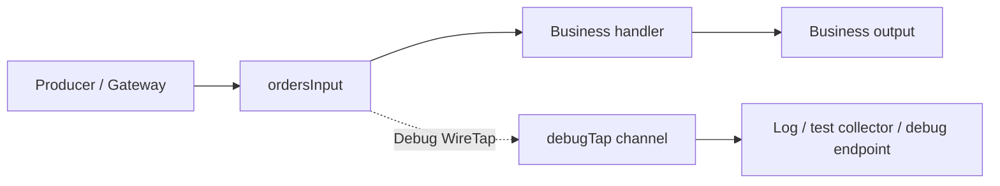
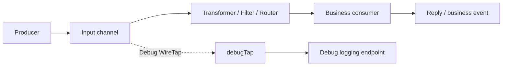
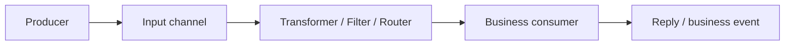
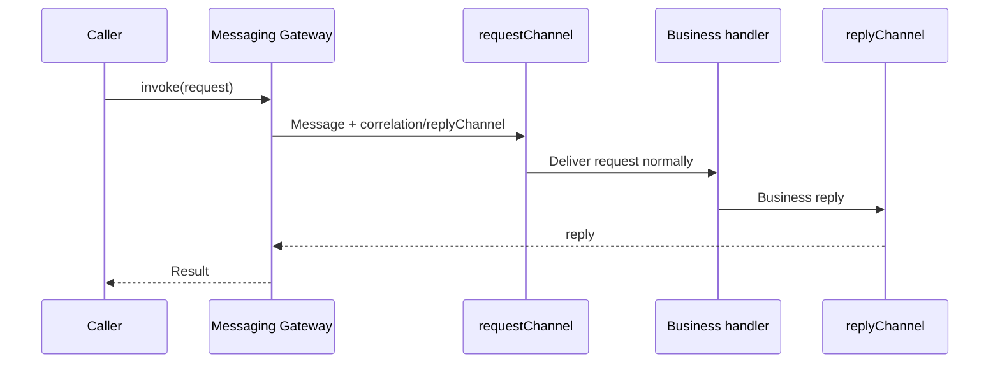

# Wire Tap — Removing Debug Wire Taps from Production in Spring Integration

## Learning Objectives

After this lesson, you will be able to:

- Explain why a **debugging Wire Tap** should not remain active and copy data by default in production.
- Locate every place a Wire Tap may be declared: `ChannelInterceptor`, Java DSL `.wireTap(...)`, global interceptors, XML, or conditionally enabled configurations.
- Remove the **debug branch** while keeping the primary business path, `replyChannel`, correlation, Router/Filter/Transformer steps, and mandatory audit taps intact.
- Build a production configuration free of debug Wire Taps, along with tests verifying messages are still processed properly and no unintended debug interceptors/consumers remain.
- Define rollout, rollback, access revocation, handling of previously collected logs/copies, and post-change measurement of latency/queues/errors.

This lesson belongs to the **Wire tap** chapter of the **SPRING_INTEGRATION_PATTERN** module. The module focuses on Enterprise Integration Patterns with Spring Integration to build loosely coupled and extensible message flows, practicing Router, Filter, Transformer, Splitter, Aggregator, Gateway, retry, error channel, correlation, testing, and branch observation. Here, the specific task is **removing debugging Wire Taps from production in a verifiable way**—not removing all observability from the application.

## 1. Why Must Debug Wire Taps Be Removed from Production?

Wire Tap is an integration pattern used to **observe a message at a point in a flow** and send a secondary branch to another channel/endpoint, while the message continues along the main business path.



During development, the secondary branch is handy for inspecting payloads, headers, routing, or when messages pass a channel. In production, however, a debug tap introduces several risks:

1. **Data leakage**: payloads and headers may contain tokens, customer data, transaction identifiers, or fields not yet sanitized before a Filter/Transformer.
2. **Increased latency**: interceptors run on message send; if a tap channel or synchronous tap endpoint runs slowly, the main path suffers.
3. **Resource consumption**: each message triggers an extra send/write; tap buffers and log volume scale with traffic.
4. **Unexpected backpressure**: a bounded tap channel can fill up; send/error behavior depends on the channel, interceptor, and specific configuration.
5. **Operational confusion**: tapped message count does not equal successful business message count; debug logs can be mistaken for proof of processing.
6. **Duplicate copies**: a flow with both a DSL Wire Tap and a manual interceptor can produce multiple observations, raising load and complicating diagnostics.

**The right goal** is not deleting all tracing and auditing, but removing **unapproved payload/header copying mechanisms used for debugging**. Structured logging, metrics, distributed tracing, or a properly secured audit flow can and usually should continue operating.

## 2. Distinguishing Debug Taps, Observability, and Mandatory Auditing

Before removing anything, identify what the tap was created for.

| Branch type | Example | Usually appropriate decision |
| --- | --- | --- |
| **Temporary debug Wire Tap** | Copies every request into `debugTap` and prints payload to troubleshoot | Remove from production after diagnosis completes |
| **Controlled metadata logging** | Logs `eventId`, `correlationId`, endpoint name, latency | Keep if approved; avoid logging secret payloads |
| **Distributed tracing** | Traces/spans across endpoints/adapters | Keep per sampling and data-protection policies |
| **Mandatory auditing** | Records proof of order status changes or transactions | Do not remove arbitrarily; ensure storage, access control, and durability |
| **Business fan-out branch** | `PublishSubscribeChannel` broadcasting events to billing and notifications | This is a business flow, not a debug tap to delete |
| **Error channel** | Receives `ErrorMessage` from asynchronous endpoints | Keep error handling and alerting paths; never replace with Wire Tap |

Core distinction: a **debug tap** observes a message passing through a channel; **business auditing** must prove an event or transaction was actually recorded. A message arriving at `ordersInput` may still be dropped by a Filter or throw an exception in a downstream handler. Therefore, Wire Tap data at the start of the pipeline cannot serve as proof that a transaction committed.

If a Wire Tap is currently being used as "mandatory auditing", do not simply delete it and call the job done. Migrate that capability to an approved design, such as durable business events, a transactional outbox, and an idempotent consumer.

## 3. Inventorying All Ways Wire Tap May Be Configured

A Spring Integration project has multiple ways to activate a debug branch. When reviewing configurations **in lessons or systems you are authorized to edit**, inspect both channel and endpoint declarations—not just a single `wireTap` string.

### 3.1. `ChannelInterceptor` on a channel

Example of Wire Tap added directly to a `DirectChannel`:

```java
@Bean("ordersInput")
DirectChannel ordersInput(
        @Qualifier("debugTap") MessageChannel tapChannel) {
    DirectChannel input = new DirectChannel();
    input.addInterceptor(new WireTap(tapChannel));
    return input;
}
```

In this configuration:

- `ordersInput` is the **tapped channel**.
- `WireTap` is the interceptor attached to that channel.
- `debugTap` is the **tap channel** receiving observed messages.
- A `@ServiceActivator`, logging handler, or polling flow may act as the **tap endpoint** consuming from `debugTap`.

Deleting only the endpoint reading `debugTap` **without removing the interceptor** does not turn off the tap: messages can still be pushed into the debug channel and build up backlog.

### 3.2. Wire Tap in Java DSL

Another declaration style:

```java
@Bean
IntegrationFlow ordersFlow() {
    return IntegrationFlow.from("ordersInput")
        .wireTap("debugTap")
        .transform(String.class, String::trim)
        .handle(String.class, (id, headers) -> "ACCEPTED:" + id)
        .channel("ordersProcessed")
        .get();
}
```

The tap branch is declared inside the DSL flow. When removing debugging, **remove only the `.wireTap("debugTap")` operator**, leaving Transformer/Service Activator steps, input channel, and output channel untouched. If a dedicated intermediate channel existed solely to host the tap, verify that removing that channel does not alter thread boundaries, ordering, or send contracts.

### 3.3. Broad-scope or conditionally enabled interceptors

Places to search within editable configuration scope:

- `WireTap` or `ChannelInterceptor` beans registered via global interceptor mechanisms, such as `@GlobalChannelInterceptor` or equivalent configuration.
- XML `<int:wire-tap>` / channel interceptor configs when the project uses Spring Integration XML namespaces.
- Beans created via Spring profiles, properties, feature flags, environments, or `@Conditional...`.
- Dedicated debug `IntegrationFlow`s, logger endpoints, or bridges to brokers existing solely to consume taps.
- Instrumentation paths added by shared libraries/configs or imported across multiple application contexts.
- Debug channels under other names like `loggingChannel`, `traceTap`, `auditDebug`, or `wiretapQueue`.

**Distinguish configuration sources from actual runtime state.** Silencing a logger with `logging.level=OFF` does not necessarily detach `WireTap` from the channel: the interceptor may still send messages and the tap channel may still buffer copies. Changing a property on a running machine also does not automatically recreate or detach beans/interceptors. For configurations resolved at startup, verify the deployed artifact and **restart/roll out** according to your application's deployment process.

## 4. Safe Removal Procedure: Change Only the Debug Branch

Before editing, map both paths:



Desired state after the change:



Steps:

1. **Confirm purpose and owner.** Verify the branch is temporary debugging, not a contractual audit or business subscriber.
2. **Locate tap attachment points.** Which channel is it on, before or after Transformer/Filter, in DSL or an interceptor? Are there duplicate declarations?
3. **Trace the secondary branch destinations.** List tap channels, tap-reading endpoints, output queues/brokers, loggers, metrics, or file sinks serving only debugging.
4. **Preserve the main path.** Do not alter request inputs, Routers, Filters, Transformers, `outputChannel`, `replyChannel`, or Service Activators if still needed.
5. **Detach the tap emitter.** Remove the `WireTap` interceptor or `.wireTap(...)` operator. Then clean up **debug-only** beans/channels/endpoints once no other consumer uses them.
6. **Do not delete shared branches.** If `auditTap` serves both debugging and policy-mandated auditing, separate the contracts first; never delete a bean just because its name looks like "debug".
7. **Test logic and runtime state.** Verify business messages still reach the right handlers, debug copies are gone, and errors still route appropriately.
8. **Roll out and monitor.** Confirm the debug tap is truly absent in the deployed build; monitor latency, errors, queue depth, log volume, and request–reply metrics.

A small configuration edit in the wrong spot can break an `IntegrationFlow`. Therefore, run tests covering the main path before and after—do not rely solely on the application starting up cleanly.

## 5. Before Removal Example: Wire Tap Enabled for Debugging

Suppose an application receives order IDs on `ordersInput`, normalizes them, discards blank strings, and returns processing statuses on `ordersProcessed`. While troubleshooting, the development team added a `debugTap` to inspect unnormalized messages.

Here is the **pre-removal configuration snippet**, showing only tap-related beans:

```java
import org.springframework.beans.factory.annotation.Qualifier;
import org.springframework.context.annotation.Bean;
import org.springframework.integration.channel.DirectChannel;
import org.springframework.integration.channel.QueueChannel;
import org.springframework.integration.channel.interceptor.WireTap;
import org.springframework.messaging.MessageChannel;

@Bean("debugTap")
QueueChannel debugTap() {
    return new QueueChannel(64);
}

@Bean("ordersInput")
DirectChannel ordersInput(
        @Qualifier("debugTap") MessageChannel debugTap) {
    DirectChannel input = new DirectChannel();
    input.addInterceptor(new WireTap(debugTap));
    return input;
}
```

A debug endpoint might poll `debugTap` and log:

```java
@ServiceActivator(
    inputChannel = "debugTap",
    poller = @Poller(fixedDelay = "200", maxMessagesPerPoll = "10")
)
public void debugLog(Message<?> message) {
    // DO NOT ship this payload-printing logger to production.
    System.out.println("DEBUG TAP payload=" + message.getPayload());
}
```

The endpoint above illustrates **what needs to be removed**: it can print raw payloads, including unsanitized data. If messages arrive faster than the logger drains them, `QueueChannel(64)` can fill up. This code illustrates the legacy setup, not a recommendation for production.

When removing, do not delete only `debugLog(...)`. If `WireTap` remains attached to `ordersInput`, messages will keep entering `debugTap` with no consumer, causing backlog and risking main-flow disruption.

## 6. Post-Removal Configuration: Business Path Unchanged

`ProductionOrderFlowConfiguration.java`:

```java
import org.springframework.context.annotation.Bean;
import org.springframework.context.annotation.Configuration;
import org.springframework.integration.annotation.EnableIntegration;
import org.springframework.integration.channel.DirectChannel;
import org.springframework.integration.channel.QueueChannel;
import org.springframework.integration.dsl.IntegrationFlow;
import org.springframework.messaging.MessageChannel;

@Configuration
@EnableIntegration
public class ProductionOrderFlowConfiguration {

    @Bean("ordersInput")
    public DirectChannel ordersInput() {
        // Do not register WireTap or debug interceptors.
        return new DirectChannel();
    }

    @Bean("ordersProcessed")
    public QueueChannel ordersProcessed() {
        return new QueueChannel(20);
    }

    @Bean
    public IntegrationFlow ordersFlow() {
        return IntegrationFlow.from("ordersInput")
            .transform(String.class, String::trim)
            .filter(String.class, orderId -> !orderId.isBlank())
            .handle(String.class, (orderId, headers) ->
                "ACCEPTED:" + orderId)
            .channel("ordersProcessed")
            .get();
    }
}
```

Key points:

- The `ordersInput` bean still exists with the same name and `DirectChannel` type; producers need no changes.
- `IntegrationFlow` still invokes the Transformer, Filter, and Service Activator in the same order.
- `ordersProcessed` still receives business results after the handler. It is **not** a debug channel.
- No `debugTap` bean, `WireTap`, or debug endpoint remains in this production configuration.
- Business headers like `correlationId` still travel with messages according to endpoint propagation rules. Removing Wire Tap is no reason to strip headers.
- `QueueChannel(20)` holds unread messages in RAM; it does not provide durability across restarts. This is a demo choice for testing output, not a durable production queue solution.

If the application uses DSL instead of an interceptor, the equivalent change is even simpler:

```java
// BEFORE: Has debug branch.
IntegrationFlow.from("ordersInput")
    .wireTap("debugTap")
    .transform(String.class, String::trim)
    .handle(String.class, (id, headers) -> "ACCEPTED:" + id)
    .channel("ordersProcessed")
    .get();

// AFTER: Preserve business logic, remove only the .wireTap(...) operator.
IntegrationFlow.from("ordersInput")
    .transform(String.class, String::trim)
    .handle(String.class, (id, headers) -> "ACCEPTED:" + id)
    .channel("ordersProcessed")
    .get();
```

These two DSL snippets are **illustrative configuration alternatives**, not two flows to register simultaneously on the same input in one application context. In real code, keep all existing Filter/Router steps—this minimal snippet highlights only the `.wireTap(...)` line.

## 7. Testing to Prove Removal Without Breaking the Flow

Do not conclude "removed" just because `debugTap` no longer appears in one class. Verify the **runtime channel state** and **business path** inside the actual context used for deployment.

JUnit 5 + Spring Test example for the configuration in section 6:

`ProductionOrderFlowTest.java`:

```java
import static org.junit.jupiter.api.Assertions.assertEquals;
import static org.junit.jupiter.api.Assertions.assertFalse;
import static org.junit.jupiter.api.Assertions.assertNotNull;
import static org.junit.jupiter.api.Assertions.assertNull;
import static org.junit.jupiter.api.Assertions.assertTrue;

import org.junit.jupiter.api.Test;
import org.springframework.beans.factory.annotation.Autowired;
import org.springframework.beans.factory.annotation.Qualifier;
import org.springframework.context.ApplicationContext;
import org.springframework.integration.channel.DirectChannel;
import org.springframework.integration.channel.QueueChannel;
import org.springframework.integration.channel.interceptor.WireTap;
import org.springframework.messaging.Message;
import org.springframework.messaging.support.MessageBuilder;
import org.springframework.test.context.junit.jupiter.SpringJUnitConfig;

@SpringJUnitConfig(ProductionOrderFlowConfiguration.class)
class ProductionOrderFlowTest {

    @Autowired
    ApplicationContext context;

    @Autowired
    @Qualifier("ordersInput")
    DirectChannel ordersInput;

    @Autowired
    @Qualifier("ordersProcessed")
    QueueChannel ordersProcessed;

    @Test
    void removesDebugTapAndStillProcessesBusinessMessage() {
        // Inspect the live channel, not just source code.
        assertTrue(ordersInput.getInterceptors()
            .stream()
            .noneMatch(WireTap.class::isInstance));

        assertFalse(context.containsBean("debugTap"));

        Message<String> request = MessageBuilder
            .withPayload("  ORD-42  ")
            .setHeader("correlationId", "req-42")
            .setHeader("eventType", "order.requested")
            .build();

        assertTrue(ordersInput.send(request));

        Message<?> output = ordersProcessed.receive(1_000);
        assertNotNull(output);
        assertEquals("ACCEPTED:ORD-42", output.getPayload());
        assertEquals("req-42",
            output.getHeaders().get("correlationId"));
        assertEquals("order.requested",
            output.getHeaders().get("eventType"));
    }

    @Test
    void keepsFilterBehaviorAfterRemovingTap() {
        assertTrue(ordersInput.send(
            MessageBuilder.withPayload("   ").build()
        ));

        // Blank strings after trimming are still dropped by the Filter.
        assertNull(ordersProcessed.receive(0));
    }
}
```

**Verified by tests:**

1. `ordersInput` contains no `WireTap` in its interceptor list.
2. The `debugTap` debug bean does not exist in the test context.
3. Input payloads with whitespace are still normalized; output receives `ACCEPTED:ORD-42`.
4. `correlationId` and `eventType` headers still propagate along the business path.
5. The Filter still rejects blank strings as before.

**Test limitation:** `@SpringJUnitConfig(ProductionOrderFlowConfiguration.class)` loads only the specified configuration class. Real production apps might still have `@GlobalChannelInterceptor`, auto-configuration, or other modules adding Wire Taps. Therefore, add an **integration/smoke test loading the full application context and actual production profile** to verify no debug interceptors/sinks remain at runtime.

Test both sender and receiver sides: producers still send successfully; consumers are still invoked properly; no records reach debug sinks; metrics and error handling were not unintentionally disabled.

## 8. If a Tap Must Remain in Dev Only: Conditional Activation and Fail-Closed

Removing it completely from production is the simplest solution. If the team still needs a debug tap for development and bug reproduction, isolate it in an **opt-in, dev/local-only** configuration that defaults to off.

Example split into a separate class using Spring Boot `@ConditionalOnProperty`:

`OptionalDebugTapConfiguration.java`:

```java
import org.springframework.beans.factory.annotation.Qualifier;
import org.springframework.boot.autoconfigure.condition.ConditionalOnProperty;
import org.springframework.context.annotation.Bean;
import org.springframework.context.annotation.Configuration;
import org.springframework.context.annotation.Profile;
import org.springframework.beans.factory.SmartInitializingSingleton;
import org.springframework.integration.channel.DirectChannel;
import org.springframework.integration.channel.QueueChannel;
import org.springframework.integration.channel.interceptor.WireTap;
import org.springframework.integration.dsl.IntegrationFlow;
import org.springframework.integration.dsl.Pollers;

@Configuration(proxyBeanMethods = false)
@Profile("!prod & (local | dev)")
@ConditionalOnProperty(
    prefix = "diagnostics.wiretap",
    name = "enabled",
    havingValue = "true"
)
public class OptionalDebugTapConfiguration {

    @Bean("debugTap")
    public QueueChannel debugTap() {
        return new QueueChannel(64);
    }

    @Bean
    public SmartInitializingSingleton installDebugTap(
            @Qualifier("ordersInput") DirectChannel input,
            @Qualifier("debugTap") QueueChannel debugTap) {
        // Registered only during application context initialization.
        return () -> input.addInterceptor(new WireTap(debugTap));
    }

    @Bean
    public IntegrationFlow debugTapConsumer() {
        return IntegrationFlow.from(
                "debugTap",
                spec -> spec.poller(Pollers.fixedDelay(200))
            )
            .handle(message -> {
                // Dev only: log metadata, never log payloads/secrets.
                Object correlation =
                    message.getHeaders().get("correlationId");
                System.out.println("debug corr=" + correlation);
            })
            .get();
    }
}
```

In this example:

- `ProductionOrderFlowConfiguration` always creates the business flow and **never registers a tap**.
- `OptionalDebugTapConfiguration` is evaluated only under matching profiles, **excluding `prod`**, and when `diagnostics.wiretap.enabled=true`.
- When the property is disabled, neither the `debugTap` bean nor the Wire Tap interceptor from this class exists.
- `@Profile` adds an extra guardrail, not a substitute for release-pipeline configuration checks. Profile names must match project conventions.
- `SmartInitializingSingleton` illustrates attaching the interceptor **at context startup**; changing the property after startup does not automatically attach or detach interceptors. Changing it requires a controlled reload strategy or rollout/restart.
- The example logger prints only the correlation ID, and production should use properly configured logging/tracing rather than keeping ad hoc debug hooks.

Default configuration should be:

```properties
diagnostics.wiretap.enabled=false
```

As a precaution, validate the production profile in CI/CD. Do not rely solely on property files checked into the repository: environment variables, Config Server, or startup flags can override them.

### Testing against accidental production activation

Write an application test running under the **actual production profile**—even intentionally enabling the debug property—to confirm the debug configuration class still does not activate. Conceptual example:

```java
@SpringJUnitConfig({
    ProductionOrderFlowConfiguration.class,
    OptionalDebugTapConfiguration.class
})
@ActiveProfiles("prod")
@TestPropertySource(properties = {
    "diagnostics.wiretap.enabled=true"
})
class ProductionProfileTapTest {

    @Autowired
    ApplicationContext context;

    @Autowired
    @Qualifier("ordersInput")
    DirectChannel ordersInput;

    @Test
    void neverInstallsDebugTapInProd() {
        assertFalse(context.containsBean("debugTap"));
        assertTrue(ordersInput.getInterceptors()
            .stream()
            .noneMatch(WireTap.class::isInstance));
    }
}
```

This test requires the same JUnit/Spring Test imports as section 7, plus `@ActiveProfiles` and `@TestPropertySource`. It verifies **two illustrative classes**; in a real application, expand the test to cover all auto-scanned/global interceptor configurations and paths to debug sinks.

## 9. Never Accidentally Remove Error Channels, Correlation, or Request–Reply

Wire Tap may sit on a request flow backed by a Gateway. When detaching the tap, the request–reply path must stay intact:



**What to keep:**

- `requestChannel` to which `@MessagingGateway` sends messages.
- Transformers, Filters, Routers, Splitters/Aggregators, and Service Activators doing actual work.
- `replyChannel` / correlation headers per the flow contract; a debug Wire Tap is not the Gateway's reply receiver.
- `errorChannel` or actual error-handler configurations handling exceptions, especially on pollers/async endpoints.
- Timeouts, retries, idempotency, processing state, and metrics needed for operations.

**What to remove if debug-only:** Wire Tap interceptors, temporary tap channels, payload-logging endpoints, and subscriptions/queues/file sinks created solely to hold observed messages. If the name "audit" is shared by both debug logs and business auditing, classify them before deleting anything.

Cascading startup failures can occur if you delete a channel bean while leaving a consumer behind, such as `@ServiceActivator(inputChannel = "debugTap")` with no channel or no messages arriving. Always inspect **both ends** of the debug branch, and never alter the step order of the main flow.

## 10. Impact of Removing Taps on Latency and Backpressure

A Wire Tap is an interceptor on the channel's send point. Its impact depends on:

| Tap channel/endpoint | Potential impact while enabled | After removal |
| --- | --- | --- |
| `DirectChannel` with synchronous logger | Tap endpoint may run on sending thread, increasing `send()` time | Removes auxiliary work from the send path |
| Bounded `QueueChannel` | Can accumulate backlog or hit congestion when full | Stops pushing debug copies into that queue |
| `ExecutorChannel` | Submits tasks to executor, consuming threads/queue and possibly failing independently | Stops generating debug tasks at that tap point |
| Outbound broker from tap | Raises publish rate, serialization, storage cost, and retries | Reduces broker load if no other debug producers remain |
| Logger printing full payloads | Increases log volume and data-leak risk | Stops emitting **new records** from the debug path |

**Never promise a specific percentage speedup.** If the tap was inactive or heavily sampled, the difference may be negligible. If a synchronous logger was blocking, removal can noticeably improve p95/p99 latency. Compare metrics **before and after under the same load profile** before drawing conclusions.

If a debug queue already held a backlog, removing the producer does not automatically clear queued messages or delete old logs from centralized log stores. Handle existing data under retention and security policies without accidentally deleting valid audit data.

### Why not just turn off the log level?

`logging.level.com.example=OFF` may stop a logger from emitting text, yet **does not guarantee**:

- `WireTap` interceptor was removed from the channel.
- Messages stopped entering `debugTap`.
- Buffers stopped holding messages.
- Another tap endpoint stopped forwarding messages to a broker, file, or database.

Therefore, the definition of "removed" is **zero active debug-copying branches** in the production application context/routes—not merely "no DEBUG lines on the console".

## 11. Rollout, Verification, and Rollback

An effective release process can be structured around clear gates:

### Before merging

- Confirm the tap's owner and purpose. If it is mandatory auditing, an approved replacement must be in place.
- Document all related channels/endpoints/sinks; distinguish debug branches from business branches.
- Ensure the change removes only the debug tap without dropping inputs/outputs, `replyChannel`, `errorChannel`, or Router/Filter/Transformer steps.
- Run unit/integration tests covering payloads, headers, message counts, and consumers; test the full production profile configuration.
- Capture current logs/metrics as a baseline.

### During rollout

- Deploy to a small subset of instances first if infrastructure supports canary or rolling deployments.
- Verify new instances **register no debug WireTap** and publish nothing to debug sinks.
- Check request–reply paths, error handling, latency, throughput, broker metrics, and business outputs.
- Keep track of older instances still running taps during transition; do not assume the entire cluster is clean while old replicas remain.

### After rollout

- Reconcile live runtime configurations/profiles against code conditions.
- Ensure no orphaned debug channels/consumers/queues remain, or schedule safe infrastructure decommissioning.
- Review existing logs and retention windows per policy. **Removing Wire Tap does not automatically delete old data.**
- Revoke unnecessary read permissions on debug sinks; address any sensitive data already captured (e.g., rotate credentials if exposed).
- Update runbooks: which channels remain observed, which metrics replace the debug tap for diagnostics, and when temporary debugging is permitted.

### Safe rollback

If a release causes a regression by accidentally affecting the main flow, roll back code/config per deployment procedures, **without automatically re-enabling full-payload logging in production** before assessing risk. Restore business behavior while keeping the debug tap off, or use less invasive diagnostics (metrics/tracing/sampled metadata).

If a production incident needs investigation, prefer an observation method approved for data safety and retention. "Turning Wire Tap back on as before" is not harmless if the tap path receives sensitive information.

## 12. Common Implementation Mistakes

| Mistake | Consequence | Fix |
| --- | --- | --- |
| Deleting the debug logger while leaving `WireTap` | Debug queue keeps filling, potentially causing backpressure | Remove the tap interceptor/operator first, then clean up unused sinks |
| Removing `.wireTap(...)` in only one flow | Global interceptors or other flows still copy messages | Inventory all registration sources and test at runtime |
| Using `logging.level=OFF` to claim the tap is off | Channel still sends copies; resources are still consumed | Inspect interceptors and routes to tap sinks |
| Deleting `auditTap` without checking purpose | Loses business evidence or breaks compliance | Separate debugging, observability, and mandatory auditing |
| Accidentally deleting `outputChannel` or `replyChannel` | Messages fail to reach consumers/callers | Edit only the tap branch; test request–reply |
| Deleting error channels alongside debug taps | Async errors lose observable handling | Keep error handlers, metrics, and alerts independent |
| Testing only a single config class in isolation | Production still has auto-config/global Wire Taps | Test the full context with production profile and canary |
| Enabling a temporary feature flag and forgetting to turn it off | Debug capture keeps running after investigation | Opt-in defaulting to false, with owner/deadline and deploy checks |
| Assuming stopping the producer deletes collected data | Old logs remain in brokers/collectors/storage | Enforce retention, revoke access, and remediate exposure |
| Re-enabling unlimited taps during an incident | Increases load, worsening performance problems | Use sampling, allowlists, time bounds, and safe channels |
| Keeping mutable payloads in a tap and mutating objects | Main flow can see unexpected mutations | Never mutate data in tap endpoints; use separate audit DTOs |
| Defining success solely as "no more logs" | Can miss regressions or hidden taps | Verify interceptors, sinks, business outputs, and metrics |

## 13. Hands-On Exercises

**Exercise 1 — Detaching an interceptor.** Create a `DirectChannel` with `WireTap` and a debug `QueueChannel`. Send a message to confirm the observation branch receives data. Then switch to `ProductionOrderFlowConfiguration`; verify no `WireTap` exists and the business flow still emits `ACCEPTED:...`.

**Exercise 2 — Removing a DSL tap.** Build a flow with `.wireTap("debugTap")` before the Transformer. Remove only that operator and debug-only beans. Compare payloads, `correlationId`, and message counts on `ordersProcessed` before and after.

**Exercise 3 — Checking Filter behavior.** Send `"  ORD-42  "` and `"   "`. Verify valid requests are normalized and blank requests are discarded as before; removing the tap must not alter Filter logic.

**Exercise 4 — Accidental debug flag activation.** Use the conditional profile configuration from section 8. Activate the `prod` profile and set `diagnostics.wiretap.enabled=true` in a test; verify no `debugTap` bean and no `WireTap` registered by that config exist.

**Exercise 5 — Gateway path.** Create a `@MessagingGateway` calling a handler after `ordersInput` with a reply configured; remove Wire Tap while keeping `replyChannel` and `correlationId`. Confirm the caller still receives the right reply and timeout/error behavior is unchanged apart from reduced debug capture.

**Exercise 6 — Tap overload.** Before removal, use `QueueChannel(2)` as the debug sink and send a burst; observe blocking or error risks. After removal, measure messages processed on the main flow and confirm the debug backlog is no longer fed.

**Exercise 7 — Previously collected data.** Simulate a debug sink that recorded metadata and dummy tokens. Write a plan for retention/deletion, revoking read access, and handling leaked credentials; distinguish debug data from mandatory audits.

**Exercise 8 — Testing the production context.** Add a global debug interceptor in a test configuration to demonstrate that removing a tap from one `IntegrationFlow` is insufficient. Add full-context/route checks and avoid relying on a minimal config test as sole proof.

**Completion criteria:** explain where the debug tap was attached, what the debug consumer was, which changes removed only the secondary branch, which tests prove the main flow is unchanged, and what controls ensure production deployments no longer copy data unintentionally.

## 14. Key Takeaways

- **Removing a debug Wire Tap from production** means detaching the **temporary copying/observation path** from runtime—not merely muting log lines, and never deleting valid metrics, tracing, or auditing.
- Inventory channel interceptors, Java DSL `.wireTap(...)`, global interceptors, profile/flag configurations, tap channels, and tap endpoints thoroughly.
- Keep the business path, `replyChannel`, correlation, error channels, and Router/Filter/Transformer steps intact; prove it with payload/header tests and production-profile context tests.
- If debugging is still needed in local/dev, use **default-off** configuration, enabled intentionally and blocked in production. Never assume changing a runtime property automatically detaches interceptors.
- After rollout, verify the new tap state, system load, and **previously stored** debug data; follow retention, access-control, and sensitive-data remediation procedures.
