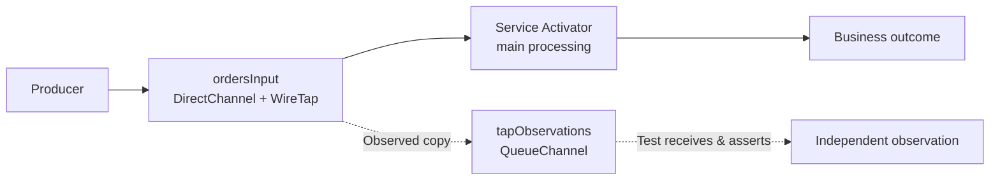
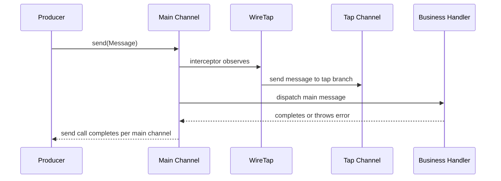
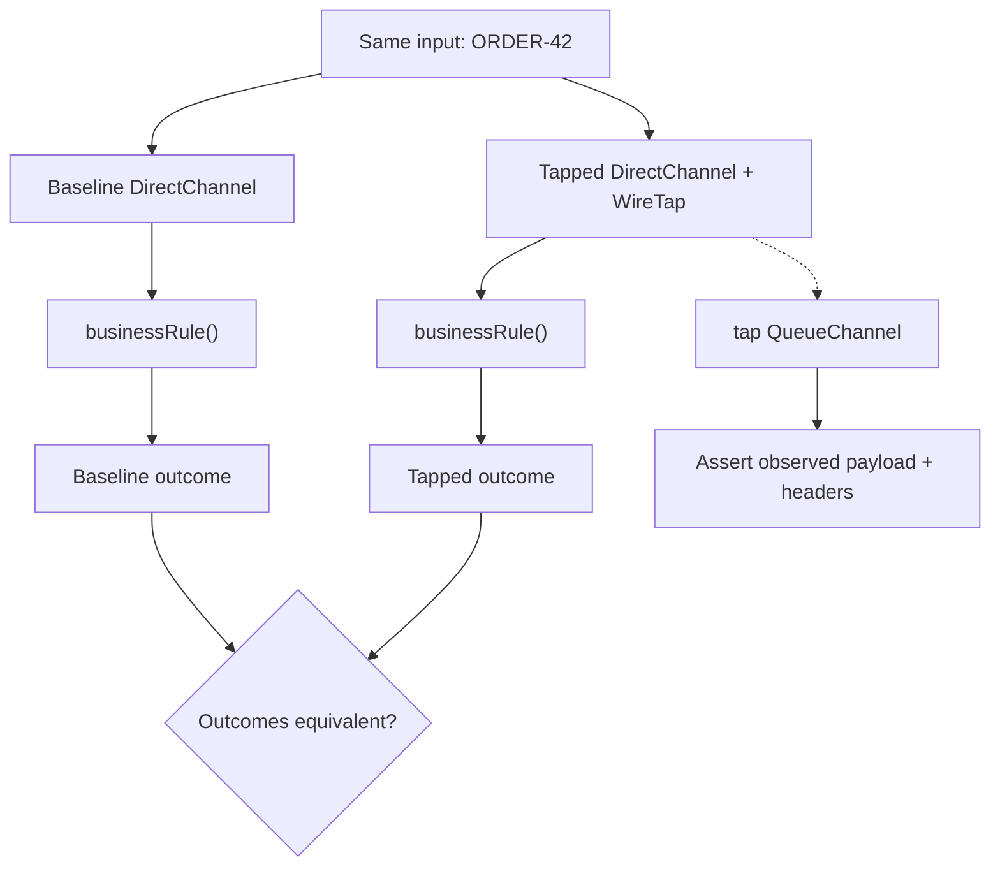
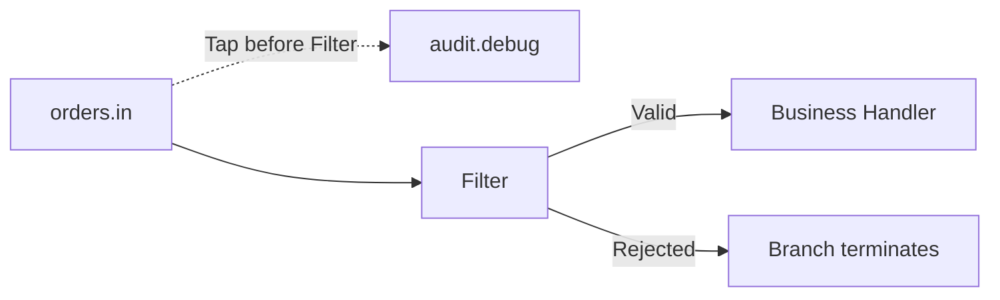

# Testing That Wire Tap Does Not Change the Main Outcome in Spring Integration

## 1. Problem: Adding Observation While Preserving Business Behavior

When adding a **Wire Tap** for logging, auditing, or debugging, we usually want to know which channel a message passed through, what correlation ID it carried, and whether its content at that stage matches expectations. However, adding an observation branch also introduces **an extra message-send operation** and potentially additional handlers, queues, or executors. If misconfigured, the secondary branch can slow down, break, or alter the behavior of the main flow.

**The goal of "Testing that a tap does not change the main outcome"** is verifying a clear contract:

> Given the same input and business conditions, the main processing outcome with Wire Tap enabled must be equivalent to the outcome without Wire Tap; acceptable side impacts such as observation-branch latency or failure must be explicitly defined and tested separately.

This lesson belongs to the **Wire tap** chapter in the **SPRING_INTEGRATION_PATTERN** module. This module practices Spring Integration Enterprise Integration Patterns (EIPs): Router, Filter, Transformer, Splitter, Aggregator, Gateway, retry, error channel, and correlation. Testing Wire Tap is a classic example of preserving behavior when adding observability to a message-based flow.



In this diagram, the primary `DirectChannel` continues dispatching messages to the Service Activator. The tap sends messages to a `QueueChannel` so tests can read them via `receive()`. This is a simple choice for testing a **passive observation branch** without connecting a database, logging stack, or external broker yet.

### After this lesson, you will be able to

- Identify which properties of the main flow must remain unchanged when Wire Tap is active.
- Build **baseline vs. tapped** comparison tests on the same input.
- Verify business outcomes, handler invocation counts, and observed payloads/headers.
- Test the effects of errors, latency, full queues, and mutable payloads.
- Distinguish business-flow correctness from logging/audit reliability.
- Design integration tests for flows involving Filter, Transformer, Router, and correlation.

## 2. Understanding Wire Tap Semantics Properly Before Testing

In Spring Integration, `WireTap` is typically used as a `ChannelInterceptor`. It observes messages passing through a `MessageChannel` and sends the message to a **tap channel**. The main message path remains owned by the original channel and its associated business endpoints.



The diagram depicts the basic flow. **Never assume the tap branch is always asynchronous.** If the tap channel is a `DirectChannel` and its observer is slow, the observer typically runs on the synchronous send path and can impact latency. If it is a `QueueChannel` or `ExecutorChannel`, consider capacity, consumption schedule, executor rejections, and error handling.

**Wire Tap does not mean deep-copying the payload.** The message envelope and headers follow Spring Messaging's immutability contract, yet the payload can point to a mutable object visible to both the main and tap branches. An observer mutating the payload can alter business data. Thus, proper tests must check *data*, *execution counts*, and *error/timing semantics*—not just two log lines appearing.

### 2.1. What constitutes the "main outcome"?

Depending on the system, the main outcome may include:

| Aspect | Example test criterion |
| --- | --- |
| Output payload | Same input produces the same `OrderResult` object or normalized value |
| Business side effects | Number of order saves, inventory updates, or business events emitted does not increase |
| Routing | Filter and Router still pass, drop, or route to the exact same branch as baseline |
| Business errors | Invalid inputs are still rejected, never turned into successes by the tap |
| Key headers | `correlationId`, idempotency keys, and contract metadata are not altered unexpectedly |
| Required ordering | Messages requiring sequential order are still processed per defined rules |
| Response/timeout | With a Gateway, the response remains correct and within acceptable latency bounds |

Do not require two runs to have **identical timestamps, threads, newly generated message IDs in downstream steps, or exact microsecond latencies**. Those values can differ without any business bug. Compare the fields that **truly form the application's contract**.

### 2.2. Receiving a tapped message does not mean business success

If a tap sits before a Filter, the tap branch can still observe a message that the Filter later drops. If a tap sits before a Service Activator, it can receive the message before the main handler fails. Therefore:

- "Tap received the message" proves the message reached the **observation point**.
- "Business handler completed" must be verified at the **output/side effect of the business handler**.
- "Business audit succeeded" must rely on an **authoritative completion event**, never inferred from an ingress tap log.

That is why tests must observe both the main branch and the secondary branch independently.

## 3. Designing Control Tests (Baseline vs. Tapped)

The clearest testing pattern uses **two equivalent main channels**:

1. **Baseline:** a `DirectChannel` without Wire Tap, dispatching to a handler executing the same business rule.
2. **Tapped:** a `DirectChannel` with `WireTap` attached sending to an observation `QueueChannel`; the main handler executes the exact same rule as baseline.
3. Send the same **immutable** input to both branches.
4. Compare business outcomes and handler invocation counts.
5. Read from the tap channel to verify the observed payload and headers, while checking no extra observation messages appear in a simple scenario.



Each channel has exactly **one** business subscriber to verify invocation counts. Do not subscribe an audit handler as a second business consumer on `DirectChannel` itself: `DirectChannel` dispatches to a single selected subscriber rather than multicasting to all handlers like `PublishSubscribeChannel`. The Wire Tap interceptor creates the dedicated observation branch.

## 4. JUnit 5 Example: Proving the Main Outcome Stays Unchanged

This example uses Java 17+, Spring Boot 3.x, and a compatible Spring Integration version. In a Maven project using Spring Boot dependency management, declare:

```xml
<dependencies>
    <dependency>
        <groupId>org.springframework.boot</groupId>
        <artifactId>spring-boot-starter-integration</artifactId>
    </dependency>
    <dependency>
        <groupId>org.springframework.boot</groupId>
        <artifactId>spring-boot-starter-test</artifactId>
        <scope>test</scope>
    </dependency>
</dependencies>
```

The test below instantiates channels directly, so it does not need to boot a full Spring Boot context. This cleanly verifies **channel and interceptor semantics** before moving into full flows.

### 4.1. Test comparing outcome, invocation count, and observed message

Create `src/test/java/com/example/integration/WireTapOutcomeTest.java`:

```java
package com.example.integration;

import java.util.Locale;
import java.util.concurrent.atomic.AtomicInteger;
import java.util.concurrent.atomic.AtomicReference;

import org.junit.jupiter.api.Test;
import org.springframework.integration.channel.DirectChannel;
import org.springframework.integration.channel.QueueChannel;
import org.springframework.integration.channel.interceptor.WireTap;
import org.springframework.messaging.Message;
import org.springframework.messaging.support.MessageBuilder;

import static org.junit.jupiter.api.Assertions.*;

class WireTapOutcomeTest {

    @Test
    void tapKeepsBusinessOutcomeAndInvocationCount() {
        DirectChannel baseline = new DirectChannel();
        DirectChannel tapped = new DirectChannel();

        // Read from tap after the main flow send finishes.
        QueueChannel observations = new QueueChannel(4);
        tapped.addInterceptor(new WireTap(observations));

        AtomicInteger baselineCalls = new AtomicInteger();
        AtomicInteger tappedCalls = new AtomicInteger();
        AtomicReference<String> baselineResult = new AtomicReference<>();
        AtomicReference<String> tappedResult = new AtomicReference<>();

        baseline.subscribe(message -> {
            baselineCalls.incrementAndGet();
            baselineResult.set(businessRule(message.getPayload()));
        });

        tapped.subscribe(message -> {
            tappedCalls.incrementAndGet();
            tappedResult.set(businessRule(message.getPayload()));
        });

        Message<String> input = MessageBuilder
                .withPayload(" order-42 ")
                .setHeader("correlationId", "flow-42")
                .build();

        assertTrue(baseline.send(input));
        assertTrue(tapped.send(input));

        // 1. Main outcome does not change.
        assertEquals("ORDER-42", baselineResult.get());
        assertEquals(baselineResult.get(), tappedResult.get());

        // 2. Tap does not trigger extra business executions.
        assertEquals(1, baselineCalls.get());
        assertEquals(1, tappedCalls.get());

        // 3. Tap branch observes the exact message data.
        Message<?> observed = observations.receive(0);
        assertNotNull(observed);
        assertEquals(input.getPayload(), observed.getPayload());
        assertEquals(
                input.getHeaders().get("correlationId"),
                observed.getHeaders().get("correlationId")
        );

        // 4. For one input and no retries, there is no extra tap copy.
        assertNull(observations.receive(0));
    }

    private static String businessRule(Object payload) {
        return String.valueOf(payload)
                .trim()
                .toUpperCase(Locale.ROOT);
    }
}
```

When run, the test must pass every assertion. If an assertion fails, identify whether the discrepancy is in the **main business flow**, **handler invocation count**, or **observation branch**, then inspect the corresponding configuration.

### 4.2. Why choose QueueChannel for the tap in this test?

`QueueChannel(4)` lets Wire Tap place messages into a small buffer so the test itself can retrieve them via `receive(0)`. The test does not need an audit handler introducing side effects. Only one input message is sent, so capacity 4 suffices for the happy path.

Choosing a queue **does not prove the tap branch is always safe under load**. With many messages, the queue can fill; the system needs explicit policies for overflow, timeouts, and errors. The test in section 4 only asserts equivalence in a simple scenario while the observation branch has spare capacity.

`receive(0)` is used to fetch already-present data without waiting long. Avoid blocking indefinitely on `receive()` in tests because a misconfigured tap could hang the test suite.

### 4.3. Must the preserved result be the exact same object?

Not necessarily. If a handler constructs a new result DTO on each invocation, two objects may have different object identities while being equivalent in **business key, status, amount, or asserted data**. In real tests, assert on stable business fields rather than `assertSame()` between two results.

Similarly, when a Transformer creates a new message, `messageId` and timestamp may change. Assert ID preservation only where the application contract explicitly requires it.

## 5. Testing Error Flows: Wire Tap Must Never Mask Business Failures

A critical property is that **enabling a tap must not cause a real main-handler error to be reported as success**.

On a main flow using `DirectChannel` and a synchronous handler, exceptions propagate through the send call. We can write an independent test:

```java
@Test
void tapDoesNotTurnBusinessFailureIntoSuccess() {
    DirectChannel main = new DirectChannel();
    QueueChannel observations = new QueueChannel(2);

    main.addInterceptor(new WireTap(observations));
    main.subscribe(message -> {
        throw new IllegalStateException("Order validation failed");
    });

    Message<String> invalid = MessageBuilder
            .withPayload("INVALID-ORDER")
            .build();

    // RuntimeException may be wrapped by Spring Integration
    // in a MessagingException, so do not over-constrain the specific class.
    assertThrows(RuntimeException.class, () -> main.send(invalid));

    // Tap sits before the handler so it may still observe the failing input.
    assertNotNull(observations.receive(0));
}
```

Add this test as another method in the same `WireTapOutcomeTest` class. The imports from the previous example still apply.

This test shows that in this synchronous topology, when the main handler fails, the caller still observes an error. It does **not** prove tap errors and business errors share the same handling, nor does it automatically prove a failed message was retried.

### 5.1. Tap-branch failures require a separate test

Next, simulate the tap observer throwing an exception or the tap destination rejecting messages. The expected outcome must follow **product policy**:

- **Best-effort debugging:** the system typically prioritizes keeping the main result; the debug branch may drop an observation while emitting loss metrics if needed.
- **Mandatory auditing:** if the audit record is a precondition for accepting the transaction, the system may need to reject or coordinate compensation; test both business and audit consistency.
- **Synchronous tap:** a slow or failing observer can affect the main send path.
- **Asynchronous tap:** test dedicated error handling, such as an error channel or worker/consumer retries.

Never write a blanket assertion claiming "errors in any tap can never affect the main flow". That property must be **designed and proven against your actual topology**.

## 6. Testing Data and Header Preservation

### 6.1. An immutable envelope does not mean the payload is immutable

The primary example uses `String`, making the payload safe to share between main and tap. However, if the payload is a mutable `ArrayList<OrderLine>` or mutable entity, both branches see the exact same object inside the message.

Suppose the tap observer removes the first element from the list and the main handler then sums the list to calculate total price. With a synchronous tap, the main outcome can change even though Wire Tap never called a Transformer.

To prevent this:

1. Prefer immutable payloads, Java records/immutable DTOs, or read-only structures.
2. Mandate that tap observers **never mutate payloads or mutable headers**.
3. When auditing is needed, build a separate snapshot DTO containing only allowed fields instead of passing mutable objects to the audit system.
4. Test that inputs and data seen by the main handler are untouched when the tap is enabled.

A simple test for mutable types captures a pre-send snapshot of values and asserts business fields remain unchanged after the observer runs. If asynchronous processing is involved, wait for both branches to finish before asserting.

### 6.2. Which headers should be preserved?

| Header / metadata | How to test |
| --- | --- |
| `correlationId` | Tap observes the expected request/flow value; downstream receives the expected value |
| `replyChannel` | In request–reply flows, replies return to the right caller even with the tap enabled |
| Business key / idempotency key | Unmodified by audit code; handler uses the exact key |
| `messageId` | Can be asserted at the specific tap point if needed; do not assume every Transformer keeps the same ID |
| Timestamp | Check reasonable bounds or presence, never exact equality across two runs |
| Error/cause metadata | When observing error flows, verify the exact error and correlation to the original message |

Do not make tests overly brittle by asserting equality on system headers that get regenerated, causing failures even when business results are correct.

## 7. Testing Wire Tap with Other EIPs

### 7.1. With Filter



If a message is dropped by the Filter, **a tap placed before the Filter still sees the message**. Proper tests must assert:

- Tap observes the incoming message.
- Business handler is **not** invoked for the rejected message.
- Tap does not alter the Filter's decision compared to baseline.

A tap after the Filter sees only messages that passed the Filter. Tests must know the tap's exact position before comparing message counts.

### 7.2. With Transformer

If a Transformer converts a JSON `String` into an `Order`, a tap before the Transformer sees `String`; a tap after the Transformer sees `Order`. Tests verify that the business output matches baseline and compare payloads at the **exact stage**, instead of assuming every tap sees the same type.

### 7.3. With Router

A tap attached before a Router does not prove which branch a message entered. To verify routing, assert on the destination channel/handler receiving the right message. Add taps to individual branches only for observation; business routing must remain unchanged.

### 7.4. With Splitter/Aggregator

One input may be split into multiple messages and later aggregated. Verify element count, `correlationId`, sequence numbers, and Aggregator output per contract. The number of tap events varies depending on **tap placement** (before Splitter, on individual branches, or after Aggregator), while the final aggregated result must not change unexpectedly.

### 7.5. With Gateway

In request–reply flows, checking only that `send()` returns `true` is **not enough**. Invoke the Gateway or `MessagingTemplate.sendAndReceive()` and assert on the reply payload, errors, and timeouts. The tap must never hijack `replyChannel` or replace the endpoint generating the response. If the tap adds latency, measure it against the caller's timeout budget.

## 8. Testing Speed, Load, and Fault Isolation

A single-message test is only a starting point; it does not evaluate what happens when the system receives thousands of messages or when the tap destination backs up.

| Scenario | Primary output to check | Tap branch to check |
| --- | --- | --- |
| Slow tap handler | Result remains right; latency stays within contract bounds | Whether backlog/latency grows |
| Tap queue reaches capacity | Never assume producer can still send all messages | Full-queue policy, timeouts, drop metrics |
| Executor rejects tasks | Business result follows chosen policy | Rejections, error handling, recovery behavior |
| Audit store outage | Chosen fail-open/fail-closed policy executes properly | Retries, durable persistence, alerts |
| Business message retried | Main side effects do not exceed idempotency contract | Tap may observe multiple attempts |
| Multiple consumers | Outcome and ordering per business key | Tap does not change dispatch semantics |
| Application restart | Business messages recover per designed mechanism | Observations in in-memory queues may be lost |

### 8.1. Measuring latency with and without the tap

Run load tests with the same request count, message sizes, and environment. Measure **p50/p95/p99 latency** of the main flow with the tap off vs. on, along with throughput and error counts. Avoid comparing total duration of two single runs because JVM warm-up, schedulers, I/O, and GC introduce noise.

If the tap channel is a `DirectChannel`, observer code may sit directly on the synchronous send path. If it is an `ExecutorChannel` or `QueueChannel`, still monitor executor pressure, queue depth, and full-queue effects. Asynchrony only creates an execution boundary; it does not grant infinite resources.

### 8.2. Testing multiple messages and duplicates

If a producer sends 100 valid messages without retries or sampling and the tap is configured to forward all messages, a test can wait until:

- The main handler has completed exactly **100** times, no more.
- Business results cover all 100 business IDs.
- The tap observer received the expected event count matching the tap point.
- Zero business side effects were triggered by the tap branch.
- No unbounded queue growth or shutdown hang occurs.

If sampling or a message selector is active, tapped message count will be **lower** and must be asserted against the sampling/selector policy rather than forced to equal main-flow count.

## 9. Making Tests Deterministic

For synchronous main branches using `DirectChannel`, asserting immediately after `send()` works in simple examples. When switching to `ExecutorChannel`, `QueueChannel`, or external systems, synchronize on **completion events**.

Useful techniques:

- Use a `CountDownLatch` or thread-safe collector to wait for handler/observer completion with a finite timeout.
- Use dedicated test queues to collect results rather than asserting on log output order.
- Assign unique correlation IDs per test case to avoid cross-test interference.
- Reset in-memory test state between cases so leftover messages from one test never break another.
- Never use fixed `Thread.sleep()` calls and guess that async tasks have finished.
- Separate "main result is correct" tests from "audit is durably persisted" tests; the two requirements have different completion conditions.

Example waiting on an asynchronous handler in a test:

```java
CountDownLatch completed = new CountDownLatch(1);
AtomicReference<String> outcome = new AtomicReference<>();

// Inside the handler under test:
outcome.set("ORDER-42-ACCEPTED");
completed.countDown();

// Inside the test:
assertTrue(completed.await(3, TimeUnit.SECONDS));
assertEquals("ORDER-42-ACCEPTED", outcome.get());
```

The snippet assumes `java.util.concurrent.CountDownLatch`, `TimeUnit`, and JUnit 5 assertions are imported. When running multiple cases in parallel, isolate state or collectors per case cleanly.

## 10. What Does Each Test Prove?

A common mistake is drawing overly broad conclusions from a single test.

| Assertion / test | What you can conclude | What you cannot conclude yet |
| --- | --- | --- |
| Baseline and tapped produce the same `OrderResult` | Main outcome is equivalent in the tested case | Tap has zero performance/load impact |
| Main handler invoked exactly once | No duplicate business execution in this case | Exactly-once across crashes/retries |
| Tap receives expected payload/headers | Tap observed the message at the intercepted channel | Business transaction committed |
| Business exception still surfaces | Tap did not mask the business error in the tested topology | All tap failures are isolated |
| Tap queue still has capacity | Secondary branch received the test message | Behavior when the queue is full |
| Audit repository contains a record | Record existed when the test checked | Audit and business commit are atomic |
| Load test meets SLA | Design met targets in the test environment and load profile | Always meets SLA under every workload |

For **strict auditing** requirements, you may also need tests for transactions, transactional outboxes, idempotency, dead-letter/retry flows, log access controls, and retention. Wire Tap itself does not provide these guarantees.

## 11. Checklist Before Accepting Wire Tap in Production

- [ ] Identical inputs produce identical business outcomes with the tap off and on.
- [ ] Main handler invocation counts, side effects, and routing outcomes do not increase unexpectedly.
- [ ] Critical headers such as correlation/idempotency keys remain intact.
- [ ] The tap branch never mutates mutable payloads used by business logic.
- [ ] Business handler failures were tested to confirm they are not falsely reported as successes.
- [ ] Tap-branch errors, slowdowns, and overloads were tested per the chosen fail-open or fail-closed policy.
- [ ] Main-flow latency and throughput were measured with the tap enabled.
- [ ] Logs/taps contain only necessary fields; sensitive data is masked or omitted.
- [ ] If durable auditing is required, durability, retries, duplicates, and restart recovery were tested separately.
- [ ] Asynchronous tests wait on explicit conditions rather than arbitrary sleep durations.

## 12. Knowledge Self-Check

1. Why should `assertEquals(baselineResult, tappedResult)` be paired with an assertion on the main handler invocation count?
2. If a tap is placed **before a Filter** and observes a message that is later rejected, can you conclude business logic accepted that message?
3. The payload is a mutable `ArrayList`, and the observer calls `clear()`. How can the business outcome be affected, and what test catches this?
4. If the tap branch's `QueueChannel` fills up, is a single-message test enough to prove the main flow is safe?
5. In a Gateway → Transformer → Router → handler flow, which outputs and headers would you check to prove Wire Tap did not alter the primary outcome?

**Remember:** Testing Wire Tap requires **two independent sets of evidence**: the main branch still produces the right outcome and side effects; the observation branch receives the expected data at the tap point. Beyond that, test errors, load, timeouts, mutable payloads, and recovery based on product requirements. A passing test under normal conditions is an important foundation, but does not replace testing operational policies.

**References:** [Spring Integration Reference](https://docs.spring.io/spring-integration/reference/) (Wire Tap, Message Channels, Testing) and [Enterprise Integration Patterns — Wire Tap](https://www.enterpriseintegrationpatterns.com/patterns/messaging/WireTap.html).
