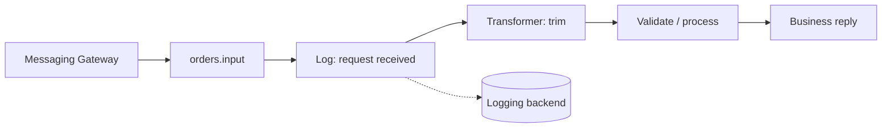
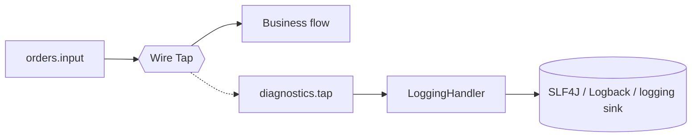
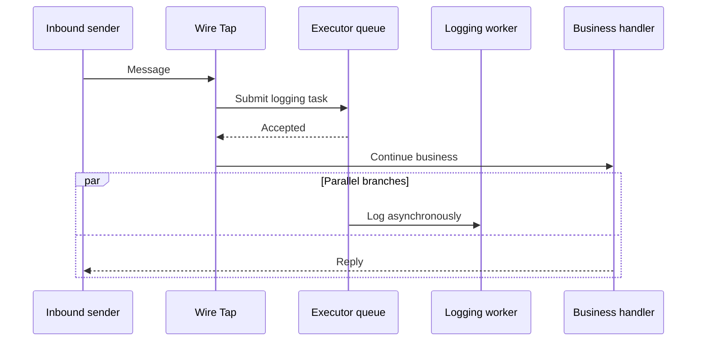

# Logging Handler and Message Logging

## 1. Why Is Message Logging Needed in an Integration Flow?

When an order processing system is built with Spring Integration, a single request may pass through a `Channel Adapter` or `Messaging Gateway`, `Transformer`, `Filter`, `Router`, and `Service Activator` before producing a reply. If only the final error is visible, operators find it difficult to tell which channel the message reached, how the payload was normalized, whether it took the wrong branch, or which dependency caused a slowdown.

**Message Logger** is a way to observe a message at a specific point in a flow using logging. In Spring Integration, `LoggingHandler` is a message handler dedicated to logging; the Java DSL provides the `.log(...)` operation to insert log output into a flow while preserving the main processing path. Logging is useful for troubleshooting failures, tracking requests, verifying processing routes, and correlating correlation IDs.

This lesson belongs to the **Message logger** chapter of the `SPRING_INTEGRATION_PATTERN` module. The goal of this module is to practice Enterprise Integration Patterns (EIP) with Spring Integration to build loosely coupled, extensible message flows with retries, error channels, correlation, and the ability to test and observe Router, Filter, Transformer, Splitter, Aggregator, and Gateway components. This lesson focuses on **Logging handler and message logging**.

Example input for a request:

```text
Request:  "  ORD-42  "
Channel:  orders.input
Actions:  log received -> normalize -> validate -> process -> reply
Reply:    "ACCEPTED:ORD-42"
```

If you log at `orders.input`, you know the **request was received**, not that the order has been saved successfully. To know whether processing actually succeeded, you need a signal at the exact business completion point or after the transaction commits.

After this lesson, you will be able to:

- Distinguish between `LoggingHandler`, Java DSL `.log(...)`, Wire Tap, direct logging inside handlers, and metrics/tracing systems.
- Choose where to log messages and select just enough log fields for traceability without exposing sensitive data.
- Write a Java DSL flow with a logger, Transformer, Service Activator, and Messaging Gateway, and distinguish the meaning of logs versus replies.
- Evaluate threading, log levels, latency, error logging, redelivery, correlation, and the impact of log sinks under overload.
- Test log content, business logic, and failure scenarios using a clear test matrix.

## 2. Where Does LoggingHandler Fit in EIP?

`LoggingHandler` is an endpoint that receives a message and logs information through the application's logging system. It is **not** a Transformer, Router, broker, or message store. When a logging handler is used as the **end point** of a flow, the handler only writes logs; it does not automatically produce a reply payload for a gateway.

There are two common patterns:

1. **In-path observation:** use the DSL `.log(...)` to record information at a specific point and then continue with the remaining processing steps.
2. **Dedicated logging branch:** send the message to a secondary channel (typically via a `Wire Tap`) and terminate that branch with a `LoggingHandler`. The main branch still executes the business logic.



The `Log: request received` point is an observation signal. It does not prove that the downstream Transformer or business logic ran successfully.

### 2.1. Comparing Observability Tools

| Mechanism | Purpose | Key Considerations |
| --- | --- | --- |
| `LoggingHandler` | Logs the message or an expression representing it via the logging framework. | If placed as the final handler, the flow does not automatically produce a reply. |
| `IntegrationFlow.log(...)` | Declares a readable log point directly in the Java DSL. | Use an expression or mapper that extracts only permitted fields. |
| `WireTap` | Copies the observation path to a secondary channel; a LoggingHandler can be used on that branch. | Synchronous/asynchronous behavior depends on the target channel; does not provide durability on its own. |
| `log.info(...)` inside `Service Activator` | Records events closely tied to business logic. | Mixes observability with business code if overused. |
| Micrometer metrics | Tracks error rates, counts, latency, and saturation. | Avoid high-cardinality labels; does not replace per-request logs. |
| Distributed tracing | Connects spans/hops across components, processes, or services. | Requires propagation and instrumentation across threads and adapters. |

A flow can use logging, metrics, and tracing together, but each signal must have a clear meaning. Logs do not replace transactions, retries, idempotency, or broker message acknowledgments.

### 2.2. Logging Does Not Mean "Processed"

For example, suppose `orders.input` already logged `event=order-received`. Immediately afterward, the handler might throw an `IllegalArgumentException` due to an invalid ID, or the DB might roll back. The earlier log line still exists.

Stages that should be distinguished:

| Stage | What Is Known for Certain? | What Cannot Be Inferred |
| --- | --- | --- |
| `received` | The message reached the logger point. | Business logic has committed. |
| `validated` | The validation step completed successfully. | Downstream dependencies are ready. |
| `attempted` | The handler started attempting a side effect. | The side effect completed. |
| `completed` | The handler returned a successful result per its local contract. | Independent DBs/brokers committed together. |
| `committed` | The transaction was confirmed successful on a specific resource. | The entire distributed system achieved "exactly once". |

Name stages according to observable facts, and avoid logging `order-saved` before the DB commits.

## 3. Core Capabilities of LoggingHandler

`LoggingHandler` belongs to Spring Integration. It supports logging at a chosen level and allows specifying a logger/category. In Java DSL configuration, `.log(...)` is convenient for specifying the log level, category, and a function that renders a message as a string.

### 3.1. Level and Category

| Level | Suggested Purpose | Example |
| --- | --- | --- |
| `ERROR` | Errors that cause processing to fail or require action. | Message sent to DLQ after exceeding the retry policy. |
| `WARN` | Abnormal condition, though the system can continue. | Fallback triggered, or payload missing an optional field. |
| `INFO` | Important operationally meaningful milestones. | A request was received at the start of the flow. |
| `DEBUG` | Information needed when investigating a pipeline. | Stage before/after a Transformer, or chosen route. |
| `TRACE` | Very fine-grained details of how a message moves. | Per-hop metadata in a diagnostic environment. |

A category such as `integration.orders` lets you enable or disable loggers for a group of flows. In Spring Boot, levels can be configured in `application.yml`:

```yaml
logging:
  level:
    integration.orders: INFO
    integration.orders.diagnostics: WARN
```

The level configured in the runtime logging framework decides whether an event is written to the sink. If the code logs at `DEBUG` while the category is set to `INFO`, `DEBUG` events may be dropped. Do not rely on log level changes as a durable audit trail mechanism.

### 3.2. Logging Payload, Headers, or a Selected Message Representation?

A Spring Integration message may contain:

```text
Message
  payload = OrderRequest(orderId, customerName, deliveryAddress)
  headers = {
    id, timestamp, correlationId, replyChannel, errorChannel,
    trace metadata, custom headers, ...
  }
```

If you log the entire `Message.toString()`, the application may inadvertently record customer names, addresses, tokens, order contents, channel objects, or internal metadata. A safe default principle is **field allowlisting**: event/stage, flow name, payload type, normalized correlation identifier, outcome, and processing duration. For sensitive payloads, log only aggregated or masked information.

Distinguish between:

- `MessageHeaders.ID`: UUID of the **message instance** in Spring Integration; helpful for tracking a single hop, though it may change if the message is reconstructed.
- `correlationId`: links multiple messages belonging to the same request, Splitter/Aggregator, or workflow; not inherently unique per business effect.
- `eventId` or `idempotencyKey`: a stable business identifier across retries, redeliveries, and replays; independent of a new message's UUID.
- `traceId` / `spanId`: links to distributed tracing systems; requires propagation across adapters and threads.

Do not put high-cardinality identifiers into **metric labels**, though permitted IDs can be included in logs/traces in accordance with data protection policies.

## 4. Java DSL Example: Log and Continue Processing an Order

The example uses Java 17+, Spring Boot 3.x, and Spring Integration 6.x. `OrdersGateway` accepts an order ID string, the flow logs a `received` milestone, normalizes the payload, and calls `OrderService` to return a reply. The snippet focuses on the Java DSL API; a real application requires Spring Integration, Spring Test, and an appropriate logging backend dependency.

### 4.1. Declaring the Channel and IntegrationFlow

```java
import org.springframework.context.annotation.Bean;
import org.springframework.context.annotation.Configuration;
import org.springframework.integration.annotation.IntegrationComponentScan;
import org.springframework.integration.channel.DirectChannel;
import org.springframework.integration.config.EnableIntegration;
import org.springframework.integration.dsl.IntegrationFlow;
import org.springframework.integration.handler.LoggingHandler;
import org.springframework.messaging.MessageChannel;

@Configuration
@EnableIntegration
@IntegrationComponentScan
public class OrderLoggerConfiguration {

    @Bean("orders.input")
    MessageChannel ordersInput() {
        return new DirectChannel();
    }

    @Bean
    IntegrationFlow ordersFlow(OrderService service) {
        return IntegrationFlow.from("orders.input")
                .log(LoggingHandler.Level.INFO,
                        "integration.orders",
                        message -> "stage=received" +
                                " payloadType=" +
                                message.getPayload().getClass().getSimpleName() +
                                " messageId=" + message.getHeaders().getId())
                .transform(String.class, String::trim)
                .handle(String.class,
                        (orderId, headers) -> service.accept(orderId))
                .get();
    }
}
```

`.log(...)` places the log point **before** the Transformer: the log records the payload type and message ID when first received, without logging the raw order ID. After logging, the flow still runs `String::trim` and the business handler.

```java
import org.springframework.stereotype.Service;

@Service
public class OrderService {

    public String accept(String orderId) {
        if (orderId == null || orderId.isBlank()) {
            throw new IllegalArgumentException("Order ID is required");
        }
        return "ACCEPTED:" + orderId;
    }
}
```

### 4.2. Messaging Gateway for Request–Reply

```java
import org.springframework.integration.annotation.Gateway;
import org.springframework.integration.annotation.MessagingGateway;

@MessagingGateway(defaultRequestChannel = "orders.input")
public interface OrdersGateway {

    @Gateway(replyTimeout = "3000")
    String submit(String orderId);
}
```

When a caller invokes:

```java
String result = ordersGateway.submit("  ORD-42  ");
// result = "ACCEPTED:ORD-42"
```

An illustrative log line might look like:

```text
INFO integration.orders - stage=received payloadType=String messageId=...
```

The log line does not contain the order code and does not prove the order was saved to the DB. It only records that the message passed the logger point. Returning a success string in `OrderService.accept(...)` is a minimal business example; when replaced with DB/RPC calls, transactions, retries, timeouts, and properly placed outcome logs must be designed.

### 4.3. Why Not Use LoggingHandler as the Sole Handler in a Request–Reply Flow?

`LoggingHandler` is a handler dedicated to logging. If a flow consists solely of:

```java
@Bean
IntegrationFlow logOnlyFlow() {
    return IntegrationFlow.from("logging.in")
            .handle(new LoggingHandler("INFO"))
            .get();
}
```

then it is a **terminal logging endpoint**. It is suitable for consuming a one-way message for logging, but it does not produce a `String` reply for an inbound gateway.

When you need to **both log and continue processing**, use `.log(...)` in the Java DSL or a Wire Tap to a separate logging flow. Avoid expecting `.handle(new LoggingHandler(...))` to automatically forward the message to a downstream handler like a Transformer.

## 5. Variant: Wire Tap to a Separate Logging Channel

In a larger system, you can keep the logging flow separate:



Java DSL example illustrating this layout:

```java
import org.springframework.context.annotation.Bean;
import org.springframework.integration.channel.DirectChannel;
import org.springframework.integration.dsl.IntegrationFlow;
import org.springframework.integration.handler.LoggingHandler;
import org.springframework.messaging.MessageChannel;

@Bean("diagnostics.tap")
MessageChannel diagnosticsTap() {
    return new DirectChannel();
}

@Bean
IntegrationFlow businessWithTap(OrderService service) {
    return IntegrationFlow.from("orders.input")
            .wireTap("diagnostics.tap")
            .transform(String.class, String::trim)
            .handle(String.class,
                    (orderId, headers) -> service.accept(orderId))
            .get();
}

@Bean
IntegrationFlow diagnosticsLoggingFlow() {
    LoggingHandler logging = new LoggingHandler("DEBUG");
    logging.setLoggerName("integration.orders.diagnostics");

    return IntegrationFlow.from("diagnostics.tap")
            .transform(String.class, ignored ->
                    "stage=received payloadType=String")
            .handle(logging)
            .get();
}
```

This is an **alternative variant** to `ordersFlow` in section 4: do not register two flows with the same `orders.input` channel and the same business goal simultaneously unless you intend to have competing subscribers. These `@Bean` methods belong inside a valid `@Configuration` class; the snippet omits the wrapper class to focus on the differences.

In this variant, the tap branch transforms **the message on the logging branch** into a string free of sensitive payload data before handing it to `LoggingHandler`. The Transformer on the tap branch must not mutate the payload on the main business path.

`LoggingHandler` acts as the final consumer of the `diagnostics.tap` channel. When `diagnostics.tap` is a `DirectChannel`, logging can increase main-path latency because the handler runs synchronously. To isolate threads, you can replace the tap channel with an `ExecutorChannel` backed by a bounded pool and queue. This approach requires monitoring overflow/rejection, trace context propagation, and async error handling; another thread does not automatically carry the caller's transaction or MDC.

### 5.1. Log Level and Logger Placement

Suppose you log at the input and log again after normalization:

```text
orders.input
  -> log stage=received
  -> Transformer: trim orderId
  -> log stage=normalized
  -> business handler
```

These two lines have different meanings. If the Transformer fails, only the `received` log exists; if the handler fails after normalization, both logs may exist. Do not infer from a `normalized` log line that the business operation committed.

For systems with many stages, define a stable list of stages upfront; if each handler uses arbitrary wording, dashboards or log queries will be hard to parse.

## 6. Data Safety and Structured Logging

Putting messages into logs means transferring data to **a separate storage system** whose access and retention policies may differ from the source DB. Logs may be aggregated across services, shipped to third parties, or backed up longer than intended.

Things that **should not be logged verbatim by default**:

- Passwords, login tokens, API keys, `Authorization` / cookie headers.
- Payment details, personal identification numbers, email/address/phone numbers when not strictly necessary.
- Full payloads or exception messages that may contain user data or contract contents.
- Raw object references such as `replyChannel`, `errorChannel`, or uncontrolled serialized objects.
- Large payloads, binary/Base64 files, or any unbounded user-supplied strings.

Prefer **structured logging**:

```text
event=integration.message_received
flow=orders
stage=received
payloadType=OrderRequest
correlationId=checkout-208
outcome=observed
```

`key=value` pairs are a simple representation; JSON logging can be used when the pipeline supports schemas. Avoid building JSON via ad-hoc string concatenation if values are unescaped or could be controlled by input.

### 6.1. Avoiding Log Injection and Unintended Exposure

If you must log a client-supplied field, bound its length, strip or escape newline and control characters, and mask sensitive segments. Otherwise, a payload containing `\nERROR fake...` could confuse log queries or forge multiple log lines.

If a log message is built with a SpEL expression or lambda, keep the expression concise, avoid network I/O, and avoid `toString()` on domain objects of unknown safety. Complex redaction logic should live in a dedicated, tested component.

### 6.2. Bounding Log Volume

A Message Logger at every hop can generate huge volumes of data. For example, if a message traverses 12 endpoints and each emits 2 logs, a system receiving 10,000 messages/second produces hundreds of thousands of lines/second before accounting for retries or redeliveries.

The solution is choosing meaningful log points, appropriate levels, deliberate sampling for trace/debug, and metrics for aggregated measurements. For mandatory audit trails, do not rely on sampling or a logger's best-effort storage.

## 7. Correlation, Retry, Redelivery, and Errors

### 7.1. Message ID vs. Correlation and Idempotency Keys

As a message passes through a Gateway, Splitter, Aggregator, or broker, it can be recreated. Thus `message.getHeaders().getId()` is useful for identifying a single instance at an observation point, but it does not replace a producer-supplied `eventId` when linking multiple redeliveries.

Example flow:

```text
requestCorrelationId = checkout-208
eventId             = evt-571
deliveryAttempt     = 1
messageId           = 8c3...  (instance)
```

When the broker redelivers `evt-571`, the message instance may get a new ID and the attempt count increases, while `eventId` must be preserved. For a Splitter, multiple child messages may share a correlation ID while each child has its own sequence number or business key. This is critical when reconciling logs across a multi-branch flow.

### 7.2. Retries Can Cause Duplicate Logs

Suppose a DB-writing handler hits a transient failure; Spring Integration's retry or the broker invokes the handler again. If a logger sits before the handler, each attempt may emit another `received` or `attempted` line depending on where retry advice is placed. Do not read the total log line count as "total orders created".

Include fields such as:

| Field | What Is It Used For? | Key Considerations |
| --- | --- | --- |
| `eventId` | Correlates delivery attempts for the same business event. | Preserved across retries/replays. |
| `correlationId` | Correlates branches of the same workflow. | Do not use as the sole deduplication key. |
| `attempt` / redelivery count | Distinguishes the first attempt from retries. | Source depends on broker/adapter; do not fabricate if absent. |
| `stage` | Identifies the step where the event occurred. | Define a semantically consistent stage list. |
| `outcome` | Accepted, rejected, retried, failed, committed... | Only log outcomes that have actually been confirmed. |
| `dependency` / `latencyMs` | Finds bottlenecks. | Do not confuse log timestamp with handler execution time. |

### 7.3. Logging Errors in the Right Place

A `LoggingHandler` placed before business logic only sees the input; it does not automatically receive exceptions thrown by downstream handlers. For synchronous `DirectChannel` flows, exceptions propagate back to the gateway/listener; for asynchronous channels, error handling can route to `errorChannel` if endpoints/containers are configured appropriately.

To log errors, you can design an **error flow** that receives `ErrorMessage`, extracts safe information (exception type, stage, correlation, retry attempt), and hands off to a retry policy, DLQ, or error response. Do not simply log and swallow an exception if upstream relies on exceptions to roll back a broker or JDBC transaction; "log and return success" can cause a message to be acknowledged even though processing never completed.

### 7.4. Logs Do Not Replace Acknowledgments or Transactions

There is no automatic guarantee that "log written" equals "DB committed" or "broker received ack". An async appender may write to the sink after business logic returns; in a crash, buffered log lines may not be flushed. Conversely, a logger may record `attempted` and then the DB rolls back.

If auditing must strictly accompany a business commit, store an audit/outbox record in the same DB transaction (the **transactional outbox** pattern) or use an appropriate transactional resource, then emit logs/notifications afterward. This is a consistency design decision beyond the scope of a standalone LoggingHandler.

## 8. Threading, Performance, and Logger Reliability

### 8.1. Synchronous Logging Overhead

When `LoggingHandler` runs synchronously on the send path, even formatting strings or serializing payloads consumes request-thread CPU. If the appender blocks on I/O, business latency can spike dramatically. To avoid this:

- Log short fields and never execute DB queries or HTTP calls inside a log mapper.
- Use appropriate log levels; enable DEBUG/TRACE selectively.
- Size appenders, buffers, and rotation according to actual sink throughput.
- Measure main-path p95/p99 latency before and after enabling detailed logging.
- Consider asynchronous logging for slow sinks, while accepting queue/rejection/log-loss risks on crash.

### 8.2. Asynchronous Logging Branch

If the logging flow is placed behind a `WireTap` pointing to an `ExecutorChannel`, logging can run on a separate thread pool:



Notes:

- `ExecutorChannel` does not automatically propagate `ThreadLocal`, MDC, or thread-bound DB transactions; tracing requires context propagation.
- An executor with a bounded queue can reject tasks; `CallerRunsPolicy` can even push logging back onto the caller thread. Do not assume "async" is free.
- The logging worker may finish after the business handler; log line order can differ from business commit order.
- In-memory queues or async appenders do not guarantee log survival across crashes. For durable auditing, use an outbox or durable storage.
- Monitor queue depth, rejected tasks, log appender failures, and drain time during shutdown.

### 8.3. Changing Log Levels Is Not a "Risk-Free Debug Mode"

Enabling DEBUG in production can cause a sudden surge in log volume, creating CPU/IO pressure, high storage costs, and exposing data that normally does not appear. Enforce a clear scope and time limit when enabling debug, measure the impact, and never enable `logFullMessage` across flows carrying PII.

## 9. Testing LoggingHandler and Message Logging

Testing logging has two independent goals:

1. **Content:** logs have the right stage/category/correlation and contain no forbidden data.
2. **Non-invasiveness:** adding logging does not alter payloads, replies, exceptions, or business side effects.

### 9.1. Request–Reply Test for a Flow with a Logger

You can use Spring Test and JUnit 5 to verify the business path:

```java
import static org.junit.jupiter.api.Assertions.assertEquals;

import org.junit.jupiter.api.Test;
import org.springframework.beans.factory.annotation.Autowired;
import org.springframework.test.context.junit.jupiter.SpringJUnitConfig;

@SpringJUnitConfig(classes = {
        OrderLoggerConfiguration.class,
        OrderService.class
})
class OrderLoggerFlowTest {

    @Autowired
    private OrdersGateway gateway;

    @Test
    void loggerDoesNotChangeBusinessReply() {
        assertEquals("ACCEPTED:ORD-42",
                gateway.submit("  ORD-42  "));
    }
}
```

This example verifies `Gateway → log → Transformer → handler → reply` while channels remain synchronous. It does not by itself prove that logs reached the log sink, nor does it test MDC/async behavior. Verify that the test context registers the gateway via `@IntegrationComponentScan` and has no duplicate channel bean names.

### 9.2. Testing Log Lines with a Temporary Appender

If the project uses Logback, you can attach a `ListAppender` to the `integration.orders` logger category, invoke the gateway, and assert on the emitted events:

```java
import static org.junit.jupiter.api.Assertions.assertTrue;

import ch.qos.logback.classic.Level;
import ch.qos.logback.classic.Logger;
import ch.qos.logback.classic.spi.ILoggingEvent;
import ch.qos.logback.core.read.ListAppender;
import org.junit.jupiter.api.Test;
import org.slf4j.LoggerFactory;

@Test
void logContainsStageWithoutRawOrderId() {
    Logger logger = (Logger) LoggerFactory.getLogger("integration.orders");
    Level previousLevel = logger.getLevel();
    ListAppender<ILoggingEvent> appender = new ListAppender<>();
    appender.start();
    logger.addAppender(appender);

    try {
        logger.setLevel(Level.INFO);
        gateway.submit("  ORD-42  ");

        assertTrue(appender.list.stream()
                .anyMatch(e -> e.getFormattedMessage()
                        .contains("stage=received")));
        assertTrue(appender.list.stream()
                .noneMatch(e -> e.getFormattedMessage()
                        .contains("ORD-42")));
    } finally {
        logger.detachAppender(appender);
        logger.setLevel(previousLevel);
        appender.stop();
    }
}
```

This snippet is a **test method** added into the `OrderLoggerFlowTest` class above; add imports matching your test environment. In projects not using Logback, substitute the corresponding logging backend appender/capture mechanism. When running multiple tests in parallel on the same logger, isolate the logger/appender or disable parallel execution to prevent interference.

Checking category and stage is very useful; avoid coupling tests to the full timestamp format, thread name, or prefix because production logging configuration can change.

### 9.3. Behavior Test Matrix

| Scenario | How to Test | Expected Verification |
| --- | --- | --- |
| Valid input | Call gateway with `"  ORD-42  "`. | Reply `ACCEPTED:ORD-42`, `received` log present, no raw payload. |
| Invalid input | Send a blank string. | `received` log present, handler throws exception; no false `committed` log. |
| Logging level disabled | Set category higher than log level. | No log emitted at that level; business logic still runs. |
| Three retries | Use a fake dependency that fails then succeeds. | Attempt logs reflect logger placement; three attempts are not mistaken for three orders. |
| Error handler/rollback | Throw an exception in the handler. | Exception/retry/ack follows policy and is not swallowed by the logger. |
| PII in payload | Send a DTO containing sensitive data. | Log contains only allowlisted fields and does not print DTO `toString()`. |
| Slow log sink | Use a controlled slow test appender. | Distinguishes sync vs. async latency; avoids hanging the test. |
| Async logging queue full | Small executor queue, burst many messages. | Rejection/backpressure/metrics follow policy; main flow behaves per documented design. |
| Correlation across Splitter | Send a request producing multiple child messages. | Logs correlate to the same workflow; children are distinguished by sequence or distinct ID. |
| Broker redelivery | Replay the same `eventId`. | Logs show multiple deliveries without implying duplicate business effects. |
| App restart before flush | Stop process while logs are buffered. | Demonstrates logging durability limits; do not use as audit proof. |

## 10. Common Mistakes

**1. Logging the entire message at INFO.** A `Message.toString()` may contain the full payload and many headers. Use a mapper that extracts only safe fields, set appropriate log levels, and restrict access to the sink.

**2. Using LoggingHandler as a mid-flow handler and expecting a reply.** LoggingHandler is meant for one-way logging; Java DSL `.log(...)` or a Wire Tap is better suited for logging without interrupting the business path.

**3. Logging `success` before transaction commit.** A log saying "handler ran" means something different from "DB committed". Separate received, processed, and committed stages so investigations are not misled.

**4. Relying on message UUID for event deduplication.** The message instance ID can change across redeliveries/replays. Use a business-generated event ID and an appropriate idempotency key.

**5. Overlooking log level configuration.** A `DEBUG` line will not appear if the logger category is set to `INFO`. Understand both handler and backend log levels.

**6. Attaching too many loggers on the hot path.** Formatting, locking, and I/O can increase latency; place targeted log points, monitor logs/second, and sample when appropriate.

**7. Testing only the happy path.** During retry failures, broker redeliveries, or executor saturation, log contents and business continuation behavior can differ drastically. Test realistic failure points.

**8. Assuming async logs are durable.** In-memory queues/appenders can lose data on crashes; async tasks can be rejected or arrive late. Mandatory auditing requires durable storage.

**9. Using logs as flow-control tools.** Logs are observational signals; branching and transformation belong to Router/Filter/Transformer, while retries and rollbacks require dedicated mechanisms.

## 11. Checklist Before Applying Message Logger

Before deploying on a Spring Integration flow, answer these questions:

1. **Purpose:** does the log point serve troubleshooting, tracing, metrics, or mandatory auditing?
2. **Placement:** is the logger placed before/after which Transformer/Filter/Router/handler/commit?
3. **Stage:** what does the log line prove happened, and what can it not yet prove?
4. **Data:** are only allowlisted fields logged, with PII/tokens masked and payload/headers bounded?
5. **Identifiers:** are `eventId`/`correlationId` and trace context present to link hops and retries?
6. **Level/category:** do INFO/DEBUG/ERROR levels and logger names align with runtime configuration?
7. **Performance impact:** does synchronous logging affect p95/p99 latency, CPU, or log volume?
8. **Async:** if using Wire Tap/ExecutorChannel, are queue capacity, rejection policy, trace propagation, and backlog alerts in place?
9. **Failure semantics:** can a logger failure alter business processing/ack/rollback, and does that match the application contract?
10. **Testing:** have replies, log content, PII, errors, retries, redeliveries, and log sink overload been tested?

**LoggingHandler** and Java DSL `.log(...)` help observe messages traversing integration flows without scattering logging code across every business component. A sound strategy defines **what to log, where to log it, and what each log line proves**; combining logs with correlation, metrics, and tracing makes Spring Integration branches observable while keeping transaction and delivery semantics enforced at their proper processing boundaries.
