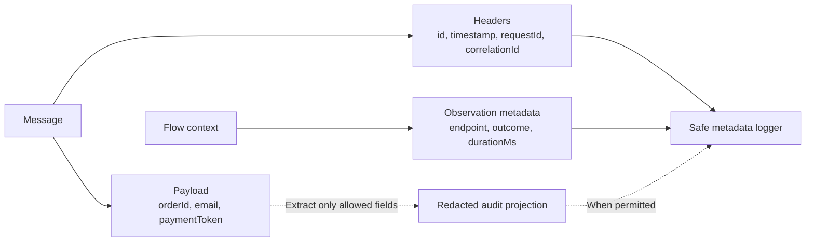
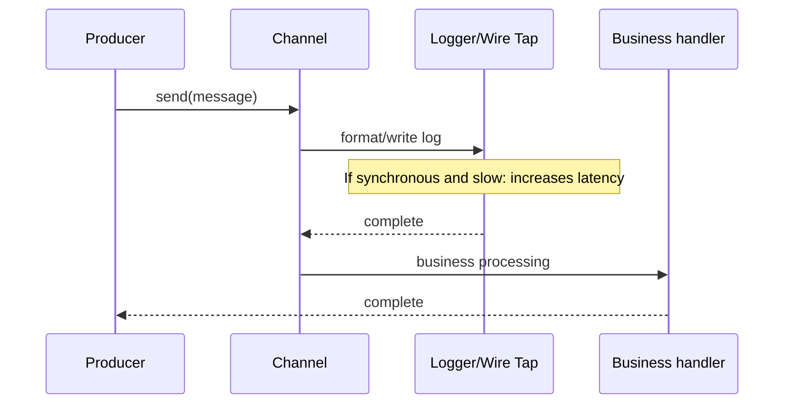
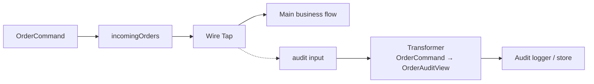
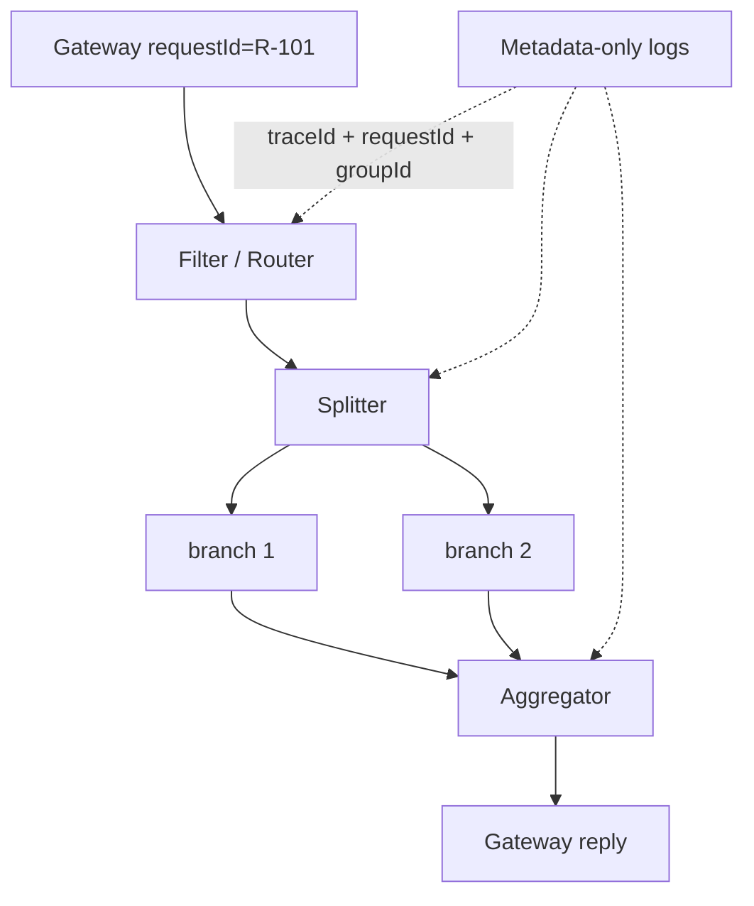

# Log Payload or Metadata Only in Spring Integration?

## Lesson Objectives

After this lesson, you will be able to:

- Distinguish between **payload**, **message headers**, **observation metadata**, and exception content when logging a message flow.
- Choose a policy of **metadata-only**, **selective/redacted payload**, or **full payload** based on sensitivity, environment, and troubleshooting needs.
- Use Spring Integration Java DSL `.log(...)` with a safe log expression, avoiding accidental calls to `Message.toString()` or `payload.toString()` that contain secret data.
- Design a **Wire Tap** that routes observation data to a dedicated branch without altering the business payload on the main flow.
- Preserve traceability with `requestId`, `correlationId`, and trace context as messages traverse Router, Filter, Transformer, Splitter, Aggregator, or Gateway components.
- Test that logs **contain the required metadata** and **do not leak emails, tokens, or payment data**, while also evaluating logger latency and errors.

This lesson belongs to the **Message logger** chapter of the **SPRING_INTEGRATION_PATTERN** module. When learning *Enterprise Integration Patterns* with Spring Integration, we need to observe loosely coupled, extensible message flows. Logging helps debug Router, Filter, Transformer, Splitter, Aggregator, Gateway, retry, error channel, and correlation behavior. Because messages often carry data from users or external systems, deciding **"log payload or metadata only?"** is a decision about **security, cost, operability, and business contracts**, not merely `logger.info(...)` syntax.

## 1. What Data Parts Does a Message Contain?

In Spring Integration, a message is typically represented by `org.springframework.messaging.Message<T>`, consisting of:

- **Payload:** business data, such as an `OrderCommand` containing an order ID, customer email, and transaction details.
- **Headers:** `MessageHeaders.ID`, message creation timestamp, correlation/sequence headers, and application-defined headers such as `requestId` and `traceId`.
- **Information arising outside the message:** channel/endpoint name, error type, processing duration, retry count, validation outcome, or record count.



**Not every header is safer than the payload.** Headers may contain `Authorization`, cookies, API keys, user information, URLs with query strings, or internal objects like `replyChannel`/`errorChannel`. Logging "all headers" does not equal logging safe metadata.

### 1.1. Example of a Payload Containing Sensitive Data

```java
public record OrderCommand(
        String orderId,
        String customerEmail,
        String paymentToken,
        int itemCount
) {}
```

If you write:

```java
logger.info("Incoming message={}", message);
logger.info("Payload={}", message.getPayload());
```

a Java `record`'s default `toString()` can expose both `customerEmail` and `paymentToken`. This is an **unsafe example** and should never be copied into production. Adding `logger.isDebugEnabled()` does not eliminate the risk because once DEBUG is turned on, secret logs still end up in centralized log storage.

## 2. Decision Table: What to Log and When?

| Strategy | Content | Suitability | Risks to Manage |
| --- | --- | --- | --- |
| **Metadata-only** | Event name, endpoint, message ID, validated request/correlation ID, outcome, latency | **Recommended default** in production | IDs can still be personal data or reveal business activity; headers must use an allowlist |
| **Payload projection** | An observation DTO containing only approved fields: action type, item count, status | When business context is needed for operations | Seemingly harmless fields can become sensitive when combined; requires versioning and retention limits |
| **Redacted payload** | Payload with secret fields masked/removed by schema | Short-term investigations or controlled logging | Regex string stripping can miss nested fields, new formats, or exceptions |
| **Full payload** | Complete business data | Special cases, synthetic data, or controlled environments | PII/secret leakage, compliance exposure, storage cost, and difficulty erasing data |
| **No content log** | Aggregated metrics only, no per-message records | Highly sensitive systems, very high throughput | Loss of per-message traceability without other telemetry |

**Recommended rule:** default in production to **metadata-only with an explicit allowlist**; if content is needed, build a **purpose-fit projection** instead of automatically logging the entire `Message<?>`.

### 2.1. Notes on Data Classification

Do not treat a field as safe just because it is labeled "metadata":

| Field | Safe to Log? | Guidance |
| --- | --- | --- |
| Framework UUID `messageId` | Usually yes | Use only as a technical ID for the current message |
| Internal `requestId`/`correlationId` | Depends on data rules | Restrict characters and length; avoid IDs containing emails or account numbers |
| `payloadType` | Usually yes | Use permitted type/event names; do not call payload `toString()` |
| `channelName`, `endpointName` | Usually yes | Do not embed user data into channel names |
| `durationMs`, `status`, `attempt` | Usually yes | Control granularity; avoid high-cardinality labels in metrics |
| `Authorization`, `Cookie`, `Set-Cookie` | **No** | Never log raw values directly |
| `paymentToken`, passwords, API keys | **No** | Blocklist across payloads, headers, and exceptions |
| Email/phone/address | Strictly restricted | Include only with valid business justification and proper access/retention controls |
| `replyChannel`/`errorChannel` objects | Do not log raw objects | When needed, log a known destination name or channel type |
| Stack traces and exception messages | Needs review | Error messages may contain URLs, raw requests, tokens, or personal information |

## 3. Why Logging Every Message Is Usually Harmful

### 3.1. Data Leakage and Expanded Access Surface

A service may only be authorized to access payment data during processing. When the full payload is logged, that same data can appear in log aggregation systems, dashboards, cold archives, backups, and support environments. Access permissions and retention periods of the **logging system** can differ significantly from the business database.

### 3.2. Cost and Performance

If each message produces 2 KB of logs and a flow processes 20,000 messages/second, raw volume is roughly **40 MB/second** before indexing, replication, metadata, and compression. Logging full payloads spends CPU on serialization, allocates many objects, and pressures the logging pipeline.

A message may pass through multiple steps (Router → Transformer → Splitter → Gateway). Logging the entire message at every step multiplies volume; a single small payload before a Splitter can generate thousands of log entries once split into child messages.

### 3.3. Logging Can Alter Flow Behavior

`LoggingHandler`/`.log(...)` participates in the messaging pipeline. Heavy formatting or synchronous appender writes can increase latency. If the observation step throws an exception or a tap channel fills up, it can affect the main path depending on configuration. **Logging is neither "free" nor "guaranteed to succeed".**



If logging must not block business processing, you must define asynchronous boundaries, capacity, queue-full policies, and tracking for dropped logs. Simply "adding a Wire Tap" does not guarantee complete isolation from observation-branch failures.

## 4. How Spring Integration Supports Message Logger

Spring Integration provides **LoggingHandler** and flow-level logging options. Java DSL `.log(...)` adds a message observation step at a chosen point. A Wire Tap can also forward messages to a dedicated logging channel.

Key distinctions:

- `LoggingHandler` is an endpoint dedicated to recording information about a message.
- `.log(...)` in the Integration DSL places logging at a point in the flow; its overload accepts a function that converts `Message<?>` into **log-safe content**.
- `.wireTap(...)` copies a message to another channel for separate logging/auditing, which is convenient when transforming into an audit projection.
- `@ServiceActivator` can also receive a message and invoke SLF4J, though you should avoid mixing observation logic into business logic.

**Important:** never place `.log()` with default settings in production and assume only metadata is logged. Always use an explicit expression/formatting function, and test the actual log output produced by your Spring Integration version.

## 5. Example 1: Metadata-Only Logging with Java DSL

This example targets **Java 17+, Spring Boot 3.x, and Spring Integration 6.x**. Suppose a service receives an `OrderCommand` containing an email and payment token, while logs are only permitted to record:

```text
event=order.received messageId=... requestId=REQ_101 payloadType=OrderCommand itemCount=2
```

We will avoid calling `toString()` on either the message or the payload. Business IDs in the example use only allowlisted characters.

### 5.1. DTO and Safe Formatter

```java
// OrderCommand.java
public record OrderCommand(
        String orderId,
        String customerEmail,
        String paymentToken,
        int itemCount
) {}
```

```java
// SafeMessageLog.java
import org.springframework.messaging.Message;

public final class SafeMessageLog {
    private SafeMessageLog() {}

    public static String summarize(Message<?> message) {
        Object requestIdHeader =
                message.getHeaders().get("requestId");
        String requestId = safeId(requestIdHeader);

        Object payload = message.getPayload();
        String payloadType = payload instanceof OrderCommand
                ? "OrderCommand"
                : "Other";

        String itemCount = payload instanceof OrderCommand order
                ? Integer.toString(order.itemCount())
                : "n/a";

        return "event=order.received"
                + " messageId=" + message.getHeaders().getId()
                + " requestId=" + requestId
                + " payloadType=" + payloadType
                + " itemCount=" + itemCount;
    }

    public static String safeId(Object value) {
        if (!(value instanceof String id)) {
            return "missing";
        }
        // Allowlist to prevent newline/log injection and oversized strings.
        return id.matches("[A-Za-z0-9_-]{1,64}")
                ? id
                : "invalid";
    }
}
```

Key takeaways:

1. Extract only the `requestId` header from an **allowlist**. Never iterate and print all headers.
2. Validate string values to prevent **log injection** via newlines or control characters.
3. Map `payloadType` from an application-controlled set of values; do not call payload `toString()`.
4. `itemCount` is a business field approved for logging under the example's assumptions. If item counts are sensitive in your domain, omit this field.
5. The formatting function never accesses `customerEmail` or `paymentToken`.

### 5.2. Configuring IntegrationFlow with `.log(...)`

```java
// OrderFlowConfiguration.java
import org.springframework.context.annotation.Bean;
import org.springframework.context.annotation.Configuration;
import org.springframework.integration.channel.DirectChannel;
import org.springframework.integration.config.EnableIntegration;
import org.springframework.integration.dsl.IntegrationFlow;
import org.springframework.integration.handler.LoggingHandler;
import org.springframework.messaging.MessageChannel;

@Configuration
@EnableIntegration
public class OrderFlowConfiguration {
    @Bean
    public MessageChannel incomingOrders() {
        return new DirectChannel();
    }

    @Bean
    public IntegrationFlow orderFlow(OrderProcessor processor) {
        return IntegrationFlow.from("incomingOrders")
            .log(
                LoggingHandler.Level.INFO,
                "app.integration.orders",
                SafeMessageLog::summarize
            )
            .handle(processor, "process")
            .get();
    }
}
```

```java
// OrderProcessor.java
import org.springframework.stereotype.Component;

@Component
public class OrderProcessor {
    public void process(OrderCommand command) {
        if (command.itemCount() <= 0) {
            throw new IllegalArgumentException("INVALID_ITEM_COUNT");
        }
        // Execute business processing; do not print command.toString().
    }
}
```

`.log(...)` is placed before the business handler to identify which messages reached the flow. `SafeMessageLog.summarize` returns a **structured metadata string**, not the full message.

**Distinguishing log placement:** this line indicates the message reached the checkpoint before the handler; it does **not** prove the business logic committed. To record success or failure outcomes, place an appropriate checkpoint after successful processing or emit an outcome event with a clearly defined status.

### 5.3. Producer Sending a Message with a Valid Request ID

```java
// OrderSender.java
import org.springframework.beans.factory.annotation.Qualifier;
import org.springframework.messaging.MessageChannel;
import org.springframework.messaging.support.MessageBuilder;
import org.springframework.stereotype.Component;

@Component
public class OrderSender {
    private final MessageChannel incomingOrders;

    public OrderSender(
            @Qualifier("incomingOrders") MessageChannel incomingOrders) {
        this.incomingOrders = incomingOrders;
    }

    public boolean submit() {
        OrderCommand order = new OrderCommand(
            "O-101",
            "customer@example.com",
            "tok_live_secret_example",
            2
        );
        return incomingOrders.send(
            MessageBuilder.withPayload(order)
                .setHeader("requestId", "REQ_101")
                .build()
        );
    }
}
```

The email and token are **synthetic test data** solely to demonstrate that the logger must omit them. The test will assert that neither string **appears in the log output**.

## 6. Example 2: Wire Tap to Separate an Audit Projection from the Main Flow

Metadata-only logs usually fit technical observability; sometimes a system needs an **audit event** containing approved business fields. Instead of logging the full `OrderCommand`, you can build a projection:

```java
// OrderAuditView.java
public record OrderAuditView(
        String requestId,
        String orderReference,
        int itemCount,
        String action
) {}
```

In this example, `orderReference` must also be an ID cleared for the logging environment. If an order code can trace directly back to an individual, pseudonymization or omission may be required. Including `itemCount` in audits is only valid if the domain permits it.



A separate alternative flow (do not register concurrently on the same input channel as Example 1):

```java
// OrderAuditFlowConfiguration.java
import org.springframework.context.annotation.Bean;
import org.springframework.context.annotation.Configuration;
import org.springframework.integration.channel.DirectChannel;
import org.springframework.integration.config.EnableIntegration;
import org.springframework.integration.dsl.IntegrationFlow;
import org.springframework.messaging.MessageChannel;

@Configuration
@EnableIntegration
public class OrderAuditFlowConfiguration {
    @Bean
    public MessageChannel auditIngress() {
        return new DirectChannel();
    }

    @Bean
    public MessageChannel auditEvents() {
        return new DirectChannel();
    }

    @Bean
    public IntegrationFlow auditAwareBusinessFlow(
            OrderProcessor processor) {
        return IntegrationFlow.from("auditIngress")
            .wireTap("auditEvents")
            .handle(processor, "process")
            .get();
    }

    @Bean
    public IntegrationFlow auditProjectionFlow(OrderAuditProjector projector) {
        return IntegrationFlow.from("auditEvents")
            .transform(projector, "project")
            .handle(message -> {
                // Illustrates writer placement without printing the full message.
                OrderAuditView view =
                        (OrderAuditView) message.getPayload();
                // Write view to an access-controlled audit store/log.
                if (view.action() == null) {
                    throw new IllegalStateException("AUDIT_VIEW_INVALID");
                }
            })
            .get();
    }
}
```

The Transformer class maps data into an audit view and extracts the real `requestId` from the header after validation:

```java
// OrderAuditProjector.java
import org.springframework.messaging.Message;
import org.springframework.stereotype.Component;

@Component
public class OrderAuditProjector {
    public OrderAuditView project(Message<OrderCommand> message) {
        OrderCommand order = message.getPayload();
        String requestId = SafeMessageLog.safeId(
                message.getHeaders().get("requestId"));

        return new OrderAuditView(
            requestId,
            order.orderId(),
            order.itemCount(),
            "ORDER_RECEIVED"
        );
    }
}
```

`OrderAuditProjector.project` accepts the full `Message<OrderCommand>` to read headers rather than just the payload. For an invalid request ID, the example returns `invalid`; a mandatory audit system might **reject or record an error state** instead of writing an unidentifiable ID. Do not hardcode a request ID or assume every message always carries that header.

In this configuration, `auditEvents` is a `DirectChannel`, meaning the audit transformer/writer **can still slow down or fail the main flow**. Switching to an `ExecutorChannel`/broker decouples processing time, but requires queue limits, error handling, and a policy for undelivered messages. If auditing is mandatory and must stay consistent with the business transaction, prefer an appropriate transaction or transactional outbox; a Wire Tap does not create atomicity on its own.

### 6.1. A Log Projection Does Not Guarantee Absolute Safety

A projection only **reduces the recorded dataset**; it does not replace governance controls:

- Who can access the data once logged?
- Are retention, deletion, or access-revocation mechanisms in place when the purpose expires?
- Is the metadata alone enough to trace back to a specific individual or sensitive transaction?
- Does it comply with organizational policies and applicable laws?

Never rely solely on regex patterns like "find token strings and replace with `***`": fields can be renamed, nested inside JSON, or transformed into another representation before the regex runs.

## 7. Testing That Logs Do Not Leak Payload Data

For Example 1, include **negative tests** alongside metadata verification tests. Below is a test pattern using Logback's `ListAppender` (applicable only when the application uses Logback; other logging frameworks require their corresponding test adapters). The example assumes the test context contains `OrderFlowConfiguration`, `OrderProcessor`, and `OrderSender`.

```java
// SafeMessageLoggingTest.java
import static org.assertj.core.api.Assertions.assertThat;

import ch.qos.logback.classic.Level;
import ch.qos.logback.classic.Logger;
import ch.qos.logback.classic.spi.ILoggingEvent;
import ch.qos.logback.core.read.ListAppender;
import java.util.stream.Collectors;
import org.junit.jupiter.api.Test;
import org.slf4j.LoggerFactory;
import org.springframework.beans.factory.annotation.Autowired;
import org.springframework.boot.test.context.SpringBootTest;

@SpringBootTest
class SafeMessageLoggingTest {
    @Autowired
    private OrderSender sender;

    @Test
    void logsMetadataButNotSensitivePayload() {
        Logger logger = (Logger) LoggerFactory.getLogger(
                "app.integration.orders");
        Level previousLevel = logger.getLevel();

        ListAppender<ILoggingEvent> appender = new ListAppender<>();
        appender.start();
        logger.addAppender(appender);
        logger.setLevel(Level.INFO);

        try {
            assertThat(sender.submit()).isTrue();

            String output = appender.list.stream()
                .map(ILoggingEvent::getFormattedMessage)
                .collect(Collectors.joining(" "));

            assertThat(output)
                .contains("event=order.received")
                .contains("requestId=REQ_101")
                .contains("payloadType=OrderCommand");

            assertThat(output)
                .doesNotContain("customer@example.com")
                .doesNotContain("tok_live_secret_example")
                .doesNotContain("customerEmail")
                .doesNotContain("paymentToken");
        } finally {
            logger.detachAppender(appender);
            logger.setLevel(previousLevel);
            appender.stop();
        }
    }
}
```

**Test limitation:** this verifies log events from the logger placed at the example's checkpoint; it does not prove that all logging in HTTP clients, exception handlers, framework DEBUG logs, or other observability systems is safe. Audit logging configurations across the entire chain from inbound adapter to broker.

To avoid flaky tests, tests that mutate global loggers should not run in parallel with other tests using the same logger. Use isolated test contexts and dedicated logger names per test suite if needed.

### 7.1. Additional Tests to Include

| Scenario | How to Trigger | Expectation |
| --- | --- | --- |
| Request ID header with newline | `requestId="ABC\\nFAKE-ERROR"` | Logger outputs `invalid` or a safe format without injecting fake log lines |
| Header containing secret | Send `Authorization`, `Cookie` in headers | Values do not appear in output |
| Payload is not `OrderCommand` | Send another message type past the log point | Does not invoke payload `toString()`; logs allowed type |
| Message with huge payload | Send a record with a very long string/byte array | Log size does not grow with payload size |
| Formatter throws error | Trigger a controlled exception in the log expression | Verify impact on main path and error flow behavior |
| Async audit overloaded | Executor/queue is full | Drop/fail policy is observable; business success is not assumed silently |
| Splitter generates many messages | Send one request splitting into 100 items | Log frequency and cardinality remain controlled |
| Exception contains token in message | Adapter/handler throws an error with a sensitive message | Raw exception text is not logged unless sanitized |

## 8. Correlation When Logging Across Multiple Flow Steps



When logging a multi-endpoint flow, distinguish among these keys:

| Key | Meaning | How to Use in Logs |
| --- | --- | --- |
| `MessageHeaders.ID` | ID of a specific message instance | Use to trace a message at the current checkpoint; a newly built message can change ID |
| `requestId` / `operationId` | Business ID across multiple steps | Use to find logs for one operation; must be validated/sanitized |
| `IntegrationMessageHeaderAccessor.CORRELATION_ID` | Group correlation in Spring Integration | Use when Splitter/Aggregator forms groups; do not assume it is a broker RPC correlation ID |
| `SEQUENCE_NUMBER` / `SEQUENCE_SIZE` | Group position and size | Track groups with missing items |
| `traceId` / `spanId` | Tracing context across endpoints/services | Use for logs and distributed tracing; do not use as an idempotency key |
| Broker correlation ID | Request–reply key in AMQP/JMS/Kafka per adapter | Log only when permitted by contracts and security policy |

A new message created by a Transformer may have a different `MessageHeaders.ID` from the original request, whereas the business request ID should be preserved across hops whenever possible. Logging both `messageId` and `requestId` helps separate "which message passed this endpoint" from "which business operation it belongs to".

If part of the flow crosses a broker, never assume every Spring header is serialized onto the transport. Adapters have their own header-mapper rules; Aggregator correlation and broker request–reply correlation can differ. Verify which IDs actually arrive on the consumer side.

### 8.1. When Is a Reduced Payload Log Needed?

Some errors require more context than basic metadata—for instance, a Filter rejecting a message due to a missing product code. You can log:

```text
event=order.validation_rejected
requestId=REQ_101
reasonCode=MISSING_PRODUCT_CODE
payloadType=OrderCommand
```

You do not need to log the full order to know the cause. For a Router, log the **selected branch name** and an enum reason code; for an Aggregator, log `groupId`, received count, and release condition; for retries, log `attempt` and a **normalized error category**. These fields are typically far more actionable for investigations than a full JSON dump lacking endpoint state.

## 9. Logging Errors and ErrorMessage Without Exposing Data

When a Service Activator or adapter throws an exception, Spring Integration can propagate the error synchronously or send an `ErrorMessage` to `errorChannel` at supported asynchronous boundaries.

**Avoid this habit**:

```java
// Dangerous example when error content has not been inspected:
logger.error("Integration failed message={}", failedMessage, throwable);
```

`Throwable.getMessage()` and stack traces may contain URLs with tokens, query parameters, serialized payloads, or SQL messages embedding sensitive values. A safer rule is to log categorized information:

```java
// ErrorMetadata.java
public record ErrorMetadata(
        String requestId,
        String errorCategory,
        String failedEndpoint
) {}
```

Error handling example (illustrative snippet; the `operationalErrors` channel must be defined separately in the flow):

```java
import org.slf4j.Logger;
import org.slf4j.LoggerFactory;
import org.springframework.integration.annotation.ServiceActivator;
import org.springframework.messaging.support.ErrorMessage;
import org.springframework.stereotype.Component;

@Component
public class SafeIntegrationErrorLogger {
    private static final Logger LOG =
            LoggerFactory.getLogger(SafeIntegrationErrorLogger.class);

    @ServiceActivator(inputChannel = "operationalErrors")
    public void handle(ErrorMessage error) {
        Throwable cause = error.getPayload();
        String category = cause instanceof java.util.concurrent.TimeoutException
                ? "TIMEOUT"
                : "PROCESSING_FAILURE";

        LOG.warn("event=integration.failure category={} errorType={}",
                category, cause.getClass().getSimpleName());
        // For requestId/endpoint, log only after extracting and validating
        // from failedMessage/originalMessage if present.
    }
}
```

This snippet intentionally **does not log the raw `Throwable`, stack trace, message, or headers**. In practice you may need stack traces for investigation, but you must define sensitive-data filtering, access-restricted storage, and retention policies. Do not treat checking only `TimeoutException` as comprehensive classification; HTTP/JMS/AMQP clients throw different timeout classes that should be normalized at the adapter.

An `ErrorMessage` is not guaranteed to always carry the failed message in the same location; error-handling code must check the exception type and which metadata is actually present. Do not use `errorChannel` as a durable audit store, or assume all errors are routed there when a flow runs synchronously.

## 10. Sampling, Levels, and Log Retention

Keeping every log for every message is not always necessary. Consider:

| Policy | Purpose | Notes |
| --- | --- | --- |
| `INFO` metadata at key checkpoints | Track requests and outcomes | Keep only a few meaningful checkpoints; control volume |
| Selective `DEBUG` by trace/request ID | Short-term troubleshooting | Do not expand unconditionally to full payloads |
| **Deterministic sampling** by permitted ID | Consistent sampling across multiple hops | Hash/key function must be consistent; still observe critical errors separately |
| **Aggregated metrics** | Throughput, latency, retries, errors | No per-message log needed; never use unique IDs as metric tags |
| **Durable audit events** | Compliance, state reconciliation | Use appropriate storage and transactions; do not substitute a regular logger |

Never add `requestId`, `userId`, or `messageId` to per-message **metric labels**: they cause *high cardinality* and can explode metric system costs. These IDs belong in **retention-controlled tracing/logs**, not aggregated metric labels.

Log retention and read permissions must match data sensitivity; never assume the central logging system has the same access controls as the source database.

## 11. What Happens to the Main Flow When the Logger Fails?

Logging is often treated as a side activity, yet in message-driven systems it is a step that consumes resources.

| Design | When Logger/Appender Is Slow or Fails | Mitigation Approach |
| --- | --- | --- |
| Synchronous logging directly on `DirectChannel` | Can increase processing time or throw on the sender thread | Use a lightweight formatter; bound content; consider branching |
| Wire Tap to `ExecutorChannel` | Log handler can fail on a worker after the main flow proceeds | Add an error flow and rejected-task metrics; bound queue and thread pool |
| Wire Tap to `QueueChannel` | Tap can build backlog; a full queue blocks or fails dispatch | Set capacity limits, pollers, and queue-full policies |
| Logs sent to a broker | Adapter/publish/consumer errors occur at distinct stages | Define confirms, retries, dead-lettering, and audit storage |
| Mandatory in-transaction audit | Log failure may need to fail the transaction | Design consistency/outbox rather than relying on best-effort logs |

**Fail-open vs. fail-closed** depends on the log's purpose. For diagnostic logging, prioritize the business flow and track dropped-log counts if permitted. For mandatory auditing, silently dropping records is unacceptable. Validate this decision alongside concurrency and transaction design.

## 12. Pre-Production Review Checklist

1. **Is the logging purpose clear?** Debugging, tracing, metrics, and auditing each require different contracts.
2. **Are logs metadata-only by default?** Does the formatter use an allowlist instead of printing `Message<?>` or raw payloads?
3. **Are headers checked?** Are `Authorization`/`Cookie` blocked and external request IDs sanitized?
4. **Does the payload contain sensitive data?** Emails, tokens, account numbers, user-identifiable IDs, nested JSON?
5. **Are error logs safe?** Could exception messages or stack traces contain request-supplied data?
6. **Does Wire Tap impact the main flow?** Have sync/async channels, full queues, rejected tasks, and latency been tested?
7. **Is correlation sufficient for investigation?** Are `messageId`, `requestId`, group IDs, and trace IDs preserved at the right boundaries?
8. **Are sampling, retention, and access policies defined?** Avoid unbounded-cardinality metric tags.
9. **Have non-leakage log tests run?** Test secrets in payloads, headers, exceptions, and DEBUG mode.
10. **If logs must be durable?** Use an appropriate audit store/outbox/transaction; do not claim a standard logger gives exactly-once delivery.

## Conclusion

In Spring Integration, **log selective metadata by default**, rather than automatically logging full payloads or all headers. A good logging checkpoint records only the fields needed to answer: **which message passed which endpoint, which request/correlation it belongs to, and what the outcome and latency were**. When business context is required, build an approved audit projection instead of printing `Message.toString()`. Protect data inside exceptions and Wire Tap branches alike, test that forbidden fields never appear in logs, and choose appropriate isolation and retention. Doing so preserves diagnostic visibility across Router, Filter, Transformer, Splitter, Aggregator, Gateway, and error channels while preventing your logging system from turning into an uncontrolled copy of sensitive data.
