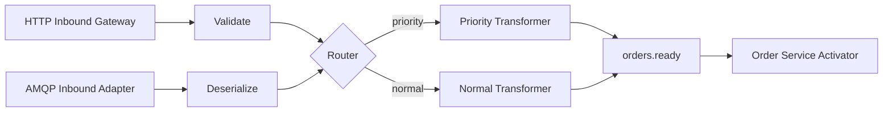
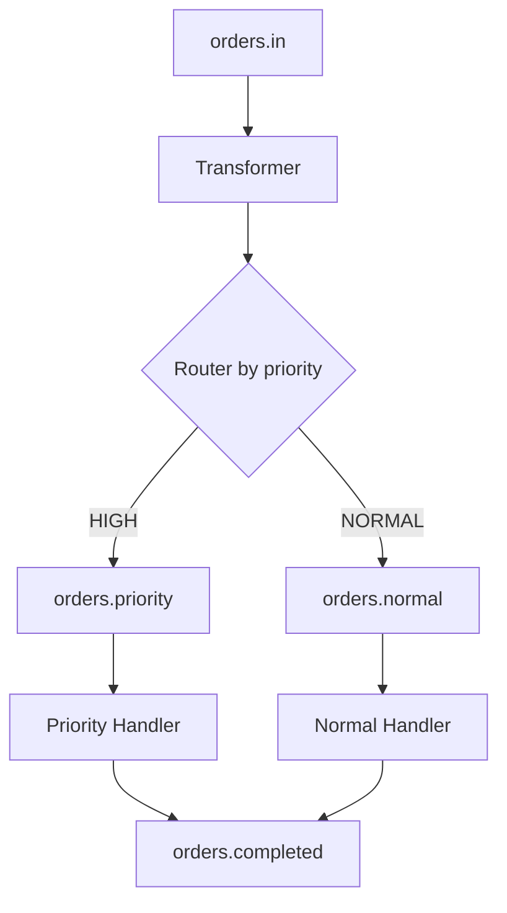
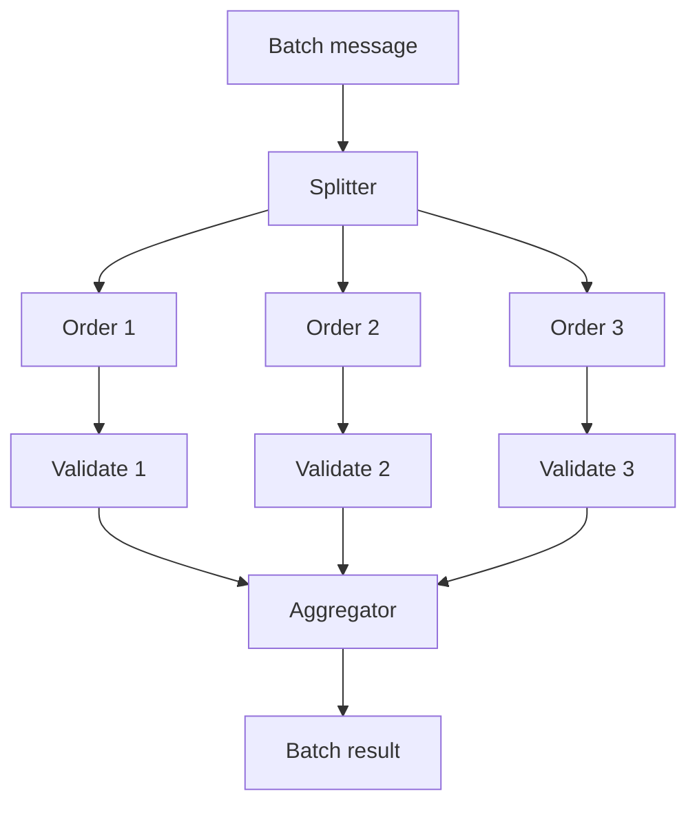
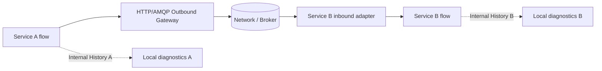

# Message History for Flow Tracking

In the **Message logger** chapter of the **SPRING_INTEGRATION_PATTERN** module, an important need when implementing Enterprise Integration Patterns is understanding **which components a message traversed before reaching the current processing point**. When a flow includes Router, Filter, Transformer, Splitter, Aggregator, Gateway, retry, and error channels, looking only at logs at the final step is often insufficient to know which branch the message came from, which channels it traversed, or where it stopped.

Spring Integration's **Message History** is a mechanism that records the **traversal history across integration components** in a message's metadata. When enabled and appropriately configured, tracked components append identifying information to the `history` header. At a handler near the end of the flow, you can read that header to inspect the message's path within the recorded scope.

This lesson focuses on using Message History to trace flows while distinguishing it from **Message Logger**, **Wire Tap**, **correlation IDs**, **Micrometer metrics**, and **distributed tracing**. These are complementary tools and should not be substituted mechanically for one another.

After this lesson, you will be able to:

- Explain the meaning, structure, and limitations of the `history` header.
- Enable Message History deliberately and read it using `MessageHistory.read(message)`.
- Build a Java DSL flow with a Transformer, Filter, and Service Activator to inspect message history.
- Use history to aid investigations across Routers, Splitters/Aggregators, Gateways, and error branches.
- Detect cases where history is lost during message reconstruction, adapter crossings, or handoffs to external systems.
- Design logging, metrics, tests, and security controls so the flow remains observable without overloading the application.

## 1. Why Is a Single Log Line at the End of a Flow Not Enough?

Suppose an application receives an order through two sources: an API and a message broker. Messages pass through different steps before both entering `orderService`:



Logs at `Order Service` might only record:

```text
requestId=REQ-117 orderId=O-117 status=PROCESSED
```

This line confirms the order was processed, but does not answer:

1. Did the message arrive via HTTP or AMQP?
2. Did the Router select the `priority` or `normal` branch?
3. Which Transformer executed?
4. Were any messages dropped by a Filter before reaching the final step?
5. Had there already been a retry or another execution of the same request?

**Message History** helps answer part of the **path** question. For example, an illustrative history might contain entries such as:

```text
history:
  - name: orders.in
    type: channel
    timestamp: ...
  - name: orders.normalized
    type: channel
    timestamp: ...
  - name: orders.ready
    type: channel
    timestamp: ...
```

This is a **conceptual representation**, not a guarantee of the exact `toString()` format or entry list across all versions and configurations. Actual data depends on which components are enabled for history tracking and how endpoints/channels are named.

History records the **observed path**, not the full Router decision logic, payload contents, or why a handler failed. To know "why the router chose priority," you also need decision data or structured logs/metrics at the Router.

## 2. Where Is Message History Stored?

A Spring `Message<T>` consists of:

- **Payload:** business data, such as `OrderEvent` or `String`.
- **Headers:** metadata such as `id`, `timestamp`, `correlationId`, `contentType`, and application-defined headers.

When Message History is enabled, Spring Integration can record a sequence of integration component entries in the header associated with `MessageHistory.HEADER_NAME` (typically `history`).

```text
Message<String>
  payload:
    "O-117"
  headers:
    id: ...
    timestamp: ...
    requestId: "REQ-117"
    history:
      [component 1 -> component 2 -> component 3 ...]
```

Key points:

- **History lives inside the message**, not in an external audit database. If a message is lost or not persisted, history does not automatically become a durable record.
- Each entry reflects a component configured to record history, usually containing its **name** and **component type**, optionally with a timestamp or other metadata.
- Not every Java method call, Router decision, or line of processing automatically becomes an entry.
- A history header can **grow in size** as the message traverses many components.
- Recreating a message without preserving headers can cause history to be lost.
- In-message history can be helpful even when full payloads are not written to application logs.

### History Is Not a Correlation Key

A message transformed across multiple steps may acquire different technical message IDs while still belonging to the **same business request**. Therefore:

| Data | What Question Does It Answer? |
| --- | --- |
| `MessageHeaders.ID` | What is the ID of this current message instance? |
| System-defined `requestId`/`eventId` | Which business request/event does this message relate to? |
| `correlationId` | Which messages belong to the same request, reply, or Aggregator group? |
| `Message History` | Which tracked components has the message traversed? |
| `traceId`/`spanId` | Which operations across threads/processes share the same trace? |

In production, teams typically combine **history + correlation + structured logs/tracing**, rather than picking only one.

## 3. Enabling Message History in a Spring Integration Application

Message History should not be assumed enabled by default for every message flow. Applications should enable it deliberately. A common Java Configuration approach is `@EnableMessageHistory` alongside Spring Integration.

```java
package example.history;

import org.springframework.context.annotation.Configuration;
import org.springframework.integration.config.EnableIntegration;
import org.springframework.integration.config.EnableMessageHistory;

@Configuration
@EnableIntegration
@EnableMessageHistory
class MessageHistoryConfiguration {
    // Configures history tracking for message flows.
}
```

Specific annotations and options must be checked against the Spring Integration version in use. Applications using XML configuration or `MessageHistoryConfigurer` may enable it differently, but the principle is that matching components are configured to participate in updating message history.

### Why Enable It Deliberately?

Message History provides observability, but it is not free:

- Each entry can increase message metadata size.
- Recording history adds processing work on the message send path.
- A long flow or a large split/aggregate pipeline can accumulate many entries.
- When a message is serialized across a broker, the adapter may omit `history`, or transmitting it may enlarge network payloads.
- Some channel/endpoint names may expose internal architectural details if forwarded directly to external systems.

Choose the tracking scope based on operational goals and load levels. When restricting tracking, consult the component-selection configuration for your framework version and test the exact list of components actually recorded; never guess that every endpoint is automatically instrumented.

## 4. Complete Example: Reading History at the End of a Flow

This example focuses on enabling and reading history without depending on HTTP or RabbitMQ. An event is sent to the `orders.in` channel, normalized, filtered for blank values, and routed to the `orders.valid` handler.

### 4.1. Java DSL Flow

```java
package example.history;

import org.springframework.context.annotation.Bean;
import org.springframework.context.annotation.Configuration;
import org.springframework.integration.config.EnableIntegration;
import org.springframework.integration.config.EnableMessageHistory;
import org.springframework.integration.dsl.IntegrationFlow;

@Configuration
@EnableIntegration
@EnableMessageHistory
class OrderHistoryFlowConfiguration {

    @Bean
    IntegrationFlow orderHistoryFlow() {
        return IntegrationFlow.from("orders.in")
            .transform(String.class, String::trim)
            .filter(String.class, text -> !text.isBlank())
            .channel("orders.valid")
            .get();
    }
}
```

Behavior:

1. `orders.in` receives the inbound message.
2. **Transformer** trims leading/trailing whitespace.
3. **Filter** allows only non-blank messages to proceed.
4. `orders.valid` hands the message off to the final consumer.
5. Tracked components contribute entries to Message History as configured.

The Filter **drops messages from the main flow** if they fail the condition. Without a discard flow, rejected messages never reach the final handler, so you cannot inspect history at that handler for discarded messages.

### 4.2. Reading History with `MessageHistory.read`

```java
package example.history;

import java.util.stream.Collectors;

import org.slf4j.Logger;
import org.slf4j.LoggerFactory;
import org.springframework.integration.annotation.ServiceActivator;
import org.springframework.integration.history.MessageHistory;
import org.springframework.messaging.Message;
import org.springframework.stereotype.Component;

@Component
class OrderHistoryObserver {

    private static final Logger log =
        LoggerFactory.getLogger(OrderHistoryObserver.class);

    @ServiceActivator(inputChannel = "orders.valid")
    public void handle(Message<String> message) {
        MessageHistory history = MessageHistory.read(message);

        if (history == null || history.isEmpty()) {
            log.info(
                "requestId={} history=UNAVAILABLE",
                message.getHeaders().get("requestId")
            );
            return;
        }

        String path = history.stream()
            .map(entry -> entry.getProperty("name", "<unnamed>"))
            .collect(Collectors.joining(" -> "));

        log.info(
            "requestId={} path={} payloadType={}",
            message.getHeaders().get("requestId"),
            path,
            message.getPayload().getClass().getSimpleName()
        );

        // Business processing can be added here if needed.
    }
}
```

`MessageHistory.read(message)` reads history from the message header. For entries represented as `Properties`, you can access attributes such as `name` and `type`. The example logs only the path and payload type, not the order contents.

**Runtime note:** the observer class must be registered as a bean via Spring component scanning, with Spring Integration, SLF4J, and Java 17+ dependencies present. If your actual version generates entries with a different structure or naming, inspect your current configuration and assert against component names you assign rather than hardcoding an illustrative log string.

### 4.3. Sending a Message with a Request ID

```java
package example.history;

import org.springframework.beans.factory.annotation.Qualifier;
import org.springframework.messaging.MessageChannel;
import org.springframework.messaging.support.MessageBuilder;
import org.springframework.stereotype.Component;

@Component
class OrderHistorySender {

    private final MessageChannel input;

    OrderHistorySender(@Qualifier("orders.in") MessageChannel input) {
        this.input = input;
    }

    boolean sendOrder(String orderId, String requestId) {
        return input.send(
            MessageBuilder.withPayload("  " + orderId + "  ")
                .setHeader("requestId", requestId)
                .build()
        );
    }
}
```

Invocation example:

```java
boolean accepted = sender.sendOrder("O-117", "REQ-117");
```

If the message is not dropped by the Filter, the observer receives the trimmed payload. In a synchronous flow built on `DirectChannel`, the handler typically runs on the `send` call path; if switched to an executor/queue, processing may continue after `send` returns.

**Do not confuse `accepted=true` with a committed business operation** across all channel types. This return value only reflects the `send` semantics of the specific channel.

## 5. Naming Channels and Endpoints for Readable History

When many endpoints use auto-generated names, history can contain identifiers that are hard to map back to business concepts or that shift during refactoring. Use **stable, meaningful names** at key observation points:

```text
orders.in
orders.valid
orders.priority
orders.normal
orders.persisted
orders.error
```

Naming convention examples:

| Component Type | Example Name | How to Read It |
| --- | --- | --- |
| Input channel | `orders.in` | Message enters the order flow |
| Post-Transformer channel | `orders.normalized` | Data has been normalized |
| Router branch channel | `orders.priority` | Message routed to priority branch |
| Aggregated channel | `orders.aggregated` | Message reached Aggregator output |
| Completion channel | `orders.completed` | Message sent to completion step |
| Error channel | `orders.error` | Error routed to error-handling path |

These names only take effect when the component actually appears in the flow segment and is enabled for history tracking. Do not add dozens of unnecessary channels just to lengthen history; each channel is also a boundary affecting dispatch, error handling, and performance.

### Endpoint Names and User Data

Never embed order IDs, emails, or secret tenant identifiers directly into bean or channel names. Those names can surface in history, metrics, or monitoring. Choose stable names based on role, and place business identifiers inside access-controlled headers or logs.

## 6. Message History on Router Branches

A Router dispatches a message to one of several branch channels, or to multiple channels if designed to do so. History reveals **which channels were actually traversed**:



Suppose the observer on `orders.completed` receives two messages:

```text
message A history:
  orders.in -> orders.priority -> orders.completed

message B history:
  orders.in -> orders.normal -> orders.completed
```

This is an **illustrative path**. Actual history may include additional endpoint, Transformer, and other component names depending on configuration.

### Distinguishing "Traversed" from "Why It Decided That"

History helps prove a message **traversed** channel `orders.priority`; it does not explain why the Router chose `HIGH`. To diagnose the reason, combine it with:

- Validated headers such as `priority=HIGH`.
- Router logs at an appropriate level using `requestId`/`eventId`.
- Metrics counting messages per branch.
- Unit/integration tests for channel selection rules.

If a message does not reach the expected branch, also check the default output channel, channel mappings, Filters, and exception paths. History can only be read where a message arrives; a message dropped before the observer leaves no durable record by default.

## 7. Transformers, `MessageBuilder`, and the Risk of Losing History

Transformers and handlers can create new messages. In Spring Integration, the framework usually preserves appropriate headers when transforming payloads through standard mechanisms. However, if an application **manually constructs** a brand-new message without copying headers, history and correlation can be lost.

Code requiring caution:

```java
// Unsuitable example if you intend to preserve headers from the source.
Message<String> newMessage =
    MessageBuilder.withPayload("normalized-value").build();
```

The new message has a payload and default headers, but does not automatically inherit `requestId`, `correlationId`, or the previous message's history.

When you must construct a new message manually, use the appropriate API to **copy permitted headers**:

```java
import org.springframework.messaging.Message;
import org.springframework.messaging.support.MessageBuilder;

static Message<String> normalize(Message<String> source) {
    return MessageBuilder
        .withPayload(source.getPayload().trim())
        .copyHeaders(source.getHeaders())
        .build();
}
```

This snippet illustrates preserving metadata when transforming payloads. In production, consider **which headers should be allowed to propagate**: not every technical header, internal channel reference, or credential should cross a transport boundary. Spring Messaging applies special rules to immutable/regenerated headers like message ID and timestamp; do not expect every technical field to be copied verbatim in every scenario.

**How to verify:** before and after the Transformer, call `MessageHistory.read(message)` and verify request/correlation IDs. A metadata-preservation test is far safer than assuming headers are intact just because the payload is right.

## 8. Splitter and Aggregator: One Message Becoming Many

When an order file or batch is split by a Splitter into multiple parts, each part can carry a correlation ID and sequence metadata so an Aggregator can reassemble them:



Things to remember:

- **Message History** is a trace on each individual message, not the algorithm for joining parts.
- **Correlation ID and sequence numbers** determine grouping, ordering, and Aggregator release conditions per configuration.
- The Aggregator's output message may be a **new** message whose payload and headers are built by the output processor/strategy.
- Never assume the Aggregator automatically merges the entire history of **every child message** into a "perfect combined history".

Example:

```text
batch B-10
  child 1: history -> splitter -> validate.normal -> aggregator
  child 2: history -> splitter -> validate.priority -> aggregator
  child 3: history -> splitter -> validate.normal -> aggregator

aggregated result:
  correlationId = B-10
  history = depends on how the aggregated message is built
```

If your problem requires querying the path of **all** child messages, store observed events keyed by `(batchId, childId)` in durable storage or use structured tracing/correlation, rather than reading only the final aggregated message's history.

## 9. Gateways, Remote Adapters, and System Boundaries

Message History operates within **the scope of Spring Integration components that record history as a message traverses them**. When a message leaves the JVM via HTTP, AMQP, JMS, or another adapter, two things can happen:

1. The adapter serializes the payload and mapped headers; internal history may **not** be forwarded to the target system.
2. If configured to forward it, history can bloat payload/header sizes and leak internal component names or integration topology.

Therefore, do not treat history as a **distributed trace** or a universal transport header.



To stitch journeys across services, use:

- `requestId`, `eventId`, or business correlation IDs propagated by contract.
- Trace context (e.g., trace ID and span ID) when distributed tracing is available.
- Structured logs per service, governed by data-protection policies.
- **Local** Message History to inspect the flow segments inside each service.

**Do not forward the entire history header externally** as a shortcut to "get tracing". You must evaluate mapping, privacy, size, versioning, and data trustworthiness.

## 10. Message History Does Not Replace Message Logger or Wire Tap

These mechanisms are often used together, each answering different questions:

| Mechanism | Primary Purpose | Strengths | Limitations |
| --- | --- | --- | --- |
| **Message History** | Records traversed components in a message header | Shows the path directly on the current message | Not automatically durable; does not fully explain causes or timing |
| **Message Logger / LoggingHandler** | Selectively logs payload, headers, or a message representation | Easy to inspect errors and values at a point | Risks sensitive data exposure, huge logs, and overhead |
| **Wire Tap** | Copies messages to an observation branch | Cleanly separates audit/metrics streams from the main branch | Must handle errors, backpressure, and privacy on the secondary branch |
| **Micrometer Timer/Counter** | Measures message counts, throughput, latency, errors | Great for SLOs, alerts, and p95/p99 comparisons | Does not show per-message paths without tracing |
| **Distributed tracing** | Tracks spans across threads, processes, and systems | Diagnoses complex end-to-end transactions | Requires context propagation, sampling, and instrumentation |

For example, a flow might:

1. Enable history to record which channels/endpoints were visited.
2. Place a `.log(...)` or `LoggingHandler` after a Router to log message type and request ID.
3. Use a Wire Tap to emit a minimal audit record without sending sensitive payloads.
4. Use Micrometer to count messages per branch and measure latency.
5. Use a trace ID to correlate requests moving from HTTP to broker and DB.

Message History helps **read the route**, not do the work of other tools.

## 11. Can History Measure Step-by-Step Latency?

Do not use Message History as an accurate per-handler timer just because entries may include timestamps.

Reasons:

- History timestamps typically reflect when a component recorded its marker, not necessarily **processing start and end times**.
- With `QueueChannel`/`ExecutorChannel`, the gap between two entries may include **queue wait or scheduling time**, not pure service time.
- Across multiple processes, clocks can skew.
- Timestamp resolution and recording location may not suit microsecond benchmarking.
- Messages dropped by a Filter or failing before the end will not appear in end-of-flow measurements.

When you need to measure latency, define the boundaries clearly:

```text
producer -> channel input -> queue/poller -> handler -> channel output
           ^                 ^             ^             ^
         arrival          dequeue       processing      departure
```

Then use a Micrometer `Timer`, Observation, or `System.nanoTime()` checkpoints within the **same JVM**. Report queue wait, handler time, end-to-end latency, and error/drop counts separately. History helps locate **where to place timers**, rather than replacing timers.

## 12. History in Retries, Error Channels, and Dropped Messages

An error handler can receive an `ErrorMessage` containing exception details and the original message, depending on the endpoint type and execution model. In this case:

- The history of the **new error message** does not necessarily match the history of the **failed message**.
- During investigation, inspect the original/failed message (when provided and access is permitted) while preserving `requestId`.
- An error flow triggered on another thread may record history from a different processing segment.
- Internal retries may re-invoke the same handler without adding a separate history entry for **each attempt** in the way operators might expect.
- Broker redeliveries can create a fresh Spring Message upon redelivery; do not assume history from a previous attempt is persisted in the broker.

Example troubleshooting table:

| Symptom | How History Helps | What Else Is Needed |
| --- | --- | --- |
| Message never reaches final handler | Inspect history at the closest observation point | Filter discard logs, Router mappings, metrics |
| Transformer throws exception | Inspect failed message and pre-error steps | Error channel, sanitized stack trace |
| Retry happens 3 times | See which route the message took | Attempt count and retry logs |
| Broker redelivers | See the path of the current delivery | Event ID, redelivery metadata, idempotency record |
| Gateway times out | See how far the message got before waiting | Latency/deadlines/remote tracing |
| Aggregator does not release | Inspect history of each child message | Correlation, group state, release strategy |
| Flow succeeds but DB is wrong | Verify processing route | Business audit, DB transactions, and validation |

In particular, a message dropped by a Filter **no longer reaches the point where history is read**. If you need visibility into rejected messages, configure a discard channel or a deliberate monitoring branch; avoid concluding "no log at the end" means "never entered the system".

## 13. Combining History with Structured Logs and Metrics in Production

Good diagnostic logs include identifying fields without leaking payloads:

```text
timestamp=2026-11-21T09:00:00Z
service=order-processing
requestId=REQ-117
eventId=EV-117
stage=orders.valid
payloadType=String
historyPath=orders.in -> orders.valid
outcome=PROCESSED
```

This is a formatting example, not Spring Integration's default output.

### What to Log

- Contract-stable `requestId` or `eventId`.
- Flow/channel/endpoint names scoped for easy traceability.
- Outcome: `RECEIVED`, `VALIDATED`, `SKIPPED`, `FAILED`, `COMMITTED`.
- Payload type, schema version, and exception class on failure.
- Trace ID (if available) to correlate across services.
- Bounded-length history path, **only when genuinely needed**.

### What to Avoid

- Logging raw payloads containing customer information, tokens, or payment details.
- Putting `messageId`, `requestId`, or full history paths into **metric tags**: high cardinality can cause cardinality explosion.
- Logging history at INFO for every message in high-throughput systems without measuring cost.
- Treating history as an immutable audit record; headers can be lost, modified, or stripped across transport boundaries.

**Distinguishing logs and audits:** if you need durable proof of processing, use an appropriate store with access and retention policies. Message History alone cannot prove a business transaction succeeded.

## 14. Performance, Size, and Scope Selection

To decide whether to enable Message History in high-load environments, evaluate:

| Factor | Potential Impact | Risk Mitigation |
| --- | --- | --- |
| Components per flow | More entries in header | Track only the necessary scope |
| Messages/second | Higher metadata creation/update overhead | Benchmark with vs. without history |
| Splitter creating many children | Headers copied/built repeatedly | Limit tracking depth and message size |
| Aggregator/Transformer building new messages | History may be kept or altered | Test header propagation |
| Adapter serializing headers | Larger network/broker messages | Map only required headers across boundaries |
| Logging full history | Spike in log I/O and observability volume | Sampling, log levels, quotas |
| Metric tags derived from history | High cardinality | Tag with bounded flow/channel categories, never full paths |
| Queue backlog | Many messages holding history headers in memory | Monitor queue depth and memory |

There is no single fixed overhead number that applies to all flows. A three-step history on a `DirectChannel` has a very different cost profile from hundreds of entries in a flow spanning queues, Splitters, and multiple adapters.

### Controlled Benchmarking

1. Build a representative workload matching production payload sizes and step counts.
2. Warm up the JVM.
3. Run **without history enabled**, measuring throughput, p50/p95/p99 latency, GC, and memory.
4. Enable history for the planned scope and re-run the same workload.
5. Also compare message/header sizes, log counts, and telemetry export rates.
6. Check errors, backlogs, and messages that do not reach the final endpoint; do not measure only successful messages.

Never extrapolate a single run on one machine into a universal overhead percentage for the entire system.

## 15. Testing Message History

Testing should verify that **the flow processes correctly** and **history is useful**, rather than asserting every internal entry auto-generated by the framework.

### 15.1. Test Matrix

| Scenario | Setup | Expectation |
| --- | --- | --- |
| History enabled | Send message through a synchronous flow | At final handler, `MessageHistory.read` is non-empty when components are tracked |
| History disabled | Feature not enabled | Code handles missing history header gracefully |
| Transformer | Transform payload | History/request ID continues propagating per configuration |
| Priority router | Select priority branch | Tracked branch endpoint/channel is identifiable |
| Filter drops message | Invalid payload | Message does not reach final handler; discards are counted separately |
| Splitter | One message into multiple parts | Child messages show expected history; correlation remains intact |
| Aggregator | Gather multiple child messages | Output is not assumed to carry every child's full history |
| Manually built message | Handler creates new message dropping headers | Test catches lost history/correlation |
| Retry/redelivery | Reprocess the same event | Attempt logs and event ID remain distinct from history |
| Asynchronous channel | Use `ExecutorChannel` | History across async boundary is preserved; never measure time across two hosts' clocks |
| Remote adapter | Send message over HTTP/broker | Header mapping follows contract; internal history is not leaked |
| High volume | Send many messages | Latency/memory stay within defined budgets |

### 15.2. Unit Test Example for Reading History

```java
package example.history;

import static org.assertj.core.api.Assertions.assertThat;

import org.junit.jupiter.api.Test;
import org.springframework.integration.history.MessageHistory;
import org.springframework.messaging.support.MessageBuilder;

class HistoryReaderTest {

    @Test
    void messageWithoutHistoryIsHandledSafely() {
        var message = MessageBuilder.withPayload("example").build();

        MessageHistory history = MessageHistory.read(message);

        assertThat(history == null || history.isEmpty()).isTrue();
    }
}
```

This test shows how to write history-reading code that avoids a `NullPointerException` when the header is absent. It does **not** verify that components actually recorded history; for that, run an **integration test with a Spring context that enables Message History**.

### 15.3. What Should Integration Tests Check?

In a context with `@EnableMessageHistory` enabled, send a message through `orders.in` and capture the final message with a test handler:

```text
Given:
  Message History is enabled for the flow
  input message has requestId=REQ-117
  flow: orders.in -> Transformer -> Filter -> orders.valid
When:
  send payload "  O-117  "
Then:
  observer receives payload "O-117"
  requestId remains REQ-117
  MessageHistory.read(message) is non-empty
  history includes at least the configured observation points
  no sensitive payload data is leaked into logs
```

Assert on **component names explicitly assigned and configured for tracking** by the application rather than asserting every exact entry auto-generated by the Java DSL. Adding or toggling an endpoint can change entry counts while business logic remains valid.

### 15.4. Safety and Failure Testing

- A message rejected by a Filter should be counted on a discard branch if required by policy, rather than disappearing unmonitored.
- When a Transformer creates a new message, verify history and correlation remain intact.
- When errors route to an error channel, inspect the failed message's history as supported by the framework.
- When crossing to a broker/HTTP, check payload and header mapping and verify internal history is not unintentionally exported.
- At high message volumes, measure throughput/latency/GC to confirm enabling history stays within operational budgets.

## 16. Common Implementation Mistakes

**Reading the history header without enabling Message History.** The result may be empty; configure it properly and verify against the live runtime.

**Confusing Message History with payload logging.** History tracks components; it does not replace logging values or exceptions at individual steps.

**Using history to prove a DB commit.** Passing `orders.persist` does not mean the transaction succeeded; you need outcome/transaction auditing.

**Equating Message ID with request ID.** New messages can have different IDs; use a stable business ID.

**Creating a new message and dropping all headers.** Drops history/correlation and makes troubleshooting difficult across custom Transformers.

**Reading history only at the final endpoint.** Messages dropped or failing earlier never arrive there; add observation/error checkpoints.

**Assuming Aggregator history combines all branches.** Output headers may not retain every child's full path; rely on correlation and per-child logs.

**Sending history across a broker as a distributed trace.** It may not map across transports, bloats payloads, and exposes internal topology.

**Using history timestamps for microsecond latency calculations.** They are not standard start/end pairs; use `Timer`/Observation.

**Logging full history and payloads at INFO under high throughput.** Increases I/O and PII exposure; use sampling and data policies.

**Using full paths as metric tags.** High cardinality makes monitoring systems difficult to operate.

## 17. Implementation Checklist

1. Define the question to answer: **where did the message go**, **why was it routed**, **where was it lost**, or **how long did it take**.
2. Enable Message History appropriately for your scope and Spring Integration version.
3. Name channels/endpoints stably without embedding user data or secrets.
4. Read history at high-value points, such as after a Router or before the final service.
5. Preserve `requestId`/`eventId` and proper correlation when Transformers create new messages.
6. For Splitters/Aggregators, track individual child messages and group them with correlation keys.
7. Design discard/error channels so messages that never reach the end are not missed.
8. Never infer transaction commits, retry attempts, or remote outcomes from history alone.
9. Do not propagate internal history over external protocols without a contract and security review.
10. Pair with Message Logger, Wire Tap, metrics, and tracing to cover what history does not capture.
11. Test present history, missing history, header propagation, errors, and asynchronous execution.
12. Benchmark overhead before and after enabling; bound log output, header sizes, and metric cardinality.

## Conclusion

**Message History** tracks a message's route across recorded Spring Integration components. Within the **Message logger** chapter, it is a practical tool for understanding multi-branch flows without logging full payloads at every hop. However, history is in-message metadata—**not a durable audit log, detailed error log, latency timer, or distributed trace**. Combine it with clear channel naming, correlation IDs, error/discard flows, structured logging, Micrometer, and header-propagation tests. When you know exactly what history answers and what it **does not** answer, observing Router, Filter, Transformer, Splitter, Aggregator, and Gateway flows becomes reliable and maintainable.
