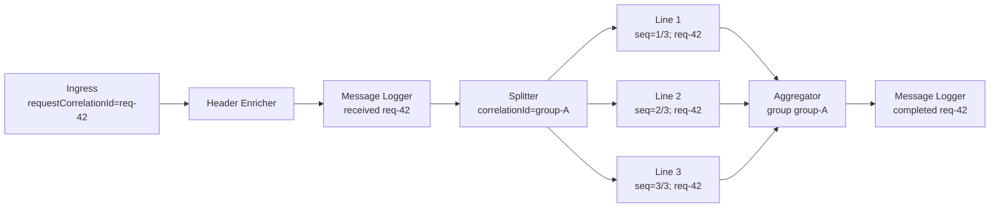

# Correlation ID in Logs

In an integration system, a single request may traverse multiple `MessageChannel`, `Filter`, `Router`, `Transformer`, `Splitter`, `Aggregator`, and retry stages before completion. Each step may write its own logs; if logs only say "order processed," operators can hardly tell which lines belong to the same request.

This lesson belongs to the **Message logger** chapter of the **SPRING_INTEGRATION_PATTERN** module. Its goal is to practice Enterprise Integration Patterns with Spring Integration to build loosely coupled, extensible message flows while tracking processing branches, errors, and message correlation using a consistent identifier.

After this lesson, you will be able to:

- Distinguish a request-tracking ID across the system from the message group ID used by `Aggregator`.
- Attach and preserve a tracking ID in `MessageHeaders`; log per stage using `IntegrationFlow.log()` or `LoggingHandler`.
- Put the tracking ID into MDC when using standard loggers, and recognize MDC limits across asynchronous boundaries.
- Inspect logs across Router, Filter, Splitter, Aggregator, retry, and error channel branches without exposing sensitive data.

## 1. The Problem: Which Request Do These Log Lines Belong To?

Suppose a service receives an `ORD-42` command containing three line items. The processing flow may include:

1. A Gateway receives the command and converts it into a `Message`.
2. A Filter validates it and a Router selects the processing branch.
3. A Splitter emits three child messages to process each line item.
4. One branch hits a transient error and is retried.
5. An Aggregator collects all results before emitting the final status.

When multiple orders execute concurrently, log lines interleave over time:

```text
INFO  Received order ORD-42
INFO  Processing item A
INFO  Received order ORD-43
WARN  Retrying item B
INFO  Order completed
```

The lines "Retrying item B" and "Order completed" do not indicate which order they belong to. If every step logs a stable `requestCorrelationId`, we can filter accurately:

```text
INFO  event=received  requestCorrelationId=req-42 orderId=ORD-42
INFO  event=item     requestCorrelationId=req-42 lineNo=1
INFO  event=received  requestCorrelationId=req-43 orderId=ORD-43
WARN  event=retry    requestCorrelationId=req-42 lineNo=2 attempt=2
INFO  event=complete requestCorrelationId=req-42 result=ACCEPTED
```

Here `requestCorrelationId` is an **application convention** used to find logs from start to finish for a request. Spring Integration also has a `correlationId` header with a different important purpose: grouping related messages together.

## 2. Distinguishing the Different IDs

| ID / Metadata | Common Source | Meaning | Should It Be Used as the Cross-Flow Log Key? |
| --- | --- | --- | --- |
| `requestCorrelationId` | Application-defined header | Links events belonging to the same request/unit of work | **Yes**, provided it is preserved across steps |
| `MessageHeaders.ID` (`messageId`) | Generated by Spring Messaging per `Message` | Identifies one message object; new messages may receive new IDs | Should not be used as the sole key for an entire flow |
| `IntegrationMessageHeaderAccessor.CORRELATION_ID` (`correlationId`) | Splitter, sequence-producing components, or application | Group key for Aggregator/Resequencer to correlate messages | Useful for tracking a **group**, but not inherently stable across an entire flow |
| `SEQUENCE_NUMBER` and `SEQUENCE_SIZE` | Sequence-producing components, especially Splitter | Position and total count in a group | Use **alongside** the group ID when diagnosing |
| `traceId` / `spanId` | Distributed tracing/observability system | Links spans and operations across instrumented components | Useful for looking up traces; not identical to an application correlation ID |
| `orderId` / `customerId` | Business domain | Identifies a business entity, which may appear across multiple requests | Use only as a supplementary field if allowed by data policies |

Key point: **Do not overload Spring Integration's `correlationId` as a request ID and assume it stays unchanged across every Splitter/Aggregator.** That header is used and potentially modified by the framework and grouping strategies depending on context. To track a request across a flow, use a distinct name such as `requestCorrelationId`; to diagnose a Splitter/Aggregator group, also log `correlationId` and the sequence numbers.

For example, request `req-42` may be split into three messages. All three carry `requestCorrelationId=req-42`, while sharing `correlationId=group-A` with `sequenceNumber` values `1`, `2`, and `3`. In flows with nested split/aggregate stages, each level also maintains its own group context.

## 3. Setting the ID at the Ingress Boundary and Propagating It in Messages

A practical convention:

1. At an HTTP controller, messaging gateway, consumer, or inbound adapter, read an incoming ID from the caller **if permitted**.
2. Validate length, character set, and trust boundary; if missing or invalid, generate a new UUID. Never use emails, phone numbers, tokens, or personal data as tracking IDs.
3. Store the normalized ID in the application header `requestCorrelationId` before entering the flow.
4. Preserve that header through Transform/Route/Split steps; if constructing a new `Message` manually, explicitly copy the required headers.
5. When sending to another service or broker, map the ID to an appropriate protocol header/metadata field and verify at the receiver. Never assume every adapter forwards every header.

Example of normalizing an inbound ID in Java (character rules are illustrative):

```java
import java.util.UUID;

static String normalizeCorrelationId(String candidate) {
    if (candidate != null && candidate.matches("[A-Za-z0-9._-]{1,64}")) {
        return candidate;
    }
    return UUID.randomUUID().toString();
}
```

If the system requires uniqueness under its own control, **always generate a new ID at the trust boundary**, while storing any partner ID in a separate header for reconciliation. Syntax validation alone does not prove an external ID is unique or trustworthy.

The diagram below illustrates the difference between a request-tracking ID and a group ID generated by a Splitter:



In the diagram, `req-42` and `group-A` are shortened values for readability; actual IDs may be UUIDs or other object types.

## 4. Spring Integration Java DSL Example: Logging Without Altering the Flow

The example below uses Spring Integration Java DSL, SLF4J, and a `DirectChannel`. It assumes Spring Integration, Spring Context, and logging are already configured. The input is a string representing an order so the focus stays on correlation mechanics.

```java
import java.util.UUID;

import org.slf4j.Logger;
import org.slf4j.LoggerFactory;
import org.slf4j.MDC;
import org.springframework.context.annotation.Bean;
import org.springframework.context.annotation.Configuration;
import org.springframework.integration.channel.DirectChannel;
import org.springframework.integration.dsl.IntegrationFlow;
import org.springframework.integration.handler.LoggingHandler;
import org.springframework.messaging.MessageChannel;

@Configuration
public class OrderLogFlowConfig {

    public static final String REQUEST_ID = "requestCorrelationId";

    private static final Logger log =
            LoggerFactory.getLogger(OrderLogFlowConfig.class);

    @Bean
    public MessageChannel ordersInput() {
        return new DirectChannel();
    }

    @Bean
    public IntegrationFlow ordersFlow() {
        return IntegrationFlow.from("ordersInput")
                // Add the ID when the inbound message does not already have this header.
                .enrichHeaders(h -> h.headerFunction(
                        REQUEST_ID, message -> UUID.randomUUID().toString()))

                // The flow logger reads the header directly, independent of MDC.
                .log(LoggingHandler.Level.INFO, "orders.flow", message ->
                        "event=received requestCorrelationId="
                                + message.getHeaders().get(REQUEST_ID)
                                + " messageId=" + message.getHeaders().getId())

                // Example handler that uses standard application logging.
                .handle(message -> {
                    String requestId =
                            String.valueOf(message.getHeaders().get(REQUEST_ID));
                    try (MDC.MDCCloseable ignored =
                                 MDC.putCloseable("requestCorrelationId", requestId)) {
                        log.info("event=processed payloadType={}",
                                message.getPayload().getClass().getSimpleName());
                    }
                })
                .get();
    }
}
```

Role of each stage:

- `enrichHeaders(...headerFunction(...))` adds the header if absent. By default in Header Enricher, an existing header is **not overwritten**; therefore inbound values must be normalized before sending to `ordersInput`.
- `log(level, category, function)` creates an observation point in the flow using the logging operator (backed by Wire Tap/`LoggingHandler`). The snippet selects only required fields instead of logging full payloads and headers.
- `handle(...)` processes the message. `MDC.putCloseable` populates the ID for standard loggers within the `try` block and removes the key on exit, even if an exception occurs.
- `get()` finishes the `IntegrationFlow` definition; `handle` is the terminal consumer in this example.

A sender can submit a message to the channel as follows (with `ordersInput` being an injected `MessageChannel` or retrieved from the Spring context):

```java
import org.springframework.messaging.support.MessageBuilder;

String trustedId = normalizeCorrelationId(incomingCorrelationId);
ordersInput.send(MessageBuilder.withPayload("order:ORD-42")
        .setHeader(OrderLogFlowConfig.REQUEST_ID, trustedId)
        .build());
```

Two quick checks: (1) logs from `orders.flow` show the right `requestCorrelationId`; (2) logs from `OrderLogFlowConfig` also include the ID via MDC **if** the log format pattern is configured to display MDC.

With Spring Boot using Logback, you can include the MDC field in the pattern, for example:

```yaml
logging:
  pattern:
    level: "%5p [requestCorrelationId=%X{requestCorrelationId:-none}]"
```

Note: `.log(...)` runs outside the handler's `try` block, so it logs the ID by reading the **message header**. The MDC pattern only displays a value while the current thread holds the `requestCorrelationId` key; it does not automatically populate every log emitted in the flow.

## 5. Useful Logging Across Enterprise Integration Patterns

A correlation ID is most valuable when logged at **key decision points**, paired with event name, branch, outcome, and processing duration; repeating the exact same line at every hop only adds noise.

| Component | Events Worth Logging | Useful Fields Alongside `requestCorrelationId` |
| --- | --- | --- |
| Gateway / inbound adapter | Inbound receipt and validation | `event=received`, `source`, `messageId` |
| Filter | Accepted or rejected | `event=accepted/rejected`, `reasonCode` |
| Router | Branching decision | `event=routed`, `route=priority/standard` |
| Transformer | Transformation succeeded/failed | `event=transformed`, `sourceType`, `targetType` |
| Splitter | Start/emission of each part | `event=split`, `correlationId`, `sequenceNumber`, `sequenceSize` |
| Aggregator | Group completed or timed out | `event=aggregated/timeout`, `correlationId`, `groupSize` |
| Retry / recoverer | Retry attempt, retries exhausted | `event=retry/exhausted`, `attempt`, `errorCode` |
| Error channel | Error received and handled | `event=failed`, `errorType`, `failedMessageId` |

With a `Filter`, rejected messages will not reach a logger placed **after** the Filter. If auditing rejections is required, place logging in the discard flow or at the decision point. With a `Router`, you can place loggers on each branch to confirm the actual route taken.

Spring Integration provides the `.log(...)` operator to insert observation points in Java DSL; another option is configuring a logging channel adapter and Wire Tap. Control log levels, categories, frequency, and permitted data. Never enable full-message logging on paths carrying sensitive information.

### Illustration When Splitter and Aggregator Appear Together

Spring Integration's Splitter typically populates sequence-related headers including `correlationId`, `sequenceNumber`, and `sequenceSize`. By default, Aggregator relies on `correlationId` for grouping and sequence metadata to decide when to release a result. Consequently, when debugging "Aggregator stuck waiting," inspect the group ID, sequence number, and sequence size before looking only at the request ID.

```text
INFO event=split-item requestCorrelationId=req-42 correlationId=group-A sequenceNumber=1 sequenceSize=3
INFO event=split-item requestCorrelationId=req-42 correlationId=group-A sequenceNumber=2 sequenceSize=3
WARN event=retry      requestCorrelationId=req-42 correlationId=group-A sequenceNumber=3 attempt=2
INFO event=split-item requestCorrelationId=req-42 correlationId=group-A sequenceNumber=3 sequenceSize=3
INFO event=aggregated requestCorrelationId=req-42 groupSize=3
```

This is **illustrative** output, not output automatically generated by Spring Integration. You must configure the corresponding log points explicitly. `correlationId` can change across nested split/aggregate layers; once the Aggregator emits its result, the framework may strip that layer's sequence headers. Therefore, log individual branches **before** the Aggregator if you need per-item reconciliation.

Also note: when a Splitter emits from an `Iterator`/`Iterable` whose total count is unknown upfront, `sequenceSize` may be `0`. In that case, the default release strategy based on sequence size will not suffice to detect group completion automatically; design an appropriate release or timeout strategy.

## 6. Correlation ID and MDC: Two Complementary Mechanisms

**Headers live on the `Message`; MDC lives in thread context.** Spring Integration can transition from a synchronous `DirectChannel` to an `ExecutorChannel`, `QueueChannel`, poller, or external broker. A handler running on another thread does not automatically inherit the previous thread's MDC.

Safe MDC workflow:

1. Read `requestCorrelationId` from the header of the message currently being handled.
2. Put it into MDC **strictly within the execution scope** that needs logging.
3. Use `try-with-resources` (or `try/finally` with proper state restoration) to clear MDC afterward; prevent a previous request's ID from "sticking" to a pooled thread.
4. At a consumer/handler after an async boundary, read the ID from the header again and set a fresh MDC scope. If using tracing/observation instrumentation, configure context propagation according to your library.

Example of a flawed assumption:

```java
MDC.put("requestCorrelationId", "req-42");
executor.execute(() -> log.info("async step")); // Do not assume req-42 is present.
MDC.remove("requestCorrelationId");
```

Attach the ID to the handed-off work and establish the MDC scope where the work actually runs. For instance, when a consumer pulls a `Message<?>` from a queue, invoke a handler wrapped with `MDC.putCloseable` as in the earlier example; this works regardless of which thread receives the message.

**Distributed tracing** is a separate mechanism. With Micrometer Observation/Tracing, trace context can propagate via message headers when observation is configured on channels and consumers. Use `traceId` to investigate spans across services; use `requestCorrelationId` to look up the business lifecycle. Both fields can be logged if system scale warrants it.

## 7. Errors, Retries, and Failure Branches

In asynchronous processing, Spring Integration can send an `ErrorMessage` to an error channel rather than throwing an exception back to the caller. The payload of an `ErrorMessage` is a `Throwable`; for a `MessagingException`, you can access the failed message via `getFailedMessage()` if available:

```java
import org.springframework.messaging.Message;
import org.springframework.messaging.MessagingException;
import org.springframework.messaging.support.ErrorMessage;

static Object findFailedRequestId(ErrorMessage errorMessage) {
    Throwable cause = errorMessage.getPayload();
    if (cause instanceof MessagingException messagingException) {
        Message<?> failed = messagingException.getFailedMessage();
        if (failed != null) {
            return failed.getHeaders().get("requestCorrelationId");
        }
    }
    return null; // When failedMessage is absent: an alternative metadata source is needed.
}
```

This is an illustrative helper to **extract the ID**, not a complete error flow configuration. Depending on where the failure occurred and how the `ErrorMessage` was built, `failedMessage` may be absent or lack certain headers. Therefore, design error paths to carry the necessary metadata and verify them with tests that trigger real failures.

During retries, ensure repeated attempts of the same work retain `requestCorrelationId`, while also logging attempt counts and error codes. Do not use the retry count as an ID, and do not generate a new business ID for each attempt if your goal is tracking one unified request.

## 8. Common Places Correlation Gets Lost or Confused

| Symptom | Possible Cause | How to Check / Fix |
| --- | --- | --- |
| Initial log has ID, later log loses it | New `Message` built without copying headers, header filtered out, or adapter did not map headers | Inspect headers on **both sides** of the boundary; selectively forward `requestCorrelationId` |
| `.log(...)` has ID, but `log.info(...)` does not | ID placed in header only, MDC not set in handler, or log pattern omits MDC | Read header in handler, set scoped MDC, configure pattern |
| Concurrent logs show wrong ID | Thread pool reuses threads without clearing MDC | Clear/restore MDC after every message; test interleaved requests |
| Aggregator does not release output | Missing or mismatched `correlationId`, `sequenceSize`, release strategy, or timeout | Log group and sequence headers right before Aggregator; review release strategy |
| Searching by `messageId` finds only a few lines | New messages were created in downstream steps | Search by `requestCorrelationId` for the whole request; keep `messageId` for single-message tracing |
| Strange ID contains newlines or sensitive data | Blindly trusting an externally supplied header | Validate/normalize inputs, restrict logged fields, filter sensitive data |
| Trace exists, but business ID is missing | Trace context propagates independently of custom headers | Log `traceId` and `requestCorrelationId` separately; configure propagation for both as needed |

When logging in distributed systems, use structured logging (JSON or key-value) with consistent field names such as `timestamp`, `level`, `service`, `event`, `requestCorrelationId`, `messageId`, `traceId`, and `errorCode`. Avoid logging raw payloads, tokens, credentials, or unclassified headers.

## 9. Hands-On Exercise and Verification Criteria

**Scenario:** The Gateway receives two requests, `req-A` and `req-B`, nearly simultaneously. `req-A` is split by a Splitter into three parts; the second part fails on its first attempt, retries, and succeeds. `req-B` is rejected by a Filter.

Tasks:

1. Generate or propagate `requestCorrelationId` at ingress. Log `event=received` when each request arrives.
2. At the Filter, log `event=accepted` and `event=rejected` (with a reason code) on the respective branches. Verify `req-B` does not appear in downstream processing branches.
3. For `req-A`, log `correlationId`, `sequenceNumber`, and `sequenceSize` for each part after the Splitter; explicitly log `attempt` on the retried part.
4. After the Aggregator, log `event=aggregated` and the number of aggregated items. Verify the same `requestCorrelationId` appears at all expected points.
5. Move one processing stage onto an executor/queue to re-verify MDC handling; ensure `req-A` and `req-B` never bleed into each other's logs.
6. Intentionally throw an error to observe the error channel. Verify whether the failed message's ID appears in the error log, and add missing metadata if needed.

A passing result must clearly answer: **which request**, **which branch it took**, **how many parts it split into**, **which part was retried**, **whether aggregation completed**, and **where errors occurred**.

### Self-Check Questions

1. Why does `message.getHeaders().getId()` fail to guarantee end-to-end tracking across Transformers and Splitters?
2. Why should `requestCorrelationId` be kept distinct from `IntegrationMessageHeaderAccessor.CORRELATION_ID`?
3. If logs inside an `ExecutorChannel` are missing MDC values, where should you fix it and why?
4. What happens when an Aggregator uses a `sequenceSize`-based release strategy if the Splitter cannot know the item count ahead of time?
5. How can an inbound ID support lookups without introducing log injection or data leakage vulnerabilities?

## 10. References

- Spring Integration Reference — [Logging Channel Adapter](https://docs.spring.io/spring-integration/reference/logging-adapter.html): configuring `LoggingHandler` and selecting log content.
- Spring Integration Reference — [Java DSL `log()` operator](https://docs.spring.io/spring-integration/reference/dsl/java-log.html): behavior of the logging operator inside an integration flow.
- Spring Integration Reference — [Splitter](https://docs.spring.io/spring-integration/reference/splitter.html) and [Aggregator](https://docs.spring.io/spring-integration/reference/aggregator.html): `correlationId`, sequence headers, and release strategies.
- Spring Integration Reference — [Message](https://docs.spring.io/spring-integration/reference/message.html): `Message` headers and `IntegrationMessageHeaderAccessor`.
- Spring Integration Reference — [Metrics and Management](https://docs.spring.io/spring-integration/reference/metrics.html): observability and propagating observation context across messages.
- Spring Integration Reference — [Error Handling](https://docs.spring.io/spring-integration/reference/error-handling.html): error channels and `ErrorMessage`.

**Key takeaway:** a correlation ID in logs is only truly useful when it has clear semantics, propagates across flow steps, appears consistently at key observation points, and is verified across failures and thread switches.
