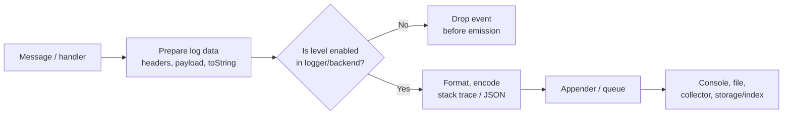
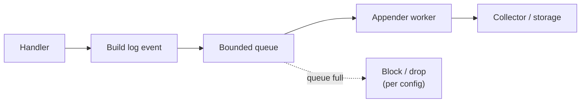

# Log Levels and the Cost of Creating Logs

A Spring Integration flow may log when a Gateway receives a request, a Filter decides whether to keep or reject it, a Router chooses a branch, a Transformer converts data, a Splitter splits a message, an Aggregator combines a group, and an error channel receives a failure. These logs help troubleshoot incidents, yet every line carries processing, emission, and storage costs. Especially when a single request spawns hundreds of child messages, logging at every step can vastly exceed the volume of the original business payload.

This lesson belongs to the **Message logger** chapter of the **SPRING_INTEGRATION_PATTERN** module, focusing on implementing Enterprise Integration Patterns with Spring Integration to build loosely coupled, extensible message flows. Choosing log levels and controlling observability costs is part of designing Router, Filter, Transformer, Splitter, Aggregator, Gateway, retry, error channel, and correlation behavior.

After this lesson, you will be able to:

- Choose `ERROR`, `WARN`, `INFO`, `DEBUG`, or `TRACE` based on **the event and operational need**, not simply log line count.
- Distinguish between **not emitting a log line** and **avoiding the cost of building the data for that log line**.
- Configure log levels for application loggers and `.log(...)` checkpoints in Spring Integration Java DSL.
- Estimate log volume when using Splitter, Aggregator, retries, or parallel processing flows.
- Measure actual impacts on latency, CPU, GC, I/O, and the log pipeline while retaining enough information for error tracing.

## 1. Log Level Is a Decision About Significance

Systems built on SLF4J with backends such as Logback or Log4j2 commonly use these levels:

| Level | Practical Meaning | Example in Spring Integration |
| --- | --- | --- |
| `ERROR` | A failure requiring handling or investigation; the flow cannot complete as expected | Retries exhausted, unrecovered `ErrorMessage`, unable to persist a critical result |
| `WARN` | A recoverable anomaly or condition risking functional degradation | Flaky broker, retries occurring, Aggregator waiting unusually long for a group |
| `INFO` | Business events or milestones worth observing in normal operations | Request received, group completed, key order processed |
| `DEBUG` | Details useful for finding root causes, usually enabled selectively | Condition the Router used to branch, post-Splitter item sequence, normalized headers |
| `TRACE` | Very fine-grained progression, suited for isolating tricky issues | Fine-grained internal steps, message progression across multiple adapters |

Not every Filter rejection is a `WARN`: if filtering is expected by design, log at `DEBUG`, increment a metric counter, or emit a dedicated business event at an appropriate level. Similarly, a single retry might be `DEBUG`; `WARN` is better reserved for notable delays or elevated retry rates.

**Foundational rule:** an event gets its log level from its semantic meaning. If you raise log levels solely to see more details during an incident, scope it by category/flow; do not turn every per-item processing step into permanent `INFO` logs.

### Where Are Log Levels Filtered?

A log message may pass through multiple layers:



This diagram is a mental model of cost, not the exact call order of every library. **Every Java expression used to construct arguments for a logger call is evaluated before the logger method receives those arguments**, unless deliberately deferred via a guard or supplier. The logger/backend can skip formatting, I/O writes, and indexing when a level is disabled, but it cannot undo work the application already performed beforehand.

In Spring Integration, both the level configured on `LoggingHandler`/`.log(...)` and the backend's per-category configuration determine whether a record is emitted. Never assume lowering a backend log level eliminates all expression-evaluation overhead in an arbitrary logging setup; verify with your specific library and version.

## 2. Where Does Logging Cost Come From?

Costs fall into five categories:

1. **Data construction:** reading headers, computing strings, invoking `toString()`, serializing JSON/XML, formatting exceptions, or copying payloads.
2. **Record formatting:** resolving category and level, formatting placeholders, capturing timestamps/thread info, injecting MDC or trace context into output.
3. **Record transport:** writing to stdout/files, enqueuing, sending over the network to a collector.
4. **Log-system processing:** parsing, field indexing, storage, compression, and retention.
5. **Indirect effects:** memory allocation, GC, resource contention, I/O waits, queue saturation, and increased message-processing latency.

Cost scales not only with **request rate**, but also with **intermediate message count** and **log points per message**. When a Splitter emits `N` items and each passes `K` loggers, logging on the split branch generally grows by roughly `N × K` records per request; retries multiply it further.

### Example: Logging Is Disabled, Yet Expressions Still Execute

```java
// Easily wastes CPU: serialization runs before the logger is called.
log.debug("event=transformed payload={}",
        expensiveJsonSerialization(message.getPayload()));

// Similarly: string concatenation runs before the logger call.
log.debug("event=transformed " + buildExpensiveSummary(message));
```

Even when `DEBUG` is disabled, Java still evaluates `expensiveJsonSerialization(...)` and `buildExpensiveSummary(...)` to pass their return values to `debug(...)`. If those arguments allocate large strings, this work creates substantial allocation and GC pressure.

More idiomatic approaches:

```java
// For simple arguments: placeholders defer formatting.
log.debug("event=transformed messageId={} payloadType={}",
        message.getHeaders().getId(),
        message.getPayload().getClass().getSimpleName());

// For expensive expressions: guard before computing.
if (log.isDebugEnabled()) {
    String summary = expensiveJsonSerialization(message.getPayload());
    log.debug("event=transformed summary={}", summary);
}
```

Placeholders `{}` typically defer formatting/`toString()` of **already-passed objects** until the backend actually processes the event, but they do not defer evaluating argument expressions. For instance, in `log.debug("{}", expensiveJsonSerialization(payload))`, serialization still runs upfront.

With **SLF4J 2.x**, you can use the Fluent API with a supplier so expensive details are computed only when the level is active:

```java
log.atDebug()
        .addArgument(() -> expensiveJsonSerialization(message.getPayload()))
        .log("event=transformed summary={}");
```

This requires an SLF4J version supporting the Fluent API; if your project uses SLF4J 1.x, use `isDebugEnabled()`. Suppliers must remain pure: never mutate business state or depend on the logger definitely invoking them.

### When Should Payloads Be Formatted?

For flow troubleshooting, it is usually sufficient to log `messageId`, `requestCorrelationId`, `route`, `payloadType`, `elapsedMs`, and `errorCode`. Printing the entire `Message<?>` or full payload can trigger all three issues: high serialization cost, bloated logs, and accidental exposure of sensitive information.

Especially for large or deeply nested payloads, `toString()` can be slow and may even trigger lazy loading or custom logic. Never dump all headers by default, as headers may contain tokens, internal routing metadata, or user data.

## 3. Logging in Spring Integration Java DSL

Spring Integration lets you add log points via the `.log(...)` operator. You can pass the log level, category, and a function computing the text to log. The following example logs metadata only, omitting the full payload.

```java
import org.slf4j.Logger;
import org.slf4j.LoggerFactory;
import org.springframework.context.annotation.Bean;
import org.springframework.context.annotation.Configuration;
import org.springframework.integration.channel.DirectChannel;
import org.springframework.integration.dsl.IntegrationFlow;
import org.springframework.integration.handler.LoggingHandler;
import org.springframework.messaging.MessageChannel;

@Configuration
class OrderLoggingFlowConfig {

    private static final Logger log =
            LoggerFactory.getLogger(OrderLoggingFlowConfig.class);

    @Bean
    MessageChannel ordersInput() {
        return new DirectChannel();
    }

    @Bean
    IntegrationFlow ordersFlow() {
        return IntegrationFlow.from("ordersInput")
                .log(LoggingHandler.Level.DEBUG, "demo.orders.flow", m ->
                        "event=received"
                                + " messageId=" + m.getHeaders().getId()
                                + " requestCorrelationId="
                                + m.getHeaders().getOrDefault(
                                        "requestCorrelationId", "unknown"))
                .filter(String.class, payload -> !payload.isBlank())
                .transform(String.class, String::trim)
                .log(LoggingHandler.Level.INFO, "demo.orders.flow", m ->
                        "event=accepted"
                                + " messageId=" + m.getHeaders().getId()
                                + " payloadType=" + m.getPayload().getClass().getSimpleName())
                .handle(m -> {
                    log.debug("event=handled messageId={}",
                            m.getHeaders().getId());
                })
                .get();
    }
}
```

How this behaves:

- Logger `demo.orders.flow` acts as a dedicated category for observation points in the flow, making it easy to tune log levels for this flow alone.
- The `DEBUG` point records the inbound message and tracking ID (if present) for troubleshooting. The `INFO` point fires only when the message passes the Filter.
- `Filter` drops empty or blank strings; if you also need visibility into rejected messages, configure a `discardFlow`/discard channel or a metric for that branch.
- `.log(...)` does not replace business logic; it is an observation point. The final handler demonstrates standard SLF4J logging.
- In a flow with multiple log levels, actual emitted records depend on both the path taken and logger threshold settings.

Example using Spring Boot with `application.yml`:

```yaml
logging:
  level:
    root: INFO
    org.springframework.integration: WARN
    demo.orders.flow: INFO
    com.example.orders: INFO
```

In this configuration, `INFO` records from `demo.orders.flow` are emitted, while `DEBUG` records in the same category are suppressed. To investigate this specific flow:

```yaml
logging:
  level:
    demo.orders.flow: DEBUG
```

These are **two alternative configurations**, not blocks to place back-to-back. If you also want `log.debug(...)` inside the handler, you must enable `DEBUG` for the handler class's category as well, such as `com.example.orders` (depending on the actual package). `logging.level` is a Spring Boot mechanism; non-Boot applications must configure Logback/Log4j2 accordingly.

When temporarily enabling logs to isolate an incident, systems can use runtime logging configuration—such as the Spring Boot Actuator `loggers` endpoint if enabled and properly secured. Record when it was toggled and restore the baseline threshold afterward.

### Logging Operator vs. Manual Logger

| Situation | Typically Suitable Tool | Cost Considerations |
| --- | --- | --- |
| Observing messages at a milestone in `IntegrationFlow` | `.log(level, category, expression)` / `LoggingHandler` | Avoid logging full payloads; monitor how often messages hit the milestone |
| Logging logic outcomes inside a service/handler | `org.slf4j.Logger` | Guard expensive computations; use placeholders |
| Recording context across multiple threads | Message headers paired with scoped MDC | MDC does not follow threads automatically; populate context where work executes |
| Tracking message counts, error rates, latency | Micrometer metrics/observation | Metrics aggregate data and are usually cheaper than one log line per message |

The logging operator may use Wire Tap/`LoggingHandler` to observe the flow. Regardless of the exact mechanism, treat **each log point** as part of throughput design and measure its impact in realistic conditions.

## 4. How Does Log Volume Scale by Pattern?

The table below illustrates what to log continuously versus details enabled only during investigations:

| Pattern | Useful Operational Logs | Detailed Troubleshooting Logs | Volume Growth Risk |
| --- | --- | --- | --- |
| Gateway | Key request receipts, failure outcomes | Sanitized routing headers | One record per request |
| Filter | Unusual rejection reasons, rejection counts via metrics | Filter predicate, per-message reason code | Spikes if rejecting most messages is normal |
| Router | Routing to unusual/critical branches | Every branch decision | Many branches + steps multiply line counts |
| Transformer | Mapping/validation errors | Source/target types, schema version | Serializing input/output incurs heavy cost |
| Splitter | Group split start/end, item count | Each item with `correlationId`, `sequenceNumber` | **One request becomes N messages** |
| Aggregator | Full group release, timeout, partial group | Group size and per-group status | Long-waiting groups can emit many events if logged on every update |
| Retry | Retries exhausted, abnormal attempt counts | Each attempt and error category | Retry count × item count |
| Error channel | Final failure, error code, and related group | Controlled stack trace, error metadata | Large stack traces and repeated errors bloat logs |

A **Correlation ID** is especially helpful for reducing log volume: instead of printing payloads at every hop, attach the application's `requestCorrelationId` to high-value events and use it to trace across steps. Keep this request-tracking ID distinct from the `correlationId` Spring Integration uses for Splitter/Aggregator groups. Log group details like `sequenceNumber`/`sequenceSize` when needed.

Another rule is placing loggers **after decision points** when you only care about the outcome. For example, if a Filter drops a message, a logger after the Filter will never see it; if you need to observe rejections, measure or log in the discard flow. Do not raise log levels to compensate for misplacing a logger.

## 5. Estimating Log Volume and Storage Cost

An initial estimation model:

\[
V_{\text{day}} = R \times E \times B \times 86\,400
\]

Where:

- `R`: number of messages or requests passing log points per second;
- `E`: average log events per chosen unit (if R is requests/s, use logs/request; if R is messages/s, use logs/message);
- `B`: average encoded bytes per record;
- `V`: log bytes generated per day, **before** compression, index replication, or storage-system overhead.

For example, for a system handling 1,000 requests/s, averaging four records per request at ~500 bytes each:

```text
1,000 requests/s × 4 logs/request × 500 B/log
= 2,000,000 B/s ≈ 2 MB/s
= 172,800,000,000 B/day ≈ 172.8 GB/day
= 5,184 GB in 30 days (before overhead)
```

If each request splits into ten child messages and we add one `DEBUG` line per child message:

```text
1,000 requests/s × 10 logs/request × 500 B/log
= 5 MB/s additional
≈ 432 GB/day additional if DEBUG stays permanently on
```

These numbers are **hypothetical examples for practicing estimation**, not Spring Integration benchmarks. Real sizes depend on JSON formatting, stack trace length, headers, encoding, retention, batching, and replication factors in the log pipeline.

Beyond storage volume, monitor `events/s`, bytes/s from appenders, dropped records, queue memory, CPU, GC, and processing latency. An error repeating 1,000 times/s with a large stack trace can consume far more resources than thousands of short INFO metadata lines.

### Avoid Miscounting Volume

- With a Router, a request normally takes one branch; with publish-subscribe or fan-out, one message can hit multiple handlers.
- With a Splitter, count logs by **child message** count and nested splitter levels; never multiply only by original request count.
- With retries, count both failed and successful attempts. If one failure logs at the handler, advice, and error channel, a single attempt can emit multiple lines for the same event.
- With an Aggregator, distinguish logs emitted when **receiving each part** from logs emitted when **releasing the result**.
- When scaling across multiple instances, sum cluster-wide traffic and remember collectors may add replicas, metadata, and indexes.

Monetary cost can be estimated from ingest, storage, and retention rates using your actual logging provider's pricing. Do not simply multiply GB/day by an assumed unit price if the pipeline also charges per event, index, or query.

## 6. Synchronous Logging, Asynchronous Logging, and Latency Impact

A synchronous logger can force the message-processing thread to wait for the append operation (depending on backend and appender). With `DirectChannel`, handlers and most synchronous steps run on the sender's thread; slow logging I/O can directly lengthen request latency.

An async appender reduces target write wait time on the main path by placing logs into a queue, but it **does not eliminate** data creation and enqueue overhead. It also adds CPU/memory cost and an operational trade-off: when the queue fills up, should the system block, drop lower-severity events, or reject writes? Exact behavior depends on Logback/Log4j2 and configuration.



If logs serve as mandatory audits, you cannot accept an async appender's default drop policy. You need durable persistence, retry/recovery strategies, and dedicated guarantees; general observability logs and business audits have different requirements.

### Distinguishing Latency by Layer

- `.log(...)` on synchronous channels adds work before the message reaches the next step.
- `ExecutorChannel` hands execution to another thread; you still pay logging cost on the receiving thread and must re-establish MDC context if used.
- Poller/`QueueChannel` separates enqueue time from processing time; measure end-to-end latency from ingress to outcome rather than only inside a single handler.
- When the network or collector slows down, log pipeline queues and retries can contend for resources shared with business logic.

Never claim "async logging is always faster" with a fixed number: results depend on backend, event size, queue settings, storage device, CPU, and enabled log rate.

## 7. Strategies to Reduce Cost While Preserving Observability

**Select meaningful events instead of logging every step.** Keep INFO for key milestones and essential errors; turn on DEBUG by category during investigations. For high-throughput flows, counters for total successes/failures and latency histograms are usually more efficient than one log line per message.

**Log minimal metadata.** For flow logs, prefer `event`, `service`, `requestCorrelationId`, `messageId`, `route`, `errorCode`, and `elapsedMs`. Log large objects only when genuinely required, size-bounded, classified, and redacted. Never log access tokens, secrets, personal data, or unchecked full message headers.

**Reduce repetitive logs deliberately.** You can sample routine success events or rate-limit repeated identical warnings. However, if sampling at 1% without recording the rate, you cannot extrapolate log counts directly into processed message counts. For critical errors, mandatory audits, or full-trace investigations, evaluate sampling policies separately.

**Design solid correlation.** Preserve the request-tracking ID across Router, Filter, Transformer, Splitter, Aggregator, and error flows. At Splitter boundaries, log group and sequence metadata at troubleshooting points. Pair with distributed tracing to inspect spans, without replacing business logs at decision points.

**Bound detail level and retention.** Timebox DEBUG/TRACE windows during incidents, monitor log volume afterward, and restore baseline thresholds. Align retention periods and access controls with the operational value of each log class.

## 8. Diagnosing Real-World Issues

| Symptom | Hypothesis to Verify | Action |
| --- | --- | --- |
| DEBUG is off, yet CPU stays high | Serialization/summary code runs inside logger arguments before level check | Locate expensive string builders, add guards/suppliers, re-measure allocations |
| CPU/GC jumps after adding `.log(...)` | Logging many child messages, expensive log expression, backend formatting/encoding | Count events/s per checkpoint, check payload logging and configured levels |
| Switched to async appender, logs are missing | Queue full, discard threshold active, or appender failing | Check queue/drop metrics and write policy; classify critical events |
| Splitter logs explode | Logging INFO per item when N is very large | Keep INFO at group completion; use selective DEBUG per item |
| Multiple duplicate stack traces | Same exception logged at handler, advice, and error channel | Pick one final error log point; log short events or metrics elsewhere |
| Logs do not match request after thread switch | Relying on prior thread's MDC or lost correlation header | Carry ID in message headers; establish scoped MDC on the new thread |
| Filter rejection logs never appear | Logger placed after Filter; rejected messages are discarded | Move observation into the discard flow/counter |
| Collector billing spikes suddenly | Level change, newly deployed log points, retry loop, traffic spike | Compare events/s, bytes/s, and categories before/after deployment |

In Spring Integration, turning `org.springframework.integration` up to `TRACE` typically produces massive output. If the issue sits inside an application flow, raise the log level on the flow's own category first. When framework logs are necessary, enable them strictly for the required window and watch resource usage.

## 9. Hands-On Exercise: Measuring Cost Before and After

**Scenario:** A service receives orders through a Gateway, uses a Filter to drop blank inputs, a Router to select branches, a Splitter to emit line items, an Aggregator to combine them, and retries a branch with transient failures. The goal is comparing diagnostic value and overhead across three logging strategies.

Prepare the same input message set and controlled failure scenarios; keep JVM settings, load rate, instance count, backend, and run duration identical across comparisons.

1. **Configuration A — Minimal INFO.** Log only request receipt, group completion, and final errors. Log short metadata and the request correlation ID.
2. **Configuration B — Per-item DEBUG.** Add logs for Router branch selection, every Splitter child message, retries, and each Aggregator arrival. Enable DEBUG for the flow category.
3. **Configuration C — Cost when DEBUG is off.** Keep the DEBUG log points from B but disable DEBUG. Add an expensive summary builder into a logger argument to observe eager evaluation cost; then add a guard/supplier and re-measure under identical conditions.

Observe at minimum:

- Messages processed and log events emitted per message/request.
- Throughput (messages/s) and end-to-end latency `p50`/`p95`/`p99`.
- CPU, allocations/GC, log volume in bytes, queue utilization, and dropped records (if any).
- Ability to answer: "Which request took which branch, which item retried, which group finished, and where did errors happen?" from retained logs.

Calculate expected log counts from request count, Splitter fan-out, and retries before running. Afterward, compare actual counts with your estimate and trace discrepancies (such as logs in discard flows or retry advice).

Reference results table to fill in:

| Metric | A: Minimal INFO | B: Per-Item DEBUG | C: DEBUG Off, Before/After Guard |
| --- | --- | --- | --- |
| Events/s | Measure actual | Measure actual | Measure actual |
| Bytes/s | Measure actual | Measure actual | Measure actual |
| CPU and allocations | Measure actual | Measure actual | Measure before/after guard |
| `p95` latency | Measure actual | Measure actual | Measure actual |
| Queue fill / drops | Measure actual | Measure actual | Measure actual |
| Request traceability | Verify | Verify | Verify |

Do not use the hypothetical numbers from Section 5 as benchmark results. Nor should you attribute differences solely to DEBUG if workload, collector, network, or JVM state changed between runs.

### Verifying Argument Evaluation When DEBUG Is Off

The Java snippet below illustrates a small check for an SLF4J logger without needing a connection to a centralized logging system:

```java
import java.util.concurrent.atomic.AtomicInteger;
import org.slf4j.Logger;

static String expensiveSummary(AtomicInteger calls) {
    calls.incrementAndGet();
    return "some summary";
}

static void unsafeDebug(Logger logger, AtomicInteger calls) {
    logger.debug("summary={}", expensiveSummary(calls));
}

static void guardedDebug(Logger logger, AtomicInteger calls) {
    if (logger.isDebugEnabled()) {
        logger.debug("summary={}", expensiveSummary(calls));
    }
}
```

When `DEBUG` is disabled, `unsafeDebug` **still** increments `calls` by one, whereas `guardedDebug` does not. This demonstrates Java's argument-evaluation rules, not a performance benchmark, and makes no assumptions about Spring Integration internals.

## 10. Self-Check Questions

1. Why can `log.debug("payload={}", serialize(payload))` still burn CPU when DEBUG is disabled? Give two ways to fix it.
2. Why is `ERROR` inappropriate for every message rejected by a Filter?
3. When a Splitter produces 20 items and each item passes three log points, how can log volume scale?
4. To trace a request across Gateway, Router, Splitter, Aggregator, and an error channel, which IDs should be logged and where?
5. Which cost does an async appender reduce, and what trade-offs arise when its queue fills up?
6. If enabling DEBUG multiplies storage costs several times over, which metrics would you inspect before changing code?
7. When logs are sampled, why can't log line counts directly tell you how many requests were processed?

## 11. References

- [Spring Integration — Logging Channel Adapter](https://docs.spring.io/spring-integration/reference/logging-adapter.html): configuring `LoggingHandler` and logging message content.
- [Spring Integration — Java DSL `log()`](https://docs.spring.io/spring-integration/reference/dsl/java-log.html): log points inside integration flows.
- [Spring Integration — Message](https://docs.spring.io/spring-integration/reference/message.html): message structure and headers.
- [Spring Boot — Logging](https://docs.spring.io/spring-boot/reference/features/logging.html): configuring loggers/categories and log levels.
- [SLF4J Manual](https://www.slf4j.org/manual.html): placeholders, log levels, Fluent API, and suppliers.
- [Logback — Appenders](https://logback.qos.ch/manual/appenders.html): appender behavior, `AsyncAppender`, and queue bounds.
- [OWASP — Logging Cheat Sheet](https://cheatsheetseries.owasp.org/cheatsheets/Logging_Cheat_Sheet.html): what to log vs. exclude and balancing log utility with security.

**Key takeaway:** log level controls only whether an event is emitted after reaching the filter; the cost of building logger arguments beforehand is still governed by application code. In Spring Integration, factor in child messages, retries, and processing branches when placing log points, favor compact metadata, and measure impact under realistic workloads.
