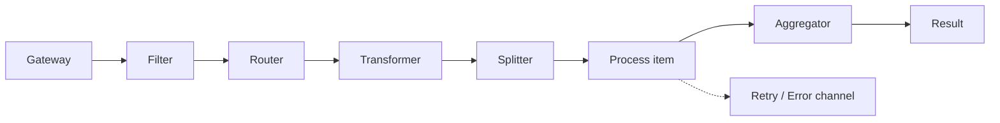

# Filtering or Masking Sensitive Data

Spring Integration frequently transports payloads containing emails, phone numbers, order details, access tokens, or internal data. When debugging Router, Filter, Transformer, Splitter, Aggregator, Gateway, retry, or error channel behavior, developers are tempted to log entire messages. That makes inspecting state quick, but also sends secrets into the console, log files, centralized collectors, and monitoring tools.

This lesson belongs to the **Message logger** chapter of the **SPRING_INTEGRATION_PATTERN** module. While learning Enterprise Integration Patterns with Spring Integration to build loosely coupled, extensible message flows, observing individual branches must go hand in hand with controlling what data is emitted to logs.

After this lesson, you will be able to classify sensitive fields, construct log records from an allowlist, mask or pseudonymize values deliberately, log safe metadata in the Java DSL, and test both normal and error logging paths.

## 1. Risks of Logging Full Messages

A system processes an order across multiple steps:



A short statement like:

```java
log.debug("incoming message={}", message);
```

can expose both the payload and `MessageHeaders` through `toString()`, depending on the message type and payload object. Once emitted, records may pass through stdout, sidecars/agents, queues, collectors, indexing systems, and backups—each with its own access controls and retention rules.

Handwritten loggers are not the only risk. Locations to audit include `IntegrationFlow.log()`, `LoggingHandler`, Wire Taps, HTTP/broker loggers, discard flows, retry advice, exception handlers, error channels, MDC, and tracing exporters.

### Classifying Data Before Logging

| Category | Examples | Default Policy |
| --- | --- | --- |
| Access secrets | Passwords, tokens, API keys, session cookies, private keys | **Never log**, not even partially |
| Authentication/payment data | OTPs, CVVs, full card numbers, credentials | **Never log** |
| Personal data | Email, phone number, address, personal identifiers | Omit from logs; mask only with valid need and proper access controls |
| Private business content | Contract pricing, order notes, case contents | Emit only approved metadata |
| Controlled technical fields | `event`, `messageId`, enum `route`, `itemCount`, `durationMs` | Safe to log with validated types and bounds |
| Correlation IDs | Application-issued `requestCorrelationId` | Safe to log if free of personal info/secrets |

A field's name does not automatically guarantee safety. For instance, `customerId` or `accountId` can still be sensitive data; evaluate based on purpose, access permissions, retention periods, and data-protection policies.

## 2. Choosing a Protection Strategy

### 2.1. Omitting Unnecessary Fields

This is the default choice. Instead of logging the order payload, construct a minimal record with data needed for investigation:

```text
DO NOT LOG:
event=received email=an@example.com phone=0901234567
authorization=Bearer eyJ... note="Private delivery address"

LOG INSTEAD:
event=order_received requestCorrelationId=req_42
messageId=6d5dc7c3-4066-4aa8-a394-3970d6789acd itemCount=3
```

A controlled logger still tells you which request ran, which steps it traversed, how many items were processed, and where an error occurred.

### 2.2. Partial Masking When Permitted

Masking retains part of a value for matching—for example, a support system whose policy permits showing the **last three digits** of a phone number:

```text
0901234567 -> [MASKED]***567
```

Masked data is **not necessarily anonymous**: it may still help link or identify an individual when combined with other data. For tokens, passwords, OTPs, and CVVs, avoid logging even a "last few characters only" version without special controls.

### 2.3. Using Surrogate IDs or Pseudonymization

When you need to correlate events without the real value, use a managed random ID or a keyed HMAC with a protected secret key. Unkeyed hashes of emails or phone numbers are vulnerable to dictionary attacks. An HMAC also produces linkable data, so access controls, storage, and key rotation must still be evaluated. Never store secret keys in source code or logs.

## 3. Distinguishing Message Filtering from Log Data Filtering

| Mechanism | Target | Result |
| --- | --- | --- |
| `IntegrationFlow`'s `.filter(...)` | Business message | Can stop the message from reaching downstream handlers |
| Safe log projection (allowlist projection) | Fields written to logs | Leaves the business message untouched |
| Logger level/backend filter | Log events | May skip writing a record to an appender |
| Collector-side redaction | Already-emitted records | Restricts stored data but does not prevent exposure at source or transit |

If downstream logic needs a token for authentication, never strip the token from the business message just to protect a logger. Keep the payload inside authorized processing boundaries and build a **projection containing only safe metadata** when logging.

Prefer an **allowlist** over merely searching and replacing words like `password` or `secret`. Payloads can introduce `refreshToken`, nested objects, differently named fields, or values embedded in exceptions. A field-name blocklist easily misses them.

## 4. Java: Constructing Log Strings Strictly from Approved Fields

This example uses Java 17+, Spring Messaging, and a sample `OrderCommand` payload. The payload carries an email and token, while the log record allows only the correlation ID, message ID, and item count.

```java
import java.util.List;
import java.util.regex.Pattern;
import org.springframework.messaging.Message;

record OrderCommand(
        String orderId,
        String customerEmail,
        String accessToken,
        List<String> productCodes) {
}

final class SafeLogView {
    private static final Pattern REQUEST_ID =
            Pattern.compile("[A-Za-z0-9_-]{1,64}");

    private SafeLogView() {
    }

    static String requestId(Message<?> message) {
        Object raw = message.getHeaders().get("requestCorrelationId");
        if (raw instanceof String id && REQUEST_ID.matcher(id).matches()) {
            return id;
        }
        return "missing";
    }

    static String received(Message<?> message) {
        int itemCount = -1;
        if (message.getPayload() instanceof OrderCommand command) {
            itemCount = command.productCodes() == null
                    ? 0 : command.productCodes().size();
        }
        return "event=order_received"
                + " requestCorrelationId=" + requestId(message)
                + " messageId=" + message.getHeaders().getId()
                + " itemCount=" + itemCount;
    }

    static String routed(Message<?> message, String route) {
        String safeRoute = switch (route) {
            case "priority" -> "priority";
            case "standard" -> "standard";
            default -> "unknown";
        };
        return "event=order_routed"
                + " requestCorrelationId=" + requestId(message)
                + " route=" + safeRoute;
    }
}
```

`received` never calls `OrderCommand.toString()`, never serializes JSON, never reads `customerEmail` or `accessToken`, and never prints all headers. When new fields are added to `OrderCommand`, the logger still emits only approved fields.

The `requestId` regex only constrains length and character set, blocking newlines or arbitrary characters through that field. **It does not prove a partner-supplied ID is trustworthy or unique.** Issue or normalize IDs at ingress rather than generating fresh IDs inside individual loggers, which would break correlation.

If policy genuinely permits showing the last three digits of a phone number, the following function illustrates masking; when number matching is unnecessary, omit the field altogether:

```java
static String maskPhone(String phone) {
    if (phone == null || !phone.matches("\\+?[0-9]{9,15}")) {
        return "[REDACTED]";
    }
    return "[MASKED]***" + phone.substring(phone.length() - 3);
}
```

This helper is for illustrative formatting only; never reuse it for tokens, passwords, OTPs, or any unapproved data.


## 5. Applying a Safe Representation in Spring Integration Java DSL

Java DSL log points accept a `LoggingHandler.Level`, category, and content-builder function. The example below logs only metadata from `SafeLogView`:

```java
import org.springframework.context.annotation.Bean;
import org.springframework.context.annotation.Configuration;
import org.springframework.integration.channel.DirectChannel;
import org.springframework.integration.dsl.IntegrationFlow;
import org.springframework.integration.handler.LoggingHandler;
import org.springframework.messaging.MessageChannel;

@Configuration
class SafeOrderFlowConfig {

    @Bean
    MessageChannel ordersInput() {
        return new DirectChannel();
    }

    @Bean
    IntegrationFlow ordersFlow() {
        return IntegrationFlow.from("ordersInput")
                .log(
                        LoggingHandler.Level.INFO,
                        "app.orders.safe",
                        SafeLogView::received)
                .filter(OrderCommand.class,
                        command -> command.productCodes() != null
                                && !command.productCodes().isEmpty())
                .handle(message -> {
                    // Place actual business processing call here.
                    // Never print message, payload, or all headers.
                })
                .get();
    }
}
```

This is an **illustrative skeleton**: replace the handler body with your order-processing service when integrating into an application. `OrderCommand` and `SafeLogView` are defined in the previous section.

- `.log(...)` places an observation point in `IntegrationFlow` using a controlled content function.
- `app.orders.safe` is a dedicated category for configuring log levels and troubleshooting without enabling all framework loggers.
- `.filter(...)` here rejects orders without products; it **filters business messages**, rather than stripping sensitive fields.
- Messages reaching the handler still carry the payload needed by business logic. Only log output is restricted.
- When you need visibility into messages dropped by a Filter, configure a discard flow that logs a defined `reasonCode`; do not log the rejected raw payload.

Some logging handler configurations can produce default output containing payloads, headers, or full message representations. Always specify an explicit safe expression at sensitive log points. Lowering log levels does not replace redaction: when DEBUG/TRACE is enabled during an incident, unsafe content would still be emitted.

### SLF4J: Do Not Pass Raw Objects

Inside a handler or service, log only approved fields:

```java
log.info(
        "event=order_accepted requestCorrelationId={} itemCount={}",
        SafeLogView.requestId(message),
        approvedItemCount);
```

Avoid statements like:

```java
log.debug("order={}", orderCommand);          // record.toString() includes email/token
log.warn("headers={}", message.getHeaders()); // May expose Authorization
log.error("processing failed: " + ex);        // ex.toString() may expose input
```

With SLF4J 2.x, you can attach key-value fields:

```java
log.atInfo()
        .addKeyValue("event", "order_accepted")
        .addKeyValue("requestCorrelationId", SafeLogView.requestId(message))
        .addKeyValue("itemCount", approvedItemCount)
        .log("order accepted");
```

The backend/encoder controls how key-value pairs render in output. Configure and verify the final format at the destination. **Structured logging does not automatically redact**: a `password` field in JSON is still a data leak even if validly encoded.

## 6. Headers, MDC, and Correlation IDs

A Spring Integration message may contain:

| Header / Context | Purpose | How to Log |
| --- | --- | --- |
| `MessageHeaders.ID` | Identifies a single message | Usually safe to log as a framework-generated UUID |
| `requestCorrelationId` (application-set) | Tracks one request across steps | Log only IDs issued/controlled and normalized by the application |
| `correlationId` | Links messages in a Splitter/Aggregator group | Use when debugging groups; validate type/format or map to a safe group ref |
| `sequenceNumber`, `sequenceSize` | Item position / group size | Safe to log as validated numbers |
| `traceId`, `spanId` | Traces spans when tracing is enabled | Log only approved tracing metadata |
| Unclassified headers | Authorization, cookies, adapter-specific data | **Never print all headers** |

`requestCorrelationId` and `correlationId` do not carry the same semantics. The first tracks the business lifecycle; the second helps Aggregator group items and may change across split/aggregate stages.

Example of a child message with selected fields:

```text
event=split_item requestCorrelationId=req_42
messageId=c4e8... groupRef=grp_17 sequenceNumber=2 sequenceSize=5
```

`groupRef` illustrates a normalized value safe for logs, not necessarily the raw string from the `correlationId` header. Never blindly call `toString()` on an arbitrary header object, as custom implementations can serialize unwanted data.

**MDC** is thread-scoped context. Across an `ExecutorChannel`, poller, queue, or broker, it does not travel automatically with the `Message`. Inside a handler that logs, set context from a verified ID and clean it up on exit:

```java
import org.slf4j.MDC;

String safeId = SafeLogView.requestId(message);

try (MDC.MDCCloseable ignored =
             MDC.putCloseable("requestCorrelationId", safeId)) {
    log.info("event=order_processed");
}
```

Never put emails, phone numbers, access tokens, raw payloads, or customer addresses into MDC, trace attributes, or baggage just for search convenience: those contexts are also shipped to observability systems.

## 7. Protecting Error Paths, Retries, and Exceptions

Error paths carry high leakage risk because exceptions can embed URLs with tokens, SQL parameters, upstream responses, or payload fragments. That data can appear in `getMessage()`, `toString()`, the cause chain, and stack traces.

In Spring Integration, asynchronous failures may be wrapped in an `ErrorMessage` sent to an error channel. The payload of an `ErrorMessage` is a `Throwable`; in certain cases `MessagingException` exposes `getFailedMessage()`. Extract only permitted metadata:

```java
import org.springframework.messaging.Message;
import org.springframework.messaging.MessagingException;
import org.springframework.messaging.support.ErrorMessage;

static String safeFailureSummary(ErrorMessage errorMessage) {
    Throwable error = errorMessage.getPayload();
    String requestId = "missing";

    if (error instanceof MessagingException messagingException) {
        Message<?> failed = messagingException.getFailedMessage();
        if (failed != null) {
            requestId = SafeLogView.requestId(failed);
        }
    }

    return "event=processing_failed"
            + " requestCorrelationId=" + requestId
            + " errorType=" + error.getClass().getSimpleName();
}
```

This snippet builds a log string, not a complete error flow configuration. Depending on the failure source, `failedMessage` may be null or lack headers; test realistic error paths and propagate correlation explicitly where required.

Not every stack trace contains secrets, yet no stack trace should be assumed safe by default. If stack traces are needed for deep investigations, route them to a dedicated logger/channel with strict access permissions, bounded retention, and content controls. Never dump verbatim exception messages and causes into broadly accessible loggers.

For retries, prefer fields like `attempt`, `requestCorrelationId`, `errorCode`, and `event=retry`. One error may be logged multiple times across a handler, advice, recoverer, and error flow; audit all of those loggers so they do not repeat sensitive payloads or responses.

Across other patterns:

- **Gateway:** log event code, route, status, and request ID instead of request bodies or headers.
- **Filter:** log a reason code from an internal enum without logging the rejected raw message.
- **Router:** log the branch as an enum rather than predicate values containing user data.
- **Transformer:** log source/target schema, record counts, and error codes rather than before/after contents.
- **Splitter:** log a controlled group ID and sequence numbers; avoid repeating each item's data.
- **Aggregator:** log collected count, completion/timeout status, and group ID without printing the full group payload.

## 8. Preventing Log Injection and Log Format Corruption

An input string may contain newlines or control characters designed to forge fake log lines:

```text
userNote = "hello\nERROR authentication bypassed"
```

If `userNote` is written directly into text logs, the second line can be mistaken for a genuine system event. Very long values also waste I/O and storage and slow down log viewers.

Mitigations in priority order:

1. **Avoid logging free-text fields** such as `comment`, `note`, or request/response bodies unless strictly needed.
2. For fields that must be logged, validate type, character set, and length; use enums/allowlists for `event`, `route`, and `errorCode`.
3. Strip or escape CR, LF, control characters, and line separators when writing text formats.
4. When writing JSON, use a proper serializer/encoder to preserve structure; JSON escaping does not replace removing sensitive data.
5. Never let client-supplied fields directly dictate log levels, logger category names, or access permissions.

`SafeLogView.requestId` in Section 4 limits input to 64 ASCII characters from a strict character class. That blocks newline injection through the ID, though it does not prove a client-supplied ID is trustworthy; still normalize or assign IDs at ingress.


## 9. Auditing Logging Points Across the System

Fixing a single logger at the Gateway is often insufficient: sensitive data can still appear in a Wire Tap, error handler, or HTTP client library. When designing your policy, review every boundary:

| Location | Common Risk | Mitigation |
| --- | --- | --- |
| Inbound HTTP/Gateway | Request body, query string, cookies, Authorization | Log only route, HTTP status, and validated request ID |
| `.log(...)` / `LoggingHandler` | Default expressions or mappers returning payload/headers | Use an expression that selects only safe fields |
| Wire Tap | Copies messages to a logging branch | Audit the tap branch handler; never print raw messages |
| Filter discard flow | Rejected data is often printed as "evidence" | Log reason code and message ID, not the rejected content |
| Transformer / Mapper | Logging before/after transformed contents | Log only schema, type, size, and status |
| Splitter / Aggregator | Each child message and group may be logged | Log only safe group ID, sequence, and aggregation status |
| Retry advice / Error channel | Exceptions and failed messages contain input data | Log error code/type; control stack trace exposure |
| Outbound HTTP/Broker | Client loggers may print URLs, request headers, bodies | Check library logger categories and configure header mapping |
| MDC / Distributed tracing | Baggage/span attributes carry PII | Attach only classified metadata |
| Log collector | Collector strips secrets only after stdout/agent transit | Redact at source; collector redaction is only a secondary defense |

During incidents, avoid enabling DEBUG/TRACE for entire frameworks, HTTP libraries, or serialization layers in environments holding real data without assessing what events they emit. Scope to specific categories and plan how to turn them back off afterward.

A practical application policy usually defines: log field owners, the allowlist of permitted fields, masking rules, log level thresholds, retention periods, authorized viewer groups, and automated verification tests. These decisions keep a maintainer's casual `log.debug(message)` from accidentally altering data exposure.

## 10. Testing That Sensitive Data Never Leaks into Logs

Create **synthetic** test data with easily recognizable canary markers:

- `FAKE_TOKEN_DO_NOT_LOG_123` and `FAKE_PASSWORD_DO_NOT_LOG_456`.
- `student@example.invalid`, plus a fake phone number matching accepted formatting.
- Long notes, nested JSON, newline characters, control characters, and unusual header names.
- An exception deliberately carrying a fake canary in its message to test the error channel.

A small unit test checking the safe projection in isolation:

```java
import static org.junit.jupiter.api.Assertions.assertFalse;
import static org.junit.jupiter.api.Assertions.assertTrue;

import java.util.List;
import org.junit.jupiter.api.Test;
import org.springframework.messaging.support.MessageBuilder;

class SafeLogViewTest {

    @Test
    void logProjectionDoesNotExposeSensitiveFields() {
        String token = "FAKE_TOKEN_DO_NOT_LOG_123";
        String email = "student@example.invalid";

        OrderCommand command = new OrderCommand(
                "ord_42", email, token, List.of("itemA", "itemB"));

        var message = MessageBuilder.withPayload(command)
                .setHeader("requestCorrelationId", "req_42")
                .setHeader("Authorization", "Bearer " + token)
                .build();

        String logText = SafeLogView.received(message);

        assertTrue(logText.contains("requestCorrelationId=req_42"));
        assertTrue(logText.contains("itemCount=2"));
        assertFalse(logText.contains(email));
        assertFalse(logText.contains(token));
        assertFalse(logText.contains("Authorization"));
    }
}
```

This test proves only that **`SafeLogView.received`** omits those payload/header values. It does not yet prove every logger in the application is safe. In integration tests, attach a backend test appender to capture emitted events and verify:

1. Logs at the Gateway, success branch, Filter discard, Router, Splitter/Aggregator, and error channel contain zero canaries.
2. Enabling INFO and then DEBUG for the flow category does not accidentally reveal payloads or headers.
3. Under retries, repeated attempts share the same request ID without logging request bodies or error messages containing secrets.
4. On async branches, MDC values never leak between concurrent requests while correlation still appears as needed.
5. Structured fields, stack traces, and actual collector output contain no fields outside the allowlist.
6. Troubleshooting fields such as `event`, `requestCorrelationId`, `route`, `sequenceNumber`, `attempt`, and `errorCode` still appear where expected.

Never use real secrets or real user data in tests. If you need to test log-pipeline safety, use a staging environment with synthetic canary data and controlled access.

### Diagnostic Table

| Symptom | Possible Cause | Remediation |
| --- | --- | --- |
| Access token appears when DEBUG is on | Logger renders raw messages or headers | Replace expression with `SafeLogView` and audit every log point |
| INFO is clean, but stack trace contains email | Exception message or cause retains input | Lock down error paths; log error codes instead of raw messages |
| Regex masks `password` but leaks `refreshToken` | Field-name blocklist misses nested payloads | Use schema-based allowlist projections |
| Logs lose searchability after removing payloads | Correlation ID not preserved | Generate and propagate a safe ID from ingress |
| Traces still carry personal data | Email/token placed in baggage/span attributes | Audit instrumentation; attach only approved metadata |
| Forged log line appears at ERROR level | Input contains CR/LF or control characters | Avoid free-text fields; validate/escape and bound length |
| Data is masked, yet too many people can read it | Only formatted content was fixed without access/retention controls | Restrict collector permissions, cap retention, review masking depth |

## 11. Hands-On Exercise: Safe Logging for an Order Flow

**Scenario:** A Gateway receives an `OrderCommand` containing an email, token, and address; a Filter validates it; a Router selects `priority` or `standard`; a Splitter splits the product list; one item retries; an Aggregator combines results; and an error channel handles failures if any occur.

Steps:

1. Create a data-classification table. Allow only `event`, `requestCorrelationId`, `messageId`, `route` (enum), `sequenceNumber`, `sequenceSize`, `attempt`, `errorCode`, and `elapsedMs`; exclude email, address, token, and free-text notes.
2. Assign `requestCorrelationId` at ingress from a system-controlled value. Propagate it across Router, Filter, Transformer, Splitter, and Aggregator; keep it distinct from `correlationId` used for grouping.
3. Log after the Gateway and at Router/Filter decisions using safe metadata expressions. Configure a discard flow for rejections logging only `reasonCode`.
4. Before the Aggregator, log per-item metadata to track sequence numbers without printing product data. After the Aggregator, log completion status and item count.
5. Trigger a transient failure in a handler to observe retries and the error channel. Put a canary into a mock exception message to test leakage resistance.
6. Enable INFO and then DEBUG for the flow category. Use a test appender to verify all canaries are absent while events remain searchable by request ID.
7. Test thread switching via `ExecutorChannel` or `QueueChannel`. Verify MDC is cleared and IDs never leak between two requests.
8. Measure log line counts and byte volume; evaluate whether observability is sufficient for operations. If specialized detailed logs are needed, isolate them in a separate flow with restricted access and retention.

**Completion criteria:** operators can tell which request took which branch, which item retried, which group completed, and where errors occurred—yet cannot read emails, tokens, addresses, or full payloads from logs. Verify error branches, adapters, and loggers at DEBUG level as well.

### Self-Check Questions

1. Why can using `.filter(...)` to strip a token from logs alter business behavior?
2. Why is an allowlist projection safer than finding the word `password` and replacing it with asterisks?
3. When should a field be omitted completely versus masked or HMAC-pseudonymized?
4. Why can collector-side redaction still leave data exposed upstream of the collector?
5. How can `requestCorrelationId` track a Splitter/Aggregator flow without logging the full payload?
6. Why can `log.error("failed", exception)` introduce sensitive data into logs?
7. What test scenarios would you write to detect sensitive data leaks on retry or error channel paths?

## 12. References

- [Spring Integration — Logging Channel Adapter](https://docs.spring.io/spring-integration/reference/logging-adapter.html): `LoggingHandler` and emitted message content.
- [Spring Integration — Java DSL log operator](https://docs.spring.io/spring-integration/reference/dsl/java-log.html): using the logging operator in `IntegrationFlow`.
- [Spring Integration — Message](https://docs.spring.io/spring-integration/reference/message.html): payloads and headers.
- [Spring Integration — Error Handling](https://docs.spring.io/spring-integration/reference/error-handling.html): `ErrorMessage` and error channels.
- [OWASP Logging Cheat Sheet](https://cheatsheetseries.owasp.org/cheatsheets/Logging_Cheat_Sheet.html): data to avoid logging, log injection, and defenses.
- [SLF4J User Manual](https://www.slf4j.org/manual.html): logger APIs, log levels, and structured logging.
- [OpenTelemetry — Baggage](https://opentelemetry.io/docs/concepts/signals/baggage/): propagating context across components and sensitive-data considerations.

**Key takeaway:** the foundational safeguard is **building and emitting records containing only permitted fields**. Masking, backend filters, and collector redaction are supplementary layers. In Spring Integration, govern normal branches, Splitters/Aggregators, retries, error channels, and observability consistently so sensitive data never escapes authorized business boundaries.
