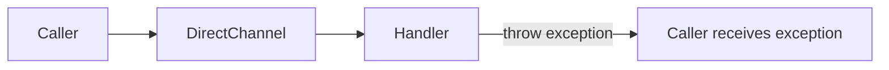
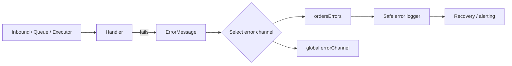

# Logging Exceptions and Failed Messages

In Spring Integration, a request may pass through a Gateway, Filter, Router, Transformer, Splitter, Aggregator, and multiple handlers before finishing. When a handler fails, logging only `"Processing failed"` is rarely enough to identify which step failed and which message was affected. Conversely, logging the raw exception alongside the entire message can leak tokens, customer data, or huge payloads into the logging system.

This lesson belongs to the **Message logger** chapter of the **SPRING_INTEGRATION_PATTERN** module. Its goal is to practice Enterprise Integration Patterns with Spring Integration to build loosely coupled, extensible message flows while observing branches, retries, error channels, and correlation with structured logs sufficient for incident diagnosis.

**Learning outcomes:**

- Distinguish Java exceptions, `MessagingException`, `ErrorMessage`, and `failedMessage`.
- Understand when errors are thrown back to the caller versus sent to an error channel.
- Locate failed-message metadata without assuming `failedMessage` always exists.
- Write an error handler that selects safe log fields, protects sensitive data, and avoids duplicate logging.
- Test failure scenarios across Filter, Router, Transformer, Splitter, Aggregator, retry, and asynchronous handlers.

## 1. Why Must Errors Be Linked to Messages?

Consider two requests arriving nearly simultaneously:

```text
15:01:02 INFO  event=received requestCorrelationId=req_A
15:01:02 INFO  event=received requestCorrelationId=req_B
15:01:03 ERROR Processing failed
15:01:03 WARN  Retrying message
```

You cannot tell whether the failure belongs to `req_A` or `req_B`. Adding stage, request correlation, message, and error-type details is far more useful:

```text
15:01:03 WARN  event=retry requestCorrelationId=req_A
               stage=inventory attempt=2 errorCode=UPSTREAM_TIMEOUT
15:01:04 ERROR event=processing_failed requestCorrelationId=req_A
               stage=inventory messageId=ae6c... errorType=MessageHandlingException
               errorCode=RETRY_EXHAUSTED
```

These logs are **illustrative output**, not lines automatically generated by Spring Integration. The application must actively choose fields, log at the right points, and ensure correlation IDs propagate across intermediate messages.

Distinguish key concepts:

| Concept | Role | Logging Considerations |
| --- | --- | --- |
| `Throwable` / `Exception` | Technical or business cause of processing failure | `getMessage()` and stack traces may contain sensitive data |
| `MessagingException` | Exception carrying Spring Messaging context | May hold `failedMessage`, but never assume it is always present |
| `ErrorMessage` | A `Message<Throwable>` carrying error information | Payload is the exception; has its own headers and may hold the original message |
| `failedMessage` | Message tied to the failure, accessible from some `MessagingException`s | May be absent; may be the message at the failing step rather than the inbound request |
| `requestCorrelationId` | Application header used to track one request | Must be created/normalized at ingress and preserved across steps |
| `correlationId` | Header supporting Splitter/Aggregator grouping | Serves message groups; not inherently equal to the request correlation ID |

## 2. Synchronous and Asynchronous Errors Take Different Paths

With a `DirectChannel`, handlers normally run on the sender's thread. If a handler throws an exception and nothing handles it locally, the exception can propagate back to the caller:



With asynchronous components such as pollers or handlers running via an executor, the caller may have already returned before the error occurs. If the component is configured to publish errors, Spring Integration wraps the exception in an `ErrorMessage` and sends it to an error channel:



These two diagrams show **two typical handling paths**. Exact routing depends on the component, channel, advice, gateway, poller, executor, and error handler configuration. There is no universal rule that throwing an exception in any flow automatically sends an `ErrorMessage` to a custom channel.

Error-channel resolution order is typically influenced by the message's `errorChannel` header, endpoint/inbound-adapter error-channel configuration, and the context's default error channel. Check the actual configuration of each endpoint, especially when combining multiple inbound adapters.

### Implications for Logging

- For **synchronous** paths, log a safe record at the boundary/controller/gateway where the exception is caught, then return the error to the caller.
- For **asynchronous** paths, place a handler on the appropriate error channel to log the failure while deciding on retry, recovery, or dead-lettering.
- Never log the stack trace at every handler and then log the full stack trace again in the error flow; this adds noise, volume, and data-exposure risk.
- Failures successfully recovered at the retry layer may only need `DEBUG`/`WARN` per attempt; final failure after retries are exhausted typically warrants `ERROR` and alerting.

## 3. Structure of `ErrorMessage` and Sources of Failed Messages

In Spring Messaging, `ErrorMessage` is a message whose **payload is a `Throwable`**. It has its own message headers for the error event; those headers are not the same as the failed message's headers.

Available information sources:

```java
import org.springframework.messaging.Message;
import org.springframework.messaging.MessagingException;
import org.springframework.messaging.support.ErrorMessage;

void inspect(ErrorMessage errorMessage) {
    Throwable exception = errorMessage.getPayload();

    // This is the ErrorMessage ID, not necessarily the business message ID.
    Object errorMessageId = errorMessage.getHeaders().getId();

    // May be null depending on how the ErrorMessage was created.
    Message<?> original = errorMessage.getOriginalMessage();

    // May be null if Throwable is not a MessagingException,
    // or if the exception has no attached failedMessage.
    Message<?> failed = null;
    if (exception instanceof MessagingException messagingException) {
        failed = messagingException.getFailedMessage();
    }
}
```

An `ErrorMessage` can hold an `originalMessage` supplied by the error-publishing component; a `MessagingException` can carry `failedMessage`, representing the message at the failing step. They **can differ** when a Transformer created a new message, a Splitter emitted a child message, or a handler modified headers.

Never assume:

- `errorMessage.getPayload()` is the business payload;
- `errorMessage.getHeaders().getId()` is the failed message's ID;
- `errorMessage.getHeaders()` already holds all business headers;
- `getFailedMessage()` is always non-null;
- every exception is a `MessagingException`.

If an external exception is wrapped through multiple cause layers, the `MessagingException` holding the failed message may sit deeper in the cause chain rather than as the outermost exception. The next section provides a lookup helper covering common cases.

## 4. Deciding What to Include in Error Logs

An error record might follow this structure:

```text
event=processing_failed
requestCorrelationId=req_42
messageId=0ab4...
stage=paymentRoute
errorType=MessageHandlingException
errorCode=HANDLER_FAILED
attempt=3
recovered=false
```

Typically, log these controlled fields:

| Field | Benefit | Notes |
| --- | --- | --- |
| `event` | Distinguishes failed attempt, exhausted retries, successful recovery | Use a predefined set of values |
| `requestCorrelationId` | Groups logs belonging to the same request | Must not contain emails, tokens, or personal data |
| `messageId` | Identifies the message at the failing stage | May differ from the inbound message ID |
| `stage` | Identifies the endpoint/handler involved | Taken from an application-managed enum/endpoint name |
| `errorType` | Classifies exception for investigation | Use normalized type; no need to print `getMessage()` |
| `errorCode` | Aggregates errors and drives action routing | Stable, application-defined value |
| `attempt` | Clarifies retry progress | Attempt count does not replace the request ID |
| `sequenceNumber` / `sequenceSize` | Pinpoints a failing Splitter child message | Log alongside a safe group ID when needed |
| `elapsedMs` | Measures processing time before failure | Use measurements at corresponding stages |

Avoid emitting raw `Message<?>`, payloads, all headers, request bodies, access tokens, cookies, SQL parameters, HTTP response bodies, or exception messages containing input data. If stack traces are strictly required for troubleshooting, isolate them in an access-controlled log channel with bounded retention, sensitive-string filtering, and rate monitoring.

**Key point:** calling `log.error("...", throwable)` usually emits both the stack trace and exception message per backend configuration. Never assume that call is safe for customer data. Even with JSON logging, serializing the full exception or failed message can still leak sensitive data.

## 5. Java: Finding the Failed Message and Building a Safe Log Record

The example below uses Java 17+, Spring Messaging, and SLF4J. It avoids logging payloads or exception text. When no failed message can be found, it returns `"unknown"` instead of fabricating an ID.

```java
import java.util.regex.Pattern;

import org.springframework.messaging.Message;
import org.springframework.messaging.MessagingException;
import org.springframework.messaging.support.ErrorMessage;

final class SafeErrorLog {

    private static final Pattern SAFE_ID =
            Pattern.compile("[A-Za-z0-9._-]{1,64}");

    private SafeErrorLog() {
    }

    static Message<?> findFailedMessage(ErrorMessage error) {
        Throwable current = error.getPayload();

        // Bound depth to guard against abnormal cause chains.
        for (int depth = 0; current != null && depth < 16; depth++) {
            if (current instanceof MessagingException messagingException) {
                Message<?> failed = messagingException.getFailedMessage();
                if (failed != null) {
                    return failed;
                }
            }
            Throwable next = current.getCause();
            if (next == current) {
                break;
            }
            current = next;
        }
        return error.getOriginalMessage();
    }

    static String safeRequestId(Message<?> message) {
        if (message == null) {
            return "unknown";
        }
        Object value = message.getHeaders().get("requestCorrelationId");
        if (value instanceof String id && SAFE_ID.matcher(id).matches()) {
            return id;
        }
        return "unknown";
    }

    static String line(ErrorMessage error) {
        Message<?> failed = findFailedMessage(error);
        String messageId = failed == null
                ? "unknown"
                : String.valueOf(failed.getHeaders().getId());

        Throwable cause = error.getPayload();

        return "event=processing_failed"
                + " requestCorrelationId=" + safeRequestId(failed)
                + " messageId=" + messageId
                + " errorType=" + cause.getClass().getSimpleName()
                + " errorCode=HANDLER_FAILED";
    }
}
```

Design rationale:

1. `getFailedMessage()` is preferred when found in a `MessagingException` because it usually reflects the message at the point of failure. If missing, fall back to `ErrorMessage.getOriginalMessage()`.
2. `safeRequestId` accepts only short IDs from an allowed character set; never trust arbitrary header values directly.
3. `messageId` is taken from the failed message, distinct from the `ErrorMessage` ID. If absent, log `unknown`; never break correlation by generating a new ID inside the logger.
4. `cause.getClass().getSimpleName()` identifies the exception type, while `cause.getMessage()` is omitted because it can embed input data.
5. `errorCode=HANDLER_FAILED` is an illustrative default. Production systems can classify exceptions using a fixed code mapping such as `UPSTREAM_TIMEOUT`, `INVALID_FORMAT`, or `RETRY_EXHAUSTED`.

The helper intentionally does **not** read `error.getHeaders()` to infer business IDs because `ErrorMessage` headers and failed-message headers represent two different contexts. If your flow explicitly attaches safely classified metadata onto error messages, you can add schema-driven extraction logic.

### Limitations to Keep in Mind

- If the very first stage fails before a message is created, `failedMessage` may not exist.
- If an exception is wrapped outside `MessagingException`, walking the cause chain helps, though custom frameworks are not guaranteed to preserve the message.
- With a Splitter, the failed message may be a **child message**, so its payload and message ID differ from the original request.
- Custom exceptions carrying a separate reference need a dedicated adapter; never parse exception messages to extract IDs.
- Do not tag every production error as `HANDLER_FAILED` when distinct business error codes exist; the example uses it only as a simple fallback.

## 6. Logging from a Dedicated Error Channel

One clean structure is creating a dedicated error channel for the order flow and attaching a flow that consumes `ErrorMessage`s from it.

```java
import org.slf4j.Logger;
import org.slf4j.LoggerFactory;

import org.springframework.context.annotation.Bean;
import org.springframework.context.annotation.Configuration;
import org.springframework.integration.channel.DirectChannel;
import org.springframework.integration.dsl.IntegrationFlow;
import org.springframework.messaging.MessageChannel;
import org.springframework.messaging.support.ErrorMessage;

@Configuration
class OrderErrorLoggingConfiguration {

    private static final Logger log =
            LoggerFactory.getLogger(OrderErrorLoggingConfiguration.class);

    @Bean
    MessageChannel ordersErrors() {
        return new DirectChannel();
    }

    @Bean
    IntegrationFlow ordersErrorFlow() {
        return IntegrationFlow.from("ordersErrors")
                .handle(message -> {
                    if (message instanceof ErrorMessage error) {
                        log.error("{}", SafeErrorLog.line(error));
                    }
                })
                .get();
    }
}
```

When an endpoint in the system **is configured to publish errors** to `ordersErrors`, this flow receives the `ErrorMessage` and logs a metadata line. The code above only creates the channel and handler; it does **not automatically wire** all application errors to that channel. You must configure the error channel on inbound adapters, pollers, or message metadata depending on the error source.

For example, you can set the error routing header on the inbound message (assuming `ordersInput` and `ordersErrors` are injected `MessageChannel`s):

```java
import org.springframework.messaging.MessageHeaders;
import org.springframework.messaging.support.MessageBuilder;

ordersInput.send(
        MessageBuilder.withPayload("order:ORD-42")
                .setHeader("requestCorrelationId", "req_42")
                .setHeader(MessageHeaders.ERROR_CHANNEL, ordersErrors)
                .build());
```

The `errorChannel` header specifies where errors **can** be sent when a component uses error publishing; it does not force every synchronous exception onto that channel. For example, if a `DirectChannel` throws an exception back to the caller, the caller still needs appropriate try/catch handling. In production, error-channel wiring must match the exact endpoint and dispatch mechanism in use.

Before modifying or reusing the global `errorChannel`, check existing default subscribers and multi-subscriber behavior to avoid duplicate error logs or accidentally dropping error events. Never alter application-wide defaults just to log a single flow.

## 7. Correlation When Errors Happen in Router, Splitter, or Aggregator

A single request can split into multiple messages, each with its own ID while belonging to the same request. If you log only the `messageId` of a failing item, operators struggle to reconstruct the full journey. Therefore, propagate an application `requestCorrelationId` header safely from the Gateway into downstream branches.

Example:

```text
INFO  event=received requestCorrelationId=req_42 messageId=in_1
DEBUG event=split_item requestCorrelationId=req_42
      messageId=part_2 groupRef=group_9 sequenceNumber=2 sequenceSize=3
WARN  event=retry requestCorrelationId=req_42
      messageId=part_2 groupRef=group_9 attempt=2
ERROR event=processing_failed requestCorrelationId=req_42
      messageId=part_2 groupRef=group_9 errorCode=RETRY_EXHAUSTED
```

These are application-produced logs for illustration, not framework defaults. In practice, `MessageHeaders.ID` is typically a UUID; `in_1` and `part_2` are used here for readability.

| Location | Data to Preserve | Error Handling Approach |
| --- | --- | --- |
| Gateway | `requestCorrelationId`, source, and message ID | If failure happens before message creation, keep correlation in boundary logging |
| Filter | ID and rejection reason code | Expected rejections are not automatically exceptions; log `rejected` meaningfully |
| Router | ID and valid branch name | Log selected branch; routing failures log explicit error codes |
| Transformer | ID, source/target types | Never print before/after payloads |
| Splitter | Request ID, group ID, sequence | Pinpoint the exact failing item |
| Aggregator | Group ID, item count, timeout | Distinguish group timeouts from handler exceptions |
| Gateway reply | Request ID and outcome | Synchronous errors may be returned to the caller |
| Retry / error channel | Request ID, attempt, error code | Inspect the final failed message and check group ID if needed |

Spring Integration's `correlationId` header primarily serves grouping; it may differ from the application's `requestCorrelationId` header. Never use `correlationId` to represent the entire request across nested Splitter/Aggregator layers. Do not blindly copy every old header onto newly created messages; verify which metadata must stay and which headers are framework-managed.

## 8. Retries, Recovery, Dead-Lettering, and Avoiding Duplicate Error Logs

A flow with retries may fail several times before succeeding. Avoid logging an `ERROR` stack trace on every attempt and then logging the exact same stack trace again on the error channel.

A common policy:

- **Transient failed attempt:** log `DEBUG` or `WARN` with `attempt`, `errorCode`, and correlation ID, depending on severity.
- **Retry succeeded:** log a `recovered` event or increment a retry metric; avoid emitting a final error when business processing completed.
- **Retries exhausted:** log one `ERROR` event with `RETRY_EXHAUSTED` and recovery/error-channel routing details.
- **Moved to dead-letter:** log `dead_lettered`, request ID, error type, reason, and the controlled record identifier in the error queue; do not log the full record.
- **Recovery failed:** define a clear policy for secondary failures so the error-channel handler does not keep throwing and looping.

An error channel is **not synonymous** with a retry mechanism or dead-letter queue. Spring Integration provides dedicated components/advice and endpoints for retries, recoverers, and routing to another channel; exact behavior must be configured. If replay is required, manage business identifiers, state, attempt counts, and handler idempotency; a log ID aids lookup only and does not guarantee exactly-once processing.

A record may pass through multiple endpoints that each have loggers. Designate **one place responsible for the final error log**, while keeping intermediate points at lower log levels or metrics. Before choosing `ERROR`, verify whether the error was handled or represents a terminal failure.

## 9. Guarding Against Sensitive Data in Exceptions

Exceptions frequently carry fragments of input data:

```text
java.lang.IllegalArgumentException:
  Invalid Authorization header: Bearer SECRET_TOKEN_ABC
```

Even if code never logs payloads, calling:

```java
log.error("Cannot process message", exception);
```

can dump secrets from exception messages and stack traces into logs. Similarly, logging `ErrorMessage` via `toString()` can drag in the underlying exception and original metadata.

Safer approach:

1. Construct logs from an **allowlist of fields**: event, stage, request ID, message ID, error type/code, and attempt.
2. Omit raw payloads, all headers, tokens, cookies, SQL parameters, error response bodies, or external exception messages.
3. If stack traces must be retained, route them to a separate logger/store with restricted access and retention, and verify what is actually emitted.
4. Prevent log injection by validating length, character set, and origin for fields such as request ID, stage, and error code.
5. For recurring errors, use counters, rate-limit log emission, and log only key sample events.

For instance, a client-supplied `requestCorrelationId` containing a newline could forge an `ERROR` log line. Generate IDs at ingress or restrict characters and length before putting them into headers. `SafeErrorLog` above is a write-time safeguard, not a substitute for trusted ID issuance at the boundary.

### Distinguishing Diagnostic Logs from Audits

Technical logs diagnose exceptions; business audits require higher completeness and verifiability. Do not treat every error logger line as an audit event or rely on drop-prone async logging for mandatory trails. When auditing is required, design a dedicated store and durability guarantees.

## 10. Testing: With and Without `failedMessage`

Test both when the exception supplies a failed message and when metadata is absent. The unit test below uses **synthetic** data containing a token in both payload and exception message, verifying `SafeErrorLog` never leaks it.

```java
import static org.junit.jupiter.api.Assertions.assertFalse;
import static org.junit.jupiter.api.Assertions.assertTrue;

import org.junit.jupiter.api.Test;
import org.springframework.messaging.Message;
import org.springframework.messaging.MessagingException;
import org.springframework.messaging.support.ErrorMessage;
import org.springframework.messaging.support.MessageBuilder;

class SafeErrorLogTest {

    @Test
    void logsFailedMessageMetadataWithoutPayloadOrExceptionText() {
        String canary = "FAKE_SECRET_DO_NOT_LOG_123";

        Message<String> failed = MessageBuilder.withPayload(
                        "order=ORD-42 token=" + canary)
                .setHeader("requestCorrelationId", "req_42")
                .build();

        MessagingException exception =
                new MessagingException(failed, "upstream returned " + canary);
        ErrorMessage error = new ErrorMessage(exception);

        String line = SafeErrorLog.line(error);

        assertTrue(line.contains("requestCorrelationId=req_42"));
        assertTrue(line.contains("event=processing_failed"));
        assertFalse(line.contains(canary));
        assertFalse(line.contains("token="));
    }

    @Test
    void supportsErrorWithoutFailedMessage() {
        ErrorMessage error = new ErrorMessage(
                new IllegalStateException("FAKE_SECRET_DO_NOT_LOG_123"));

        String line = SafeErrorLog.line(error);

        assertTrue(line.contains("requestCorrelationId=unknown"));
        assertFalse(line.contains("FAKE_SECRET_DO_NOT_LOG_123"));
    }
}
```

These unit tests verify **the log-formatting helper**, not how error channels are triggered or other framework loggers. In integration tests, send a message through a failing endpoint and capture real system logs, including INFO/DEBUG levels and retry paths.

Recommended test scenarios:

| Scenario | What to Verify |
| --- | --- |
| Synchronous handler throws exception | Caller receives the error properly; no `ErrorMessage` emitted unless configured |
| Poller/executor fails with error publishing | `ErrorMessage` reaches the right error channel; safe logger receives it |
| `MessagingException` with `failedMessage` | Failed message ID and request ID are logged accurately |
| Plain `Throwable`, no `failedMessage` | Log shows `unknown` and error type without throwing secondary exceptions |
| Deeply wrapped exception | Helper locates `failedMessage` inside the cause chain |
| Splitter emits three items, item two fails | Logs identify request and sequence properly without confusing group ID |
| Retry then succeed | No false terminal error log; attempts share the same request ID |
| Retries exhausted | Final log contains `RETRY_EXHAUSTED` or application-defined equivalent |
| Exception contains fake token | Final log and framework/collector logs never leak the canary |
| Two concurrent requests | MDC/correlation never bleeds across threads |

When an error channel is synchronous, an exception thrown **inside the error handler itself** can disrupt error publishing. Keep log handlers simple, provide fallbacks for missing metadata, avoid serializing large messages, and explicitly test secondary failure paths.

## 11. Quick Troubleshooting Reference

| Symptom | Likely Cause | Where to Check |
| --- | --- | --- |
| `ErrorMessage` never reaches handler | Error still throws synchronously; error channel not wired to the right endpoint | Check channel type, advice, poller, and error-channel configuration |
| Log shows only `ErrorMessage` ID | Logger reads `ErrorMessage` headers | Unwrap failed/original message to read its ID |
| `getFailedMessage() == null` | `Throwable` is not a `MessagingException` or lacks message | Fall back to `originalMessage` if present, otherwise `unknown` |
| Missing request correlation | Header lost when creating a new message or not issued at ingress | Compare headers before/after hops; forward permitted metadata |
| Logs expose tokens | Logging full `Message`, `Throwable`, headers, or HTTP responses | Apply allowlist and run canary tests |
| Duplicate identical stack traces | Handler, retry, and error channel all log `ERROR` | Pick one final log point; track attempts with metrics or lower levels |
| Aggregator errors without knowing which item | Missing group/sequence metadata in pre-Aggregator logs | Log group and sequence at Splitter and per-item handlers |
| Error handler also fails | Complex logging branch, exception parsing, or external dependency | Simplify log handler with fallbacks; test failure paths |

## 12. Hands-On Exercise

**Context:** A Gateway receives an order creation request. A Filter validates data, a Router chooses standard or priority, and a Splitter produces three child messages. One handler calls an inventory service that occasionally times out. Retries run twice; once exhausted, the message goes to a dedicated error channel. The Aggregator completes only when the group satisfies its release condition.

Requirements:

1. Issue `requestCorrelationId` at the Gateway and place it in message headers. Log request receipt, branch selection, per-item processing, and group completion.
2. Create `ordersErrors` and an error logger using `SafeErrorLog`. Configure error publishing on the asynchronous endpoint and verify it with a failing test.
3. For a timing-out item, log `attempt` and `errorCode` per attempt; upon final failure, log one `processing_failed` event.
4. Deliberately taint a mock exception message with canary `FAKE_SECRET_DO_NOT_LOG_123`. Capture logs from the flow and error channel and verify the canary never appears.
5. Test failures occurring before message creation and when `MessagingException.getFailedMessage()` is null; confirm the logger throws no secondary exception.
6. Run two requests in parallel and verify `requestCorrelationId` never mixes. Reconcile `messageId`, `correlationId`, and `sequenceNumber` when the Splitter emits multiple messages.
7. Distinguish final error logs from recovering retries; check whether duplicate logging occurs across advice, handlers, and the error channel.

**Passing criteria:** logs clearly answer which request failed, which step failed, which child message was involved, how many retries ran, and whether recovery succeeded; sensitive data is never printed; synchronous and asynchronous errors behave as configured.

### Self-Check Questions

1. What is the payload of an `ErrorMessage`, and how does it differ from a business message?
2. Why is `ErrorMessage.getHeaders().getId()` not automatically the ID of the failed business message?
3. When `MessagingException.getFailedMessage()` is null, what fallback options exist?
4. Why might a synchronous exception on a `DirectChannel` bypass the error channel?
5. What risks arise from logging a full `Throwable` even when application code does not log the payload?
6. How do you pinpoint a failure on the second item in a three-message group without mixing up the request ID and group correlation ID?
7. When a retry succeeds, should the first attempt's error still be treated as a terminal business failure?
8. Which integration test cases are needed beyond unit testing the log-formatting helper?

## 13. References

- [Spring Integration Reference — Error Handling](https://docs.spring.io/spring-integration/reference/error-handling.html): `ErrorMessage`, error channels, and error dispatching.
- [Spring Integration Reference — Message](https://docs.spring.io/spring-integration/reference/message.html): `Message` and headers.
- [Spring Integration Reference — Logging Channel Adapter](https://docs.spring.io/spring-integration/reference/logging-adapter.html): `LoggingHandler` and log content selection.
- [Spring Integration Reference — Java DSL log operator](https://docs.spring.io/spring-integration/reference/dsl/java-log.html): placing log points in flows.
- [Spring Integration Reference — Splitter](https://docs.spring.io/spring-integration/reference/splitter.html) and [Aggregator](https://docs.spring.io/spring-integration/reference/aggregator.html): group correlation and sequencing.
- [Spring Messaging `MessagingException` API](https://docs.spring.io/spring-framework/docs/current/javadoc-api/org/springframework/messaging/MessagingException.html): failed message attached to an exception.
- [Spring Messaging `ErrorMessage` API](https://docs.spring.io/spring-framework/docs/current/javadoc-api/org/springframework/messaging/support/ErrorMessage.html): exception payload and original message.
- [OWASP Logging Cheat Sheet](https://cheatsheetseries.owasp.org/cheatsheets/Logging_Cheat_Sheet.html): sensitive data, log structure, and log injection.

**Key takeaway:** `ErrorMessage` tells you **an error was wrapped as a message**, while `failedMessage` is context that **may** be retrieved from the exception or original message. Identify the actual error path, pick safe fields to log, and preserve correlation IDs across branches instead of relying on printing full exceptions or payloads.
