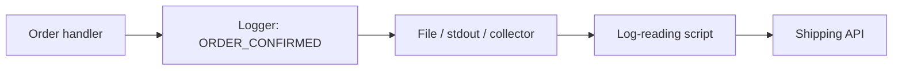
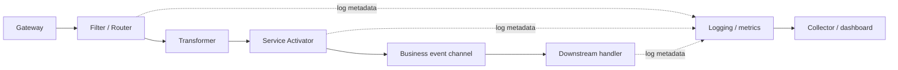
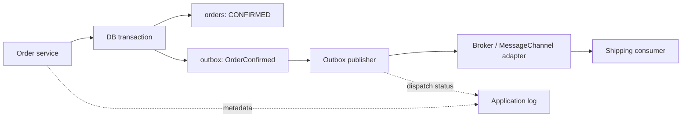
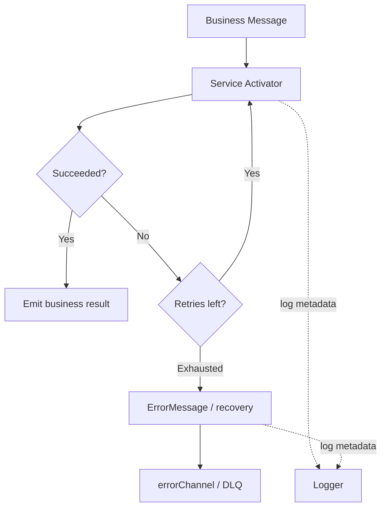

# Do Not Use Logs as a Communication Mechanism

In an integration system, business messages travel through Gateways, Channels, Routers, Filters, Transformers, Splitters, Aggregators, and handlers to complete a task. Alongside that flow, a message logger records what happened so operators can analyze failures and monitor performance. Those two streams serve different purposes and carry different reliability requirements.

**Principle of this lesson:** never use application log contents as commands, mandatory business events, or a source of truth for another system to continue processing. A line like `INFO Order ready` is solely an observation signal; it does not replace sending a structured `Message` over a `MessageChannel` or an appropriate messaging system.

This lesson belongs to the **Message logger** chapter of the **SPRING_INTEGRATION_PATTERN** module. The module focuses on implementing Enterprise Integration Patterns with Spring Integration to build loosely coupled, extensible message flows—practicing Router, Filter, Transformer, Splitter, Aggregator, Gateway, retry, error channel, and correlation, while testing and observing branches. This topic places logging in its proper role within that architecture.

## 1. Recognizing the Anti-Pattern: Reading Logs to Trigger Business Logic

Suppose an ordering system needs to dispatch a shipping request once an order is confirmed. A design that easily emerges during prototyping:

1. The service processes the order and logs `INFO ORDER_CONFIRMED orderId=...`.
2. Another script or service tails the log file or queries the centralized log system.
3. Upon seeing the string `ORDER_CONFIRMED`, that service calls the shipping API.



This flow looks simple, yet it lacks a **business communication contract**. The script depends on exact log formatting; logs may be disabled by level, sampled, truncated, delayed, or dropped under overload. Rewording a log message for readability can silently halt shipping without any error in the ordering service.

Variations of the same problem:

- A payment service watches for `payment_success` in logs to record `PAID` status.
- A cron job uses `grep` to find `Retry later` messages and re-sends them.
- A handler reads Aggregator logs to tell when enough items arrived and release results.
- Another service parses the request ID from MDC text in logs instead of message headers/metadata.
- A system turns on `DEBUG` to "enable a feature" because a consumer only acts when it sees a DEBUG line.

These are signs you need to replace the communication mechanism. Having a monitoring tool raise **operational alerts** from logs is a different case: alerting a human to investigate can rely on log signals, provided it is never treated as a guaranteed business transaction trigger.

## 2. How Do Observation Logs Differ from Business Messages?

| Criterion | Application Log | Business Message / Event |
| --- | --- | --- |
| Primary purpose | Diagnostics, operations, investigation, and analytics | Transferring data, announcing events, or requesting specific work |
| Consumers | Operators, log/tracing/SIEM tools, offline analytics | Handlers/services with a message contract |
| Structure | Text or structured log, freely changed for readability | Versioned schema/payload and governed metadata |
| Delivery guarantees | Depends on logger, appender, and collector; can be lost/dropped/sampled | Designed around explicit transport, ack, retry, and persistence mechanics |
| Ordering | Can interleave, flush late, or appear out of execution order | Ordering can be defined by key/partition or suitable channels |
| Duplicate handling | Usually carries no business processing semantics | Consumers can apply IDs and idempotency to handle duplicates |
| Retention | Observability log policy; may be purged or summarized | Retention/compensation/replay policy driven by business requirements |
| Content changes | Log levels, wording, and fields may be adjusted freely | Contract changes must consider producer/consumer compatibility |
| Consumer failures | The logger usually has no idea whether a log-reading script succeeded | Can leverage acks, error channels, retry/recovery, or DLQs |
| Data protection | Logs typically restrict payloads and mask sensitive info | Messages may carry required business data under controlled transit |

**Note:** calling a component a message broker does not automatically grant exactly-once delivery, persistence, or global ordering. Those properties depend on the technology, configuration, transaction boundaries, and application strategy. The key distinction is that business communication is designed and verified over a transport with an explicit contract.

### A Log Line Does Not Equal a Committed Event

```text
INFO event=order_confirmed orderId=ORD-42
```

This log line could be written **before** the database transaction commits, right after a business step, or before a downstream branch throws an exception. If the transaction rolls back while the log remains, a log-reading consumer could ship an unconfirmed order. Conversely, the transaction might commit and the process crash before logs flush.

Therefore, logs are not proof that a transaction completed at the commit boundary. When you need to publish a reliable business event tied to data changes, consider a **transactional outbox** or an appropriately designed transactional messaging mechanism.

## 3. Proper Architecture: Channels Carry Business Work, Loggers Observe

Spring Integration provides Enterprise Integration Patterns to structure processing pipelines. Messages travel across `MessageChannel`s; logging observes selected milestones.



To route branches, use a `Router`. To filter conditionally, use a `Filter`. To transform payloads, use a `Transformer`. To invoke processing methods, use a `Service Activator` or `Gateway`. To combine items, use an `Aggregator`. To handle failures, use `errorChannel` and retry/recovery mechanisms. A logger does not perform any of those pattern roles.

Practical choices:

| Need | Suitable Mechanism | Role of the Logger |
| --- | --- | --- |
| Dispatch a command within the app | `DirectChannel`/`ExecutorChannel` with handler | Log receipt time, outcome, and errors |
| Synchronous request–reply | Messaging Gateway with request/reply | Log correlation, duration, and result code |
| Broadcast to multiple subscribers | Publish-subscribe channel or pub/sub broker | Log subscriber/branch counts and failures |
| Send data to another system | Outbound channel adapter/gateway with right protocol | Log transport metadata, not act as the transport |
| Persist while a service is down | Durable broker or designed persistent queue | Log enqueue/dequeue stats and failures |
| Publish event alongside DB changes | Transactional outbox and publisher | Log outbox/dispatch status |
| Retries and terminal error handling | Retry advice, recoverer, error channel, appropriate DLQ | Log attempt, error code, and IDs |
| Operational observability | Logs, metrics, traces | This is the logger's actual job |

## 4. Spring Integration Java DSL Example

Scenario: A Gateway accepts an order, a Filter rejects requests missing products, and a handler executes business logic. The log line records the acceptance event, yet real execution happens via channels and handlers.

Minimal example using Spring Integration Java DSL and Java 17+:

```java
import org.springframework.context.annotation.Bean;
import org.springframework.context.annotation.Configuration;
import org.springframework.integration.annotation.Gateway;
import org.springframework.integration.annotation.MessagingGateway;
import org.springframework.integration.channel.DirectChannel;
import org.springframework.integration.dsl.IntegrationFlow;
import org.springframework.integration.handler.LoggingHandler;
import org.springframework.messaging.MessageChannel;
import org.springframework.stereotype.Service;

record OrderSubmitted(String orderId, int itemCount) { }

@MessagingGateway
interface OrderGateway {
    @Gateway(requestChannel = "ordersInput")
    void submit(OrderSubmitted order);
}

@Service
class FulfillmentHandler {
    public void fulfill(OrderSubmitted order) {
        // Invoke actual fulfillment business logic here.
        // Processing results come from this call, not from parsing log text.
    }
}

@Configuration
class OrderIntegrationConfig {

    @Bean
    MessageChannel ordersInput() {
        return new DirectChannel();
    }

    @Bean
    MessageChannel fulfillmentRequests() {
        return new DirectChannel();
    }

    @Bean
    IntegrationFlow ordersIngressFlow() {
        return IntegrationFlow.from("ordersInput")
                .filter(OrderSubmitted.class,
                        order -> order.itemCount() > 0)
                .log(
                        LoggingHandler.Level.INFO,
                        "app.orders.flow",
                        message -> "event=order_accepted messageId="
                                + message.getHeaders().getId())
                .channel("fulfillmentRequests")
                .get();
    }

    @Bean
    IntegrationFlow fulfillmentFlow(FulfillmentHandler handler) {
        return IntegrationFlow.from("fulfillmentRequests")
                .handle(handler, "fulfill")
                .get();
    }
}
```

Classes in this example can be split into separate Java files following project conventions. This is a learning skeleton; `fulfill` needs real business logic, and invalid messages need explicit handling according to requirements.

Key points:

1. `OrderGateway.submit(...)` sends a message to `ordersInput`; it does not emit a log line for another handler to read.
2. `Filter` decides whether the message proceeds based on the business field `itemCount`.
3. `.log(...)` emits an observation log under category `app.orders.flow`. The record contains only event and message ID, independent of whether any script parses logs.
4. `.channel("fulfillmentRequests")` sends the **business message** to the next channel.
5. `FulfillmentHandler.fulfill(...)` executes the work. Turning off logging for this category must not disable business execution.

Because the example uses `DirectChannel`, processing is synchronous and primarily demonstrates **separation of concerns**; it does not yet provide durable persistence, crash-safe retries, or network delivery. Those requirements call for appropriate adapters, brokers, or an outbox when designing a production system.

If a correlation ID must be logged across steps, issue a tracking ID at ingress and propagate it via `MessageHeaders`; logging operators read the normalized value. Never parse values out of log lines to construct headers for subsequent messages.

## 5. Why Is a Logging Operator Not a Business Endpoint?

In Spring Integration Java DSL, `.log(...)` observes a flow through logging/Wire Tap mechanisms. Its purpose is emitting diagnostic info per configuration, not handing messages off to a business consumer via log text.

Distinguish these three operators:

```java
// 1. Write an observation log.
.log(LoggingHandler.Level.DEBUG, "app.flow", m ->
        "event=transformed messageId=" + m.getHeaders().getId())

// 2. Route the message to a business channel.
.channel("fulfillmentRequests")

// 3. Invoke a business handler (in the corresponding flow segment).
.handle(fulfillmentHandler, "fulfill")
```

These snippets illustrate **operators inside a flow definition**, not standalone executable Java statements.

You can subscribe a logging channel adapter purely as an observer, or use a Wire Tap to copy messages passing through a channel. However, never build a downstream business flow by **reading records emitted by a logger**. When you need a real subscriber to process messages, register a handler or channel adapter matching the payload and protocol.

One practical note: logging still consumes CPU, memory, and I/O; a slow backend can affect performance or throw errors depending on configuration. Never assume logging always has zero impact on the flow. Even so, **the business semantics of the flow** must remain independent of whether a log record was emitted, stored, or queried successfully.

## 6. Why Relying on Text Logs Easily Breaks Systems

| Risk | What Can Happen | Business Consequence |
| --- | --- | --- |
| Log level changes | DEBUG disabled in production | Consumer never receives its "command" |
| Sampling / rate limiting | Collector drops a portion of logs | Orders go unprocessed |
| Log queue fills up | Async appender drops or blocks | Signal lost, latency spikes |
| Format changes | Switching text to JSON or rewording text | Consumer regex/parser breaks |
| Duplicate log entries | Retries/restarts log the same event again | Consumer dispatches duplicate commands |
| Out-of-order emission | Multiple threads, services, or collectors flush out of order | Downstream step runs before business state is ready |
| Logged before commit | DB rolls back after logger wrote success | Consumer acts on an event that never occurred |
| Committed before flush | Process crashes right after commit | Consumer never sees the event that occurred |
| Retention limits | Files rotate, collector purges old records | Cannot replay when consumer recovers |
| Redaction | Fields masked by security policy | Consumer lacks data needed to execute business logic |
| Access permission changes | Consumer loses read access to central logs | Business communication halts due to observability policy |

A messaging system must also deal with disconnects, duplicate messages, ordering, and retries; the difference is that those cases are modeled explicitly in the communication contract and actively tested.

## 7. Choosing a Communication Mechanism by Reliability Needs

### In-Application Communication

To hand a message off to another handler within the same process, use `DirectChannel` (synchronous) or `ExecutorChannel` (asynchronous processing). Account for exception handling, thread pools, and reply expectations; neither channel automatically provides durability across process crashes.

### Cross-Service and Broker Communication

When services must deploy independently, integrating a message broker such as RabbitMQ, Kafka, or JMS through appropriate adapters lets you organize producers and consumers around explicit contracts. Define:

- Format/schema, versioning, and event/command types.
- Message ID, correlation ID, and idempotency key.
- Acks, retry/backoff, timeouts, dead-lettering, and replay capability.
- Ordering guarantees within the required scope and duplicate handling.
- Access permissions, data security, and retention periods.

These are properties of a **business transport**, never guaranteed by an `INFO` line in application logs.

### Transactional Outbox for Publishing Events After Commit

If a service must both update an `orders` table and publish `OrderConfirmed`, the standard pattern is writing the state change and an `outbox_events` record within the **same DB transaction**. A separate publisher reads the outbox, dispatches messages to the broker, and marks them published once confirmed.



The transaction ensures order state and outbox commit or roll back together, while the publisher can retry if the broker is temporarily unavailable. An outbox **does not completely eliminate duplicates**: consumers still need idempotency because an event may be re-sent if the publisher crashes between sending and recording completion.

Logging continues observing `outbox_enqueued`, `publish_retry`, and `consumer_processed` by event ID; consumers do not rely on those log lines to perform business work.

## 8. When Are Logs a Valid Data Source?

The rule "do not use logs for communication" must be understood **in its proper scope**.

There are valid cases where logs serve as input to **observability or analytics** systems:

- A SIEM inspects logs to detect suspicious logins and trigger security alerts.
- Operations teams alert when `ERROR` rates spike abnormally.
- Offline analytics tools process historical logs for trend reporting.
- Support tools search logs by `requestCorrelationId` to investigate a request.

These activities tolerate incomplete results, delayed reporting, or human verification under operational policy. If an alert triggers an automated high-impact action, that automation still requires verification, deduplication, authorization, and error-handling paths.

There are also concepts containing the word "log" that **differ from application logging**:

| Name | Nature |
| --- | --- |
| SLF4J/Logback application log | Diagnostic and operational records |
| Database commit log / transaction log | Storage structure for consistency and crash recovery |
| Kafka partition log | Message broker data structure with offsets and dedicated consumer semantics |
| Event store in event sourcing | Business event store with schemas, versioning rules, and state-rebuilding guarantees |

Not everything named "log" is an anti-pattern. What to avoid is **treating diagnostic logger output as a reliable business message**, because it was never built with those guarantees.

## 9. Logging, Metrics, and Tracing Have Distinct Roles

Flow monitoring does not require turning logs into a communication bus. Combine all three observability pillars:

- **Logs:** answer "what happened at which step?" using `event`, `requestCorrelationId`, `messageId`, `route`, and `errorCode`.
- **Metrics:** answer "how many messages were processed, what is the error rate, and what is the latency?" using counters, gauges, and histograms.
- **Tracing:** answer "which services/spans did a request cross, and where was it slow?" using properly propagated trace context.

Example of a flow with Retry and Aggregator:

```text
INFO event=received requestCorrelationId=req_42 messageId=...
WARN event=retry requestCorrelationId=req_42 stage=inventory attempt=2
INFO event=aggregated requestCorrelationId=req_42 groupSize=3
INFO event=fulfilled requestCorrelationId=req_42
```

These records aid investigation; they do not trigger fulfillment. Handlers receive messages over channels and perform work according to contract.

`requestCorrelationId` should travel in message headers or designed context propagation, never reconstructed by parsing old logs. With Splitter/Aggregator, keep the lifecycle request ID distinct from the framework's grouping `correlationId`.

## 10. Retries and Error Channels Are Processing Paths, Not Log Parsers

When a handler fails, **the exception and the message** are the inputs to retry/error handling. Never write a job scanning for `WARN Retrying order` to re-submit the same order.

In Spring Integration, the failure path may involve:

1. A handler receives a `Message` from a channel.
2. Retry advice re-invokes the call subject to attempt limits and backoff.
3. If retries are exhausted and recovery is configured, a recoverer or error flow takes over.
4. Depending on the endpoint, errors may be wrapped in an `ErrorMessage` and sent to an `errorChannel`.
5. A handler decides whether to recover, route to a DLQ, alert, or return failure.



This diagram illustrates conceptual logic: `ErrorMessage`, recovery, and DLQ behavior depend on how endpoints, retry advice, channels, and adapters are configured. Synchronous failures on a `DirectChannel` may throw back to the caller rather than routing through an error channel automatically.

Loggers should record `attempt`, `stage`, `errorCode`, and the normalized request ID. Never use log emission timestamps to determine remaining retries or recovery status; use real retry state and metadata.

## 11. Testing to Catch Hidden Dependencies on Logs

A valuable test is **changing logging configuration without changing inputs** and verifying that business outcomes remain identical.

Scenarios to include:

| Scenario | Expected Outcome |
| --- | --- |
| Set category `app.orders.flow` to `OFF` | Handler still receives and processes valid messages |
| Set category to `DEBUG` | Additional diagnostic detail appears; no extra business work occurs |
| Log collector temporarily down | Business communication does not require collector ack; measure appender slowdown risk separately |
| Filter rejects invalid message | Handler does not run; discard/rejection is handled properly without relying on logs |
| Router selects two different branches | Messages reach the right handlers regardless of log wording |
| Splitter emits N items | N messages are processed per contract, not counted via log lines |
| Retrying a failing handler | Attempts are driven by retry advice, not by a log-scanning job |
| Aggregator completes a group | Output is emitted by the release strategy, not by a `group complete` log line |
| Duplicate broker delivery | Consumer applies an appropriate idempotency strategy |
| DB transaction rolls back | `OrderConfirmed` is not published as a committed transaction |
| Asynchronous exception | Follows configured error channel/recovery regardless of `ERROR` logger output |

### A Behavior-Focused Test

Suppose `FulfillmentHandler` is replaced by a mock in a Spring Integration test. Send a valid message via `OrderGateway.submit(...)` and verify `fulfill(...)` is invoked the expected number of times with the logger category set to both `OFF` and `INFO`. Do not assert "because `order_accepted` was logged, fulfillment must have run"; that log line is secondary observational evidence.

For synchronous flows on `DirectChannel`, you can assert on the handler immediately after the Gateway call. For executors, brokers, or outboxes, use bounded waits and inspect the state/acknowledgment of the respective messaging path. Simultaneously, you can verify logs contain safe metadata and zero sensitive payload fields.

A strong design criterion is: **removing loggers or changing log wording does not alter any business decision**. If it does, some component is likely using logs as a hidden protocol.

## 12. Exercise: Fixing a Log-Dependent Design

**Context:** A store has `orders` and `shipping` services. When an order is confirmed, `orders` logs:

```text
INFO ORDER_READY orderId=ORD-42 customerEmail=an@example.com
```

A script scans logs every minute, extracts `orderId`, and calls `shipping.createShipment`. During peak hours, the script occasionally triggers duplicates or misses orders. When operations switches logs to JSON, the script breaks.

Redesign step by step:

1. Define an explicit **business event** `OrderConfirmed` or **command** `CreateShipment`, its schema/payload, and a unique ID.
2. Within the same application, use a `MessageChannel`/handler; across services needing durability, choose an appropriate broker/adapter.
3. If order confirmation must be persisted alongside the event, use a transactional outbox or designed transaction mechanism—never emit events before commit.
4. Make the `shipping` consumer idempotent by event ID/order ID, updating state and returning errors per contract.
5. Configure retry/backoff and dead-letter or error channels as supported by the transport. Define recovery and replay procedures.
6. Keep logs such as `event=order_confirmed`, `event=shipment_requested`, and `event=shipment_created` with correlation IDs, omitting emails and tokens.
7. Test changing log levels, changing log formats, stopping the collector, injecting duplicates, and simulating producer crashes before/after commit.

The expected deliverable is an updated diagram where `shipping` consumes a **business message/event** with clear duplicate and error handling. Logging still provides step-by-step diagnostics, without sitting on the mandatory delivery path for shipping.

### Self-Check Questions

1. Why does an `INFO ORDER_READY` line fail to prove the order confirmation transaction committed?
2. What can go wrong if a business consumer only works when `DEBUG` logging is enabled?
3. How do `Wire Tap` and `LoggingHandler` differ from a business subscriber?
4. When is `DirectChannel` sufficient, and when do you need a broker or outbox?
5. What problem does an outbox solve, and why must consumers still be idempotent?
6. Why is a Kafka partition log not equivalent to text logs written by SLF4J?
7. How can you use logs, metrics, and tracing to monitor retries without using them as retry counters?
8. Why is "turn off the logger and business logic still runs" a useful architectural check?

## 13. References

- [Spring Integration Reference — Messaging Channels](https://docs.spring.io/spring-integration/reference/channel.html): channels and message delivery characteristics.
- [Spring Integration Reference — Java DSL](https://docs.spring.io/spring-integration/reference/dsl.html): building flows from channels, handlers, and adapters.
- [Spring Integration Reference — Logging Channel Adapter](https://docs.spring.io/spring-integration/reference/logging-adapter.html): logger purpose and configuration.
- [Spring Integration Reference — Java DSL `log()` operator](https://docs.spring.io/spring-integration/reference/dsl/java-log.html): logging at a point in a flow.
- [Spring Integration Reference — Gateway](https://docs.spring.io/spring-integration/reference/gateway.html): request/reply and message-oriented interfaces.
- [Spring Integration Reference — Error Handling](https://docs.spring.io/spring-integration/reference/error-handling.html): `ErrorMessage` and error channels.
- [Enterprise Integration Patterns](https://www.enterpriseintegrationpatterns.com/): patterns for transporting, routing, transforming, and observing messages.
- [Transactional Outbox Pattern — microservices.io](https://microservices.io/patterns/data/transactional-outbox.html): publishing events transactionally with DB changes.

**Key takeaway:** logs are **signals for humans and observability tools to understand what happened**. Use messages, channels, events, and explicit contracts for business communication between components. That way, changing log levels, formats, retention, or collectors never becomes a hidden functional change.
