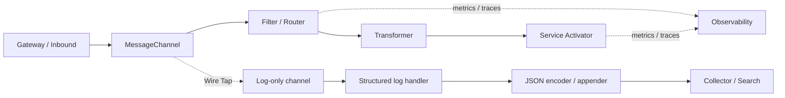

# Structured Logging for Integration Flows

When a request passes through a Gateway, Filter, Router, Transformer, Splitter, Aggregator, and handlers, free-form text logs are hard to aggregate. One line saying "order received" and another saying "routed to priority successfully" may describe the same request yet share no common fields for filtering or counting. **Structured logging** solves this by representing log events with consistently named, typed, and defined fields—typically emitted as JSON.

This lesson belongs to the **Message logger** chapter in the **SPRING_INTEGRATION_PATTERN** module. The module focuses on implementing Enterprise Integration Patterns with Spring Integration to build loosely coupled, extensible message flows—practicing Router, Filter, Transformer, Splitter, Aggregator, Gateway, retry, error channel, and correlation while testing and observing processing branches. Structured logging makes those steps observable and analyzable across multiple threads or services without printing entire messages.

After this lesson, you will be able to:

- Design a common log schema for each stage of an integration flow.
- Attach `requestCorrelationId`, `messageId`, route, stage, error code, and sequence metadata appropriately to logs.
- Distinguish `key=value` text logs, logger-API structured fields, and JSON generated by an encoder/backend.
- Configure a Wire Tap and handler that emit structured events using Spring Integration Java DSL and SLF4J 2.x.
- Observe Filter, Router, Splitter/Aggregator, retry, and error channel paths without leaking sensitive payloads.
- Test both log content and formatting at the emitter alongside real query requirements at the collector.

## 1. From Plain-Text Logs to Structured Logs

Suppose an application writes three text lines:

```text
INFO  Received order ORD-42
INFO  Routed order to priority
ERROR Timeout while calling inventory for ORD-42
```

To answer "how many priority-branch orders timed out in the last five minutes?", analytics systems typically need regexes or depend on exact phrasing. Changing `Routed order` to `Order selected route` can silently break queries.

Structured logging uses stable fields:

```json
{
  "timestamp": "2026-11-21T08:15:30.321Z",
  "level": "WARN",
  "logger": "app.integration.orders",
  "service": "orders",
  "event": "integration.retry",
  "flow": "orderFulfillment",
  "stage": "inventoryGateway",
  "requestCorrelationId": "req_42",
  "messageId": "5b8f7d3b-69e3-4d32-94c3-d8c6bd13e0db",
  "attempt": 2,
  "errorCode": "UPSTREAM_TIMEOUT",
  "durationMs": 1500
}
```

This is **sample JSON defined by the application and encoder**, not a schema emitted automatically by Spring Integration in that exact shape. Logging backends may use different field names, such as `@timestamp`, `log.level`, or `message`. What matters is aligning the team on a schema and configuring the encoder so collectors parse it accurately.

### Characteristics of Structured Events

| Characteristic | Free-Text Log | Structured Log |
| --- | --- | --- |
| Field names | Implicit in prose | Explicit: `event`, `stage`, `errorCode` |
| Data types | Often parsed from strings | Can be numbers, booleans, strings, objects |
| Querying | Regex / full-text search | Field-level filtering and aggregation |
| Message wording changes | Can break parsers | Prose can change while keeping schema stable |
| Correlation | Must extract IDs from text | Consistent `requestCorrelationId` field |
| Cost | Easy to read in console, hard to aggregate | Incurs encoding/indexing cost and requires schema governance |

Structured logging **does not guarantee** complete delivery, ordering, or accuracy after a database rollback. It is an observation tool. Messages/events used for business communication must still travel via `MessageChannel`s, brokers, or dedicated persistence mechanisms.

## 2. Designing a Unified Schema Before Placing Loggers

Start from the questions operators need answered: which request is running, which steps did it take, how did it branch, has a message group finished aggregating, where did it fail, and how long did it take? From there, choose a small set of fields with clear semantics.

### Core Fields

| Field | Suggested Type | Meaning |
| --- | --- | --- |
| `timestamp` | ISO 8601 string with timezone | Record creation time; usually added by the encoder |
| `level` | Enum/string | `INFO`, `WARN`, `ERROR`, `DEBUG`… |
| `service` | Configured string | Name of the service emitting the log |
| `environment` | Configured string | Operating environment, e.g., `staging` |
| `logger` | String | Source logger category/class |
| `event` | String enum | Stable event name, such as `integration.received` |
| `flow` | String enum | Flow executing, such as `orderFulfillment` |
| `stage` | String enum | Step such as `router` or `inventoryGateway` |
| `requestCorrelationId` | Normalized string | Links events belonging to one request |
| `messageId` | UUID/string | Identifies the current message |
| `traceId` / `spanId` | String | Context from tracing system if configured |
| `route` | String enum, optional | Actual branch selected by Router |
| `durationMs` | Number, optional | Measured duration of a stage |
| `errorCode` | String enum, optional | Application-classified error code |
| `attempt` | Number, optional | Processing/retry attempt number |
| `groupId`, `sequenceNumber`, `sequenceSize` | String/number, optional | Validated Splitter/Aggregator group details |

Not every field belongs on every event. For example, `attempt` applies only during retries; `route` is needed only after a routing decision. Likewise, a JSON logger may automatically add timestamp, level, logger, and thread; the application need not duplicate them.

### Event Naming and Versioning

Name events consistently, for example:

```text
integration.received
integration.filtered
integration.routed
integration.transformed
integration.split
integration.aggregate_completed
integration.retry
integration.failed
integration.recovered
```

`event` is a **stable code**, not free-form prose. You can add `schemaVersion`, e.g., `1`, if multiple systems consume logs or if renaming/retyping a field could break dashboards. Adding backwards-compatible fields rarely requires bumping everything; changing semantics or types requires a query migration plan.

A practical convention is keeping `durationMs` strictly in milliseconds and starting `attempt` at `1`. Never let service A log `duration=1.2s` while service B logs `duration=1200` with ambiguous units.

## 3. Observability Architecture in an Integration Flow

A business message preserves the payload and headers it needs while passing through endpoints. Observation points should build a **safe projection** from the message and emit log events without altering business content or requiring downstream consumers to parse log text.



This diagram shows a Wire Tap at a single milestone. When you need visibility **after** a Router or Transformer, place observation points at those positions. A Wire Tap before a Filter cannot know whether the Filter accepted or rejected the message; observe inside a discard flow or after the Filter.

Key distinctions:

- **`MessageChannel`** transfers messages between endpoints.
- **`LoggingHandler`** or `IntegrationFlow.log(...)` records selected details at an observation checkpoint.
- **Wire Tap** forwards a copy of the message to a secondary branch, usually for logging/monitoring without coupling the main handler to logger internals.
- **SLF4J fluent API** attaches key-value pairs to log events.
- **JSON encoder/backend** decides how key-value pairs, MDC, timestamps, severity, and stack traces serialize into output.

When a Wire Tap points to a synchronous channel, the log branch still consumes time on the sender thread. When using an asynchronous channel, account for queues, backpressure, and potential log loss. "Observation branch" does not mean completely free or isolated from main-flow resources.

## 4. Java DSL Example: Wire Tap Emitting Key-Value Pairs to a Logger

This example uses **Spring Integration Java DSL, Java 17+, and SLF4J 2.x**. It receives an order, validates item count in a Filter, dispatches to a business handler, and uses a Wire Tap to emit a structured event with controlled fields.

```java
import java.util.regex.Pattern;

import org.slf4j.Logger;
import org.slf4j.LoggerFactory;
import org.springframework.context.annotation.Bean;
import org.springframework.context.annotation.Configuration;
import org.springframework.integration.channel.DirectChannel;
import org.springframework.integration.dsl.IntegrationFlow;
import org.springframework.messaging.Message;
import org.springframework.messaging.MessageChannel;
import org.springframework.stereotype.Service;

record OrderSubmitted(String orderId, int itemCount, String customerEmail) { }

@Service
class OrderProcessor {
    public void process(OrderSubmitted order) {
        // Real business processing, e.g., forwarding order to fulfillment.
        // Do not use log lines as triggers for business execution.
    }
}

@Configuration
class OrderStructuredLogConfig {

    private static final Logger flowLog =
            LoggerFactory.getLogger("app.integration.orders");

    private static final Pattern SAFE_ID =
            Pattern.compile("[A-Za-z0-9_-]{1,64}");

    @Bean
    MessageChannel ordersInput() {
        return new DirectChannel();
    }

    @Bean
    MessageChannel ordersLogTap() {
        return new DirectChannel();
    }

    @Bean
    IntegrationFlow ordersFlow(OrderProcessor processor) {
        return IntegrationFlow.from("ordersInput")
                .wireTap("ordersLogTap")
                .filter(OrderSubmitted.class, order -> order.itemCount() > 0)
                .handle(processor, "process")
                .get();
    }

    @Bean
    IntegrationFlow ordersLogFlow() {
        return IntegrationFlow.from("ordersLogTap")
                .handle(message -> logReceived(message))
                .get();
    }

    private static void logReceived(Message<?> message) {
        String requestId = safeRequestId(message);

        flowLog.atInfo()
                .addKeyValue("event", "integration.received")
                .addKeyValue("flow", "orderFulfillment")
                .addKeyValue("stage", "ordersInput")
                .addKeyValue("requestCorrelationId", requestId)
                .addKeyValue("messageId", message.getHeaders().getId())
                .addKeyValue("payloadType",
                        message.getPayload().getClass().getSimpleName())
                .log("order accepted for routing");
    }

    private static String safeRequestId(Message<?> message) {
        Object raw = message.getHeaders().get("requestCorrelationId");
        if (raw instanceof String id && SAFE_ID.matcher(id).matches()) {
            return id;
        }
        return "missing";
    }
}
```

`OrderSubmitted`, `OrderProcessor`, and `OrderStructuredLogConfig` can live in separate Java files per project conventions. The `process` handler is where real business logic belongs.

**How it works:**

1. `ordersInput` is the flow's entry channel. A gateway, adapter, or sender writes to this channel.
2. `.wireTap("ordersLogTap")` sends the same message to an observation flow. Because `DirectChannel` is used here, the log branch runs synchronously.
3. `ordersLogFlow` extracts required fields and passes them to the logger via `addKeyValue`.
4. `Filter` and `OrderProcessor` continue processing the message for business purposes; the business handler never waits for a consumer parsing log text.
5. `requestCorrelationId` is checked for length and allowed characters before logging. Issue or normalize IDs at ingress to ensure a trustworthy source; this helper is an additional safeguard.
6. `customerEmail` is **never logged** even though it is present in the payload.

**A note on the event:** the Wire Tap sits **before the Filter**, so the event in this example means "message arrived at input," not that the message was accepted. To log `integration.accepted`, place a log point *after* the Filter; to log `integration.rejected`, use a discard flow or a handler observing filter rejections.

### Sending a Message with a Correlation ID

Assuming `ordersInput` is an injected `MessageChannel`, you can send:

```java
import org.springframework.messaging.support.MessageBuilder;

ordersInput.send(MessageBuilder
        .withPayload(new OrderSubmitted("ORD-42", 3, "student@example.invalid"))
        .setHeader("requestCorrelationId", "req_42")
        .build());
```

A production system should **issue or normalize** the ID at the ingress boundary. Do not generate a new correlation ID at each step, as that breaks end-to-end traceability across Gateway, Splitter, Aggregator, retry, or error channel stages.

### Version and Visibility Notes

`atInfo().addKeyValue(...)` is part of the **SLF4J 2.x** fluent API. The logging backend must support and configure an appropriate encoder so key-value pairs actually render as separate JSON fields. If the encoder prints only `message`, key-value pairs may not appear as expected; inspect actual output rather than inferring from Java code.

If your project uses SLF4J 1.x, you can use scoped MDC or backend-specific APIs, while carefully handling cross-thread propagation and MDC cleanup/restoration. Avoid manually concatenating JSON strings as a replacement for an encoder.

## 5. Configuring the Backend for JSON Output

SLF4J is a logging facade; actual JSON output is typically produced by Logback, Log4j2, or Spring Boot's logging subsystem. For **Spring Boot versions with built-in structured logging support (3.4 and later)**, you can configure a console formatter:

```yaml
logging:
  level:
    app.integration.orders: INFO
  structured:
    format:
      console: logstash
```

This is a **version-specific configuration example**. If your project uses an older Spring Boot version or a custom backend, use the JSON encoder/appender compatible with that version and verify the output. Exact JSON field names and how `addKeyValue` renders vary by formatter.

An output that is **semantically representative** (exact field spelling depends on your backend):

```json
{
  "@timestamp": "2026-11-21T08:15:30.321Z",
  "level": "INFO",
  "logger_name": "app.integration.orders",
  "message": "order accepted for routing",
  "event": "integration.received",
  "flow": "orderFulfillment",
  "stage": "ordersInput",
  "requestCorrelationId": "req_42",
  "messageId": "5b8f7d3b-69e3-4d32-94c3-d8c6bd13e0db",
  "payloadType": "OrderSubmitted"
}
```

Each record should be a single standalone JSON object per line (if the pipeline uses JSON Lines). Distinguish:

- **Message text:** `"order accepted for routing"` is for human readers and its wording may change.
- **Event code:** `integration.received` is used by dashboards and queries and must remain stable.
- **Structured fields:** key-value pairs added by Java, while timestamp/level/logger are usually added by the encoder.
- **MDC/tracing:** the backend may also emit `traceId`/`spanId` or MDC entries. Configure and verify this behavior; never assume automatic propagation across every channel type.

Not every string formatted as `event=... requestCorrelationId=...` counts as true structured logging. If the entire string sits inside a JSON `message` field, the collector still has to parse text. Emitting each attribute as its own top-level JSON field is much better.

## 6. Placing Structured Events at the Right Flow Steps

You do not need to log at every endpoint. Pick checkpoints sufficient to trace the path and outcome.

| Pattern | Suggested Event | Useful Additional Fields |
| --- | --- | --- |
| Inbound/Gateway | `integration.received` | `source`, `messageId`, request ID |
| Filter accepts | `integration.accepted` | `reasonCode` if helpful |
| Filter rejects | `integration.rejected` | enum `reasonCode`, never raw payload |
| Router | `integration.routed` | `route` from a defined set |
| Transformer | `integration.transformed` | `sourceType`, `targetType`, `schemaVersion` |
| Splitter | `integration.split` | `groupId`, `sequenceNumber`, `sequenceSize` |
| Aggregator | `integration.aggregate_completed` | `groupId`, `groupSize`, `durationMs` |
| Retry | `integration.retry` | `attempt`, `errorCode`, `stage` |
| Error channel | `integration.failed` | `errorType`, `errorCode`, failed message ID |
| Recovery | `integration.recovered` | `recoveryAction`, `attempt` |

For example, two requests `req_A` and `req_B` emit interleaved logs. With a stable `requestCorrelationId`, queries cleanly isolate events for a single request. When a stage processes multiple messages in parallel, `messageId` distinguishes individual messages and `groupId` links them to a Splitter/Aggregator group.

An `integration.routed` log must record **the branch actually chosen by the Router**, rather than inferring it merely from which final handler ran. With a Filter, a logger after the Filter never sees rejected messages; add a discard flow or counter if rejection visibility is required.

## 7. Correlation, `messageId`, `groupId`, and `traceId` Are Different

Using one generic `correlationId` name for multiple contexts easily causes bugs.

- **`requestCorrelationId`** is an application-created/controlled ID tracking one business request across steps.
- **`MessageHeaders.ID`** is the ID of the current `Message`; newly constructed messages may get different IDs.
- **`IntegrationMessageHeaderAccessor.CORRELATION_ID`**, usually the `correlationId` header, handles group correlation for Splitter/Aggregator and similar components.
- **`sequenceNumber` and `sequenceSize`** track item order and group size, useful for spotting missing parts.
- **`traceId` and `spanId`** belong to distributed tracing if installed and configured; distinct from the business request ID.

Example structured event for the second child message:

```json
{
  "event": "integration.split",
  "flow": "orderFulfillment",
  "requestCorrelationId": "req_42",
  "messageId": "7c1097b8-edfa-4d6c-aa78-996c9934a27f",
  "groupId": "grp_9",
  "sequenceNumber": 2,
  "sequenceSize": 3
}
```

In this example, `groupId` is a normalized identifier from the group context, **not necessarily the raw header string**. If `correlationId` is an object or comes from an untrusted source, never log arbitrary `toString()` output; extract permitted fields or map to a safe ID.

When crossing `ExecutorChannel`, queues, or pollers, MDC does not automatically follow across threads. Message headers remain the application metadata carrier; in the downstream handler, establish a scoped MDC entry from the validated ID and clear it afterward. With Micrometer Tracing/Observation, configure trace context propagation to match your channels and instrumentation.

## 8. Logging Errors as Structured Events

A Spring Integration error channel can receive an `ErrorMessage` whose payload is a `Throwable`, and some `MessagingException`s carry `failedMessage`. Error events should clearly state the request, failed message, stage, and error type/code—without dumping raw exception messages, tokens, or payloads into every log.

Example error-logging helper with SLF4J 2.x:

```java
import org.slf4j.Logger;
import org.springframework.messaging.Message;
import org.springframework.messaging.MessagingException;
import org.springframework.messaging.support.ErrorMessage;

static void logError(Logger log, ErrorMessage error) {
    Throwable cause = error.getPayload();
    Message<?> failed = error.getOriginalMessage();

    if (cause instanceof MessagingException messagingException
            && messagingException.getFailedMessage() != null) {
        failed = messagingException.getFailedMessage();
    }

    String requestId = failed == null
            ? "missing" : sanitizeId(failed.getHeaders().get("requestCorrelationId"));

    log.atError()
            .addKeyValue("event", "integration.failed")
            .addKeyValue("flow", "orderFulfillment")
            .addKeyValue("stage", "inventoryGateway")
            .addKeyValue("requestCorrelationId", requestId)
            .addKeyValue("errorType", cause.getClass().getSimpleName())
            .addKeyValue("errorCode", "HANDLER_FAILED")
            .log("integration step failed");
}

static String sanitizeId(Object raw) {
    if (raw instanceof String id && id.matches("[A-Za-z0-9_-]{1,64}")) {
        return id;
    }
    return "missing";
}
```

These two helpers illustrate logic to place inside your logging class; add imports for your environment and invoke them from your configured error-flow handler. Notes:

1. `ErrorMessage` and the failed message have distinct IDs and headers; prefer `failedMessage` when present, falling back to `originalMessage` if appropriate.
2. `MessagingException` may sit deeper in the cause chain rather than as the outermost exception; production code can walk causes with a bounded depth limit.
3. Not every synchronous error automatically becomes an `ErrorMessage`; error publishing depends on endpoint, channel, and configuration.
4. `errorCode` is an application-classified code. Never use raw exception messages or upstream responses directly as query fields.
5. If stack traces are needed, configure a detailed log channel with appropriate access permissions and retention. The metadata record above intentionally omits attaching the `Throwable` to avoid leaking sensitive details.

`integration.retry` events should include the request ID and `attempt`; when a retry succeeds, emit `integration.recovered` or an appropriate metric. When retries are exhausted, emit one final `integration.failed`. Avoid emitting an `ERROR` with a full stack trace on every attempt without a clear operational reason.

## 9. Controlling Sensitive Data and Log Size

Structured logging helps select exact fields, yet it **does not automatically redact**. A JSON object containing `"authorization": "Bearer ..."` is still a sensitive leak.

Avoid writing:

```java
log.atDebug()
        .addKeyValue("headers", message.getHeaders())
        .addKeyValue("payload", message.getPayload())
        .log("debug message");
```

Log approved attributes instead, such as `payloadType`, `itemCount`, enum `route`, `errorCode`, and normalized IDs.

Practical rules:

- **Allowlist fields:** emit only permitted fields by default; never serialize an entire `Message<?>` or `Throwable`.
- **Bound size:** avoid storing response bodies or large objects in logs. In a Splitter, one request can spawn hundreds of records.
- **Validate input data:** restrict length, character set, and type of request IDs; block newlines and structure-breaking characters.
- **Mask deliberately:** tokens, passwords, OTPs, and CVVs should usually be omitted completely; even partially masked personal data can remain sensitive.
- **Keep PII out of context:** never put emails/tokens into MDC, tracing baggage, span attributes, or high-cardinality metric tags.
- **Access and retention:** define who can read logs, for how long, and where they are replicated; collector-side redaction is only an additional layer.

To guard against log injection, let a proper JSON encoder escape values structurally rather than assembling JSON via string concatenation. Escaping keeps JSON valid, though it does not make sensitive data safe.

## 10. Cost, Cardinality, and Choosing Log Levels

Structured logs can carry many fields, increasing ingest bytes, encoding CPU, and index size. Especially with a Splitter:

\[
\text{events/request} \approx E_{\mathrm{ingress}} + N \times E_{\mathrm{item}} + E_{\mathrm{aggregate}} + E_{\mathrm{retry}}
\]

Where `N` is the Splitter item count and `E_item` is log points per item. For a request splitting into 20 child messages, logging 3 events per child generates 60 lines from that segment alone.

Prefer `INFO` for important business/orchestration milestones, `DEBUG` for individual branch or item decisions during investigations, `WARN` for recoverable anomalies, and `ERROR` for terminal failures requiring attention. A valid Filter rejection is not automatically an `ERROR`.

**Cardinality:** high-cardinality fields like `requestCorrelationId` and `messageId` are invaluable for locating a request's logs, yet indexing them heavily can be expensive in log backends. Decide intentionally which fields are indexed, and never put high-cardinality IDs into **metric labels**. For metrics, stick to bounded labels like `route`, `result`, and `errorCode`.

If your pipeline requires sampling successful logs, document the sampling rate and ensure critical events remain un-sampled. Never extrapolate raw sampled log counts directly into total request counts. Logs never replace a reliably configured message bus.

## 11. Testing Structured Logging in Both Application and Collector

Do not just test that code calls `log.atInfo()`; verify that fields actually serialize into JSON and are queryable. Prepare synthetic test requests including a valid request, a Filter-rejected request, a Splitter multi-item request, and a request that retries and fails.

### Testing Levels

| Level | How to Run | What to Verify |
| --- | --- | --- |
| Schema unit tests | Test request-ID sanitizer, enum mapping, and error-code classifier | Right types, no sensitive data leaked |
| Flow integration tests | Send messages via channel/gateway and capture flow loggers | Each stage emits semantically accurate events |
| JSON encoder tests | Capture an actual record from the backend and parse JSON | Structured fields sit outside `message` text; numeric fields are JSON numbers |
| Error channel tests | Trigger failures with `ErrorMessage` and `failedMessage` | IDs and error codes match; no raw exceptions/payloads printed |
| Async/correlation tests | Interleave two requests across executors/pollers | No mixing of request IDs or MDC |
| Collector tests | Ship JSON to a staging environment and query | Can filter by `event`, `flow`, `requestCorrelationId` and aggregate error codes |
| Log level config tests | Toggle DEBUG on the flow category | Changes only observation granularity, not business outcomes |

A small JUnit 5 test for the ID sanitizer when `sanitizeId` resides in an appropriate utility class:

```java
import static org.junit.jupiter.api.Assertions.assertEquals;

import org.junit.jupiter.api.Test;

class SafeIdTest {

    @Test
    void onlyAcceptsExpectedCorrelationIdFormat() {
        assertEquals("req_42", sanitizeId("req_42"));
        assertEquals("missing", sanitizeId("bad\ninjected"));
        assertEquals("missing", sanitizeId(null));
    }
}
```

This illustrates testing a utility method; place the method in the right class and adjust visibility when integrating. JSON schema tests must target **the actual encoder in use** because configurations and field names differ across backends.

One high-value leakage test: put `FAKE_TOKEN_DO_NOT_LOG_123` and a fake email in a payload, enable DEBUG, and assert those strings never appear in emitted logs—including error flows and HTTP/broker adapter loggers. Never use real tokens in tests.

## 12. Hands-On Scenario: Tracing a Multi-Branch Order

**Context:** A Gateway receives order `ORD-42` with `requestCorrelationId=req_42`. A Router sends it to the `priority` branch; a Splitter creates three items. The second item fails once and succeeds on retry; an Aggregator combines all three results and the Gateway returns the final reply.

Tasks:

1. Define the event schema for `integration.received`, `integration.routed`, `integration.split`, `integration.retry`, `integration.aggregate_completed`, and `integration.replied`. Specify required fields and data types for each.
2. Attach the request ID at ingress and verify it survives across all child messages. Also log controlled `messageId` and `groupId` values at diagnostic checkpoints.
3. Place Wire Tap/`.log(...)` checkpoints after key decisions. For Filter rejections, design a discard flow or counter rather than relying on a logger after the Filter.
4. Use the SLF4J fluent API to log events and key-value pairs. Configure a JSON encoder and inspect a real emitted record.
5. Trigger a transient failure in one handler and verify `attempt` and `errorCode` are emitted; when retries exhaust, verify the error flow logs one final failure event.
6. Write collector queries by `requestCorrelationId` to build a timeline and by `event` + `errorCode` to compute error rates. Check timestamps and timezones.
7. Toggle DEBUG on/off and compare log volume, throughput, and ingest size; confirm business behavior is unchanged.
8. Inject synthetic canaries into payload emails/tokens and verify no INFO/DEBUG records expose them.

**Completion criteria:** you can trace which branch the request took, which item retried, how many parts the Aggregator combined, and the final outcome; queries filter independent fields without regex; forbidden fields never appear in logs; changing log levels never changes business behavior.

### Self-Check Questions

1. Why is a line like `event=integration.routed route=priority` inside a JSON `message` field not ideal structured logging?
2. How do `event`, `flow`, `stage`, `requestCorrelationId`, and `messageId` differ?
3. Why can't a Wire Tap placed before a Filter prove the message was accepted?
4. Why must you verify the JSON encoder even when Java code calls SLF4J's `addKeyValue`?
5. Which fields should be included when logging a Splitter child message failure?
6. How do you distinguish distributed tracing's `traceId` from Aggregator's `correlationId`?
7. When should per-item `DEBUG` logging be enabled, and why does it drive up ingest volume?
8. Why is `requestCorrelationId` great for searching logs yet unsuitable as a metric label?

## 13. References

- [Spring Integration Reference — Logging Channel Adapter](https://docs.spring.io/spring-integration/reference/logging-adapter.html): `LoggingHandler` and log content selection.
- [Spring Integration Reference — Java DSL log operator](https://docs.spring.io/spring-integration/reference/dsl/java-log.html): logging at an `IntegrationFlow` checkpoint.
- [Spring Integration Reference — Wire Tap](https://docs.spring.io/spring-integration/reference/channel/wire-tap.html): branching observation from a message channel.
- [Spring Integration Reference — Message](https://docs.spring.io/spring-integration/reference/message.html): `Message` and `MessageHeaders`.
- [Spring Integration Reference — Error Handling](https://docs.spring.io/spring-integration/reference/error-handling.html): `ErrorMessage`, synchronous and asynchronous errors.
- [Spring Boot Reference — Structured Logging](https://docs.spring.io/spring-boot/reference/features/logging.html#features.logging.structured): configuring JSON structured logging by version.
- [SLF4J Manual](https://www.slf4j.org/manual.html): fluent API, `addKeyValue`, and log levels.
- [OWASP Logging Cheat Sheet](https://cheatsheetseries.owasp.org/cheatsheets/Logging_Cheat_Sheet.html): protecting sensitive data and preventing log injection.
- [OpenTelemetry Semantic Conventions](https://opentelemetry.io/docs/specs/semconv/): reference for aligning attribute names and multi-service observability.

**Key takeaway:** structured logging is effective when **events follow a stable schema, fields use proper types, correlation spans the flow, and encoders produce queryable output**. Use `MessageChannel`s and handlers for business delivery; use logs, metrics, and traces for observability. Choose the right fields at each stage and verify both success paths and retry/error channels before deployment.
