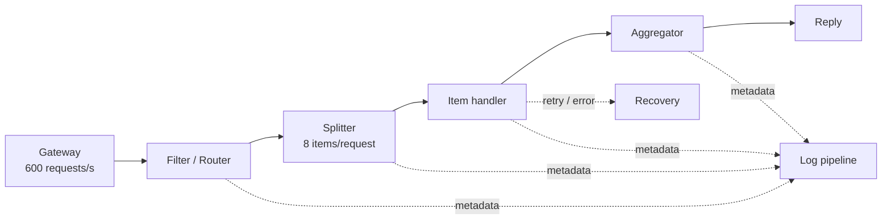
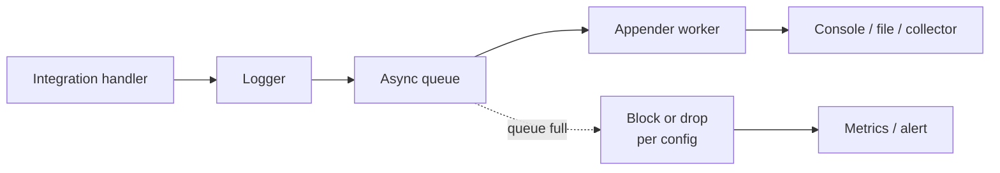

# Limiting Message Logs in Production

In development, printing every message makes it easy to see what a Filter drops, which branch a Router picks, and what payload a Transformer returns. In production, a single request may cross multiple channels, split into tens or thousands of parts via a Splitter, call external services, and retry before an Aggregator combines results. If every step logs the entire message, log generation rates can vastly exceed the inbound request rate.

**Limiting message logs in production** means defining which events truly require observation, what detail level is allowed, maximum acceptable volume, and how to behave when the log pipeline saturates. Reducing logs must preserve enough signal to detect errors and investigate specific requests without ever altering the business flow.

This lesson belongs to the **Message logger** chapter of the **SPRING_INTEGRATION_PATTERN** module. The module teaches Enterprise Integration Patterns with Spring Integration to build loosely coupled, extensible message flows—practicing Router, Filter, Transformer, Splitter, Aggregator, Gateway, retry, error channel, and correlation while testing and observing processing branches.

After this lesson, you will be able to:

- Estimate log volume from requests, child messages, and retries; set budgets for events/s, bytes/s, and retention.
- Choose `ERROR`, `WARN`, `INFO`, `DEBUG`, and `TRACE` levels and logger categories based on operational needs.
- Cut log volume by selecting observation points, sampling, rate limiting, and event aggregation without dropping business messages.
- Understand risks when an async appender or collector queue fills up, and how to monitor drops/blocks.
- Configure log checkpoints in Spring Integration Java DSL and build a sampled diagnostic branch.
- Verify data safety, correlation, performance, and behavior when logging is disabled or degraded.

## 1. Why Does Production Need Log Limits?

Consider an order-intake flow:



If two loggers sit along **every child message's** path, one request generates at least `8 × 2 = 16` log lines in the Splitter/handler branch alone—before counting Gateway, Router, Aggregator, retries, and exceptions. As traffic grows, logs scale with intermediate message count, not just API call count.

Limiting logs controls four impact areas:

1. **Application resources:** string formatting, payload serialization, memory allocation, locks, CPU, and garbage collection.
2. **Latency and backpressure:** file/console writes can block; async appender queues are bounded and may drop logs.
3. **Operational cost:** network egress, ingest, indexing, storage, retention, and query performance.
4. **Security and diagnosability:** the more payloads/headers emitted, the harder it is to govern sensitive data; excessive duplicate lines also drown out error signals.

Less logging is not automatically better. A system that drops final error events or lacks correlation IDs saves ingest cost yet drags out incident recovery. Define **log budgets and minimum observability requirements** right inside flow design.

## 2. Defining a Log Budget and What Must Be Kept

A practical budget needs measurable thresholds:

| Metric | Operational Question | Example Policy |
| --- | --- | --- |
| `events/s` | How many lines per instance and cluster-wide? | Dashboards broken down by service, logger category, and event |
| `bytes/s` | How much data must network and collector absorb? | Alert when exceeding thresholds baselined under real load |
| `bytes/request` | How much log data does a normal request emit? | Keep INFO at entry/exit milestones; details behind DEBUG |
| `logs/error` | How many times is a single failure logged? | One terminal failure record; concise attempt records |
| `queue occupancy` | How much buffer capacity remains in the appender? | Monitor queue fill and dropped-event counts |
| `p95/p99 latency` | Does enabling logging slow message processing? | Measure before/after under identical workloads |
| `retention` | How long are logs kept, and in which tier? | Driven by data policy and investigation needs |

Never apply one fixed lines/s threshold across all projects. First measure current traffic, record size, Splitter/Retry multipliers, audit mandates, and collector capacity; then set thresholds suited to your architecture.

### Classifying Logs by Value

- **Minimum operational signals:** receipt/completion of critical work, terminal failures, group timeouts, recovery status; keep under clear retention policies.
- **Diagnostic details:** individual Router decisions, child messages, safe headers, Transformer steps, retry attempts; typically placed at `DEBUG` or deliberately sampled.
- **Overly granular data:** every method invocation, full payloads, all headers, repeated stack traces; enable only temporarily within a narrow scope when justified.

If regulations or business rules require a complete **audit** trail, never rely by default on application logging (which can be sampled or dropped) as the system of record. Design auditing with dedicated contracts, durability, access controls, and retention.

## 3. Estimating Log Volume Before Adding Loggers

Start with an approximate model:

\[
V_{\text{day}} = R \times E \times B \times 86\,400
\]

Where:

- `R` is requests/s or messages/s at the boundary being sized.
- `E` is average records per **unit of R**. If `R` is requests/s, `E` must be logs/request.
- `B` is average encoded record size in bytes.
- `V` is raw log bytes per day, before compression, indexing, replication, and collector metadata.

**Hypothetical** example (not a benchmark): 600 requests/s, each request producing eight items; two log points on the item branch; average JSON line of 350 bytes.

```text
Events/s = 600 requests/s × 8 items/request × 2 logs/item
         = 9,600 logs/s

Bytes/s  = 9,600 × 350 B = 3,360,000 B/s ≈ 3.36 MB/s

Bytes/day = 3,360,000 × 86,400
          = 290,304,000,000 B/day ≈ 290.3 GB/day
```

If you log only two brief INFO events **per request**, under the same 350 bytes/log assumption:

```text
600 × 2 × 350 × 86,400 = 36,288,000,000 B/day
                       ≈ 36.3 GB/day
```

In this model, per-item logging produces roughly eight times the log volume of two request milestones. Sampling 5% of requests for per-item DEBUG logs reduces **that sampled DEBUG share** from ~290.3 GB/day to ~14.5 GB/day, while INFO, WARN, and ERROR events kept under separate policies still add volume.

Recalculate whenever you have:

- Multi-level Splitters or fan-out to multiple subscribers;
- Retries across multiple attempts for the same child message;
- An Aggregator waiting and logging every group update;
- Exception stack traces much larger than normal records;
- Multiple instances, collector replication, or heavy field indexing;
- Additional JSON fields, MDC entries, or tracing attributes.

**Note:** sampling 5% of requests does not necessarily yield exactly 5% of log bytes. Long requests may spawn more items; retry counts and record lengths vary too. Measure in practice.

## 4. Choosing Log Levels and Logger Categories for Production

Reference policy table:

| Level | Use For | Avoid |
| --- | --- | --- |
| `ERROR` | Terminal failures, unprocessable data, failed recovery | Logging the same stack trace on every retry attempt |
| `WARN` | Recoverable anomalies or conditions needing attention | Treating every expected Filter rejection as a warning |
| `INFO` | Major start/completion milestones, accepted business outcomes | Logging every Splitter item under high load |
| `DEBUG` | Router branches, group/sequence IDs, payload types, Transformer decisions | Leaving enabled permanently across the entire framework |
| `TRACE` | Narrowly scoped deep message-flow troubleshooting | Leaving enabled globally for extended periods |

Spring Boot supports per-category level configuration:

```yaml
logging:
  level:
    root: INFO
    org.springframework.integration: WARN
    app.integration.orders: INFO
    app.integration.diagnostic: WARN
```

When troubleshooting a flow, temporarily switch **only** `app.integration.diagnostic` to `DEBUG`, then restore the baseline level afterward. If using Spring Boot Actuator's `loggers` endpoint for runtime changes, restrict and authenticate access properly. Never let anyone freely toggle TRACE or expose sensitive data.

Two crucial principles:

1. **Both the log point's level and the backend's level matter.** A `.log(LoggingHandler.Level.DEBUG, ...)` checkpoint is suppressed when its category is set to INFO.
2. **Disabling a level does not eliminate all data-preparation work.** Java still evaluates expressions passed as logger arguments before invoking the method. For expensive data, use guards or library-supported suppliers; for `.log(...)` in a flow, verify behavior for your Spring Integration version.

SLF4J example:

```java
// Costly mistake: expensiveJson() runs before the logger decides whether to log.
log.debug("payload={}", expensiveJson(message.getPayload()));

// Better when computing expensive content is truly needed.
if (log.isDebugEnabled()) {
    log.debug("payloadSummary={}", approvedSummary(message.getPayload()));
}
```

Put only `approvedSummary` containing permitted fields into the log; enabling DEBUG does not grant permission to log full payloads.

## 5. Choosing Log Placement by Enterprise Integration Pattern

Effective log limiting starts by **removing low-value observation points**, then considering sampling.

| Pattern | Continuous Logs to Consider | Detailed Troubleshooting Logs |
| --- | --- | --- |
| Gateway / inbound | `received` or final outcome, request ID | Adapter metadata, payload type |
| Filter | Truly abnormal validation errors; rejection counts via metrics | `accepted/rejected` and reason code |
| Router | High-risk branches or critical route shifts | Per-message decision, enum route |
| Transformer | Conversion errors and schema incompatibilities | Source/target types, schema version |
| Splitter | Group split start/end, item count | Each item with `groupId` and sequence |
| Aggregator | Group completion/timeout | Received message count, per-update group state |
| Retry | Retries exhausted, abnormal retry rates | Per-attempt `attempt` and error code |
| Error channel | Terminal failure, recovery action | Filtered failed-message context |
| Outbound adapter | Significant success/failure, destination code | Masked request details, latency |

For example, a logger placed **after a Filter** never sees dropped messages; if tracking rejections is needed, add a discard flow or counter. For a Router, log the actually chosen branch rather than inferring it from a downstream handler name. For an Aggregator, never log the entire group payload just to check size; `groupSize` and `groupId` suffice for most cases.

If an item retries three times, `retry` events may emit three lines; do not add three full stack traces across advice, handler, and error channel. Designate one point for the terminal error log, keeping other points to brief statuses or metrics.

## 6. Java DSL Example: Milestone Logging with Bounded Observation Detail

The example below uses Java 17+, Spring Integration Java DSL, and **SLF4J 2.x**. The business flow receives `OrderSubmitted`, filters invalid orders, and passes them to a service. A Wire Tap sends a copy to a diagnostic branch. **Only the diagnostic branch** is sampled; business messages are never filtered by the sampling rate.

```java
import java.util.regex.Pattern;

import org.slf4j.Logger;
import org.slf4j.LoggerFactory;
import org.springframework.context.annotation.Bean;
import org.springframework.context.annotation.Configuration;
import org.springframework.integration.channel.DirectChannel;
import org.springframework.integration.dsl.IntegrationFlow;
import org.springframework.integration.handler.LoggingHandler;
import org.springframework.messaging.Message;
import org.springframework.messaging.MessageChannel;
import org.springframework.stereotype.Service;

record OrderSubmitted(String orderId, int itemCount) { }

@Service
class OrderProcessor {
    public void process(OrderSubmitted order) {
        // Real business processing (to be implemented in the application).
    }
}

@Configuration
class OrderLoggingFlowConfig {

    private static final Logger diagnosticLog =
            LoggerFactory.getLogger("app.integration.diagnostic");

    private static final Pattern SAFE_REQUEST_ID =
            Pattern.compile("[A-Za-z0-9_-]{1,64}");

    @Bean
    MessageChannel ordersInput() {
        return new DirectChannel();
    }

    @Bean
    MessageChannel diagnosticTap() {
        return new DirectChannel();
    }

    @Bean
    IntegrationFlow ordersFlow(OrderProcessor processor) {
        return IntegrationFlow.from("ordersInput")
                // Observation only; never drives business decisions.
                .wireTap("diagnosticTap")
                .filter(OrderSubmitted.class, order -> order.itemCount() > 0)
                .log(LoggingHandler.Level.INFO, "app.integration.orders",
                        message -> "event=order_accepted messageId="
                                + message.getHeaders().getId())
                .handle(processor, "process")
                .get();
    }

    @Bean
    IntegrationFlow sampledDiagnosticFlow() {
        return IntegrationFlow.from("diagnosticTap")
                .handle(message -> sampledLog(message))
                .get();
    }

    private static void sampledLog(Message<?> message) {
        String requestId = safeRequestId(message);

        // Illustrative sampling: deterministically select ~5% of valid IDs.
        // Do not apply this sampling to terminal errors or mandatory audits.
        if (!diagnosticLog.isDebugEnabled()
                || "missing".equals(requestId)
                || Math.floorMod(requestId.hashCode(), 100) >= 5) {
            return;
        }

        diagnosticLog.atDebug()
                .addKeyValue("event", "integration.message_seen")
                .addKeyValue("requestCorrelationId", requestId)
                .addKeyValue("messageId", message.getHeaders().getId())
                .addKeyValue("payloadType",
                        message.getPayload().getClass().getSimpleName())
                .log("diagnostic message observed");
    }

    private static String safeRequestId(Message<?> message) {
        Object raw = message.getHeaders().get("requestCorrelationId");
        if (raw instanceof String id
                && SAFE_REQUEST_ID.matcher(id).matches()) {
            return id;
        }
        return "missing";
    }
}
```

**Reading the example:**

1. `ordersInput` receives messages from a Gateway or inbound adapter; `OrderProcessor` handles business logic.
2. `wireTap("diagnosticTap")` creates an observation branch without removing messages from the main path. With `DirectChannel`, the tap runs synchronously, so sampling itself still has some cost; to isolate execution time, design a dedicated channel/queue and measure backpressure.
3. `.log(... INFO ...)` after the Filter records an acceptance milestone; to track rejections, add a discard flow or metric. Not every message hitting the tap passes the Filter.
4. `sampledLog` records only a subset of messages at `DEBUG`, deterministically selected by `requestCorrelationId` so diagnostic points using the same rule pick the same requests.
5. `hashCode()` is a lightweight sampling example, **not a cryptographic hash or guarantee of uniform distribution**. Issue IDs randomly or control them at ingress; if partners could craft IDs to evade sampling, use a more reliable sampling mechanism.
6. Log only the validated ID and payload type name; never call `message.toString()` or dump raw headers.
7. Set `DEBUG` on `app.integration.diagnostic` when investigating. Structured key-value pairs require encoder/backend support to render as separate fields.

This is a learning skeleton; add Filter rejection handling, business outcomes, timeouts, error flows, metrics, and production deployment controls as needed. Terminal `ERROR` events, mandatory audits, and critical security events must have **logging/monitoring paths independent of sampling policies**.

### Request-Based Sampling vs. Message-Based Sampling

If you sample 5% of **messages**, parts of the same request may be selected inconsistently: present at the Splitter yet missing at the Aggregator. Selecting deterministically on a stable `requestCorrelationId` captures all debug checkpoints for chosen requests, making timeline reconstruction straightforward. However, requests with varying item counts can push total log volume away from an exact 5%.

Log sampling also **does not** replace distributed tracing sampling, and never alters how messages travel across Channels, Routers, Filters, or Aggregators.

## 7. Rate Limiting and Aggregating Repeated Log Events

Sampling and rate limiting solve different problems:

| Technique | How It Works | When Useful | Limitations |
| --- | --- | --- | --- |
| Request-based sampling | Picks a fraction of requests for detailed logs | Flows with many child messages needing timelines | May miss rare incidents |
| Probabilistic per-event sampling | Randomly picks a fraction of events | Approximate stats over huge volumes | Hard to reconstruct a single request cleanly |
| Log rate limiting | Caps how many events emit per interval | Bursting errors, repeated warnings from one cause | Can hide error spikes unless dropped counts are tracked |
| Aggregation / summaries | Logs `count=...` over a window | Repetitive identical notifications | Loses per-message detail |
| Level/category tuning | Toggles logger groups as needed | Baseline control and incident triage | Enabling too broadly spikes load quickly |

For example, instead of emitting a thousand identical WARN lines about an unavailable upstream dependency, emit the first few warnings followed by a summary record:

```json
{
  "event": "integration.upstream_unavailable_summary",
  "stage": "inventoryGateway",
  "errorCode": "UPSTREAM_TIMEOUT",
  "windowSeconds": 60,
  "observedFailures": 1200,
  "suppressedLogEvents": 1190
}
```

This is **illustrative data**, not automatic framework output. `observedFailures` must come from a reliable counter/source and `suppressedLogEvents` must be measured by the rate-limiting policy—never inferred from remaining log lines.

**Distinction:** in Enterprise Integration Patterns, a Rate Limiter throttles **business message processing rates**; a logging rate limiter regulates only **observation events**. Never place Filters or throttles on a business channel solely to cut log volume.

Terminal errors needing investigation, security events, and mandatory audits must not be throttled under the same rules as routine debug logs. If repeated warnings must be rate-limited, preserve total failure counts via metrics and alerting independent of remaining log lines.

## 8. Async Appenders, Full Queues, and Backpressure

Applications can log synchronously or use an async appender/queue. Asynchronous logging reduces destination write wait time on some workloads, though it still incurs event creation, encoding/enqueuing, and memory costs.



Three scenarios require explicit design:

- **Block when queue is full:** preserves more logs at the cost of higher latency or stalling message-processing workers.
- **Drop events:** prevents blocking the application but risks losing incident traces; behavior may vary by log level and appender settings.
- **Slow collector or disk:** queues grow, RAM fills, and shutdown flushes may not finish before the process exits.

With Logback's `AsyncAppender`, settings such as `queueSize`, `discardingThreshold`, and `neverBlock` govern buffering, blocking, and dropping. Never copy a "safe default" queue config across all production services: verify backend, version, capacity, drop policy, and which logs must be protected. Async logging **does not turn application logs into a durable messaging channel**.

If logs serve as audits or compliance records requiring 100% retention, build a dedicated durable persistence mechanism. Never rely on an in-memory appender queue that can lose data on crashes.

### Behavior During Configuration Changes

Setting `TRACE` across all of `org.springframework.integration` can multiply log output many times over, especially in flows with Splitters. Before runtime changes, define the exact category, affected scope, time limit, rollback plan, and monitoring metrics. Restore default levels as soon as the investigation concludes.

## 9. Preserving Correlation and Observability While Reducing Logs

Cutting line counts only helps if operators can still reconstruct the right event chain. Preserve consistent metadata:

- `requestCorrelationId`: application-issued ID tracking one request across the flow.
- `messageId`: ID of the current message, which may change when new messages are created.
- `correlationId` or `groupId`: Splitter/Aggregator grouping key, distinct from the request ID.
- `sequenceNumber` and `sequenceSize`: item index and group size where relevant.
- `traceId`/`spanId`: distributed tracing context when instrumented.
- `event`, `stage`, `route`, `errorCode`, `attempt`, `durationMs`: diagnostic fields with stable names and types.

A minimal INFO log pattern might emit:

```json
{"event":"integration.received","requestCorrelationId":"req_42","stage":"ordersInput"}
{"event":"integration.aggregate_completed","requestCorrelationId":"req_42","groupSize":8}
{"event":"integration.replied","requestCorrelationId":"req_42","result":"ACCEPTED"}
```

When deep investigation of a request is needed, enable DEBUG on the specific category under controlled sampling or timeboxed diagnostics. Observation logs never mutate `requestCorrelationId` and are never a source for rebuilding business state.

**MDC and threads:** scope MDC entries and clear them when the handler exits. Across `ExecutorChannel`, pollers, or brokers, MDC does not automatically follow the message; re-read correlation from normalized headers. Avoid using emails or tokens as searchable IDs, as they can spread into loggers and traces.

## 10. Protecting Sensitive Data Before Emitting Logs

Limiting log volume **does not replace** sensitive-data filtering. Even a rarely sampled request can contain passwords or tokens. When logging full messages, headers, or stack traces, sampling only lowers exposure probability rather than eliminating risk.

Practical rules:

1. **Allowlist** safe fields such as `event`, `stage`, validated `requestCorrelationId`, `messageId`, enum `route`, `groupSize`, `durationMs`, and `errorCode`.
2. **Never** serialize full `Message<?>`, payloads, `MessageHeaders`, request/response bodies, or tokens in routine debug logs.
3. Emit exception messages/stack traces only under clear access, redaction, and retention policies; `Throwable.getMessage()` can embed user data.
4. Bound length and allowed characters for externally sourced fields to block log injection and oversized entries.
5. Verify HTTP client, broker, and framework loggers do not print sensitive headers when DEBUG/TRACE is turned on.
6. Use a structured JSON encoder for proper field typing and escaping; valid JSON syntax **does not mean** the data inside is safe to log.

For example, an error flow should log `event=integration.failed`, `requestCorrelationId`, `errorType`, and a mapped `errorCode` rather than `log.error("{}", failedMessage)`.

## 11. Measuring Load and Detecting Dropped Logs

To verify that log limits work without hiding incidents, monitor **application metrics** alongside **logging pipeline metrics**:

| Metric | Meaning | What to Check |
| --- | --- | --- |
| Requests/messages processed | True business throughput | Never estimate volume from log line counts when sampling is active |
| Success/failure/retry counters | Success, error, and retry rates | Alerts still fire even when WARN logs are rate-limited |
| Log events/s and bytes/s | Output load emitted by the app | Break down by service, category, and level |
| Queue depth / occupancy | Appender or collector queue saturation | Alerting and capacity planning |
| Dropped log events | Events discarded by appender or pipeline | Never mistake a drop in log lines for fewer application errors |
| Error log volume | Stack trace size and repeated errors | Check whether multiple logs emit per single attempt |
| CPU, memory, GC | Application-side logging overhead | Compare before and after adding log checkpoints |
| `p50/p95/p99` latency | Impact on processing time | Include tests with a slow collector |
| Ingest/index/storage/retention | Cost inside the logging backend | Review indexing rules and retention windows |

For instance, if INFO logs drop 70% right after a deployment while `failure_counter` and `dropped_events` rise simultaneously, that signals an overloaded logger/collector—**not** a healthier application.

In distributed systems, synchronize timestamps/timezones and retain validated IDs for timeline reconstruction. Use traces for cross-service spans and metrics for error frequencies; there is no need to turn every stage into an INFO line.

## 12. Testing Production Logging Policies

Tests should simulate level toggles, load spikes, errors, retries, and slow I/O. Keep workload, JVM flags, instance count, backend, and collector settings constant across comparisons.

| Scenario | How to Run | Expected Outcome |
| --- | --- | --- |
| DEBUG disabled | Send many valid messages | No DEBUG details emitted; business logic runs normally |
| DEBUG enabled on one category | Enable for a bounded test window | Right flow details appear; zero sensitive payload data |
| High Splitter fan-out | Send requests with 1, 8, and 100 items | Events/s scales per logger placement; stays within budget |
| Deterministic request sampling | Send multiple messages sharing a request ID | Checkpoints using the same policy select consistently |
| Filter rejects messages | Send invalid payloads | Reject branch updates counter/`reasonCode`; business handler never runs |
| Retry then succeed | Inject transient failures for a few attempts | Attempts and recovery are counted; no false terminal failure logged |
| Retries exhausted | Inject persistent failure | Terminal error event retained; correlation preserved |
| Async queue full | Simulate slow log sink in test env | Observe block/drop policy, p95 latency, and dropped events |
| Collector unavailable | Stop collector in test env | Business flow and logging degrade as designed |
| Payload contains fake token | Enable all supported log levels | Canary token absent from all output, including errors and stack traces |
| Two concurrent requests | Cross executor/poller boundaries | MDC and request IDs never bleed across threads |

### Measuring Java Argument-Evaluation Cost

A simple check for debug logging:

```java
import java.util.concurrent.atomic.AtomicInteger;
import org.slf4j.Logger;

static String buildDebugSummary(AtomicInteger counter) {
    counter.incrementAndGet();
    return "summary";
}

static void unguarded(Logger logger, AtomicInteger counter) {
    logger.debug("summary={}", buildDebugSummary(counter));
}

static void guarded(Logger logger, AtomicInteger counter) {
    if (logger.isDebugEnabled()) {
        logger.debug("summary={}", buildDebugSummary(counter));
    }
}
```

When DEBUG is off, `unguarded` still calls `buildDebugSummary`, whereas `guarded` skips it. This demonstrates Java's argument-evaluation behavior, **not a Spring Integration benchmark**. For logging operators, Wire Taps, and async appenders, measure on a realistic pipeline.

During load tests, record request counts, post-Splitter message counts, attempts, emitted log records, bytes, CPU, GC, and before/after latency. Never judge solely by file size if the collector compresses, samples, or caps records.

## 13. Hands-On Exercise: Setting Log Limits for an Order Flow

**Scenario:** A Gateway receives 600 requests/s, a Filter drops invalid requests, a Router splits `priority` and `standard`, a Splitter creates 1 to 20 items, some items retry, and an Aggregator combines results. The goal is limiting production logs while keeping incidents detectable and diagnosable.

Steps:

1. Map the message path from Gateway to Aggregator and the error channel. Mark which points log per request, per item, and stack traces.
2. Define an initial log budget: steady-state events/request, expected bytes/day, peak load ceiling, and error-log retention policy.
3. Keep `INFO` only at major acceptance/completion milestones; use metrics for rejections and retries; place Router decisions and Splitter items at `DEBUG`.
4. Preserve `requestCorrelationId` end to end and log group/sequence IDs on sampled diagnostic branches; keep payloads out of logs.
5. Configure sampling for diagnostic events: 5% of valid requests keyed on an application-issued ID. Verify the business Filter **never** depends on whether a request was sampled.
6. Enable DEBUG on the target category and compare measured events/s and ingest bytes against estimates; check whether large multi-item requests cause bursts.
7. Trigger timeouts, successful retries, and exhausted retries; confirm terminal error events are logged completely per policy even when DEBUG details are sampled.
8. Simulate a slow appender/collector queue in a test environment; inspect blocking/dropping, latency, CPU, and alerting metrics.
9. Inject a synthetic canary token into messages; verify it never appears in INFO, DEBUG, error channel, or formatted outputs.
10. Document results, real thresholds, and the procedure for temporarily toggling logs during incidents; restore default category levels after testing.

**Completion criteria:** throughput and business behavior remain intact; failing requests are traceable via correlation; terminal errors are observed; per-item logs stay within budget; queue/dropped-event metrics exist; sensitive data never appears in logs.

### Self-Check Questions

1. Why can 600 requests/s produce nearly 10,000 log lines/s after a Splitter?
2. What is the difference between message-based sampling and `requestCorrelationId`-based sampling?
3. Why shouldn't you use a business Filter to drop 95% of messages when your only goal is reducing DEBUG logs?
4. Does turning off DEBUG eliminate all data-preparation costs for logging?
5. With an async appender, how can a full queue affect latency or log completeness?
6. Why must rate-limited repeated `WARN` logs be paired with a true error counter?
7. How do you distinguish a request ID from Aggregator's `correlationId` and `traceId`?
8. If ERROR log counts drop while failure metrics climb, what would you investigate?
9. When do you need a separate durable audit channel instead of application logging?
10. How do you test data confidentiality when DEBUG/TRACE is enabled only briefly?

## 14. References

- [Spring Integration Reference — Logging Channel Adapter](https://docs.spring.io/spring-integration/reference/logging-adapter.html): `LoggingHandler` and content selection.
- [Spring Integration Reference — Java DSL log operator](https://docs.spring.io/spring-integration/reference/dsl/java-log.html): logging inside `IntegrationFlow`.
- [Spring Integration Reference — Wire Tap](https://docs.spring.io/spring-integration/reference/channel/wire-tap.html): creating observation branches from channels.
- [Spring Integration Reference — Splitter](https://docs.spring.io/spring-integration/reference/splitter.html) and [Aggregator](https://docs.spring.io/spring-integration/reference/aggregator.html): message grouping and sequence effects.
- [Spring Integration Reference — Error Handling](https://docs.spring.io/spring-integration/reference/error-handling.html): error channels and sync/async failures.
- [Spring Boot Reference — Logging](https://docs.spring.io/spring-boot/reference/features/logging.html): configuring loggers and log levels.
- [SLF4J Manual](https://www.slf4j.org/manual.html): log parameters and fluent API.
- [Logback Manual — Appenders](https://logback.qos.ch/manual/appenders.html): synchronous/async appenders and queues.
- [OWASP Logging Cheat Sheet](https://cheatsheetseries.owasp.org/cheatsheets/Logging_Cheat_Sheet.html): restricting sensitive content, log injection, and log quality.

**Key takeaway:** limiting message logs in production means **retaining the right observability signals within an explicit resource budget**. Place logs by EIP pattern, trim per-item noise, sample only diagnostic branches, and preserve error metrics and terminal failure events. Measure queue blocking/dropping, guard sensitive data, and ensure business decisions remain independent of logging.
