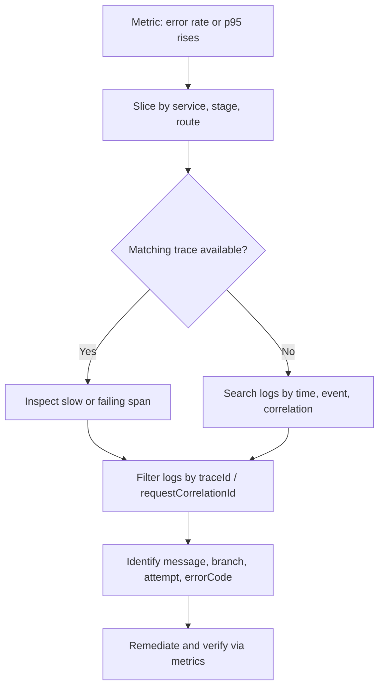
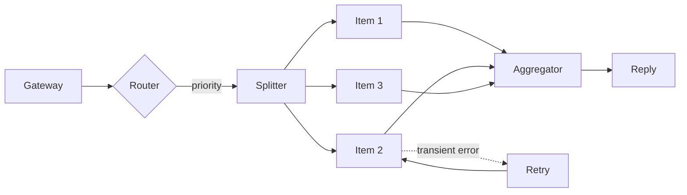

# Correlating Logs with Metrics and Traces

A Spring Integration flow may traverse a Gateway, Filter, Router, Transformer, Splitter, and Aggregator before calling multiple external services. When the final outcome is slow or wrong, reading individual log lines does not necessarily show **the scope of impact**; conversely, an aggregated duration metric does not pinpoint **which specific request failed**. Distributed traces show the spans within one execution, yet they can be sampled and lack complete business decisions.

Therefore, you must **correlate logs, metrics, and traces** instead of picking one source to replace everything else:

- **Metrics** tell you *how many, how fast or slow, and when it changed*.
- **Traces** tell you *which hops an execution crossed and where time was spent*.
- **Logs** tell you *which specific event occurred, what routing decision was made, and what context surrounded an error*.

This lesson belongs to the **Message logger** chapter in the **SPRING_INTEGRATION_PATTERN** module. Its scope is implementing Enterprise Integration Patterns with Spring Integration to build loosely coupled, extensible message flows—practicing Router, Filter, Transformer, Splitter, Aggregator, Gateway, retry, error channel, and correlation while testing and observing processing branches.

After this lesson, you will be able to select the right signal for each operational question, use consistent IDs to link logs with traces, avoid using request IDs as high-cardinality metric labels, measure latency and errors with Micrometer, and test a scenario combining Splitter, retry, Aggregator, and an error channel.

## 1. Three Signals Answer Three Different Questions

| Signal | Common Units | Best Answers | Key Limitations |
| --- | --- | --- | --- |
| **Logs** | Timestamped events with fields | "Which message was dropped? Which branch did Router pick? What was the error code?" | Can be massive; incomplete due to levels, sampling, or queue/drops |
| **Metrics** | Counters, timers/histograms, gauges | "How much did errors jump? What is p95 latency? Is the queue filling up?" | Pre-aggregated; usually cannot look up one specific request |
| **Traces** | Traces composed of related spans | "Which adapter slowed this request down? Which services did it visit?" | May not be sampled, propagation can break, and does not capture every business decision |

Suppose an API processes 1,000 orders/minute, and 25 orders fail in the inventory adapter. A metrics dashboard may show the error rate climbing from 0.5% to 2.5%. A captured trace may reveal 1.3 seconds spent inside the HTTP client calling inventory. Logs matching the same request ID tell you which branch the Router chose, which item retried, and the classified error code.

**Never infer an exact total failure count from `ERROR` log line counts**: one exception may be logged multiple times, a recovered retry is not a terminal failure, some records are sampled/dropped, and some errors are tracked via metrics without emitting stack traces.

### Example of Three Signals for the Same Incident

```text
METRIC:
  integration_orders_total{stage="inventory", outcome="failure"} increases
  integration_step_duration p95 at inventory increases

TRACE:
  HTTP inbound -> ordersFlow -> inventoryGateway (1.3 s) -> reply ERROR

LOG:
  event=integration.retry requestCorrelationId=req_42
  stage=inventory attempt=2 errorCode=UPSTREAM_TIMEOUT

  event=integration.failed requestCorrelationId=req_42
  stage=inventory errorCode=RETRY_EXHAUSTED
```

This is **illustrative output**. Exact metric names, log fields, and spans do not appear automatically in this form unless instrumentation and exporters are configured.

## 2. Mental Model: Detect, Isolate, Explain

An effective investigation typically moves from broad signals down to specific cases.



You do not always have to start with metrics. When a user provides a request ID for a specific transaction, you can look up logs first and then open the linked trace. When an alert indicates system-wide latency degradation, metrics are the better starting point.

A complete correlation loop consists of:

1. **Detect:** monitor error-rate counters, p95/p99 timers, or queue depth.
2. **Slice:** inspect stage, route, outcome, and dependency across bounded-cardinality labels.
3. **Isolate:** find retained traces or logs within the corresponding time window.
4. **Investigate:** verify request ID, message ID, Splitter/Aggregator group, retry count, and error code.
5. **Remediate:** adjust infrastructure/configuration or business logic.
6. **Confirm:** metrics return to baseline; terminal error logs subside; fresh traces show improved step durations.

## 3. Which IDs Must Be Distinguished?

Similar names do not imply identical scope.

| Field | Belongs To | Usage |
| --- | --- | --- |
| `requestCorrelationId` | Application | Tracks an entire request/order across steps and branches |
| `MessageHeaders.ID` | Spring Messaging | Identifies the **current message**; can change when new messages are created |
| `correlationId` | Spring Integration / message group | Groups messages in Splitter/Aggregator; may apply only to one group |
| `sequenceNumber`, `sequenceSize` | Split group | Identifies child messages, ordering, and group size when known |
| `traceId` | Distributed tracing | Links spans within a trace when context propagates completely |
| `spanId` | Distributed tracing | Identifies a specific step inside a trace |
| `businessId` / `orderId` | Business domain | May be sensitive depending on policy; does not replace trace ID |

For example, request `req_42` splits into three child messages. All three should carry `requestCorrelationId=req_42`, while each has its own `messageId`. The `correlationId` and `sequenceNumber` headers serve Aggregator grouping; they do not automatically become trace/span IDs.

A diagnostic log on a child message might be structured as:

```json
{
  "event": "integration.item_retry",
  "flow": "orderFulfillment",
  "stage": "inventory",
  "requestCorrelationId": "req_42",
  "messageId": "54c314f3-62df-485f-a85e-f028df69531d",
  "groupRef": "grp_9",
  "sequenceNumber": 2,
  "attempt": 2,
  "errorCode": "UPSTREAM_TIMEOUT",
  "traceId": "a32d7b72c5734295a1c3b403b90d3a23",
  "spanId": "9f1a32c74d5bc680"
}
```

This schema is **governed by the application and backend**. `groupRef` illustrates a sanitized group identifier rather than assuming the `correlationId` header is always a safe string. `traceId` and `spanId` appear only when tracing is instrumented and active context is present.

### Correlation IDs Do Not Replace Context Propagation

Adding `requestCorrelationId` to message headers helps correlate logs and business steps, yet **does not automatically create parent–child relationships between spans**. Traces require tracing context and propagation via Micrometer Tracing/OpenTelemetry or your chosen stack. Conversely, a trace may connect spans yet lack Aggregator group IDs or sequence numbers.

When a message crosses an `ExecutorChannel`, poller, or broker, threads change. SLF4J MDC is thread-bound and does not travel naturally with messages. Never assume `MDC.put("traceId", ...)` at a Gateway appears in every worker; configure context propagation properly and clean up MDC scopes.

## 4. Choosing Signals for Each Enterprise Integration Pattern

| Pattern | Metrics to Track | What Traces Should Show | What Logs Should Record |
| --- | --- | --- | --- |
| Gateway/inbound | Requests, outcome, latency | Entry span, call duration | Request receipt, IDs, outcome code |
| Filter | Accepted/rejected counters | Processing span if valuable | `reasonCode` for abnormal rejections |
| Router | Per-route counters | Branch traversed | Selected `route` using an enum |
| Transformer | Mapping/schema error counts | Expensive transformation steps | Source/target types, error code |
| Splitter | Child message count, items/request distribution | Fan-out or item-processing steps | Controlled group/sequence when needed |
| Aggregator | Groups completed, timeouts, wait time, active groups | Group wait step if instrumented | `groupRef`, size, release/timeout |
| Service Activator | Success/failure, timers | Business/dependency spans | Outcome or error code |
| Retry | Attempt counters, retries exhausted | Retry attempts and dependency latency | Attempt, error code, request ID |
| Error channel | Terminal failure counters, recovery outcomes | Error/recovery spans if any | `integration.failed`, failed message ID |
| Outbound adapter | Throughput, latency, timeouts | Outbound service call spans | Approved destination type, status, latency |

Avoid creating a span for every tiny step with zero diagnostic value: overly granular tracing adds overhead much like excessive logging. Instrument meaningful boundaries such as inbound, outbound, queue waits, business stages, and error branches.

### A Message Crossing Multiple Branches Is Not Always a Linear Timeline



A trace can represent branching, yet span hierarchy and links depend on instrumentation; if async context is lost, a single trace can fragment into separate traces. Child messages traversing Router/Splitter/Aggregator should still carry proper business metadata so logs can reconcile them even if a trace drops a span.

## 5. Micrometer in Spring Integration: Role and Prerequisites

Spring Integration includes management/metrics and observation capabilities, and Spring Boot integrates Micrometer Metrics, Micrometer Observation, and Micrometer Tracing. However, **never assume adding a dependency automatically equips every channel/handler with the exact metrics, traces, and log correlation you want**.

Distinguish:

- **`MeterRegistry`:** creates and stores meters like `Counter`, `Timer`, and `Gauge`. The registry and exporter must match your metrics backend.
- **`ObservationRegistry`:** coordinates Observations with start/stop lifecycles and context. With registered `ObservationHandler`s, an Observation can produce both metrics and traces.
- **Micrometer Tracing:** creates and manages spans and context propagation via the configured tracer bridge/exporter; when configured, it can populate trace/span IDs into MDC/log output.
- **Spring Integration instrumentation:** depends on framework version, endpoints, and management/observation configuration. Verify which points are instrumented, exact observation/metric names, propagation, and cardinality in the live app.

**Consequence:** calling `Observation.start(...)` without a matching handler only creates a lifecycle object—it does **not** mean a trace will appear in your backend. Likewise, registering a Counter does not guarantee dashboards see it unless the exporter or scrape endpoint is configured.

Spring Boot tools can inspect emitted endpoints/metrics/traces, though enabling and securing Actuator depends on security policy. Never expose management endpoints carelessly to the internet.

## 6. Example: One Handler Producing Semantically Aligned Metrics, Observations, and Logs

The example below uses **Java 17+, Spring Integration Java DSL, Micrometer, and SLF4J 2.x**. A gateway/adapter sends `Message<OrderSubmitted>` into a channel. The handler increments outcome counters, wraps the stage in an Observation, and logs a safe event with the request ID.

**Goal of this example:** show how one piece of work emits three independent yet semantically aligned signals. How an Observation translates into metrics/traces and how `traceId` renders in logs depend on your application's `ObservationHandler`, tracer, MDC, and log encoder setup.

```java
import io.micrometer.core.instrument.Counter;
import io.micrometer.core.instrument.MeterRegistry;
import io.micrometer.observation.Observation;
import io.micrometer.observation.ObservationRegistry;

import org.slf4j.Logger;
import org.slf4j.LoggerFactory;
import org.springframework.context.annotation.Bean;
import org.springframework.context.annotation.Configuration;
import org.springframework.integration.channel.DirectChannel;
import org.springframework.integration.dsl.IntegrationFlow;
import org.springframework.messaging.Message;
import org.springframework.messaging.MessageChannel;
import org.springframework.stereotype.Service;

record OrderSubmitted(String orderId, int itemCount) { }

@Service
class FulfillmentProcessor {
    private static final Logger log =
            LoggerFactory.getLogger("app.integration.fulfillment");

    private final ObservationRegistry observations;
    private final Counter successCount;
    private final Counter failureCount;

    FulfillmentProcessor(ObservationRegistry observations,
                         MeterRegistry meters) {
        this.observations = observations;
        this.successCount = Counter.builder("integration.orders.fulfill")
                .tag("stage", "fulfillment")
                .tag("outcome", "success")
                .register(meters);
        this.failureCount = Counter.builder("integration.orders.fulfill")
                .tag("stage", "fulfillment")
                .tag("outcome", "failure")
                .register(meters);
    }

    void process(Message<?> message) {
        String requestId = safeRequestId(message);

        Observation observation =
                Observation.createNotStarted("orders.fulfill", observations)
                        .lowCardinalityKeyValue("stage", "fulfillment");
        observation.start();

        try (Observation.Scope scope = observation.openScope()) {
            try {
                OrderSubmitted order = (OrderSubmitted) message.getPayload();

                // Real business work, possibly invoking an outbound Gateway.
                fulfill(order);

                successCount.increment();
                log.atInfo()
                        .addKeyValue("event", "integration.fulfilled")
                        .addKeyValue("stage", "fulfillment")
                        .addKeyValue("requestCorrelationId", requestId)
                        .addKeyValue("messageId", message.getHeaders().getId())
                        .log("order fulfillment completed");
            } catch (RuntimeException ex) {
                observation.error(ex);
                failureCount.increment();
                log.atError()
                        .addKeyValue("event", "integration.failed")
                        .addKeyValue("stage", "fulfillment")
                        .addKeyValue("requestCorrelationId", requestId)
                        .addKeyValue("errorCode", "HANDLER_FAILED")
                        .log("order fulfillment failed");
                throw ex;
            }
        } finally {
            observation.stop();
        }
    }

    private void fulfill(OrderSubmitted order) {
        // Replace with actual business processing.
        // Never print the entire order or authentication data.
    }

    private static String safeRequestId(Message<?> message) {
        Object raw = message.getHeaders().get("requestCorrelationId");
        if (raw instanceof String id
                && id.matches("[A-Za-z0-9_-]{1,64}")) {
            return id;
        }
        return "missing";
    }
}

@Configuration
class FulfillmentIntegrationConfig {

    @Bean
    MessageChannel ordersInput() {
        return new DirectChannel();
    }

    @Bean
    IntegrationFlow ordersFlow(FulfillmentProcessor processor) {
        return IntegrationFlow.from("ordersInput")
                .filter(OrderSubmitted.class,
                        order -> order.itemCount() > 0)
                .handle(message -> processor.process(message))
                .get();
    }
}
```

`OrderSubmitted`, `FulfillmentProcessor`, and `FulfillmentIntegrationConfig` are illustrative components; in a real project they can reside in separate Java files. Replace `fulfill(...)` with real business logic. The example assumes `ObservationRegistry`, `MeterRegistry`, compatible `ObservationHandler`s, and a log backend are configured when exporting metrics/traces.

**Inspecting each signal:**

1. **Metric:** counter `integration.orders.fulfill` carries tags `stage=fulfillment` and `outcome=success/failure`. Tags come from bounded sets; **never** attach `requestCorrelationId` or `orderId` to a Counter.
2. **Observation/trace:** `orders.fulfill` wraps one execution. Observation marks errors if an exception is thrown and stops in `finally`. With a tracing handler, it produces a span; with a metrics handler, it can also produce timing metrics. Exact backend names depend on conventions/exporters.
3. **Log:** success/failure records contain the event and request ID for one specific case, omitting exception text and raw payloads. When MDC tracing is configured, the log encoder can append `traceId`/`spanId`.
4. **Business flow:** the exception is rethrown so Spring Integration applies configured error/retry paths; logging never swallows messages or replaces recovery.
5. **Measurement placement:** because the Filter sits before the handler, the handler's counter does **not** represent total inbound messages or Filter rejections. To measure rejections, add a dedicated counter or discard flow.

**Avoiding double counting:** if your application already enables automatic counters/timers for the exact same stage/outcome, do not add a manual meter with the same meaning and sum both on dashboards. Clearly name meters as "attempt" vs. "terminal request" and review existing auto-instrumentation.

### Propagating the Correlation ID with the Message

Example sending a request to `ordersInput` (injected bean):

```java
import org.springframework.messaging.support.MessageBuilder;

ordersInput.send(MessageBuilder
        .withPayload(new OrderSubmitted("ORD-42", 3))
        .setHeader("requestCorrelationId", "req_42")
        .build());
```

This illustrates header propagation. In production, correlation IDs must be generated/normalized at a trusted boundary (inbound Gateway or adapter)—never use raw emails, tokens, or personal data as IDs.

## 7. What Should Metrics Count to Prevent Reconciliation Mistakes?

In flows with retries and Splitters, mixing counting units causes confusion.

| Metric | Counting Unit | Meaning |
| --- | --- | --- |
| `integration.requests.received` | Request | Inbound request count |
| `integration.messages.handled` | Message | Messages reaching handlers, including Splitter child messages |
| `integration.handler.attempts` | Attempt | Total handler invocations including retries |
| `integration.handler.failures` | Failed attempt | Handler invocations throwing errors, possibly recovered later |
| `integration.requests.failed` | Terminal failed request | Requests that ultimately failed to complete |
| `integration.groups.completed` | Group | Groups released by the Aggregator |
| `integration.groups.timed_out` | Group | Groups timing out per policy |
| `integration.step.duration` | Time unit | Measured duration of a defined stage |

These names are **examples of metrics you can design**, not a claim that Spring Integration emits them automatically with those exact names.

Suppose one request has 10 items; each item's handler runs once, except item two retries twice before succeeding. You might observe:

```text
requests.received:       +1
messages.handled:        +10 (if counting logical messages)
handler.attempts:        +12 (10 initial + 2 retries)
handler.failures:        +2 (2 failed attempts)
requests.failed:         +0 (request ultimately succeeded)
groups.completed:        +1
```

Exact numbers depend on **where the Counter sits**. If `messages.handled` increments on every handler invocation, it reads `12` rather than `10`. Document exact metric boundaries, units, and label semantics.

### Timers and Latency

Timers/histograms reveal p50/p95/p99 and latency distributions; `Counter` measures counts only, not time. When measuring timeouts or retries, distinguish:

- **Attempt duration:** one single service call.
- **Stage duration:** total time at a stage, potentially spanning multiple attempts/backoffs.
- **End-to-end latency:** from Gateway/inbound to final reply, including queue waits and Aggregator waits if any.
- **Group wait time:** how long an Aggregator waits for all members.

Never sum per-stage p95 values to estimate end-to-end p95: percentiles do not add linearly. Measure end-to-end latency directly if that is your monitored SLO.

## 8. Designing Metric Labels: Cardinality and Cost

A common mistake is attaching `requestCorrelationId`, `messageId`, `orderId`, or exception messages as metric tags. In a flow handling 1 million requests, that explodes time-series counts, spiking memory, CPU, storage, and slowing queries.

**Good labels** typically have small bounded value sets:

```text
service = orders
stage   = gateway | routing | inventory | aggregation
route   = standard | priority | fallback
outcome = success | failure | rejected
reason  = invalid_input | timeout | upstream_unavailable
```

**Poor choices** for standard metric labels:

```text
requestCorrelationId = req_00001, req_00002, ...
messageId            = unique UUID per message
email                = customer address
exceptionMessage     = free-form error string
fullUrl              = URL with arbitrary query strings
```

Request IDs, trace IDs, and message IDs are immensely valuable in **logs and trace attributes**, but must never become unbounded metric labels. To jump from a metric data point to a specific trace, use **exemplars** if supported by your backend/exporter and configuration. Exemplars appear only when deployment prerequisites are met and do not guarantee every chart point links to a trace.

## 9. Sampling: Why Don't Logs and Traces Match One-to-One?

Multiple independent sampling sources exist:

- **Log level:** DEBUG may be disabled in production; only selected categories are active.
- **Log sampling:** the application or collector may retain only a fraction of events/requests.
- **Trace sampling:** the tracer may record only a subset of traces, especially under high load.
- **Error/retry logging:** repeated warnings may be rate-limited.
- **Queue/appender:** overloaded pipelines may drop logs.

Therefore, having **a log without a matching trace** is not necessarily an instrumentation bug. The trace may simply not have been sampled, propagation may have broken, or the exporter may have failed. Conversely, a trace may exist while DEBUG logs are missing because the logger was disabled.

Some systems support probabilistic or rule-based tail sampling at the collector; exact semantics and decision timing vary by technology. Never assume every span of a trace is preserved completely without inspecting sampler and backend configuration.

### Checklist When Data Is Missing During Reconciliation

1. Verify logs carry a safe `requestCorrelationId` and accurate timestamps.
2. Check whether logs include `traceId`; if missing, verify the MDC/tracing bridge and encoder.
3. If `traceId` exists yet no trace appears, check sampling, exporter health, send failures, and retention.
4. If one request produces multiple disconnected traces, inspect propagation across executors, pollers, brokers, and newly built messages.
5. If metrics report more errors than logs, check log levels, rate limits, sampling, and metric definitions (attempt vs. terminal failure).
6. If logs report more errors than metrics, check for duplicate logging across handler/advice/error channel, recovered retries, or misplaced metric counters.

Never treat retained log or trace counts as "total request volume" without guaranteed sampling/completeness semantics.

## 10. Reconciling a Retry Incident in a Splitter/Aggregator Flow

**Scenario:** A Gateway receives `req_42`, a Router picks the priority branch, and a Splitter emits three items. Item two hits two inventory timeouts before succeeding on the third attempt. The Aggregator collects all three parts and returns the result.

### A. Looking at Metrics

A dashboard might show:

```text
integration.requests.received     +1
integration.item.attempts        +5  (3 initial + 2 retries)
integration.item.attempt_errors  +2
integration.groups.completed     +1
integration.requests.failed      +0
inventory.client.duration        p95 spiked over the last 5 minutes
```

These numbers are **illustrative data**. If counting attempts at a specific stage excluding others, document it accurately. Two failed attempts must not be misread as two failed terminal orders.

### B. Looking at Traces

```text
traceId=a32d...  requestCorrelationId=req_42
  Gateway (15 ms)
    Router (2 ms) -> priority
    Splitter (1 ms)
      inventory item 1 (30 ms)
      inventory item 2 (attempt 1: 1,000 ms timeout)
      inventory item 2 (attempt 2: 1,000 ms timeout)
      inventory item 2 (attempt 3: 35 ms success)
      inventory item 3 (28 ms)
    Aggregator (group complete)
  Reply (success)
```

This trace tree illustrates the logical structure to observe. Actual spans depend on how retries, fan-out, threads/queues, and context are instrumented. When a group runs in parallel, the span tree can be more complex, sometimes linking operations via span links or separate traces.

### C. Looking at Logs

```text
INFO  event=integration.received requestCorrelationId=req_42
INFO  event=integration.routed requestCorrelationId=req_42 route=priority
DEBUG event=integration.split requestCorrelationId=req_42
      groupRef=grp_9 sequenceNumber=2 sequenceSize=3
WARN  event=integration.retry requestCorrelationId=req_42
      stage=inventory attempt=2 errorCode=UPSTREAM_TIMEOUT
INFO  event=integration.recovered requestCorrelationId=req_42
      stage=inventory attempt=3
INFO  event=integration.aggregate_completed requestCorrelationId=req_42
      groupRef=grp_9 groupSize=3
```

If `DEBUG` is off, per-item sequence lines may be absent. You can still rely on metrics plus terminal/recovery logs for broad diagnosis. When recurring issues appear, selectively raise detail by category and time window.

**Reconciliation conclusion:** two failed attempts point to upstream instability, not two failed orders. Metrics reflect rates/latency, traces isolate the slow step, and logs prove the request retried and completed via the Aggregator.

## 11. Error Channel and Failed Messages from All Three Perspectives

When retries are exhausted and a final handler fails, Spring Integration can emit an `ErrorMessage` on an error channel if the endpoint is configured to publish errors. The `ErrorMessage` payload is a `Throwable`; for `MessagingException`, `getFailedMessage()` may return the failed message, though not always.

At the **metrics** level, count terminal failures by `stage` and `errorCode`, kept separate from attempt counters. At the **trace** level, mark the span with error status and identify the dependency, avoiding marking the entire request failed prematurely if recovery can still succeed. At the **log** level, emit `integration.failed` with selected metadata.

```json
{
  "event": "integration.failed",
  "stage": "inventory",
  "requestCorrelationId": "req_42",
  "messageId": "54c314f3-62df-485f-a85e-f028df69531d",
  "errorCode": "RETRY_EXHAUSTED",
  "errorType": "MessageHandlingException",
  "terminal": true
}
```

`errorCode`, `stage`, and `terminal` are application-defined fields. Never assume `MessagingException.getFailedMessage()` returns the original message from the Gateway: after Transformers and Splitters, it may be the intermediate message at the failing step. To reconcile the entire journey, carry the application request ID in headers and log group/sequence metadata when needed.

### Sensitive Data Reminder

Never dump full `ErrorMessage`, `failedMessage`, `Throwable.getMessage()`, HTTP headers, or raw payloads into structured logs. Those values can hold tokens, phone numbers, payment details, or private responses. Structured JSON does not automatically scrub sensitive data; enforce allowlists and source-side redaction.

## 12. Dashboards and Alerts: Avoiding Double Counting

An on-call dashboard can organize panels as:

| Panel | Source | Question |
| --- | --- | --- |
| Requests/s, success/failure | Counter metrics | Overall health |
| End-to-end p50/p95/p99 | Timer/histogram metrics | Latency SLOs |
| Retry attempts and exhausted | Counters by stage/outcome | Which dependency is flaky? |
| Aggregator timeouts and group backlog | Meters/gauges | Are any groups stuck? |
| Queue depth or poller lag | Infrastructure gauges/metrics | Is there backlog or backpressure? |
| Slowest retained traces | Trace backend | Which stage consumes time? |
| Terminal error logs by `errorCode` | Log search backend | Which specific cases need debugging? |

Key principle: **primary alerts for error rates or latency should fire from metrics** whenever reliable metrics exist; never base your sole alert on sampled `ERROR` log line counts. Logs can support alerts for rare events while respecting delivery limitations.

A system logging the same exception at three points emits three `ERROR` lines, whereas the terminal failure metric should increment **once by definition**. Charts must state their exact unit: request, message, attempt, group, or span. Never add numbers across mismatched units.

## 13. Testing Cross-Signal Correlation

Tests should separate two concerns: **business correctness** and **observability correctness**. Never let missing logs or traces alter business handler outcomes.

| Scenario | Metrics to Match | Traces to Check | Logs to Check |
| --- | --- | --- | --- |
| One successful request | 1 successful request | Span present when sampled and instrumented | Request ID, outcome event |
| Filter rejection | Reject counter increments | Filter span if instrumented | Reason code, no raw payload |
| Router selects priority | Matching route counter increments | Right branch if spanned | `route=priority` |
| Splitter emits 3 parts | Item/group counters match | Fan-out handled cleanly | Sequence/group IDs when DEBUG on |
| Retry twice then succeed | +2 attempt errors, 0 terminal failures | Retry steps if instrumented | Retry/recovered logs, no false terminal error |
| Retries exhausted | Terminal failure increments once | Error span recorded | `integration.failed` and final error code |
| Aggregator timeout | Timeout/backlog meters reflect it | Wait span if instrumented | Group ID and timeout code |
| Switch to `ExecutorChannel` | Counters retain semantics | No unintended propagation loss | IDs never mix across requests |
| Disable DEBUG | Metrics unchanged | Traces follow independent sampling | Only verbose logs disappear |
| Disable tracing/exporter | Metrics and business work normally | Traces absent per test setup | Logs still retain request ID |
| Log queue full | Business meters still reflect outcomes | Message contracts unaffected | Check dropped events and latency |
| Payload contains fake token | Metrics carry no secrets | Span attributes carry no secrets | No canary in any output |

### Testing with a Predictable Request ID

Using `req_test_42` and three child messages, you can build an integration test scenario:

1. Send a message with header `requestCorrelationId=req_test_42`.
2. Measure counters before/after; assert on the delta to avoid noise from parallel tests.
3. Capture logs via a test appender; assert event, request ID, error code, and absence of sensitive canaries.
4. Use an in-memory tracer or test span exporter if configured; assert expected span relationships or verify sampling behavior.
5. Route through an executor/poller; verify context propagation and MDC cleanup so one test's request ID never leaks into the next.
6. Trigger retries followed by recovery; verify attempt errors remain distinct from terminal request failures.
7. Re-run with TRACE/DEBUG disabled; business outcomes and counters remain identical.

If a mock/tracer captures no spans because instrumentation is unconfigured, tests should reflect that honestly rather than assuming every Spring Integration endpoint emits spans automatically. Collector-stage tests should verify exporters, JSON field names, metric labels, and live queryability.

## 14. Common Reconciliation Pitfalls

| Symptom | Likely Cause | How to Check |
| --- | --- | --- |
| Metrics show more errors than ERROR logs | Log sampling/rate limits, dropped logs, errors not logged at ERROR | Inspect attempt/terminal counters, logger levels, and drop metrics |
| Logs show errors, yet metrics do not rise | Intermediate/recovered retry logs, counter placed on wrong stage | Review "failure" definition and increment placement |
| Logs contain `traceId`, yet trace is missing | Trace sampling, exporter errors, retention | Check sampler, exporter, backend, and retention settings |
| One request produces multiple traces | Context not propagated across threads/queues/brokers | Check per-endpoint instrumentation and propagation |
| Trace omits the second item | Item step uninstrumented or span dropped | Reconcile with group/sequence metadata and logs |
| Dashboard explodes with time series | `requestId`/`orderId` used as a metric label | Replace with `route`/`stage`/`outcome` enums |
| Stage p95 looks good, yet end-to-end p95 is bad | Unmeasured queue or Aggregator wait time | Add end-to-end and wait-time measurements |
| Workers mix up MDC across requests | Scope not closed, threads reused | Use `try/finally` or scoped context management |
| Three ERROR logs for one failed transaction | Handler, advice, and error channel all log stack traces | Designate one terminal error log point; use metrics/short logs for attempts |
| Enabling tracing spikes overhead | Too many spans, huge attributes, or saturated exporter | Reduce granularity, cap attributes, measure CPU/queues/sampling |

Never fix reconciliation gaps by logging full messages at every step. That drives up ingest cost, leakage risk, and duplicate noise without fixing broken context propagation.

## 15. Hands-On Exercise: Investigating a Multi-Branch Order Flow

**Problem:** A Gateway receives 100 requests, a Router splits priority/standard, and a Splitter splits each request into 1–5 items. Some items time out calling inventory and retry; an Aggregator returns results only when groups complete or match the release strategy. The system collects metrics, structured logs, and traces via Micrometer/observability tooling.

Requirements:

1. Tabulate all stages and define **metric units**: request, item message, attempt, group. Separate `attempt_failure` from terminal `request_failure`.
2. Choose low-cardinality metric tags: `stage`, `route`, `outcome`, `errorCode`. Never add request IDs or emails to tags.
3. Choose structured log fields: `event`, `requestCorrelationId`, `messageId`, `groupRef`, `sequenceNumber`, `attempt`, `errorCode`, and `traceId` when present.
4. Wrap one handler in an Observation, configuring `MeterRegistry` and tracing handlers/exporters as needed. Check what Spring Integration instruments automatically to avoid double counting.
5. Trigger two retries followed by success on one item. Compare successful request counts, attempt errors, and recovery logs.
6. Trigger another terminal failure routing to the error channel. Verify metrics increment accurately, error metadata logs safely, and the trace marks error status if recorded.
7. Replace a `DirectChannel` with an asynchronous test boundary and verify trace and request ID propagation across the new thread.
8. Enable trace sampling or reduce DEBUG logs; verify metrics still accurately report total requests/attempts at measurement points.
9. Inject a synthetic canary `FAKE_SECRET_DO_NOT_LOG_123` into a payload; verify logs, trace attributes, and metric labels contain no secrets.
10. Summarize results in a table listing time window, requests, message items, attempts, terminal failures, groups completed, p95 latency, retained logs, and retained traces; explain why the numbers do not necessarily match.

**Completion criteria:** metrics detect rising errors or latency, traces isolate slow dependencies/steps when retained, and logs reveal the exact request, branch, group/sequence, attempt, and error code. Message processing remains accurate when DEBUG or tracing is disabled, and zero sensitive data appears in telemetry.

### Self-Check Questions

1. Why can't `ERROR` log line counts accurately measure failed request rates?
2. How does `requestCorrelationId` differ from `traceId` and Aggregator's `correlationId`?
3. Why can a request suffer two failed retries while its terminal failure metric remains zero?
4. Which fields make good metric labels, and why is `messageId` usually a poor choice?
5. When a log includes `traceId` yet no trace exists, what should you check before blaming broken propagation?
6. Why can't per-handler p95 values be summed to compute end-to-end p95?
7. When moving to an `ExecutorChannel`, what must be verified for MDC and span context?
8. Why might `ObservationRegistry` fail to emit traces without an appropriate handler/exporter?
9. When a Splitter emits multiple child messages, why isn't a trace always a simple linear tree?
10. When metrics and logs disagree, how do you re-verify counting-unit definitions?

## 16. References

- [Spring Integration — Micrometer Support](https://docs.spring.io/spring-integration/reference/metrics.html): metrics and management in Spring Integration (verify against your version).
- [Spring Integration — Message](https://docs.spring.io/spring-integration/reference/message.html): message structure and headers.
- [Spring Integration — Error Handling](https://docs.spring.io/spring-integration/reference/error-handling.html): error channels, `ErrorMessage`, and async failures.
- [Spring Integration — Splitter](https://docs.spring.io/spring-integration/reference/splitter.html) and [Aggregator](https://docs.spring.io/spring-integration/reference/aggregator.html): correlation, sequencing, and release.
- [Spring Boot — Observability](https://docs.spring.io/spring-boot/reference/actuator/observability.html): Observation, metrics, and traces in Spring Boot.
- [Micrometer — Concepts](https://docs.micrometer.io/micrometer/reference/concepts.html): `Counter`, `Timer`, `Observation`, and registry design.
- [Micrometer Tracing — Reference](https://docs.micrometer.io/tracing/reference/): spans, tracer bridges, and context propagation.
- [OpenTelemetry — Traces](https://opentelemetry.io/docs/concepts/signals/traces/) and [Metrics](https://opentelemetry.io/docs/concepts/signals/metrics/): concepts and cross-signal correlation.
- [SLF4J Manual](https://www.slf4j.org/manual.html): logging APIs and structured key-value pairs.
- [OWASP Logging Cheat Sheet](https://cheatsheetseries.owasp.org/cheatsheets/Logging_Cheat_Sheet.html): safe log fields and protecting sensitive information.

**Key takeaway:** **metrics detect trends, traces isolate journeys, and logs explain specific events**. Effective correlation requires consistent metadata, clear counting-unit definitions, proper instrumentation and context propagation, and awareness that logs/traces may be sampled. Keep request IDs in logs and message headers rather than high-cardinality metric labels; use all three signals to understand Spring Integration flows without replacing business messaging.
