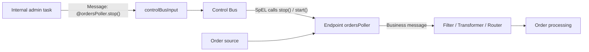

# Control Bus: Controlling Endpoints with Messages

## 1. Purpose and Context

In systems using **Enterprise Integration Patterns (EIP)**, message flows are typically designed to run continuously: receiving data from external systems, filtering, transforming, routing, splitting, and aggregating results. However, real-world operations require the ability to **start or pause an endpoint while the application is still running**. For example:

- Pausing data polling from a partner while the partner is undergoing maintenance.
- Restarting a message receiver after connection issues have been resolved.
- Checking whether an endpoint is currently running without restarting the entire application.
- Allowing an administrative operation in the system to emit control messages, in the same way business flows exchange messages.

The **Control Bus** is an EIP pattern for a channel that controls and monitors components of a messaging system. With **Spring Integration**, the Control Bus receives a message containing a **Spring Expression Language (SpEL)** expression, evaluates the expression in the Spring context, and can invoke a management method on a bean, such as `start()` or `stop()` on an endpoint that implements `Lifecycle`.

By the end of this lesson, you will be able to configure a Control Bus, control a polling endpoint via messages, check its status, write tests, and identify operational boundaries to watch out for.

## 2. Where Does the Control Bus Fit in an Integration Flow?

Suppose an application periodically receives orders from an internal queue, then sends them through a Transformer, Router, and processing channels. When the upstream source is under maintenance, we want to pause the **order receiving endpoint** while other flows keep running.



There are **two different types of messages**:

| Type | Purpose | Example payload | Where it is handled |
| --- | --- | --- | --- |
| Business message | Transports data to be integrated | `ORDER-001` | Filter, Transformer, Router, Aggregator… |
| Control message | Changes or queries component state | `@ordersPoller.stop()` | Control Bus |

The Control Bus is a **message-handling endpoint** on the control plane; it does not automatically replace business endpoints, does not stop the JVM, and does not provide a distributed management mechanism across all instances.

A few terms to distinguish:

- **Channel** is the pathway for transferring messages; a channel like `DirectChannel` does not have `start()/stop()` operations of its own.
- **Endpoint** is a component attached to sending/receiving or processing messages. Some endpoints, especially *polling inbound adapters*, implement `Lifecycle`/`SmartLifecycle` and can be started/stopped.
- **Bean name / endpoint id** is the name the Control Bus uses to look up the object in the `ApplicationContext`; this name must be exact and should be kept stable.

## 3. Command Execution Mechanism

A typical workflow:

1. An authorized component sends a message whose payload is a SpEL string to the Control Bus input channel.
2. The Control Bus evaluates this string, looks up the bean using the `@beanName` syntax, and invokes the corresponding method.
3. The endpoint changes state, for example from *stopped* to *running*. The poller will begin executing polls according to its configured schedule.
4. Operations verify the actual state and monitor the flow's logs/metrics.

Common expressions for an endpoint with bean id `ordersPoller`:

```text
@ordersPoller.start()
@ordersPoller.stop()
@ordersPoller.isRunning()
```

`start()` and `stop()` are state-changing operations. `isRunning()` is a state-querying operation; if you want to retrieve the return value via a message, you need to configure a reply path or an appropriate messaging gateway. The example below uses `SmartLifecycle` for direct inspection, helping to clearly separate control commands from observation.

If a bean id contains a hyphen, such as `orders-poller`, you can reference the bean name using SpEL syntax:

```text
@'orders-poller'.start()
```

**Prerequisite:** the target endpoint must exist in the same `ApplicationContext` visible to the Control Bus and must support the invoked method. Not every message handler has a corresponding lifecycle API.

## 4. Complete Example with Spring Integration Java DSL

Scenario: a Spring Boot application has an in-memory order queue. A polling endpoint fetches orders every 2 seconds and passes them to a handler. The endpoint **starts in a stopped state** and is started via the Control Bus.

The project requires the Spring Integration library, such as the following Gradle dependency in a Spring Boot application with compatible version management:

```gradle
implementation("org.springframework.boot:spring-boot-starter-integration")
```

Create the configuration class `ControlBusConfiguration.java`:

```java
package example.controlbus;

import java.time.Duration;
import java.util.concurrent.BlockingQueue;
import java.util.concurrent.LinkedBlockingQueue;

import org.springframework.context.annotation.Bean;
import org.springframework.context.annotation.Configuration;
import org.springframework.integration.annotation.IntegrationComponentScan;
import org.springframework.integration.channel.DirectChannel;
import org.springframework.integration.config.EnableIntegration;
import org.springframework.integration.core.MessageSource;
import org.springframework.integration.dsl.IntegrationFlow;
import org.springframework.integration.dsl.Pollers;
import org.springframework.messaging.MessageChannel;
import org.springframework.messaging.support.GenericMessage;

@Configuration
@EnableIntegration
@IntegrationComponentScan
public class ControlBusConfiguration {

    @Bean
    public MessageChannel controlBusInput() {
        return new DirectChannel();
    }

    @Bean
    public IntegrationFlow controlBusFlow() {
        return IntegrationFlow.from("controlBusInput")
                .controlBus()
                .get();
    }

    @Bean
    public BlockingQueue<String> pendingOrders() {
        return new LinkedBlockingQueue<>();
    }

    @Bean
    public MessageSource<String> orderSource(BlockingQueue<String> pendingOrders) {
        return () -> {
            String orderId = pendingOrders.poll();
            return orderId == null ? null : new GenericMessage<>(orderId);
        };
    }

    @Bean
    public IntegrationFlow ordersFlow(MessageSource<String> orderSource) {
        return IntegrationFlow
                .from(orderSource, endpoint -> endpoint
                        .id("ordersPoller")
                        .autoStartup(false)
                        .poller(Pollers.fixedDelay(Duration.ofSeconds(2))))
                .handle(message ->
                        System.out.println("Received order: " + message.getPayload()))
                .get();
    }
}
```

Key lines and their roles:

| Configuration | Meaning |
| --- | --- |
| `controlBusInput()` | Channel dedicated exclusively to control commands. |
| `.controlBus()` | Attaches the handler that interprets payloads as control expressions. |
| `.id("ordersPoller")` | Assigns a stable name so SpEL finds the exact endpoint. |
| `.autoStartup(false)` | Prevents the polling source from starting automatically when the application starts. |
| `Pollers.fixedDelay(Duration.ofSeconds(2))` | Polling schedule **when** the endpoint is running. |
| `MessageSource.receive()` returns `null` | Indicates there are currently no orders; no new message is sent. |

`DirectChannel` dispatches commands to the handler on the sender's calling thread in this configuration. Therefore, command evaluation errors can usually be propagated directly back to the caller. If replaced with an asynchronous channel, a separate acknowledgment and error-handling mechanism must be designed.

Create the messaging gateway `ControlCommands.java` so internal components can send commands without manually constructing a `Message<?>`:

```java
package example.controlbus;

import org.springframework.integration.annotation.MessagingGateway;

@MessagingGateway(defaultRequestChannel = "controlBusInput")
public interface ControlCommands {
    void execute(String expression);
}
```

`@IntegrationComponentScan` in the configuration above helps discover the gateway interface located in the scanned package. For applications with multiple packages, ensure that the scan configuration includes the gateway's package.

Wrap the commands in an administrative service that only exposes permitted operations:

```java
package example.controlbus;

import org.springframework.context.ApplicationContext;
import org.springframework.context.Lifecycle;
import org.springframework.stereotype.Service;

@Service
public class OrderPollingAdminService {
    private final ControlCommands commands;
    private final ApplicationContext applicationContext;

    public OrderPollingAdminService(
            ControlCommands commands,
            ApplicationContext applicationContext) {
        this.commands = commands;
        this.applicationContext = applicationContext;
    }

    public void start() {
        commands.execute("@ordersPoller.start()");
    }

    public void stop() {
        commands.execute("@ordersPoller.stop()");
    }

    public boolean isRunning() {
        Lifecycle endpoint =
                applicationContext.getBean("ordersPoller", Lifecycle.class);
        return endpoint.isRunning();
    }
}
```

This service **does not accept arbitrary SpEL strings from callers**. It only dispatches two fixed commands corresponding to starting and stopping polling.

### Sequential Execution Walkthrough

Suppose the Spring Boot application has started and `OrderPollingAdminService` is injected into an internal task:

```java
// pendingOrders is an injected BlockingQueue<String>.
pendingOrders.offer("ORDER-001");

// Initially false because of autoStartup(false).
System.out.println(adminService.isRunning());

adminService.start(); // sends "@ordersPoller.start()"

// After starting, the poller picks up ORDER-001 on the next poll.
// Handler prints: Received order: ORDER-001
System.out.println(adminService.isRunning());

adminService.stop();  // sends "@ordersPoller.stop()"
System.out.println(adminService.isRunning());
```

If the source still has data, `stop()` prevents **new polls** after the endpoint stops. The stop command does not guarantee revoking a message that a poll has already fetched or canceling a downstream task already in progress. Wait for in-flight processing to finish if the workflow requires a safe stopping point.

## 5. Testing Control Behavior

Integration tests should verify the actual state change of the endpoint, not merely that the gateway was called. With Spring Boot Test and AssertJ:

```java
package example.controlbus;

import static org.assertj.core.api.Assertions.assertThat;

import org.junit.jupiter.api.Test;
import org.springframework.beans.factory.annotation.Autowired;
import org.springframework.boot.test.context.SpringBootTest;
import org.springframework.context.ApplicationContext;
import org.springframework.context.Lifecycle;

@SpringBootTest
class ControlBusIntegrationTest {

    @Autowired
    ControlCommands commands;

    @Autowired
    ApplicationContext context;

    @Test
    void canStartAndStopPollingEndpointByMessage() {
        Lifecycle poller = context.getBean("ordersPoller", Lifecycle.class);

        assertThat(poller.isRunning()).isFalse();

        commands.execute("@ordersPoller.start()");
        assertThat(poller.isRunning()).isTrue();

        commands.execute("@ordersPoller.stop()");
        assertThat(poller.isRunning()).isFalse();
    }
}
```

This test focuses on lifecycle state. To test **business impact**, you should add a test that puts an order into the queue, waits with a bounded timeout until the handler receives it, stops the poller, adds another order, and verifies that no new poll occurs within an observation window. Time-based tests should use reasonable wait timeouts rather than calling `Thread.sleep()` and assuming the system has definitely finished processing.

For production systems, verify all three layers: **the command message is received**, **the endpoint transitions state**, and **business traffic changes as expected**.

## 6. Combining with Router, Filter, Splitter, and Aggregator

The Control Bus is useful when an integration flow consists of multiple branches, but the scope of control must be clearly defined:

- **Router:** stopping an inbound adapter for one source stops *new* messages from arriving from that source; other sources can still pass through the router.
- **Filter / Transformer:** when you only want to skip or alter how messages are processed, you can use filter/router rules instead of stopping an endpoint. Stopping an intermediate processing endpoint can leave upstream without an active consumer.
- **Splitter / Aggregator:** stopping the receiver while a group of messages is being aggregated may leave incomplete groups. You need timeout policies, group release strategies, and correlation key monitoring.
- **Retry / error channel:** stopping a poller does not clear failed messages, does not replace retry, and does not guarantee rollback of work in progress. Appropriate retry, dead-letter, or incident-handling mechanisms are still needed.

For example, when partner A undergoes maintenance: instead of stopping the entire system, use the Control Bus to stop only the `partnerAPoller` endpoint. Flows receiving data from B and C continue running; messages from A that already entered the channel before the stop still get processed under the current policy.

## 7. Safe Operations and State Observation

### 7.1. Do Not Expose SpEL Execution Publicly

The Control Bus payload is an expression evaluated with access to application beans. If accepted directly from HTTP, public queues, or untrusted users, this presents a severe attack surface.

Recommended design:

1. Only allow **authenticated and authorized** administrative tasks to call the control service.
2. Map user choices to **predefined commands** (`startOrders`, `stopOrders`); do not concatenate SpEL strings from free-form input.
3. Keep the control channel internal, enforce authorization checks, and record an audit log containing the requester, endpoint, action, timestamp, and outcome.
4. Restrict the set of controllable endpoints to avoid modifying unrelated system beans.

When implementing an admin API, the API should only call `OrderPollingAdminService.start()/stop()` after authorization. Do not design an endpoint like `POST /control` that accepts a SpEL expression as its body.

### 7.2. Distinguishing State from Processing Outcomes

| Situation | What is actually guaranteed | What is **not** guaranteed |
| --- | --- | --- |
| `start()` succeeds | The endpoint has been requested to transition to running | Upstream data is ready or messages have definitely been processed |
| `stop()` succeeds | The endpoint has been requested to stop new polling/processing per lifecycle | All in-flight processing has completed or been rolled back |
| `isRunning() == true` | The bean reports running state | Remote connection is healthy, there is no backlog, or there are no business errors |
| Command sent to channel | The command message has been dispatched according to channel configuration | Every other instance is also controlled |

For real-world monitoring, combine lifecycle state with metrics, logs with correlation IDs, inbound/outbound message counts, retry counts, latency, backlog, and error alerts. Spring Boot Actuator and Micrometer can provide additional observability signals; the Control Bus does not replace a monitoring system.

### 7.3. Errors and Multi-Instance Systems

Common errors include: wrong bean id, the endpoint not implementing the target method, invalid SpEL syntax, or insufficient access permissions. With a synchronous dispatch path like `DirectChannel`, exceptions typically propagate back to the caller; the caller should catch errors, record an audit log, and report a failed status. If using `ExecutorChannel` or an asynchronous path, you need to design an error-receiving path, such as `errorChannel` or a dedicated acknowledgment mechanism.

If the application has multiple replicas, each replica has its own `ApplicationContext`. Whichever instance receives the command controls the bean on **that instance**; it does not automatically broadcast to all replicas. To manage the entire cluster, commands must be routed to the appropriate instance, or a distributed coordination layer must be used to track each instance's state. Never assume `stop()` on one node has stopped all other consumers.

## 8. Common Pitfalls and Troubleshooting

| Symptom | Common cause | How to verify |
| --- | --- | --- |
| Command reports bean not found | Using channel/flow name instead of endpoint id or wrong bean name | Check the id assigned directly to the endpoint in the DSL and verify the bean exists in context |
| `start()` sent but no orders appear | Queue is empty, poller hasn't reached its next interval, source or downstream error | Check `isRunning()`, data source, poll schedule, and handler logs |
| `stop()` called yet a message is still processed | Message had already been received before stopping | Monitor in-flight tasks and flow completion semantics |
| Gateway bean not created | `@MessagingGateway` package is outside the scan range | Check `@IntegrationComponentScan` |
| Command succeeds on one replica while others keep polling | Each instance has its own context and lifecycle | Check topology and target instance |
| SpEL error or handler error | Invalid payload or target method not supported | Log exceptions, trace the command, and inspect the target bean |
| Data loss while stopping an external source | Source does not retain backlog or does not support replay | Determine the source's durability, checkpointing, and backfill mechanisms |

## 9. Hands-On Exercises

**Exercise 1 — Start/stop an adapter.** Using the example above, add two fixed admin commands `start` and `stop`; log state transitions. Observe that an order placed into the queue before starting the poller gets processed after starting it.

**Exercise 2 — Error handling check.** Send a command to a non-existent bean id in a test environment. Capture the exception and ensure the admin service returns a clear failure result without claiming the endpoint changed state.

**Exercise 3 — Two independent sources.** Add `partnerBPoller` and two separate processing flows. Stop `ordersPoller` and demonstrate that `partnerBPoller` continues running. Then connect both to a Router and observe traffic on each branch.

**Exercise 4 — Operational conditions.** Describe a plan to stop an upstream source that currently has messages in an Aggregator. Specify how to inspect incomplete groups, timeouts, retries, and how to recover after restarting.

Completion criteria: explain **command message → Control Bus → endpoint bean → lifecycle transition**, distinguish endpoint state from business outcomes, write tests for `start()/stop()`, and accurately identify instance scope and access control boundaries.

## 10. Takeaways

The Control Bus turns administrative actions into **messages** so Integration components can be controlled at runtime. In Spring Integration, the typical usage is sending a SpEL payload such as `@ordersPoller.start()` or `@ordersPoller.stop()` to a channel wired to `.controlBus()`. Assign **stable endpoint IDs**, manage lifecycle deliberately, verify actual state, and only permit controlled commands from internal sources.
