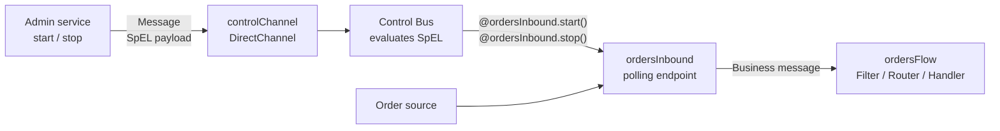

# Sending Lifecycle Commands via a Control Channel

## 1. Scenario and Expected Outcome

In an enterprise integration application, receiving data from an external system sometimes has to be paused while the application continues serving other flows. For example, a vendor is undergoing API maintenance: we want to stop polling orders, keep the messages already in the system intact, and resume receiving once the connection stabilizes.

With **Spring Integration**, a **control message** can be sent to a dedicated channel so the **Control Bus** executes `start()` or `stop()` on an endpoint that supports lifecycle management. This approach aligns with the goal of the **SPRING_INTEGRATION_PATTERN** module: implementing Enterprise Integration Patterns so that components such as Router, Filter, Transformer, Splitter, Aggregator, Gateway, retry, and error channels collaborate through messages with low coupling and high observability.

This lesson focuses on the concrete sequence: **create a control channel → register the Control Bus → assign an ID to the endpoint → send lifecycle commands as messages → verify the state and impact on the business flow**.

After this lesson, you will be able to:

- Send `start()`, `stop()`, and query `isRunning()` for an endpoint supporting `Lifecycle`.
- Distinguish a **command-carrying channel** from a **controlled endpoint** and from channels carrying business data.
- Use Java DSL and `MessageChannel.send()` to send commands; wrap operations in an administrative service that only allows fixed commands.
- Write tests for endpoint state, analyze command failure cases, pause a busy poller, and handle multi-instance deployments.

## 2. Three Components of the Control Flow



| Component | Role | Key point to remember |
| --- | --- | --- |
| `controlChannel` | Channel that delivers operational commands to the Control Bus | Carries **control messages**; does not need to be identified as a lifecycle endpoint |
| Control Bus | Handler that reads expressions from messages and invokes the corresponding bean | Must be bound to the correct input channel |
| `ordersInbound` | Polling inbound endpoint to be started/stopped | Must have a stable bean id and implement the lifecycle API |

The command syntax uses **Spring Expression Language (SpEL)**. The `@` prefix references a bean in the Spring `ApplicationContext`; the remainder is the method call on that bean:

```text
@ordersInbound.start()
@ordersInbound.stop()
@ordersInbound.isRunning()
```

`start()` transitions the endpoint to the running state; `stop()` requests the endpoint to stop running; `isRunning()` queries the state currently reported by the bean. These commands are meaningful only when the target bean actually supports `org.springframework.context.Lifecycle` or `SmartLifecycle`. Do not assume that every router, filter, message channel, or service activator exposes the same methods.

**Important:** stopping a polling endpoint stops it from collecting **new** messages on its schedule. The command does not automatically delete already-received messages, cancel an already-running processing task, or affect other instances of the application.

## 3. Configuring a Control Channel and a Lifecycle-Aware Endpoint

The example uses Spring Boot, Spring Integration Java DSL, and an in-memory queue to focus on how commands are sent. In a Spring Boot project with version management, you need the Integration starter:

```gradle
dependencies {
    implementation("org.springframework.boot:spring-boot-starter-integration")
    testImplementation("org.springframework.boot:spring-boot-starter-test")
}
```

Create the class `ControlChannelConfiguration.java`. The complete example below assumes the application already has a `@SpringBootApplication` class in an enclosing package `example.integration`.

```java
package example.integration;

import java.time.Duration;
import java.util.concurrent.BlockingQueue;
import java.util.concurrent.LinkedBlockingQueue;

import org.springframework.context.annotation.Bean;
import org.springframework.context.annotation.Configuration;
import org.springframework.integration.channel.DirectChannel;
import org.springframework.integration.config.EnableIntegration;
import org.springframework.integration.core.MessageSource;
import org.springframework.integration.dsl.IntegrationFlow;
import org.springframework.integration.dsl.Pollers;
import org.springframework.messaging.MessageChannel;
import org.springframework.messaging.support.GenericMessage;

@Configuration
@EnableIntegration
public class ControlChannelConfiguration {

    // Dedicated channel for receiving control messages.
    @Bean
    public MessageChannel controlChannel() {
        return new DirectChannel();
    }

    // Command receiver: Control Bus evaluates the SpEL payload.
    @Bean
    public IntegrationFlow controlBusFlow() {
        return IntegrationFlow.from("controlChannel")
                .controlBus()
                .get();
    }

    // Simulated data source for testing polling start/stop.
    @Bean
    public BlockingQueue<String> orderQueue() {
        return new LinkedBlockingQueue<>();
    }

    @Bean
    public MessageSource<String> orderSource(
            BlockingQueue<String> orderQueue) {

        return () -> {
            String orderId = orderQueue.poll();
            return orderId == null ? null : new GenericMessage<>(orderId);
        };
    }

    // The controlled endpoint must have its own id: ordersInbound.
    @Bean
    public IntegrationFlow ordersFlow(MessageSource<String> orderSource) {
        return IntegrationFlow
                .from(orderSource, spec -> spec
                        .id("ordersInbound")
                        .autoStartup(false)
                        .poller(Pollers.fixedDelay(Duration.ofSeconds(1))))
                .handle(message -> System.out.println(
                        "Processed order: " + message.getPayload()))
                .get();
    }
}
```

In this configuration:

1. `controlChannel` is a `DirectChannel`: messages are delivered synchronously to the channel's subscriber upon sending. This makes it possible to observe exceptions directly during the send call.
2. `controlBusFlow` receives messages on `controlChannel`; the `.controlBus()` handler evaluates the SpEL string carried by the message.
3. `ordersFlow` pulls orders from `orderSource` every second **while the poller is running**; a poll returns `null` if the queue has no elements.
4. `.id("ordersInbound")` assigns a name to the **polling endpoint**, which is the object the Control Bus looks up via `@ordersInbound`.
5. `.autoStartup(false)` prevents the endpoint from automatically receiving orders when the application starts. The endpoint's initial state is stopped so you can verify the effect of the start command.

This is an internal example for learning lifecycle management. With a real data source, the adapter might be an inbound file, JDBC, FTP, or another polling-capable source; you should verify that adapter's lifecycle behavior before applying this pattern.

## 4. Sending Control Messages via `MessageChannel`

A Control Bus command is usually represented by a **String payload**. The Java API `MessageChannel.send(Message<?>)` can send messages to `controlChannel`:

```java
package example.integration;

import org.springframework.beans.factory.annotation.Qualifier;
import org.springframework.context.ApplicationContext;
import org.springframework.context.Lifecycle;
import org.springframework.messaging.MessageChannel;
import org.springframework.messaging.support.MessageBuilder;
import org.springframework.stereotype.Service;

@Service
public class OrdersPollingControl {

    private final MessageChannel controlChannel;
    private final ApplicationContext context;

    public OrdersPollingControl(
            @Qualifier("controlChannel") MessageChannel controlChannel,
            ApplicationContext context) {
        this.controlChannel = controlChannel;
        this.context = context;
    }

    public void start() {
        sendCommand("@ordersInbound.start()");
    }

    public void stop() {
        sendCommand("@ordersInbound.stop()");
    }

    public boolean isRunning() {
        Lifecycle endpoint = context.getBean(
                "ordersInbound", Lifecycle.class);
        return endpoint.isRunning();
    }

    private void sendCommand(String expression) {
        boolean accepted = controlChannel.send(
                MessageBuilder.withPayload(expression).build());

        if (!accepted) {
            throw new IllegalStateException(
                    "Control command was not accepted");
        }
    }
}
```

The key sending call is:

```java
controlChannel.send(
    MessageBuilder.withPayload("@ordersInbound.stop()").build()
);
```

The payload is an **expression string**, not an object such as a `Runnable` or an HTTP command. The Control Bus reads that string, looks up the `ordersInbound` bean, and invokes `stop()`.

The reason the `OrdersPollingControl` service only exposes `start()` and `stop()` is that callers are not allowed to supply arbitrary SpEL strings. This is a safeguard to prevent unintended access to other beans in the Spring context.

**Limitations of the send result:** a `true` return value from `send()` indicates that the message was accepted on the channel under the `MessageChannel` contract. It is not independent proof that all business processing has finished. With `DirectChannel`, the handler executes on the caller thread and handler errors are typically thrown back to the caller; you must still check `isRunning()` and relevant operational signals.

### Sample Application Call Flow

Example of an internal administrative task injected with both `OrdersPollingControl` and the queue:

```java
orderQueue.offer("ORDER-1001");

// The poller has not started automatically.
System.out.println(control.isRunning()); // false

control.start();
System.out.println(control.isRunning()); // true

// On the next poll interval:
// Processed order: ORDER-1001

control.stop();
System.out.println(control.isRunning()); // false
```

When stopped, new data remaining in the queue will not be read by `orderSource`; when started again, the poller resumes reading available data. Note that this example queue resides solely in memory and does not guarantee data persistence if the process stops.

## 5. Sending via a Messaging Gateway to Avoid Depending on `MessageChannel`

In a larger application, business code can issue commands through a Java interface, while Spring Integration handles creating the message and sending it to the right channel:

```java
package example.integration;

import org.springframework.integration.annotation.MessagingGateway;

@MessagingGateway(defaultRequestChannel = "controlChannel")
public interface LifecycleCommandGateway {
    void send(String expression);
}
```

Gateway scanning must be enabled in the appropriate package scope, such as adding `@IntegrationComponentScan` to the Integration configuration (or an equivalent scan configuration). Then, sending from an administrative service can look like:

```java
gateway.send("@ordersInbound.start()");
gateway.send("@ordersInbound.stop()");
```

A gateway reduces message-creation boilerplate, but **does not automatically restrict expressions**. Never pass raw HTTP payloads, untrusted queue data, or user-supplied expressions directly into `gateway.send(...)`. Keep the gateway encapsulated inside an administrative service with a fixed set of commands like `OrdersPollingControl`.

You can choose `MessageChannel.send()` **or** a gateway depending on your needs. The two code snippets above demonstrate two ways of sending a message to the same `controlChannel`; they do not require two Control Buses.

## 6. State Query Commands and Result Verification

In addition to `start()` and `stop()`, the Control Bus can evaluate the expression:

```text
@ordersInbound.isRunning()
```

This is a query expression because `isRunning()` returns a boolean. However, **how you retrieve the result from the message** depends on how the reply path, gateway, and channel behavior are configured. When you only need start/stop, the example above chooses a simpler verification method: retrieving the endpoint bean from `ApplicationContext` and calling `isRunning()` directly right after sending the command.

If you use a request-reply pattern to query through the Control Bus, you need to configure the sender to receive replies and inspect the returned payload type, timeout, reply routing conditions, and exception handling. Never assume every `send()` returns the expression's result; `MessageChannel.send()` only returns a boolean indicating whether the message was sent.

There are three separate things to verify:

| Question | Observed signal | Meaning |
| --- | --- | --- |
| Was the command sent to the channel? | `send()` returns `true` or no error occurs on the synchronous path | The message was accepted according to the channel contract |
| Did the endpoint change state? | `isRunning()` on the target bean | The endpoint reports running or stopped |
| Is the data flow behaving properly? | Messages actually reaching the handler, backlog, retries, errors, and metrics | Operational impact on business data |

In systems with retries or an Aggregator, endpoint state cannot replace observing in-flight messages. A successful poller stop command does not mean all correlation groups have completed or that the error channel is empty.

## 7. Testing Start/Stop Behavior via Messages

Place the test in `src/test/java/example/integration/ControlChannelTest.java`. With `spring-boot-starter-test`, you can run JUnit Jupiter and AssertJ; use `@SpringJUnitConfig` to build the context solely from the lesson's configuration:

```java
package example.integration;

import static org.assertj.core.api.Assertions.assertThat;

import org.junit.jupiter.api.Test;
import org.springframework.beans.factory.annotation.Autowired;
import org.springframework.beans.factory.annotation.Qualifier;
import org.springframework.context.ApplicationContext;
import org.springframework.context.Lifecycle;
import org.springframework.messaging.MessageChannel;
import org.springframework.messaging.support.MessageBuilder;
import org.springframework.test.context.junit.jupiter.SpringJUnitConfig;

@SpringJUnitConfig(ControlChannelConfiguration.class)
class ControlChannelTest {

    @Autowired
    ApplicationContext context;

    @Autowired
    @Qualifier("controlChannel")
    MessageChannel controlChannel;

    @Test
    void startsAndStopsEndpointUsingControlMessages() {
        Lifecycle endpoint = context.getBean(
                "ordersInbound", Lifecycle.class);

        assertThat(endpoint.isRunning()).isFalse();

        try {
            assertThat(controlChannel.send(MessageBuilder
                    .withPayload("@ordersInbound.start()")
                    .build())).isTrue();
            assertThat(endpoint.isRunning()).isTrue();
        } finally {
            controlChannel.send(MessageBuilder
                    .withPayload("@ordersInbound.stop()")
                    .build());
        }

        assertThat(endpoint.isRunning()).isFalse();
    }
}
```

This test verifies the chain **send message → Control Bus invokes lifecycle → endpoint state changes**. It does not assert the end-to-end effect of receiving and processing orders.

A deeper integration test could:

1. Put `ORDER-2001` into the queue while the endpoint is stopped; verify no message has been processed yet.
2. Send `@ordersInbound.start()`; use a bounded wait mechanism (such as Awaitility if the project includes the library) until the handler records `ORDER-2001`.
3. Send `@ordersInbound.stop()`, wait for the stopped state; add `ORDER-2002` and observe over a reasonable time window that no new poll occurs.
4. Send start again and verify `ORDER-2002` is processed. Clean up the queue and endpoint state after the test.

Avoid relying on a fixed `Thread.sleep()` call and drawing absolute conclusions; poll timing can vary under system load. With real adapters, tests also need to account for timeouts, transactions, ack/nack, and the source's replay capabilities.

## 8. Common Failure Scenarios

| Symptom | Possible cause | How to resolve |
| --- | --- | --- |
| `@ordersInbound.start()` cannot find bean | ID was placed on the flow/channel instead of the endpoint, or wrong name | Check `.id("ordersInbound")` on the endpoint configuration and the bean in context |
| Command sent but no change observed | Endpoint does not support lifecycle or command routed to the wrong channel | Check subscribers of `controlChannel`, bean type, and `isRunning()` state |
| `start()` succeeds but no messages arrive | Queue is empty, poll interval hasn't elapsed, upstream error, downstream retrying | Check the source, backlog, poller, logs, and error channel |
| `stop()` returned yet a message is still processed | Message was fetched before stopping or a task is still running | Distinguish stopping new receives from completing in-flight processing |
| Exception when sending command | Invalid SpEL expression or method does not exist / is not permitted | Catch and log errors in the caller; audit commands and verify the target bean |
| Gateway cannot be injected | Missing `@MessagingGateway` scan | Add `@IntegrationComponentScan` to the appropriate configuration |
| One node stopped while another still polls | Instances have separate `ApplicationContext`s | Target the specific instance or implement a cluster coordination mechanism |

With `DirectChannel`, command-handling exceptions usually propagate back to the sending thread. When switching to `ExecutorChannel` or an asynchronous queue, the send call may return **before** the handler runs; you must build a feedback mechanism, error tracking, or use an `errorChannel` suited to your topology.

## 9. Security and Restricting Command Scope

The Control Bus payload is a **SpEL expression evaluated inside the application**. It can access beans other than the intended endpoint if the system allows senders to supply arbitrary expressions. Therefore, this is a high-privilege administrative capability.

A secure operational design requires:

- Separating `controlChannel` from channels that receive business messages; never wire a public inbound adapter directly to the Control Bus.
- Authenticating and authorizing administrative operations. APIs should only accept known actions, such as `START_ORDERS` or `STOP_ORDERS`.
- Mapping those actions to expression strings **hardcoded in application code**, never concatenating bean names or method names from input.
- Recording audit logs containing the initiator, target, action, timestamp, outcome, and affected instance.
- Re-checking endpoint state and metrics after the command; do not treat HTTP 200 or `send() == true` as proof that the entire flow has recovered.

In a multi-replica environment, sending a command to instance A's Control Bus only affects **A**'s context. To stop all pollers for a source, there must be a routing and confirmation mechanism across each replica or coordination via a shared service. If each instance automatically restarts the endpoint on reboot, operational policies are needed to prevent the source from unexpectedly resuming polling.

## 10. Impact on Other EIP Patterns

**Router / Filter / Transformer:** Stopping an inbound endpoint prevents *new* messages from entering a branch. If you only want to exclude one event type or switch processing branches, configuring routing/filtering rules is preferable to stopping an intermediate component that could stall the whole flow.

**Splitter / Aggregator and correlation:** Split messages waiting for aggregation still remain according to the group store policy. Stopping the input can leave some groups missing fragments; you must examine timeouts, expiration, correlation keys, and procedures for handling incomplete groups.

**Gateway:** A messaging gateway can be used to send control commands; distinguish an internal command-sending gateway from an external API with unrestricted privileges.

**Retry / error channel:** Stopping polling does not replace retry mechanisms and does not resolve old errors. Upon restarting, delayed or redelivered messages may appear, so handlers should support idempotency if upstream can send duplicates.

These considerations help determine the actual effect of a lifecycle command in an integration system, rather than looking solely at a bean's running/stopped state.

## 11. Hands-On Exercises

**Exercise 1 — Send commands and observe state.** Use `controlChannel` to sequentially send `@ordersInbound.start()`, `@ordersInbound.stop()`, and check `isRunning()`. Record the state before and after each command.

**Exercise 2 — Restart and process backlog.** Stop the poller, add two orders to `orderQueue`, and verify they have not been read; start it again and verify both are received. Explain why the result would differ if the queue did not persist data durably.

**Exercise 3 — Handle invalid commands.** In a test environment, send an expression referencing a non-existent bean. Observe the exception on the synchronous path and design feedback for the operator; do not record the operation as successful.

**Exercise 4 — Control independent sources.** Create an additional inbound endpoint `partnerBInbound`. Stop `ordersInbound` and verify data from partner B is still processed through the corresponding Router branch. Document the states of each endpoint.

**Exercise 5 — Design an admin API.** Build a mapping table from `START_ORDERS`/`STOP_ORDERS` to two fixed expressions. Outline how to enforce authorization, record audit logs, and confirm the effect when deploying multiple replicas.

## 12. Knowledge Check

1. Why must a message containing `@ordersInbound.stop()` go to a channel wired to the Control Bus instead of a business channel?
2. Which **bean id** does a lifecycle command reference, and where must that id be placed in Java DSL configuration?
3. Can `send()` returning `true` and `isRunning()` returning `false` both be true at the same time? In what situation should you investigate further?
4. What happens to messages already inside an Aggregator when an inbound poller is stopped?
5. Why should an HTTP request never pass SpEL directly into `controlChannel`?
6. When a system has three instances, what must be done to verify that all three have stopped the same polling source?

Once you grasp these points, you can implement message-driven lifecycle control while preserving testability, branch visibility, and administrative privilege boundaries in a Spring Integration system.
