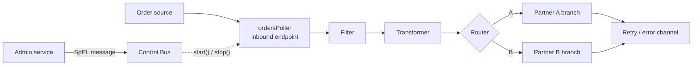
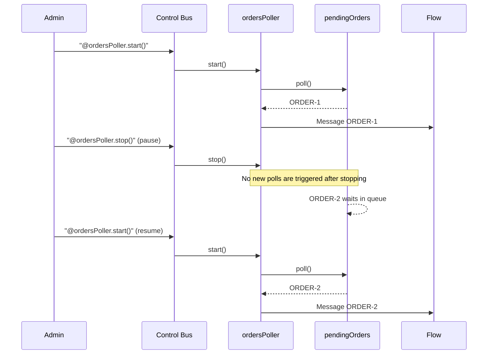

# Starting, Stopping, and Pausing a Flow

## 1. The Flow Control Problem in Spring Integration

An enterprise integration system can run many flows in parallel: receiving orders on a schedule, classifying them with a Router, checking them with a Filter, normalizing data via a Transformer, splitting batches with a Splitter, assembling results with an Aggregator, and handling errors via retry or an error channel. During operations, you sometimes need to **start**, **stop**, or **pause** a message-receiving flow without restarting the entire application.

For example: partner A announces a 15-minute maintenance window. If the poller continues reading orders and forwarding them to the step that calls A's API, retry counts and error messages can spike sharply. We need to prevent **new messages** from entering this branch, wait for maintenance to finish, and then resume receiving the waiting orders.

With Spring Integration, certain **endpoints** implement `Lifecycle` or `SmartLifecycle`, allowing `start()` and `stop()` to be invoked. The **Control Bus** makes it possible to invoke those methods via messages containing SpEL expressions. However, **`pause()` is not a universal lifecycle method for every `IntegrationFlow`**; you must clearly define which part of the business process you intend to pause, where waiting data resides, and how to resume without losing messages.

This lesson belongs to the **Control bus** chapter of the **SPRING_INTEGRATION_PATTERN** module and focuses on safely controlling endpoints when flows include Router, Filter, Transformer, Splitter, Aggregator, Gateway, retry, error channel, and correlation.

After this lesson, you will be able to:

- Choose the right target to `start()` or `stop()`: an inbound endpoint, a polling adapter, or a lifecycle-capable component.
- Execute operations via the Control Bus and inspect `isRunning()`.
- Implement **pause/resume** semantics when the data source can retain a backlog.
- Distinguish stopping new receives from stopping all in-flight processing.
- Test endpoint state and verify that messages resume flowing after a resume.

## 2. Distinguishing Start, Stop, and Pause

| Operation | Operational goal | Common mechanism | Notes |
| --- | --- | --- | --- |
| **Start** | Allow the endpoint to begin receiving or emitting messages | `Lifecycle.start()` | Does not guarantee the source is healthy or messages were processed successfully |
| **Stop** | Prevent the endpoint from continuing new work per its lifecycle | `Lifecycle.stop()` | Work already received earlier may still be processing |
| **Pause** | Temporarily suspend deliberately, with a plan to resume from the pending state | Can **stop an inbound poller** and restart it later; or use an adapter-specific pause feature | Must know where pending data lives and whether it is durable |
| **Resume** | Resume receiving messages after pausing | Usually calls `start()` again or a specific resume API | Must consider backlog, message ordering, and potential duplicates |

**Core point:** `IntegrationFlow` describes the wiring of components; it is not by default a single object that exposes `start()`, `stop()`, and `pause()`. When talking about "stopping a flow," you must first identify **which endpoint needs to stop**. A message-holding channel, Router, or Transformer does not necessarily share the same lifecycle API.

Spring Framework provides:

```java
public interface Lifecycle {
    void start();
    void stop();
    boolean isRunning();
}
```

`SmartLifecycle` extends the lifecycle contract with capabilities such as auto-startup and coordinated startup/shutdown ordering across beans. Depending on the adapter or endpoint, the exact semantics of `stop()` also depend on its implementation and configuration.

In particular, never blindly write an expression like `@someFlow.pause()`: a bean named `someFlow` may not exist, or may not have a `pause()` method. You must use a dedicated pause API supported by the adapter, or build a controlled pause strategy at the system layer.

## 3. Choosing the Right Control Point

A typical order flow:



In the example above:

- **Stopping `ordersPoller`:** halts new receives from the shared source; this may affect both branches A and B if they share the same input.
- **Stopping a dedicated inbound endpoint for partner A:** affects only A if the architecture has separated sources.
- **Changing Router or Filter rules:** suitable if you must keep receiving messages while redirecting or holding back a specific subset. You must have a safe storage location; a Filter that drops messages can cause data loss if misused.
- **Stopping a mid-flow handler:** you must check what happens to upstream messages. A synchronous flow may throw an error due to having no consumer, while an asynchronous channel may accumulate backlog.

To **pause without losing data**, the source must support retaining backlog or checkpoints, or the system must have a durable queue to hold messages. The example below uses an in-memory `BlockingQueue` for easy observation; that structure is only for single-process demonstration, not a durable storage solution for production.

## 4. Sample Configuration: A Startable/Stoppable Polling Endpoint

Use Spring Boot with Spring Integration Java DSL. When using Gradle in a Spring Boot project with version management:

```gradle
dependencies {
    implementation("org.springframework.boot:spring-boot-starter-integration")
    testImplementation("org.springframework.boot:spring-boot-starter-test")
}
```

Create `OrderFlowConfiguration.java`:

```java
package example.controlbus;

import java.time.Duration;
import java.util.concurrent.BlockingQueue;
import java.util.concurrent.LinkedBlockingQueue;

import org.springframework.context.annotation.Bean;
import org.springframework.context.annotation.Configuration;
import org.springframework.integration.channel.DirectChannel;
import org.springframework.integration.channel.QueueChannel;
import org.springframework.integration.config.EnableIntegration;
import org.springframework.integration.core.MessageSource;
import org.springframework.integration.dsl.IntegrationFlow;
import org.springframework.integration.dsl.Pollers;
import org.springframework.messaging.MessageChannel;
import org.springframework.messaging.support.MessageBuilder;

@Configuration
@EnableIntegration
public class OrderFlowConfiguration {

    // Dedicated channel for control commands.
    @Bean
    public MessageChannel controlChannel() {
        return new DirectChannel();
    }

    // Control Bus evaluates the SpEL payload received from controlChannel.
    @Bean
    public IntegrationFlow controlBusFlow() {
        return IntegrationFlow.from("controlChannel")
                .controlBus()
                .get();
    }

    @Bean
    public BlockingQueue<String> pendingOrders() {
        return new LinkedBlockingQueue<>();
    }

    // Simulated source: returns a message if an order exists; otherwise returns null.
    @Bean
    public MessageSource<String> orderSource(
            BlockingQueue<String> pendingOrders) {
        return () -> {
            String orderId = pendingOrders.poll();
            return orderId == null
                    ? null
                    : MessageBuilder.withPayload(orderId).build();
        };
    }

    // Output queue to verify messages that have passed through the flow.
    @Bean
    public QueueChannel processedOrders() {
        return new QueueChannel();
    }

    // Attach lifecycle to the inbound polling endpoint with id ordersPoller.
    @Bean
    public IntegrationFlow ordersFlow(MessageSource<String> orderSource) {
        return IntegrationFlow
                .from(orderSource, endpoint -> endpoint
                        .id("ordersPoller")
                        .autoStartup(false)
                        .poller(Pollers.fixedDelay(Duration.ofMillis(250))))
                .channel("processedOrders")
                .get();
    }
}
```

Explanation of the points that must be kept exact:

| Configuration line | Effect |
| --- | --- |
| `IntegrationFlow.from("controlChannel").controlBus()` | Connects the command-receiving channel to the Control Bus handler |
| `.id("ordersPoller")` | Assigns an ID **to the inbound endpoint** so the Control Bus can look up the bean |
| `.autoStartup(false)` | Endpoint starts in the stopped state; easy to test the start command |
| `Pollers.fixedDelay(...)` | Runs spaced poll intervals while the endpoint is running |
| `MessageSource.receive()` returns `null` | No new message yet; nothing is emitted downstream |
| `QueueChannel processedOrders` | Stores messages successfully routed through the flow in this example |

You can replace `QueueChannel` with a real Filter, Transformer, Router, and business handler. Controlling `ordersPoller` still relies on the input endpoint's bean id.

## 5. Sending Start/Stop Commands with the Control Bus

The Control Bus receives a message whose **payload is a SpEL expression**, for example:

```text
@ordersPoller.start()
@ordersPoller.stop()
@ordersPoller.isRunning()
```

The first two commands alter endpoint state. The third reads state; to receive the `isRunning()` result **via a message**, a properly configured request-reply path is required. `MessageChannel.send()` does not return the expression's boolean value; it only reports message dispatch status.

So the application can send commands in a controlled manner, create the `OrderFlowAdmin.java` service:

```java
package example.controlbus;

import org.springframework.beans.factory.annotation.Qualifier;
import org.springframework.context.ApplicationContext;
import org.springframework.context.Lifecycle;
import org.springframework.messaging.MessageChannel;
import org.springframework.messaging.support.MessageBuilder;
import org.springframework.stereotype.Service;

@Service
public class OrderFlowAdmin {

    private final MessageChannel controlChannel;
    private final ApplicationContext context;

    public OrderFlowAdmin(
            @Qualifier("controlChannel") MessageChannel controlChannel,
            ApplicationContext context) {
        this.controlChannel = controlChannel;
        this.context = context;
    }

    public void start() {
        send("@ordersPoller.start()");
    }

    public void stop() {
        send("@ordersPoller.stop()");
    }

    public boolean isRunning() {
        return context.getBean("ordersPoller", Lifecycle.class)
                .isRunning();
    }

    private void send(String expression) {
        boolean accepted = controlChannel.send(
                MessageBuilder.withPayload(expression).build());
        if (!accepted) {
            throw new IllegalStateException(
                    "Control Bus did not accept the command");
        }
    }
}
```

Why look up `Lifecycle` directly for `isRunning()`? Because the example needs to read the state after sending a command without configuring request-reply for the Control Bus. The command still travels via a **message**; observing state through the bean provides clearer verification.

With `DirectChannel`, message delivery and handler execution typically run synchronously on the sending thread, so expression evaluation errors usually propagate back to the caller. If replaced with an asynchronous channel, `send() == true` does not guarantee the command has executed; dedicated acknowledgment, timeout, and error-handling mechanisms are needed.

Never concatenate SpEL strings from untrusted input. The service above permits only two fixed commands, preventing callers from interacting with unintended beans.

## 6. Implementing Intentional Pause and Resume

### 6.1. Pausing a Polling Inbound Endpoint

With a polling source and a queue holding data, a simple approach is to define:

- **Pause**: invoke `@ordersPoller.stop()` to halt new poll cycles.
- **Resume**: invoke `@ordersPoller.start()` to allow polling to continue.
- **Stop**: can also invoke `stop()` but carries a different operational intent, such as ending a session or preparing for shutdown.

A wrapper class can express this intent:

```java
package example.controlbus;

import org.springframework.stereotype.Service;

@Service
public class OrderFlowPauseService {

    private final OrderFlowAdmin admin;

    public OrderFlowPauseService(OrderFlowAdmin admin) {
        this.admin = admin;
    }

    public void pause() {
        admin.stop();
    }

    public void resume() {
        admin.start();
    }

    public boolean isAcceptingNewOrders() {
        return admin.isRunning();
    }
}
```

Note: in this example `pause()` is a **method of a business service** we defined ourselves. It simply sends a `stop()` command to a polling endpoint; it is not a built-in `pause()` API available on every Spring Integration bean.

When applying this to a specialized adapter (such as a message listener or broker consumer), pausing may require adapter-level support rather than `stop()`. In that case, you must read the adapter's exact contract regarding consumer assignment, offsets/acks, rebalancing, in-flight messages, and resume behavior.

### 6.2. Message Lifecycle Before and After Pause



A pause command **does not automatically wait for all in-flight processing to finish**. If a message has already been polled and is still moving through a Transformer, Retry, or Aggregator, that message can continue processing. Therefore:

1. Stop or pause the source of new receives.
2. Verify the endpoint has transitioned state.
3. Monitor in-flight message counts, unacknowledged messages, queues, and incomplete Aggregator groups.
4. If a safe maintenance point is needed, wait for running tasks to complete or use a custom drain/quiesce mechanism designed for the system.

**Pause is not a rollback.** If a message already caused downstream side effects before pausing, restarting does not reverse those side effects.

### 6.3. Checking Backlog Retention Capability

In the example, `pendingOrders` is a `LinkedBlockingQueue`. While the poller is stopped, data added to the queue remains there within the same process. However, if the JVM stops, an in-memory queue does not guarantee data retention.

In production, depending on the source, you must check:

- Does the broker retain unacknowledged or unread messages?
- Does the file/JDBC source store checkpoints or processed state?
- Are multiple consumers or instances pulling messages concurrently?
- Might the source redeliver messages, causing duplicates upon resume?
- Is there sufficient capacity for the backlog and a catch-up strategy after maintenance?

When zero data loss is required, rely on durable sources or queues, timely acknowledgments, and idempotent handlers.

## 7. Testing Both Lifecycle and Flow Behavior

A test that only checks `isRunning()` tells you the endpoint changed state, but does not prove messages are held back during the pause window. The following example checks both.

Create `OrderFlowLifecycleTest.java` in the test directory:

```java
package example.controlbus;

import static org.assertj.core.api.Assertions.assertThat;

import java.util.concurrent.BlockingQueue;

import org.junit.jupiter.api.Test;
import org.springframework.beans.factory.annotation.Autowired;
import org.springframework.beans.factory.annotation.Qualifier;
import org.springframework.context.ApplicationContext;
import org.springframework.context.Lifecycle;
import org.springframework.integration.channel.QueueChannel;
import org.springframework.messaging.Message;
import org.springframework.messaging.MessageChannel;
import org.springframework.messaging.support.MessageBuilder;
import org.springframework.test.context.junit.jupiter.SpringJUnitConfig;

@SpringJUnitConfig(OrderFlowConfiguration.class)
class OrderFlowLifecycleTest {

    @Autowired
    ApplicationContext context;

    @Autowired
    @Qualifier("controlChannel")
    MessageChannel controlChannel;

    @Autowired
    @Qualifier("processedOrders")
    QueueChannel processedOrders;

    @Autowired
    BlockingQueue<String> pendingOrders;

    private void command(String expression) {
        assertThat(controlChannel.send(
                MessageBuilder.withPayload(expression).build()))
                .isTrue();
    }

    @Test
    void pausesAndResumesPollingWithoutConsumingNewOrders() {
        Lifecycle poller = context.getBean(
                "ordersPoller", Lifecycle.class);

        // autoStartup(false): initially not receiving orders.
        assertThat(poller.isRunning()).isFalse();

        try {
            pendingOrders.offer("ORDER-1");
            assertThat(processedOrders.receive(400)).isNull();

            command("@ordersPoller.start()");
            assertThat(poller.isRunning()).isTrue();

            Message<?> first = processedOrders.receive(2000);
            assertThat(first).isNotNull();
            assertThat(first.getPayload()).isEqualTo("ORDER-1");

            // pause is represented by stopping the inbound poller.
            command("@ordersPoller.stop()");
            assertThat(poller.isRunning()).isFalse();

            pendingOrders.offer("ORDER-2");
            assertThat(processedOrders.receive(600)).isNull();
            assertThat(pendingOrders).contains("ORDER-2");

            // resume via start; backlog is processed afterward.
            command("@ordersPoller.start()");
            assertThat(poller.isRunning()).isTrue();

            Message<?> second = processedOrders.receive(2000);
            assertThat(second).isNotNull();
            assertThat(second.getPayload()).isEqualTo("ORDER-2");
        } finally {
            command("@ordersPoller.stop()");
        }

        assertThat(poller.isRunning()).isFalse();
    }
}
```

This illustrative test makes several explicit assumptions: only one poller reads the queue; no concurrent producer adds messages; the output channel starts empty; the number of waiting messages is small; and the test context is not shared with other tests that mutate its state. In a large test suite, create an isolated context, clean up the queue, and ensure stop is called at the end of the test.

The `receive(400)` and `receive(600)` timeouts are **bounded observation windows**, not absolute proof that a distributed system will never process a late message. When testing real systems, add processing events, latches, or condition-waiting tools (such as Awaitility), along with tests for source errors, retries, and checkpoints.

To verify safe pausing while a task is running, add a test with a slow handler: send the first message, wait until the handler starts, pause the poller, then verify the first message completes per contract and new messages are not picked up until resumed.

## 8. Stopping a Flow with Multiple Endpoints: Scope and Side Effects

An IntegrationFlow can contain many endpoints across multiple branches. Stopping an inbound poller does not mean every component in the flow is stopped.

| Structure | When stopping the inbound poller | What to watch |
| --- | --- | --- |
| `poller → Filter → Transformer → Router` | No more new messages received from the poller after stopping | Messages already in the Router may keep running |
| `splitter → aggregator` | Already-open groups may miss fragments | Correlation keys, timeouts, message store, and group expiration |
| `retry → errorChannel` | Retries for already-received messages may continue | Retry counts, backoff, dead-letter, error flow |
| `QueueChannel → worker` | Stopping the receiver does not automatically stop downstream consumers | Queue backlog and capacity |
| Multiple inbound adapters sharing downstream | Stops only the specified adapter | Other sources can still push into the shared handler |

If you need to pause **an entire branch** after a Router, explicitly design how messages are accepted and where they are stored during the pause window. Never use a Filter to drop messages and call that pausing, because a Filter can permanently discard data if there is no proper discard flow and storage.

Flows registered dynamically via `IntegrationFlowContext` have their own registration and lifecycle management mechanisms. That is a different capability from sending SpEL to an inbound endpoint; do not apply a single command across every topology without knowing which actual endpoints were created.

## 9. Error Handling and Control in Multi-Instance Environments

Common errors:

| Symptom | Possible cause | How to inspect |
| --- | --- | --- |
| SpEL reports `ordersPoller` not found | Wrong id, or id was placed on another channel/flow | Check the bean id of the **inbound endpoint** in the context |
| `start()` ran yet no messages appear | Queue empty, poll interval not reached, source error, handler error | Check the source, `isRunning()`, logs, and metrics |
| `stop()` returned yet logs still show processing | Message entered the pipeline beforehand | Monitor in-flight work and drain duration |
| Resume produces duplicate messages | Source redelivered or checkpoint/ack incomplete | Use idempotency keys and deduplication mechanisms |
| Pause causes uncontrolled backlog growth | Source continues producing data; bounded or unbounded queue | Measure backlog, capacity, drain time, and alerts |
| One instance stopped, another still receives | Each JVM has its own Spring context | Route commands to the right instance and verify per instance |
| Command fails while traversing channel | Handler throws exception or channel has no consumer | Log failure reason, audit the action, and return failed status |

If using `DirectChannel`, exceptions during Control Bus execution typically propagate back to the calling thread. In asynchronous flows, sending a message can succeed before the command executes; you must design reply/ack, timeouts, and error handling via an appropriate error channel.

The Control Bus operates on beans in the **ApplicationContext of the instance that receives the command**. If three instances are running, an `@ordersPoller.stop()` command sent to instance A does not automatically stop the corresponding endpoint on B and C. When cluster-wide pausing is needed, explicitly target each instance, log the command, verify each node's state, and prevent two controllers from issuing conflicting commands.

## 10. Securing Lifecycle Control

Control Bus messages contain SpEL, which can interact with other beans if the command source is permitted to send arbitrary expressions. Therefore, treat the control channel as a **high-privilege administrative interface**.

Principles to enforce:

1. Never wire a public HTTP inbound adapter, a queue containing user messages, or partner data directly to `controlChannel`.
2. Accept only a predefined set of actions, such as `START_ORDERS`, `PAUSE_ORDERS`, `RESUME_ORDERS`; map actions to fixed commands in code.
3. Enforce authentication, authorization, and audit logging: who requested, which endpoint, on which instance, timestamp, before/after state, and any errors.
4. Maintain independent monitoring, covering `isRunning()`, throughput, backlog, errors, retry counts, and pending Aggregator groups.
5. Never treat `send() == true` or a successful HTTP response as proof that the entire pipeline has exited an error state.

If the application restarts, `autoStartup(false)` in the example leaves the poller stopped until started. For systems that need to preserve a "paused" intent across restarts, define a persistent operational state configuration source and recovery procedure instead of relying solely on in-memory state.

## 11. Applied Exercises

**Exercise 1 — Start/stop a source.** Use `orderSource`, `ordersPoller`, and `controlChannel`. Send a start command then a stop command via messages, recording three facts: whether the command was accepted, what `isRunning()` reports, and whether messages flow through `processedOrders`.

**Exercise 2 — Pause/resume and backlog.** Call `pause()` from `OrderFlowPauseService`, add at least five orders to the queue, and verify they wait until resume. Measure backlog drain time and explain the limitations of an in-memory queue.

**Exercise 3 — In-flight work and retry.** Introduce a slow handler that can fail and retry. Pause while the handler is running. Verify the endpoint state is stopped while existing work remains subject to the active retry policy; design a graceful drain mechanism for maintenance windows.

**Exercise 4 — Splitter/Aggregator.** Design a flow that receives a batch, splits it into multiple parts, and aggregates by correlation key. Suppose you pause before all parts arrive; specify the message store, timeout, and resume conditions so waiting groups are not abandoned.

**Exercise 5 — Multiple sources, multiple instances.** Have two separate pollers for A/B and two application replicas. Describe how to pause only A across both replicas while B continues processing normally. State clearly which signals must be collected to verify this.

## 12. Self-Check Questions

1. Why does `@ordersPoller.stop()` not mean "the entire IntegrationFlow has stopped and no tasks are still running"?
2. What is the difference between `pause()` in `OrderFlowPauseService` and a dedicated pause API supported by an adapter?
3. Why must you know where the backlog and checkpoints/acks reside in order to resume without losing messages?
4. When Filter, Router, and Aggregator remain active, which messages might still be in flight after stopping an inbound poller?
5. How do you test lifecycle state separately from business data impact?
6. When multiple instances are running, why is a single Control Bus command insufficient to confirm the entire cluster is paused?

The most important capability is identifying **lifecycle scope**, deliberately designing **pause/resume semantics** according to the source type, and verifying results via both endpoint state and message traffic. That way, operating Spring Integration flows stays flexible while keeping retry, error handling, correlation, and risks of data loss or duplication under control.
