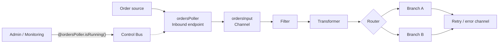
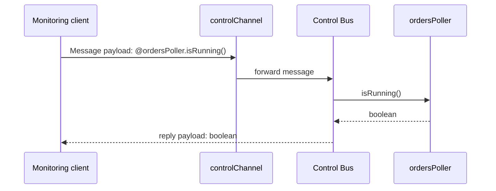
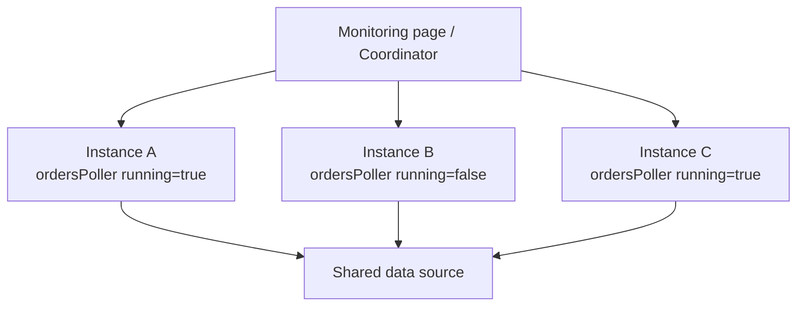

# Reading Endpoint Status

## 1. Why Read Endpoint Status?

In a system using **Enterprise Integration Patterns (EIP)**, a single Spring Integration application can contain multiple message sources, Router branches, Filters, Transformers, Splitters, Aggregators, Gateways, and retry or error channel mechanisms. During maintenance, operations, or testing, common questions arise:

- Has the poller fetching orders from the external source **been started** yet?
- After sending a stop command through the Control Bus, does the endpoint **report stopped** yet?
- When restarting an endpoint, how do you distinguish its **running** state from **actually receiving and processing messages successfully**?
- Across multiple instances of the application, which instance does the status you just read belong to?

The **Control Bus** allows sending a message containing a **Spring Expression Language (SpEL)** expression to invoke or read a property/method of a bean, such as `@ordersPoller.isRunning()`. When executing within the same Spring `ApplicationContext`, the application can also look up the endpoint bean and call `Lifecycle.isRunning()` directly.

This lesson belongs to the **Control bus** chapter of the **SPRING_INTEGRATION_PATTERN** module. Its goal is to read endpoint status accurately, combining message and error observation to build loosely coupled, extensible, and testable integration flows.

After completing this lesson, you will be able to:

1. Identify the exact **endpoint id** and bean to inspect.
2. Read status using `Lifecycle.isRunning()` or by sending a query through the Control Bus.
3. Distinguish lifecycle state from connection health, throughput, and backlog.
4. Test state transitions after `start()` and `stop()` commands.
5. Design meaningful status checks when the system has multiple endpoints, branches, and replicas.

## 2. Endpoint, Flow, and Channel: Query the Right Object

Suppose an order-processing flow has this structure:



Three concepts that are very easy to confuse:

| Object | Function | Should you call `isRunning()`? |
| --- | --- | --- |
| **Inbound endpoint** `ordersPoller` | Receives or actively polls data and creates messages | **Yes**, when the bean implements `Lifecycle`/`SmartLifecycle` |
| **Channel** `ordersInput` | Transfers messages between components | Do not assume a channel has lifecycle state |
| **IntegrationFlow** `ordersFlow` | Declares how endpoints and channels connect | Do not assume a flow bean is a single endpoint with `isRunning()` |

The name `ordersPoller` must be the **id of the actual endpoint**. Naming a flow or channel does not make that bean the right inspection target. In Java DSL, for a polling inbound endpoint, you can assign the id in the configuration `.from(source, endpoint -> endpoint.id("ordersPoller")...)`.

At the Spring Framework level, the base API is:

```java
public interface Lifecycle {
    void start();
    void stop();
    boolean isRunning();
}
```

Some endpoints also implement `SmartLifecycle`. This interface provides additional lifecycle information such as `isAutoStartup()` and `getPhase()`, yet **running** remains a bean state signal, not a complete health check result.

**Note:** not every Spring Integration component supports `Lifecycle`. If looking up a bean by name and type `Lifecycle.class` fails, first verify the bean id and endpoint type; do not attempt to call `isRunning()` on a message channel or handler that lacks this API.

## 3. Two Ways to Read Status

### 3.1. Reading Directly from the Spring Context

When administrative logic runs in the same instance as the endpoint, the straightforward way is to look up the bean by name and interface:

```java
Lifecycle endpoint = applicationContext.getBean(
        "ordersPoller", Lifecycle.class);

boolean running = endpoint.isRunning();
```

This approach is useful for tests, internal admin services, or a dedicated monitoring endpoint. It avoids configuring request-reply via the Control Bus for a simple query. However, it introduces a dependency on `ApplicationContext` and can only read beans **belonging to the context that the code has access to**.

### 3.2. Reading via a Message Sent to the Control Bus

The Control Bus receives a message whose payload is a SpEL expression, for example:

```text
@ordersPoller.isRunning()
```

Path of a query with a reply:



To receive the return value, the sender must use **request-reply** and have an appropriate reply-receiving path. `MessageChannel.send(Message<?>)` only returns a `boolean` indicating the result of **sending the message**, not the value of the `isRunning()` expression.

For example:

```java
// The accepted value indicates command dispatch to the channel.
boolean accepted = controlChannel.send(
        MessageBuilder.withPayload("@ordersPoller.isRunning()").build());

// Do not interpret accepted as the running state of ordersPoller.
```

If you need to receive the result directly from the Control Bus, use a `MessagingTemplate` or a messaging gateway configured for request-reply. The example section below illustrates such a query and clearly distinguishes it from calling `Lifecycle` directly.

## 4. Java DSL Example with a Controllable Endpoint

We will build a simple Spring Integration application: an in-memory queue holds order IDs; the polling endpoint `ordersPoller` forwards order IDs to `processedOrders`. Initially the poller is stopped, then commands are sent via the Control Bus to inspect status before and after starting it.

The example assumes the Spring Boot project already has compatible dependency and version management:

```gradle
dependencies {
    implementation("org.springframework.boot:spring-boot-starter-integration")
    testImplementation("org.springframework.boot:spring-boot-starter-test")
}
```

Contents of `EndpointStatusConfiguration.java`:

```java
package example.endpointstatus;

import java.time.Duration;
import java.util.concurrent.BlockingQueue;
import java.util.concurrent.LinkedBlockingQueue;

import org.springframework.context.annotation.Bean;
import org.springframework.context.annotation.Configuration;
import org.springframework.integration.channel.DirectChannel;
import org.springframework.integration.channel.QueueChannel;
import org.springframework.integration.config.EnableIntegration;
import org.springframework.integration.core.MessageSource;
import org.springframework.integration.dsl.IntegrationFlow;
import org.springframework.integration.dsl.Pollers;
import org.springframework.messaging.MessageChannel;
import org.springframework.messaging.support.MessageBuilder;

@Configuration
@EnableIntegration
public class EndpointStatusConfiguration {

    // Channel dedicated to administrative commands and queries.
    @Bean
    public MessageChannel controlChannel() {
        return new DirectChannel();
    }

    // Control Bus evaluates the SpEL expression inside the message.
    @Bean
    public IntegrationFlow controlBusFlow() {
        return IntegrationFlow.from("controlChannel")
                .controlBus()
                .get();
    }

    @Bean
    public BlockingQueue<String> pendingOrders() {
        return new LinkedBlockingQueue<>();
    }

    @Bean
    public MessageSource<String> ordersSource(
            BlockingQueue<String> pendingOrders) {
        return () -> {
            String orderId = pendingOrders.poll();
            return orderId == null
                    ? null
                    : MessageBuilder.withPayload(orderId).build();
        };
    }

    @Bean
    public QueueChannel processedOrders() {
        return new QueueChannel();
    }

    @Bean
    public IntegrationFlow ordersFlow(MessageSource<String> ordersSource) {
        return IntegrationFlow
                .from(ordersSource, endpoint -> endpoint
                        .id("ordersPoller")
                        .autoStartup(false)
                        .poller(Pollers.fixedDelay(Duration.ofMillis(300))))
                .channel("processedOrders")
                .get();
    }
}
```

Explanation of the settings that determine the status-reading results:

- `.id("ordersPoller")` names the polling endpoint bean. The Control Bus uses this exact name when calling `@ordersPoller.isRunning()`.
- `.autoStartup(false)` keeps the poller from running automatically after the context starts, so an initial `false` state can be observed.
- `.poller(...)` declares the message-receiving schedule; new polls occur when the endpoint is running.
- `controlChannel` is a `DirectChannel`: it delivers messages to the Control Bus in the synchronous calling context in this example.
- `processedOrders` holds messages that entered the flow for testing purposes. It is **not** the source of truth for the poller's status.

In production, the data source could be JDBC, file, FTP, or another system. The semantics of `start/stop`, durability, and message replay must be determined according to the actual adapter and source.

## 5. Status-Reading Service: Local and via Control Bus

Create `EndpointStatusService.java`. This class provides two ways to read status and two fixed control operations:

```java
package example.endpointstatus;

import org.springframework.beans.factory.annotation.Qualifier;
import org.springframework.context.ApplicationContext;
import org.springframework.context.Lifecycle;
import org.springframework.messaging.Message;
import org.springframework.messaging.MessageChannel;
import org.springframework.messaging.core.GenericMessagingTemplate;
import org.springframework.messaging.support.MessageBuilder;

public class EndpointStatusService {

    private final ApplicationContext context;
    private final MessageChannel controlChannel;

    public EndpointStatusService(
            ApplicationContext context,
            @Qualifier("controlChannel") MessageChannel controlChannel) {
        this.context = context;
        this.controlChannel = controlChannel;
    }

    // Option 1: read the endpoint bean directly from the current ApplicationContext.
    public boolean isRunningLocally() {
        Lifecycle endpoint = context.getBean(
                "ordersPoller", Lifecycle.class);
        return endpoint.isRunning();
    }

    // Option 2: send a query expression to the Control Bus and read the reply.
    public boolean isRunningViaControlBus() {
        GenericMessagingTemplate template = new GenericMessagingTemplate();
        template.setReceiveTimeout(3_000);

        Message<?> reply = template.sendAndReceive(
                controlChannel,
                MessageBuilder
                        .withPayload("@ordersPoller.isRunning()")
                        .build());

        if (reply == null) {
            throw new IllegalStateException(
                    "No reply from Control Bus within timeout");
        }
        if (!(reply.getPayload() instanceof Boolean)) {
            throw new IllegalStateException(
                    "Unexpected status reply payload: "
                            + reply.getPayload().getClass().getName());
        }
        return (Boolean) reply.getPayload();
    }

    public void start() {
        send("@ordersPoller.start()");
    }

    public void stop() {
        send("@ordersPoller.stop()");
    }

    private void send(String expression) {
        boolean accepted = controlChannel.send(
                MessageBuilder.withPayload(expression).build());

        if (!accepted) {
            throw new IllegalStateException(
                    "Lifecycle command was not accepted");
        }
    }
}
```

**Distinguishing the results:** `isRunningLocally()` receives a boolean directly from the bean, whereas `isRunningViaControlBus()` receives a **reply message** carrying a boolean payload. The `send()` method used for `start/stop` only checks whether the message was accepted on the channel.

If the actual Control Bus configuration does not send a reply, or the endpoint lacks `isRunning()`, the request-reply function must report an explicit error. Never interpret `null` or a timeout as `false`, because `false` means the endpoint actually answered that it is stopped.

To register the service as a Spring bean when injection is needed, add this to `EndpointStatusConfiguration`:

```java
@Bean
public EndpointStatusService endpointStatusService(
        org.springframework.context.ApplicationContext context,
        @org.springframework.beans.factory.annotation.Qualifier(
                "controlChannel") MessageChannel controlChannel) {
    return new EndpointStatusService(context, controlChannel);
}
```

The `@Bean` method above is placed **inside** the `EndpointStatusConfiguration` class. It uses the `ApplicationContext` and `controlChannel` of the running instance itself.

## 6. Demonstrating Queries Before and After Start/Stop

With an injected `EndpointStatusService statusService` and `BlockingQueue<String> pendingOrders`, the sample operation sequence is:

```java
// autoStartup(false): the poller has not started automatically.
System.out.println(statusService.isRunningLocally());       // false
System.out.println(statusService.isRunningViaControlBus()); // false

pendingOrders.offer("ORDER-101");

// Control Bus invokes Lifecycle.start() on the endpoint.
statusService.start();
System.out.println(statusService.isRunningLocally());       // true
System.out.println(statusService.isRunningViaControlBus()); // true

// After the next poll, ORDER-101 arrives at processedOrders.

statusService.stop();
System.out.println(statusService.isRunningLocally());       // false
System.out.println(statusService.isRunningViaControlBus()); // false
```

This is a sequence of operations **on the same instance**. When `isRunning()` returns `true`, it does not yet mean orders have been received. The queue could be empty, the poller could be waiting for the next interval, or downstream could still be failing. Conversely, when the status is `false`, a message fetched before stopping may still be in progress.

Status is also **point-in-time**: immediately after reading it, another administrative thread might call start or stop. When confirming a reliable change, bind the status to its observation timestamp, command outcome, instance id, and flow metrics.

## 7. Lifecycle Status Is Not a Health Check

Three signal groups should be observed separately:

| Group | Examples | Question answered |
| --- | --- | --- |
| **Lifecycle** | `isRunning()`, `isAutoStartup()`, `getPhase()` | Does the endpoint report running? How is it configured for auto-startup and lifecycle ordering? |
| **Source / connectivity** | Connection to broker/DB, last successful receive, timeouts | Can data actually be fetched from the source? |
| **Business flow** | Message counts through Filter/Router, backlog, retries, error channel, correlation groups | Are messages passing through and being processed as expected? |

For example, `ordersPoller.isRunning() == true` while the JDBC source has an authentication failure. The poller can still execute on schedule and fail repeatedly; that is not a sign that the application is operating properly.

Similarly, `isRunning() == false` is the expected outcome when operations deliberately pause a source for maintenance. If a health endpoint marks the entire application "unhealthy" simply because of an intentional stopped state, the monitoring system can trigger false alarms.

A practical monitoring model can expose dedicated fields:

```json
{
  "instanceId": "orders-service-1",
  "endpointId": "ordersPoller",
  "running": true,
  "desiredState": "RUNNING",
  "lastSuccessfulMessageAt": "2026-11-21T08:00:00Z",
  "pendingMessageCount": 12,
  "errorCountLast5Minutes": 0,
  "observedAt": "2026-11-21T08:00:05Z"
}
```

This is merely an **example monitoring payload structure built by the application itself**. Fields such as `desiredState`, `lastSuccessfulMessageAt`, `pendingMessageCount`, and `errorCountLast5Minutes` do not appear automatically by calling `isRunning()`; they must come from the operational configuration store, counters, message stores, metrics, or corresponding logs.

When there are multiple processing branches, gather statistics per specific endpoint or branch. For instance, a Filter dropping messages according to rules can still be valid behavior; and a Router branch receiving no messages while running might be due to routing rules rather than a lifecycle fault.

## 8. Testing: Reading Status and Verifying Real Data

Use `@SpringJUnitConfig` with the configuration from section 4. This is a focused test for the Control Bus and bean state without needing to boot a full web application.

Create `EndpointStatusTest.java`:

```java
package example.endpointstatus;

import static org.assertj.core.api.Assertions.assertThat;

import java.util.concurrent.BlockingQueue;

import org.junit.jupiter.api.Test;
import org.springframework.beans.factory.annotation.Autowired;
import org.springframework.context.ApplicationContext;
import org.springframework.context.Lifecycle;
import org.springframework.integration.channel.QueueChannel;
import org.springframework.messaging.Message;
import org.springframework.test.context.junit.jupiter.SpringJUnitConfig;

@SpringJUnitConfig(EndpointStatusConfiguration.class)
class EndpointStatusTest {

    @Autowired
    ApplicationContext context;

    @Autowired
    EndpointStatusService statusService;

    @Autowired
    BlockingQueue<String> pendingOrders;

    @Autowired
    QueueChannel processedOrders;

    @Test
    void readsEndpointStatusBeforeAndAfterControlCommands() {
        Lifecycle poller = context.getBean(
                "ordersPoller", Lifecycle.class);

        assertThat(poller.isRunning()).isFalse();
        assertThat(statusService.isRunningLocally()).isFalse();
        assertThat(statusService.isRunningViaControlBus()).isFalse();

        try {
            statusService.start();

            assertThat(poller.isRunning()).isTrue();
            assertThat(statusService.isRunningLocally()).isTrue();
            assertThat(statusService.isRunningViaControlBus()).isTrue();

            // Running does not prove a message has already arrived.
            pendingOrders.offer("ORDER-201");
            Message<?> processed = processedOrders.receive(3_000);

            assertThat(processed).isNotNull();
            assertThat(processed.getPayload()).isEqualTo("ORDER-201");
        } finally {
            statusService.stop();
        }

        assertThat(poller.isRunning()).isFalse();
        assertThat(statusService.isRunningViaControlBus()).isFalse();
    }
}
```

The test has two layers of verification:

1. **Lifecycle state**: the same bean returns `false → true → false` after being controlled via the Control Bus.
2. **Business message**: an order is placed in the queue and appears in `processedOrders` while the poller is running.

`QueueChannel.receive(3_000)` waits at most 3 seconds; this is a test bound, not a production throughput guarantee. If the test fails due to timeout, check the poll schedule, data source, and handler rather than simply increasing the wait timeout. The test assumes an isolated test context, empty input and output queues initially, and no interfering external threads.

Additional test variants you should include:

- Send a SpEL query to a **non-existent** bean id in a test environment and verify an error is clearly reported rather than inferring `false`.
- Stop the poller and add more messages to the source; verify no **new poll** happens within an observation window, then start it and verify the backlog is read.
- If Retry/Aggregator is present, separate in-flight message checks from the `isRunning()` result.

## 9. Reading Status from Multiple Instances and Multiple Endpoints

In a system with multiple replicas, each instance usually has its own `ApplicationContext`:



When calling `@ordersPoller.isRunning()` through the Control Bus in instance B, a `false` value only tells you **the endpoint on B** is stopped. That does not mean the entire cluster has stopped pulling orders: A and C may still keep running.

To answer "has this source stopped across all replicas?", the coordinator needs to query each instance, tag responses with instance IDs, handle timeouts or unreachable instances, and then aggregate the results. For example:

| Instance | Endpoint status | Local conclusion |
| --- | --- | --- |
| A | `true` | Poller is running on A |
| B | `false` | Poller is stopped on B |
| C | No response received | **Unknown**, must not be treated as stopped |

If you need to enforce that only one replica is allowed to poll, use a coordination/locking mechanism or consumer assignment appropriate to the data source. Single-node lifecycle status does not enforce distributed job exclusivity.

## 10. Safe Practices When Exposing Status

The Control Bus evaluates SpEL expressions that can access application beans. Therefore, never use a public API that takes a user-supplied payload and passes it verbatim to `controlChannel`, even if the goal is merely "viewing status."

A safer administrative interface:

1. Allow only authenticated and authorized users to query the status of **endpoints on an allowlist**.
2. For each permitted endpoint, the service builds a **fixed expression**, such as `@ordersPoller.isRunning()`, or directly looks up the `Lifecycle` bean.
3. Log who queried which status, on which instance, and when; avoid arbitrarily leaking bean structures or internal details externally.
4. Distinguish **query errors**, **missing replies**, **non-existent beans**, and **running=false**. Never collapse all of them into stopped.
5. Maintain explicit timeouts and monitor the control path as well. When the Control Bus is asynchronous or the reply channel is misconfigured, displayed data can become stale.

When state-changing operations also exist, include post-command verification to avoid displaying "started" solely because the `start()` message was sent successfully.

## 11. Common Errors and Fixes

| Symptom | Possible cause | How to handle |
| --- | --- | --- |
| `NoSuchBeanDefinitionException` when reading `ordersPoller` | Wrong endpoint id or wrong context | Check `.id("ordersPoller")` and the active context |
| Cannot retrieve bean of type `Lifecycle` | Queried bean is a channel/handler without lifecycle support | Identify the actual inbound endpoint and adapter type |
| `send() == true` yet UI shows running | Mistook the boolean from send for the `isRunning()` result | Use request-reply or call `Lifecycle.isRunning()` directly |
| Control Bus query receives no reply | Request-reply not properly configured, processing error, or timeout | Check reply channel, handler, exceptions, and timeout |
| `isRunning() == true` yet no data arrives | Source empty, connection error, poll interval not reached, downstream branch failing | Inspect source, logs, metrics, error channel, and backlog |
| `isRunning() == false` yet messages are still processed | Messages were already received before the stop command | Monitor in-flight counts, Retry, and pending Aggregators |
| Status differs across nodes | Each replica has its own context/lifecycle | Query each instance and display alongside its instance ID |
| Status changes immediately after reading | Concurrent admin command or restart | Display `observedAt` and desired state if available |

## 12. Hands-On Exercises

**Exercise 1 — Read using both mechanisms.** Run the example configuration, calling `isRunningLocally()` and `isRunningViaControlBus()` before and after start/stop commands. Explain why `MessageChannel.send()` cannot substitute for this read.

**Exercise 2 — Distinguish running from healthy.** Let the endpoint run while keeping the queue empty; record lifecycle status and processed message count. Then insert a message into the queue and check which metrics change.

**Exercise 3 — Query the wrong object.** Try reading status of a channel bean and a non-existent endpoint in a test. Categorize the errors so the admin UI does not mistakenly show stopped.

**Exercise 4 — Splitter/Aggregator.** Design a measurement beyond `isRunning()` to tell how many correlation groups remain incomplete after the receiver has stopped. Describe how to monitor timeouts, retries, and the message store.

**Exercise 5 — Multiple replicas.** Suppose three instances return `true`, `false`, and timeout. Design a per-instance status JSON payload and an aggregation rule for "is the whole cluster stopped?" that avoids drawing false conclusions when a node does not respond.

## 13. Self-Check Questions

1. Why must you look up the exact endpoint bean instead of just using the `IntegrationFlow` name?
2. What does `Lifecycle.isRunning()` answer and what does it not answer?
3. What is the difference between `controlChannel.send(...)` and request-reply with `@ordersPoller.isRunning()`?
4. If `isRunning()` is `true` but the error channel receives many errors, what should the operational conclusion be?
5. If `isRunning()` is `false`, do messages that already passed a Splitter or are waiting in an Aggregator disappear?
6. Why is one instance's status insufficient to describe the state of the whole cluster?

**Key takeaway:** Reading endpoint status means reading the **lifecycle of the right bean at the right point in time and on the right instance**. Combining `isRunning()` queries with metrics, backlog, retry/error tracking, and correlation visibility helps you understand whether the entire Spring Integration flow is operating as intended.
