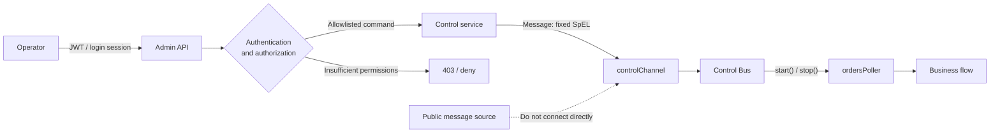

# Control Bus Access Control

## 1. Why Does the Control Bus Need Access Control?

In the **SPRING_INTEGRATION_PATTERN** module, Spring Integration is used to implement Enterprise Integration Patterns (EIP): Router, Filter, Transformer, Splitter, Aggregator, Gateway, retry, error channel, and correlation. Flows exchange data via messages to reduce coupling between components. However, in a live system, operators also need to send **control messages** such as starting or stopping polling endpoints, inspecting status, and coordinating maintenance.

The **Control Bus** accomplishes this by processing a message whose payload is a **Spring Expression Language (SpEL)** expression. For example:

```text
@ordersPoller.start()
@ordersPoller.stop()
@ordersPoller.isRunning()
```

These commands are evaluated inside the Spring application context, so permission to send messages to the Control Bus must be treated as a **sensitive administrative privilege**. If an untrusted source is allowed to submit arbitrary SpEL expressions, it can attempt to access beans outside the intended scope and alter application state.

This lesson belongs to the **Control bus** chapter and focuses on answering: **who is allowed to request which operation on which endpoint, through which channel, and how can we confirm the operation actually occurred?**

After this lesson, you will be able to:

1. Analyze trust boundaries across the admin API, control channel, Control Bus, and endpoint.
2. Build an allowed command list (**allowlist**) and separate read/query permissions from lifecycle-changing permissions.
3. Protect calls with Spring Security, keep SpEL expressions fixed on the application side, and test permissions.
4. Design audit logging, outcome tracking, and multi-instance handling.
5. Avoid security flaws related to arbitrary expressions, user-supplied bean names, and misinterpreted message send results.

## 2. What Capabilities Does the Control Bus Have?

Suppose a system has an endpoint receiving orders from partner A, an endpoint receiving payments from partner B, and a notification-sending branch. When the system needs to pause accepting orders, an operator can send:

```text
@ordersPoller.stop()
```

The Control Bus looks up the `ordersPoller` bean in the `ApplicationContext` where it runs and attempts to invoke the `stop()` method. When that bean supports `Lifecycle`, the operation can change the polling endpoint's state.

Unlike a message containing an order or a business event, **a Control Bus payload is an executed expression**. Therefore, it must be treated as an interface capable of invoking methods on beans, not as a regular data channel.



Here, authorization decisions must occur **before the message reaches the Control Bus**. Simply isolating a separate `DirectChannel` is not enough: a channel does not turn itself into a role-based authorization engine. Nor does Spring Integration evaluating SpEL mean the expression has been checked against the caller's business privileges.

### Boundaries to Maintain

| Boundary | What to check | Risk if ignored |
| --- | --- | --- |
| User → API | Identity, read/control permissions, allowed endpoints | Unauthorized person stops a critical source |
| API → admin service | Command belongs to a predefined set; valid input data | User input gets concatenated into a SpEL expression |
| Service → control channel | Only trusted command issuers may send | A business flow forwards untrusted content to the Control Bus |
| Control Bus → endpoint bean | Valid bean id, method supports lifecycle | Affecting the wrong bean or invoking an unintended method |
| Command → operational state | Change verification and audit log | Dispatch succeeds while endpoint remains errored or on the wrong instance |

**Core principle:** users only select **approved business actions**; the application decides **which SpEL expressions** are permitted to be sent.

## 3. Authorization by Operation and Endpoint

Not everyone who can view status should be allowed to stop an endpoint. A simple policy for a multi-team operations system might be:

| Example role | View status | Start/stop orders source | Start/stop payments source | Grant permissions |
| --- | --- | --- | --- | --- |
| Observer | Yes | No | No | No |
| Order operator | Yes | Yes | No | No |
| Payment operator | Yes | No | Yes | No |
| Platform administrator | Yes | Per governance policy | Per governance policy | Via separate workflow |

This table is an **illustrative policy**, not a built-in role hierarchy provided by Spring Integration. When implementing, map the Identity Provider's privileges to the authorities your application actually checks.

Permissions can be separated into:

- `integration.control.read` — read status of permitted endpoints.
- `integration.orders.write` — start/stop the order-receiving endpoint.
- `integration.payments.write` — start/stop the payment endpoint.

When using Spring Security's JWT Resource Server with default scope conversion, scopes are typically mapped to authorities prefixed with `SCOPE_`; for instance, the scope `integration.orders.write` becomes `SCOPE_integration.orders.write`. For tokens using different claims or custom mappings, configure the corresponding converter.

Two key principles:

1. **Default deny:** actions or endpoints not listed in the policy are rejected.
2. **Least privilege:** read permission does not grant expression execution; order control permission does not implicitly allow stopping payments.

If permissions depend on organization, environment, tenant, or deployment region, check those attributes alongside roles/authorities. A generic "can control" scope is insufficient to isolate endpoints per tenant.

## 4. Sample Spring Integration Configuration with a Dedicated Control Channel

To illustrate, build an order polling flow with a stable ID `ordersPoller`. The endpoint is initially stopped; control operations pass only through an internal channel.

For a Spring Boot project with managed dependency versions:

```gradle
dependencies {
    implementation("org.springframework.boot:spring-boot-starter-integration")
    implementation("org.springframework.boot:spring-boot-starter-security")
    implementation("org.springframework.boot:spring-boot-starter-web")
    implementation("org.springframework.boot:spring-boot-starter-validation")
    testImplementation("org.springframework.boot:spring-boot-starter-test")
    testImplementation("org.springframework.security:spring-security-test")
}
```

Create configuration `ControlBusAccessConfiguration.java`:

```java
package example.controlbus;

import java.time.Duration;
import java.util.concurrent.BlockingQueue;
import java.util.concurrent.LinkedBlockingQueue;

import org.springframework.context.annotation.Bean;
import org.springframework.context.annotation.Configuration;
import org.springframework.integration.channel.DirectChannel;
import org.springframework.integration.config.EnableIntegration;
import org.springframework.integration.core.MessageSource;
import org.springframework.integration.dsl.IntegrationFlow;
import org.springframework.integration.dsl.Pollers;
import org.springframework.messaging.MessageChannel;
import org.springframework.messaging.support.MessageBuilder;
import org.springframework.security.config.annotation.method.configuration.EnableMethodSecurity;

@Configuration
@EnableIntegration
@EnableMethodSecurity
public class ControlBusAccessConfiguration {

    @Bean
    public MessageChannel controlChannel() {
        return new DirectChannel();
    }

    @Bean
    public IntegrationFlow controlBusFlow() {
        return IntegrationFlow.from("controlChannel")
                .controlBus()
                .get();
    }

    @Bean
    public BlockingQueue<String> pendingOrders() {
        return new LinkedBlockingQueue<>();
    }

    @Bean
    public MessageSource<String> orderSource(
            BlockingQueue<String> pendingOrders) {
        return () -> {
            String id = pendingOrders.poll();
            return id == null
                    ? null
                    : MessageBuilder.withPayload(id).build();
        };
    }

    @Bean
    public IntegrationFlow ordersFlow(MessageSource<String> orderSource) {
        return IntegrationFlow
                .from(orderSource, endpoint -> endpoint
                        .id("ordersPoller")
                        .autoStartup(false)
                        .poller(Pollers.fixedDelay(Duration.ofSeconds(1))))
                .handle(message -> System.out.println(
                        "Processed order: " + message.getPayload()))
                .get();
    }
}
```

Details to distinguish:

- `controlChannel` is the command-receiving channel, **not** the endpoint to be controlled.
- `.controlBus()` causes messages sent to that channel to be processed as control expressions.
- `ordersPoller` is the ID of the **polling inbound endpoint**, so `@ordersPoller.start()` or `@ordersPoller.stop()` targets the right component.
- `.autoStartup(false)` prevents polling before a start command is issued; this is an example setting, not a mandatory policy for every system.
- `@EnableMethodSecurity` enables annotations such as `@PreAuthorize` on Spring bean methods invoked through a proxy.

**Note on trust boundaries:** even though the code above declares a dedicated channel, any component within the same application that can obtain the `controlChannel` bean could still attempt to send messages to it. Protection at the service/API layer must be combined with controlling which message producers are wired, application configuration, and internal access rights.

## 5. Do Not Accept Free-Form SpEL: Create a Fixed Command Set

An external API should never accept a body like:

```json
{
  "expression": "@ordersPoller.stop()"
}
```

Because an "expression" contract lets the caller decide what gets evaluated, it is very difficult to guarantee it targets only valid objects. Nor should you concatenate strings from input:

```java
// Never apply this to user-supplied data:
String expression = "@" + beanName + "." + methodName + "()";
```

Instead, define **an operation enum** and map each choice to a fixed expression.

Create `ControlCommand.java`:

```java
package example.controlbus;

public enum ControlCommand {
    START_ORDERS,
    STOP_ORDERS
}
```

Create the service `SecureControlBusService.java`:

```java
package example.controlbus;

import java.util.Objects;

import org.springframework.beans.factory.annotation.Qualifier;
import org.springframework.context.ApplicationContext;
import org.springframework.context.Lifecycle;
import org.springframework.messaging.MessageChannel;
import org.springframework.messaging.support.MessageBuilder;
import org.springframework.security.access.prepost.PreAuthorize;
import org.springframework.stereotype.Service;

@Service
public class SecureControlBusService {

    private final MessageChannel controlChannel;
    private final ApplicationContext context;

    public SecureControlBusService(
            @Qualifier("controlChannel") MessageChannel controlChannel,
            ApplicationContext context) {
        this.controlChannel = controlChannel;
        this.context = context;
    }

    @PreAuthorize("hasAuthority('SCOPE_integration.orders.write')")
    public void execute(ControlCommand command) {
        Objects.requireNonNull(command, "command");

        // All expressions are controlled here; never concatenated from input.
        String expression = switch (command) {
            case START_ORDERS -> "@ordersPoller.start()";
            case STOP_ORDERS  -> "@ordersPoller.stop()";
        };

        boolean accepted = controlChannel.send(
                MessageBuilder.withPayload(expression).build());

        if (!accepted) {
            throw new IllegalStateException(
                    "Control channel rejected the command");
        }
    }

    @PreAuthorize(
        "hasAnyAuthority('SCOPE_integration.control.read', "
        + "'SCOPE_integration.orders.write')")
    public boolean isOrdersRunning() {
        Lifecycle endpoint =
                context.getBean("ordersPoller", Lifecycle.class);
        return endpoint.isRunning();
    }
}
```

In this design:

1. Callers can only pick `START_ORDERS` or `STOP_ORDERS`.
2. `@PreAuthorize` blocks callers lacking the corresponding authority before entering the method.
3. The bean id and method name in SpEL are fixed server-side.
4. Status querying has its own permission, while also remaining accessible to operators.
5. The service throws an error if the channel rejects the command; operators still need to re-read status and verify actual impact.

Within the same Spring context, calling `Lifecycle.isRunning()` directly is a concise way to read status. If querying via the Control Bus is needed, `@ordersPoller.isRunning()` can be sent using request-reply, while still protecting permission to issue the expression and distinguishing the **boolean reply** from the boolean returned by `MessageChannel.send()`.

**Boundaries of `@PreAuthorize`:** the annotation only takes effect when Spring Security method security is enabled and the method is called through a Spring proxy. Self-invocation via `this.execute(...)` inside the bean itself can bypass the interceptor. Moreover, components that can send directly to `controlChannel` will not automatically pass through `SecureControlBusService`. Therefore, ensure all untrusted inputs pass through the authorization checkpoint, and restrict direct access to the channel to trusted code.

## 6. Securing the Administrative API

A controller can expose a narrow business contract instead of accepting raw SpEL.

```java
package example.controlbus;

import jakarta.validation.Valid;
import jakarta.validation.constraints.NotNull;

import org.springframework.http.HttpStatus;
import org.springframework.web.bind.annotation.GetMapping;
import org.springframework.web.bind.annotation.PostMapping;
import org.springframework.web.bind.annotation.RequestBody;
import org.springframework.web.bind.annotation.RequestMapping;
import org.springframework.web.bind.annotation.ResponseStatus;
import org.springframework.web.bind.annotation.RestController;

@RestController
@RequestMapping("/internal/integration")
public class IntegrationControlController {

    private final SecureControlBusService service;

    public IntegrationControlController(SecureControlBusService service) {
        this.service = service;
    }

    public record CommandRequest(@NotNull ControlCommand command) {}

    public record StatusResponse(String endpoint, boolean running) {}

    @PostMapping("/control")
    @ResponseStatus(HttpStatus.NO_CONTENT)
    public void execute(@Valid @RequestBody CommandRequest request) {
        service.execute(request.command());
    }

    @GetMapping("/endpoints/orders/status")
    public StatusResponse status() {
        return new StatusResponse(
                "ordersPoller", service.isOrdersRunning());
    }
}
```

Example valid request:

```http
POST /internal/integration/control
Content-Type: application/json
Authorization: Bearer <access-token>

{"command":"STOP_ORDERS"}
```

Cases that must have clear outcomes:

| Request | Expected outcome |
| --- | --- |
| User with control permission sends `STOP_ORDERS` | Command is sent to the Control Bus; returns success if the synchronous operation succeeds without error |
| User with read-only permission sends `STOP_ORDERS` | Rejected, typically HTTP 403 |
| Unauthenticated | Rejected, typically HTTP 401 |
| `command` not in enum | Request validation/deserialization error, typically HTTP 400 |
| `command` is `null` | Validation error, typically HTTP 400 |
| Endpoint bean does not exist | Execution error must be logged and translated into a safe response; never pretend the operation succeeded |

In addition to `@PreAuthorize`, HTTP routes must be **authenticated by `SecurityFilterChain`**, with a consistent authorization policy. For instance, a bearer-token-only (JWT) API can verify scopes before reaching the controller. An application with existing security should integrate these rules into its existing configuration:

```java
// Example authorizeHttpRequests rules in SecurityFilterChain
.authorizeHttpRequests(auth -> auth
    .requestMatchers(
        org.springframework.http.HttpMethod.POST,
        "/internal/integration/control"
    ).hasAuthority("SCOPE_integration.orders.write")
    .requestMatchers(
        org.springframework.http.HttpMethod.GET,
        "/internal/integration/endpoints/orders/status"
    ).hasAnyAuthority(
        "SCOPE_integration.control.read",
        "SCOPE_integration.orders.write")
    .anyRequest().authenticated()
)
```

To process bearer tokens, configure a Resource Server, verify signatures, issuer/audience, token expiration, and map scopes/authorities in line with policy. If the API uses cookie-based login sessions, CSRF protection is required for state-changing operations; never disable this protection arbitrarily. For a purely bearer-token, stateless API, the CSRF policy can be adjusted separately after confirming there is no cookie reliance.

**Do not treat a path containing `/internal/` as a security measure.** You must protect it with proper authentication, authorization, network configuration, and transport channels; if a reverse proxy or service mesh is present, policies there are an additional layer, not a replacement for in-application authorization checks.

## 7. Testing Authorized and Unauthorized Users

An important test verifies that a user with read-only permissions **cannot affect** the endpoint. Use `spring-security-test` to simulate authorities and invoke the **proxy-protected Spring bean**.

```java
package example.controlbus;

import static example.controlbus.ControlCommand.START_ORDERS;
import static example.controlbus.ControlCommand.STOP_ORDERS;
import static org.assertj.core.api.Assertions.assertThat;
import static org.assertj.core.api.Assertions.assertThatThrownBy;

import org.junit.jupiter.api.Test;
import org.springframework.beans.factory.annotation.Autowired;
import org.springframework.context.ApplicationContext;
import org.springframework.context.Lifecycle;
import org.springframework.security.access.AccessDeniedException;
import org.springframework.security.test.context.support.WithMockUser;
import org.springframework.test.context.junit.jupiter.SpringJUnitConfig;

@SpringJUnitConfig({
    ControlBusAccessConfiguration.class,
    SecureControlBusService.class
})
class ControlBusPermissionTest {

    @Autowired
    SecureControlBusService service;

    @Autowired
    ApplicationContext context;

    @Test
    @WithMockUser(authorities = "SCOPE_integration.control.read")
    void observerCanReadButCannotStopOrders() {
        Lifecycle poller =
                context.getBean("ordersPoller", Lifecycle.class);

        assertThat(service.isOrdersRunning()).isFalse();

        assertThatThrownBy(() -> service.execute(STOP_ORDERS))
                .isInstanceOf(AccessDeniedException.class);

        // Unauthorized commands must not alter state.
        assertThat(poller.isRunning()).isFalse();
    }

    @Test
    @WithMockUser(authorities = "SCOPE_integration.orders.write")
    void authorizedOperatorCanStartAndStopOrders() {
        Lifecycle poller =
                context.getBean("ordersPoller", Lifecycle.class);

        try {
            service.execute(START_ORDERS);
            assertThat(poller.isRunning()).isTrue();
            assertThat(service.isOrdersRunning()).isTrue();
        } finally {
            service.execute(STOP_ORDERS);
        }

        assertThat(poller.isRunning()).isFalse();
    }
}
```

This test focuses on **service-level authorization policy**, without fully simulating HTTP request authentication. For a REST API, add `MockMvc` or integration tests to verify:

- Unauthenticated requests are rejected.
- Read-only tokens are allowed to view status but cannot send commands.
- Control-scoped tokens successfully send valid commands.
- Requests with unknown enum values, missing fields, or invalid tokens never reach the control channel.
- When the Control Bus throws an exception, the API does not return a false success.

An HTTP test suite using JWT security must also test actual mapping from claims to authorities, since `@WithMockUser` assigns the specified authorities directly and does not verify production token mapping.

If multiple tests share one Spring context, `ordersPoller` state and queue data can affect one another. Use isolated contexts or cleanup to avoid order-dependent test results.

## 8. Access Control with Multiple Endpoints and Multiple Instances

In a large application, multiple pollers may exist:

- `ordersPoller` for receiving orders.
- `paymentsPoller` for receiving payments.
- `notificationsPoller` for receiving notification-sending events.

Do not replace fixed constants with strings like `"@" + endpointName + "." + action` as more endpoints are added. Instead, expand the enum or policy map **defined in code**, where each option is tied to a specific endpoint and permission.

Example policy:

| Public command | Fixed server-side expression | Required permission |
| --- | --- | --- |
| `START_ORDERS` | `@ordersPoller.start()` | `integration.orders.write` |
| `STOP_ORDERS` | `@ordersPoller.stop()` | `integration.orders.write` |
| `START_PAYMENTS` | `@paymentsPoller.start()` | `integration.payments.write` |
| `STOP_PAYMENTS` | `@paymentsPoller.stop()` | `integration.payments.write` |

When adding a command, update the policy, permission tests, and audit logging together. Never allow an operator with order management privileges to affect payment beans simply by changing a bean name string.

In a multi-replica environment, a Control Bus command only affects **beans belonging to the ApplicationContext of the instance receiving the message**. To stop polling across the entire cluster:

1. Authorize both the **target resource** (endpoint) and the **impact scope** (instance, instance group, cluster).
2. Send commands to the right instances or a governed orchestration layer.
3. Check `isRunning()` for each instance and explicitly mark unresponsive nodes as **unknown**, never defaulting to stopped.
4. Ensure retries or resent commands do not create conflicting states; define permissions across different coordinators.

An operator authorized to control an endpoint in a test environment does not implicitly have permission to control the same endpoint in production. Bind the environment into both authorization policies and routing rules.

## 9. Auditing and Post-Operation Verification

Administrative actions must be traceable. At a minimum, log:

| Audit field | Example | Purpose |
| --- | --- | --- |
| `actor` | `operator-42` | Who requested |
| `action` | `STOP_ORDERS` | Approved business operation |
| `target` | `ordersPoller` | Affected endpoint |
| `instanceId` | `orders-service-2` | Which instance owns the bean |
| `requestedAt` | UTC timestamp | Request timestamp |
| `result` | `SUCCEEDED` / `FAILED` / `UNKNOWN` | Verified outcome |
| `observedRunning` | `false` | Endpoint state read after command |
| `correlationId` | Admin request ID | Links logs, command, and response |

There is no need to log raw user-supplied SpEL expressions because a properly designed API does not accept that input. Log the **predefined command code**, outcome, and relevant identifiers; avoid logging tokens, secrets, or sensitive data.

**Distinguish three levels of success:**

1. **Authorized:** the identity passed permission checks.
2. **Accepted/executed:** the message passed through the control channel and the handler evaluated the command without error.
3. **Desired state reached:** the endpoint confirmed the new lifecycle state; if safe maintenance is needed, in-flight tasks and backlog are also handled per policy.

A `true` value from `MessageChannel.send()` only pertains to message acceptance under the channel contract. With `DirectChannel`, the handler runs synchronously on the caller thread so exceptions usually propagate back to the caller; however, a successful operation does not mean the business system is healthy, the source is ready, or all in-flight messages have completed.

When sending commands over an asynchronous channel, message receipt and endpoint state change can occur at different times. In that case, you need acknowledgments, timeouts, correlation, and independent status verification. Audit logs must also record `UNKNOWN` or `TIMED_OUT` when complete evidence is unavailable.

## 10. Rules for Combining with Other EIP Patterns

**Router and Filter:** someone authorized to stop an inbound endpoint does not automatically have permission to modify routing or filtering rules. When a Filter drops messages, that can be normal business behavior; do not use a Filter to simulate Control Bus authorization if it can still forward untrusted SpEL payloads.

**Gateway:** an internal messaging gateway can send commands to `controlChannel`. If the gateway exposes a method taking `String expression`, it remains a risk point. Wrap the gateway in a service enforcing an allowlist and authorization policy.

**Splitter/Aggregator and correlation:** stopping an endpoint does not delete already-split message fragments or groups being aggregated. If an administrative action is for maintenance, monitor incomplete groups, timeouts, and the message store; permission to stop a source must accompany procedures for handling remaining data.

**Retry and error channel:** a stop command does not replace retries, does not automatically move failed messages to dead-letter, and does not roll back prior side effects. A stopped endpoint may still have in-flight work; upon restart, the source might redeliver duplicate messages, so handlers must ensure appropriate idempotency.

**Observability:** separately monitor lifecycle state, source connectivity, throughput, latency, backlog, retry counts, errors, and audit results. `isRunning() == true` does not mean all of these metrics are normal.

## 11. Common Pitfalls and How to Handle Them

| Symptom | Common cause | Action to take |
| --- | --- | --- |
| Read-only user can still stop the source | API endpoint or service lacks permission check; another flow sends directly to the channel | Audit all paths to the Control Bus; enforce policy and restrict command producers |
| API rejects even though token has scope | Authority name with or without `SCOPE_` prefix, mismatched claim mapping | Check issuer, JWT converter, and Spring Security policy |
| `@PreAuthorize` does not run | `@EnableMethodSecurity` not enabled or internal call bypasses proxy | Enable method security and call the service through a Spring bean proxy |
| Valid command modifies the wrong component | Bean id or expression points to the wrong endpoint | Use fixed mappings, test against the right bean, and audit the target |
| API returns success yet poller hasn't stopped | Confusing `send()` with state, or asynchronous execution | Read `isRunning()`, confirm the instance, and record observed state |
| One node stopped while another still runs | Command reached only one replica's ApplicationContext | Inspect topology and verify each node |
| All endpoints report running yet flow is failing | Source lost connection, high retry/backlog, or full error channel | Combine health checks, metrics, and data inspection |
| Admin command yields no outcome | Timeout, SpEL exception, missing subscriber, or orchestration error | Distinguish `FAILED`, `UNKNOWN`, and `STOPPED`; never treat timeout as stopped |

If implementing anomaly detection for commands, you can rate-limit start/stop operations, trigger alerts on rapid state flapping, and require separate approval for commands affecting multiple endpoints or the whole cluster. This is an additional operational policy that must be designed for system requirements rather than an automatic Control Bus feature.

## 12. Hands-On Exercises

**Exercise 1 — Read-only permission.** Create an account or security context with only `SCOPE_integration.control.read`. Verify this account can call `isOrdersRunning()` but calling `execute(STOP_ORDERS)` is rejected and the endpoint state remains unchanged.

**Exercise 2 — Fixed command set.** Extend `ControlCommand` with operations to start/stop a separate endpoint for notifications. Design the `integration.notifications.write` permission, fixed SpEL mappings, and tests ensuring the orders operator cannot control notifications.

**Exercise 3 — HTTP testing.** Send requests: unauthenticated, read-only token, authorized control token, invalid enum, and body missing `command`. Distinguish 401, 403, 400, and execution error responses. Check audit logs for each outcome.

**Exercise 4 — Internal boundary.** Suppose an adapter receiving partner messages was configured to pass payloads straight into `controlChannel`. Redraw the topology to ensure partners cannot send SpEL; identify the sole components permitted to emit administrative commands.

**Exercise 5 — Multiple replicas.** Three instances A/B/C all run `ordersPoller`. Design permissions to stop A individually vs. stopping the whole cluster; specify how to verify each node's status, audit logging, timeouts, and backlog impact.

## 13. Self-Check Questions

1. Why does a dedicated control channel not automatically solve authentication and authorization?
2. What is the danger of an API that directly accepts an `expression` string or concatenates `beanName` and `methodName` from input?
3. Why should `integration.control.read` not imply `integration.orders.write`?
4. Can `@PreAuthorize` prevent an arbitrary component in the same context from sending a message directly to the Control Bus?
5. What is the difference between `send() == true`, `isRunning() == false`, and "the flow has stopped safely"?
6. If one replica does not respond to a status query, why must you not conclude the entire cluster is stopped?

**Key takeaway:** The Control Bus is a control path capable of acting on beans inside the application. Secure design begins with **trusted command sources, allowlisted actions, and per-endpoint/per-operation authorization**, before sending fixed expressions to the Control Bus. After each command, verify actual state, write audit logs, and observe in-flight messages to operate Spring Integration safely in both single-instance and distributed systems.
