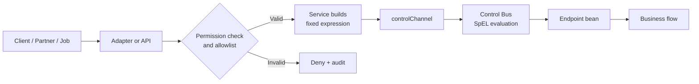
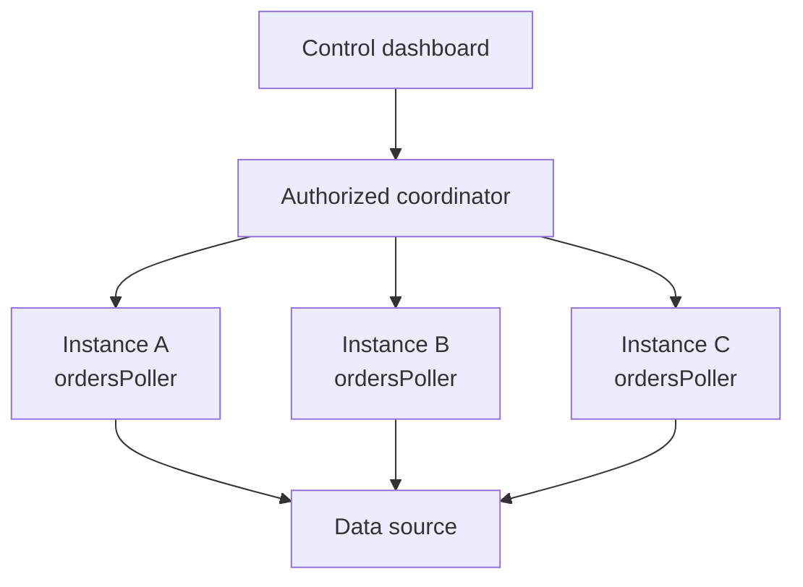

# Risks of Executing Control Expressions

## 1. Why Is a Control Bus Expression an Attack Surface?

The **Control Bus** is an Enterprise Integration Patterns (EIP) pattern that allows managing components of an integration system through messages. In Spring Integration, a message sent to the Control Bus typically carries a **Spring Expression Language (SpEL)** expression to invoke a method or query a bean, for example:

```text
@ordersPoller.stop()
@ordersPoller.start()
@ordersPoller.isRunning()
```

The crucial distinction: the payload here is not just business data. It is **evaluated as an expression within the application context**, so it can act on beans accessible to the Control Bus. The exact syntax and operations actually permitted depend on the Spring Integration version, `EvaluationContext`, bean resolver, method visibility, and runtime configuration. Never assume an input expression is safely sandboxed simply because it traveled over a message channel.

In the **SPRING_INTEGRATION_PATTERN** module, learners implement Router, Filter, Transformer, Splitter, Aggregator, Gateway, retry, error channel, and correlation patterns to build loosely coupled, extensible message flows. Flow administration capabilities are essential, yet if an untrusted message enters the Control Bus, the message-based integration mechanism itself can become a vector for unintended operations.

**This lesson belongs to the Control bus chapter** and focuses on answering:

- Who can send an expression to the Control Bus?
- Which beans and methods can an expression access?
- What consequences can arise for confidentiality, integrity, and availability?
- How must control channels, APIs, and tests be designed so only authorized operations execute?
- Why does even a valid command still require state verification and monitoring of its impact on in-flight messages?

This is a risk analysis and prevention lesson. Examples use only valid administrative commands on a simulated endpoint; evaluation of arbitrary expressions must be **blocked** right at the trust boundary.

## 2. Mechanisms That Make Expressions Sensitive

A Control Bus in Spring Integration can be configured using Java DSL:

```java
@Bean
public MessageChannel controlChannel() {
    return new DirectChannel();
}

@Bean
public IntegrationFlow controlBusFlow() {
    return IntegrationFlow.from("controlChannel")
            .controlBus()
            .get();
}
```

When a message with payload `@ordersPoller.stop()` reaches this channel, the Control Bus attempts to evaluate the expression, look up the `ordersPoller` bean in the permitted context, and call `stop()`. On an endpoint supporting `Lifecycle`, the command can halt receiving new messages.



If the checkpoint in the middle is bypassed, an externally controlled string can travel straight to the expression evaluator. That is **expression injection** at the system boundary: input that should only be data is used instead to determine which operation executes.

Several characteristics increase the level of risk:

1. **Bean resolution:** bean reference syntax can resolve to a component other than the intended endpoint.
2. **Method invocation:** expressions can trigger method calls; the impact depends on the bean, method, and evaluation configuration.
3. **Broad privilege context:** the Control Bus runs inside an application that has connections to queues, databases, files, or external services. A misdirected call can affect the application's own resources.
4. **Dynamic nature:** the expression is determined when the message arrives; static Java code review is not enough to know every string that might be sent.
5. **Flexible routing:** Spring Integration allows bridges, Routers, Gateways, and inbound adapters to connect channels. A miswired connection can open a path from an untrusted source.

**Not every deployment permits the same set of SpEL operations.** When assessing risk, examine the exact evaluation context configuration, library version, and accessible beans, and protect the system as though Control Bus input represents a high-privilege administrative capability.

## 3. Distinguishing Business Data from Control Commands

In EIP, both types are messages, yet they require different boundaries:

| Attribute | Business message | Control message |
| --- | --- | --- |
| Typical payload | Order JSON, payment status, notification | `@ordersPoller.stop()` |
| Purpose | Carries data across integration steps | Mutates/queries bean state |
| Source | Partners, brokers, HTTP endpoints, schedulers | Authorized administrative service |
| Receiver | Transformer, Filter, Router, handler | Control Bus |
| What must be controlled | Schema, data validity, idempotency | Identity, authorization, target endpoint, fixed command set |
| Harm when mishandled | Corrupt data, business errors, duplicate sends | Invoking wrong method, stopping a source, out-of-scope access |

Example of an unsafe route design:

```text
HTTP inbound adapter (String body)
    -> DirectChannel
    -> Control Bus
```

In this route, the body from an external request becomes an expression to evaluate. Simply putting it on an "internal" URL or naming a channel "control" does not guarantee the payload is authorized.

Controlled route:

```text
HTTP API: {"action":"STOP_ORDERS"}
    -> authentication
    -> authorization
    -> enum allowlist
    -> server-side mapping: STOP_ORDERS = "@ordersPoller.stop()"
    -> controlChannel
    -> Control Bus
```

Client input expresses only **business intent**. The application decides and owns the corresponding expression.

## 4. Threat Model: Sources, Assets, and Consequences

When reviewing an integration topology, list every source capable of influencing the Control Bus payload.

| Source or entry point | Verification question | Possible mistake |
| --- | --- | --- |
| Admin HTTP API | Is it authenticated and restricted to allowed actions? | Client sends arbitrary expressions |
| Messaging Gateway | Does the interface accept a `String expression` parameter from outside? | Caller directly controls SpEL |
| Broker queue / topic | Are there messages from partners or other tenants? | Untrusted payload gets bridged to the Control Bus |
| Router or Bridge | Is there a business data path leading to the control channel? | Misrouting turns data into a command |
| Scheduler / workflow engine | Can jobs dynamically choose beans and methods? | Job config is modified to call out-of-scope beans |
| Admin dashboard | Are control buttons authorized per endpoint? | Read-only users can trigger actions |
| Automated ops tooling | How are tokens, secrets, and instance scope managed? | Credential leaks or commands sent to the wrong cluster |

Assets to protect include endpoint states, connections to external systems, in-flight messages, data in message stores, operational configuration, sensitive information accessible to beans, and overall system availability.

### 4.1. Impact on Integrity

An unauthorized invocation can alter endpoint state or affect unintended beans. For instance, stopping `paymentsPoller` instead of `ordersPoller` halts the payment workflow from receiving new data. In a flow with a Splitter/Aggregator, already-split messages may hang waiting for remaining fragments; retry and error channels may continue processing tasks fetched before the stop command.

**The risk does not end at a running/stopped boolean.** Lifecycle changes can cause indirect business consequences such as growing backlogs, missed SLA deadlines, incomplete correlation groups, or duplicate data during recovery.

### 4.2. Impact on Availability

A rapid sequence of repeated `start/stop` commands can cause instability and operational errors, especially for adapters that open/close connections on state transitions. Heavy expressions or long-running method calls can also block synchronous channel processing threads.

With `DirectChannel`, handlers typically execute on the sender's thread. A long operation can tie up request threads if called directly by an API. With asynchronous channels, effects may be delayed and command backlogs can build up; message acceptance does not mean execution has occurred.

### 4.3. Impact on Confidentiality

An expression allowed to access inappropriate beans or properties can expose internal data in replies, logs, or error messages. Depending on evaluation settings, an expression's reach can be broader than the intended lifecycle methods.

Hence, even a "read status only" API must not accept arbitrary expressions. Permission to **read the status of an allowlisted endpoint** differs from permission to **evaluate arbitrary SpEL in the ApplicationContext**.

### 4.4. Valid Commands Used at the Wrong Time

Even `@ordersPoller.stop()` can cause an incident when:

- Sent while the system is processing a critical batch.
- The target instance or environment is unspecified.
- Two coordinators send start and stop almost simultaneously.
- Retried after a timeout without knowing whether the previous command ran.
- Triggered by an account whose privileges were revoked while an old token remained valid.

You must combine **authorization**, **operational procedures**, and **state verification**. A syntactically valid expression is insufficient to prove an operation is authorized or safe.

## 5. Anti-Patterns to Avoid

### 5.1. Concatenating Bean and Method Names from Input

```java
// DO NOT use for data from HTTP, broker, or users:
String expression =
        "@" + requestedBean + "." + requestedMethod + "()";

controlChannel.send(
        MessageBuilder.withPayload(expression).build());
```

Even if the developer intends to support only `start()` and `stop()`, this code lets input choose the bean and method. Blacklist filtering a few SpEL keywords is also prone to missing syntax variants.

### 5.2. Exposing an Endpoint That Accepts Verbatim Expressions

```json
{
  "expression": "@ordersPoller.stop()"
}
```

Such an API pushes expression-validation responsibility onto the server without a narrow business contract. Change the body to a structured action, such as `{"action":"STOP_ORDERS"}`, and perform fixed server-side mapping.

### 5.3. Assuming the Channel Name Protects It

`controlChannel` is merely a bean name for a channel. Multiple components in the same application can still send messages to that channel. If an inbound adapter is wired directly to the channel, all authorization rules on the REST controller are bypassed.

### 5.4. Trusting the `send()` Return Value

`MessageChannel.send()` returns a boolean indicating message dispatch under the channel contract. It is **not** the result of `@ordersPoller.isRunning()`, nor does it confirm all downstream side effects have completed.

With synchronous handlers, exceptions can propagate back to the caller. With asynchronous handlers, a command can be accepted first and executed later. Distinguish **accepted**, **executed**, and **desired state observed**.

### 5.5. Assuming One Instance Represents the Entire Cluster

The Control Bus evaluates expressions in the context of the instance receiving the message. Stopping `ordersPoller` on instance A does not automatically stop the same bean on B or C. A cluster-wide administrative API needs explicit per-instance routing, tracking, and confirmation.

## 6. Layered Risk-Mitigation Design

A design can apply the following control layers:

| Layer | Goal | Mechanism |
| --- | --- | --- |
| Authentication | Know the requesting principal | JWT/mTLS/login session per architecture |
| Authorization | Permit operations only on appropriate endpoints | Scopes/authorities, tenant and environment checks |
| Contract validation | Reject free-form SpEL syntax | Action enum, closed schema/DTO |
| Server-side mapping | Dispatch only reviewed commands | Map actions to constant expressions |
| Restrict producers | Never wire untrusted messages to the Control Bus | Internal channels, topology control, and producer restrictions |
| Operation control | Prevent spam and race conditions | Rate limiting, idempotency keys, per-endpoint serialization when needed |
| Observability | Confirm outcomes and detect anomalies | `isRunning()`, audits, metrics, timeouts |
| Infrastructure governance | Limit blast radius if application is affected | Least privilege for service accounts, network segmentation |

An **action-based allowlist** is far more effective than attempting to "safely sanitize" an arbitrary SpEL string. The rule is to translate only predefined actions into expressions, rather than trying to build a security parser from scratch.

If requirements do not mandate using the Control Bus, an internal admin API can also invoke lifecycle methods directly on the designated bean. In that case, no expression-evaluation path needs to be opened at that boundary. If you still use the Control Bus to keep message-based control, enforce all of the controls shown below.

## 7. Self-Contained Example: Sending Commands Safely via the Control Bus

Assume a Spring Boot 3.x application on Java 17+ with Spring Integration versions managed by Spring Boot.

```gradle
dependencies {
    implementation("org.springframework.boot:spring-boot-starter-integration")
    implementation("org.springframework.boot:spring-boot-starter-security")
    implementation("org.springframework.boot:spring-boot-starter-web")
    testImplementation("org.springframework.boot:spring-boot-starter-test")
    testImplementation("org.springframework.security:spring-security-test")
}
```

### 7.1. Declaring the Endpoint and Control Channel

```java
package example.controlbus;

import java.time.Duration;
import java.util.concurrent.BlockingQueue;
import java.util.concurrent.LinkedBlockingQueue;

import org.springframework.context.annotation.Bean;
import org.springframework.context.annotation.Configuration;
import org.springframework.integration.channel.DirectChannel;
import org.springframework.integration.config.EnableIntegration;
import org.springframework.integration.core.MessageSource;
import org.springframework.integration.dsl.IntegrationFlow;
import org.springframework.integration.dsl.Pollers;
import org.springframework.messaging.MessageChannel;
import org.springframework.messaging.support.MessageBuilder;
import org.springframework.security.config.annotation.method.configuration.EnableMethodSecurity;

@Configuration
@EnableIntegration
@EnableMethodSecurity
public class SafeControlBusConfiguration {

    @Bean
    public MessageChannel controlChannel() {
        return new DirectChannel();
    }

    @Bean
    public IntegrationFlow controlBusFlow() {
        return IntegrationFlow.from("controlChannel")
                .controlBus()
                .get();
    }

    @Bean
    public BlockingQueue<String> pendingOrders() {
        return new LinkedBlockingQueue<>();
    }

    @Bean
    public MessageSource<String> orderSource(
            BlockingQueue<String> pendingOrders) {
        return () -> {
            String id = pendingOrders.poll();
            return id == null
                    ? null
                    : MessageBuilder.withPayload(id).build();
        };
    }

    @Bean
    public IntegrationFlow ordersFlow(MessageSource<String> orderSource) {
        return IntegrationFlow.from(orderSource, spec -> spec
                        .id("ordersPoller")
                        .autoStartup(false)
                        .poller(Pollers.fixedDelay(Duration.ofSeconds(1))))
                .handle(message ->
                        System.out.println("Order: " + message.getPayload()))
                .get();
    }
}
```

**Explanation:** `ordersPoller` is the ID of the polling inbound endpoint and the target the Control Bus will control. `controlChannel` receives only control messages. `autoStartup(false)` makes it easy for tests to inspect the initial state. This configuration is for illustration; if the source is a broker, JDBC, or another adapter, you must analyze its specific ack, polling, and stop contracts.

### 7.2. Allowing Only Fixed Actions

Define the public actions:

```java
package example.controlbus;

public enum OrderControlAction {
    START,
    STOP
}
```

Create a service holding **application-controlled** expressions without accepting SpEL strings from callers:

```java
package example.controlbus;

import java.util.Objects;

import org.springframework.beans.factory.annotation.Qualifier;
import org.springframework.context.ApplicationContext;
import org.springframework.context.Lifecycle;
import org.springframework.messaging.MessageChannel;
import org.springframework.messaging.support.MessageBuilder;
import org.springframework.security.access.prepost.PreAuthorize;
import org.springframework.stereotype.Service;

@Service
public class OrderControlService {

    private final MessageChannel controlChannel;
    private final ApplicationContext context;

    public OrderControlService(
            @Qualifier("controlChannel") MessageChannel controlChannel,
            ApplicationContext context) {
        this.controlChannel = controlChannel;
        this.context = context;
    }

    @PreAuthorize("hasAuthority('SCOPE_integration.orders.control')")
    public boolean execute(OrderControlAction action) {
        Objects.requireNonNull(action, "action");

        // Only two fixed, reviewed expressions.
        String expression = switch (action) {
            case START -> "@ordersPoller.start()";
            case STOP  -> "@ordersPoller.stop()";
        };

        boolean accepted = controlChannel.send(
                MessageBuilder.withPayload(expression).build());

        if (!accepted) {
            throw new IllegalStateException(
                    "Control command was not accepted");
        }

        // Verify status after synchronous processing in this example.
        boolean running = poller().isRunning();
        boolean expectedRunning = (action == OrderControlAction.START);
        if (running != expectedRunning) {
            throw new IllegalStateException(
                    "Endpoint did not reach the requested state");
        }
        return running;
    }

    @PreAuthorize(
        "hasAnyAuthority('SCOPE_integration.orders.read', "
        + "'SCOPE_integration.orders.control')")
    public boolean isRunning() {
        return poller().isRunning();
    }

    private Lifecycle poller() {
        return context.getBean("ordersPoller", Lifecycle.class);
    }
}
```

Points to note:

- `execute(...)` accepts an enum, not a `String expression`.
- Only callers with the orders-control authority may invoke `execute(...)`; callers with read permission can invoke `isRunning()`.
- The code references a single chosen bean: `ordersPoller`. Input is never used to form bean or method names.
- `@EnableMethodSecurity` makes `@PreAuthorize` effective on **calls passing through a Spring proxy**; self-invocation via `this.execute(...)` from inside the same bean can bypass the check.
- Verifying `isRunning()` immediately after the command suits the synchronous `DirectChannel` in this example. On an asynchronous channel, you need a reply-handling workflow and eventual-state verification with a timeout.
- State can be modified by another controller after being read; do not treat a single boolean read as an atomic administrative transaction.

**Protection boundary:** this code checks permissions at the service method. Another component in the same application that obtains the `controlChannel` bean directly and sends a message bypasses the service's `@PreAuthorize`. You must audit every adapter, bridge, flow, and gateway connected to the Control Bus, and allow only trusted code to issue commands.

### 7.3. Action-Only API

Example controller for an environment with authentication and a properly configured HTTP SecurityFilterChain:

```java
package example.controlbus;

import org.springframework.web.bind.annotation.GetMapping;
import org.springframework.web.bind.annotation.PostMapping;
import org.springframework.web.bind.annotation.RequestBody;
import org.springframework.web.bind.annotation.RequestMapping;
import org.springframework.web.bind.annotation.RestController;

@RestController
@RequestMapping("/internal/operations/orders")
public class OrderControlController {

    private final OrderControlService service;

    public OrderControlController(OrderControlService service) {
        this.service = service;
    }

    public record CommandRequest(OrderControlAction action) {}
    public record StatusResponse(boolean running) {}

    @PostMapping
    public StatusResponse execute(@RequestBody CommandRequest request) {
        if (request == null || request.action() == null) {
            throw new IllegalArgumentException("action is required");
        }
        return new StatusResponse(service.execute(request.action()));
    }

    @GetMapping
    public StatusResponse status() {
        return new StatusResponse(service.isRunning());
    }
}
```

Sample request:

```http
POST /internal/operations/orders
Authorization: Bearer <access-token>
Content-Type: application/json

{"action":"STOP"}
```

This controller illustrates only the **expression-free** contract. For a real application, add Bean Validation, exception handlers returning 400 for malformed requests, 403 handling for missing privileges, and controlled error responses when the Control Bus fails. HTTP SecurityFilterChain configuration must authenticate requests and permit only authorized routes; method security serves as an additional layer. If using bearer JWTs, configure a Resource Server, token verification, and appropriate claim-to-authority mapping. The name `SCOPE_integration.orders.control` in the example assumes scopes have been mapped to authorities with the `SCOPE_` prefix.

Never expose this endpoint publicly simply because its path contains "internal". When cookie-based authentication is present, enforce CSRF protection on POST operations; for token-based APIs, apply the policy matching the actual authentication mechanism.

## 8. Testing Permission Boundaries

The goal of security testing is to prove that an insufficiently privileged user **cannot alter endpoint state**, rather than attempting to execute destructive payloads.

With `spring-security-test` and `@EnableMethodSecurity`:

```java
package example.controlbus;

import static org.assertj.core.api.Assertions.assertThat;
import static org.assertj.core.api.Assertions.assertThatThrownBy;

import org.junit.jupiter.api.Test;
import org.springframework.beans.factory.annotation.Autowired;
import org.springframework.context.ApplicationContext;
import org.springframework.context.Lifecycle;
import org.springframework.security.access.AccessDeniedException;
import org.springframework.security.test.context.support.WithMockUser;
import org.springframework.test.context.junit.jupiter.SpringJUnitConfig;

@SpringJUnitConfig({
    SafeControlBusConfiguration.class,
    OrderControlService.class
})
class ControlExpressionSecurityTest {

    @Autowired
    OrderControlService service;

    @Autowired
    ApplicationContext context;

    @Test
    @WithMockUser(authorities = "SCOPE_integration.orders.read")
    void observerCannotChangeEndpointState() {
        Lifecycle poller = context.getBean(
                "ordersPoller", Lifecycle.class);

        assertThat(poller.isRunning()).isFalse();
        assertThat(service.isRunning()).isFalse();

        assertThatThrownBy(() ->
                service.execute(OrderControlAction.START))
                .isInstanceOf(AccessDeniedException.class);

        assertThat(poller.isRunning()).isFalse();
    }

    @Test
    @WithMockUser(authorities = "SCOPE_integration.orders.control")
    void operatorMayStartAndStopEndpoint() {
        Lifecycle poller = context.getBean(
                "ordersPoller", Lifecycle.class);

        try {
            assertThat(service.execute(OrderControlAction.START))
                    .isTrue();
            assertThat(poller.isRunning()).isTrue();
        } finally {
            service.execute(OrderControlAction.STOP);
        }
        assertThat(poller.isRunning()).isFalse();
    }
}
```

The test checks authorization at the **Spring service proxy**. When testing the API, add further cases using MockMvc or integration tests:

| Scenario | Expectation |
| --- | --- |
| Unauthenticated | Request is rejected |
| Read-only permission sends START/STOP | HTTP 403; no command sent |
| Control permission sends START/STOP | Valid operation is forwarded to the service |
| Unknown enum action, null, or invalid body | HTTP 400; no command sent |
| Invalid token or wrong audience/issuer | Rejected at the authentication layer |
| Service cannot find target bean | Controlled error reported and audited; never return false success |
| Client attempts to send a free-form `expression` field | Field is unused; configure strict DTO validation to reject unknown properties |
| Command sent to an unauthorized environment/tenant | Rejected and target requested is logged |

`@WithMockUser` simulates authorities directly and does not verify how real JWTs are converted into authorities. Separately test tokens, route security, and every internal adapter capable of sending messages into the Control Bus. A passing service test does **not** prove other branches in the topology are secured.

## 9. Auditing, Anomaly Detection, and Outcome Verification

For lifecycle-changing commands, record structured audit logs:

```json
{
  "requestId": "ops-20261121-0042",
  "actor": "operator-17",
  "action": "STOP",
  "targetEndpoint": "ordersPoller",
  "instanceId": "orders-instance-a",
  "requestedAt": "2026-11-21T08:00:00Z",
  "result": "SUCCEEDED",
  "observedRunning": false
}
```

This is an **application-designed audit payload template**, not a payload generated automatically by the Control Bus. In a real system, you must have a trustworthy actor identifier, timestamps from a synchronized clock, and a correlation ID linking the request, command message, logs, and observed outcome.

A suitable audit workflow may include:

1. Log **request received** after authentication, including action and target endpoint.
2. Check permissions; if denied, log `DENIED` without emitting a Control Bus message.
3. If authorized, emit the fixed expression and log `ACCEPTED` when accepted by the channel.
4. Confirm `isRunning()` or an equivalent signal; mark `SUCCEEDED` once the desired state is observed.
5. On evaluation errors, timeouts, or unresponsive instances, record `FAILED` or `UNKNOWN`; never default to `SUCCEEDED`.

Anomaly detection signals include an actor rapidly sending start/stop commands, commands outside maintenance windows, spikes in denied attempts, unusual requests targeting multiple instances, actions on sensitive endpoints, and actual state diverging from desired state. Rate limiting and per-endpoint serialization can be applied when competing operations must be prevented.

Never log bearer tokens, secrets, externally supplied expressions, or business message data in audit logs. Store only the fields necessary for traceability and authorization auditing, in accordance with organizational data-retention policies.

## 10. Risks When Combining with Other EIP Patterns

The Control Bus affects the behavior of other components in the pipeline, even when an expression invokes only a valid lifecycle method.

| EIP component | What can happen after a control command | Observation measure |
| --- | --- | --- |
| **Router** | Stopping a shared source stops multiple branches from receiving new messages | Throughput and state of each inbound endpoint |
| **Filter** | Blocking a source at the wrong point can discard data instead of holding it | Discard rate, backlog-retaining channels |
| **Transformer** | Messages already in the pipeline continue being transformed | In-flight counts and transformation errors |
| **Splitter** | An already-split batch may be partially processed when the source stops | Batch ID and processed fragment counts |
| **Aggregator** | Incomplete correlation groups may wait for timeout | Group store, expiration, and open groups |
| **Gateway** | External gateways may send or receive requests while an endpoint is stopped | Timeouts, open request count, reply channel |
| **Retry / error channel** | Retries for older messages may still run; stop does not clear errors | Retry count, backoff, dead-letter/error flow |
| **Polling adapter** | New polls stop while data at the source may continue accumulating | Backlog, checkpoints, replay capability |

The key point when designing expression controls is **preventing unauthorized actions** and **understanding the consequences of authorized actions**. Never promise that `stop()` will cancel running tasks or clear all incomplete Aggregator groups. If safe maintenance is required, establish a *quiesce/drain* procedure for in-flight work and mechanisms to preserve messages at the source or message store.

## 11. When Deploying Multiple Replicas

Suppose three application instances all have the `ordersPoller` bean. Each instance has its own `ApplicationContext`:



A command running in A does not automatically stop the poller on B or C. The coordinator must explicitly specify the **target** (a specific instance or the whole cluster), permission to control that target, how commands are dispatched, and the confirmation mechanism.

If an operator is permitted to stop an instance in staging, the system must not infer they are allowed to stop all production instances. Authorization must evaluate **resource, environment, and impact scope**. Furthermore, every result must record the instance ID; timeouts or lost connections must be treated as `UNKNOWN` for that instance.

When cluster-wide coordination is required, implement a purpose-built coordination mechanism: idempotency keys, prevention of competing coordinators, post-command verification, and bounded retries. Do not trust a single SpEL command sent to a load-balanced gateway and conclude the whole cluster has stopped.

## 12. Pre-Release Prevention Checklist

Before deploying the Control Bus to production, use the following checklist for self-review:

- [ ] No HTTP endpoint or inbound adapter accepts untrusted SpEL strings and passes them straight to the Control Bus.
- [ ] APIs accept only actions from a predefined list and verify endpoint, tenant, and environment.
- [ ] Every expression triggered by an external source is constructed from server-side constants; never concatenate beans or methods from input.
- [ ] **Status-view** permission and **control** permission are separated.
- [ ] HTTP authentication, method security, and all internal paths leading to the control channel are reviewed.
- [ ] Invalid or unauthorized requests never generate control messages.
- [ ] Command dispatch and state verification have timeouts and distinguish `FAILED`, `UNKNOWN`, and `SUCCEEDED`.
- [ ] Audit logging captures actor, action, endpoint, instance, timestamp, correlation ID, and outcome.
- [ ] Monitoring covers in-flight work, backlog, retries, error channels, and Aggregator groups.
- [ ] Multi-instance procedures do not equate one node's state with the entire cluster.
- [ ] Application service-account permissions against brokers, databases, and external systems are appropriately restricted.
- [ ] Tests cover denied access, missing beans, channel errors, concurrent control, and recovery after stop/start.

The checklist is a review tool for the engineering team; the final level of assurance depends on library versions, actual configuration, and all data paths entering the Control Bus.

## 13. Hands-On Exercises

**Exercise 1 — Find trust boundaries.** Given a topology with an HTTP adapter, Router, Gateway, control channel, and Control Bus, mark every path that could carry a message from an external client into the control channel, then design authorization checkpoints before any expression is constructed.

**Exercise 2 — Migrate API to fixed actions.** Suppose a legacy API accepted `{"expression":"..."}`. Design a new API accepting `{"action":"START"}` or `{"action":"STOP"}`, restricting management to `ordersPoller` and returning errors when the action is not in the enum.

**Exercise 3 — Role-based authorization.** Create two security contexts: one read-only and one with control permission. Test that the read-only user can query `isRunning()` but cannot start/stop the endpoint.

**Exercise 4 — Observe business consequences.** Use a poller connected to a Splitter and Aggregator. Stop the poller while a group is waiting for remaining fragments; specify which metrics and message stores must be checked before declaring the system safe for maintenance.

**Exercise 5 — Cluster coordination.** Three replicas return stop outcomes of `SUCCEEDED`, `FAILED`, and `UNKNOWN`, respectively. Design the audit JSON and the decision rule for whether "stop the whole cluster" succeeded.

## 14. Self-Check Questions

1. Why must a Control Bus payload be treated as an **active expression** rather than ordinary data?
2. Why cannot blacklisting a few "dangerous" keywords replace an action allowlist?
3. Does `@PreAuthorize` on a service protect against every component in the same context sending a message directly to `controlChannel`?
4. What is the difference between `send() == true`, `isRunning() == false`, and "the flow has stopped safely"?
5. If an endpoint is stopped, why can retries or correlation groups still be active?
6. When a command succeeds on instance A, what evidence is needed to conclude the whole cluster performed the same operation?

**Key takeaway:** The Control Bus brings runtime management into the Spring Integration messaging model, yet control expressions constitute a **high-privilege execution surface**. Proper defense means preventing untrusted input from becoming SpEL, issuing only authorized fixed commands, governing every path into the channel, and verifying impact on the right endpoint, right instance, and in-flight messages.
