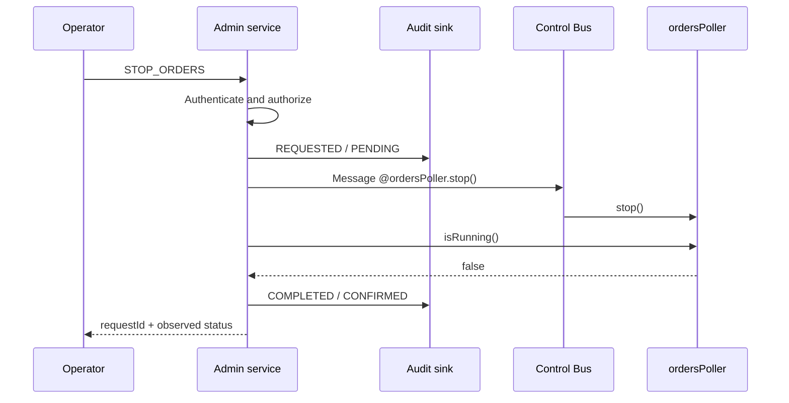
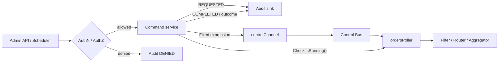
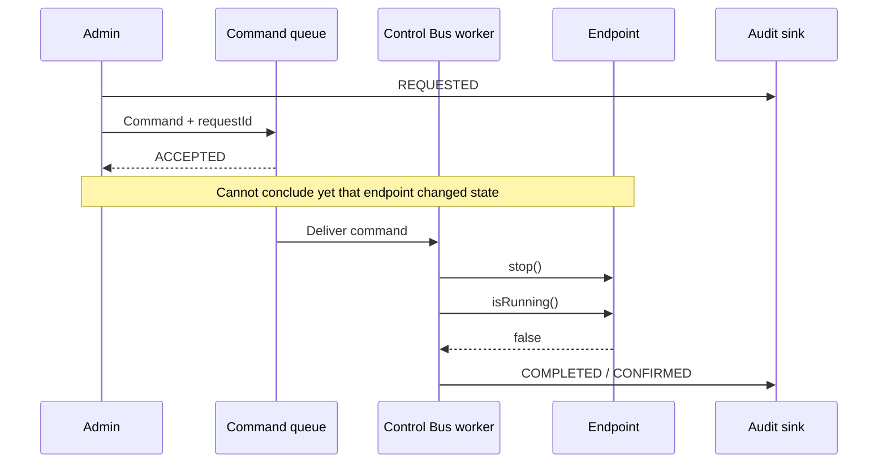

# Auditing Operational Commands

## 1. Why Audit Control Commands?

In Spring Integration, the **Control Bus** allows sending messages containing **Spring Expression Language (SpEL)** expressions to control application beans. For example:

```text
@ordersPoller.start()
@ordersPoller.stop()
@ordersPoller.isRunning()
```

These operations are useful when pausing a data source for maintenance, restarting polling, or reading endpoint status. However, a `stop()` command can increase backlog and affect multiple branches downstream of a Router; messages already inside a Splitter, Aggregator, or retry flow may still be processing.

In the **SPRING_INTEGRATION_PATTERN** module, learners implement Enterprise Integration Patterns to build loosely coupled, extensible message flows, including Router, Filter, Transformer, Splitter, Aggregator, Gateway, retry, error channel, and correlation. Therefore, auditing control commands must answer **who requested it, which endpoint was targeted, where the command traveled, whether it executed, and how the actual state was verified**.

This lesson belongs to the **Control bus** chapter and focuses on producing a traceable trail for operational commands, not merely recording that a Java method returned normally.

After this lesson, you will be able to:

1. Design an audit record containing actor, action, endpoint, instance, request ID, timestamp, and outcome.
2. Distinguish **request recorded**, **message accepted**, and **endpoint state confirmed**.
3. Explicitly record outcomes `DENIED`, `REJECTED`, `CONFIRMED`, `MISMATCH`, and `UNKNOWN`.
4. Integrate auditing into a Control Bus command service while avoiding arbitrary SpEL from untrusted sources.
5. Test audit records before/after commands, permission enforcement, asynchronous execution, and multi-instance setups.

## 2. Distinguishing Audits from Technical Logs

A log line like `Received STOP_ORDERS` shows the code received the action. It does not prove the endpoint stopped. Even `controlChannel.send() == true` is insufficient: with `MessageChannel.send()`, the returned boolean reflects message dispatch under the channel contract, not the value of `isRunning()` and not confirmation that all business side effects have finished.

An ideal command lifecycle has these milestones:



A **command message** and a **business message** can both travel over channels, yet they serve different purposes. The Control Bus is an expression execution point; order data should flow through a Filter, Transformer, Router, or corresponding handler.

| Audit milestone | Evidence | Not yet confirmed |
| --- | --- | --- |
| `REQUESTED` | Caller identified and request recorded | Control Bus has executed |
| `ACCEPTED` | Channel/queue accepted the message | Bean has changed state |
| `EXECUTED` | Handler recorded as having executed | Entire flow is free of in-flight messages |
| `CONFIRMED` | Endpoint reported desired state at inspection time | Every replica and branch has reached that state |

**Stopping an endpoint differs from draining the entire flow.** A stop command can prevent new polls, yet previously received messages may still be in retry, an Aggregator, or downstream. Thus lifecycle command audits must be examined alongside metrics, backlog, and in-flight message counts.

## 3. Structured Audit Schema

Instead of free-form log text, design an event with enough fields to reconcile multiple dispatches, multiple instances, and retries.

| Field | Example | Role |
| --- | --- | --- |
| `requestId` | `c71b...` | Links stages of the same request |
| `occurredAt` | `2026-11-21T08:30:00Z` | Event timestamp in UTC |
| `actor` | `operator-17` | Authenticated principal, taken from the security context |
| `action` | `STOP_ORDERS` | Operation code from the allowlist |
| `targetEndpoint` | `ordersPoller` | Target endpoint bean |
| `instanceId` | `orders-node-a` | Instance hosting the Spring context with the bean |
| `phase` | `REQUESTED` / `COMPLETED` | Audit phase |
| `outcome` | `CONFIRMED` | Conclusion at that phase |
| `observedRunning` | `false` | Observed lifecycle state; may be null |
| `errorType` | `MessageHandlingException` | Concise error type |
| `traceId` (optional) | `trace-42` | Correlates with tracing and other logs |

Example completed event:

```json
{
  "requestId": "c71b33f1-8f0e-4b28-b242-66e6fa5b99a0",
  "occurredAt": "2026-11-21T08:30:00Z",
  "actor": "operator-17",
  "action": "STOP_ORDERS",
  "targetEndpoint": "ordersPoller",
  "instanceId": "orders-node-a",
  "phase": "COMPLETED",
  "outcome": "CONFIRMED",
  "observedRunning": false,
  "errorType": null
}
```

This is an **application-defined schema**, not an event automatically emitted by Spring Integration with all the fields above. If `tenantId`, `environment`, `changeTicket`, or `policyVersion` are needed, the application must supply them from trustworthy sources.

Never write full JWTs, passwords, connection strings, business message contents, or uncontrolled SpEL expressions into audits. Fields such as actor and endpoint must also comply with organizational data-retention and access policies.

## 4. Classifying Outcomes Honestly

| Outcome | When recorded | Interpretation |
| --- | --- | --- |
| `DENIED` | Request rejected before sending command due to missing permissions | Call path blocked the operation |
| `REJECTED` | Channel rejected message; e.g., `send()` returned `false` | No evidence handler processed it |
| `CONFIRMED` | Inspected exact endpoint and state matched target | That instance reported the desired state when read |
| `MISMATCH` | State was read but differed from target state | Requested state not achieved at observation time |
| `UNKNOWN` | Exception/timeout/lost connection left outcome uncertain | Do not infer endpoint is stopped or running |

A timeout error can happen **after** the Control Bus already invoked `stop()`. Therefore `UNKNOWN` must stand until fresh evidence arrives. Retrying the command requires considering adapter idempotency, in-flight tasks, and potentially concurrent commands.

`CONFIRMED` is also a **point-in-time** conclusion. If another coordinator calls `start()` right after a stop command is confirmed, the state changes; the audit log must preserve both events rather than overwriting history.

## 5. Audit Architecture in the Control Path



Responsibilities to separate clearly:

- **Authentication & authorization:** identifies who is requesting and decides whether they may control that endpoint.
- **Command service:** accepts validated actions, generates a request ID, dispatches fixed expressions, and collects outcomes.
- **Control Bus:** evaluates the expression against the target bean.
- **Audit sink:** writes structured events to a central store with access and retention policies.
- **Monitoring:** provides additional visibility into source status, throughput, backlog, retries/errors, and correlation groups.

Write `REQUESTED` **before executing the command**. For high-impact operations, policy may require refusing to send the command if recording the start event fails. If recording the completion event fails after the command already ran, throwing an exception alone cannot undo it: raise an alert and reconcile against actual state.

## 6. Spring Integration Java DSL Configuration

The example uses Spring Boot, Java 17+, and the Spring Integration version managed by Spring Boot. In Gradle:

```gradle
dependencies {
    implementation("org.springframework.boot:spring-boot-starter-integration")
    implementation("org.springframework.boot:spring-boot-starter-security")
    testImplementation("org.springframework.boot:spring-boot-starter-test")
    testImplementation("org.springframework.security:spring-security-test")
}
```

Create `ControlBusAuditConfiguration.java`:

```java
package example.audit;

import java.time.Duration;
import java.util.concurrent.BlockingQueue;
import java.util.concurrent.LinkedBlockingQueue;

import org.springframework.context.annotation.Bean;
import org.springframework.context.annotation.Configuration;
import org.springframework.integration.channel.DirectChannel;
import org.springframework.integration.config.EnableIntegration;
import org.springframework.integration.core.MessageSource;
import org.springframework.integration.dsl.IntegrationFlow;
import org.springframework.integration.dsl.Pollers;
import org.springframework.messaging.MessageChannel;
import org.springframework.messaging.support.MessageBuilder;
import org.springframework.security.config.annotation.method.configuration.EnableMethodSecurity;

@Configuration
@EnableIntegration
@EnableMethodSecurity
public class ControlBusAuditConfiguration {

    @Bean
    public MessageChannel controlChannel() {
        return new DirectChannel();
    }

    @Bean
    public IntegrationFlow controlBusFlow() {
        return IntegrationFlow.from("controlChannel")
                .controlBus()
                .get();
    }

    @Bean
    public BlockingQueue<String> pendingOrders() {
        return new LinkedBlockingQueue<>();
    }

    @Bean
    public MessageSource<String> orderSource(
            BlockingQueue<String> pendingOrders) {
        return () -> {
            String id = pendingOrders.poll();
            return id == null
                    ? null
                    : MessageBuilder.withPayload(id).build();
        };
    }

    @Bean
    public IntegrationFlow ordersFlow(MessageSource<String> orderSource) {
        return IntegrationFlow
                .from(orderSource, spec -> spec
                        .id("ordersPoller")
                        .autoStartup(false)
                        .poller(Pollers.fixedDelay(Duration.ofSeconds(1))))
                .handle(message ->
                        System.out.println("Order: " + message.getPayload()))
                .get();
    }
}
```

`controlChannel` is the channel dedicated to control messages. The `ordersPoller` bean is the **inbound polling endpoint** given a stable id so SpEL can locate it; it is not the channel name or the entire flow name. `autoStartup(false)` ensures tests observe an initial stopped state.

In this example, the queue is in-memory solely for illustration; if the application stops, data may be lost. With real sources such as a broker, JDBC, or files, evaluate ack policies, checkpoints, retries, and backlog preservation.

## 7. Defining the Event and AuditSink

Create `ControlAuditRecord.java`:

```java
package example.audit;

import java.time.Instant;

public record ControlAuditRecord(
        String requestId,
        Instant occurredAt,
        String actor,
        String action,
        String targetEndpoint,
        String instanceId,
        String phase,
        String outcome,
        Boolean observedRunning,
        String errorType) {
}
```

The `ControlAuditSink` interface lets you swap the storage backend without modifying the control service:

```java
package example.audit;

public interface ControlAuditSink {
    void append(ControlAuditRecord event);
}
```

For illustration, implement it with structured logging:

```java
package example.audit;

import org.slf4j.Logger;
import org.slf4j.LoggerFactory;
import org.springframework.stereotype.Component;

@Component
public class StructuredLogAuditSink implements ControlAuditSink {
    private static final Logger log =
            LoggerFactory.getLogger(StructuredLogAuditSink.class);

    @Override
    public void append(ControlAuditRecord e) {
        log.info(
            "controlAudit requestId={} at={} actor={} action={} " +
            "endpoint={} instance={} phase={} outcome={} running={} error={}",
            e.requestId(), e.occurredAt(), e.actor(), e.action(),
            e.targetEndpoint(), e.instanceId(), e.phase(), e.outcome(),
            e.observedRunning(), e.errorType());
    }
}
```

**Limitation:** this is an example of **formatting**, not a durable audit store. Logs can be lost if the process crashes, disk fills up, or the log shipper fails. For strict traceability requirements, `ControlAuditSink` must write to an append-only store or a durable queue/outbox mechanism with write-failure monitoring, separated read/write permissions, and reconciliation.

## 8. Service That Sends Control Bus Messages and Records Audits

Do not accept arbitrary expression Strings from the API. Accept only enum actions:

```java
package example.audit;

public enum OrderCommand {
    START_ORDERS,
    STOP_ORDERS
}
```

The following service writes `REQUESTED` before sending the command, then observes the lifecycle of the exact endpoint. It uses the synchronous `DirectChannel` configured above.

```java
package example.audit;

import java.time.Instant;
import java.util.Objects;
import java.util.UUID;

import org.springframework.beans.factory.annotation.Qualifier;
import org.springframework.beans.factory.annotation.Value;
import org.springframework.context.ApplicationContext;
import org.springframework.context.Lifecycle;
import org.springframework.messaging.MessageChannel;
import org.springframework.messaging.support.MessageBuilder;
import org.springframework.security.access.prepost.PreAuthorize;
import org.springframework.security.core.Authentication;
import org.springframework.security.core.context.SecurityContextHolder;
import org.springframework.stereotype.Service;

@Service
public class AuditedOrderControlService {

    private final MessageChannel controlChannel;
    private final ApplicationContext context;
    private final ControlAuditSink auditSink;
    private final String instanceId;

    public AuditedOrderControlService(
            @Qualifier("controlChannel") MessageChannel controlChannel,
            ApplicationContext context,
            ControlAuditSink auditSink,
            @Value("${app.instance-id:local}") String instanceId) {
        this.controlChannel = controlChannel;
        this.context = context;
        this.auditSink = auditSink;
        this.instanceId = instanceId;
    }

    @PreAuthorize("hasAuthority('SCOPE_integration.orders.control')")
    public CommandReceipt execute(OrderCommand command) {
        Objects.requireNonNull(command, "command");

        Authentication auth =
                SecurityContextHolder.getContext().getAuthentication();
        if (auth == null || !auth.isAuthenticated()) {
            throw new IllegalStateException("No authenticated actor");
        }

        String actor = auth.getName();
        String requestId = UUID.randomUUID().toString();
        boolean desiredRunning = command == OrderCommand.START_ORDERS;

        // Record before dispatching message: if audit fails, do not send command.
        auditSink.append(record(requestId, actor, command,
                "REQUESTED", "PENDING", null, null));

        String expression = switch (command) {
            case START_ORDERS -> "@ordersPoller.start()";
            case STOP_ORDERS  -> "@ordersPoller.stop()";
        };

        String outcome = "UNKNOWN";
        Boolean observedRunning = null;
        String errorType = null;
        RuntimeException commandError = null;

        try {
            boolean accepted = controlChannel.send(
                    MessageBuilder.withPayload(expression).build());

            if (!accepted) {
                outcome = "REJECTED";
                throw new IllegalStateException(
                        "Control command was not accepted");
            }

            Lifecycle poller = context.getBean(
                    "ordersPoller", Lifecycle.class);
            observedRunning = poller.isRunning();

            if (observedRunning != desiredRunning) {
                outcome = "MISMATCH";
                throw new IllegalStateException(
                        "Endpoint did not reach desired state");
            }

            outcome = "CONFIRMED";
            return new CommandReceipt(requestId, observedRunning);
        } catch (RuntimeException ex) {
            commandError = ex;
            errorType = ex.getClass().getSimpleName();
            throw ex;
        } finally {
            ControlAuditRecord completed = record(
                    requestId, actor, command, "COMPLETED",
                    outcome, observedRunning, errorType);
            try {
                auditSink.append(completed);
            } catch (RuntimeException auditError) {
                // If the command already failed, keep the original exception for diagnostics.
                if (commandError != null) {
                    commandError.addSuppressed(auditError);
                } else {
                    throw auditError;
                }
            }
        }
    }

    @PreAuthorize(
        "hasAnyAuthority('SCOPE_integration.orders.read', " +
        "'SCOPE_integration.orders.control')")
    public boolean isRunning() {
        return context.getBean("ordersPoller", Lifecycle.class)
                .isRunning();
    }

    private ControlAuditRecord record(
            String requestId, String actor, OrderCommand command,
            String phase, String outcome,
            Boolean observedRunning, String errorType) {
        return new ControlAuditRecord(
                requestId, Instant.now(), actor, command.name(),
                "ordersPoller", instanceId,
                phase, outcome, observedRunning, errorType);
    }

    public record CommandReceipt(String requestId, boolean running) {}
}
```

On the happy path:

1. `@PreAuthorize` checks authority when the caller invokes through the Spring bean proxy.
2. `REQUESTED/PENDING` is recorded before evaluating the expression.
3. A message carrying `@ordersPoller.stop()` or `@ordersPoller.start()` is sent to the Control Bus.
4. The service reads `Lifecycle.isRunning()` of `ordersPoller` in the current instance.
5. Once the result matches the desired state, the audit records `COMPLETED/CONFIRMED` with the same `requestId`.

On error paths:

- `send()` returns `false`: records `REJECTED`.
- Bean not found, handler throws exception, or unable to read result: records `UNKNOWN` with the error type.
- State read differs from desired state: records `MISMATCH`.
- Writing `REQUESTED` fails: the method aborts before sending the Control Bus message.
- Writing `COMPLETED` fails: the command **may have already run**; never retry automatically without first checking state.

This code illustrates synchronous audit recording. In production, you need a dedicated plan for audit-store outages or process crashes between the two events, as `try/finally` alone cannot guarantee zero audit loss.

## 9. Recording Permission-Denied Requests

A very important point: `@PreAuthorize` can block a call **before the body of `execute()` runs**. Therefore, unauthorized requests are not recorded by `auditSink.append(REQUESTED)` inside this service.

To capture `DENIED` events, record them where the authorization decision happens, such as:

- `SecurityFilterChain` / `AccessDeniedHandler` for REST APIs.
- Spring Method Security authorization events or interceptors.
- Authorization checkpoints at the ingress of a scheduler, gateway, or message adapter if not arriving over HTTP.

Example denied event:

```json
{
  "requestId": "req-301",
  "actor": "observer-3",
  "action": "STOP_ORDERS",
  "targetEndpoint": "ordersPoller",
  "instanceId": "orders-node-a",
  "phase": "AUTHORIZATION",
  "outcome": "DENIED",
  "observedRunning": null,
  "errorType": "ACCESS_DENIED"
}
```

The actor identity must come from a trustworthy authentication mechanism, never from an `actor` field in the JSON request. Unify the request ID across HTTP, service, and message headers when spanning multiple layers. Also avoid logging duplicate `DENIED` records across multiple interceptors for the same decision.

Keep in mind that `@PreAuthorize` protects only calls passing through a Spring proxy. A component sending directly to the `controlChannel` bean does not automatically go through `AuditedOrderControlService`; inspect all producers wired to the Control Bus and disallow arbitrary SpEL input.

## 10. Testing the Audit Trail

In tests, use an in-memory sink to assert event order and contents. This is a test double, not a production sink.

```java
package example.audit;

import java.util.List;
import java.util.concurrent.CopyOnWriteArrayList;

public class InMemoryAuditSink implements ControlAuditSink {
    private final List<ControlAuditRecord> events =
            new CopyOnWriteArrayList<>();

    @Override
    public void append(ControlAuditRecord event) {
        events.add(event);
    }

    public List<ControlAuditRecord> snapshot() {
        return List.copyOf(events);
    }

    public void clear() {
        events.clear();
    }
}
```

Create `AuditedOrderControlTest.java`:

```java
package example.audit;

import static org.assertj.core.api.Assertions.assertThat;
import static org.assertj.core.api.Assertions.assertThatThrownBy;

import org.junit.jupiter.api.BeforeEach;
import org.junit.jupiter.api.Test;
import org.springframework.beans.factory.annotation.Autowired;
import org.springframework.context.ApplicationContext;
import org.springframework.context.Lifecycle;
import org.springframework.context.annotation.Bean;
import org.springframework.context.annotation.Configuration;
import org.springframework.security.access.AccessDeniedException;
import org.springframework.security.test.context.support.WithMockUser;
import org.springframework.test.context.junit.jupiter.SpringJUnitConfig;

@SpringJUnitConfig({
    ControlBusAuditConfiguration.class,
    AuditedOrderControlService.class,
    AuditedOrderControlTest.TestAuditConfig.class
})
class AuditedOrderControlTest {

    @Autowired
    AuditedOrderControlService service;

    @Autowired
    InMemoryAuditSink auditSink;

    @Autowired
    ApplicationContext context;

    @BeforeEach
    void clearAudit() {
        auditSink.clear();
    }

    @Test
    @WithMockUser(username = "operator-17",
                  authorities = "SCOPE_integration.orders.control")
    void writesRequestedAndConfirmedWithSameRequestId() {
        Lifecycle poller = context.getBean("ordersPoller", Lifecycle.class);
        assertThat(poller.isRunning()).isFalse();

        try {
            var receipt = service.execute(OrderCommand.START_ORDERS);
            assertThat(receipt.running()).isTrue();
            assertThat(poller.isRunning()).isTrue();

            var events = auditSink.snapshot();
            assertThat(events).hasSize(2);
            assertThat(events.get(0).phase()).isEqualTo("REQUESTED");
            assertThat(events.get(1).phase()).isEqualTo("COMPLETED");
            assertThat(events.get(1).outcome()).isEqualTo("CONFIRMED");
            assertThat(events.get(1).actor()).isEqualTo("operator-17");
            assertThat(events.get(1).observedRunning()).isTrue();
            assertThat(events.get(0).requestId())
                    .isEqualTo(events.get(1).requestId());
        } finally {
            service.execute(OrderCommand.STOP_ORDERS);
        }
        assertThat(poller.isRunning()).isFalse();
    }

    @Test
    @WithMockUser(username = "observer-3",
                  authorities = "SCOPE_integration.orders.read")
    void observerCannotSendControlCommand() {
        Lifecycle poller = context.getBean("ordersPoller", Lifecycle.class);
        assertThat(poller.isRunning()).isFalse();

        assertThatThrownBy(() ->
                service.execute(OrderCommand.START_ORDERS))
                .isInstanceOf(AccessDeniedException.class);

        assertThat(poller.isRunning()).isFalse();
        // Service body does not run when @PreAuthorize denies.
        assertThat(auditSink.snapshot()).isEmpty();
    }

    @Configuration
    static class TestAuditConfig {
        @Bean
        InMemoryAuditSink auditSink() {
            return new InMemoryAuditSink();
        }
    }
}
```

The test verifies **two audit phases sharing the same request ID**, the actor matching the security context, and `CONFIRMED` being recorded only after observing the endpoint. The read-only user test confirms no command is sent and state remains unchanged.

This test does not cover full HTTP security or how JWTs map to authorities. If the application exposes a REST API, add tests for 401, 403, invalid request schemas, invalid scope/tenant/environment, and `DENIED` logging at the authorization layer. Add separate tests for message-send failures or AuditSink failures to verify outcomes and exception handling.

## 11. When Commands Execute Asynchronously

In the example above, `DirectChannel` typically runs handlers synchronously on the sending call. If switched to `ExecutorChannel`, a queue, or a broker, `send() == true` can occur **before** the endpoint receives the command.



Additional mechanisms required:

- Propagate `requestId` through message headers or the command envelope.
- Record `ACCEPTED`, `EXECUTED`, and `CONFIRMED` separately if the topology requires all three milestones.
- Use timeouts to transition unconfirmed requests to `UNKNOWN`, rather than `CONFIRMED`.
- Design deduplication and idempotency when messages can be redelivered.
- Record execution/observation audits on the **executing worker**, or at the coordinator backed by corresponding evidence.
- Use a durable queue/outbox and reconciliation for commands lacking a final outcome.

If a command worker receives a duplicate message, the audit trail must distinguish **the same operation redelivered** from **two independent requests**. Use event IDs and request IDs to prevent duplicate recording when needed; never rely on timestamps alone to infer two events are duplicates.

## 12. Multiple Replicas and Cluster-Wide Operations

Each Spring Boot instance has its own `ApplicationContext`. A `@ordersPoller.stop()` command sent to instance A does not automatically stop the same bean on B or C. Audits must identify the **exact target**.

| Instance | Evidence after STOP command | Outcome |
| --- | --- | --- |
| `orders-a` | `isRunning() == false` | `CONFIRMED` |
| `orders-b` | No response received | `UNKNOWN` |
| `orders-c` | `isRunning() == true` | `MISMATCH` |

For cluster-wide operations, use a **parent operation ID** linked to **per-instance child request IDs**. The aggregated outcome must never report SUCCESS while any node remains UNKNOWN or MISMATCH.

```json
{
  "operationId": "cluster-stop-27",
  "action": "STOP_ORDERS",
  "cluster": "orders-prod",
  "outcome": "PARTIAL",
  "instances": [
    {"id": "orders-a", "outcome": "CONFIRMED", "running": false},
    {"id": "orders-b", "outcome": "UNKNOWN", "running": null},
    {"id": "orders-c", "outcome": "MISMATCH", "running": true}
  ]
}
```

If two coordinators send start and stop close together, an older result may have been true when written but no longer true immediately afterward. Audits must preserve history and, if needed, also record `desiredState`, sequence numbers, versions, or lease ownership.

## 13. Ensuring Audit Integrity and Security

Audits often contain details about operators, endpoints, and application structure, so the audit trail itself must be protected.

| Risk | Mitigation |
| --- | --- |
| Losing events on JVM crash or network failure | Durable sink, outbox, bounded retries, and reconciliation of PENDING requests |
| History deletion or tampering | Append-only store, separated read/write permissions, anomaly alerts on access |
| Duplicate records due to retries | Event ID, request ID, and idempotent append operations |
| Leaking secrets or business payloads | Log only required metadata; never log tokens or client-supplied expressions |
| Spoofed actor from client | Obtain actor from authentication context/IdP |
| Clock skew across nodes | Use UTC, clock synchronization, store instance ID and sequence when needed |
| Log pipeline congestion | Monitor sink latency/errors, backpressure, capacity, and retention policy |
| Unauthorized audit access | Restrict read access by tenant, environment, role, and purpose |

For sensitive operations, require confirmation that the `REQUESTED` event was persisted before proceeding. If the `COMPLETED` event fails after a successful command, distinguish an audit write failure from the lifecycle outcome and **never resend the command just to generate another log**.

## 14. Relation to Router, Aggregator, and Error Channel

An operational command can cause effects beyond the immediate endpoint:

- **Router / Filter:** stopping a shared inbound endpoint can halt new messages across multiple branches; audits should be paired with per-branch throughput and discard metrics.
- **Transformer:** messages already in the pipeline may continue transforming while the source is stopped; monitor in-flight counts.
- **Splitter / Aggregator:** some correlation groups may still be missing fragments and remain incomplete; inspect the message store, timeouts, and expiration.
- **Gateway:** callers of a control gateway must be authorized and carry a request ID; never let clients send arbitrary SpEL.
- **Retry / error channel:** retries for previously received messages may still run after stopping; inspect retry counts, error backlog, dead-letter queues, and error-flow status.
- **Polling adapter:** backlog at the source may grow while stopped; lifecycle audits cannot replace backlog and checkpoint measurement.

You can link audits with business flow trace/correlation IDs during incident investigations, while storing **identifiers and summary metrics** rather than copying full message payloads into control records.

## 15. Hands-On Exercises

**Exercise 1 — Two-phase auditing.** Send `START_ORDERS` and `STOP_ORDERS` through the service. Verify each command produces two events, `REQUESTED` and `COMPLETED`, sharing the same request ID and recording the observed state.

**Exercise 2 — Denied permissions.** Use a security context with only `SCOPE_integration.orders.read`. Prove it cannot change the endpoint. Add `DENIED` auditing at the authorization layer and verify no command is sent to the Control Bus.

**Exercise 3 — Audit store failures.** Simulate `append(REQUESTED)` and `append(COMPLETED)` failures separately. Explain why the first case can avoid sending the command, whereas the second requires reconciliation and alerting.

**Exercise 4 — Asynchronous control.** Replace the synchronous control channel with a queued mechanism. Design message headers carrying request ID, `ACCEPTED`, `EXECUTED`, and `CONFIRMED` events, and timeout handling.

**Exercise 5 — Multiple instances.** Design a cluster-wide stop operation across three instances returning CONFIRMED/UNKNOWN/MISMATCH. Define rules for determining the aggregate outcome while preserving individual node history.

**Exercise 6 — Downstream impact.** When stopping the poller, measure backlog, retries, open Aggregator groups, and in-flight messages. Explain why `CONFIRMED` for stop does not mean "flow is safe for maintenance."

## 16. Self-Check Questions

1. Why is `send() == true` insufficient to record `CONFIRMED`?
2. Why must the same `requestId` be used in both REQUESTED and COMPLETED events?
3. Where should `DENIED` auditing be placed when `@PreAuthorize` prevents entering the service method?
4. When a command is sent but no reply arrives, why should `UNKNOWN` be recorded?
5. Why can you not conclude the entire cluster is stopped from a single instance's result?
6. How do you distinguish an audit-writing failure from a Control Bus execution failure?
7. Which signals from Aggregator, retry, and error channels should be inspected after stopping a source?

**Key takeaway:** Auditing operational commands must build an evidence chain from **caller identity and authorization**, to the **control message**, and finally to the **observed endpoint state**. Using authorized fixed commands, end-to-end request IDs, honest outcomes, and durable storage makes Spring Integration system changes explainable and verifiable.
