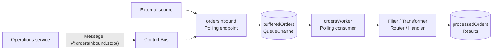
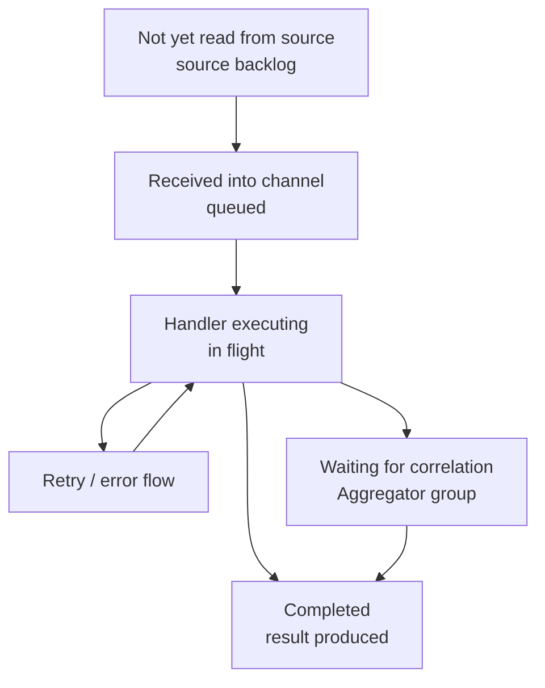
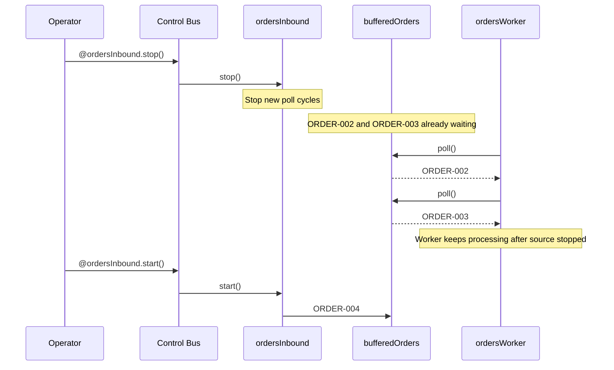

# Controlling a Flow That Currently Has In-Flight Messages

## 1. The Problem: Stopping New Intake While Messages Are Still Processing

In a Spring Integration system, a flow is rarely empty when maintenance is needed. For example, the application may be receiving orders from a partner, passing messages through a Filter and Transformer, routing with a Router, and then processing payments or sending notifications. Some messages may already be sitting in a queue, some are being processed by handlers, and others are retrying or waiting for remaining fragments in an Aggregator.

When a partner announces a service suspension, operators want to **prevent new messages from being received** while still **ensuring already-received messages are processed or preserved per policy**. Calling `stop()` on an endpoint without defining the stop boundary can cause backlog growth, missed notifications, duplicate messages, or correlation groups waiting too long.

In the **Control bus** chapter of the **SPRING_INTEGRATION_PATTERN** module, this lesson focuses on that scenario. The module's goal is implementing Enterprise Integration Patterns with Spring Integration to create loosely coupled, extensible message flows; practicing Router, Filter, Transformer, Splitter, Aggregator, Gateway, retry, error channel, and correlation, while testing and monitoring processing branches.

By the end of this lesson, you will be able to:

1. Identify the **endpoint to control**, instead of treating the entire `IntegrationFlow` as a single process.
2. Use the Control Bus to send `start()`/`stop()` commands to an inbound endpoint while **messages are already in the flow**.
3. Distinguish messages that are **not yet received**, **received and waiting**, **in flight**, and **completed**.
4. Execute the workflow: **stop intake → observe → drain → confirm → resume**.
5. Test that stopping the source does not automatically drop messages already downstream.
6. Choose appropriate handling for `QueueChannel`, `ExecutorChannel`, retries, transactions, and Aggregators.

## 2. Which Component Actually Stops When You "Stop a Flow"?

A Spring Integration flow can contain multiple endpoints and channels. `IntegrationFlow` describes how they are wired together; it does not implicitly provide a unified `pause()` command that can safely suspend the entire pipeline.

Consider a topology with an intermediate queue:



In this topology there are two endpoints that can run on independent schedules:

- **`ordersInbound`:** actively pulls data from the external source and puts messages into `bufferedOrders`.
- **`ordersWorker`:** pulls messages from `bufferedOrders` and forwards them to downstream processing.

If you execute `ordersInbound.stop()`, new polls from the external source stop according to the endpoint's lifecycle semantics. However, `ordersWorker` **can still continue pulling messages already sitting in `bufferedOrders`**.

If you execute `ordersWorker.stop()`, consumption from the intermediate queue stops; **`ordersInbound` may still keep pushing messages into the queue** if it has not been stopped. The queue will accumulate backlog and may run out of capacity. The exact impact depends on the channel type and capacity configuration.

| Stopped target | What can stop | What may continue |
| --- | --- | --- |
| `ordersInbound` | Receiving additional messages from the source on new poll cycles | Downstream worker consuming messages already in the queue |
| `ordersWorker` | Pulling more messages from `bufferedOrders` | Inbound continuing to push messages into the queue if still running |
| Both endpoints | New polls at both points after they stop | Messages already handed to handlers, retries, async executors, or Aggregator |
| Entire application | Depends on bean-by-bean shutdown and infrastructure | External resources may still have unacknowledged messages or pending replays |

**There is no universal guarantee that `stop()` will recall in-flight messages, roll back all transactions, or wait until every downstream branch is "empty."** Exact guarantees depend on the endpoint/adapter and the channel, transaction, executor, and message store types.

## 3. Classifying Messages by Processing State

Before sending a command, identify the message groups:



| Group | Examples | When the inbound poller stops |
| --- | --- | --- |
| **Not yet read** | Database rows, broker messages, items still in source queue | May stay at the source if the source retains backlog; check checkpoints/acks |
| **In channel** | Messages inside a `QueueChannel` | May continue being consumed by the worker if the worker is still running |
| **In flight** | Handler calling a partner API or writing to DB | May continue, complete, or fail; depends on transactions and stop semantics |
| **Retrying** | Failed request entered retry policy | May keep retrying, route to error channel, or stay scheduled for retry |
| **Awaiting aggregation** | An incomplete correlation group | Remains waiting in the MessageStore under timeout/expiration policy |
| **Completed** | Message confirmed as processed successfully | Stop command does not automatically undo already-committed side effects |

When an operator says "stop the flow now," clarify whether they mean **stop new intake**, **wait for in-flight messages to finish**, or **deliberately cancel tasks**. These are three distinct requirements that usually need three different mechanisms.

## 4. Java DSL Example: Independent Source and Worker

The example uses a `BlockingQueue` as a simulated data source, a `QueueChannel` as an intermediate buffer, and a second endpoint consuming the buffer. Splitting them this way clearly shows messages mid-flow while the source is stopped.

Dependencies in a Spring Boot project with version management:

```gradle
dependencies {
    implementation("org.springframework.boot:spring-boot-starter-integration")
    testImplementation("org.springframework.boot:spring-boot-starter-test")
}
```

Create `LiveFlowConfiguration.java`:

```java
package example.controlbus;

import java.time.Duration;
import java.util.concurrent.BlockingQueue;
import java.util.concurrent.LinkedBlockingQueue;

import org.springframework.context.annotation.Bean;
import org.springframework.context.annotation.Configuration;
import org.springframework.integration.channel.DirectChannel;
import org.springframework.integration.channel.QueueChannel;
import org.springframework.integration.config.EnableIntegration;
import org.springframework.integration.core.MessageSource;
import org.springframework.integration.dsl.IntegrationFlow;
import org.springframework.integration.dsl.Pollers;
import org.springframework.messaging.MessageChannel;
import org.springframework.messaging.support.MessageBuilder;

@Configuration
@EnableIntegration
public class LiveFlowConfiguration {

    @Bean
    public MessageChannel controlChannel() {
        return new DirectChannel();
    }

    @Bean
    public IntegrationFlow controlBusFlow() {
        return IntegrationFlow.from("controlChannel")
                .controlBus()
                .get();
    }

    // Source-side backlog, exists only in application memory.
    @Bean
    public BlockingQueue<String> sourceBacklog() {
        return new LinkedBlockingQueue<>();
    }

    @Bean
    public MessageSource<String> orderSource(
            BlockingQueue<String> sourceBacklog) {
        return () -> {
            String orderId = sourceBacklog.poll();
            return orderId == null
                    ? null
                    : MessageBuilder.withPayload(orderId).build();
        };
    }

    // Buffer between the intake endpoint and the downstream worker.
    @Bean
    public QueueChannel bufferedOrders() {
        return new QueueChannel();
    }

    // Where tests read messages that have passed through the worker.
    @Bean
    public QueueChannel processedOrders() {
        return new QueueChannel();
    }

    // First endpoint: reads from the source and puts messages into the intermediate queue.
    @Bean
    public IntegrationFlow ordersIntakeFlow(
            MessageSource<String> orderSource) {
        return IntegrationFlow
                .from(orderSource, endpoint -> endpoint
                        .id("ordersInbound")
                        .autoStartup(false)
                        .poller(Pollers.fixedDelay(
                                Duration.ofMillis(200))))
                .channel("bufferedOrders")
                .get();
    }

    // Second endpoint: worker pulls messages from the QueueChannel.
    @Bean
    public IntegrationFlow ordersProcessingFlow() {
        return IntegrationFlow
                .from("bufferedOrders", endpoint -> endpoint
                        .id("ordersWorker")
                        .poller(Pollers.fixedDelay(
                                Duration.ofMillis(200))))
                .channel("processedOrders")
                .get();
    }
}
```

### Key Configuration Points

| Configuration | Role |
| --- | --- |
| `controlChannel` + `.controlBus()` | Channel and handler that execute SpEL commands |
| `.id("ordersInbound")` | ID of the **inbound polling endpoint** to stop receiving new items |
| `.autoStartup(false)` | Source starts stopped so it can be explicitly started in the exercise |
| `bufferedOrders()` | Queue holding messages that entered the pipeline but haven't been picked up by the worker |
| `.id("ordersWorker")` | ID of the **worker polling endpoint** reading from the queue |
| `processedOrders()` | Output queue to verify messages that passed through the worker |

`ordersProcessingFlow` configures polling on a `PollableChannel`. By default, `ordersWorker` starts automatically when the context starts, whereas `ordersInbound` runs only after a start command. Hence, even while the source is stopped, the worker can still read messages already in `bufferedOrders`.

This example intentionally uses an **in-memory** `QueueChannel` with unbounded capacity to focus on lifecycle behavior. It **does not guarantee data persistence when the JVM stops**; never use an unbounded buffer configuration as a production default because backlog can exhaust memory. For data that must survive restarts, evaluate a durable `MessageStore` or broker, bounded capacity, retry/ack, and an appropriate recovery strategy.

### Conditions for Messages to Keep Flowing

If `ordersInbound` already placed a message into `bufferedOrders`, calling `ordersInbound.stop()` afterward does not delete the message in the queue. As `ordersWorker` continues polling, the message is still forwarded to `processedOrders` in this example.

If both endpoints are stopped, messages in `bufferedOrders` wait until a consumer becomes active again (or until the queue is cleared, messages expire under another policy, or the process terminates and loses in-memory data).

## 5. Controlling via Messages Through the Control Bus

The Control Bus evaluates SpEL expressions referencing endpoint beans:

```text
@ordersInbound.start()
@ordersInbound.stop()
@ordersInbound.isRunning()

@ordersWorker.start()
@ordersWorker.stop()
@ordersWorker.isRunning()
```

To stop fetching new messages from the source while still processing backlog already in the queue, send only **`@ordersInbound.stop()`**.

Create the internal admin service `LiveFlowControlService.java`:

```java
package example.controlbus;

import org.springframework.beans.factory.annotation.Qualifier;
import org.springframework.context.ApplicationContext;
import org.springframework.context.Lifecycle;
import org.springframework.messaging.MessageChannel;
import org.springframework.messaging.support.MessageBuilder;
import org.springframework.stereotype.Service;

@Service
public class LiveFlowControlService {

    private final MessageChannel controlChannel;
    private final ApplicationContext context;

    public LiveFlowControlService(
            @Qualifier("controlChannel") MessageChannel controlChannel,
            ApplicationContext context) {
        this.controlChannel = controlChannel;
        this.context = context;
    }

    public void startIntake() {
        send("@ordersInbound.start()");
    }

    public void stopIntake() {
        send("@ordersInbound.stop()");
    }

    public void startWorker() {
        send("@ordersWorker.start()");
    }

    public void stopWorker() {
        send("@ordersWorker.stop()");
    }

    public boolean isIntakeRunning() {
        return context.getBean("ordersInbound", Lifecycle.class)
                .isRunning();
    }

    public boolean isWorkerRunning() {
        return context.getBean("ordersWorker", Lifecycle.class)
                .isRunning();
    }

    private void send(String expression) {
        boolean accepted = controlChannel.send(
                MessageBuilder.withPayload(expression).build());

        if (!accepted) {
            throw new IllegalStateException(
                    "Control command was not accepted");
        }
    }
}
```

In this example, `MessageChannel.send()` returns `true` if the channel accepts the message under its contract; this is **not** the value of `isRunning()`. Because a synchronous `DirectChannel` is used, exceptions from the Control Bus handler usually propagate to the caller, yet you should still re-read `Lifecycle.isRunning()` after sending.

The service exposes only **methods that emit fixed expressions**. In a real application, add authentication, authorization, auditing, and ensure no untrusted source is wired directly to `controlChannel`. A Control Bus payload is an expression evaluated in the Spring context; never accept arbitrary expressions from HTTP requests or public brokers.

## 6. Scenario with Messages Currently in the Flow

Suppose `ordersInbound` has already received three orders and put them into `bufferedOrders`, while the worker has processed one order so far:

```text
sourceBacklog:    [ORDER-004, ORDER-005]
bufferedOrders:   [ORDER-002, ORDER-003]
processedOrders:  [ORDER-001]
```

When `@ordersInbound.stop()` is sent:

1. **New intake:** `ordersInbound` is requested to stop polling; `ORDER-004` and `ORDER-005` remain at the source according to the simulated source's backlog behavior.
2. **Intermediate queue:** `ORDER-002` and `ORDER-003` remain in `bufferedOrders`; they do not vanish just because inbound stopped.
3. **Worker:** if `ordersWorker` is still running, it continues pulling messages from the queue and forwarding them downstream.
4. **Outcome:** `processedOrders` can still receive `ORDER-002` and `ORDER-003` **after the intake stop command was sent**.
5. **On resume:** send `@ordersInbound.start()`, and the poller picks up the remaining items in `sourceBacklog`.



This is the expected behavior of a design that separates **intake** from **processing**. If the maintenance goal is "prevent any downstream handler from calling the partner anymore," stopping intake alone is insufficient. You need an appropriate strategy to wait for or stop the worker, manage the backlog, and handle already-dispatched work.

## 7. Safe Stop Procedure While Messages Remain

A practical procedure is commonly called **quiesce** (stop accepting new work) followed by **drain** (wait for existing work to finish). This is an operational workflow designed by the system; the Control Bus merely provides one of the actions to carry it out.

### Step 1: Identify the Scope to Stop

First determine:

- Name and type of the inbound endpoint: polling adapter, message listener, inbound gateway, or other adapter.
- How many instances are receiving data concurrently; one Control Bus command typically affects only the `ApplicationContext` of the receiving instance.
- Which channels hold backlog, which executors still have tasks, which transactions are open, which retries are running, and which Aggregator groups are still waiting.
- Whether the goal is only to **stop new intake**, or to **completely halt downstream activity** before maintenance starts.

### Step 2: Stop Receiving New Messages

For the polling endpoint example:

```text
@ordersInbound.stop()
```

Then verify `ordersInbound.isRunning() == false` on the **exact target instance**. The stop command is not proof that all running tasks have completed. A poll cycle or handler that started prior to stop may still be executing depending on the implementation.

### Step 3: Measure and Wait for Existing Work

Let `ordersWorker` continue processing messages in `bufferedOrders` if downstream is still safe. Monitor:

- Messages still waiting in queues.
- Messages currently executing in handlers or executors.
- Scheduled retries continuing and messages in the error channel.
- Incomplete Aggregator correlation groups.
- Unacknowledged/uncommitted messages or open transactions on brokers and databases.

Example check on the in-memory queue:

```java
int queued = bufferedOrders.getQueueSize();
boolean intakeRunning = control.isIntakeRunning();
boolean workerRunning = control.isWorkerRunning();
```

**`getQueueSize() == 0` does not mean the flow has finished draining.** Messages may have left the queue yet still be processing, waiting for retry, queued in an async executor, or waiting inside an Aggregator. Combine metrics suited to the actual topology.

### Step 4: Confirm the Stop Point if Downstream Maintenance Is Needed

Once the queue is empty and no tasks remain to complete, you can stop the worker:

```text
@ordersWorker.stop()
```

Do this only if your goal actually requires stopping the worker. When maintaining only the upstream source, there is no need to stop the worker.

If waiting for all processing to finish is impossible, explicitly decide how to durably retain messages, how to retry on resume, and how to report incomplete groups. Never treat a wait timeout as a successful drain.

### Step 5: Resume in the Proper Order

If both the worker and intake were stopped:

1. Restore and verify downstream connectivity.
2. Start the worker, ensuring message consumers are operational.
3. Start the inbound endpoint.
4. Monitor backlog, errors, retries, throughput, and potentially redelivered messages.

This ordering generally prevents flooding new data while downstream is unready, though it must be adjusted for specific adapters and dependency constraints. After starting, `isRunning() == true` is only lifecycle state—it does not prove the source has successfully pulled messages yet.

## 8. Testing: Messages Already in the Queue Still Progress After Stop

The following test uses `QueueChannel` to observe two distinct situations:

- A message already in `bufferedOrders` is still processed by `ordersWorker` while `ordersInbound` is stopped.
- A message waiting in `sourceBacklog` is not read by inbound while stopped, but gets read after restarting.

Create `LiveFlowControlTest.java`:

```java
package example.controlbus;

import static org.assertj.core.api.Assertions.assertThat;

import java.util.concurrent.BlockingQueue;

import org.junit.jupiter.api.Test;
import org.springframework.beans.factory.annotation.Autowired;
import org.springframework.integration.channel.QueueChannel;
import org.springframework.messaging.Message;
import org.springframework.messaging.support.MessageBuilder;
import org.springframework.test.context.junit.jupiter.SpringJUnitConfig;

@SpringJUnitConfig({
    LiveFlowConfiguration.class,
    LiveFlowControlService.class
})
class LiveFlowControlTest {

    @Autowired
    LiveFlowControlService control;

    @Autowired
    BlockingQueue<String> sourceBacklog;

    @Autowired
    QueueChannel bufferedOrders;

    @Autowired
    QueueChannel processedOrders;

    @Test
    void stoppingIntakeDoesNotDiscardMessagesAlreadyInPipeline() {
        assertThat(control.isIntakeRunning()).isFalse();
        assertThat(control.isWorkerRunning()).isTrue();

        try {
            // Simulate a message that entered the pipeline earlier.
            assertThat(bufferedOrders.send(MessageBuilder
                    .withPayload("ALREADY_BUFFERED")
                    .build())).isTrue();

            control.stopIntake();

            // Worker is still running so it picks up the buffered message.
            Message<?> existing = processedOrders.receive(2_000);
            assertThat(existing).isNotNull();
            assertThat(existing.getPayload())
                    .isEqualTo("ALREADY_BUFFERED");

            // New messages at the source must wait while intake is stopped.
            sourceBacklog.offer("WAITING_AT_SOURCE");

            assertThat(processedOrders.receive(500)).isNull();
            assertThat(sourceBacklog).contains("WAITING_AT_SOURCE");
            assertThat(control.isIntakeRunning()).isFalse();

            control.startIntake();
            assertThat(control.isIntakeRunning()).isTrue();

            Message<?> resumed = processedOrders.receive(2_000);
            assertThat(resumed).isNotNull();
            assertThat(resumed.getPayload())
                    .isEqualTo("WAITING_AT_SOURCE");
        } finally {
            control.stopIntake();
        }

        assertThat(control.isIntakeRunning()).isFalse();
    }
}
```

In this test, `bufferedOrders.send(...)` simulates a message already admitted into the pipeline **before intake was stopped**. This makes the test demonstrate downstream behavior deterministically rather than trying to time an active poll cycle.

Test assumptions: isolated context; initially empty queues; worker poller is running; single consumer; no interference from external tasks. Timeouts on `receive(...)` are wait bounds, not production processing-time guarantees.

**Adding a true in-flight test:** use a handler that signals "processing started" and a latch to hold it at a controlled point. Once the handler has started, send stop to inbound and only then release the handler to complete. The test should assert that already-received work completes per contract or retries/rolls back per policy. Avoid writing tests that wait **indefinitely** for stop when stop and the handler could deadlock on each other.

## 9. Asynchronous Processing and Large Queues

In real systems, messages do not always flow synchronously to handlers. Different channel types have different effects:

| Channel type | What to watch when stopping |
| --- | --- |
| `DirectChannel` | Handlers typically run on the sending thread. Stopping the source does not necessarily cancel processing already started on that thread |
| `QueueChannel` | Messages stay in the queue until polled by a consumer; stopping the producer does not clear the queue |
| `ExecutorChannel` | Messages may have been handed off to an executor; track both running tasks and tasks queued in the executor |
| Store/broker-backed channel | Durability depends on the store, acks, transactions, and retention policy |
| `PublishSubscribeChannel` | May deliver to multiple subscribers; completion status must account for all relevant branches |

When `ordersInbound.stop()` succeeds, do not rely on "queue is currently empty" to conclude it is safe. For example, the worker may have pulled a message off the queue and still be calling an external API; in-flight count increases just as queue size drops to 0.

To quiesce a high-throughput system, you should have:

- **Backpressure/capacity:** bound waiting messages and define behavior when queues fill up.
- **In-flight tracking:** count active handlers as well as tasks accepted by executors that have not started executing yet.
- **Idempotency:** handle safely if messages are redelivered after timeouts or rollbacks.
- **Drain timeout:** bound wait times and report incomplete drains instead of marking false success.
- **Metrics:** received count, processed count, errors, retries, backlog, wait times, and processing latency.

### Notes on Ordering and Performance

Pausing a source and starting it again can unleash a large burst of backlog. If workers process concurrently, completion order may differ from arrival order. When business rules require preserving order, explicitly design partitioning by key, concurrency limits, sequence numbers, and resequencing if necessary. `start()`/`stop()` do not re-establish message ordering on their own.

## 10. Transactions, Acknowledgments, and Message Loss/Duplication

The in-memory `BlockingQueue` and `QueueChannel` example is designed to **illustrate lifecycle behavior**, not to guarantee "exactly once" semantics under failure.

With real adapters, ask:

1. At what point is data marked "read" at the source?
2. Are sending the message to the channel and updating the checkpoint inside the same transaction?
3. If the handler fails after the message was acknowledged, is there a replay or dead-letter mechanism?
4. If stop happens while a transaction is open, how do commit/rollback behave?
5. On resume, if the source redelivers messages, does downstream check for duplicates?

For example, an inbound adapter may have fetched a message from a broker and handed it to a handler. If the application stops or loses connectivity before acknowledging, the broker may redeliver depending on its delivery mechanism and configuration. If the handler already wrote data before the message is redelivered, use idempotency keys, deduplication, or an appropriate transaction/outbox pattern to prevent duplicate side effects.

**The Control Bus does not replace transactions, acks, retries, or error channels.** A stop command only affects the lifecycle of the invoked endpoint; how data is confirmed and durably stored remains governed by the source, adapter, and topology.

## 11. Router, Filter, Splitter, Aggregator, and Retry During Stop

EIP patterns can retain or continue forwarding work after inbound has stopped:

| Component | Risk when stopping while messages remain | How to monitor / handle |
| --- | --- | --- |
| **Router** | Messages have already been routed to different branches | Measure backlog, in-flight, and errors per branch |
| **Filter** | Some messages are intentionally discarded; easy to confuse with message loss | Track discarded messages and filter rules |
| **Transformer** | Messages already in the handler may still be transformed | Measure processing time, exceptions, and outputs |
| **Splitter** | An already-split batch still has fragments moving downstream | Track sequence/correlation and completed fragment counts |
| **Aggregator** | Incomplete groups may remain waiting in the MessageStore | Measure open groups, timeouts, expiration, and release strategy |
| **Gateway** | Already-sent requests are waiting for replies or timeouts | Count open requests/replies and enforce timeout policies |
| **Retry** | Older work may keep backing off and retrying | Monitor attempt counts, backoff, idempotency, and deadlines |
| **Error channel** | Failed messages may still be processed after stop | Watch the error flow, dead-letter queue, and error classification |

In a flow with a Splitter/Aggregator, merely seeing inbound stopped and queue size at 0 **does not mean** all correlation groups have completed. Inspect the MessageStore and the Aggregator's release/expiration policies. Some groups may miss fragments because upstream stopped, the source lagged, or a branch failed.

If downstream cannot accept additional work during maintenance, plan to wait for active handlers to finish and durably store remaining messages. Never use a Filter to silently discard messages and call it a "pause."

## 12. Observing State and Sending Commands Safely

### 12.1. Distinguishing State from Effectiveness

Three levels to report separately to operators:

| Level | Evidence | What it does NOT prove |
| --- | --- | --- |
| **Command sent** | `MessageChannel.send()` accepted the message | Endpoint reached target state or drained |
| **Endpoint stopped** | `Lifecycle.isRunning() == false` on the right bean | No in-flight work, retries, queued messages, or active replicas remain |
| **Flow safe for maintenance** | Queues, in-flight tasks, retries, correlation groups, and transactions are in a safe state | No new messages exist in external systems if sources keep generating data |

Instead of reporting `STOPPED` for the whole system immediately after sending one command, an admin UI can display distinct states:

- `STOP_REQUESTED` — request was dispatched.
- `INTAKE_STOPPED` — inbound endpoint reports stopped.
- `DRAINING` — remaining messages are being processed.
- `DRAINED` — defined drain conditions have been satisfied.
- `FAILED` / `UNKNOWN` — error or insufficient confirmation data.

This is an **application-designed operational state model**, not built-in states provided by Spring Integration.

### 12.2. Security

Control Bus payloads are SpEL, so only an authenticated and authorized administrative source may generate commands. Never take `beanName`, `methodName`, or a full expression from a client and concatenate strings to send into the channel.

The `LiveFlowControlService` example above uses fixed expressions. In production, enforce per-endpoint start/stop authorization, audit actor/action/instance/time, and prohibit adapters receiving external data from sending directly to `controlChannel`.

### 12.3. Multiple Instances

An `@ordersInbound.stop()` command sent to instance A's Control Bus only affects **A**'s bean. If instances B and C keep running, they can continue pulling messages from the same source. A cluster-wide coordinator must send or route commands to every instance that needs to stop and verify each one's status. Unresponsive instances must be marked **unknown**, never assumed stopped.

## 13. Common Mistakes

| Symptom | Possible cause | How to address |
| --- | --- | --- |
| Stopped inbound yet handler logs still appear | Messages were already in queue/handler or retries are running | Check in-flight counts, worker, retries, and messages received before the command |
| `isRunning() == false` yet queue is non-empty | Stopping source does not empty intermediate queues | Let the worker continue draining or persist the backlog durably |
| Stopped worker while inbound kept running | Controlled the wrong endpoint | Identify the exact IDs of source and consumer; monitor capacity |
| Queue size is 0 yet unsafe for maintenance | Handlers/executors still have tasks, Aggregator still has groups | Monitor post-queue states |
| Stopping source causes message loss after restart | Buffer was memory-only or ack/checkpoint was mismatched | Use durable broker/store, transactions, or replay |
| Duplicates appear on resume | Broker redelivered or action committed before ack error | Use idempotency and test recovery |
| One node stopped yet cluster keeps receiving | Control Bus acts within one `ApplicationContext` | Coordinate and verify each instance |
| Command reports success yet app receives no data after resume | Command only toggled lifecycle; source or downstream still errored | Check upstream health, metrics, errors, and backlog |

## 14. Hands-On Exercises

**Exercise 1 — Stop intake while backlog remains.** Start `ordersInbound` and `ordersWorker`, and push multiple orders into the source. Once several are in `bufferedOrders`, send `@ordersInbound.stop()`. Observe that the worker can continue processing already-received messages while the source backlog is read only after restarting.

**Exercise 2 — Stopping the wrong endpoint.** Keep `ordersInbound` running and stop `ordersWorker`. Measure `bufferedOrders` growing in size. Explain the cause and propose capacity limits, backpressure, or stopping the source first.

**Exercise 3 — Proper drain.** Add a slow handler and an in-flight counter. Define a drain condition requiring an empty queue, zero in-flight tasks, and zero pending retries. When a timeout expires, return an incomplete status rather than reporting success.

**Exercise 4 — Retry and Aggregator.** Have a Splitter create a group of messages with a correlation ID; make one branch fail and enter retry. Stop inbound. Track the incomplete group and determine how timeout/expiration affects the outcome.

**Exercise 5 — Two replicas.** Have A and B poll the same source. Stop inbound on A. Demonstrate that B can still receive messages, then describe the coordination mechanism needed to stop both without equating one instance's state with the whole cluster.

## 15. Self-Check Questions

1. Why might calling `@ordersInbound.stop()` not immediately stop message-processing logs?
2. What is the difference between stopping **inbound** and stopping the **worker** when a `QueueChannel` sits in between?
3. Why is `bufferedOrders.getQueueSize() == 0` insufficient to prove the flow has drained?
4. When using `ExecutorChannel`, which messages may still be pending even though inbound is stopped?
5. Does stop automatically roll back already-acknowledged messages or committed side effects?
6. Which groups might remain in an Aggregator after the receiver has stopped?
7. Why does sending commands via the Control Bus require an allowlist, authorization, and auditing?
8. When multiple replicas exist, what evidence is needed to confirm new intake has stopped across the entire cluster?

**Key takeaway:** Controlling a flow with in-flight messages begins by **choosing the right endpoint to stop new intake**, then **observing and handling messages already in the pipeline**. The Control Bus provides message-driven lifecycle commands; data integrity still depends on channels, adapters, retries, transactions, correlation, and drain/resume procedures tailored to your system.
