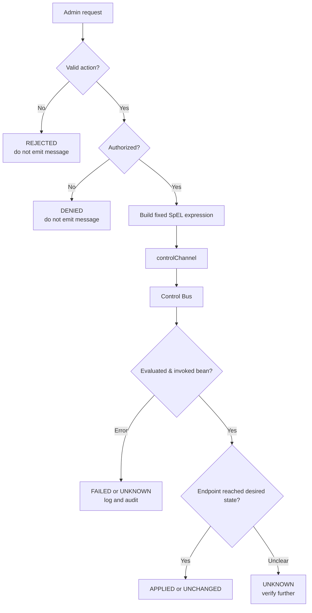

# Handling Invalid Commands

## 1. Context and Objective

In **Spring Integration**, the Control Bus allows sending control messages to a running endpoint without restarting the application. For example, an administrative service sends a SpEL payload:

```text
@ordersPoller.start()
@ordersPoller.stop()
@ordersPoller.isRunning()
```

The Control Bus evaluates the expression to interact with the target bean in the Spring `ApplicationContext`. This is a useful capability when implementing **Enterprise Integration Patterns (EIP)**: a system may consist of Router, Filter, Transformer, Splitter, Aggregator, Gateway, retry, error channel, and correlation. However, an **invalid command** must be detected at the right layer, handled explicitly, and prevented from disrupting business flows.

In the **SPRING_INTEGRATION_PATTERN** module, the goal is to build loosely coupled, extensible flows while testing and observing every branch. This lesson belongs to the **Control bus** chapter and addresses the question: if someone sends an unsupported action, a malformed SpEL expression, a non-existent bean id, or a command to an endpoint already in the wrong state, how should the system respond?

After this lesson, you will be able to:

1. Classify errors across **input**, **access permissions**, **expression evaluation**, **message delivery**, and **operational state**.
2. Design a control path that permits only predefined actions without accepting arbitrary SpEL from outside.
3. Distinguish `REJECTED`, `FAILED`, `UNKNOWN`, and valid commands that make no state change.
4. Handle synchronous errors on `DirectChannel` and establish error-receiving/confirmation strategies for asynchronous flows.
5. Write tests for unsupported commands, non-existent target beans, missing permissions, and repeated start/stop calls.
6. Write audit logs and inspect impact on in-flight messages when a control command fails.

## 2. A Command Can Be Invalid at Multiple Layers

Do not treat every control failure as "invalid SpEL syntax." Some requests must be blocked **before becoming messages**, while others fail only when the Control Bus processes them or when the endpoint transitions state.



| Scenario type | Example | Appropriate handling stage |
| --- | --- | --- |
| Unsupported action | `"RESET_ALL"` outside the command list | Validation/allowlist before the Control Bus |
| Missing or wrong-type payload | `null`, object instead of action name | API or service boundary |
| Insufficient permissions | Status viewer sends a stop command | Authentication and authorization |
| Invalid SpEL | Expression constructed by internal code has syntax errors | When the Control Bus handler evaluates |
| Invalid bean/method | `@missingPoller.stop()` or bean lacks `stop()` | During bean resolution or method invocation |
| Channel failure | No subscribers, channel rejects message | When sending the command |
| Endpoint already in target state | Stopping an already stopped endpoint | Can be treated as an **idempotent no-op**, not necessarily an error |
| Outcome unconfirmed | Timeout, unresponsive replica, concurrent state change | Post-command verification procedure |
| Error from lifecycle operation | Endpoint throws exception during start/stop | Operational error; log cause and verify consequences |

**Distinction to keep clear:** "unsupported" and "dispatched but failed during execution" are two different situations. A request with an unknown action should be rejected early; a valid command whose target endpoint is missing is a configuration or operational failure and must not be reported as if the user merely typed an invalid action.

## 3. Allowed Command Set and Meaningful Responses

Suppose the operations team is permitted to control the `ordersPoller` endpoint. The public contract contains only:

```json
{"action": "START_ORDERS"}
```

or:

```json
{"action": "STOP_ORDERS"}
```

The application maps these internally to fixed expressions:

| External action | Internal expression | Required permission |
| --- | --- | --- |
| `START_ORDERS` | `@ordersPoller.start()` | `integration.orders.write` |
| `STOP_ORDERS` | `@ordersPoller.stop()` | `integration.orders.write` |

Never accept a request like `{"expression":"..."}` and forward the string verbatim to the Control Bus. Nor should you concatenate user-supplied `beanName` and `methodName` into an expression. A Control Bus payload can be **evaluated** in the application context; it is a high-privilege administrative path.

An **application-defined** set of administrative result codes may include:

| Code | Interpretation | Usage |
| --- | --- | --- |
| `REJECTED` | Action not in contract or invalid input data | Do not send any control message |
| `DENIED` | Caller is not authorized to perform the action | Block before service or at Spring Security proxy |
| `APPLIED` | Command executed and desired state was observed | Record outcome and observation timestamp |
| `UNCHANGED` | Endpoint was already in the desired state before the command | Return success without mutating state, if that is the desired policy |
| `FAILED` | Clear evidence of validation/channel/configuration failure | Report error, log root cause, avoid blind retries |
| `UNKNOWN` | Insufficient evidence to determine effect | Re-query state with bounded timeout; never infer success |

The codes above **are not built-in Spring Integration enums**. They help APIs and operations dashboards express state accurately. A command may have produced side effects before an exception or timeout occurred; when consequences cannot be confirmed, choosing `UNKNOWN` is safer than asserting the endpoint was definitely unaffected.

### 3.1. Idempotency and Repeated Commands

If `ordersPoller.isRunning() == true`, another `START_ORDERS` request usually does not need to re-execute. You can return `UNCHANGED` along with observed state `true`. Likewise, stopping an already stopped endpoint can be a successful no-op.

However, reading `isRunning()` and then calling `start()` or `stop()` is not an atomic transaction. Another administrative task might change the state immediately after reading. For systems with multiple coordinators, use synchronization/coordination mechanisms and request versions or request IDs if strict command ordering is required.

## 4. Sample Configuration for Testing Commands

The example below uses Spring Boot with Spring Integration Java DSL. A polling endpoint reads order IDs from an in-memory queue; the Control Bus receives commands via `controlChannel`.

Gradle dependencies in a Spring Boot project with version management:

```gradle
dependencies {
    implementation("org.springframework.boot:spring-boot-starter-integration")
    implementation("org.springframework.boot:spring-boot-starter-security")
    testImplementation("org.springframework.boot:spring-boot-starter-test")
    testImplementation("org.springframework.security:spring-security-test")
}
```

Place the sample classes in package `example.controlbus`; the application uses Java 17+.

```java
package example.controlbus;

import java.time.Duration;
import java.util.concurrent.BlockingQueue;
import java.util.concurrent.LinkedBlockingQueue;

import org.springframework.context.annotation.Bean;
import org.springframework.context.annotation.Configuration;
import org.springframework.integration.channel.DirectChannel;
import org.springframework.integration.config.EnableIntegration;
import org.springframework.integration.core.MessageSource;
import org.springframework.integration.dsl.IntegrationFlow;
import org.springframework.integration.dsl.Pollers;
import org.springframework.messaging.MessageChannel;
import org.springframework.messaging.support.MessageBuilder;
import org.springframework.security.config.annotation.method.configuration.EnableMethodSecurity;

@Configuration
@EnableIntegration
@EnableMethodSecurity
public class ControlBusDemoConfiguration {

    @Bean
    public MessageChannel controlChannel() {
        return new DirectChannel();
    }

    @Bean
    public IntegrationFlow controlBusFlow() {
        return IntegrationFlow.from("controlChannel")
                .controlBus()
                .get();
    }

    @Bean
    public BlockingQueue<String> orderQueue() {
        return new LinkedBlockingQueue<>();
    }

    @Bean
    public MessageSource<String> orderSource(
            BlockingQueue<String> orderQueue) {
        return () -> {
            String id = orderQueue.poll();
            return id == null
                    ? null
                    : MessageBuilder.withPayload(id).build();
        };
    }

    @Bean
    public IntegrationFlow ordersFlow(MessageSource<String> orderSource) {
        return IntegrationFlow.from(orderSource, endpoint -> endpoint
                        .id("ordersPoller")
                        .autoStartup(false)
                        .poller(Pollers.fixedDelay(Duration.ofSeconds(1))))
                .handle(message -> System.out.println(
                        "Received order: " + message.getPayload()))
                .get();
    }
}
```

Key points:

- `controlChannel` is dedicated to control messages; it does not enforce per-user authorization on its own.
- `.controlBus()` registers the handler that evaluates expressions from messages sent to the channel.
- `.id("ordersPoller")` assigns the ID to the **polling inbound endpoint**. This is the bean name referenced by the Control Bus.
- `.autoStartup(false)` enables testing the stopped state right after context creation.
- `DirectChannel` delivers messages synchronously to the subscriber in this configuration; exceptions thrown while handling a command typically propagate back to the sending thread.

The `orderQueue` example is an in-memory source and does not guarantee data retention when the JVM exits. With a broker or another adapter, verify its specific stop/start, acknowledgment, transaction, and replay contracts.

## 5. Service That Blocks Invalid Actions Before the Control Bus

We use an enum to specify the action, then emit **fixed expressions** from the application. The service also separates caller errors from execution errors.

### 5.1. Actions and Results

```java
package example.controlbus;

public enum OrderAction {
    START_ORDERS,
    STOP_ORDERS
}
```

```java
package example.controlbus;

public enum CommandStatus {
    REJECTED,
    APPLIED,
    UNCHANGED,
    FAILED,
    UNKNOWN
}
```

```java
package example.controlbus;

public record CommandResult(
        CommandStatus status,
        Boolean observedRunning,
        String message) {
}
```

`observedRunning` is of type `Boolean` so it can return `null` when status cannot be read. Never force a timeout or query error to `false`, because `false` means the endpoint actually reported stopped.

### 5.2. Service Implementation

```java
package example.controlbus;

import org.slf4j.Logger;
import org.slf4j.LoggerFactory;
import org.springframework.beans.BeansException;
import org.springframework.beans.factory.annotation.Qualifier;
import org.springframework.context.ApplicationContext;
import org.springframework.context.Lifecycle;
import org.springframework.messaging.MessageChannel;
import org.springframework.messaging.support.MessageBuilder;
import org.springframework.security.access.prepost.PreAuthorize;
import org.springframework.stereotype.Service;

@Service
public class SafeOrderControlService {

    private static final Logger log =
            LoggerFactory.getLogger(SafeOrderControlService.class);

    private final MessageChannel controlChannel;
    private final ApplicationContext context;

    public SafeOrderControlService(
            @Qualifier("controlChannel") MessageChannel controlChannel,
            ApplicationContext context) {
        this.controlChannel = controlChannel;
        this.context = context;
    }

    @PreAuthorize("hasAuthority('SCOPE_integration.orders.write')")
    public CommandResult execute(String rawAction) {
        // Reject out-of-contract input before building SpEL.
        if (rawAction == null) {
            return new CommandResult(
                    CommandStatus.REJECTED, null, "Action is required");
        }

        final OrderAction action;
        try {
            action = OrderAction.valueOf(rawAction);
        } catch (IllegalArgumentException ex) {
            return new CommandResult(
                    CommandStatus.REJECTED, null, "Unsupported action");
        }

        final Lifecycle endpoint;
        try {
            endpoint = context.getBean("ordersPoller", Lifecycle.class);
        } catch (BeansException ex) {
            log.error("Lifecycle endpoint ordersPoller is unavailable", ex);
            return new CommandResult(
                    CommandStatus.FAILED, null, "Endpoint unavailable");
        }

        boolean desiredRunning = action == OrderAction.START_ORDERS;

        try {
            // A repeated request can be a valid no-op.
            if (endpoint.isRunning() == desiredRunning) {
                return new CommandResult(
                        CommandStatus.UNCHANGED,
                        desiredRunning,
                        "Already in requested state");
            }

            // Never concatenate bean name or method name from input.
            String expression = switch (action) {
                case START_ORDERS -> "@ordersPoller.start()";
                case STOP_ORDERS -> "@ordersPoller.stop()";
            };

            boolean accepted = controlChannel.send(
                    MessageBuilder.withPayload(expression).build());

            if (!accepted) {
                return new CommandResult(
                        CommandStatus.FAILED,
                        null,
                        "Control channel did not accept command");
            }

            // Reliable only within this instance, at read time.
            boolean observed = endpoint.isRunning();
            return new CommandResult(
                    observed == desiredRunning
                            ? CommandStatus.APPLIED
                            : CommandStatus.UNKNOWN,
                    observed,
                    observed == desiredRunning
                            ? "Requested state observed"
                            : "State not confirmed");
        } catch (RuntimeException ex) {
            // Command may have partially taken effect before the error occurred.
            log.error("Control Bus command failed: {}", action, ex);
            return new CommandResult(
                    CommandStatus.UNKNOWN,
                    null,
                    "Command result could not be confirmed");
        }
    }
}
```

### 5.3. Why Process in This Order?

1. **Validation first:** Invalid actions return `REJECTED`; no SpEL is built and no message is sent to the Control Bus.
2. **Authorization at the call boundary:** `@PreAuthorize` checks authority before entering the method via the Spring proxy. Unauthorized callers are rejected, typically raising `AccessDeniedException`.
3. **Configuration check:** If the `ordersPoller` bean does not exist or does not implement `Lifecycle`, that is a configuration error—report `FAILED` and log internally.
4. **Fixed commands:** Only two expressions exist in source code; caller-provided actions are never used to construct arbitrary SpEL syntax.
5. **Idempotency:** If the endpoint is already in the desired state, return `UNCHANGED` rather than treating it as an error.
6. **Post-send verification:** With synchronous `DirectChannel` in the example, re-reading `isRunning()` verifies the target state. If it does not match, return `UNKNOWN` for further investigation.
7. **Execution errors:** If an exception occurs after starting to send the command, it is uncertain whether side effects happened. Log details internally and return a safe result without leaking stack traces to the API.

**Important limitation:** `@PreAuthorize` applies only to calls going through a Spring Security proxy when method security is enabled. Another component sending a message directly to `controlChannel` will **not** pass through this service's authorization check. Ensure all untrusted inputs go only to the controlled service, never directly to the Control Bus.

In production, the HTTP API must also authenticate callers (e.g., via SecurityFilterChain, Resource Server, or an appropriate mechanism), verify endpoint/tenant/environment scope, and translate outcomes into meaningful HTTP statuses. Permissions to view status should be separated from permissions to start/stop.

## 6. Sample Responses for Invalid Cases

Suppose a protected API invokes `SafeOrderControlService.execute(rawAction)`. The following cases can be mapped to responses:

| Case | Service result | Suggested HTTP | Notes |
| --- | --- | --- | --- |
| Missing `action` | `REJECTED` | 400 | No message emitted |
| `action = "RESET_ALL"` | `REJECTED` | 400 | Do not disclose internal bean list |
| Unauthenticated | Blocked by HTTP security | 401 | Service not invoked |
| Authenticated but lacking authority | `AccessDeniedException` | 403 | No message emitted |
| `START_ORDERS` when already running | `UNCHANGED` | 200 | Idempotent no-op per policy |
| `STOP_ORDERS` and stopped observed | `APPLIED` | 200 | Confirms only target endpoint's lifecycle |
| Target endpoint does not exist | `FAILED` | 5xx | Operational configuration error |
| Command sent yet outcome uncertain | `UNKNOWN` | 202 or 503 per contract | Do not promise state reached; provide a way to re-query |

**Never record `SUCCEEDED` solely because `MessageChannel.send() == true`.** This boolean reports message delivery, not lifecycle state or order-processing outcome. When the system uses asynchronous channels, `send()` can return before the Control Bus actually evaluates the expression.

If you want to return HTTP 202 for `UNKNOWN`, provide a mechanism to query command status by request id; without such a mechanism, 503 with instructions to re-check may be more appropriate. HTTP mapping is an API design decision, not automatic Control Bus behavior.

## 7. When the Control Bus Directly Receives a Bad Expression

The service in the previous section deliberately prevents external callers from passing arbitrary SpEL. Even so, a configuration mistake or bug in internal code might still send an invalid expression:

```text
@missingPoller.stop()
```

The expression above may be syntactically valid while the target bean does not exist. When the handler attempts to resolve the bean, an exception can be thrown. Other errors can come from syntax errors, unsupported methods, exceptions inside the invoked method itself, or expressions returning unexpected values.

On a synchronous `DirectChannel` path:

```java
try {
    controlChannel.send(
            MessageBuilder
                    .withPayload("@missingPoller.stop()")
                    .build());
} catch (RuntimeException ex) {
    // Internal: log cause, correlation id, and intended endpoint.
    // External API: return a sanitized error message.
}
```

**Do not hardcode every exception to a single class** in business code: the actual exception may be wrapped by Spring Messaging/Integration, while the root cause could be a bean resolution failure, a SpEL evaluation error, or a lifecycle method failure. Handling code should log the internal exception chain while returning limited information externally.

For messages sent over asynchronous channels, the handler may execute on a different thread, so exceptions **do not necessarily** propagate back to the thread calling `send()`. Configure an error flow/`errorChannel` matched to the endpoint and channel, along with an execution confirmation strategy. Never assume that merely declaring a channel named `errorChannel` automatically routes every asynchronous failure into it.

### Classifying Outcomes from Error Messages

| Indicator | Hypothesis | Check |
| --- | --- | --- |
| Bean not found | Wrong id or wrong ApplicationContext | Check the id assigned on the endpoint |
| No `stop()` method | Confused a channel/handler with a lifecycle-capable endpoint | Check bean type and `Lifecycle` |
| SpEL syntax error | Literal expression written by internal code is malformed | Review the literal and test in context |
| Channel has no subscriber | Control Bus flow was not wired/initialized | Check topology and channel |
| Handler method throws exception | Endpoint failed during start/stop | Inspect root cause and post-error state |
| Timeout waiting for confirmation | Slow handler, network error, or unresponsive node | Status `UNKNOWN`; inspect by request id |

Invalid SpEL strings should only be used in an **isolated test environment** to verify error-handling paths. Never feed untrusted expressions from the network or users into the Control Bus "to see if it is valid."

## 8. Testing Both Valid and Rejection Paths

The test below uses JUnit, AssertJ, and `spring-security-test`. It runs with `@SpringJUnitConfig`, testing a Spring context containing the exact configuration and service protected by method security.

```java
package example.controlbus;

import static org.assertj.core.api.Assertions.assertThat;
import static org.assertj.core.api.Assertions.assertThatThrownBy;

import org.junit.jupiter.api.Test;
import org.springframework.beans.factory.annotation.Autowired;
import org.springframework.beans.factory.annotation.Qualifier;
import org.springframework.context.ApplicationContext;
import org.springframework.context.Lifecycle;
import org.springframework.messaging.MessageChannel;
import org.springframework.messaging.support.MessageBuilder;
import org.springframework.security.access.AccessDeniedException;
import org.springframework.security.test.context.support.WithMockUser;
import org.springframework.test.context.junit.jupiter.SpringJUnitConfig;

@SpringJUnitConfig({
    ControlBusDemoConfiguration.class,
    SafeOrderControlService.class
})
class InvalidControlCommandTest {

    @Autowired
    SafeOrderControlService service;

    @Autowired
    ApplicationContext context;

    @Autowired
    @Qualifier("controlChannel")
    MessageChannel controlChannel;

    @Test
    @WithMockUser(authorities = "SCOPE_integration.orders.write")
    void unknownActionIsRejectedWithoutChangingLifecycle() {
        Lifecycle poller = context.getBean(
                "ordersPoller", Lifecycle.class);
        boolean before = poller.isRunning();

        CommandResult result = service.execute("RESET_ALL");

        assertThat(result.status()).isEqualTo(CommandStatus.REJECTED);
        assertThat(poller.isRunning()).isEqualTo(before);
    }

    @Test
    @WithMockUser(authorities = "SCOPE_integration.orders.write")
    void repeatedStartIsAnIdempotentNoOp() {
        Lifecycle poller = context.getBean(
                "ordersPoller", Lifecycle.class);

        try {
            CommandResult started = service.execute("START_ORDERS");
            assertThat(started.status()).isEqualTo(
                    CommandStatus.APPLIED);
            assertThat(poller.isRunning()).isTrue();

            CommandResult repeated = service.execute("START_ORDERS");
            assertThat(repeated.status()).isEqualTo(
                    CommandStatus.UNCHANGED);
            assertThat(poller.isRunning()).isTrue();
        } finally {
            service.execute("STOP_ORDERS");
        }

        assertThat(poller.isRunning()).isFalse();
    }

    @Test
    @WithMockUser(authorities = "SCOPE_integration.orders.read")
    void readOnlyCallerCannotSubmitControlAction() {
        Lifecycle poller = context.getBean(
                "ordersPoller", Lifecycle.class);
        boolean before = poller.isRunning();

        assertThatThrownBy(() -> service.execute("STOP_ORDERS"))
                .isInstanceOf(AccessDeniedException.class);

        assertThat(poller.isRunning()).isEqualTo(before);
    }

    @Test
    void invalidInternalBeanReferenceRaisesAnError() {
        // Simulates an internal bug only; never let clients send raw SpEL.
        assertThatThrownBy(() -> controlChannel.send(
                MessageBuilder
                        .withPayload("@missingPoller.stop()")
                        .build()))
                .isInstanceOf(RuntimeException.class);
    }
}
```

The tests above assume an isolated Spring context with no other administrative threads altering state. If multiple tests share a context, perform cleanup and ensure order independence; add timeouts for pollers/handlers if asynchronous flows are introduced. Tests do not need to submit destructive expressions to prove an allowlist policy works.

**Additional HTTP tests:** If the application exposes a REST API, include tests verifying that requests missing a body, containing an unknown action, or lacking permissions are handled **before creating any message**. `@WithMockUser` tests method security with simulated authorities; it does not verify that real JWT tokens are validated and mapped to the right scopes.

## 9. Never Confuse Command Errors with Business Message Processing Errors

Suppose the Control Bus receives `@ordersPoller.stop()` and the command completes. Some earlier messages may still be in:

- `QueueChannel` waiting for a consumer;
- handlers currently processing;
- retry with backoff;
- `errorChannel` or a dead-letter flow;
- Aggregator holding incomplete correlation groups.

A stop command does not delete those messages or roll back committed side effects.

Conversely, if the Control Bus fails to invoke `stop()`, the endpoint may still be polling. Hence, during maintenance procedures, monitor **control state** and **business state** in parallel.

| EIP component | What to inspect when a control command fails? |
| --- | --- |
| Router | Is the source still feeding new messages into branches? |
| Filter | Are messages being discarded by rule or due to a routing error? |
| Transformer | Are in-flight messages continuing to be transformed? |
| Splitter | Are any batches partially split? |
| Aggregator | Are correlation groups waiting for remaining fragments or timing out? |
| Gateway | Are requests waiting for replies and at risk of timing out? |
| Retry | Are older tasks retrying; are errors rising while the source keeps polling? |
| Error channel | Does the error belong to command/control or business messages; where was it recorded? |

Separating these error categories keeps the operations team from misdiagnosing issues: a SpEL exception is not a Transformer error; a payment error during retry does not prove the stop command failed.

## 10. Concurrency, Command Retries, and Multi-Instance Environments

### 10.1. Conflicting Commands

One operator sends `START_ORDERS`, while another sends `STOP_ORDERS` almost simultaneously. Although each command is valid, the final state depends on execution ordering and system threads. Reading `isRunning()` after each command may already be stale by the time the caller displays the result.

For critical endpoints, add per-endpoint command serialization, coordinator-managed `desiredState`, request versions, and per-operation correlation IDs. Never treat reading the current state as a synchronization lock.

### 10.2. Resending After a Timeout

If a caller times out while sending `STOP_ORDERS`, you cannot infer the command did not run. Resending can be valid if start/stop are defined as idempotent, yet the system must still verify state and avoid accidentally overwriting a newer intent.

Record `requestId`, timestamp, action, target, and observed state. For actions with non-idempotent side effects, retries require dedicated deduplication.

### 10.3. Multiple Replicas

A Control Bus only sees beans in the `ApplicationContext` of the instance receiving the command. Sending stop to node A does not automatically stop the similarly named endpoint on B/C.

If a node fails to respond, you can only mark that node's status as `UNKNOWN`. Never conclude the entire cluster has stopped. Reports should include instance id, endpoint id, observation timestamp, and aggregated summary. In multi-tenant or multi-environment architectures, control permissions must also be bound to tenant, environment, and impact scope.

## 11. Auditing and Returned Information

An appropriate audit event might look like:

```json
{
  "requestId": "ctrl-009-001",
  "actor": "ops-user",
  "action": "STOP_ORDERS",
  "target": "ordersPoller",
  "instance": "orders-node-a",
  "result": "UNKNOWN",
  "reasonCode": "EXECUTION_EXCEPTION",
  "observedRunning": null,
  "observedAt": "2026-11-21T08:00:00Z"
}
```

This is an **application-defined structure**, not a payload automatically emitted by Spring Integration. Internal logs may include the exception chain needed for diagnostics; user-facing responses should limit bean, class, stack trace, and application configuration details.

Metrics worth tracking:

- Requests rejected due to unsupported actions, insufficient permissions, or malformed payloads.
- Commands accepted yet failed during execution.
- Commands in `UNKNOWN` state and time taken to re-confirm.
- Rate of divergence between `desiredState` and `isRunning()`.
- Unusual repeated start/stop counts, conflicting commands, or wrong-instance attempts.
- Backlog and in-flight message counts during maintenance stops.

Auditing should also capture **rejections prior to the Control Bus**. If only successfully dispatched commands are logged, the system misses unauthorized access attempts or repeated malformed requests.

## 12. Operator Error-Handling Playbook

When alerted "cannot control endpoint," verify in this order:

1. **Check the request:** does the action match the contract, is data complete, and is the caller authorized?
2. **Check the target:** are the endpoint id, bean type, instance, and environment right?
3. **Check the control path:** does the channel have a Control Bus subscriber, is the handler initialized, and was the command accepted?
4. **Read the execution error:** if an exception occurred, identify the root cause (SpEL, bean resolution, method invocation, or lifecycle error).
5. **Re-check state:** read `isRunning()` on the right bean; never assume every error means zero side effects.
6. **Observe the pipeline:** are queues, in-flight work, retries, error channels, transactions, and Aggregators still changing?
7. **Decide on retry:** retry only with an idempotency policy, no newer conflicting commands, and the right target instance selected.
8. **Record outcome:** audit `REJECTED`, `DENIED`, `FAILED`, `UNKNOWN`, or `APPLIED` along with timestamp and actor.

For admin APIs, a good error message answers: **which command**, **which target**, **whether it was accepted**, **whether state was verified**, and **what follow-up action is needed**. There is no need to expose SpEL expressions or raw exception details to users.

## 13. Hands-On Exercises

**Exercise 1 — Invalid action.** Send `"RESET_ALL"` and `null` to the service. Verify `REJECTED` is returned and prove no message is emitted to the Control Bus.

**Exercise 2 — Repeated commands.** Send `START_ORDERS` twice. Observe `APPLIED` the first time and `UNCHANGED` the second time when nothing else alters the endpoint. Then stop it and verify state.

**Exercise 3 — Wrong target bean.** In an isolated test context, internally send `@missingPoller.stop()`. Capture the exception and define how to translate the error into a safe response without leaking stack traces to clients.

**Exercise 4 — Insufficient permissions.** Create a read-only security context and send `STOP_ORDERS`. Verify Spring Security blocks the call before any expression is constructed.

**Exercise 5 — Asynchronous channel.** Outline how to replace `DirectChannel` with an async channel. Specify where to place the error flow, timeouts, correlation IDs, and how to distinguish message accepted from command executed. Never use `send() == true` to conclude the endpoint stopped.

**Exercise 6 — Stopping with an Aggregator.** Build a flow with Splitter/Aggregator and a correlation key. Simulate a failure of the stop command; list the metrics needed to tell whether new messages keep entering and whether old groups are still waiting.

**Exercise 7 — Multiple instances.** Send a stop command to two replicas; one succeeds while the other times out. Design how to report each replica's state and an aggregate outcome that does not equate timeout with stopped.

## 14. Self-Check Questions

1. Why must actions outside the allowlist be rejected **before** constructing a SpEL expression?
2. Is a stop command on an already stopped endpoint necessarily an error? When should `UNCHANGED` be returned?
3. Does `MessageChannel.send() == true` mean the Control Bus invoked the method successfully?
4. Why must `FAILED` be distinguished from `UNKNOWN` when a command may have caused side effects?
5. When the control channel is asynchronous, do handler errors necessarily return to the thread calling `send()`?
6. Does `@PreAuthorize` protect against another adapter sending straight into `controlChannel`?
7. Does stopping an inbound endpoint clear messages already inside a `QueueChannel`, retry, or Aggregator?
8. If one instance fails to respond, why can you not conclude the entire cluster is stopped?

**Key takeaway:** Handling invalid commands starts with an **explicit action contract, authorization, and pre-Control-Bus input blocking**. For execution failures, keep message dispatch status, expression evaluation errors, and observed endpoint state separate. An integration system can be administered safely when every rejected, failed, or unknown case is logged and verified without losing sight of in-flight business messages.
