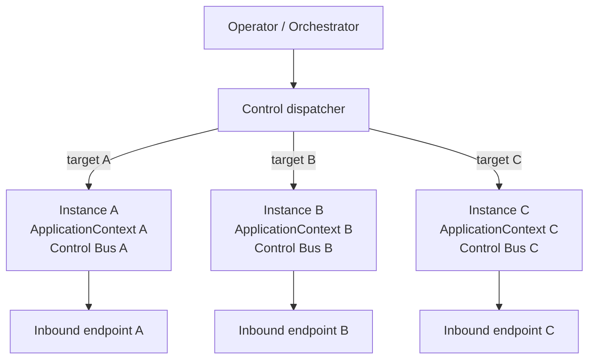
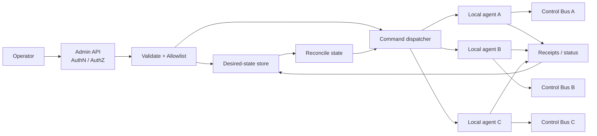
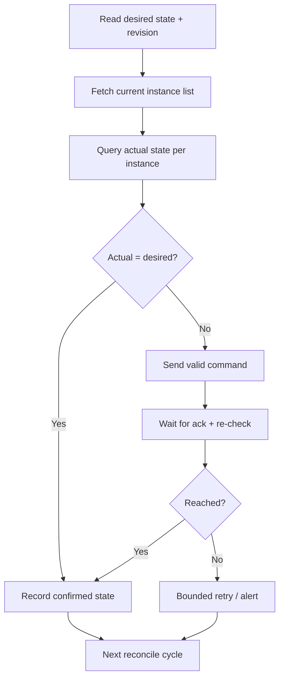

# Control Bus in Multi-Instance Operations

In a development environment, a Spring Integration application typically runs as a single process. When you want to pause an inbound adapter or restart a lifecycle-managed endpoint, you send a command to the **Control Bus** and observe the controlled bean. In production, however, a service usually runs across multiple JVMs, containers, or pods. A command handled by **one** instance does not mean all remaining instances change state as well.

This lesson belongs to the **Control bus** chapter of the **SPRING_INTEGRATION_PATTERN** module. The module's goal is learning to implement Enterprise Integration Patterns with Spring Integration to build loosely coupled, extensible message flows; practicing Router, Filter, Transformer, Splitter, Aggregator, Gateway, retry, error channel, correlation, and branch testing/monitoring. Here, we focus on operating the Control Bus across multiple instances while preserving business flow correctness.

**After this lesson, you will be able to:**

- Explain why the Control Bus is scoped to an **ApplicationContext/instance**, not a distributed control plane by default.
- Distinguish commands targeting one replica, a subset of replicas, and an entire deployment; choose appropriate routing/ack mechanisms.
- Use the Control Bus to control a `Lifecycle`-supporting endpoint without exposing arbitrary SpEL execution externally.
- Design instance identifiers, command IDs, TTLs, idempotency, state confirmation, and reconciliation after restarts/scaling.
- Distinguish "command received," "bean stopped accepting new work," and "all in-flight work completed."
- Create operational checklists, metrics, logs, traces, and tests for retries, rolling deployments, state drift, and control failures.

## 1. From a Single-Instance Control Bus to a Multi-Instance Cluster

The **Control Bus** is an Enterprise Integration Pattern that enables sending control messages to components of an integration system. In Spring Integration, the Control Bus supports control expressions, commonly used to invoke management operations on permitted beans in the `ApplicationContext`, such as `start()`, `stop()`, or `isRunning()` on a lifecycle-capable bean.

Example control command payload in a trusted context:

```text
@ordersInboundEndpoint.stop()
```

This expression acts on the bean named `ordersInboundEndpoint` **inside the context that received and executed the command**. The bean name and method must actually exist and match the framework version and configured control mechanism; not every handler can be stopped or started this way.

Suppose a deployment has three independent instances:



If a command arrives only at `Control Bus A`, only the bean inside `ApplicationContext A` is affected. B and C can still poll data, consume messages, or run their corresponding endpoints.

**There is no guaranteed cluster broadcast merely from declaring a Control Bus in each replica.** Broadcasting, target selection, security, delivery, idempotency, and state reconciliation must be designed at the orchestration layer or appropriate infrastructure layer.

### Key Questions Before Issuing a Command

An operational request like "stop receiving orders" needs to be made concrete:

- Stop **one adapter on one pod** for investigation?
- Stop **every replica** of a deployment?
- Stop **one role** such as a worker poller while keeping the API Gateway accepting requests?
- Stop accepting new work or wait for in-flight tasks to finish (**drain**)?
- Pause temporarily until a point in time, or persist the desired state across restarts?
- If one replica fails to respond, is the overall operation treated as succeeded, partial, or failed?

There is no single answer. Design must follow the properties of the message source, topology, and business requirements.

## 2. Where Does the Control Bus Sit in a Multi-Instance Architecture?

A design can separate into a **data plane** and a **control plane**:

| Plane | Components | Responsibility |
| --- | --- | --- |
| Data plane | Gateway, Filter, Router, Transformer, Splitter, Aggregator, Service Activator | Processes business messages |
| Data plane | Queue, broker, inbound/outbound adapters | Delivers and transfers messages under business contracts |
| Control plane | Admin API, operator, or scheduler | Authenticates issuer, decides scope |
| Control plane | Command dispatcher | Selects instances, dispatches commands, manages timeouts/acks |
| Control plane | **Local** Control Bus | Executes permitted operations on the instance's beans |
| Control plane | Registry/desired-state store | Tracks existing replicas, desired state, and revisions |
| Observability | Logs, metrics, traces, audits | Proves commands were applied and shows their impact |

The control plane should not rely on a consumer parsing text logs to decide the next command. Establish an explicit communication path: an authenticated admin API, a message broker with proper routing, or a purpose-built controller/operator.

A typical diagram:



This diagram is a **proposed architecture**, not components automatically created by Spring Integration. For smaller systems, the admin API might call management endpoints on each pod instead of using a standalone dispatcher; what matters is knowing exactly which target is controlled and the actual outcome.

## 3. Selecting Targets: Single Instance, Multiple Instances, or Entire Cluster

| Command scope | Example | Characteristics |
| --- | --- | --- |
| `INSTANCE` | Pause the poller on replica A to investigate an error | Requires exact target identity to avoid other replicas executing |
| `ROLE` | Pause replicas with role `import-worker` | Requires a controlled registry or selector |
| `DEPLOYMENT` | Pause data ingestion across an entire release | Must handle newly created replicas or recently restarted pods |
| `LEADER_ONLY` | Activate the adapter only on the leader | Requires leader election/lease and stale-leader protection |
| `CANARY` | Pause/resume a single pod before expanding the operation | Reduces blast radius; allows testing impact |

An instance identifier should remain stable for the **process lifetime** and uniquely distinguish running replicas. In container environments, you can use the orchestration layer's ID combined with deployment/version. Never treat a manual hostname as a permanent identity: scaling or rolling updates can create new pods with different IDs.

### Recognize Common Routing Mistakes

**Load-balanced HTTP admin endpoint:** sending `POST /admin/pause` to a shared Service/Load Balancer may hit **only one** pod. Calling once and claiming "the whole deployment is paused" is wrong.

**Broker queue shared across a consumer group:** if three replicas consume from one queue, a command will be picked up by one consumer; that is **work sharing**, not broadcasting to three instances.

**Publish/subscribe:** can broadcast to connected subscribers given the right topology, yet broadcasting alone does not guarantee every replica succeeded or that a pod created later will know the desired state.

**Per-instance routing:** sending directly to an instance's admin address or dedicated queue targets that instance, though you must handle changing addresses, disconnected replicas, and expired commands.

For deployment-wide operations, you usually need to persist **desired state** and run a reconciliation loop. Both existing and newly started instances reconcile desired state against the endpoint's actual state.

## 4. Structured Command Schema—Never Forward User SpEL

An external administrative request should be a command **with a schema and a restricted action set**:

```json
{
  "commandId": "b7e8a2fa-0ed5-4b4a-8977-8caa15b0c628",
  "scope": "INSTANCE",
  "targetInstance": "orders-worker-a",
  "action": "PAUSE_INGEST",
  "endpoint": "ordersInboundEndpoint",
  "requestedBy": "ops-automation",
  "reasonCode": "PLANNED_MAINTENANCE",
  "expectedRevision": 41,
  "expiresAt": "2026-11-21T10:15:00Z"
}
```

These fields are **defined by the control application itself**, not a built-in Spring Integration schema. Specifically:

- `commandId`: used for deduplication and correlating logs/acks.
- `scope` and `targetInstance`: prevent unrelated replicas from executing.
- `action`: uses an enum such as `PAUSE_INGEST`, `RESUME_INGEST`, `GET_STATUS`.
- `endpoint`: if choosing an endpoint is allowed, accept only allowlisted names.
- `expectedRevision`: rejects stale commands when state has already moved on.
- `expiresAt`: prevents a delayed pause command from executing after an incident is over.
- `requestedBy` and `reasonCode`: support authorization, traceability, and auditing; should not contain tokens or sensitive data.

**Never let clients supply** payloads like `"@anyBean.anyMethod()"` directly, and never concatenate unvalidated `action`/`endpoint` strings into SpEL. The Control Bus can execute expressions; if a channel accepting arbitrary expressions is exposed to the network, it becomes a control vulnerability or unintended execution vector.

## 5. Java DSL Example: Local Control Bus on Each Instance

Minimal example (Java 17+, Spring Integration Java DSL) declaring **a dedicated channel inside each ApplicationContext**:

```java
import org.springframework.context.annotation.Bean;
import org.springframework.context.annotation.Configuration;
import org.springframework.integration.channel.DirectChannel;
import org.springframework.integration.dsl.IntegrationFlow;
import org.springframework.messaging.MessageChannel;

@Configuration
class LocalControlBusConfig {

    @Bean
    MessageChannel localControlInput() {
        return new DirectChannel();
    }

    @Bean
    IntegrationFlow localControlBusFlow() {
        return IntegrationFlow.from("localControlInput")
                .controlBus()
                .get();
    }
}
```

When this flow is loaded in three JVMs, there are **three** `localControlInput` channels and **three** independent Control Buses. No automatic magic causes a message sent to A to appear on B or C.

To operate in practice, assume a bean named `ordersInboundEndpoint` implements `org.springframework.context.Lifecycle` (or `SmartLifecycle`) and can stop/start. This bean name must be declared/assigned explicitly by the application or flow endpoint; do **not** assume every input channel has a `stop()` method.

Example of a service accepting only approved internal operations:

```java
import org.springframework.beans.factory.annotation.Qualifier;
import org.springframework.context.Lifecycle;
import org.springframework.messaging.MessageChannel;
import org.springframework.messaging.support.GenericMessage;
import org.springframework.stereotype.Service;

@Service
class LocalIngestControl {

    private final MessageChannel localControlInput;
    private final Lifecycle ordersInboundEndpoint;

    LocalIngestControl(
            @Qualifier("localControlInput") MessageChannel control,
            @Qualifier("ordersInboundEndpoint") Lifecycle endpoint) {
        this.localControlInput = control;
        this.ordersInboundEndpoint = endpoint;
    }

    boolean pause() {
        // Command is an application-defined constant, not user input.
        boolean sent = localControlInput.send(
                new GenericMessage<>("@ordersInboundEndpoint.stop()"));
        return sent && !ordersInboundEndpoint.isRunning();
    }

    boolean resume() {
        boolean sent = localControlInput.send(
                new GenericMessage<>("@ordersInboundEndpoint.start()"));
        return sent && ordersInboundEndpoint.isRunning();
    }

    boolean isRunning() {
        return ordersInboundEndpoint.isRunning();
    }
}
```

**Conditions for using this example:**

1. The `ordersInboundEndpoint` bean must actually exist in the same `ApplicationContext`, support `Lifecycle`, and be permitted under Control Bus security policy.
2. `DirectChannel` processes synchronously on the sending thread in this example. With other channels, command execution and confirmation timing may differ.
3. The boolean result here is only a **bean state check at read time**; it does not prove the queue is empty, all in-flight messages have completed, or the entire cluster has applied the change.
4. This is a **local service**. A real admin API must authenticate, authorize, check target/revision/TTL, and write audit logs before calling `pause()` or `resume()`.
5. If the Control Bus cannot manipulate the chosen bean/endpoint in your version, configure an appropriate `Lifecycle` bean or a separate management component; do not assume renaming a bean will fix it.

Never wire `localControlInput` to a public Gateway allowing arbitrary payloads. The goal is creating a **strictly typed adapter** between admin commands and the local expression mechanism.

### Why Not Call Stop Directly in Every Case?

If an application only needs two administrative operations and already holds a `Lifecycle` reference, an authorized service calling `start()/stop()` directly can also be appropriate. The Control Bus is useful when integrating endpoint management into Spring Integration message flows and control mechanisms, though it is **not mandatory** for a safe multi-instance architecture.

## 6. Command Orchestration: Sending, Confirming, and Verifying Results

Distinguish multiple levels of success:

| Level | Interpretation | Does it guarantee "stopped receiving all messages"? |
| --- | --- | --- |
| `REQUESTED` | Operator/API received the request | No |
| `ACCEPTED` | Command is valid and placed on the processing path | No |
| `DELIVERED` | Delivered to the target agent/instance per transport contract | No |
| `APPLIED` | Control Bus invoked the operation and bean reports matching state | Not necessarily |
| `QUIESCED` | Instance no longer accepts new work per defined criteria | Depends on endpoint |
| `DRAINED` | In-flight work finished or was handled per policy | Only with dedicated checks |
| `CONFIRMED` | Reconciliation verified targets reached desired state | Per defined scope and thresholds |
| `FAILED/EXPIRED` | Failed, expired, or did not complete within timeout | No |

For a `PAUSE_INGEST` command, the dispatcher must not return `"deployment paused"` right after publishing a message to a broker. Define what counts as success: 3/3 replicas confirmed, or only a target subset; whether offline instances are allowed; and how long the state must hold.

Example application-defined receipt:

```json
{
  "commandId": "b7e8a2fa-0ed5-4b4a-8977-8caa15b0c628",
  "instanceId": "orders-worker-a",
  "state": "APPLIED",
  "observedRunning": false,
  "revision": 42,
  "observedAt": "2026-11-21T10:14:02Z"
}
```

One `APPLIED` receipt does not prove B or C's adapters stopped. Aggregate across the **locked target list for the operation** and handle partial results:

```text
Deployment pause command: cmd-73
Targets: A, B, C
A: APPLIED, running=false
B: APPLIED, running=false
C: TIMED_OUT, status=unknown
Overall: PARTIAL (do not return SUCCESS)
```

When an instance does not respond, inspect the registry, instance health, timeouts, and the possibility that the command executed while the ack was lost. Retries should run only for commands designed with idempotent semantics.

## 7. Idempotency, Command Ordering, and Avoiding Stale Execution

Networks duplicate packets, consumers restart, dispatchers retry on lost acks, and events arrive late. On the control plane, a dangerous scenario is:

```text
10:00:00  PAUSE emitted
10:00:03  RESUME emitted, applied
10:00:06  Delayed duplicate PAUSE arrives
10:00:07  Replica stops ingest again even though operator resumed
```

Never rely solely on log order or sender timestamps. One strategy is storing **desired state** with monotonically increasing revisions so instances apply only valid revisions:

```text
revision=41 desired=PAUSED
revision=42 desired=RUNNING  <- newer state
replica sees command revision=41 after already applying 42
=> reject STALE_COMMAND
```

Additional safeguards:

- **`commandId` for deduplication:** a redelivered command does not trigger unintended repeated side effects.
- **`expiresAt`/TTL:** expired commands are no longer executed.
- **Expected revision / compare-and-set:** prevents older commands from overwriting newer state.
- **Idempotent actions:** `PAUSE_INGEST` when already paused should typically return "already in desired state" rather than failing and triggering another command.
- **Appropriate dedupe storage:** keeping `commandId` only in RAM loses history on restart; consider durable storage matching the risk level.
- **Fencing/lease:** for single-owner resources, a pause command alone is insufficient to stop a stale leader from continuing to process.

Control Bus calls to `start()` or `stop()` do not form a distributed transaction. There is no all-or-nothing guarantee when applied sequentially across replicas. If requirements demand strong consistency, design appropriate coordination, confirmation, and recovery mechanisms.

## 8. Reconciling State After Restarts, Scaling, and Rolling Updates

Operating on Kubernetes, Docker Swarm, or another orchestrator routinely changes cluster membership:

- Pod A restarts after being paused.
- Deployment scales from 3 replicas to 5.
- Rolling update creates new instances with different configurations/bean names.
- An old instance loses connectivity yet keeps running for a while.
- One node misses a broadcast due to a network partition.

If pause state exists **only in process RAM**, new beans can auto-start when the application boots. Thus, a single `PAUSE` broadcast is insufficient to establish **durable desired state**.

A simple reconciliation loop:



Design **revisions** and the relationship between desired state and lifecycle: newly created instances must know whether they should start or pause before accepting traffic or consuming messages. You cannot expect them to have heard a command broadcast before they existed.

During rolling deployments, control operations should separate the **logical target** (deployment/role) from **current instance IDs**. As the deployment rolls over, the dispatcher must apply policy to the active set of replicas, not just the old pod list.

## 9. Pause, Stop, Drain, and Readiness Are Not Synonymous

A "Pause consumers" button on a dashboard can mask several different semantics:

| Action | Goal | What NOT to assume |
| --- | --- | --- |
| Stop an inbound adapter/poller | Stop initiating new receives at the endpoint | Does not automatically stop all running handlers |
| Pause traffic on a load balancer | Stop new HTTP requests through that route | Does not guarantee workers/broker consumers stopped |
| Drain | Wait for in-flight jobs to complete or hand off safely | Not every endpoint has a built-in drain command |
| Stop entire ApplicationContext/pod | Shut down application lifecycle | Does not replace commits/acks and data protection on shutdown |
| Flip readiness to not-ready | Avoid receiving some new router/LB traffic | Does not necessarily stop polling or broker consumption |
| Set desired state to PAUSED | Persist operational intent across restarts/scaling | Requires actual reconciliation to enforce |

For example, an inbound poller stops scheduling new polls yet messages may remain in handlers or queues. With message brokers, pausing/stopping consumers depends on the client, ack mode, prefetch, and rebalancing. Verify specific adapter behavior and implement a dedicated drain strategy when needed.

### Runbook for Pausing a Worker Group

1. Identify scope: instance or role; avoid load-balanced Service addresses when targeting specific instances.
2. Inspect current state: instance, revision, `isRunning()`, in-flight count, backlog, retries, and errors.
3. Send an authenticated `PAUSE_INGEST` command with TTL and command ID.
4. Collect per-instance acks; verify endpoint state and confirm new messages stopped arriving per policy.
5. If draining is required, monitor in-flight tasks and unacknowledged messages; wait until defined thresholds/timeouts or run recovery procedures.
6. Persist desired state in the registry if the pause must survive restarts.
7. After maintenance, send `RESUME_INGEST` with a new revision; confirm the right targets started and backlog, error rate, and latency return to normal.

Never treat `isRunning()==false` as the sole proof that a business requirement has been met. It is strictly a bean lifecycle signal.

## 10. Leader-Only Pollers and Duplicate Processing Risk

Some data sources should have only **one** active poller across the entire cluster: for instance, a file source or legacy API that cannot safely share work. If three instances all start their pollers, duplicate processing can occur.

A naive design like "operator sends Control Bus stop commands to the other two replicas" is **not resilient enough**:

- A restarted replica might auto-start its poller.
- One replica might miss the stop command.
- A former leader might lose its lease yet keep processing before stopping.
- Two controllers might both believe they control the worker pool.

When "only one active instance" is required, coordinate with **leader election / distributed locks / leases** or broker consumer assignment. A lease is trustworthy only when properly checked and renewed; for tasks with critical side effects, consider **fencing tokens** or ownership checks at the target resource.

The Control Bus can serve as the **local execution mechanism** (start/stop endpoint) when leadership changes, yet it does not provide distributed locking, leader election, or exactly-once processing on its own.

### Distinguishing Sources That Support Horizontal Scaling

If three replicas consume from a broker with proper consumer groups and partitions, they may be designed to run concurrently; stopping two replicas can **reduce throughput and grow backlog** without improving correctness. Determine the inbound source's nature before adopting a leader-only strategy.

## 11. Securing the Control Bus in Multi-Instance Environments

The Control Bus uses control expressions that can access beans/methods inside the application context. Therefore, any exposed channel, admin API, or control broker topic must be treated as a **high-privilege surface**.

Defense principles:

1. **Do not accept free-form SpEL** over public HTTP, public WebSockets, or queues where multiple systems can publish.
2. **Allowlist actions and targets:** translate `PAUSE_INGEST` into an application-controlled constant command; never concatenate method/bean names from input.
3. **Authentication and authorization:** operators, automation, and service accounts have distinct privileges; production actions should be restricted and audited.
4. **Narrow scope:** permission to pause one replica must not escalate to pausing the entire cluster. For high-impact actions, consider two-step approval or progressive rollouts.
5. **Protect transport channels:** TLS/mTLS or equivalent; enforce broker publish/consume ACLs and keep control topics isolated from business consumers.
6. **TTL, revision, nonce/command ID:** prevent replay and execution of obsolete commands.
7. **Structured auditing:** record requester, action, scope, targets, timestamp, revision, and outcome; never log credentials or arbitrary expressions.
8. **Network isolation:** allow only control agents/controllers to reach control endpoints.
9. **Rate limiting:** prevent rapid pause/resume flapping; apply at the control plane rather than confusing it with business-message rate limiting.
10. **Test negative cases:** missing target, invalid action, unauthorized account, expired command, and stale revision.

Even inside an internal network, a leaked bearer token or publish privilege can affect every replica if the control channel is unprotected. A syntactically valid Control Bus setup does not mean it is safe to expose on the network.

## 12. Correlation, Logging, Metrics, and Auditing for the Control Plane

Control events must be separated from business messages. Example structured log:

```json
{
  "event": "control.command_applied",
  "service": "orders-worker",
  "instanceId": "orders-worker-a",
  "commandId": "b7e8a2fa-0ed5-4b4a-8977-8caa15b0c628",
  "action": "PAUSE_INGEST",
  "endpoint": "ordersInboundEndpoint",
  "revision": 42,
  "observedRunning": false,
  "outcome": "APPLIED",
  "durationMs": 18
}
```

This is an illustrative application-defined schema. In operations, track:

| Signal | Example | Purpose |
| --- | --- | --- |
| Structured log | `control.command_received`, `control.command_applied`, `control.command_failed` | Investigate a specific command by command ID |
| Metric counter | `control_commands_total{action="PAUSE_INGEST",outcome="applied"}` | Aggregate successes/failures by action |
| Metric timer | `control_command_duration` | Time to apply/await confirmation |
| Gauge | Instances in desired state, instances drifted | Detect configuration/state drift |
| Application metrics | Backlog, in-flight, handled/s, failed/s | Verify impact on the data plane |
| Trace | Spans for dispatch, local apply, and verify (when instrumented) | Identify where a command slowed down |
| Durable audit | RequestedBy, command ID, scope, revision, outcome | Trace critical operational changes |

**Do not use `instanceId` or `commandId` indiscriminately as metric labels** in systems with large replica counts or autoscaling: cardinality can explode. Keep granular IDs in logs/audits, and use bounded-cardinality metric labels such as `action`, `outcome`, `serviceRole`.

Never equate the count of "command applied" log lines with the total number of stopped replicas. A command may be retried, logs may be dropped, or a bean may change state after logging. Status dashboards should rely on the registry and current verification.

### Distinguishing Request Correlation from Control Command ID

An order flow's `requestCorrelationId` traces a business transaction; the control plane's `commandId` traces an operational change. One pause command can affect thousands of distinct requests. Never attach a synthetic `requestCorrelationId` across unrelated business messages to indicate maintenance; that destroys business traceability.

## 13. Risks When the Dispatcher or Registry Is Unavailable

Remote control needs policies for each failure mode:

- **Dispatcher disconnected:** undelivered commands must be persisted/queued or return a bounded retryable error; never report false success.
- **Replica offline:** persist desired state and apply when the replica returns (if still applicable), or wait for operator decision.
- **Lost ack:** the command may already have executed; avoid resending non-idempotent operations without checking command ID / actual state.
- **Stale registry:** an instance was replaced; rediscover members and compare revisions.
- **Network partition:** full cluster verification may be impossible; report partial/unknown status rather than inferring from connected nodes alone.
- **Controller restart:** orchestration must resume from durable state or safely replay using idempotency.
- **Mixed deployment versions:** the same action may not map to the same bean name; perform capability/version checks and deny unsupported instances.
- **Control channel congestion:** monitor queues, timeouts, and latency; prevent unbounded control commands from starving data-plane resources.

For high-availability workloads, decide explicitly between **fail-open** and **fail-closed** when desired state cannot be fetched. For instance, continuing ingestion when the registry is unreachable favors throughput but violates an emergency pause; auto-pausing protects data yet causes downtime. This is a policy choice, not a default Control Bus behavior.

## 14. Multi-Instance Testing and Operational Correctness

Do not test only that Java invokes `stop()` on a single bean. Build a test plan covering real or simulated multi-instance topologies.

| Scenario | How to test | Result to verify |
| --- | --- | --- |
| Local instance | Send command to Control Bus A | Bean on A changes; B/C do not change automatically |
| Wrong target | Send command target=B to agent A | A rejects and does not execute expression |
| Broadcast | Request pause for A+B+C | Collect acks across full scope, not a single success log |
| Load balancer | Call a shared HTTP Service | Never assume one request touched every replica |
| Shared queue | Publish one command to a shared-consumer queue | Verify it reaches one consumer, not a broadcast |
| Duplicate command | Send the same command ID twice | Apply side effects only per idempotency policy |
| Stale command | Send revision 41 after applying 42 | Reject stale command |
| Expired TTL | Deliver command after `expiresAt` | Do not execute expired command |
| Ack loss | Complete execution then simulate dropped receipt | Reconcile properly without falsely assuming business failure |
| Pod restart | Restart a PAUSED replica | Desired state re-applied; ingest does not start against policy |
| Scale out | Add instance D after broadcast pause | D reads desired policy before accepting work |
| Rolling update | Change bean/version | Check capabilities and detect incompatible commands |
| Pause with in-flight | Send command while messages are processing | Distinguish endpoint stopped from drain completed |
| Leader lease loss | Leave stale leader before receiving STOP | Fencing/ownership prevents duplicate side effects |
| Insufficient permissions | Send command from unauthorized actor | Denied, audited, no SpEL exposed |
| Control plane offline | Block dispatcher or registry | Clear status reported, with recovery and alerts |
| Missing logs/audit | Drop diagnostic logs | Control state remains verifiable independently of logs |

### Unit Testing with a Stub Local Lifecycle

Example stub class for testing stop/start semantics without connecting to a broker:

```java
import java.util.concurrent.atomic.AtomicBoolean;
import org.springframework.context.Lifecycle;

class FakeInboundEndpoint implements Lifecycle {
    private final AtomicBoolean running = new AtomicBoolean(true);

    @Override
    public void start() {
        running.set(true);
    }

    @Override
    public void stop() {
        running.set(false);
    }

    @Override
    public boolean isRunning() {
        return running.get();
    }
}
```

When writing an integration test, register the stub under the exact bean name `ordersInboundEndpoint`, configure `localControlInput`/`localControlBusFlow`, and invoke `pause()/resume()` to re-read state. That test only verifies the Control Bus and bean in one `ApplicationContext`. For distributed behavior, run **at least two contexts/instances** with a real dispatcher or fake transport capable of simulating routing, duplicates, restarts, and timeouts.

## 15. Hands-On Exercise: Maintaining a Three-Worker Cluster

**Context:** the `orders-ingest` service has three replicas `A`, `B`, `C`; each replica has an inbound adapter with the same logical name `ordersInboundEndpoint`. The inbound flow passes through Filter, Router, Transformer, Splitter, Aggregator, and out through a Gateway to another service. Operators need to pause ingestion to update an upstream schema while letting in-flight messages finish processing.

### Execution Steps

1. Diagram the three instances and highlight the three distinct `ApplicationContext`s. Identify the Control Bus, internal admin channel, and allowed endpoint to stop in each context.
2. Define the `PAUSE_INGEST` command with command ID, `DEPLOYMENT` scope, revision, TTL, requestedBy, and reasonCode. Disallow free-form SpEL from senders.
3. Build an admin dispatcher that authenticates the actor, resolves the target list A/B/C, and sends to **each replica individually**. Avoid sending one command to a shared-consumer queue if all three must act.
4. Each replica uses a local `LocalIngestControl` to invoke its Control Bus with a constant expression for the allowlisted bean. Return an `APPLIED` receipt along with `isRunning()`.
5. Aggregate outcomes: if A/B succeed while C times out, report `PARTIAL`; never report "whole cluster paused."
6. Inspect in-flight messages, backlog, and unacknowledged messages. Declare `DRAINED` only after meeting explicit drain criteria, not merely because `isRunning()==false`.
7. Restart C and add replica D during maintenance. Verify that reading desired state prevents C/D from ingesting against policy.
8. Once upstream is ready, issue `RESUME_INGEST` with a new revision. Confirm each target's status and measure throughput, retries, timeouts, and Gateway errors.
9. Replay an old PAUSE command after RESUME; it must be rejected as `STALE_COMMAND`.
10. Inspect audits/logs/metrics by `commandId` and `instanceId`; prove unauthorized callers cannot control beans or submit arbitrary expressions.

### Completion Criteria

- Controlling A does not automatically alter B/C state.
- Cluster-wide deployment commands have a target list and verifiable outcomes.
- Duplicates, TTLs, and revisions do not produce incorrect states.
- New/restarted instances obey desired state.
- `APPLIED`, `QUIESCED`, and `DRAINED` are clearly distinguished.
- No public path accepts arbitrary SpEL into the Control Bus.
- EIP flows continue following error channel, retry, and correlation policies; logs serve only for observation.

### Self-Check Questions

1. Why does sending `@ordersInboundEndpoint.stop()` to Control Bus A not stop endpoints on B and C?
2. Why is sending a command to a queue with three consumers not equivalent to broadcasting?
3. What does `isRunning()==false` prove, and what does it not prove?
4. Why does `PAUSE_INGEST` need a command ID, revision, TTL, and expected target?
5. Why can an autoscaled new instance break pause state without desired-state reconciliation?
6. For a leader-only poller, can the Control Bus replace a distributed lock? Why or why not?
7. When C's ack is lost after C already executed the command, how should the dispatcher react?
8. Why should an admin API never accept raw SpEL strings directly from clients?
9. When should orchestrator-level management be used instead of calling the Control Bus on individual instances?
10. How do you verify that a pause operation neither drops nor duplicates in-flight messages?

## 16. References

- [Spring Integration Reference — Control Bus](https://docs.spring.io/spring-integration/reference/control-bus.html): Control Bus, control expressions, and endpoint management.
- [Spring Integration Reference — Java DSL](https://docs.spring.io/spring-integration/reference/dsl.html): defining flows and endpoints.
- [Spring Integration Reference — Message Channels](https://docs.spring.io/spring-integration/reference/channel.html): DirectChannel, publish-subscribe, and channel types.
- [Spring Integration Reference — Polling Consumer](https://docs.spring.io/spring-integration/reference/endpoint.html): endpoints/pollers and processing lifecycle.
- [Spring Integration Reference — Error Handling](https://docs.spring.io/spring-integration/reference/error-handling.html): handling errors when message processing fails.
- [Spring Framework — Bean lifecycle](https://docs.spring.io/spring-framework/reference/core/beans/factory-nature.html#beans-factory-lifecycle): `Lifecycle`, `SmartLifecycle`, and lifecycle management.
- [Kubernetes — Pod lifecycle](https://kubernetes.io/docs/concepts/workloads/pods/pod-lifecycle/): restarts, lifecycle, and pod status.
- [Kubernetes — Probes](https://kubernetes.io/docs/concepts/configuration/liveness-readiness-startup-probes/): readiness, liveness, and startup.
- [OWASP Authorization Cheat Sheet](https://cheatsheetseries.owasp.org/cheatsheets/Authorization_Cheat_Sheet.html): authorization and least privilege for administration.

**Key takeaway:** The Control Bus is a very useful **local** control execution mechanism, yet multi-instance operations require an orchestration layer with explicit targets, authentication/authorization, desired state, actual verification, and reconciliation. Never confuse a dispatched command with cluster-wide application; never confuse a stopped endpoint with all work drained; and never use an externally controllable SpEL string as an administrative protocol.
