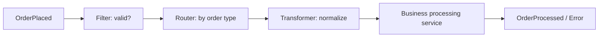
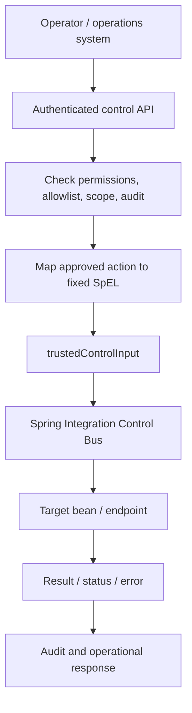
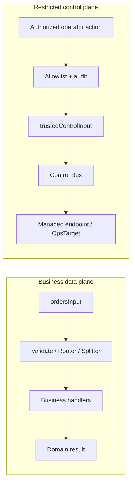

# Distinguishing the Control Bus from Business Messages

In the **Control bus** chapter of **SPRING_INTEGRATION_PATTERN**, an important architectural question is: **how do messages used to control the system differ from messages that process business data?** Both can be represented as `Message<?>`, travel through channels, and be handled by Spring Integration endpoints, yet they carry **completely different intent, blast radius, access permissions, and success criteria**.

When building Enterprise Integration Patterns with Spring Integration, we commonly combine Router, Filter, Transformer, Splitter, Aggregator, and Gateway to process orders, payments, or inventory data. Alongside that, operations teams need to stop an ingestion flow, resume an endpoint after maintenance, or query operational status. The **Control Bus** provides a way to send control commands to application components through a message flow. Those commands are not business events and should never be mixed into the order-processing pipeline.

> **Foundational rule:** Business messages are about **business entities and events**; control messages are about **the operation of the integration system itself**. Sharing a messaging infrastructure does not mean sharing permissions, input channels, or retry rules.

## 1. Two Message Types Solving Two Different Problems

### 1.1. Business Messages: The Data Plane

*Business messages* carry the data and requests that the system must process to serve users, partners, or business workflows. For example:

- `OrderPlaced(orderId, items)`: a new order was created.
- `PaymentAuthorized(paymentId, amount)`: a payment was authorized.
- `InventoryReserved(orderId, sku, quantity)`: inventory was reserved.
- `GenerateInvoice(orderId)`: a request to perform a business task.

These messages may be **events** (describing something that happened) or **business commands** (requesting a domain task). They typically pass through Router, Filter, Transformer, Splitter, Aggregator, Gateway, and specialized handlers.

Example order flow:



Success is evaluated by business invariants: the order is recorded accurately, not duplicated, totals match, and inventory is adjusted properly.

### 1.2. Control Messages: The Control Plane

*Control messages* convey **administrative or operational requests for integration flows**, for example:

- Pausing a data-receiving endpoint when downstream is overloaded.
- Restarting an adapter after external infrastructure recovers.
- Querying whether a component is currently running or stopped.
- Performing an authorized management action on a target bean/endpoint.

In Spring Integration, the **Control Bus** is a pattern/endpoint that uses **SpEL (Spring Expression Language)** to process control commands, typically as method-invocation expressions on beans:

```text
@opsTarget.pause()
@opsTarget.resume()
@opsTarget.isPaused()
```

The name `opsTarget` and the methods here belong to an **illustrative application-declared bean**, not default built-in Spring Integration commands. In a real application, the target bean must exist, the method must be permitted, and its effects must be controlled.

**Key distinction:** `pause()` here governs data intake; it does not directly change the meaning of an order. A business command might also be named `PauseSubscription`, yet if it pauses a **customer's subscription plan**, it remains a business message, not a Control Bus command.

## 2. Comparison Table to Avoid Confusion

| Criterion | Business message | Control Bus message |
| --- | --- | --- |
| Purpose | Execute or record a business activity | Administer integration component behavior |
| Affected target | Orders, invoices, payments, domain data | Adapters, endpoints, processing flows, management beans |
| Typical payload | DTO/domain event, JSON, business task code | SpEL expression or mapped control request |
| Typical channel | `ordersInput`, `paymentsInput`, business topics | Dedicated internal channel such as `trustedControlInput` |
| Issuer | Applications, services, users/partners via business APIs | Authenticated and authorized operational components |
| Success outcome | Accurate and durable business state | Control action accepted/executed on the right target |
| Security | Permissions on business resources, data validation | High administrative privileges; restrict expressions and callable beans |
| Retry | Per business contract and idempotency | Must evaluate repeatability of the control action |
| Audit | Who acted on which data and what business outcome occurred | Who issued which command, targeting which instance/endpoint, before/after state |
| Failure | Domain or message-processing error | Control error, missing endpoint, permission denied, invalid state |
| Blast radius | Usually a single entity/transaction | Can affect thousands of messages or an entire flow's intake |
| Availability | Per business SLA | Per operational, safety, and recovery procedures |

**Do not classify solely by payload type.** A `Message<String>` containing order JSON is still a business message; a `Message<String>` containing `@opsTarget.pause()` on the Control Bus channel is treated as a control message. Meaning depends on the **channel/endpoint contract and permission to emit messages**.

## 3. How Does the Control Bus Operate in Spring Integration?

Conceptually, the Control Bus is an endpoint that receives control messages and evaluates expressions to interact with beans in the Spring `ApplicationContext`.



**The most dangerous boundary** is the step that turns external data into an evaluated expression. If users or partners can send arbitrary SpEL to the Control Bus, they may try calling methods never intended for operations. Therefore:

1. Never expose the Control Bus channel directly over HTTP, brokers, or WebSockets without strict controls.
2. Never forward verbatim user-supplied SpEL strings to the endpoint.
3. Define an **allowed action set (allowlist)** and map each action to a fixed expression.
4. Check identity, roles, tenant, environment, and target endpoint before sending.
5. Audit the request, allow/deny decision, and execution outcome.
6. Restrict which accounts, networks, and connections are permitted to call the Control Bus.

**The Control Bus does not replace authentication or authorization mechanisms.** The fact that Spring Integration can invoke a bean via SpEL is a technical capability, not proof that the call is safe from every source.

## 4. Java DSL Example: Two Separated Message Paths

The following code illustrates a Control Bus receiving commands **only from an internal channel** and a simple management bean. It intentionally avoids connecting this channel to any public HTTP/broker source.

```java
import java.util.concurrent.atomic.AtomicBoolean;

import org.springframework.context.annotation.Bean;
import org.springframework.context.annotation.Configuration;
import org.springframework.integration.config.EnableIntegration;
import org.springframework.integration.dsl.IntegrationFlow;

@Configuration
@EnableIntegration
public class ControlPlaneConfiguration {

    @Bean("opsTarget")
    OpsTarget opsTarget() {
        return new OpsTarget();
    }

    @Bean
    IntegrationFlow internalControlBus() {
        return IntegrationFlow.from("trustedControlInput")
                .controlBus()
                .get();
    }

    public static final class OpsTarget {
        private final AtomicBoolean paused = new AtomicBoolean();

        public boolean pause() {
            return paused.compareAndSet(false, true);
        }

        public boolean resume() {
            return paused.compareAndSet(true, false);
        }

        public boolean isPaused() {
            return paused.get();
        }
    }
}
```

**Explanation:**

- `trustedControlInput` is a channel on the control flow, **not a channel carrying order events**.
- `.controlBus()` creates the endpoint that processes control expressions using Spring Integration's mechanism.
- `@opsTarget.pause()` or `@opsTarget.resume()` invokes methods on the `opsTarget` bean when the expression is sent to the endpoint and evaluated successfully.
- `OpsTarget` only toggles an **illustrative state flag**. It **does not automatically stop any inbound adapter**. To actually stop/start an adapter, target a bean with lifecycle capability (such as a component supporting `Lifecycle`/`SmartLifecycle`), verifying the bean name and `start()/stop()` behavior in your application version.
- The `true/false` return value reflects whether the flag changed; if a request–reply response is needed, configure and test an appropriate reply flow.

A business flow can be separated onto another channel, such as `ordersInput`, to route `OrderPlaced` events into business services. There is no reason to send `OrderPlaced` to `trustedControlInput`: the Control Bus is not a service activator for processing order payloads.

### 4.1. How Do Business Messages and Control Messages Look Different?

Example using the same Spring Messaging API:

```java
import org.springframework.messaging.Message;
import org.springframework.messaging.support.MessageBuilder;

record OrderPlaced(String orderId, long amountCents) { }

Message<OrderPlaced> business = MessageBuilder
        .withPayload(new OrderPlaced("order-42", 125_000L))
        .build();

// Created only inside an authenticated and action-allowlisted component:
Message<String> control = MessageBuilder
        .withPayload("@opsTarget.pause()")
        .build();
```

This snippet merely **illustrates the shape of the two payloads**; it is not a complete Java file (variables must live inside a method/class) and does not implement permission checks. The difference does not lie in `Message<T>`, but in the **destination, semantics, and calling privileges**.

### 4.2. Never Accept SpEL Expressions Directly from an API

A better design maps from approved administrative actions:

```java
public final class ApprovedControlCommands {

    private ApprovedControlCommands() { }

    public enum Action {
        PAUSE_INTAKE,
        RESUME_INTAKE,
        READ_STATUS
    }

    public static String expressionFor(Action action) {
        if (action == null) {
            throw new IllegalArgumentException("Action is required");
        }

        return switch (action) {
            case PAUSE_INTAKE -> "@opsTarget.pause()";
            case RESUME_INTAKE -> "@opsTarget.resume()";
            case READ_STATUS -> "@opsTarget.isPaused()";
        };
    }
}
```

The authentication/authorization component decides whether the caller may execute `PAUSE_INTAKE`, `RESUME_INTAKE`, or `READ_STATUS` on a given environment and instance. **The `expressionFor()` function only performs allowlist mapping; on its own, it does not check permissions, write audits, or send messages.**

An example of dispatching **internally after passing the authorization step**:

```java
import org.springframework.messaging.MessageChannel;
import org.springframework.messaging.support.MessageBuilder;

public final class TrustedControlDispatcher {
    private final MessageChannel internalControlChannel;

    public TrustedControlDispatcher(
            MessageChannel internalControlChannel) {
        this.internalControlChannel = internalControlChannel;
    }

    public void dispatch(ApprovedControlCommands.Action action) {
        String expression =
                ApprovedControlCommands.expressionFor(action);

        boolean accepted = internalControlChannel.send(
                MessageBuilder.withPayload(expression).build());

        if (!accepted) {
            throw new IllegalStateException(
                    "Control message was not accepted by channel");
        }
    }
}
```

When wired in Spring, this dependency must point to the declared `trustedControlInput` channel, for instance using `@Qualifier("trustedControlInput")` when needed. **`send()` returning `true` only confirms the channel accepted the message under its contract—it is not proof that the operation executed, committed, or applied across every instance.** To verify outcomes, use request–reply or a status-checking mechanism with its own correlation/audit ID.

## 5. Why Not Use a Business Channel to Send System-Stop Commands?

Suppose the application processes orders via `ordersInput`. If `@orderPoller.stop()` is also sent over the same channel:

- A business handler may interpret the control expression as customer data, causing formatting errors.
- An adapter accidentally wired to the Control Bus might **execute** content that the business source is unauthorized to request.
- A Router/Filter defined for domain events does not necessarily enforce operational privileges.
- Retries of business events could unintentionally re-dispatch control commands.
- Order throughput monitors could count a control command as a new order.

Therefore, separate ingress paths following the **control plane / data plane** principle:



The two flows can **influence each other's operational state** (pausing a source reduces incoming business messages), yet they do not need to share a channel or share an authorization model.

### 5.1. A Business Command Is Not Always a Control Command

The following names are easy to confuse:

| Message | Classification | Why? |
| --- | --- | --- |
| `CancelOrder(orderId)` | Business command | Cancels an order under business rules |
| `SuspendCustomerAccount(accountId)` | Business command | Changes customer account state |
| `PauseInboundOrderAdapter` | Control command | Controls the application's order-receiving adapter |
| `ResumeRetryWorker` | Control command | Governs the error/retry processing component |
| `OrderCancelled(orderId)` | Business event | Records that an order was cancelled |
| `ErrorMessage` from error flow | Technical message containing an error | **Not a Control Bus command by default** |

Technical error events can serve as input to propose stopping an endpoint automatically, yet there must be a **policy governing permissions, conditions, and limits** before turning error detection into a high-impact operational command.

## 6. Retry and Error Handling: Different Rules

### 6.1. Retries for Business Messages

A business flow can retry an order placement or payment service call upon transient failures. To stay safe, it needs idempotency keys, deadlines, DLQ handling, and safeguards against applying business effects twice.

For example, if `OrderPlaced(order-42)` is redelivered twice, the handler must know whether the order was already accepted before writing again.

### 6.2. Retries for Control Bus Commands

A `pause()` command can be safe to call repeatedly if designed to be **idempotent**: after the first call, subsequent calls simply preserve the paused state. However, not every administrative command is safe to retry:

- Repeated `restart()` calls can cause service unavailability.
- `rotateKey()` or `clearCache()` can produce unintended side effects.
- `start()` when an adapter has accumulated backlog can unleash a sudden load spike.
- A *one-shot* command may not allow retries even if the reply failed.

**Define idempotency for each action.** When no reply arrives, the first step may be **re-reading the target state** rather than immediately resending the command. Store `commandId`, target, version, and state to distinguish "not yet executed" from "executed but reply lost."

### 6.3. Control Errors Are Not Data Errors

An expression invoking a missing bean, an invalid method, or an endpoint unable to transition state can raise an execution error. How errors are returned depends on synchronous/asynchronous channels, gateways, adapters, and error-flow configuration.

- Never assume every control exception automatically flows into the same `errorChannel` as domain errors.
- Never route operational failures into the order DLQ without classification; they require separate runbooks and handling privileges.
- Never convert an `ErrorMessage` into a Control Bus command without an explicit evaluation step.
- Log enough detail to show **which command, who requested, which target, before/after state, and impact**.

Even when the Control Bus actually stops an inbound endpoint, the business layer must decide what happens to in-flight messages: wait for completion, return to the broker, or stop accepting new ones. **Lifecycle stop/start does not automatically guarantee all running business transactions have completed.**

## 7. Blast Radius: Single JVM or Entire System?

A Control Bus in Spring Integration normally invokes beans in the **ApplicationContext where it runs**. In a multi-instance system:

```text
Operator selects "pause ingestion"

Instance A: adapter A stops.
Instance B: adapter B keeps running.
Instance C: adapter C keeps running.

⇒ Cannot claim the entire system is paused.
```

To operate across the whole cluster, design an **orchestration mechanism**:

1. Explicitly identify targets: instance, instance group, or service name.
2. Dispatch commands via a protected admin channel or trusted coordinator.
3. Each instance applies the command to the properly named and authorized bean.
4. Collect confirmation status from each instance; never equate "sent" with "completed."
5. Handle timeouts, unresponsive instances, retries, and partial cluster execution.
6. Write audits with `commandId` and the campaign's aggregate status.

The Control Bus **does not automatically turn a local bean invocation into a consensus-backed broadcast command**. When cluster-wide consistency is needed, build it at a higher layer combining brokers, service discovery/management APIs, or appropriate orchestration tools.

## 8. Security and Auditing for Control Messages

Because the Control Bus can interact with live application beans, it requires far stronger protection than ordinary business channels.

### 8.1. What Must Be Blocked

| Risk | Consequence | Mitigation |
| --- | --- | --- |
| External actor sends SpEL directly | Executes unintended operations | Keep channel private; fixed action allowlist |
| Read-only user allowed to stop | Privilege abuse harming availability | Authorize by action and environment |
| Mixing business and control channels | Business payloads interpreted as commands | Separate channels, type contracts, validation |
| Dangerous command retries | A command applied multiple times | Command IDs, idempotency, and state checks |
| Stopping the wrong instance | Only part of cluster stops, or wrong environment hit | Explicit targets, inventory, and state confirmation |
| Missing audit trail | Cannot investigate who changed what | Structured logs and outcome verification |
| Unexpected commands under peak load | Disruptive changes while many messages are in flight | Approvals/policies, rate limits, maintenance windows |
| Sensitive data in logs | Leaking configs/secrets | Log only action, target, commandId, outcome; scrub secrets |

**Never rely on blacklisting a few SpEL keywords** and consider it secure enough. A far more reliable measure is **never accepting free-form SpEL**: callers may only choose published actions; the server holds fixed, pre-reviewed expressions.

### 8.2. Audit Template for the Control Plane

```json
{
  "commandId": "ctrl-2026-110",
  "actor": "operator-role",
  "action": "PAUSE_INTAKE",
  "targetInstance": "order-ingest-2",
  "targetBean": "opsTarget",
  "requestedAt": "2026-11-21T09:00:00Z",
  "authorization": "ALLOW",
  "execution": "SUCCEEDED",
  "before": "RUNNING",
  "after": "PAUSED"
}
```

This is an **illustrative application schema**, not default headers or audit records from Spring Integration. In a real system, record the verified state—never infer `execution: SUCCEEDED` merely from `send() == true`.

Business flows can maintain their own audits such as `orderId`, `paymentId`, and processing status; the two audit trails can link via trace/incident IDs whenever an operational decision affects business traffic.

## 9. Testing the Separation Between Control and Business Messages

Tests must verify **both functionality and privilege boundaries**, not only that calling `@opsTarget.pause()` succeeds.

| Test case | Input | Outcome to verify |
| --- | --- | --- |
| Valid business event | `OrderPlaced` sent to `ordersInput` | Business handler processes correctly; control bean unaffected |
| Valid control command | `PAUSE_INTAKE` action through authorized dispatcher | Target bean changes state; audit reflects confirmed outcome |
| Business payload containing SpEL string | Order note field containing `@opsTarget.pause()` | String is treated as data, **never executed** |
| Action not on allowlist | Arbitrary action or caller-supplied SpEL string | Rejected before reaching the Control Bus |
| Unauthorized user | Log-viewer user requests `RESUME_INTAKE` | Authorization error returned; no message sent to control channel |
| Retrying pause command | Send `PAUSE_INTAKE` twice | State stays paused with no unintended side effects |
| Non-existent method | Expression pointing to a method absent on bean | Control error recorded on the appropriate branch |
| Wrong target | Command for instance A delivered to B | B rejects/skips execution per contract |
| Unresponsive node in cluster | A succeeds, B times out | Never report "entire cluster stopped" without evidence |
| Stop during in-flight transactions | Endpoint currently processing orders | No dropped or duplicated business effects per policy |
| Lost retry/ACK | Command ran yet reply was lost | Reconcile state instead of blindly retrying |
| Separated telemetry | Concurrent orders and control commands | Metrics/audits distinguish business events from control actions |

### 9.1. Unit Test for Allowlist Mapping

JUnit 5 example verifying only that the API maps known actions to fixed expressions, rather than accepting arbitrary SpEL:

```java
import static org.junit.jupiter.api.Assertions.assertEquals;
import static org.junit.jupiter.api.Assertions.assertThrows;

import org.junit.jupiter.api.Test;

class ApprovedControlCommandsTest {

    @Test
    void mapsOnlyKnownActionsToFixedExpressions() {
        assertEquals("@opsTarget.pause()",
                ApprovedControlCommands.expressionFor(
                        ApprovedControlCommands.Action.PAUSE_INTAKE));

        assertEquals("@opsTarget.isPaused()",
                ApprovedControlCommands.expressionFor(
                        ApprovedControlCommands.Action.READ_STATUS));
    }

    @Test
    void rejectsMissingAction() {
        assertThrows(IllegalArgumentException.class,
                () -> ApprovedControlCommands.expressionFor(null));
    }
}
```

For full coverage, add integration tests with a real `ApplicationContext` and channels to check that the right method is invoked, errors are handled, and authorization is enforced at the API gateway. **A mapping unit test does not prove the Control Bus is secure if users still have another path to submit free-form SpEL.**

## 10. Checklist for Designing a Safe Control Plane

1. **Classify by purpose:** business messages describe/process the domain; control messages govern adapters/endpoints/beans.
2. **Separate channels and endpoints:** never wire business sources into `trustedControlInput`.
3. **Reject raw SpEL from users:** map approved actions to fixed expressions.
4. **Authenticate and authorize:** validate actor, action, target, environment, and approval policies.
5. **Restrict callable bean scope:** never expose the entire `ApplicationContext` or dangerous methods over public ingress.
6. **Design state and idempotency:** operational commands may repeat or lose replies; never assume retries are always safe.
7. **Verify actual outcomes:** distinguish channel message acceptance, command invocation, and endpoint state change.
8. **Maintain dedicated audits:** commandId, actor, target, before/after state, errors, and verification results.
9. **Coordinate across instances:** controlling a local bean does not equal controlling the entire cluster.
10. **Protect in-flight business flows:** stop/start must account for in-flight messages, retries, and open transactions.
11. **Separate operational errors from business errors:** provide distinct error channels, alerts, and runbooks.
12. **Test rejection cases too:** unauthorized callers, raw SpEL, wrong targets, replays, concurrent requests, and failures.

## 11. Self-Check Questions

**Question 1:** Is `CancelOrder(orderId)` a business message or a control message?

**Answer:** It is a **business command** because it acts on order state inside the business domain, even though its name sounds like "control."

**Question 2:** Is a `Message<String>` containing `@opsTarget.pause()` automatically a valid Control Bus command?

**Answer:** No. It is meaningful only when routed to a Control Bus with a matching bean. **Security validity** also requires that the sender be authenticated, authorized, checked against an allowlist, and audited.

**Question 3:** If you send a stop command to instance A's Control Bus, can you conclude every adapter in the cluster has stopped?

**Answer:** No. Calls normally target beans inside instance A's `ApplicationContext`; cluster-wide status requires orchestration and per-target verification.

**Question 4:** If `MessageChannel.send()` returns `true`, can you immediately audit "operational command succeeded"?

**Answer:** You should not. It indicates the channel accepted the message under its channel contract, which does not replace verifying that the method executed and the endpoint reached the requested state.

**Question 5:** When `errorChannel` receives an `ErrorMessage` due to a Gateway failure, is that a control command by default?

**Answer:** No. It is a technical error message. Only when an authorized governance policy decides to act should the system emit a corresponding control command.

**Conclusion:** Distinguishing the Control Bus from business messages is more than naming channels differently. It means **separating system administration boundaries from business data processing**. Spring Integration uses the same messaging model across many patterns, yet because the Control Bus interacts directly with beans and endpoints, it demands strict allowlists, authorization, auditing, idempotency, and state verification. Proper design lets business flows scale cleanly while keeping administrative actions safe, transparent, and testable.
