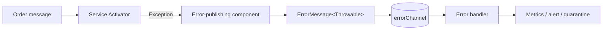

# Error Channel Receiving ErrorMessage in Spring Integration

## 1. Lesson Objectives

In the `SPRING_INTEGRATION_PATTERN` module, we practice **Enterprise Integration Patterns** with Spring Integration to build loosely coupled, extensible, testable, and observable message flows. When a **Router**, **Filter**, **Transformer**, **Gateway**, **Splitter**, or **Aggregator** step fails, the system needs to know where the error occurred, which message was affected, and whether it can be retried.

An **Error Channel** is a mechanism for routing error information as messages. The most important object entering an error channel is `org.springframework.messaging.support.ErrorMessage`, a `Message` whose payload is a `Throwable`. This is how Spring Integration represents errors in the message-exchange model instead of only logging a stack trace.

After this lesson, you will be able to:

- Explain the roles of `ErrorMessage`, `errorChannel`, the error payload, and the original message.
- Distinguish between exceptions returned directly to the caller and errors **published** to an Error Channel.
- Read an `ErrorMessage` in an error handler and safely extract the correlation ID.
- Use the global `errorChannel` and recognize when a dedicated error channel must be configured.
- Test an error handler, while distinguishing between testing the error consumer and testing the automatic error-publishing mechanism.
- Design retry, quarantine, alerting, and logging without losing business messages.

## 2. What Is ErrorMessage?

`ErrorMessage` is a special `Message<Throwable>` in Spring Messaging. Its **payload** is the exception/error object; in addition, the message has **headers** and may have an **originalMessage** to help trace the context.

Distinguish the following objects:

| Object | Role | How to Read |
| --- | --- | --- |
| `ErrorMessage` | Wraps error information into a message sent through a channel. | Received with `@ServiceActivator` or a `MessageHandler` on the error channel. |
| `ErrorMessage.getPayload()` | Returns a `Throwable`: the root cause or an exception wrapped by the framework. | Identifies the error type, cause, and cause chain (`getCause()`). |
| `ErrorMessage.getOriginalMessage()` | The original message if provided by the publisher. May be `null`. | Reads `eventId`, `correlationId`, and routing info of the input message. |
| `MessagingException.getFailedMessage()` | The message associated with a `MessagingException`, if any. | Additional information source when `originalMessage` is absent. |
| `ErrorMessage.getHeaders()` | Headers **of the error message**. | Metadata of the error event; not assumed by default to be identical to the failed message's headers. |

Suppose an order message with header `eventId=evt-42` enters a Service Activator; the handler throws an exception and an error-publishing component creates an `ErrorMessage`. The error handler will see the exception as the payload, while `evt-42` must be retrieved from the **failed message** if provided by the publisher, rather than assuming that header is already present on the `ErrorMessage`.



**Note:** Not every exception automatically goes through `errorChannel`. That depends on how the endpoint receives messages, whether the channel is synchronous or asynchronous, the poller/adapter, and the configured error handler.

## 3. When Does an Error Channel Receive Errors?

Two common paths behave differently:

### 3.1. Synchronous Flow

With a `DirectChannel`, the message is handed to the handler on the sender's thread. If the handler throws an exception, the error usually **propagates back to the caller** of `send(...)` or the Gateway. You cannot assume by default that an `ErrorMessage` will appear on the global `errorChannel`.

```text
Caller --send()--> DirectChannel --> Handler --throw--> Caller receives exception
```

In this model, the caller or an advice/retry interceptor is responsible for handling errors. If you want a message on an Error Channel, there must be a component explicitly configured to **publish** errors instead of merely letting exceptions propagate.

### 3.2. Asynchronous Flow or Framework-Managed Message Sources

With a channel backed by an executor, or message sources received via a poller/adapter that supports error handling, errors can be caught, wrapped into an `ErrorMessage`, and sent to an Error Channel. Which channel is chosen and whether errors are published depend on the specific endpoint and configuration.

```text
Sender --send()--> Executor / poller / adapter --> Handler
                                               |
                                               +--> Exception
                                                      |
                                                      v
                                                 ErrorMessage
                                                      |
                                                      v
                                               Error Channel
```

Because of the different thread boundaries, in an asynchronous flow `send(...) == true` may only mean the message was accepted into the channel, **not that business processing succeeded**.

| Criterion | Synchronous DirectChannel | Endpoint/channel with asynchronous error handling |
| --- | --- | --- |
| Where errors are typically reported | To the caller via exception. | To the error handler/publisher of the endpoint or channel. |
| `ErrorMessage` produced automatically? | Should not be assumed. | Yes, when an error-publishing component is configured/supported. |
| Does the sender know the processing result? | Usually receives the error immediately in the call. | May have already finished the call before the handler completes. |
| What needs testing | Exception propagation and caller retry. | Error Channel, metadata, retry, and asynchronous processing verification. |

## 4. Global errorChannel and Per-Flow Channels

When the Spring Integration infrastructure is enabled, the context typically provides a standard channel named **`errorChannel`**, usually a `PublishSubscribeChannel`. Error-publishing components can use it as the default destination for errors. This name is an important convention, though whether an exception actually arrives there still depends on the error publishing behavior of the emitting source.

Some error-handling sources allow specifying a custom error channel; in many cases, the `errorChannel` header of the original message can also be used by the publisher to determine the destination. For example, to separate errors between the payment flow and notification flow:

```text
Payment flow  ----> paymentErrorChannel ----> Payment investigation
Notify flow   ----> notifyErrorChannel  ----> Notification retry
Other errors  ----> errorChannel        ----> General error monitoring
```

**Do not configure error channels by guesswork:** check the documentation and actual behavior of the adapter, gateway, or endpoint you are using. An `errorChannel` header only matters if the error-publishing component supports and reads that header. If a custom channel does not exist, has the wrong type, or has no subscriber to receive errors, the error may throw another exception during error publishing.

The global Error Channel may have a default logging subscriber depending on the Spring Integration configuration. Seeing logs appear does not mean the application has retried, persisted, or resolved the failed message.

## 5. Hands-On Example: Receiving ErrorMessage with @ServiceActivator

The following example focuses on the **receiving side** of the Error Channel. `ErrorMessageObserver` reads the `Throwable` and tries to find the original message, then stores a minimal record for easy testing. In production, replace `ErrorProbe` with metrics, structured logging, or an appropriate business error-handling channel.

For a Spring Boot application, you can use `spring-boot-starter-integration`; for testing, add `spring-boot-starter-test`. For standalone Spring Framework, configure `@EnableIntegration` and the corresponding Spring Integration dependencies.

```java
import java.util.concurrent.atomic.AtomicReference;

import org.springframework.context.annotation.Bean;
import org.springframework.context.annotation.Configuration;
import org.springframework.integration.annotation.ServiceActivator;
import org.springframework.integration.config.EnableIntegration;
import org.springframework.messaging.Message;
import org.springframework.messaging.MessagingException;
import org.springframework.messaging.support.ErrorMessage;

@Configuration
@EnableIntegration
public class ErrorChannelConfig {

    public record ErrorSnapshot(String exceptionType, String eventId) {}

    public static class ErrorProbe {
        private final AtomicReference<ErrorSnapshot> latest =
            new AtomicReference<>();

        public void record(ErrorSnapshot snapshot) {
            latest.set(snapshot);
        }

        public ErrorSnapshot latest() {
            return latest.get();
        }
    }

    @Bean
    public ErrorProbe errorProbe() {
        return new ErrorProbe();
    }

    @Bean
    public ErrorMessageObserver errorMessageObserver(ErrorProbe probe) {
        return new ErrorMessageObserver(probe);
    }

    public static class ErrorMessageObserver {
        private final ErrorProbe probe;

        public ErrorMessageObserver(ErrorProbe probe) {
            this.probe = probe;
        }

        @ServiceActivator(inputChannel = "errorChannel")
        public void receive(ErrorMessage error) {
            Throwable failure = error.getPayload();
            Message<?> failed = error.getOriginalMessage();

            // Some sources do not provide a separate originalMessage.
            if (failed == null && failure instanceof MessagingException me) {
                failed = me.getFailedMessage();
            }

            String eventId = "unknown";
            if (failed != null) {
                Object value = failed.getHeaders().get("eventId");
                if (value != null) {
                    eventId = value.toString();
                }
            }

            probe.record(new ErrorSnapshot(
                failure.getClass().getSimpleName(), eventId));
        }
    }
}
```

**Key points when reading the example:**

1. `@ServiceActivator(inputChannel = "errorChannel")` registers an endpoint that receives messages on the Error Channel.
2. The `ErrorMessage` parameter type gives direct access to both the `Throwable` payload and `originalMessage`.
3. `originalMessage` and `getFailedMessage()` are **optional** sources and must not be assumed to be non-`null`.
4. The example only retains the exception type and `eventId`; do not send sensitive full payloads/stack traces to metrics systems.
5. The error handler only records observations. In a real system, any decision to retry, compensate, or quarantine must be based on an explicit business policy.

### Testing the Contract of the ErrorMessage Consumer

The following test explicitly creates an `ErrorMessage` and sends it to the global `errorChannel`. This is a test of the **Error Channel consumer**: it verifies that the endpoint receives the message and extracts the right context. It does not verify that a specific adapter automatically publishes errors when an exception occurs.

```java
import org.junit.jupiter.api.Test;
import org.springframework.beans.factory.annotation.Autowired;
import org.springframework.beans.factory.annotation.Qualifier;
import org.springframework.messaging.Message;
import org.springframework.messaging.MessageChannel;
import org.springframework.messaging.MessagingException;
import org.springframework.messaging.support.ErrorMessage;
import org.springframework.messaging.support.MessageBuilder;
import org.springframework.test.context.junit.jupiter.SpringJUnitConfig;

import static org.assertj.core.api.Assertions.assertThat;

@SpringJUnitConfig(ErrorChannelConfig.class)
class ErrorChannelConfigTest {

    @Autowired
    @Qualifier("errorChannel")
    MessageChannel errorChannel;

    @Autowired
    ErrorChannelConfig.ErrorProbe probe;

    @Test
    void receivesErrorMessageAndFindsOriginalEventId() {
        Message<String> original = MessageBuilder
            .withPayload("order-created")
            .setHeader("eventId", "evt-42")
            .build();

        MessagingException failure =
            new MessagingException(original, "Order rejected");
        ErrorMessage error = new ErrorMessage(failure, original);

        assertThat(errorChannel.send(error)).isTrue();
        assertThat(probe.latest()).isEqualTo(
            new ErrorChannelConfig.ErrorSnapshot(
                "MessagingException", "evt-42"));
    }
}
```

A useful additional test is to send `new ErrorMessage(new IllegalStateException("failure"))` and verify that `eventId` becomes `"unknown"` instead of throwing a `NullPointerException`. With an asynchronous handler, you need a bounded wait mechanism or event-based assertion, avoiding immediate synchronous checks like in this example.

### Testing the Error-Publishing Mechanism in a Real Flow

After testing the consumer, write a **separate integration test** for the error-emitting source (for example, a poller or an executor-backed channel):

1. Configure the message-emitting source, error handler, and a supported Error Channel.
2. Send a message with a known `eventId`; intentionally make the handler throw an exception.
3. Wait for the Error Channel to receive an `ErrorMessage` and confirm the payload contains the expected cause.
4. Check `originalMessage` or `failedMessage` if the endpoint type provides it, along with correlation metadata.
5. Verify retry behavior, commit/rollback, and how failures inside the error handler itself are handled.

Do not use the result of a test that manually sends an `ErrorMessage` as proof that **all** exceptions in the system are routed to the error channel.

## 6. ErrorMessage and Its Relationship with Retry, Gateway, and Null Channel

### Retry Before or After Publishing Errors?

Retry is usually the responsibility of an advice, endpoint, adapter, or flow control mechanism. In a common design, transient errors are retried up to a limit; when processing still cannot succeed, a component forwards the failure state to the error flow. However, **the order of retry and error publishing depends on configuration**, not a universal guarantee of `errorChannel`.

Classify errors carefully:

| Error Type | Example | Suggested Handling |
| --- | --- | --- |
| Transient | Partner API timeout, brief connection loss | Bounded retry with backoff; then publish error/quarantine. |
| Invalid data | Invalid schema, missing required fields | Reject or quarantine; generally do not retry indefinitely. |
| Compensatable business error | Inventory deducted but order placement did not complete | Compensation/Saga workflow or controlled manual handling. |
| Unknown error | Unexpected exception | Preserve context, alert, and investigate before deciding to replay. |

### Gateway and Synchronous Callers

A synchronous Gateway typically expects a result or an exception in its contract. When an asynchronous branch publishes an `ErrorMessage`, the error event does not automatically turn into a valid response for a waiting caller. You must explicitly design timeouts, reply/error replies, and status notification mechanisms.

For example, an HTTP request to create an order cannot rely on "an `ErrorMessage` exists in the system" to return a success code. The caller needs an ACK/response per the contract; if processing continues asynchronously, you can return a tracking ID and provide a status query API.

### Error Channel vs. Null Channel

```text
Valid discard condition ----> nullChannel  ----> intentional termination
Exception to handle     ----> errorChannel ----> ErrorMessage / error flow
```

Routing unhandled exceptions to `nullChannel` to "keep the flow running" can cause data loss and hide errors. Conversely, a heartbeat that is safe to ignore does not need to generate an `ErrorMessage`, because it is not an error.

### Splitter, Aggregator, and Correlation

In a `Splitter → processing branches → Aggregator` chain, a failing branch can prevent the Aggregator from receiving all child messages. If all errors are simply published to a separate Error Channel without a group completion strategy, the correlation group may wait until it expires.

When designing the error flow, answer these questions:

- Where are `correlationId`, `sequenceNumber`, and `sequenceSize` preserved if a failed message is wrapped into an `ErrorMessage`?
- If an error occurs on a child message, will the group retry, expire, emit an error result, or compensate?
- Does the error handler need `failedMessage` to identify the group and the failed item?

Do not assume headers in `ErrorMessage` retain all original headers; read from the failed message when available and test with the exact adapter version in use.

## 7. Observing and Operating an Error Channel

An effective error handler typically records **just enough context** to investigate and decide the next action:

| Information | Purpose |
| --- | --- |
| Flow/endpoint name | Know which step raised the error. |
| Exception type and root cause | Classify retryable vs. data errors. |
| `eventId` / `correlationId` | Link the error to the related request and message group. |
| Attempt count / error timestamp | Detect prolonged incidents and prevent infinite retries. |
| Handling decision | `retry`, `quarantine`, `compensate`, `alert`, or `resolved`. |

Metrics can include `integration_errors_total{flow,type}`, `integration_retries_total{flow}`, and `integration_failed_messages_total{flow}`. Avoid using `eventId` as a metric label because cardinality grows too quickly. If you need to store messages for replay, use a data store or an appropriate dead-letter/quarantine mechanism; the Error Channel itself is not a durable store.

**Safe operations:** do not log passwords, tokens, payment details, or full sensitive payloads; standardize alert messages. An error handler can also throw exceptions, so test how secondary errors are handled to avoid error-publishing loops or losing the original error information.

## 8. Hands-On Exercise

**Scenario:** A flow receives order events, transforms the payload, calls a payment service, and updates status. The payment service may time out, while some events are missing `orderId`.

1. Design a flow using `errorChannel` or a dedicated error channel to receive `ErrorMessage` instances from an asynchronous endpoint that supports error publishing.
2. Write an error handler that extracts `orderId` or `correlationId` from the failed message (if present) and records the exception type.
3. Define retry with backoff for timeouts, while storing errors missing `orderId` for investigation.
4. Write a test that manually sends an `ErrorMessage` to verify the handler, and an integration test for a real exception from the emitting source.
5. Simulate a Splitter child message encountering an error. Describe how the Aggregator will complete, expire, or compensate.

**Reflection question:** If a `DirectChannel` throws an exception and the caller receives the error, yet the global `errorChannel` sees no `ErrorMessage`, is that necessarily a configuration bug? How would you inspect the synchronous/asynchronous boundary and the error-publishing mechanism?

## 9. Key Takeaways

**An Error Channel receives an `ErrorMessage` when a component actively publishes an error through that channel.** The payload of an `ErrorMessage` is a `Throwable`; original message information may reside in `originalMessage` or in `MessagingException.getFailedMessage()`. Do not assume every exception automatically enters the global `errorChannel`: identify execution boundaries, publisher configuration, retry policies, and error consumers. Good design helps Spring Integration flows handle errors responsibly, traceably, and without losing business commitments.
