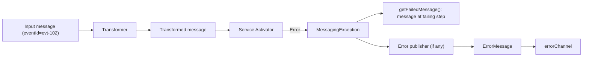
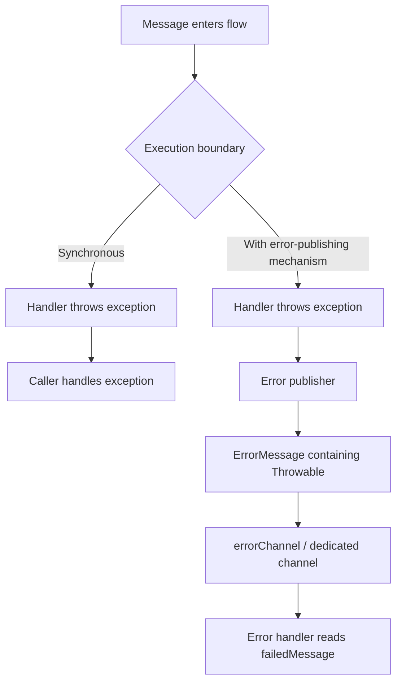

# MessagingException and failedMessage in Spring Integration

## 1. Context and Objectives

In the `SPRING_INTEGRATION_PATTERN` module, we implement **Enterprise Integration Patterns** with Spring Integration to build loosely coupled, extensible message flows while testing and observing processing branches. When a **Transformer**, **Filter**, **Router**, **Gateway**, **Splitter**, **Aggregator**, or adapter encounters an error, the critical question is not just *"What exception occurred?"* but also *"Which message was being processed at the time of failure?"*.

`org.springframework.messaging.MessagingException` connects **exception information** with the **context of the failed message**. The `getFailedMessage()` method can return the message associated with the failed operation, giving the error handler a basis to identify the event type, correlation ID, and data needing recovery.

After this lesson, you will be able to:

- Explain the differences between `MessagingException`, `Throwable`, `ErrorMessage`, and `failedMessage`.
- Extract `getFailedMessage()` and read relevant headers without assuming the message always exists.
- Identify error context when exceptions are wrapped in multiple layers or occur after a message transformation.
- Distinguish between exceptions propagating back on a synchronous channel and `ErrorMessage` instances published to an error channel.
- Write an error handler and test cases both with and without `failedMessage`.
- Leverage failed message information to design retry, quarantine, and correlation.

## 2. Structure of MessagingException

`MessagingException` is a **runtime exception** in Spring Messaging; it is itself an exception, **not a message on a channel**. It can hold a reference to a specific `Message<?>`.

| Component | Meaning | Usage Notes |
| --- | --- | --- |
| `getMessage()` | Error description as a string. | For diagnostics; not a business payload. |
| `getCause()` | The cause wrapped inside the exception, if any. | May require traversing multiple cause layers. |
| `getFailedMessage()` | The `Message<?>` associated with the failed task, if any. | **May return `null`**. |
| `getFailedMessage().getPayload()` | Payload of the message related to the error. | May be data already processed by a Transformer, no longer identical to the initial input. |
| `getFailedMessage().getHeaders()` | Headers of the failed message. | Check `correlationId`, `sequenceNumber`, or custom headers depending on the flow. |

Several exception types in the messaging ecosystem extend `MessagingException`, such as `MessageHandlingException` when a handler encounters a problem and `MessageDeliveryException` when message delivery fails. The exact exception type and whether `failedMessage` is attached depend on where the error occurred and how the framework or application created the exception.

### Simple Example: Explicitly Attaching failedMessage

```java
import org.springframework.messaging.Message;
import org.springframework.messaging.MessagingException;
import org.springframework.messaging.support.MessageBuilder;

Message<String> message = MessageBuilder.withPayload("ORDER_CREATED")
    .setHeader("eventId", "evt-102")
    .setHeader("correlationId", "order-42")
    .build();

MessagingException failure = new MessagingException(
    message, "Unable to process order");

Message<?> failed = failure.getFailedMessage();
System.out.println(failed.getPayload()); // ORDER_CREATED
System.out.println(failed.getHeaders().get("eventId")); // evt-102
```

Here, the code constructs `MessagingException` with a specific message, so `getFailedMessage()` has a value. In real failures, do not assume every exception is constructed this way.

## 3. How Does failedMessage Differ from originalMessage?

In an integration flow, a message can be transformed, split, or routed across multiple channels:



**`failedMessage`** belongs to `MessagingException` and usually represents the message associated with the failed operation. If the exception is created at a Service Activator step, it may be the message **after a Transformer changed the payload**.

**`originalMessage`** is optional information on `org.springframework.messaging.support.ErrorMessage`, provided when the error-emitting component creates the `ErrorMessage`. It may represent the input message of a processing boundary; there is no guarantee that it is always the very first message in the entire pipeline.

| Question | `MessagingException.getFailedMessage()` | `ErrorMessage.getOriginalMessage()` |
| --- | --- | --- |
| Which object owns it? | Exception. | ErrorMessage published to a channel. |
| Primary meaning | Message associated with the **failed operation**. | Message recorded by the **error publisher** as the source of the error. |
| Always present? | No. | No. |
| Can they differ? | Yes, especially across a Transformer/Splitter. | May be the message before transformation or before an adapter boundary. |
| What is it used for? | Diagnosing the failing step, retry/quarantine details. | Tracing back to the initial context when provided by the publisher. |

Do not assume headers on `ErrorMessage` itself match the failed message's headers. If you want to find `eventId` or `correlationId`, identify the **right message** to read headers from.

## 4. When Can getFailedMessage() Be null?

`getFailedMessage()` returns `null` if no message was attached to the exception. Some situations where this occurs:

1. The error is created by code outside the messaging layer, such as `IllegalStateException` or `IOException`; these exceptions do not have a `getFailedMessage()` API.
2. The application constructs a `MessagingException` using a constructor that allows no message or passes a null/missing message.
3. The error publisher wraps a plain exception into an `ErrorMessage` without adding original message context.
4. The exception sits inside the `cause` chain or another wrapper; looking only at the outermost exception misses the inner `MessagingException`.

A safe approach is to check the exception type, check for `null`, and then look for fallback context sources. If no message is available, the error handler must still handle the error based on the exception type and endpoint/flow information; it must not invent or assign an incorrect payload or correlation ID.

```java
static String readEventId(Throwable error) {
    if (error instanceof MessagingException messagingException) {
        Message<?> failed = messagingException.getFailedMessage();
        if (failed != null) {
            Object eventId = failed.getHeaders().get("eventId");
            if (eventId != null) {
                return eventId.toString();
            }
        }
    }
    return "unknown";
}
```

The snippet above only catches the case where `MessagingException` is the outermost layer. The next section adds traversal of the `cause` chain.

## 5. Practice: Error Handler Reading failedMessage in the Cause Chain

Suppose a business error is wrapped across an asynchronous boundary:

```text
IllegalStateException ("Async wrapper")
  └── MessagingException ("Unable to process ORDER_CREATED")
        └── failedMessage: eventId=evt-102, stage=payment
```

The error handler needs to find a `MessagingException` with `failedMessage` in the cause chain. The code below traverses causes while guarding against cycles using an identity set to avoid infinite loops on unusual error graphs.

### Configuration and Error Consumer

The example uses Java 17 and Spring Integration with the `@ServiceActivator` mechanism. With Spring Boot, you can add `spring-boot-starter-integration` and `spring-boot-starter-test` for testing. `FailureProbe` is an in-memory store used for observation in this lesson; real applications should use appropriate metrics and logging systems.

```java
import java.util.Collections;
import java.util.IdentityHashMap;
import java.util.Set;
import java.util.concurrent.atomic.AtomicReference;

import org.springframework.context.annotation.Bean;
import org.springframework.context.annotation.Configuration;
import org.springframework.integration.annotation.ServiceActivator;
import org.springframework.integration.config.EnableIntegration;
import org.springframework.messaging.Message;
import org.springframework.messaging.MessagingException;
import org.springframework.messaging.support.ErrorMessage;

@Configuration
@EnableIntegration
public class FailedMessageErrorConfig {

    public record FailureSnapshot(
        String exceptionType,
        String failedEventId,
        String originalEventId,
        String failedStage) {}

    public static class FailureProbe {
        private final AtomicReference<FailureSnapshot> latest =
            new AtomicReference<>();

        public void save(FailureSnapshot snapshot) {
            latest.set(snapshot);
        }

        public FailureSnapshot latest() {
            return latest.get();
        }

        public void clear() {
            latest.set(null);
        }
    }

    @Bean
    public FailureProbe failureProbe() {
        return new FailureProbe();
    }

    @Bean
    public ErrorObserver errorObserver(FailureProbe probe) {
        return new ErrorObserver(probe);
    }

    public static class ErrorObserver {
        private final FailureProbe probe;

        public ErrorObserver(FailureProbe probe) {
            this.probe = probe;
        }

        @ServiceActivator(inputChannel = "errorChannel")
        public void onError(ErrorMessage errorMessage) {
            Throwable error = errorMessage.getPayload();

            Message<?> failed = findFailedMessage(error);
            Message<?> original = errorMessage.getOriginalMessage();

            probe.save(new FailureSnapshot(
                error.getClass().getSimpleName(),
                headerAsString(failed, "eventId"),
                headerAsString(original, "eventId"),
                headerAsString(failed, "stage")));
        }

        // Search only in the cause chain. Do not infer message from payload.
        static Message<?> findFailedMessage(Throwable error) {
            Set<Throwable> visited = Collections.newSetFromMap(
                new IdentityHashMap<Throwable, Boolean>());

            for (Throwable current = error;
                 current != null && visited.add(current);
                 current = current.getCause()) {
                if (current instanceof MessagingException me) {
                    Message<?> failed = me.getFailedMessage();
                    if (failed != null) {
                        return failed;
                    }
                }
            }
            return null;
        }

        static String headerAsString(Message<?> message, String key) {
            if (message == null) {
                return "unknown";
            }
            Object value = message.getHeaders().get(key);
            return value == null ? "unknown" : value.toString();
        }
    }
}
```

Key takeaways from the example:

- `onError(ErrorMessage)` only runs when **an error-emitting source has published** an `ErrorMessage` onto `errorChannel`. Throwing an exception by itself does not necessarily trigger this consumer.
- `getPayload()` of `ErrorMessage` is a `Throwable`; the code must walk the cause chain to locate a `MessagingException` carrying message context.
- `failedEventId` and `originalEventId` are kept **separate**. If a Transform/Split created another message, those values may differ.
- `unknown` is an intentional fallback value when context is insufficient, not a real event ID.
- Retrieving the message is solely for analysis. Do not automatically replay a message before understanding whether side effects partially succeeded.

### Testing the Input of the Error Consumer

The test below **explicitly sends an ErrorMessage** to the global `errorChannel` to verify error-receiving behavior. It does not prove that every exception in a real flow is published to this channel; a separate integration test is needed for an adapter or endpoint with error publishing.

```java
import org.junit.jupiter.api.BeforeEach;
import org.junit.jupiter.api.Test;
import org.springframework.beans.factory.annotation.Autowired;
import org.springframework.beans.factory.annotation.Qualifier;
import org.springframework.messaging.Message;
import org.springframework.messaging.MessageChannel;
import org.springframework.messaging.MessagingException;
import org.springframework.messaging.support.ErrorMessage;
import org.springframework.messaging.support.MessageBuilder;
import org.springframework.test.context.junit.jupiter.SpringJUnitConfig;

import static org.assertj.core.api.Assertions.assertThat;

@SpringJUnitConfig(FailedMessageErrorConfig.class)
class FailedMessageErrorConfigTest {

    @Autowired
    @Qualifier("errorChannel")
    MessageChannel errorChannel;

    @Autowired
    FailedMessageErrorConfig.FailureProbe probe;

    @BeforeEach
    void reset() {
        probe.clear();
    }

    @Test
    void findsFailedMessageInsideWrappedException() {
        Message<String> input = MessageBuilder
            .withPayload("order-request")
            .setHeader("eventId", "evt-102")
            .build();

        Message<String> transformed = MessageBuilder
            .withPayload("payment-request")
            .setHeader("eventId", "evt-102-payment")
            .setHeader("stage", "payment")
            .build();

        MessagingException handlingFailure =
            new MessagingException(transformed, "Payment failed");
        Throwable wrapper =
            new IllegalStateException("Async wrapper", handlingFailure);
        ErrorMessage error = new ErrorMessage(wrapper, input);

        assertThat(errorChannel.send(error)).isTrue();
        assertThat(probe.latest()).isEqualTo(
            new FailedMessageErrorConfig.FailureSnapshot(
                "IllegalStateException", "evt-102-payment",
                "evt-102", "payment"));
    }

    @Test
    void handlesMissingFailedAndOriginalMessage() {
        ErrorMessage error =
            new ErrorMessage(new IllegalArgumentException("Invalid request"));

        assertThat(errorChannel.send(error)).isTrue();
        assertThat(probe.latest()).isEqualTo(
            new FailedMessageErrorConfig.FailureSnapshot(
                "IllegalArgumentException",
                "unknown", "unknown", "unknown"));
    }
}
```

The first test proves that an exception's `failedMessage` can differ from the ErrorMessage's `originalMessage`. The second test proves the error handler does not crash when both context sources are absent. For an error channel processed asynchronously, use a bounded wait mechanism instead of an assertion immediately after `send()`.

## 6. Synchronous, Asynchronous, and Where Exceptions Surface

With a `DirectChannel` in Spring Integration, the handler normally runs on the message-sending thread. If a `MessagingException` occurs, the exception can propagate back to the caller; **the global `errorChannel` does not necessarily receive an `ErrorMessage`**.

```java
try {
    inputChannel.send(message);
} catch (MessagingException ex) {
    Message<?> failed = ex.getFailedMessage();
    // failed may be null; the caller decides the appropriate retry/error reporting.
}
```

When using a poller, executor channel, or adapter with error publishing, the corresponding component can catch a `Throwable`, wrap it into an `ErrorMessage`, and send it to an Error Channel. You must verify the **error-emitting source**, channel name, error handler, and how message headers are preserved.



An `ErrorMessage` may carry an exception type other than `MessagingException`. There are also cases where `MessagingException` exists in `getCause()` rather than as the top-level payload. Therefore, the error handler should tolerate different structures.

## 7. Using failedMessage to Decide Error Handling

`failedMessage` is especially useful when correlating an error with a **specific unit of work**, though by itself it cannot decide whether to retry.

| Need | Data You Can Extract | Policy to Add |
| --- | --- | --- |
| Identify the failed request | `eventId`, `orderId`, or `traceId` in appropriate headers/payload. | Mapping to the business record. |
| Track a Splitter/Aggregator group | `correlationId`, `sequenceNumber`, `sequenceSize` if still on the failed message. | Group release/timeout, emitting an error result, or compensation. |
| Retry transient errors | Exception type/cause, failed message. | Attempt limit, backoff, idempotency, and transactions. |
| Quarantine toxic messages | Identifying headers and an appropriate copy of content. | Durable storage, access control, retention period, and replay tooling. |
| System observability | Endpoint name, error type, correlation ID. | Metrics, structured logs, and alerts. |

### Example: An Aggregator Child Message Fails

If a Splitter produces 5 parts of an order but part 3 fails, `failedMessage` may carry `sequenceNumber=3` and the group's `correlationId`. However, this information **does not automatically supply the missing message to the Aggregator**. If the release strategy requires all 5 parts, the group may wait until timeout.

You need to design how part 3 is retried, how the group ends with an error status, or how expiration is handled. Do not merely log `failedMessage` and assume the Aggregator will release the group on its own.

### Retry and Side Effects

If an error occurs after a handler wrote to a database but before sending a reply, replaying `failedMessage` can create duplicate records. When designing retries, include an idempotency key, transactions, or a compensation policy. `getFailedMessage()` tells you **which message was associated with the error**, not whether prior side effects were rolled back.

## 8. Safety Rules When Logging and Building Error Flows

1. Always check for `null` before accessing `getFailedMessage().getPayload()` or headers.
2. Only read metadata that is genuinely needed; do not log raw payloads containing personal data, tokens, or payment information.
3. Separate the **exception type** and **root cause** from the descriptive message, since `getMessage()` may contain sensitive data or change across versions.
4. Preserve correlation IDs across Transformer/Splitter chains when tracing is required, and test header presence after every major boundary.
5. When `failedMessage` does not exist, use context from `ErrorMessage.getOriginalMessage()` (if available), or record status `unknown` along with the endpoint name.
6. An Error Channel is not a dead-letter queue. If replay after data fixes is needed, you must have a proper storage/quarantine mechanism.
7. Define a policy for when the error handler itself fails to prevent losing the original error details or triggering reporting loops.

Suggested metrics: `integration_errors_total{flow,exception_type}`, `failed_message_missing_total{flow}`, and `retry_attempts_total{flow}`. Avoid using individual `eventId` values as a metric label; store IDs in queryable logs or an audit store instead of creating high-cardinality labels.

## 9. Hands-On Exercise

A flow receives `ORDER_CREATED`, uses a Transformer to build a payment request, and then calls a payment service. The service may time out or reject input data.

1. Write a handler that catches `ErrorMessage` and extracts `failedMessage`, `originalMessage`, `eventId`, and `correlationId` with safe fallback logic.
2. Create a test with a `MessagingException` wrapped inside an `IllegalStateException`; prove that information in `failedMessage` is still retrievable.
3. Create a test without any original message; confirm the handler does not throw a `NullPointerException`.
4. Use an integration test with an endpoint that has a real error publisher, verifying whether errors go to the global `errorChannel` or a dedicated channel.
5. Build a retry policy for timeouts, quarantine for schema errors, and distinguish these from a branch allowed to be discarded via `nullChannel`.
6. If the payment request is part of an Aggregator group, explain how to use correlation metadata to avoid stalling the group when one part fails.

**Self-check question:** Is `failedMessage` always the initial message of the entire flow? Why is reading `ErrorMessage.getHeaders()` insufficient to infer the headers of the failed message?

## 10. Key Takeaways

**`MessagingException` is an exception that may carry `failedMessage`; `ErrorMessage` is a message used to transmit error information across an Error Channel.** `getFailedMessage()` helps trace context at the failing step, though it **may return `null`**. Distinguish failed messages from original messages, traverse causes when necessary, and properly test the endpoint's error-publishing mechanism. When combined thoughtfully with retry, error channels, and correlation, this information makes Spring Integration flows easier to trace and recover.
