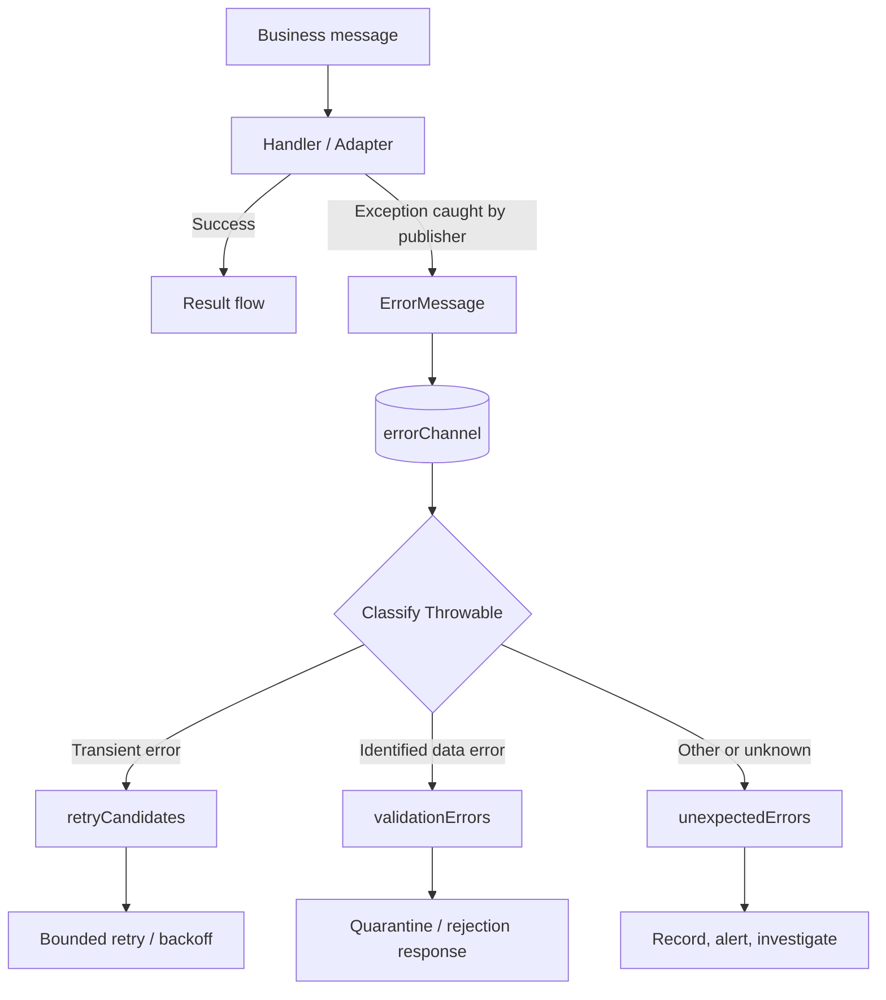

# Routing Errors by Exception Type with Error Channel in Spring Integration

## 1. Objectives and Context

In the `SPRING_INTEGRATION_PATTERN` module, we apply **Enterprise Integration Patterns** (EIP) with Spring Integration to create loosely coupled, extensible message flows while testing and observing individual branches. An order-processing flow may encounter transient API-call errors, invalid-data errors, or unknown program errors. If all three enter one generic handler and apply the same retry policy, the system may retry pointlessly, cause overload, or lose data needed for investigation.

**Routing errors by exception type** uses a classification decision to send each error event to an appropriate handling branch. Spring Integration lets you combine **Error Channel** with **Content-Based Router**: the Error Channel receives an `ErrorMessage`, and the Router inspects the `Throwable` and selects an output channel such as `retryCandidates`, `validationErrors`, or `unexpectedErrors`.

After this lesson, you will:

- Explain how `ErrorMessage`, `Throwable`, and Router collaborate in an error flow.
- Classify based on the **actual** exception type, even when it is wrapped in `MessagingException` or `cause` layers.
- Design clear processing routes for transient errors, data errors, and unknown errors.
- Write Java DSL to route error messages while preserving the failed message's context.
- Test each route and recognize the limitations of tests that manually send `ErrorMessage`.
- Combine retry, quarantine, error channels, and correlation without creating error-handling loops.

## 2. Why Do We Need a Router in an Error Flow?

An Error Channel is a `MessageChannel` dedicated to receiving **encapsulated error information**. In Spring Messaging, `ErrorMessage` has a `Throwable` payload, its own headers, and may carry `originalMessage`. A `MessagingException` may also contain `failedMessage` to trace back to the message involved in the failed operation.

An Error Channel **does not decide by itself** when to retry or send a message to an investigation store. That is the responsibility of error-receiving handlers/flows. A Router places branch selection rules in a single, testable spot.



**Important condition:** The diagram illustrates a case where an **error publisher** has caught the exception and emitted an `ErrorMessage`. With a synchronous `DirectChannel`, exceptions usually propagate back to the caller; do not assume every exception automatically appears on the global `errorChannel`. Verify the error-publishing behavior of the poller, adapter, executor, or gateway you are using.

## 3. Choosing Routes by Business Policy

Routing by exception is more than renaming channels. Each route needs explicit **conditions**, **purpose**, and **actions**:

| Error Group | Example Signals | Suggested Route | Follow-Up Policy |
| --- | --- | --- | --- |
| Transient | Brief connection loss, external service timeout | `retryCandidates` | Bounded retry, backoff, and idempotency; after limit, move to investigation. |
| Invalid data (*non-retryable*) | Missing `orderId`, violated validated data contract | `validationErrors` | Quarantine, return structured rejection, or fix data. |
| Unclassified | `NullPointerException`, unexpected library failure | `unexpectedErrors` | Preserve context, alert, investigate; decide retry after understanding root cause. |

**Do not use generic `IllegalArgumentException` as a rule that "every data error is non-retryable"**: that exception can also stem from a programming bug. In the example, we create business exception types with clear semantics. In production, the classifier can also inspect API error codes, recoverability, transaction state, and per-endpoint policies.

Furthermore, "routed to the retry branch" **does not mean retried yet**. The channel only forwards the message to the handling branch; retry behavior must be implemented via retry advice, retry template, a retry schedule, or broker/adapter mechanisms.

## 4. Reading the Right Exception Through Multiple Wrapper Layers

In Spring Integration, a handler might throw `RemoteServiceTimeoutException`, yet when reaching the error flow, the payload is `MessageHandlingException` or `MessagingException` whose `getCause()` points to the original exception.

```text
ErrorMessage.payload
  └── MessageHandlingException (may have failedMessage)
        └── RemoteServiceTimeoutException
              └── (timeout details from the external service)
```

If the Router only checks `error instanceof RemoteServiceTimeoutException`, that event will be misclassified. A simple, controlled approach is to walk the `getCause()` chain to find predefined exception types. Do not classify based on `getMessage()` strings, as messages can change by locale, library version, or input data.

When traversing causes, note:

1. An exception may have no `cause`; the default rule must lead to a safe route.
2. Multiple exceptions with different meanings may appear in the chain; classification priority must be clearly defined.
3. `MessagingException.getFailedMessage()` helps trace `eventId` or `correlationId`, but it is **not the exception type** used to decide retry.
4. Just because an exception carries a failed message does not mean replaying that message is safe: a prior step may already have partially succeeded in writing data.

## 5. Java DSL Example: Three Dedicated Error Routes

We build an **error routing flow** using the standard channel name `errorChannel`. The Router reads the **`Throwable` payload** of `ErrorMessage`, returns a route key, and forwards **the entire error message** to the destination channel. The `QueueChannel` beans in the example are only for test observation; in a real system, each route has a handler enforcing its policy.

The example uses Java 17, Spring Integration Java DSL, and `@EnableIntegration`. With Spring Boot, you can use `spring-boot-starter-integration`; testing uses JUnit 5, Spring Test, and AssertJ.

```java
import java.util.Collections;
import java.util.IdentityHashMap;
import java.util.Set;

import org.springframework.context.annotation.Bean;
import org.springframework.context.annotation.Configuration;
import org.springframework.integration.channel.QueueChannel;
import org.springframework.integration.config.EnableIntegration;
import org.springframework.integration.dsl.IntegrationFlow;
import org.springframework.messaging.PollableChannel;

@Configuration
@EnableIntegration
public class ExceptionRoutingConfig {

    // Business errors with explicit semantics, avoiding inference from message strings.
    public static class RemoteServiceTimeoutException
            extends RuntimeException {
        public RemoteServiceTimeoutException(String message) {
            super(message);
        }
    }

    public static class InvalidOrderException extends RuntimeException {
        public InvalidOrderException(String message) {
            super(message);
        }
    }

    @Bean
    public PollableChannel retryCandidates() {
        return new QueueChannel();
    }

    @Bean
    public PollableChannel validationErrors() {
        return new QueueChannel();
    }

    @Bean
    public PollableChannel unexpectedErrors() {
        return new QueueChannel();
    }

    @Bean
    public IntegrationFlow exceptionRoutingFlow() {
        return IntegrationFlow.from("errorChannel")
            .route(Throwable.class,
                ExceptionRoutingConfig::classify,
                router -> router
                    .channelMapping("TRANSIENT", "retryCandidates")
                    .channelMapping("INVALID", "validationErrors")
                    .channelMapping("UNKNOWN", "unexpectedErrors"))
            .get();
    }

    static String classify(Throwable error) {
        Set<Throwable> visited = Collections.newSetFromMap(
            new IdentityHashMap<Throwable, Boolean>());

        for (Throwable current = error;
             current != null && visited.add(current);
             current = current.getCause()) {

            if (current instanceof InvalidOrderException) {
                return "INVALID";
            }
            if (current instanceof RemoteServiceTimeoutException) {
                return "TRANSIENT";
            }
        }
        return "UNKNOWN";
    }
}
```

Explanation of key points:

- `IntegrationFlow.from("errorChannel")` creates a subscriber for the standard Error Channel provided by Spring Integration when integration infrastructure is enabled. In an application with multiple error subscribers, check multi-subscriber dispatch behavior to avoid duplicate processing.
- `.route(Throwable.class, ...)` receives the **`Throwable` payload** to compute the route key. Do not use `ErrorMessage.class` as the payload type: the payload of `ErrorMessage` is `Throwable`.
- `channelMapping(...)` maps each route key to a channel. The Router forwards the original error message so handlers on target branches can still read `ErrorMessage`, `originalMessage`, or `failedMessage`.
- `classify(...)` searches the cause chain and recognizes **only explicitly allowed application exceptions**. All other types go to `UNKNOWN`, avoiding dropping messages of unknown origin.
- `visited` uses identity equality to avoid infinite loops on abnormal cause graphs.
- The three `QueueChannel` instances are **test outputs**, without a retry scheduler, quarantine store, or alerting service yet. Putting them into production without consumers causes errors to pile up and increases memory consumption.

### Why Not Just Use a Single `catch (Exception)`?

If a handler catches every exception and decides on its own not to notify an error publisher, the system may lose observability. A Router in the error flow keeps a clear classification point, but only works for errors **that actually reach** the Error Channel. Catch policies inside handlers must align with the overall design.

## 6. Testing Classification and Routing

The tests below construct `ErrorMessage` instances, send them to `errorChannel`, and verify messages reach the **right branch**. With the default global Error Channel, router reception may run synchronously; `QueueChannel` lets you wait for a bounded duration. Each test sends an independent error type.

```java
import org.junit.jupiter.api.Test;
import org.springframework.beans.factory.annotation.Autowired;
import org.springframework.beans.factory.annotation.Qualifier;
import org.springframework.messaging.Message;
import org.springframework.messaging.MessageChannel;
import org.springframework.messaging.MessagingException;
import org.springframework.messaging.PollableChannel;
import org.springframework.messaging.support.ErrorMessage;
import org.springframework.messaging.support.MessageBuilder;
import org.springframework.test.context.junit.jupiter.SpringJUnitConfig;

import static org.assertj.core.api.Assertions.assertThat;

@SpringJUnitConfig(ExceptionRoutingConfig.class)
class ExceptionRoutingConfigTest {

    @Autowired
    @Qualifier("errorChannel")
    MessageChannel errorChannel;

    @Autowired
    @Qualifier("retryCandidates")
    PollableChannel retryCandidates;

    @Autowired
    @Qualifier("validationErrors")
    PollableChannel validationErrors;

    @Autowired
    @Qualifier("unexpectedErrors")
    PollableChannel unexpectedErrors;

    @Test
    void wrappedTimeoutGoesToRetryCandidates() {
        Message<String> failed = MessageBuilder
            .withPayload("PAYMENT_REQUEST")
            .setHeader("eventId", "evt-101")
            .build();

        var timeout = new ExceptionRoutingConfig.RemoteServiceTimeoutException(
            "upstream timeout");
        var wrapped = new MessagingException(
            failed, "Payment service failed", timeout);

        assertThat(errorChannel.send(
            new ErrorMessage(wrapped, failed))).isTrue();

        Message<?> routed = retryCandidates.receive(1_000);
        assertThat(routed).isInstanceOf(ErrorMessage.class);
        assertThat(routed.getPayload()).isSameAs(wrapped);
    }

    @Test
    void invalidOrderGoesToValidationChannel() {
        var invalid = new ExceptionRoutingConfig.InvalidOrderException(
            "orderId is missing");

        assertThat(errorChannel.send(new ErrorMessage(invalid))).isTrue();

        Message<?> routed = validationErrors.receive(1_000);
        assertThat(routed).isInstanceOf(ErrorMessage.class);
        assertThat(routed.getPayload()).isSameAs(invalid);
    }

    @Test
    void unexpectedFailureGoesToInvestigation() {
        var unexpected = new IllegalStateException("unexpected state");

        assertThat(errorChannel.send(
            new ErrorMessage(unexpected))).isTrue();

        Message<?> routed = unexpectedErrors.receive(1_000);
        assertThat(routed).isInstanceOf(ErrorMessage.class);
        assertThat(routed.getPayload()).isSameAs(unexpected);
    }
}
```

Each test above verifies **the router and destination channels**. This test does not prove that a specific adapter automatically routes exceptions to the Error Channel. To verify end-to-end, configure an endpoint with error publishing, intentionally trigger a failure in the handler, and verify that an `ErrorMessage` is actually published and reaches the right route.

Tests should be extended for deep `cause` chains, `MessagingException` without `failedMessage`, an exception with multiple wrapper layers, and ensuring unknown cases are not lost. If there are multiple subscribers or concurrent error flows, use a correlation ID to match events with outcomes instead of relying solely on the first item in a queue.

## 7. Attaching Policies to Each Branch

The Router only decides **where to send**. Processing downstream of the Router must have its own contract.

### 7.1. Transient Error Route: Bounded Retry

The handler on `retryCandidates` can schedule a job replay or feed into an adapter's retry mechanism. Before retrying, verify whether prior side effects partially occurred. A transaction rollback, idempotency key, or compensation mechanism may be necessary to prevent duplicate order writes.

Typical policy:

1. Read the error type, attempt count already performed, and business identifier.
2. If within limits, retry with policy-defined backoff and jitter.
3. When exceeding limits, save details to the investigation/quarantine route and emit an alert.
4. Record the terminal handled state to prevent infinite replay of the same message.

**Do not send a raw `ErrorMessage` straight into a business channel** unless that flow truly handles a `Throwable` payload. If replay is needed, retrieve the appropriate business message from `failedMessage` or a durable store while understanding transaction context and attempt count.

### 7.2. Data Error Route: Reject or Quarantine

With `InvalidOrderException`, immediate retry with identical data usually will not change the outcome. You can save a quarantine record, report a `REJECTED` status to the caller per contract, or require data correction before replay. Avoid exposing sensitive payloads in logs.

### 7.3. Unknown Route: Investigate Before Deciding

An unrecognized exception should not automatically go to `nullChannel` or be retried infinitely. Keep flow name, timestamp, exception type, correlation ID, and necessary context for investigation. The handler can emit an alert and store a reference to the failed work.

### 7.4. Avoid Error Loops

If the handler on `validationErrors` or `unexpectedErrors` itself throws an exception, the application may emit a new ErrorMessage. Set limits on secondary error handling to prevent looping back through the same route without a stop condition. For error handlers with important side effects (saving to quarantine), test the case where the storage itself fails too.

## 8. Error Channel, Gateway, and Correlation

### Distinguishing Error Notifications from Gateway Replies

A request/reply Gateway may be waiting for a reply or an exception. The fact that an error was sent to an Error Channel **does not automatically guarantee** the caller receives an appropriate response. Define timeouts, error replies, ACKs, and business states explicitly. If an API accepts requests asynchronously, it can return a tracking ID and provide status results later.

### Preserving Failed Message Information

In an error handler, you may need to read `ErrorMessage.getOriginalMessage()` or `MessagingException.getFailedMessage()`. Both can be `null` and are not necessarily the same message. The Router in the example preserves the whole ErrorMessage so target branches still have a chance to inspect it:

| Metadata | What Is It Used For? | Limitations |
| --- | --- | --- |
| `eventId` / `orderId` | Reconcile work and prevent duplicate processing. | May reside on the failed message, original message, or business store. |
| `correlationId` | Link message parts belonging to the same group. | Not guaranteed to be present if steps altered headers. |
| `sequenceNumber`, `sequenceSize` | Identify which Splitter part failed. | Does not automatically release the Aggregator group. |
| `retryCount` / attempt | Enforce retry limits. | Must be explicitly recorded and updated; should not be guessed from a single ErrorMessage. |

If a Splitter emits multiple parts and one enters the error flow, the Aggregator may miss that part. Routing the error to the right branch is necessary but **not sufficient**: decide whether to retry the failed part, complete the group with an error status, apply a timeout, or compensate.

## 9. Observing and Operating Error Routing Flows

At a minimum, measure error counts per route and verify whether downstream policies actually succeed:

| Metric or Log | Purpose |
| --- | --- |
| `integration_errors_routed_total{flow,route}` | Number of ErrorMessages classified into each branch. |
| `integration_retries_total{flow,result}` | Number of retries and post-retry outcomes. |
| `integration_quarantine_total{flow,reason}` | Number of jobs needing correction or investigation. |
| `integration_unexpected_errors_total{flow,type}` | Detect new error groups or sudden spikes. |
| Log `eventId`, `correlationId`, `exceptionType` | Correlate error events with messages and business operations. |

Do not use `eventId` as a metric label because each distinct ID creates another time series. Do not log tokens, passwords, payment details, or full payloads unnecessarily. Recording `route=TRANSIENT` only means the error was **routed**, not that the job succeeded after retry.

Because the global `errorChannel` is publish/subscribe, other subscribers may receive the same ErrorMessage. This can be useful for observation, but if two subscribers both perform side effects such as retry or dead-letter writing, design ownership and idempotency to avoid duplicate processing.

## 10. Hands-On Exercise

**Scenario:** A shipping event flow receives `SHIPMENT_CREATED` and `SHIPMENT_UPDATED`. When calling the carrier, the system encounters one of four errors: timeout, missing address, expired token, or unknown error.

1. Explicitly define exception/error types for the four cases. Choose a retry, validation, or investigation route for each and explain your decision.
2. Write an `IntegrationFlow` using a Router that receives `Throwable` from the Error Channel, ensuring unknown errors always have a handling route.
3. Write a test sending an `ErrorMessage` whose `MessagingException` wraps a timeout; verify it reaches the retry candidate channel.
4. Write tests for invalid address and unknown errors; check that each branch receives the message without losing necessary context.
5. Design bounded retry with backoff, idempotency, and behavior after exceeding the limit. Describe how to handle the case where the quarantine storage handler also fails.
6. If a `SHIPMENT_UPDATED` is an item from a Splitter, define how the Aggregator knows that part failed and when the group finishes.

**Self-check questions:** Why can `error instanceof RemoteServiceTimeoutException` evaluate to false when the payload is `MessagingException`? Why does a Router classifying exceptions accurately still not guarantee that the message is successfully retried?

## 11. Key Takeaways

**Routing errors by exception type** combines Error Channel with Router to turn failures into handling branches with explicit policies. The Router must read the `Throwable` payload properly, inspect the cause chain when needed, and provide a safe default route for unclassified errors. A system is only truly reliable when retry, validation, and investigation branches have complete handling, observability, retry limits, and a correlation strategy with business messages.
