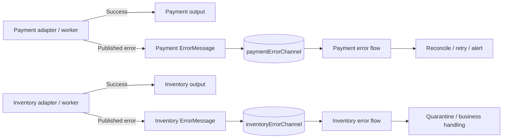

# Dedicated Error Flows in Spring Integration

## 1. Lesson Objectives

In the `SPRING_INTEGRATION_PATTERN` module, we implement **Enterprise Integration Patterns** with Spring Integration to create loosely coupled, extensible message flows. When a system has multiple business domains—such as payments, inventory management, and notifications—errors in each domain often require different remediation strategies. A single generic error flow that only logs a stack trace struggles to express clear handling ownership, priority levels, and recovery rules.

A **dedicated error flow** is a Spring Integration flow that receives error information from a specific source or business domain and executes an appropriate handling policy. You can use a `MessageChannel` dedicated to payment errors, another channel for inventory errors, and still maintain the shared `errorChannel` for errors not routed elsewhere.

After this lesson, you will be able to:

- Explain when to separate error flows by business domain or error-emitting source.
- Distinguish between **error channel**, **error-emitting component**, **error-receiving flow**, and **recovery action**.
- Configure independent `MessageChannel` beans and `IntegrationFlow` definitions using Java DSL.
- Extract `ErrorMessage`, `Throwable`, `originalMessage`, and `failedMessage` for error observability.
- Test error-route isolation, verify message context, and understand the limitations of tests that manually send errors.
- Design retry, dead-letter/quarantine, alerting, correlation, and Gateway reply guarantees.

## 2. Why Not Handle Every Error in One Flow?

An order-processing flow may consist of `Router → Transformer → Gateway → Service Activator` and sub-branches with `Splitter/Aggregator`. When a branch fails, the required diagnostic data and remediation policy depend on the work being performed.

| Error Source | Example | Suitable Policy |
| --- | --- | --- |
| Payment | Payment partner times out or returns an unknown status | Query transaction status, retry with idempotency, trigger high-priority alert. |
| Inventory | Insufficient stock or invalid inventory data | Update business status, quarantine data, notify for adjustment. |
| Notification | Email provider temporarily unresponsive | Retry with backoff; after limit, move to a reprocessing queue. |
| Unclassified error | Unexpected exception | Record diagnostic information, alert, and investigate. |

Separating error flows provides **clear ownership**, explicit retry rules, and dedicated metrics per source. However, separating channels does not automatically create retries, transactions, or durable storage. All of those actions must be implemented by the corresponding endpoints or handlers.

## 3. Architecture of a Dedicated Error Flow

An error flow consists of four parts:

1. **Error-emitting source:** a poller, adapter, gateway, executor, or application code with an exception-catching mechanism.
2. **Error publisher:** the component that creates and sends an `ErrorMessage` when appropriate.
3. **Error Channel:** the `MessageChannel` receiving the `ErrorMessage`, such as `paymentErrorChannel`.
4. **Error flow:** endpoints that observe, classify, retry, quarantine, or emit alerts.



Naming channels with business meaning helps each team own a clear policy. The `paymentErrorChannel` and `inventoryErrorChannel` channels in the diagram are example names that must be declared and wired to their corresponding error-emitting sources.

**Important distinction:** With a synchronous `DirectChannel`, exceptions from a handler typically propagate back to the caller. Simply having a bean named `paymentErrorChannel` does not mean every exception in the payment flow automatically goes to that bean. The emitting source must support error publishing and be **configured with that error destination**, or the application must explicitly create and send an `ErrorMessage`.

## 4. Choosing How to Connect an Emitting Source to an Error Flow

In Spring Integration, how you attach an error channel depends on the **execution boundary**:

| Case | Approach | What to Verify |
| --- | --- | --- |
| Poller or inbound adapter supporting an error channel | Configure the poller/adapter's error channel to publish errors to the dedicated channel. | Exception type, transactions, retry timing, and whether failed message is preserved. |
| Message with `errorChannel` header | Some components use this header to determine the destination when publishing errors. | Whether the specific component reads the header; whether the header is a valid channel name or channel reference. |
| Executor or asynchronous boundary | Configure error handling on the executor/channel/endpoint. | Whether the sender already returned before the error occurred, and who emits the `ErrorMessage`. |
| Synchronous handler invoked directly via `DirectChannel` | Handle exceptions at the caller, or build an explicit publisher when business rules require it. | Do not swallow errors and do not accidentally return success for a failed transaction. |

Illustrative example with a message:

```text
Message with payload and header eventId=pay-104
        |
        v
Payment worker (configured to use paymentErrorChannel)
        |
        +--> success: emit payment result
        |
        +--> caught exception:
                  ErrorMessage(Throwable, originalMessage if available)
                         |
                         v
                  paymentErrorChannel
                         |
                         v
                  paymentErrorFlow
```

**Do not assume** that the error channel of an inbound adapter, outbound gateway, or poller behaves identically: read the configuration contract of the endpoint in use and test with a real exception. The `errorChannel` header is not a global catch-all mechanism for arbitrary Java exceptions.

## 5. Java DSL Example: Two Isolated Error Flows

This example focuses on the **error-receiving side** to illustrate isolation. We create two `DirectChannel` beans dedicated to receiving `ErrorMessage`, two separate `IntegrationFlow` definitions, and a simple probe for testing. Synchronous channels allow tests to observe results immediately; when using asynchronous channels or external stores, test with an appropriate wait mechanism.

To run the example on Java 17 with Spring Integration, you can use `spring-boot-starter-integration` in Spring Boot, and `spring-boot-starter-test` for JUnit 5, Spring Test, and AssertJ.

```java
import java.util.List;
import java.util.concurrent.ConcurrentLinkedQueue;

import org.springframework.context.annotation.Bean;
import org.springframework.context.annotation.Configuration;
import org.springframework.integration.channel.DirectChannel;
import org.springframework.integration.config.EnableIntegration;
import org.springframework.integration.dsl.IntegrationFlow;
import org.springframework.messaging.Message;
import org.springframework.messaging.MessageChannel;
import org.springframework.messaging.MessagingException;
import org.springframework.messaging.support.ErrorMessage;

@Configuration
@EnableIntegration
public class DedicatedErrorFlowConfig {

    public record ErrorObservation(
        String source, String exceptionType, String eventId) {}

    public static class ErrorProbe {
        private final ConcurrentLinkedQueue<ErrorObservation> observed =
            new ConcurrentLinkedQueue<>();

        public void record(ErrorObservation observation) {
            observed.add(observation);
        }

        public List<ErrorObservation> snapshot() {
            return List.copyOf(observed);
        }

        public void clear() {
            observed.clear();
        }
    }

    @Bean
    public ErrorProbe errorProbe() {
        return new ErrorProbe();
    }

    @Bean
    public MessageChannel paymentErrorChannel() {
        return new DirectChannel();
    }

    @Bean
    public MessageChannel inventoryErrorChannel() {
        return new DirectChannel();
    }

    @Bean
    public IntegrationFlow paymentErrorFlow(ErrorProbe probe) {
        return IntegrationFlow.from("paymentErrorChannel")
            .handle(message -> recordError("payment", message, probe))
            .get();
    }

    @Bean
    public IntegrationFlow inventoryErrorFlow(ErrorProbe probe) {
        return IntegrationFlow.from("inventoryErrorChannel")
            .handle(message -> recordError("inventory", message, probe))
            .get();
    }

    private static void recordError(
            String source, Message<?> received, ErrorProbe probe) {

        // Channel designed to receive ErrorMessage.
        if (!(received instanceof ErrorMessage error)) {
            throw new IllegalArgumentException(
                "Expected ErrorMessage on " + source + " error flow");
        }

        Throwable failure = error.getPayload();
        Message<?> original = error.getOriginalMessage();
        Message<?> failed = findFailedMessage(failure);

        // Only fall back to failedMessage when the publisher did not supply originalMessage.
        Message<?> context = original != null ? original : failed;
        Object eventId = context == null
            ? null : context.getHeaders().get("eventId");

        probe.record(new ErrorObservation(
            source,
            failure.getClass().getSimpleName(),
            eventId == null ? "unknown" : eventId.toString()));
    }

    private static Message<?> findFailedMessage(Throwable failure) {
        for (Throwable current = failure;
             current != null;
             current = current.getCause()) {
            if (current instanceof MessagingException me
                    && me.getFailedMessage() != null) {
                return me.getFailedMessage();
            }
        }
        return null;
    }
}
```

The code passes the intact `ErrorMessage` into each flow; `ErrorMessage.getPayload()` is the `Throwable`. Therefore, when you need to read `originalMessage` or `getFailedMessage()`, work with the full error message instead of keeping only an exception description string.

In the example, `ErrorProbe` only records events and performs neither retry nor dead-letter persistence. In production, replace `recordError(...)` with processing steps suited to each domain. Do not use in-memory application collections as a long-term store for failed messages awaiting replay.

### How to Publish an Error into the Right Flow?

A publisher configured on an adapter can send an `ErrorMessage` to the right channel. If the application **explicitly creates error events**, the publishing point should clearly identify the business source:

```java
// Illustration inside a component that already has MessageChannel paymentErrorChannel:
void publishPaymentFailure(
        Throwable failure, Message<?> originalMessage) {
    ErrorMessage error = new ErrorMessage(failure, originalMessage);
    boolean accepted = paymentErrorChannel.send(error);
    if (!accepted) {
        throw new IllegalStateException("Cannot publish payment failure");
    }
}
```

This is an example of **manual publishing**, suitable only when the application has defined the processing boundary and error destination. If the caller still needs to receive the exception, do not swallow the error after publishing. In a broker-backed system, sending the error event, rollback/ack, and persisting the failure state must be designed together to avoid a situation where error reporting succeeds while the original message is lost.

## 6. Testing Dedicated Error Flows

We send an `ErrorMessage` to each channel and verify the other branch receives nothing. This test verifies **the receiving error flow configuration** and observation formatting; it does not yet verify how an adapter catches exceptions and publishes errors.

```java
import org.junit.jupiter.api.BeforeEach;
import org.junit.jupiter.api.Test;
import org.springframework.beans.factory.annotation.Autowired;
import org.springframework.beans.factory.annotation.Qualifier;
import org.springframework.messaging.Message;
import org.springframework.messaging.MessageChannel;
import org.springframework.messaging.MessagingException;
import org.springframework.messaging.support.ErrorMessage;
import org.springframework.messaging.support.MessageBuilder;
import org.springframework.test.context.junit.jupiter.SpringJUnitConfig;

import static org.assertj.core.api.Assertions.assertThat;

@SpringJUnitConfig(DedicatedErrorFlowConfig.class)
class DedicatedErrorFlowTest {

    @Autowired
    @Qualifier("paymentErrorChannel")
    MessageChannel paymentErrors;

    @Autowired
    @Qualifier("inventoryErrorChannel")
    MessageChannel inventoryErrors;

    @Autowired
    DedicatedErrorFlowConfig.ErrorProbe probe;

    @BeforeEach
    void reset() {
        probe.clear();
    }

    @Test
    void paymentErrorIsHandledOnlyByPaymentFlow() {
        Message<String> original = MessageBuilder
            .withPayload("PAYMENT_REQUEST")
            .setHeader("eventId", "pay-104")
            .build();

        var failure = new IllegalStateException("payment service timeout");
        boolean accepted = paymentErrors.send(
            new ErrorMessage(failure, original));

        assertThat(accepted).isTrue();
        assertThat(probe.snapshot()).containsExactly(
            new DedicatedErrorFlowConfig.ErrorObservation(
                "payment", "IllegalStateException", "pay-104"));
    }

    @Test
    void inventoryErrorUsesItsOwnFlowAndFailedMessageFallback() {
        Message<String> failed = MessageBuilder
            .withPayload("RESERVE_STOCK")
            .setHeader("eventId", "stock-205")
            .build();

        var failure = new MessagingException(
            failed, "Inventory reservation failed");
        boolean accepted = inventoryErrors.send(new ErrorMessage(failure));

        assertThat(accepted).isTrue();
        assertThat(probe.snapshot()).containsExactly(
            new DedicatedErrorFlowConfig.ErrorObservation(
                "inventory", "MessagingException", "stock-205"));
    }

    @Test
    void missingMessageContextDoesNotCrashErrorFlow() {
        var failure = new IllegalArgumentException("Invalid inventory request");

        assertThat(inventoryErrors.send(
            new ErrorMessage(failure))).isTrue();

        assertThat(probe.snapshot()).containsExactly(
            new DedicatedErrorFlowConfig.ErrorObservation(
                "inventory", "IllegalArgumentException", "unknown"));
    }
}
```

In each test, `snapshot()` contains only **one** observation belonging to the expected flow. If both the payment flow and inventory flow received an ErrorMessage, the test would catch the count or source label mismatch.

To test the **entire system**, add an integration test for the real endpoint: trigger an exception in the payment worker or inventory adapter, verify an `ErrorMessage` enters the right channel, check the source's reply/ack, and ensure the retry/quarantine policy executes once. Especially for asynchronous flows, do not rely on `send(...) == true` to conclude business processing succeeded.

## 7. Designing Real Logic for Each Error Flow

### 7.1. Payment: Reconcile Before Replaying

A timeout does not mean the transaction definitely failed; the partner may have captured the funds while the response was lost. The payment error flow should read `transactionId` or `idempotencyKey`, query transaction status if supported by the partner, and only then decide to retry or compensate. Avoid resending a payment command without duplicate protection.

A payment error-handling pipeline might look like:

```text
paymentErrorChannel
  → extract transactionId and exception type
  → check status at the payment gateway
  → if not yet processed: bounded retry / backoff
  → if already processed: update result, do not charge again
  → if still unclear: mark PENDING_REVIEW, alert operations
```

### 7.2. Inventory: Record Business Reason

Insufficient stock is often a business outcome, sometimes better handled by returning a rejection reply rather than publishing an `ErrorMessage`. If the system treats it as an error to handle, the inventory flow can record `RESERVATION_REJECTED`, save reconciliation data, and notify order orchestration. For technical failures like database unavailability, apply retry according to a separate policy.

### 7.3. Default Error Flow: Do Not Lose Errors

For emitting sources without a dedicated channel configured, you can use the global `errorChannel` for logging/metrics and investigation. Do not assume by default that every exception automatically reaches the global channel; that depends on how the endpoint publishes errors.

Do not let a failing error flow re-send the raw error message endlessly back to the global `errorChannel`. Define secondary error handling, attempt limits, and a store for retaining original details when needed.

## 8. Dedicated Error Flows and Other EIPs

### Gateway and Caller Replies

A synchronous Gateway may be waiting for a reply. A dedicated error flow receiving `ErrorMessage` does not automatically generate a response for the Gateway. If the contract requires an HTTP response or status code, design an explicit error reply or business status update. Do not treat publishing an error to a channel as a success ACK to the caller.

### Retry, Error Channel, and Dead-Letter/Quarantine

**Retry** re-attempts the work when permitted; **Error Channel** delivers error information to the handling flow; **dead-letter/quarantine** stores data for investigation or replay. The three components have distinct responsibilities. When retries exceed the limit, a policy can transition to quarantine, whereas an Error Channel alone does not guarantee persistence.

### Splitter, Aggregator, and Correlation

If a `Splitter` produces 5 child messages and one enters a dedicated error flow, the `Aggregator` may wait missing that part. The error flow needs `correlationId`, `sequenceNumber`, and `sequenceSize` (if preserved on `failedMessage` or `originalMessage`) to decide whether to retry the item, expire the group, or emit a failure state. Moving the error to another channel **does not automatically update group state**.

### Router, Filter, and Valid Discard Branches

Not all data dropped by a Filter is an error. Heartbeats safe to ignore can go to `nullChannel`; a message violating a critical data contract should be rejected or quarantined. Keep a clear boundary between *valid discard* and *actionable failure* so metrics and alerts are not skewed.

## 9. Operations and Observability

Each error flow should expose metrics clear enough to distinguish **error received**, **recovery started**, and **recovery completed**:

| Metric / Data | Meaning |
| --- | --- |
| `integration_error_messages_total{flow}` | Number of `ErrorMessage` instances received on each error flow. |
| `integration_recovery_attempts_total{flow,result}` | Number of recovery attempts and outcomes. |
| `integration_quarantine_total{flow,reason}` | Number of messages stored for investigation. |
| `integration_error_flow_failures_total{flow}` | Errors occurring inside the error handler itself. |
| `traceId`, `eventId`, `correlationId` | Correlate error events with transactions or message groups. |

Use structured logging and standardize `errorType`, `flow`, `decision`, and `retryAttempt`. Do not use individual `eventId` values as a metric label; do not log full payloads containing personal data, tokens, or payment information. With a publish/subscribe global channel, multiple subscribers may observe the same error: explicitly assign which subscriber is allowed to retry or trigger side effects to avoid double execution.

For error flows running asynchronously, also test crash or restart scenarios while errors are in flight. If zero message loss is required, you need durable storage and proper processing acknowledgments rather than relying solely on `DirectChannel` or JVM memory.

## 10. Hands-On Exercise

**Scenario:** An e-commerce application has three flows: payment, inventory reservation, and confirmation email sending.

1. Propose three error channels—`paymentErrorChannel`, `inventoryErrorChannel`, and `notificationErrorChannel`—and describe who emits to each and who consumes from each.
2. Design policies for payment timeout, out-of-stock, and email provider rate limit; explain which cases require retry, reconciliation, or quarantine.
3. Write an integration test that intentionally triggers a payment error and proves the message goes only to the payment error flow when the adapter is configured properly.
4. Write a test for an `ErrorMessage` with no `originalMessage` that contains `MessagingException.getFailedMessage()`; verify that `eventId` can still be recovered.
5. Design metrics/alerts for each flow, along with a fallback plan when the error handler itself fails.
6. If an order is split into items and one item hits an inventory error, propose how to complete the Aggregator group instead of waiting indefinitely.

**Self-check questions:** Why is declaring `paymentErrorChannel` not enough to guarantee every exception from the payment flow goes there? When should you use the global `errorChannel` instead of a dedicated error channel? Why should `ErrorMessage` not be treated as a durable copy of the business message?

## 11. Key Takeaways

**Dedicated error flows** separate recovery responsibilities by business domain in Spring Integration. A sound structure consists of an error-emitting source capable of publishing, an explicitly chosen Error Channel, and an error flow with concrete actions. Test both the `ErrorMessage`-receiving side and the error-publishing path from the endpoint, preserve correlation context when needed, enforce bounded retries, and track recovery outcomes. This provides the foundation for Router, Filter, Gateway, Splitter, and Aggregator flows to run observably, loosely coupled, and more safely when incidents occur.
