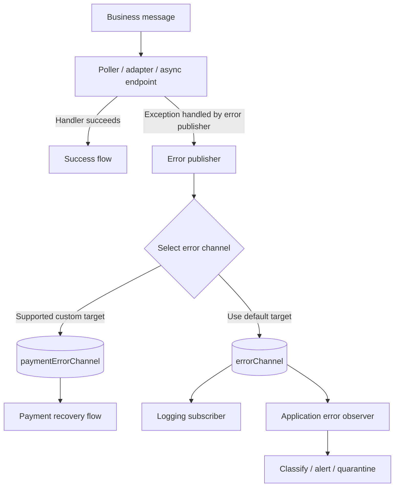

# Default Error Channel and Global Behavior in Spring Integration

## 1. Objectives and Real-World Scenario

In the `SPRING_INTEGRATION_PATTERN` module, we practice **Enterprise Integration Patterns** with Spring Integration to build loosely coupled, extensible, testable, and observable message flows. An application may have multiple `Router`, `Filter`, `Transformer`, `Splitter`, `Aggregator`, and `Gateway` flows. When an endpoint fails, the first question is usually: **where do errors go if no dedicated error-handling channel is specified?**

Spring Integration defines the conventional channel name **`errorChannel`**, commonly called the *default/global error channel*. It serves as a shared receiving point for `ErrorMessage` instances within an application context. However, this name **does not mean all Java exceptions automatically flow into it**.

After this lesson, you will be able to:

- Describe the default `errorChannel` mechanism and the scope of "global".
- Understand publish/subscribe behavior, the default logging subscriber, and multiple error consumers.
- Distinguish between **exceptions propagating back to the caller** and **`ErrorMessage` instances being published**.
- Explain how an error publisher selects a custom channel or falls back to the global channel.
- Register a consumer receiving `ErrorMessage` without replacing the `errorChannel` bean.
- Test the global channel consumer, diagnose why errors do not appear, and avoid duplicate processing.
- Design retry, alerting, quarantine, and correlation aligned with business contracts.

## 2. What Is the Default/Global Error Channel?

When Spring Integration infrastructure is enabled (for example via `@EnableIntegration` or corresponding auto-configuration), the framework normally provides a standard channel named **`errorChannel`** if the application has not declared such a bean. This default channel is typically a **`PublishSubscribeChannel`** and has an error-logging mechanism supplied by the infrastructure.

A component with error-publishing capabilities can send an `ErrorMessage` to this channel when no more specific error destination is configured. Subscribers on the channel then receive the error message to record, alert, or forward it to a recovery flow.

| Concept | Role | What Not to Infer |
| --- | --- | --- |
| `errorChannel` | Standard channel name for `ErrorMessage` instances published to the default destination. | Not an automatic catcher for every thread and every endpoint. |
| `PublishSubscribeChannel` | Dispatches messages to registered subscribers. | Not a durable queue or retry mechanism by default. |
| `ErrorMessage` | A `Message<Throwable>` containing an exception and optionally the original message. | Not guaranteed to always carry `originalMessage` or correlation metadata. |
| Logging subscriber | Logs errors arriving on the channel per framework configuration. | Seeing a log does not mean the error has been recovered. |
| Application error flow | Classifies, tracks, or handles errors according to business rules. | Exists only when you configure an endpoint that actually receives and processes errors. |

**"Global" is scoped to a Spring application context**, not a system-wide message bus. If there are three separate microservices, the `errorChannel` of service A does not automatically forward errors to service B or C.

### Overview Diagram



Error channel selection does not always follow the same rule across every adapter. Check whether the emitting source uses a dedicated channel configuration, the `errorChannel` header, or the default fallback. The diagram illustrates **routing possibilities**, not a promise that exceptions from every endpoint are published.

## 3. Conditions for an ErrorMessage to Reach the Global Channel

To understand default behavior, examine the **execution boundary** and the **error-publishing component**.

### 3.1. Errors in a Synchronous Flow

With a `DirectChannel`, the handler normally runs directly on the caller's thread. If the handler throws an exception, the error can propagate back through `send(...)` or the `Gateway` to the caller. The global `errorChannel` **does not necessarily receive** an `ErrorMessage`.

```text
Caller --> DirectChannel --> Handler --> throw MessagingException
   ^                                    |
   +------------- exception -------------+
```

This situation **is not necessarily a configuration bug**. The caller, gateway, or retry advice may be the right place to decide error handling. If business requirements mandate sending error details over a channel, an explicit error publisher is needed rather than expecting the framework to catch every synchronous exception automatically.

### 3.2. Errors at Inbound Sources or Asynchronous Boundaries

Pollers, certain inbound adapters, and asynchronous execution mechanisms can use an error handler/publisher to catch exceptions and emit an `ErrorMessage`. For example, a worker invoked by a poller fails while the original message-sending thread is no longer waiting for the result.

```text
Poller / executor / adapter
    --> Handler --> exception
                    |
                    v
               Error publisher
                    |
                    v
              ErrorMessage(Throwable)
                    |
                    +--> custom channel if selected
                    |
                    +--> errorChannel when using global fallback
```

**Do not use `send(...) == true` as proof that business processing completed in an asynchronous flow.** It may only mean the channel accepted the message for later execution.

### 3.3. Errors That Are Not Published

Several cases explain why the global channel sees no messages:

1. The exception is thrown on a synchronous thread and propagates directly back to the caller.
2. The handler catches and ignores the exception without creating an error event.
3. The error publisher uses a dedicated channel instead of `errorChannel`.
4. The component does not support the error-publishing mechanism the application assumes.
5. The failure happens during application startup, before channels/endpoints are ready, or outside Spring Integration infrastructure.

Therefore, when testing, verify **the error-publishing path as well**, not just the subscriber on the global channel.

## 4. Publish/Subscribe and Default Logging

The default global `errorChannel` typically uses `PublishSubscribeChannel`. This channel can deliver the same `ErrorMessage` to multiple subscribers, such as:

- The framework's logging handler.
- An error metrics flow.
- A recovery, quarantine, or operations notification flow.

This is convenient for **decoupling observation from business handling**. However, note four characteristics:

**One:** Having multiple subscribers does **not** turn the channel into durable storage. If the process stops, do not assume failed messages remain available for replay.

**Two:** If the channel has no executor, invoking subscribers usually happens synchronously during message dispatch. A slow subscriber or one that throws an exception can impact the error-publishing flow; exact details depend on channel and error handler configuration.

**Three:** The logging subscriber is not a retry, dead-letter, or compensation policy. Never mark a transaction as handled simply because an error log appeared.

**Four:** Two subscribers both performing side effects like retrying or writing dead-letters can cause duplicate processing. Explicitly assign one **owner** for recovery while other subscribers only observe.

### Should You Recreate the errorChannel Bean?

Usually **no**. To observe errors, register a `@ServiceActivator(inputChannel = "errorChannel")` or `IntegrationFlow.from("errorChannel")` instead of replacing the entire infrastructure bean.

If an application explicitly defines a bean named `errorChannel`, doing so can alter channel type, default subscribers, and error-publishing semantics. Only do this when there is a specific architectural requirement and after testing the logging mechanism, subscriber count, secondary error handling, and compatibility with your Spring Integration version.

## 5. Choosing Global vs. a Dedicated Error Channel

An error publisher may prioritize a channel specified in the endpoint configuration or a valid hint from the message, and fall back to the default when appropriate. In Spring Messaging, the conventional header name is `errorChannel` (`MessageHeaders.ERROR_CHANNEL`); its value can be a `MessageChannel` reference or channel name, depending on the component's resolution mechanism.

**The mere presence of the header does not cause exceptions to be published.** Only an error-emitting component that supports and actually uses this header routes errors to that destination.

| Scenario | Choice | Reason |
| --- | --- | --- |
| Want shared logging/metrics for sources without custom policies | Global `errorChannel` | Centralized observability, easy tracking of unclassified errors. |
| Payment error requiring reconciliation before retry | `paymentErrorChannel` | Avoid accidentally applying generic retry that causes double charges. |
| Data error requiring operator correction before replay | `validationErrorChannel` | Connects to specialized quarantine/triage policies. |
| Notification error with independent retry/backoff | `notificationErrorChannel` | Separates priority and alert thresholds from core systems. |
| Unknown error without clear source or contract | Global channel + investigation route | Avoid silent discard. |

When using an `ErrorMessage` to route or inspect, two context sources may differ:

- `ErrorMessage.getOriginalMessage()`: the message provided by the publisher when emitting the error; may be `null`.
- `MessagingException.getFailedMessage()`: the message attached to the failed operation; may be `null` and may be the message **after** a Transformer or Splitter.

The error flow must understand correlation ID provenance so it does not misattribute transaction context.

## 6. Example: Observing the Global errorChannel Without Replacing It

This example uses Java 17 and Spring Integration. With Spring Boot, add `spring-boot-starter-integration`; for JUnit 5/Spring Test/AssertJ, use the corresponding test dependencies (such as `spring-boot-starter-test`).

We create an observer bean with `@ServiceActivator` listening on the global `errorChannel`. The observer reads the exception type and `eventId` from the original message, then stores a small in-memory record for testing. This pattern **only illustrates observation** and does not replace production logging, metrics, or durable quarantine.

```java
import java.util.List;
import java.util.concurrent.ConcurrentLinkedQueue;

import org.springframework.context.annotation.Bean;
import org.springframework.context.annotation.Configuration;
import org.springframework.integration.annotation.ServiceActivator;
import org.springframework.integration.config.EnableIntegration;
import org.springframework.messaging.Message;
import org.springframework.messaging.MessagingException;
import org.springframework.messaging.support.ErrorMessage;

@Configuration
@EnableIntegration
public class GlobalErrorChannelLessonConfig {

    public record ErrorObservation(String exceptionType, String eventId) {}

    public static class ErrorProbe {
        private final ConcurrentLinkedQueue<ErrorObservation> observations =
            new ConcurrentLinkedQueue<>();

        public void record(ErrorObservation observation) {
            observations.add(observation);
        }

        public List<ErrorObservation> snapshot() {
            return List.copyOf(observations);
        }

        public void clear() {
            observations.clear();
        }
    }

    @Bean
    public ErrorProbe errorProbe() {
        return new ErrorProbe();
    }

    @Bean
    public GlobalErrorObserver globalErrorObserver(ErrorProbe probe) {
        return new GlobalErrorObserver(probe);
    }

    public static class GlobalErrorObserver {
        private final ErrorProbe probe;

        public GlobalErrorObserver(ErrorProbe probe) {
            this.probe = probe;
        }

        @ServiceActivator(inputChannel = "errorChannel")
        public void onError(ErrorMessage errorMessage) {
            Throwable failure = errorMessage.getPayload();

            Message<?> original = errorMessage.getOriginalMessage();
            String eventId = readHeader(original, "eventId");

            // If originalMessage has no ID, try failedMessage.
            if (eventId == null) {
                Message<?> failed = findFailedMessage(failure);
                eventId = readHeader(failed, "eventId");
            }

            probe.record(new ErrorObservation(
                failure.getClass().getSimpleName(),
                eventId == null ? "unknown" : eventId));
        }

        private static String readHeader(Message<?> message, String name) {
            if (message == null) {
                return null;
            }
            Object value = message.getHeaders().get(name);
            return value == null ? null : value.toString();
        }

        private static Message<?> findFailedMessage(Throwable failure) {
            int hops = 0;
            for (Throwable current = failure;
                 current != null && hops < 32;
                 current = current.getCause(), hops++) {
                if (current instanceof MessagingException me) {
                    Message<?> failed = me.getFailedMessage();
                    if (failed != null) {
                        return failed;
                    }
                }
            }
            return null;
        }
    }
}
```

Points to note:

1. `@EnableIntegration` enables the required Integration infrastructure. The example registers a **subscriber** rather than re-declaring the `errorChannel` bean.
2. The `ErrorMessage` parameter lets the method read both the `Throwable` and `originalMessage`.
3. `errorMessage.getHeaders()` are the headers of the error message and **must not be equated** with the headers of the failed message.
4. `findFailedMessage(...)` is only used as a bounded fallback; it does not prove that prior side effects before the error rolled back.
5. An `unknown` record indicates missing context, not a real event ID.

## 7. Testing the Receiving Side

The following test explicitly sends `ErrorMessage` instances to the global channel and checks the subscriber. This is a **consumer test**: it verifies that the observer receives and processes the error message format. It does **not** prove that exceptions raised by any adapter automatically reach the channel.

```java
import org.junit.jupiter.api.BeforeEach;
import org.junit.jupiter.api.Test;
import org.springframework.beans.factory.annotation.Autowired;
import org.springframework.beans.factory.annotation.Qualifier;
import org.springframework.messaging.Message;
import org.springframework.messaging.MessageChannel;
import org.springframework.messaging.MessagingException;
import org.springframework.messaging.support.ErrorMessage;
import org.springframework.messaging.support.MessageBuilder;
import org.springframework.test.context.junit.jupiter.SpringJUnitConfig;

import static org.assertj.core.api.Assertions.assertThat;

@SpringJUnitConfig(GlobalErrorChannelLessonConfig.class)
class GlobalErrorChannelLessonTest {

    @Autowired
    @Qualifier("errorChannel")
    MessageChannel errorChannel;

    @Autowired
    GlobalErrorChannelLessonConfig.ErrorProbe probe;

    @BeforeEach
    void reset() {
        probe.clear();
    }

    @Test
    void acceptsErrorMessageWithOriginalMessage() {
        Message<String> original = MessageBuilder
            .withPayload("ORDER_CREATED")
            .setHeader("eventId", "evt-201")
            .build();

        ErrorMessage error = new ErrorMessage(
            new IllegalStateException("Payment timeout"), original);

        assertThat(errorChannel.send(error)).isTrue();
        assertThat(probe.snapshot()).containsExactly(
            new GlobalErrorChannelLessonConfig.ErrorObservation(
                "IllegalStateException", "evt-201"));
    }

    @Test
    void usesFailedMessageWhenOriginalMessageIsMissing() {
        Message<String> failed = MessageBuilder
            .withPayload("RESERVE_STOCK")
            .setHeader("eventId", "evt-202")
            .build();

        MessagingException failure =
            new MessagingException(failed, "Inventory unavailable");

        assertThat(errorChannel.send(new ErrorMessage(failure))).isTrue();
        assertThat(probe.snapshot()).containsExactly(
            new GlobalErrorChannelLessonConfig.ErrorObservation(
                "MessagingException", "evt-202"));
    }

    @Test
    void missingContextDoesNotBreakGlobalObserver() {
        ErrorMessage error =
            new ErrorMessage(new IllegalArgumentException("Invalid event"));

        assertThat(errorChannel.send(error)).isTrue();
        assertThat(probe.snapshot()).containsExactly(
            new GlobalErrorChannelLessonConfig.ErrorObservation(
                "IllegalArgumentException", "unknown"));
    }
}
```

Because the example uses the default channel without a dedicated executor and an in-memory observer, assertions immediately after `send(...)` fit the synchronous case demonstrated. If switching to an asynchronous channel or async error subscriber, wait for the event with a timeout and avoid immediate assertions.

### Testing the Real Error-Publishing Path

After testing the consumer, write a separate integration test for a **source with an error publisher**:

1. Configure a poller/adapter or async component that supports error publishing.
2. Specify the global `errorChannel` as the default destination or omit a dedicated channel if the source's contract falls back to it.
3. Have the handler intentionally throw an exception, attaching an `eventId` for correlation.
4. Verify reception of the `ErrorMessage`, error type, and input context when supplied by the publisher.
5. Repeat with a dedicated error channel; verify the error goes to the chosen destination without accidentally causing duplicate handling.
6. Also verify retry, transaction/ack, and behavior when the error subscriber itself fails.

Do not treat "a test sending manually to `errorChannel` PASSES" as proof that a synchronous `DirectChannel` automatically publishes exceptions.

## 8. Global Channel Coordinating with Retry, Gateway, and Null Channel

### Retry

An error flow may decide to route an error for reprocessing, but `errorChannel` does not retry on its own. **Retry advice** or an endpoint's retry mechanism may run before an error is published; the exact ordering depends on configuration. Once attempts are exhausted, save error details for investigation rather than bouncing messages endlessly between channels.

For a payment transaction, retrying after a timeout requires idempotency or status reconciliation. Having an `ErrorMessage` does not prove the prior transaction never executed.

### Gateway and Reply Contracts

A synchronous Gateway typically has a contract to return a reply or throw an exception. When an error from an asynchronous branch is published to the global `errorChannel`, the caller **does not automatically** receive a valid success or failure reply per the contract. Configure an explicit error reply, timeout, or job status update mechanism.

### Null Channel

```text
Intentionally allowed discard --> nullChannel  --> end branch
Published exception           --> errorChannel --> error handling/monitoring
```

Do not use `nullChannel` in place of `errorChannel` when a message needs to be retried, stored for investigation, or produce an error status. Conversely, a heartbeat safe to ignore does not need to be turned into an exception.

### Splitter, Aggregator, and Correlation

If a Splitter child message fails and enters the global error flow, the Aggregator may miss the part needed to complete the group. `ErrorMessage` and `MessagingException` sometimes carry `correlationId`, `sequenceNumber`, or `sequenceSize` via the original/failed message; that **does not automatically adjust the release strategy**. You must design how to retry the child item, finish the group in an error state, time out, or compensate.

## 9. Operating and Troubleshooting with the Global errorChannel

For proper observability, distinguish the count of errors arriving at the channel, errors classified, and jobs successfully recovered:

| Metric or Log | Meaning |
| --- | --- |
| `integration_error_messages_total{source,channel}` | Number of errors published to channels. |
| `integration_error_routes_total{flow,route}` | Number of errors assigned a route by an error flow. |
| `integration_recovery_total{flow,result}` | Number of jobs recovered or failed after retries. |
| `integration_error_handler_failures_total{flow}` | Number of errors occurring inside the error handler itself. |
| Log `eventId`, `correlationId`, `exceptionType` | Trace errors to a specific request or message group. |

Do not use `eventId` as a metric label because it creates too many time series. Avoid logging full sensitive payloads, tokens, or payment data. Error Channel is not a replayable storage system: if recovery across restarts is required, use a broker, database, or durable quarantine by design.

### Quick Troubleshooting Table

| Symptom | Possible Cause | How to Verify |
| --- | --- | --- |
| Caller receives exception but `errorChannel` sees no error | Synchronous flow with no publisher. | Check channel type, calling thread, and endpoint error contract. |
| Error handler receives no message yet error logs appear | Logs come from caller or another logger; error sent to dedicated channel; listener not registered. | Check subscriber beans/endpoints and publisher target. |
| Two handlers both retry one error | Multiple subscribers on PublishSubscribeChannel both have side effects. | Inspect subscriber list and ownership. |
| Receive `ErrorMessage` without `eventId` | Publisher did not supply original message or headers were altered. | Check `originalMessage`, `failedMessage`, and Transformer steps. |
| One error causes the error handler to throw a new exception | Subscriber does not tolerate missing data or dependency errors. | Test secondary error-flow failures and safe termination policy. |
| Log recorded but work is not reprocessed | Logger only observes; no retry/quarantine configured. | Check downstream error flow and recovery metrics. |

## 10. Hands-On Exercise

**Scenario:** An order-processing system has payment, inventory, and notification flows. Inventory uses a poller, payment has a synchronous Gateway, and notifications run asynchronously.

1. Diagram the three exception paths and determine which cases **can** publish an `ErrorMessage` to the global `errorChannel`, and which propagate errors back to the caller.
2. Write a consumer using `@ServiceActivator(inputChannel = "errorChannel")` to record error counts and `eventId` safely.
3. Configure an error-emitting source that supports error publishing to use `notificationErrorChannel`. Explain why the global listener should not duplicate notification work.
4. Write tests manually sending `ErrorMessage` with and without `originalMessage`, then write an **integration test** triggering a real error in the poller/adapter.
5. Design bounded retry, durable quarantine storage, and alerting if the final retry fails.
6. Test an exception in a Splitter branch and identify correlation metadata so the Aggregator does not wait indefinitely.

**Self-check questions:** Does "Global" mean every exception in the JVM definitely enters `errorChannel`? Why is having a default logging subscriber insufficient to guarantee recovery? When should you register an additional consumer on the default channel, and when should you design a dedicated channel?

## 11. Key Takeaways

`errorChannel` is the **default error destination defined by Spring Integration convention**, typically having publish/subscribe behavior and logging, yet it only receives an `ErrorMessage` when a component actually publishes to it. The global channel is useful for centralized observation, not as a catch-all for every exception, automatic retry, or durable data storage. Choose error channels by emitting source, preserve `originalMessage`/`failedMessage` context, test both consumers and publishers, and ensure error flows have clear recovery policies.
