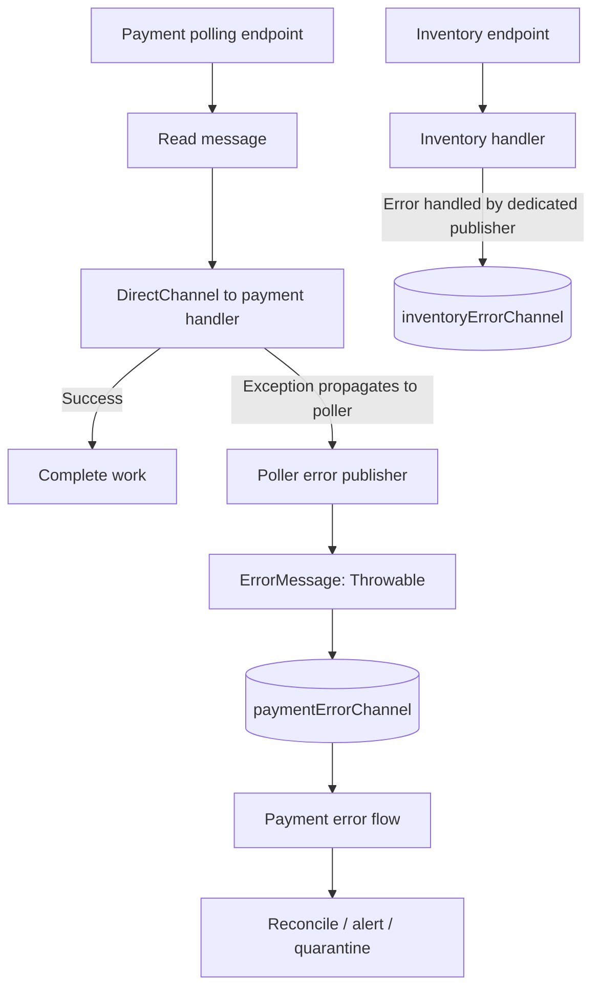

# Endpoint-Local Error Channels in Spring Integration

## 1. Problem and Objectives

In the `SPRING_INTEGRATION_PATTERN` module, we study **Enterprise Integration Patterns** with Spring Integration to build loosely coupled, extensible message flows while testing and observing processing branches such as Router, Filter, Transformer, Splitter, Aggregator, Gateway, retry, and error channels.

Suppose an application has two message ingestion sources: a **payment poller** and an **inventory update poller**. Payment errors need reconciliation with the provider; inventory errors may require data inspection and quarantine. If both sources emit errors into one place without preserving source context, classification, alerting, and recovery become difficult to control.

An **endpoint-local error channel** is an error channel assigned to a **specific error-emitting component** (such as a polling endpoint or an adapter that supports an error channel), instead of defaulting errors to the global `errorChannel`. This binds recovery policies closely to the emitting source.

After completing this lesson, you will be able to:

- Distinguish between an **endpoint-local error channel**, the global `errorChannel`, and the `errorChannel` message header.
- Identify which kinds of errors can be published by an endpoint as an `ErrorMessage`, and which propagate back to the caller.
- Configure a poller with a dedicated error channel and an error flow that handles `ErrorMessage`.
- Write tests where errors actually originate from a polling endpoint, not only by manually sending `ErrorMessage`.
- Design retry, quarantine, correlation, logging, and behavior when the error handler itself fails.

## 2. What Does "Local" Mean?

The term "local" refers to the **scope of the error-destination decision**, not a channel that exists only inside a method. For example, `paymentErrorChannel` can still be a normal `MessageChannel` bean in the Spring application context; what makes it a local error channel is that **the payment polling endpoint is configured to send errors there**.

| Component | Scope | Role |
| --- | --- | --- |
| Global `errorChannel` | Shared conventional destination within an application context. | Receives `ErrorMessage` instances from error publishers that choose the default destination. |
| `paymentErrorChannel` | Application-created channel; chosen by a specific endpoint or group of endpoints. | Routes payment errors to the appropriate error flow. |
| `errorChannel` header | Metadata on a specific message. | Can be used by **some** error-publishing mechanisms/request-reply flows to determine destination; does not catch exceptions on its own. |
| `ErrorMessage` | Message carrying a `Throwable` payload. | Transports error events over a channel; may also carry the original message. |
| Error handler/flow | Consumer registered on the channel. | Records, classifies, recovers, quarantines, or alerts. |

A dedicated error channel **does not automatically cover the entire downstream chain**. If a message crosses another thread or adapter boundary, errors there may be governed by a different error publisher. Each boundary must be evaluated individually.

## 3. Conditions for an Endpoint to Publish Errors

When a handler runs synchronously behind a `DirectChannel`, exceptions typically propagate back to the caller invoking `send(...)` or the Gateway. In that case, declaring a `paymentErrorChannel` bean **does not automatically route errors to that bean**.

Conversely, a polling endpoint or an adapter with error-handling capabilities can catch exceptions occurring during the work it executes, create an `ErrorMessage`, and send it to the configured error channel. Endpoint configuration only takes effect when the exception **passes through that endpoint's error-handling boundary**.



> An exception is forwarded to a local error channel only when the corresponding endpoint/error publisher **supports it and actually publishes it**. Do not infer that `@Poller(errorChannel = "...")` routes every Java exception in the JVM to one place.

### Synchronous vs. Asynchronous

| Case | Typical Behavior | What Must Be Tested |
| --- | --- | --- |
| Send to `DirectChannel` from a normal caller | Exception propagates back on the caller's thread. | Does the caller/Gateway receive the exception per contract? |
| Poller invokes handler via `DirectChannel` | Exception can propagate back to the poller, be caught by the poller's error handler, and be published. | Does the poller's Error Channel receive `ErrorMessage`? |
| Handler hands work off to an executor or another broker | Exceptions after the boundary may be handled by downstream components. | Which channel does the downstream publisher select? |
| Inbound/outbound adapter supporting an error channel | Can publish `ErrorMessage` per adapter configuration. | Property configuration, reply, ack/rollback, and error message structure of the adapter. |

If a component catches an exception and only logs it, the upstream poller may never see the exception. Conversely, if a handler fails after acknowledging a message successfully across an asynchronous boundary, the initial poller may no longer manage that failure.

## 4. Where Is a Local Error Channel Configured?

There are several options depending on the endpoint type:

1. **Poller:** configure the `errorChannel` attribute on the poller of a message-receiving source, when supported by that polling endpoint type.
2. **Adapter/gateway:** use the error channel or error-handling property provided by that exact adapter/gateway. Do not assume identical syntax works across all adapters.
3. **Message header:** some mechanisms read `MessageHeaders.ERROR_CHANNEL` to resolve the error destination. A header is a **hint**, not an exception catcher.
4. **Application-written publisher:** intentionally catch errors, construct an `ErrorMessage`, and send it to a defined channel while preserving the caller error contract.

**Precedence rules should not be generalized across every endpoint.** Depending on the publisher, it may consult a header, endpoint configuration, the default channel, or a specialized error handler. If a source has both a header and a local configuration, test the exact mechanism in use rather than assuming a fixed order.

### When Should You Use the Global Channel?

The global `errorChannel` fits logging errors that lack a dedicated business flow, or centralized observation. A local channel fits errors requiring specialized policies such as payment reconciliation, email retry, or inventory quarantine. Both types can coexist, as long as two handlers do not simultaneously retry the same transaction.

## 5. Complete Example: Payment Polling Endpoint

This example uses **Java 17, Spring Integration Java DSL, and poller annotations**. A `MessageSource` emits just one message for testing; the handler intentionally throws an exception; the poller is configured with `paymentErrorChannel`; and the error flow records the received error.

In Spring Boot you can use `spring-boot-starter-integration`, and `spring-boot-starter-test` for JUnit 5, Spring Test, and AssertJ. The example has no broker or database dependency so learners can clearly trace the poller's error-publishing path.

```java
import java.util.concurrent.CountDownLatch;
import java.util.concurrent.TimeUnit;
import java.util.concurrent.atomic.AtomicBoolean;
import java.util.concurrent.atomic.AtomicReference;

import org.springframework.context.annotation.Bean;
import org.springframework.context.annotation.Configuration;
import org.springframework.integration.annotation.InboundChannelAdapter;
import org.springframework.integration.annotation.Poller;
import org.springframework.integration.channel.DirectChannel;
import org.springframework.integration.config.EnableIntegration;
import org.springframework.integration.core.MessageSource;
import org.springframework.integration.dsl.IntegrationFlow;
import org.springframework.messaging.Message;
import org.springframework.messaging.MessageChannel;
import org.springframework.messaging.support.ErrorMessage;
import org.springframework.messaging.support.MessageBuilder;

@Configuration
@EnableIntegration
public class PaymentPollingLocalErrorConfig {

    public static class ErrorProbe {
        private final CountDownLatch received = new CountDownLatch(1);
        private final AtomicReference<ErrorMessage> latest =
            new AtomicReference<>();

        public void record(ErrorMessage error) {
            latest.set(error);
            received.countDown();
        }

        public boolean await(long timeout, TimeUnit unit)
                throws InterruptedException {
            return received.await(timeout, unit);
        }

        public ErrorMessage latest() {
            return latest.get();
        }
    }

    @Bean
    public ErrorProbe errorProbe() {
        return new ErrorProbe();
    }

    @Bean
    public MessageChannel paymentInput() {
        return new DirectChannel();
    }

    @Bean
    public MessageChannel paymentErrorChannel() {
        return new DirectChannel();
    }

    // Source invoked by the poller. Returns null after the first message.
    @Bean
    @InboundChannelAdapter(
        channel = "paymentInput",
        poller = @Poller(
            fixedDelay = "200",
            errorChannel = "paymentErrorChannel"))
    public MessageSource<String> paymentSource() {
        AtomicBoolean emitted = new AtomicBoolean();
        return () -> emitted.compareAndSet(false, true)
            ? MessageBuilder.withPayload("PAYMENT_REQUEST")
                .setHeader("eventId", "evt-pay-42")
                .build()
            : null;
    }

    @Bean
    public IntegrationFlow paymentProcessingFlow() {
        return IntegrationFlow.from("paymentInput")
            .handle(String.class, (payload, headers) -> {
                // Illustrates a failing synchronous handler.
                throw new IllegalStateException(
                    "Simulated payment provider timeout");
            })
            .get();
    }

    @Bean
    public IntegrationFlow paymentErrorFlow(ErrorProbe probe) {
        return IntegrationFlow.from("paymentErrorChannel")
            .handle(message -> {
                if (!(message instanceof ErrorMessage error)) {
                    throw new IllegalArgumentException(
                        "Expected ErrorMessage");
                }
                probe.record(error);
            })
            .get();
    }
}
```

### Tracing the Error Path

1. Spring Integration starts the polling endpoint for `paymentSource` according to `fixedDelay`.
2. `MessageSource` returns one message with `eventId=evt-pay-42`. Subsequent polls return `null`, creating no extra work.
3. The poller sends the message to `paymentInput`, a `DirectChannel`; the handler runs synchronously and throws `IllegalStateException`.
4. The exception propagates back to the poller's error-handling boundary; `@Poller(errorChannel = "paymentErrorChannel")` tells the poller which channel to use to publish the `ErrorMessage`.
5. `paymentErrorFlow` receives the `ErrorMessage` and stores it in `ErrorProbe` for test verification.

At step 4, the `ErrorMessage` payload may be a `MessagingException` wrapping `IllegalStateException`, rather than the exact exception type thrown by the handler. Do not inspect only `error.getPayload().getClass()` to infer the root cause.

In a real system, the poller might be configured with a transaction or retry advice. Recording an exception in the local error flow **does not by itself confirm** rollback, broker ACK, or message replay. Those behaviors depend on the inbound source configuration and business policy.

## 6. End-to-End Testing at the Poller Boundary

Unlike tests that manually send `new ErrorMessage(...)` to a channel, the following example makes the error **originate inside the real handler**, then waits for the `ErrorMessage` to arrive on the local channel.

```java
import java.util.concurrent.TimeUnit;

import org.junit.jupiter.api.Test;
import org.springframework.beans.factory.annotation.Autowired;
import org.springframework.messaging.support.ErrorMessage;
import org.springframework.test.context.junit.jupiter.SpringJUnitConfig;

import static org.assertj.core.api.Assertions.assertThat;

@SpringJUnitConfig(PaymentPollingLocalErrorConfig.class)
class PaymentPollingLocalErrorTest {

    @Autowired
    PaymentPollingLocalErrorConfig.ErrorProbe probe;

    @Test
    void pollerPublishesExceptionToLocalErrorChannel()
            throws InterruptedException {

        assertThat(probe.await(5, TimeUnit.SECONDS)).isTrue();

        ErrorMessage error = probe.latest();
        assertThat(error).isNotNull();
        assertThat(causeChainContains(
            error.getPayload(), "Simulated payment provider timeout"))
            .isTrue();
    }

    private static boolean causeChainContains(
            Throwable error, String expectedMessage) {
        int hops = 0;
        for (Throwable current = error;
             current != null && hops < 32;
             current = current.getCause(), hops++) {
            if (expectedMessage.equals(current.getMessage())) {
                return true;
            }
        }
        return false;
    }
}
```

**Why is this test valuable?** It verifies three linked steps: the poller emits the message, the handler throws an exception, and the configured endpoint delivers an `ErrorMessage` to the local channel. Using `CountDownLatch` allows a bounded wait instead of sleeping for a fixed duration and guessing timing.

The example does not assert `eventId` as a mandatory condition, because whether the publisher retains `originalMessage` or `failedMessage` depends on the error-emitting context. To assert correlation metadata accurately, add assertions tailored to the exact version and adapter in use.

### Testing the Receiving Side Without Waiting for the Poller

In a separate test, you can manually send an `ErrorMessage` to `paymentErrorChannel` to verify how the handler behaves with or without an original message. However, that is **only a consumer test** and must not replace a real error-publishing test like the one above.

### What Other Tests Are Needed?

- The payment endpoint fails while the inventory endpoint continues operating without mistakenly receiving the ErrorMessage.
- A synchronous exception on a plain `DirectChannel` still propagates to the caller if there is no publisher.
- An ErrorMessage missing both `originalMessage` and `MessagingException.getFailedMessage()` does not crash the error handler.
- An error occurring **inside the error handler** does not loop infinitely or produce a false success state.
- A poller with transaction/retry advice: verify attempt count, commit/rollback, and exact timing of error publishing.

## 7. Extracting Message Context from a Local Error Flow

An `ErrorMessage` carries a `Throwable` payload and may have `getOriginalMessage()`. If the exception is a `MessagingException`, `getFailedMessage()` may also hold a message. **Do not assume these two messages are identical**: between input and the failing step, a Transformer, Splitter, or Gateway may have altered the payload or headers.

Helper example for an error handler:

```java
import org.springframework.messaging.Message;
import org.springframework.messaging.MessagingException;
import org.springframework.messaging.support.ErrorMessage;

static String findEventId(ErrorMessage error) {
    Message<?> original = error.getOriginalMessage();
    String id = header(original, "eventId");
    if (id != null) {
        return id;
    }

    int hops = 0;
    for (Throwable cause = error.getPayload();
         cause != null && hops < 32;
         cause = cause.getCause(), hops++) {
        if (cause instanceof MessagingException me) {
            id = header(me.getFailedMessage(), "eventId");
            if (id != null) {
                return id;
            }
        }
    }
    return "unknown";
}

static String header(Message<?> message, String key) {
    if (message == null) {
        return null;
    }
    Object value = message.getHeaders().get(key);
    return value == null ? null : value.toString();
}
```

Do not read `error.getHeaders().get("eventId")` and assume it is the original business header: those are **the ErrorMessage's headers**. If `eventId` is missing from both sources, record `unknown` along with the endpoint name for investigation rather than fabricating a plausible-looking ID.

To support error analysis in a Splitter/Aggregator branch, also inspect `correlationId`, `sequenceNumber`, and `sequenceSize` on the message associated with the failure. A local Error Channel by itself does not mark an item as completed, nor does it cause the Aggregator to release a result when items are missing.

## 8. A Local Error Channel Is Neither Retry Nor a Dead-Letter Queue

Keep three concepts distinct:

| Mechanism | Function | What Is **Not** Guaranteed? |
| --- | --- | --- |
| Endpoint-local error channel | Routes `ErrorMessage` to a handler specialized for the emitting source. | Does not automatically retry and does not persist messages durably. |
| Retry advice / retry template / adapter retry | Re-attempts work when permitted. | Does not guarantee zero duplicate side effects without idempotency design. |
| Dead-letter / quarantine | Holds data for investigation and controlled replay. | Does not exist automatically just because an error channel is registered. |

A payment flow can apply the following strategy:

```text
paymentErrorChannel
  → classify error and read transactionId / eventId
  → if timeout: reconcile payment status
  → if not yet executed: bounded retry with idempotency key
  → if invalid data: quarantine and request fix
  → if status unknown: mark PENDING_REVIEW and alert
```

Especially for payment errors, a timeout does not prove the transaction failed. Immediately replaying `failedMessage` could charge the customer twice if the partner already processed it before the response was lost. The error flow must coordinate with transactions and reconciliation mechanisms.

### Gateway and Reply Contracts

A request/reply Gateway may be waiting for a result. Publishing an error to a local error channel **does not automatically produce a reply** for the caller. If the API flow must return success or failure, configure an explicit error reply path, an appropriate timeout, or return a tracking ID for asynchronous work.

### Splitter/Aggregator Boundaries

When a child message fails and is routed through an error flow, the Aggregator may not receive the required number of parts under its release strategy. You must retry the child item, expire the group, emit an error status, or compensate per business rules. Forwarding the ErrorMessage to a local channel only **reports the error**; it does not fix correlation group state automatically.

## 9. Observability and Incident Handling

Measure **error received**, **recovery strategy chosen**, and **recovery succeeded** separately:

| Metric / Log | Meaning |
| --- | --- |
| `integration_error_received_total{endpoint,channel}` | Number of ErrorMessages arriving at each local error channel. |
| `integration_retry_attempts_total{endpoint,result}` | Number of retry attempts and outcomes. |
| `integration_quarantine_total{source,reason}` | Number of data errors needing investigation or repair. |
| `integration_error_handler_failures_total{endpoint}` | Detects secondary errors inside the error flow. |
| `eventId`, `transactionId`, `correlationId` in logs | Traces back to the failed job without using them as metric labels. |

Avoid logging full sensitive payloads, tokens, or payment details. A dedicated error channel can have multiple subscribers if configured as publish/subscribe; explicitly designate which subscriber is allowed to retry or trigger side effects to avoid duplicate handling. If using a `DirectChannel`, an error handler throwing an exception can propagate the error back to the publishing code, so plan for handling **secondary errors**.

### Quick Diagnostics

| Symptom | Possible Cause | How to Check |
| --- | --- | --- |
| Declared `paymentErrorChannel` but no errors appear | Endpoint not configured to use that channel; error occurred outside the publisher's scope. | Identify the exact poller/adapter, thread boundary, and where the exception originates. |
| Caller gets exception while local channel sees no ErrorMessage | Handler runs synchronously; exception propagates to caller. | Inspect `DirectChannel` and caller contract. |
| Errors appear on global `errorChannel` instead of local | Publisher uses default fallback or dedicated channel not applied. | Check configured target and precedence rules of the **specific publisher**. |
| Handler receives error but `eventId` is missing | Original/failed message lacks metadata or headers were modified. | Inspect `getOriginalMessage()`, `getFailedMessage()`, and transformation steps. |
| Retries repeat and orders are duplicated | Missing idempotency or no attempt limit. | Check side effects, transactions, retry count, and expiration policy. |
| Error inside error handler triggers a new error | No strategy for secondary errors. | Simulate unavailable quarantine/alert store and verify termination guard. |

## 10. Hands-On Exercise

**Scenario:** Three endpoints exist: a payment status update poller, an inventory inbound adapter, and a notification Gateway. Each endpoint has a distinct criticality level and recovery policy.

1. Propose `paymentErrorChannel`, `inventoryErrorChannel`, and exception handling for the Gateway. Clearly state **who emits** the `ErrorMessage` in each case.
2. Configure a polling endpoint using `@Poller(errorChannel = "paymentErrorChannel")`; create a handler that intentionally throws an error and test that the `ErrorMessage` arrives on the right channel.
3. Write a separate consumer test receiving `ErrorMessage` when `originalMessage` is missing; try finding `eventId` from `failedMessage` or recording `unknown`.
4. For payment timeouts, describe when reconciliation, bounded retry, quarantine, or alerting is needed.
5. Pass a message through an `ExecutorChannel` and make a downstream handler fail. Explain why you must verify the error publisher at the asynchronous boundary rather than only the inbound poller.
6. Simulate a Splitter child message failing; design how the Aggregator avoids waiting indefinitely.

**Self-check questions:** Why is a bean named `paymentErrorChannel` insufficient to route all payment exceptions there? What differs between configuring an error channel on a poller versus setting the `errorChannel` header on a message? Once an `ErrorMessage` reaches a dedicated channel, what is still needed to ensure data can recover?

## 11. Key Takeaways

An **endpoint-local error channel** is an error destination **explicitly selected and used by a specific error publisher**. It helps separate recovery policies by emitting source, but does not automatically catch all exceptions, replace retry, guarantee ACK/rollback, or provide durable data storage. In Spring Integration, identify error boundaries, configure the endpoint accurately, preserve `ErrorMessage`/`failedMessage` context, test both publishers and consumers, and design domain-specific recovery policies for each business flow.
