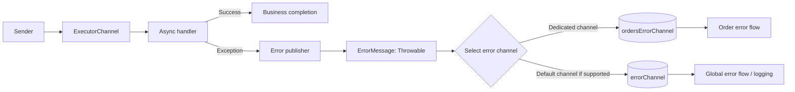

# Error Channels with Asynchronous Messages in Spring Integration

## 1. Context and Objectives

In the `SPRING_INTEGRATION_PATTERN` module, we implement **Enterprise Integration Patterns** (EIP) with Spring Integration to build loosely coupled, extensible message flows while testing and observing Router, Filter, Transformer, Splitter, Aggregator, Gateway, retry, and error channel branches.

A system receiving `ORDER_CREATED` events may hand processing off to another thread so it does not block the sender. Yet if that thread calls a payment service and times out, the sender has usually already exited the `send(...)` call. Exceptions cannot simply be "thrown back" onto the sender's call stack as in synchronous processing. An **Error Channel** turns error details into an `ErrorMessage` so another branch can receive, classify, and handle it.

After this lesson, you will be able to:

- Distinguish errors on a synchronous `DirectChannel` from errors occurring across an asynchronous boundary.
- Explain why `send(...) == true` does not mean business processing succeeded.
- Identify **error publishers**, `ErrorMessage`, the global `errorChannel`, and dedicated error channels.
- Use `ExecutorChannel` to demonstrate an asynchronous flow and explicitly publish an `ErrorMessage`.
- Test asynchronous flows using `CountDownLatch` rather than relying on fixed sleep durations.
- Design retry, quarantine, correlation, Gateway replies, and metrics to prevent data loss.

## 2. What Changes When Processing Is Asynchronous?

In a synchronous flow, a `DirectChannel` hands the message to the handler on the caller's thread. If the handler throws an exception, the caller usually receives the exception during the `send(...)` or Gateway call.

```text
Caller thread
  --> DirectChannel
      --> Handler
          --> throw Exception
  <-- exception propagates to caller
```

With an `ExecutorChannel` or a similar asynchronous boundary, submitting the message to the executor and executing the handler happen at **two different times**. The sender may receive a successful send result as soon as the task is accepted into the execution queue:

```text
Caller thread                   Worker thread
    |                                |
    +--> asyncChannel.send()         |
    |        +--> executor ----------+--> Handler
    |                                |       |
    +<-- send() returns              |       +--> Exception
                                     |               |
                                     +--> Error publisher
                                                  |
                                                  v
                                             ErrorMessage
                                                  |
                                                  v
                                             Error Channel
```

**Consequence:** `send(...) == true` may only confirm that the channel accepted the request for processing, **not that side effects succeeded**, the database committed, the broker message was ACKed, or a reply was produced.

| Aspect | Synchronous via DirectChannel | Across an Asynchronous Boundary |
| --- | --- | --- |
| Handler execution thread | Usually the sender's thread. | Thread managed by an executor/poller/adapter. |
| Handler errors | Can propagate directly back to the caller. | Usually require a dedicated error-handling/publishing mechanism at the execution boundary. |
| Return value of `send()` | Can reflect handler failure within the same call. | May only reflect task acceptance. |
| Error recipient | Caller, advice, or Gateway. | Error Channel/handler supported by the publisher, or adapter error mechanism. |
| Business completion confirmation | Must follow the flow's contract. | Needs a completion signal, job status, or appropriate async reply. |

### Not All Asynchronous Channels Are Identical

An `ExecutorChannel` dispatches tasks to an `Executor`; a `QueueChannel` holds messages for a polling consumer to retrieve; an inbound adapter may run on its own thread or listener. Each mechanism catches and publishes errors differently. Therefore, do not apply a blanket assumption: "anything asynchronous automatically sends exceptions to the global `errorChannel`."

## 3. Where Are ErrorMessages Published From?

Spring Messaging represents error events with `org.springframework.messaging.support.ErrorMessage`. This is a `Message<Throwable>`: **the payload is the exception**; metadata may include `originalMessage` provided by the publisher. If the exception is a `MessagingException`, `getFailedMessage()` may indicate the message associated with the failing step.

For an error to actually travel through a channel, an **error publisher** or equivalent error handler must:

1. Catch the exception at the execution point it manages.
2. Construct an `ErrorMessage` (or equivalent per the adapter's contract).
3. Choose a supported error channel: a dedicated channel, the `errorChannel` header when supported by the publisher, or the global `errorChannel` by configuration.
4. Send the error message to an error flow that has an actual consumer.



**Note on the global channel:** `errorChannel` is a standard name in Spring Integration, typically publish/subscribe with a default logging subscriber. It does not automatically catch arbitrary Java exceptions outside an error-publishing mechanism. Having multiple subscribers also does not mean retries occurred or the message was saved to durable storage.

## 4. Choosing an Error-Handling Path Matching the Boundary

| Execution Source | Error Path to Inspect | Example |
| --- | --- | --- |
| `DirectChannel` called directly by caller | Exception may return to caller. | A Gateway invoking a Service Activator synchronously. |
| `ExecutorChannel` | Exception handling of the dispatcher/executor and whichever error publisher the configuration uses. | Worker processing `ORDER_CREATED` on a separate thread. |
| `QueueChannel` + polling consumer | Error handler of the poller/consumer, not the queue itself. | Poller reading messages from an internal queue. |
| Inbound adapter with its own listener | Error channel, retry, redelivery, and ack/nack mechanisms of that specific adapter. | Broker consumer receiving messages. |
| Application-managed `CompletableFuture` or `Executor` | Must inspect Future outcomes/exceptions or explicitly publish errors. | A task running outside Spring Integration endpoints. |

If a handler **catches an exception and does not rethrow**, an outer error publisher will no longer see that exception. This can be valid when the handler already recorded a failure state or published an `ErrorMessage` itself, provided it does not report false success.

Conversely, if code **both publishes an error itself and rethrows the same exception** while the executor mechanism also auto-publishes, the system may receive **two ErrorMessages for one failure**. Choose a single error owner or design clear deduplication.

## 5. Java DSL Example: ExecutorChannel and Explicit Error Flow

To make behavior testable without depending on version- or adapter-specific auto-publishing defaults, the following example **explicitly publishes an ErrorMessage inside the asynchronous handler**. This demonstrates the error boundary and is **not a requirement to manually catch in every application**. For endpoints with framework-provided error publishers, follow that contract instead of publishing twice.

The example uses Java 17, Spring Integration Java DSL, and `ThreadPoolTaskExecutor`. In Spring Boot you can use `spring-boot-starter-integration`; tests use JUnit 5, Spring Test, and AssertJ (for example via `spring-boot-starter-test`).

```java
import java.util.concurrent.CountDownLatch;
import java.util.concurrent.TimeUnit;
import java.util.concurrent.atomic.AtomicReference;

import org.springframework.context.annotation.Bean;
import org.springframework.context.annotation.Configuration;
import org.springframework.beans.factory.annotation.Qualifier;
import org.springframework.integration.channel.DirectChannel;
import org.springframework.integration.channel.ExecutorChannel;
import org.springframework.integration.config.EnableIntegration;
import org.springframework.integration.dsl.IntegrationFlow;
import org.springframework.messaging.Message;
import org.springframework.messaging.MessageChannel;
import org.springframework.messaging.support.ErrorMessage;
import org.springframework.scheduling.concurrent.ThreadPoolTaskExecutor;

@Configuration
@EnableIntegration
public class AsyncErrorFlowConfig {

    public record OrderEvent(String orderId, boolean simulateFailure) {}

    public static class ErrorProbe {
        private final CountDownLatch observed = new CountDownLatch(1);
        private final AtomicReference<ErrorMessage> latest =
            new AtomicReference<>();

        public void record(ErrorMessage error) {
            latest.set(error);
            observed.countDown();
        }

        public boolean await(long timeout, TimeUnit unit)
                throws InterruptedException {
            return observed.await(timeout, unit);
        }

        public ErrorMessage latest() {
            return latest.get();
        }
    }

    @Bean
    public ErrorProbe errorProbe() {
        return new ErrorProbe();
    }

    @Bean
    public ThreadPoolTaskExecutor orderExecutor() {
        ThreadPoolTaskExecutor executor = new ThreadPoolTaskExecutor();
        executor.setCorePoolSize(1);
        executor.setMaxPoolSize(2);
        executor.setQueueCapacity(50);
        executor.setThreadNamePrefix("order-worker-");
        return executor; // Spring manages bean initialization and shutdown
    }

    @Bean
    public MessageChannel ordersInput() {
        return new DirectChannel();
    }

    @Bean
    public MessageChannel ordersAsync(ThreadPoolTaskExecutor orderExecutor) {
        return new ExecutorChannel(orderExecutor);
    }

    @Bean
    public MessageChannel ordersErrorChannel() {
        return new DirectChannel();
    }

    @Bean
    public IntegrationFlow asyncOrdersFlow(
            @Qualifier("ordersErrorChannel") MessageChannel ordersErrorChannel) {
        return IntegrationFlow.from("ordersInput")
            .channel("ordersAsync")
            .handle((Message<?> message) -> {
                try {
                    OrderEvent event = (OrderEvent) message.getPayload();
                    if (event.simulateFailure()) {
                        throw new IllegalStateException(
                            "Order service temporarily unavailable");
                    }
                    // In practice: persist result, emit next event, etc.
                } catch (RuntimeException failure) {
                    // Explicit publisher inside worker: do not rethrow the error
                    // after publishing succeeds to avoid double-publishing.
                    ErrorMessage error = new ErrorMessage(failure, message);
                    if (!ordersErrorChannel.send(error)) {
                        throw new IllegalStateException(
                            "Cannot publish order failure", failure);
                    }
                }
            })
            .get();
    }

    @Bean
    public IntegrationFlow ordersErrorFlow(ErrorProbe probe) {
        return IntegrationFlow.from("ordersErrorChannel")
            .handle((Message<?> received) -> {
                if (!(received instanceof ErrorMessage error)) {
                    throw new IllegalArgumentException(
                        "Expected ErrorMessage");
                }
                probe.record(error);
            })
            .get();
    }
}
```

### Path of a Failing Message

1. The caller sends an `OrderEvent` to `ordersInput`.
2. `ordersInput` forwards the message to `ordersAsync`, an `ExecutorChannel` backed by a thread pool.
3. The executor runs the handler across the asynchronous boundary; `simulateFailure=true` triggers an exception.
4. The `catch` block creates an `ErrorMessage` and sends it to `ordersErrorChannel`. It does not rethrow if publishing succeeded.
5. `ordersErrorFlow` receives the error event and records it into `ErrorProbe` for test assertions.

The example uses a `DirectChannel` for the error channel so delivery to `ErrorProbe` runs on the worker thread when handling the failure. From the caller's perspective, this is still an **asynchronous business flow** because the `ExecutorChannel` boundary separated threads. If the error handler throws an exception, `send()` to the error channel can fail; production needs secondary error handling and durable storage.

**Pattern limitation:** `ErrorProbe` lives only in memory. A real application needs retry policies, failure state persistence, dead-letter/quarantine, and metrics; successfully sending an `ErrorMessage` does not guarantee data will be reprocessed after a process restart.

## 6. Testing: Waiting for Asynchronous Errors Without Guessing Timing

When testing a flow running on an executor, do not call `Thread.sleep(...)` for a fixed interval and hope the worker finished. Instead, use `CountDownLatch` or a bounded synchronization primitive.

```java
import java.util.concurrent.TimeUnit;

import org.junit.jupiter.api.Test;
import org.springframework.beans.factory.annotation.Autowired;
import org.springframework.beans.factory.annotation.Qualifier;
import org.springframework.messaging.MessageChannel;
import org.springframework.messaging.support.ErrorMessage;
import org.springframework.messaging.support.MessageBuilder;
import org.springframework.test.context.junit.jupiter.SpringJUnitConfig;

import static org.assertj.core.api.Assertions.assertThat;

@SpringJUnitConfig(AsyncErrorFlowConfig.class)
class AsyncErrorFlowTest {

    @Autowired
    @Qualifier("ordersInput")
    MessageChannel ordersInput;

    @Autowired
    AsyncErrorFlowConfig.ErrorProbe probe;

    @Test
    void asyncHandlerPublishesFailureToDedicatedErrorFlow()
            throws InterruptedException {
        var event = new AsyncErrorFlowConfig.OrderEvent("ord-42", true);

        assertThat(ordersInput.send(
            MessageBuilder.withPayload(event)
                .setHeader("eventId", "evt-async-42")
                .setHeader("correlationId", "order-42")
                .build())).isTrue();

        // send() confirms the channel accepted the task;
        // the latch confirms the error flow observed the failure.
        assertThat(probe.await(5, TimeUnit.SECONDS)).isTrue();

        ErrorMessage failure = probe.latest();
        assertThat(failure).isNotNull();
        assertThat(failure.getPayload())
            .isInstanceOf(IllegalStateException.class)
            .hasMessageContaining("Order service temporarily unavailable");
        assertThat(failure.getOriginalMessage()).isNotNull();
        assertThat(failure.getOriginalMessage().getHeaders()
            .get("eventId")).isEqualTo("evt-async-42");
    }
}
```

This is an **integration test of the explicit-publisher pattern**: it verifies that the message passes through `ExecutorChannel`, the error is caught in the worker, and the `ErrorMessage` reaches the right error flow. The test does not prove that `ExecutorChannel` or every adapter auto-publishes errors if the `catch` block is removed.

A thorough test suite should also cover the success path, multiple concurrent messages, executor task rejection under load, exceptions inside the error handler, verifying zero double-publishing, and timeout cases when no ErrorMessage arrives.

## 7. Using Framework-Provided Error Publishing

When a poller or adapter has an error-publishing mechanism, you do not necessarily need a manual `catch` as in the example. Instead, accurately configure the emitting source and an error channel it supports—such as a dedicated `errorChannel` on a polling endpoint. The receiving error flow can still be `IntegrationFlow.from("ordersErrorChannel")` or `@ServiceActivator(inputChannel = "ordersErrorChannel")`.

Some error-publishing mechanisms read the `MessageHeaders.ERROR_CHANNEL` header of the original message to pick the destination; in other cases, an endpoint property or the global `errorChannel` is used. **Do not assume a universal precedence order** across all versions and adapters; test with the exact endpoint.

| Publishing Approach | When Is It Appropriate? | Risks to Control |
| --- | --- | --- |
| Poller/adapter publisher | The integration source already provides error handling. | Wrong channel config, incorrect ack/rollback timing, lost original metadata. |
| Executor boundary error handling | The execution framework/channel has an appropriate error handler. | Assuming auto-publishing when errors actually go to a different handler. |
| Application `CompletableFuture`/executor | Work executes outside Spring Integration-managed endpoints. | Unobserved Futures, dropped exceptions, or unpersisted failure state. |
| Explicit publisher as in example | Need exact control over which errors become messages. | Missing exceptions outside the `try` block, double-publishing when combined with auto-publishing. |

**Rule of thumb:** One error needs one clear ownership strategy. If the framework already catches and publishes the exception, do not manually catch and re-publish without reason. If the application catches and emits errors itself, monitor **error-publishing failures** as well.

## 8. Error Channels Do Not Replace Retry, Transactions, and Acknowledgments

Decoupling the error path from the sender keeps the caller unblocked, but raises reliability questions:

| Question | Why It Matters | How to Design |
| --- | --- | --- |
| Was the work partially processed? | Retries can cause duplicate side effects. | Use idempotency keys, transactions, or reconciliation before replaying. |
| Was the input message already ACKed? | Early ACK can prevent redelivery on failure. | Inspect the adapter's ack/nack, commit, and retry mechanisms. |
| Does an Error Channel persist messages durably? | `DirectChannel` and `PublishSubscribeChannel` are not storage systems by themselves. | Route recoverable failures to a broker, database, or suitable quarantine store. |
| What happens when retries exceed limits? | Unbounded retries can overload the system. | Backoff, attempt limits, and a final handling branch. |
| What if the error handler also fails? | Can cause secondary errors or loops. | Safe status/alert persistence policy and explicit stop conditions. |

For example, when calling a payment gateway: a timeout after the partner captured the funds **does not prove** the transaction failed. The error flow must query status or use idempotency before retrying. The presence of an `ErrorMessage` does not guarantee prior operations rolled back.

### Retry and Error Channels

- **Retry advice / adapter retry** retries an operation per policy; retry placement may sit before an error is published to a channel.
- **Error Channel** transports published error information for classification and remediation.
- **Dead-letter/quarantine** retains data for investigation, repair, and controlled replay.

Sending an ErrorMessage into `retryCandidates` only means the error message reached that branch; it does not prove the business operation was retried or succeeded.

## 9. Gateway, Splitter/Aggregator, and Correlation Context

### Request/Reply Gateway

A synchronous Gateway normally has a contract to return a reply or throw an exception. If the flow offloads processing to an `ExecutorChannel`, the caller may be waiting for a reply with a timeout. Having a worker publish an `ErrorMessage` to a dedicated channel **does not automatically return a valid error reply to the Gateway**. Design an explicit reply/error-reply path or an asynchronous workflow returning a `jobId` plus a status lookup API.

In an API accepting asynchronous jobs, never return "payment succeeded" merely because the executor accepted the message. Return "accepted" only when the contract permits, then update status once the worker finishes.

### Splitter and Aggregator

Suppose a Splitter creates 5 child messages and asynchronous workers process each part. If part 3 fails and goes to a dedicated Error Channel, the Aggregator may only receive 4 parts, failing to satisfy a release condition based on `sequenceSize=5`.

The error flow must decide whether to retry part 3, emit an error status for the group, time out, or compensate. An `ErrorMessage` **does not automatically update** the Aggregator's group state.

### Finding the Original or Failed Message

`ErrorMessage.getOriginalMessage()` may be the message supplied by the error publisher. `MessagingException.getFailedMessage()` may contain the message at the failing step. Both can be `null`, and they are not necessarily the same message.

```java
import org.springframework.messaging.Message;
import org.springframework.messaging.MessagingException;
import org.springframework.messaging.support.ErrorMessage;

static Message<?> findContext(ErrorMessage error) {
    if (error.getOriginalMessage() != null) {
        return error.getOriginalMessage();
    }
    int depth = 0;
    for (Throwable current = error.getPayload();
         current != null && depth < 32;
         current = current.getCause(), depth++) {
        if (current instanceof MessagingException me
                && me.getFailedMessage() != null) {
            return me.getFailedMessage();
        }
    }
    return null;
}
```

When an appropriate message is found, read `eventId`, `correlationId`, `sequenceNumber`, and `sequenceSize` if they actually exist. Do not treat headers on `ErrorMessage` itself as a complete copy of business headers. Avoid putting sensitive payloads or high-cardinality identifiers into metric labels.

## 10. Observing and Diagnosing Asynchronous Errors

An async system should distinguish **message accepted**, **processing started**, **completed**, **failed**, and **recovered**:

| Metric/Log | Meaning |
| --- | --- |
| `async_messages_accepted_total{flow}` | Work accepted by the channel for processing. |
| `async_processing_completed_total{flow}` | Business processing actually completed successfully. |
| `async_errors_published_total{flow,channel}` | `ErrorMessage` sent by publisher to error flow. |
| `async_recovery_total{flow,result}` | Outcome of retry/quarantine or final handling. |
| `async_error_handler_failures_total{flow}` | Errors occurring directly inside the error handler. |
| Log `eventId`, `traceId`, `correlationId` | Correlate the original request with worker thread and outcome. |

Do not use `eventId` as a metric label: ever-growing IDs will cause time-series cardinality explosions. For logs, record only necessary metadata; avoid passwords, tokens, payment details, or full payloads.

### Quick Diagnostics Table

| Symptom | Possible Cause | How to Check |
| --- | --- | --- |
| `send()` returns `true` but no business outcome appears | Worker has not run yet, failed, or has not completed. | Inspect executor, work queue, completed/error metrics. |
| Worker logs a stack trace but Error Channel is empty | Exception not caught by publisher or handled by another mechanism. | Inspect execution boundary and executor/adapter error handler. |
| ErrorMessage reaches global instead of local channel | Publisher uses default target or custom config not applied. | Check config/headers per the specific publisher's contract. |
| Two ErrorMessages for one failure | Code manually publishes and then rethrows to an auto-publisher. | Pick one error owner and check deduplication. |
| Gateway times out even though error flow handled the failure | Error Channel does not automatically produce a Gateway reply. | Design reply/error reply and timeout. |
| Error flow lacks `eventId` | Original/failed message omitted or headers were modified. | Inspect `getOriginalMessage()`, `getFailedMessage()`, and correlation. |
| Errors loop infinitely after retry | Missing attempt limit or unsafe side-effect retry. | Enforce retry limit, backoff, terminal state, and idempotency. |

## 11. Hands-On Exercise

**Scenario:** An order-processing application uses an `ExecutorChannel` for payment confirmation and a `QueueChannel` for sending notifications. The payment provider may time out, and the notification provider may return rate-limit errors.

1. Diagram the path of `send()`, worker thread, error publisher, and `ErrorMessage` across both flows. Mark where the asynchronous boundary lies.
2. Modify the `AsyncErrorFlowConfig` example to also record success events, without relying on `send() == true` as proof of completion.
3. Write a test with a real failure in the worker, wait for the `ErrorMessage` using a latch, and verify `eventId`.
4. Write a test where the error handler throws an exception or the error channel has no consumer; describe the mechanism needed to avoid losing errors.
5. Propose bounded retry, backoff, idempotency, and a quarantine store for payment timeouts.
6. Simulate one part of a Splitter group failing on a separate thread and design how the Aggregator completes the group without waiting indefinitely.
7. If using a Gateway to accept requests, decide whether the API returns synchronous results or an "accepted" status with a `jobId`.

**Self-check questions:** Why can you not conclude a message was processed successfully when `ExecutorChannel.send()` returns `true`? Who is responsible for turning a worker exception into an `ErrorMessage`? When does manually publishing and rethrowing an exception cause duplicate handling?

## 12. Key Takeaways

**When messages are processed asynchronously, errors typically surface after the sender thread has finished the send operation.** An Error Channel turns errors into `ErrorMessage` instances so a dedicated branch can observe and remediate them, but only operates when an actual error-publishing mechanism is present. In Spring Integration, accurately identify `ExecutorChannel`/poller/adapter boundaries, configure clear error destinations, test with synchronization signals, and design retry, correlation, replies, and durable storage according to the business contract.
