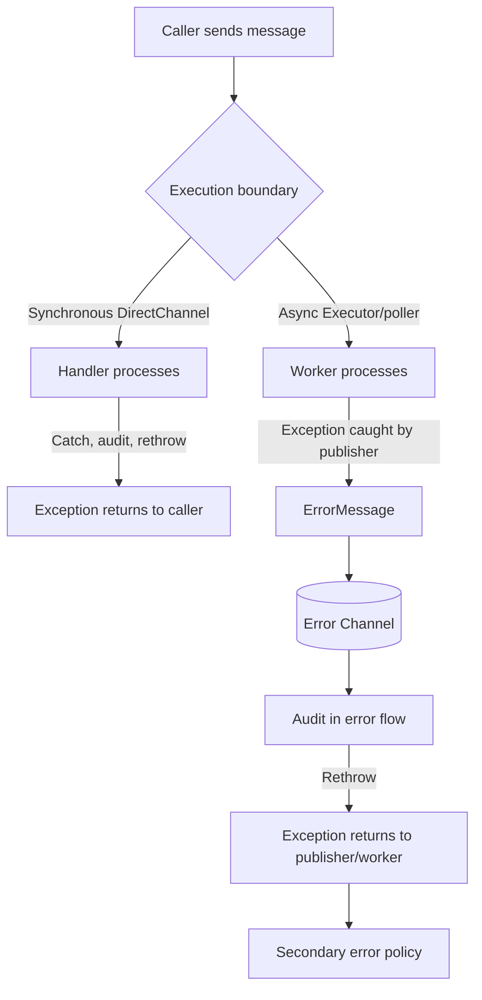
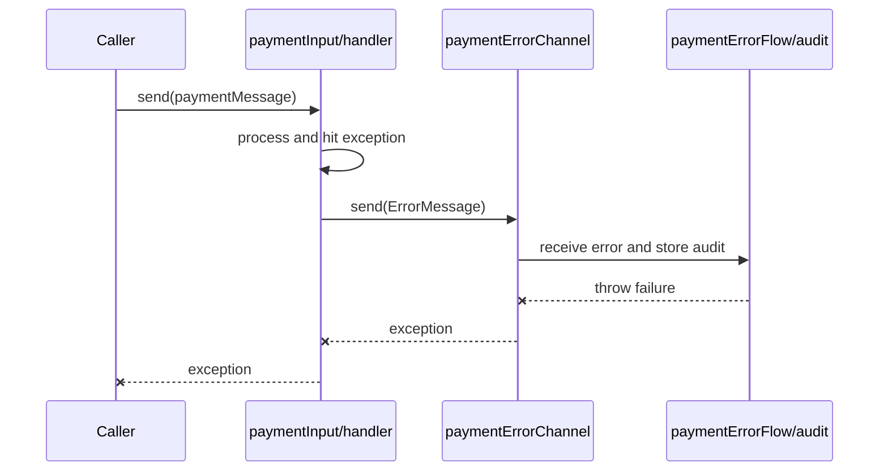

# Rethrowing Exceptions After Handling in Spring Integration

## 1. Context and Objectives

In the `SPRING_INTEGRATION_PATTERN` module, we practice **Enterprise Integration Patterns** with Spring Integration to build loosely coupled, extensible message flows that are testable and observable. Flows using Router, Filter, Transformer, Splitter, Aggregator, Gateway, or Service Activator can all encounter errors that need to be recorded before reporting failure to the caller or triggering retry.

Suppose a payment handler throws `IllegalStateException`. The application wants to write an audit record, add diagnostic context, and then **rethrow** the exception. If it merely catches the exception to log it and returns normally, upstream components may mistakenly believe the job succeeded. Yet throwing an exception from an asynchronous error flow cannot automatically travel back to an HTTP request thread that has already completed.

**Goal:** Understand precisely where an exception propagates after handling, preserve root causes and rollback/retry conditions, and avoid duplicate error publishing or Error Channel loops.

After this lesson, you will be able to:

- Distinguish rethrowing an exception in a business handler from throwing inside an `ErrorMessage` consumer.
- Explain the conditions under which a synchronous caller observes the exception after an audit step.
- Analyze what rethrowing means across `DirectChannel`, `PublishSubscribeChannel`, pollers, and `ExecutorChannel`.
- Write a Java DSL flow illustrating **audit → rethrow** together with JUnit tests.
- Preserve `cause`, `failedMessage`, `originalMessage`, and correlation ID when available.
- Decide when to rethrow and when to persist an error state and terminate an error flow cleanly.

## 2. What Is Rethrowing an Exception?

In Java, **rethrowing** means throwing onward an exception that was caught or received:

```java
try {
    paymentService.charge(order);
} catch (RuntimeException failure) {
    auditService.recordFailure(order.id(), failure);
    throw failure; // Preserve the original exception instance and cause chain.
}
```

This snippet does not "recover" from the error: it performs an observational side effect and lets the caller or infrastructure decide next. In Spring Integration, there are **two distinct places where rethrowing occurs**:

1. **Directly inside a business handler:** `catch`, write an audit record, then `throw failure`. If running on a synchronous `DirectChannel`, the exception can propagate back to the `send(...)` call or Gateway.
2. **Inside an error flow:** a component published an `ErrorMessage`, the consumer records the error, and then throws `error.getPayload()` (when valid) or an exception wrapping it as `cause`. Here, the exception propagates back to **the component currently sending the `ErrorMessage`**, not automatically to the original business message sender.

> Rule to remember: **Rethrowing fails the current invocation. It does not magically locate a caller that already exited the stack or ran on another thread.**

### Three Easily Confused Outcomes

| Action in Error Handler | Immediate Outcome | Guarantees Work Recovery? |
| --- | --- | --- |
| Log and return | Error handler finishes normally. | No. The original error may have been consumed at that boundary. |
| Log and `throw` | The invocation into the error handler fails. | No. May trigger secondary error handling or re-propagate the exception. |
| Record failure/quarantine status and return | Error flow completes handing off the error per policy. | Only when durably persisted and compliant with the system contract. |

Rethrowing is not always the right choice. A system must choose its handling strategy based on the **caller contract**, endpoint type, and retry/transaction policies.

## 3. Exception Paths Across Channel Types



| Processing Location | Who Observes the Rethrow? | What to Keep in Mind |
| --- | --- | --- |
| Handler behind synchronous `DirectChannel` | Thread calling `send()`, unless an intermediate layer catches it. | Can affect the caller's transaction or retry logic. |
| Handler receiving `ErrorMessage` via dedicated `DirectChannel` | Thread calling `errorChannel.send(error)`. | Reaches the business caller only if both calls are still on the same call stack. |
| Handler receiving errors from a poller | Poller/error publisher thread. | Original caller may no longer exist; rollback/ack depends on poller/adapter. |
| Handler behind `ExecutorChannel` | Worker or executor's error handler. | Does not automatically propagate to the thread that called `send()`. |
| Consumer on publish/subscribe global `errorChannel` | Depends on dispatcher, subscribers, executor, and channel error handler. | Do not assume every subscriber runs or exceptions always reach upstream. |

**An Error Channel is not a JVM-wide global exception catcher.** It only receives an `ErrorMessage` when a publisher actually sends an error message into the channel. With synchronous handlers, exceptions can propagate straight back to the caller without ever touching the global `errorChannel`.

## 4. Rethrowing in a Business Handler: The Simplest Approach

When the requirement is "record the failure, yet the synchronous caller must still receive the error," the clearest approach is usually **catch and rethrow right inside the handler**. Example:

```java
@ServiceActivator(inputChannel = "paymentRequests")
public void charge(PaymentRequest request) {
    try {
        paymentService.charge(request);
    } catch (RuntimeException failure) {
        audit.record(request.id(), failure.getClass().getSimpleName());
        throw failure; // Do not swallow business errors.
    }
}
```

This snippet is illustrative; `PaymentRequest`, `paymentService`, and `audit` are application-defined components. If an upper-layer error publisher is responsible for handling exceptions, this pattern avoids manually emitting an extra `ErrorMessage`.

**An important transaction note:** If the audit write executes in the **same transaction** as the failing operation, rethrowing may roll back **the audit record as well**. Design an audit store or outbox with explicit transaction boundaries if retaining failure records after rollback is mandatory. Never assume "calling the audit method" equals "the audit record is durable."

## 5. Rethrowing in an Error Flow: Who Receives the Exception?

Suppose an adapter/poller emits:

```text
ErrorMessage
  ├── payload: MessagingException / IllegalStateException / other Throwable
  ├── originalMessage: Message<?> if provided by publisher
  └── headers: metadata of the ErrorMessage itself
```

A consumer can handle it as follows:

```java
@ServiceActivator(inputChannel = "paymentErrorChannel")
public void auditAndRethrow(ErrorMessage error) {
    Throwable failure = error.getPayload();
    failureAudit.write(failure.getClass().getSimpleName());

    if (failure instanceof RuntimeException runtime) {
        throw runtime;
    }
    throw new IllegalStateException("Payment error after audit", failure);
}
```

This snippet is an **illustrative method pattern**; the `failureAudit` bean is supplied by the application. It rethrows on the **consumer's execution thread**. If an asynchronous worker sent the `ErrorMessage` via `paymentErrorChannel`, the new exception propagates back to that worker/publisher. It does **not** become an HTTP response for the original caller.

When the payload is a `MessagingException`, use `getFailedMessage()` to trace job context. When the payload is a plain exception, `ErrorMessage.getOriginalMessage()` may have context. Both can be `null`, and they are not necessarily the same message after a Transformer/Splitter.

**Avoid `throw new RuntimeException(error.getPayload().getMessage())`:** that discards the cause, exception type, and original stack trace, weakening retry classification. If you must wrap the error, pass the original `Throwable` as the `cause`.

## 6. Java DSL Example: Audit in Error Channel Then Synchronous Rethrow

The example below is designed to clearly demonstrate **the relationship between two message sends**. A business handler receives `PAYMENT_REQUEST` on a `DirectChannel` and publishes an `ErrorMessage` to a dedicated error channel. The error flow writes an audit record and rethrows the initial error. Because both channels are `DirectChannel`, the call sending the ErrorMessage has not left the caller's stack; the exception can propagate back to `paymentInput.send(...)`.

This is an **explicit error-publishing design for learning rethrow**. In a real application, if the framework/adapter already publishes errors automatically, do not manually publish the same exception again.

The example uses Java 17 and Spring Integration Java DSL; with Spring Boot you can use `spring-boot-starter-integration` along with `spring-boot-starter-test` for JUnit 5 testing.

```java
import java.util.List;
import java.util.concurrent.ConcurrentLinkedQueue;

import org.springframework.beans.factory.annotation.Qualifier;
import org.springframework.context.annotation.Bean;
import org.springframework.context.annotation.Configuration;
import org.springframework.integration.channel.DirectChannel;
import org.springframework.integration.config.EnableIntegration;
import org.springframework.integration.dsl.IntegrationFlow;
import org.springframework.messaging.Message;
import org.springframework.messaging.MessageChannel;
import org.springframework.messaging.support.ErrorMessage;

@Configuration
@EnableIntegration
public class RethrowAfterHandlingConfig {

    public record ErrorAuditRecord(
        String eventId, String exceptionType) {}

    public static class ErrorAudit {
        private final ConcurrentLinkedQueue<ErrorAuditRecord> records =
            new ConcurrentLinkedQueue<>();

        public void record(ErrorAuditRecord record) {
            records.add(record);
        }

        public List<ErrorAuditRecord> snapshot() {
            return List.copyOf(records);
        }

        public void clear() {
            records.clear();
        }
    }

    @Bean
    public ErrorAudit errorAudit() {
        return new ErrorAudit();
    }

    @Bean
    public MessageChannel paymentInput() {
        return new DirectChannel();
    }

    @Bean
    public MessageChannel paymentErrorChannel() {
        return new DirectChannel();
    }

    @Bean
    public IntegrationFlow paymentFlow(
            @Qualifier("paymentErrorChannel") MessageChannel errors) {

        return IntegrationFlow.from("paymentInput")
            .handle((Message<?> message) -> {
                try {
                    // Simulate failure of a synchronous payment service.
                    throw new IllegalStateException("Payment rejected");
                } catch (RuntimeException failure) {
                    ErrorMessage event = new ErrorMessage(failure, message);

                    // Error flow may rethrow immediately during this send call.
                    boolean accepted = errors.send(event);
                    if (!accepted) {
                        throw new IllegalStateException(
                            "Failed to publish payment error", failure);
                    }
                }
            })
            .get();
    }

    @Bean
    public IntegrationFlow paymentErrorFlow(ErrorAudit audit) {
        return IntegrationFlow.from("paymentErrorChannel")
            .handle((Message<?> received) -> {
                if (!(received instanceof ErrorMessage error)) {
                    throw new IllegalArgumentException(
                        "Expected ErrorMessage");
                }

                Throwable failure = error.getPayload();
                Message<?> original = error.getOriginalMessage();
                Object value = original == null
                    ? null : original.getHeaders().get("eventId");
                String eventId = value == null ? "unknown" : value.toString();

                audit.record(new ErrorAuditRecord(
                    eventId, failure.getClass().getSimpleName()));

                // Rethrow: fail the current ErrorMessage send call.
                if (failure instanceof RuntimeException runtime) {
                    throw runtime;
                }
                throw new IllegalStateException(
                    "Non-runtime error after audit", failure);
            })
            .get();
    }
}
```

### Step-by-Step Execution in the Example

1. Caller invokes `paymentInput.send(paymentMessage)`.
2. `paymentFlow` executes on the same thread and creates `IllegalStateException("Payment rejected")`.
3. The `catch` block creates an `ErrorMessage` with `originalMessage = paymentMessage` and calls `paymentErrorChannel.send(error)`.
4. `paymentErrorFlow` receives the error, writes the audit record, and **rethrows** the exception; the `paymentErrorChannel.send(error)` call fails.
5. Because the flow is synchronous, the exception can continue propagating back to `paymentInput.send(...)` (the framework may wrap it in a `MessagingException`/`MessageHandlingException`).



The value of this example is verifying the **exception propagation path**. It is not a recommendation that every application should publish an ErrorMessage and rethrow in a loop like this; when you simply need the caller to receive the error, catching and rethrowing directly in the business handler is usually simpler.

## 7. Testing: Audit Occurs While the Exception Is Not Swallowed

The test below checks two things at once: **the audit was recorded** and **the caller receives an exception**. Because Spring Integration layers can wrap exceptions, the test traverses the cause chain instead of rigidly demanding the outermost exception be `IllegalStateException`.

```java
import org.junit.jupiter.api.BeforeEach;
import org.junit.jupiter.api.Test;
import org.springframework.beans.factory.annotation.Autowired;
import org.springframework.beans.factory.annotation.Qualifier;
import org.springframework.messaging.MessageChannel;
import org.springframework.messaging.support.ErrorMessage;
import org.springframework.messaging.support.MessageBuilder;
import org.springframework.test.context.junit.jupiter.SpringJUnitConfig;

import static org.assertj.core.api.Assertions.assertThat;
import static org.assertj.core.api.Assertions.assertThatThrownBy;

@SpringJUnitConfig(RethrowAfterHandlingConfig.class)
class RethrowAfterHandlingConfigTest {

    @Autowired
    @Qualifier("paymentInput")
    MessageChannel paymentInput;

    @Autowired
    @Qualifier("paymentErrorChannel")
    MessageChannel paymentErrors;

    @Autowired
    RethrowAfterHandlingConfig.ErrorAudit audit;

    @BeforeEach
    void clearAudit() {
        audit.clear();
    }

    @Test
    void errorFlowAuditsThenRethrowsToSynchronousCaller() {
        var payment = MessageBuilder.withPayload("PAYMENT_REQUEST")
            .setHeader("eventId", "pay-501")
            .build();

        assertThatThrownBy(() -> paymentInput.send(payment))
            .satisfies(thrown -> assertThat(rootCause(thrown))
                .isInstanceOf(IllegalStateException.class)
                .hasMessage("Payment rejected"));

        assertThat(audit.snapshot()).containsExactly(
            new RethrowAfterHandlingConfig.ErrorAuditRecord(
                "pay-501", "IllegalStateException"));
    }

    @Test
    void directErrorSendRethrowsToErrorPublisherNotAnotherCaller() {
        var error = new ErrorMessage(
            new IllegalArgumentException("Bad payment data"));

        assertThatThrownBy(() -> paymentErrors.send(error))
            .satisfies(thrown -> assertThat(rootCause(thrown))
                .isInstanceOf(IllegalArgumentException.class)
                .hasMessage("Bad payment data"));

        assertThat(audit.snapshot()).containsExactly(
            new RethrowAfterHandlingConfig.ErrorAuditRecord(
                "unknown", "IllegalArgumentException"));
    }

    private static Throwable rootCause(Throwable error) {
        Throwable current = error;
        int hops = 0;
        while (current.getCause() != null && hops++ < 32) {
            current = current.getCause();
        }
        return current;
    }
}
```

The first test simulates a business caller and verifies the exception is not "swallowed" after auditing. The second test sends an `ErrorMessage` directly: rethrowing returns to **the caller of `paymentErrors.send(...)`**, underscoring that it is not necessarily the caller that initiated the original transaction.

**Limitation:** `ErrorAudit` in the example lives in memory and is non-transactional. The test verifies program behavior, **not that audit records survive a rollback, crash, or restart**. When moving to a database, test commit/rollback explicitly.

## 8. What Happens If the Error Flow Runs Asynchronously?

Consider the same flow where `paymentErrorChannel` is an `ExecutorChannel` backed by an executor, or the error message is sent by a poller/adapter after the caller has finished:

```text
HTTP caller -- send request --> async boundary -- return "accepted"
                                     |
                                     v
                                Worker fails
                                     |
                                     v
                                ErrorMessage
                                     |
                                     v
                              Error flow audit + throw
                                     |
                                     v
                              Worker/error dispatcher
```

Here, rethrowing inside the error handler **cannot automatically return to the already-sent HTTP response**. It only fails the call or task currently processing the ErrorMessage. Depending on dispatcher configuration, that may produce logs, secondary errors, or affect the publisher's ack/rollback behavior.

If the caller needs to know the asynchronous result, design a **completion event, job status, callback, reply channel, or status query API** with timeouts and correlation IDs. If the caller requires a synchronous result, keep an explicit reply/exception contract instead of hoping the global error channel returns errors for you.

### Gateway and Reply Errors

A Gateway can use reply/error-reply mechanisms depending on configuration, yet not every `throw` inside an error subscriber turns into an exception on the Gateway method. Actually test timeout behavior, reply message types, and thread boundaries. Never return "payment succeeded" merely because an executor accepted the job.

## 9. Rethrow, Retry, Transactions, and Recoverability

### Rethrow May Trigger Retry—Or May Not

If the exception propagates into a retry advice/caller with a retry policy, the operation may be re-attempted. But if the exception occurs **after** an error publisher has recorded the failure and no retry interceptor wraps that path, rethrowing may merely cause an error in the error handler.

| Context | What Rethrow Can Lead To | What Needs to Be Added |
| --- | --- | --- |
| Handler wrapped by retry advice | Retries the operation within policy limits. | Backoff, error classification, limits, and idempotency. |
| Handler running in a transaction | Rollback when the exception matches rollback rules. | Distinguish checked/unchecked exceptions, transaction boundaries, and audit persistence. |
| Error handler on `DirectChannel` | Exception returns to the publisher calling the channel. | Rules for who handles secondary errors. |
| Asynchronous error handler | Error inside worker/dispatcher; original caller does not automatically see it. | Job status update, alert, quarantine, or worker retry. |
| Global Error Channel with multiple subscribers | One failing subscriber may affect dispatch. | Test dispatcher, logging subscriber, and avoid duplicate side effects. |

An `ErrorMessage` has a `Throwable` payload, yet **is not a retry command**. To replay work, identify the business message, transaction state, attempt count, and idempotency. Do not send raw `ErrorMessage` instances into a business input channel that expects order/payment payloads.

### Does Auditing Then Rethrowing Actually Preserve the Audit?

Not necessarily. Example:

```text
BEGIN transaction
  -> update payment
  -> insert audit_failure
  -> throw RuntimeException
ROLLBACK transaction  // audit_failure may also be rolled back
```

If persisting failure audits is mandatory, consider a **controlled separate transaction**, an outbox, or an appropriate event-logging store. Balance audit durability against consistency; avoid blindly opening a new transaction for every error log, as retries can generate duplicate records.

## 10. Avoiding Anti-Patterns When Rethrowing

| Anti-Pattern | Consequence | Alternative |
| --- | --- | --- |
| `catch (Exception e) { log(e); }` and return normally | Caller/worker may mark work as completed despite failure. | Rethrow if the contract expects failure; or record a controlled failure state. |
| `throw new RuntimeException(e.getMessage())` | Loses `cause`, exception type, and original stack trace. | `throw e` when valid, or `new RuntimeException("...", e)`. |
| Both publishing ErrorMessage and rethrowing to another auto-publisher | Two error events for one failure, double-retry, or double-alert. | Assign one error-publishing owner and design deduplication where needed. |
| Consumer on global channel throwing errors continuously | Can cause secondary errors, disrupt subscribers, or create loops. | Separate observers from recovery owners and enforce stop conditions. |
| Writing audit inside a transaction that rolls back while assuming it saved | Loses trace when transactions fail. | Verify durable writes and transaction boundaries. |
| Rethrowing without retaining `failedMessage`/`originalMessage` | Loses correlation, hindering retry or investigation. | Keep original exception and necessary metadata without logging sensitive payloads. |

### Preserving Correlation When Router/Splitter/Aggregator Fails

In multi-branch flows, failures may relate to a child message after a Splitter. `MessagingException.getFailedMessage()` may carry `correlationId`, `sequenceNumber`, and `sequenceSize`; `ErrorMessage.getOriginalMessage()` is context provided by the publisher. These fields may be missing and do not necessarily belong to the same message.

If one element fails and the error handler merely rethrows on another worker, the Aggregator may still wait for that element until timeout. Design child retry, group error termination, expiration, or compensation; rethrowing **does not automatically fix group state**.

## 11. Observing and Operating After Rethrowing

Measure "error detected", "error recorded", and "recovered" separately:

| Metric/Log | Purpose |
| --- | --- |
| `integration_errors_observed_total{flow,type}` | Counts error events received by consumers. |
| `integration_errors_rethrown_total{flow}` | Counts cases where an error handler actively rethrew the error. |
| `integration_error_audit_persisted_total{flow,result}` | Tracks whether audit persistence succeeded or failed. |
| `integration_retry_results_total{flow,result}` | Distinguishes retry success, limit exceeded, and abandoned. |
| `integration_error_handler_failures_total{flow}` | Detects secondary errors inside error-handling flows. |

Logs can include `eventId`, `traceId`, `correlationId`, endpoint name, and exception type; avoid using individual `eventId` values as metric labels. Do not log tokens, payment details, or full sensitive payloads. Define how to alert when audit/quarantine itself fails, rather than letting an unbounded rethrow loop occur.

## 12. Hands-On Exercise

**Scenario:** A Payment Gateway processes orders, running partly synchronously and partly offloaded to an executor. The system must persist failure info for investigation while never reporting a transaction as successful when payment fails.

1. Write a synchronous handler `catch → audit → throw`, then test that the caller receives the exception and the audit was invoked.
2. Run the `RethrowAfterHandlingConfig` example. Explain why exceptions from `paymentErrorFlow` propagate back to `paymentInput.send(...)`.
3. Change a boundary to an executor, test that the caller cannot expect worker exceptions on its own thread, and add a completion/status mechanism.
4. Simulate a `MessagingException` wrapping another exception, log the error type/cause, and extract `eventId` from `failedMessage` when present.
5. Add bounded retry for timeouts, while routing invalid-data errors to quarantine. Verify that two ErrorMessages are not emitted for a single failure.
6. Simulate an audit database sharing the payment transaction. Predict whether the audit record survives or disappears after rollback and propose a suitable preservation strategy.
7. Test a failing Aggregator branch. Analyze why rethrowing on an error channel is insufficient to complete a message group missing an item.

**Self-check:** If an `ErrorMessage` is sent by a poller on the poller's thread, where does a `throw` inside the error handler propagate? When is `throw failure` preferable to `throw new IllegalStateException("...", failure)`? Why is rethrowing not a guarantee of retry or rollback?

## 13. Key Takeaways

**Rethrowing an exception after handling** preserves the failure state after logging, auditing, or enriching necessary context. With a synchronous `DirectChannel`, errors can propagate back to the caller; with an Error Channel, rethrowing returns to **the ErrorMessage sender in the current invocation**, and in asynchronous flows usually has no connection to the original caller. In Spring Integration, preserve causes, separate error-publishing and recovery responsibilities, and test exception propagation, transactions, retry, and correlation before making rethrow part of your operational design.
