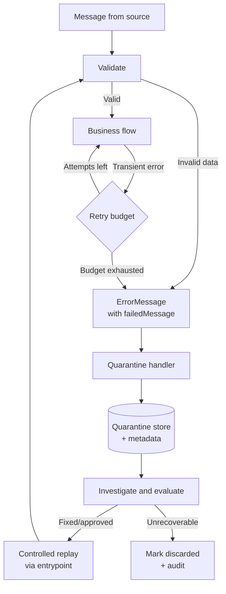
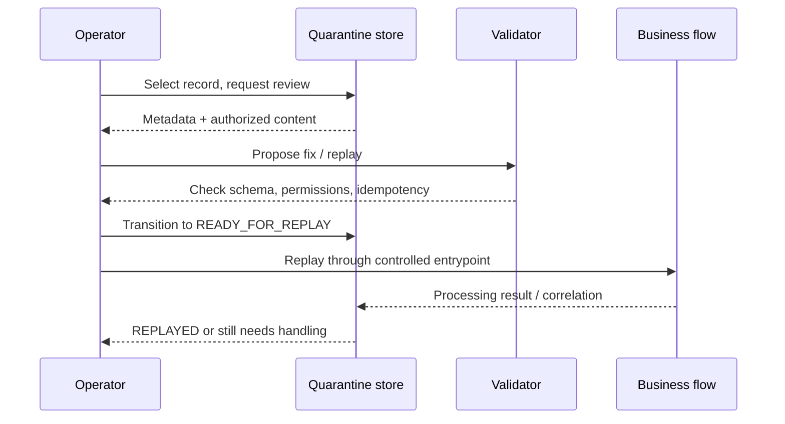

# Quarantining Failed Messages

## 1. Problem: One Failed Message Should Not Jam the Entire Flow

An integration application may receive thousands of messages from partners and process them through **Filter → Transformer → Router → Gateway**. When a message violates business rules—such as a malformed order ID—continuing to retry with the same data usually will not resolve the issue. If it keeps getting re-injected into the main flow, the failed message may loop indefinitely, occupy workers, grow the backlog, and impact valid messages.

**Quarantining failed messages** is a strategy to **isolate messages that cannot yet be processed safely** into a dedicated storage and governance space. A quarantined message can be investigated, corrected per policy, assessed for recovery, and then **replayed** in a controlled manner or discarded with a clear reason. Quarantine does not mean silently deleting messages, nor does it mean retrying automatically forever.

This lesson belongs to the **Error channel** chapter of the **SPRING_INTEGRATION_PATTERN** module. Within implementing Enterprise Integration Patterns using Spring Integration, we will connect isolation capabilities with Router, Filter, Transformer, Splitter, Aggregator, Gateway, retry, error channel, and correlation, while testing and monitoring branches.

After this lesson, you will be able to:

1. Distinguish **retry**, **error channel**, **dead-letter queue (DLQ)**, and **quarantine**.
2. Differentiate transient errors from hard-to-self-recover errors to decide when to quarantine.
3. Store the original message, failure reason, correlation ID, and processing status without exposing unnecessary data.
4. Build a quarantine flow with Spring Integration Java DSL and `ErrorMessage`.
5. Test that failed messages are isolated, valid messages continue moving forward, and no infinite automatic replay occurs.
6. Design inspection, repair, replay, monitoring, and audit workflows for real-world environments.

## 2. How Do Quarantine, Retry, and DLQ Differ?

| Mechanism | Primary Role | Suitable Scenarios | Limitations to Remember |
| --- | --- | --- | --- |
| **Retry** | Re-attempts a failed operation, typically with bounded count and backoff | Network timeout, temporarily overloaded API | Cannot fix malformed payloads; unbounded retries cause congestion |
| **Error channel** | Path forwarding error details to an error-handling flow | Errors from pollers/async flows or explicitly published errors | By itself does not guarantee durable storage and does not catch every synchronous exception by default |
| **DLQ** | Destination for failed messages after processing/redelivery policy | Brokers supporting dead-lettering or a dedicated error queue | May lack investigation workflows, access control, data repair, and replay history |
| **Quarantine** | Process for isolating, storing, evaluating, and deciding on unprocessable messages | Persistent validation errors, suspect messages, exhausted retry budget | Must design storage, security, approval permissions, replay handling, and data cleanup |

A DLQ **can serve as the storage infrastructure for quarantine**, yet it needs additional metadata and operational workflows to become a complete quarantine system.

Do not equate quarantine with the default `errorChannel`. Spring Integration has mechanisms to handle and send `ErrorMessage`, but merely declaring a channel named `errorChannel` does not create a store, dashboard, review process, or safe replay mechanism.

### Classification Examples

| Error | Priority Action | Explanation |
| --- | --- | --- |
| HTTP 503 from partner | Bounded retry with backoff | Error is likely self-recovering |
| Order ID fails schema | Quarantine | Re-sending the raw payload will not make the schema valid |
| Missing required field | Quarantine or request upstream fix | Deterministic data error |
| Database connection dropped | Retry/circuit breaker; route error per policy if budget exhausted | Must avoid overload and keep message durable |
| Message with unknown schema version | Quarantine, mark reason and version | Must determine transformation before re-running |
| Payment recorded successfully but ack failed | Investigate + idempotency/reconciliation before replay | Blind replay can create duplicate side effects |

**Operational rule:** choose actions based on error type, source durability, safe retryability, and handler idempotency. Do not quarantine every error on the first attempt, and do not retry every error indefinitely.

## 3. Lifecycle of a Quarantined Message

A typical flow can follow this diagram:



The lifecycle of a quarantine record should be explicitly defined. For example:

```text
QUARANTINED
  -> UNDER_REVIEW
  -> READY_FOR_REPLAY
  -> REPLAYING
  -> REPLAYED

QUARANTINED / UNDER_REVIEW
  -> DISCARDED
```

These states are **application-designed conventions**, not an enum automatically generated by Spring Integration. A record in `REPLAYING` must be guarded so two operators cannot replay it simultaneously. A `DISCARDED` record must retain audit details per policy, avoiding accidental deletion of investigation trails.

Clearly separate two points:

- **Error handling:** deciding to stop the message's normal path and store info for diagnosis.
- **Confirmation (ack/commit):** when using a broker or transaction, confirm that a message was handled per policy only after the necessary data **has been safely persisted**. If writing to quarantine fails, never silently treat the message as successfully handled.

## 4. Minimum Information to Store

A quarantine record needs enough information to trace the error, correlate the original message, and control replay.

| Field | Example | Purpose |
| --- | --- | --- |
| `quarantineId` | New UUID | Identifies the quarantine record |
| `originalMessageId` | Original Message ID | Correlates the initial message |
| `source` | `orders-inbound` | Identifies the message-producing source |
| `correlationId` | `batch-20261121-01` | Links to a batch, Splitter/Aggregator, or request |
| `reasonCode` | `INVALID_ORDER_ID` | Categorizes causes for statistical tracking |
| `errorSummary` | Sanitized description | Aids investigation without leaking secrets/stack traces |
| `originalPayloadRef` | Reference key to protected storage | Recovers content when authorized |
| `attemptCount` | 1 | Controls retry/replay counts |
| `quarantinedAt` | UTC timestamp | Tracks message age |
| `status` | `QUARANTINED` | Manages workflow state |
| `reviewer` / `decision` | Reviewer and decision | Audit and accountability |

For payloads containing personal data, tokens, or secrets, **do not log the entire payload**. Store it in encrypted, role-restricted storage with a retention limit, and log only references or permitted identifying fields in metadata. If replay is needed, still ensure valid original content can be retrieved.

In Spring Messaging, `ErrorMessage` carries a `Throwable`; when wrapped in `MessagingException`, you can retrieve the original message via `getFailedMessage()`. However, **not every error path retains the original message**: failures at the source, before message creation, or improper exception handling may lack `failedMessage`. Quarantine design must not assume every error message contains enough data to replay.

## 5. How Does Error Channel Relate to Quarantine?

In Spring Integration, errors can arise in several contexts:

- Along a synchronous `DirectChannel` chain, handler exceptions usually propagate back to the caller. An `ErrorMessage` **does not appear by default** on the global error channel.
- On a polling endpoint, you can configure `errorChannel` on the poller to process exceptions from poll tasks via an error handler mechanism.
- With an executor or certain asynchronous endpoints, errors can be turned into `ErrorMessage` instances on an error channel depending on configuration and message context.
- A business handler can also **explicitly emit an `ErrorMessage`** when it decides an error cannot be retried and requires isolation.

Know **who emits the error, to which channel, whether `failedMessage` exists, and who consumes the error**. Avoid assuming every application exception automatically routes to the same channel.

The example below uses **intentional error publishing** for classified data errors. Its advantage is that the original message is still in the handler's hands when publishing the error, so quarantine metadata can be constructed and tested deterministically.

## 6. Spring Integration Example: Quarantining Malformed Orders

We design an application receiving `OrderCommand` with `orderId`. Under this example's contract, a valid ID is `ORD-` followed by at least three digits. Malformed messages go to an error-handling channel; valid messages continue to `successfulOrders`.

The example assumes Spring Boot 3.x, Java 17+, and the Spring Integration version managed by Spring Boot:

```gradle
dependencies {
    implementation("org.springframework.boot:spring-boot-starter-integration")
    testImplementation("org.springframework.boot:spring-boot-starter-test")
}
```

### 6.1. Message Model and Quarantine Record

Create `OrderCommand.java`:

```java
package example.quarantine;

public record OrderCommand(String orderId) {
}
```

Create `QuarantineRecord.java`. The example stores only the order ID belonging to the test data contract; real applications must define which fields are permitted to be stored:

```java
package example.quarantine;

import java.time.Instant;
import java.util.UUID;

public record QuarantineRecord(
        UUID quarantineId,
        UUID originalMessageId,
        String correlationId,
        String orderId,
        String reasonCode,
        Instant quarantinedAt) {
}
```

Create `InMemoryQuarantineStore.java`:

```java
package example.quarantine;

import java.util.List;
import java.util.concurrent.ConcurrentLinkedQueue;

public class InMemoryQuarantineStore {

    private final ConcurrentLinkedQueue<QuarantineRecord> records =
            new ConcurrentLinkedQueue<>();

    public void save(QuarantineRecord record) {
        records.add(record);
    }

    public List<QuarantineRecord> all() {
        return List.copyOf(records);
    }
}
```

`InMemoryQuarantineStore` is for practice only. Data is lost if the JVM stops; production requires a durable store with proper transactions/acks, retention policies, and access control.

### 6.2. Defining Two Channels and Two Flows

Create `QuarantineFlowConfiguration.java`:

```java
package example.quarantine;

import java.time.Instant;
import java.util.UUID;

import org.springframework.beans.factory.annotation.Qualifier;
import org.springframework.context.annotation.Bean;
import org.springframework.context.annotation.Configuration;
import org.springframework.integration.channel.DirectChannel;
import org.springframework.integration.channel.QueueChannel;
import org.springframework.integration.config.EnableIntegration;
import org.springframework.integration.dsl.IntegrationFlow;
import org.springframework.messaging.Message;
import org.springframework.messaging.MessageChannel;
import org.springframework.messaging.MessagingException;
import org.springframework.messaging.MessageDeliveryException;
import org.springframework.messaging.MessageHandlingException;
import org.springframework.messaging.support.ErrorMessage;

@Configuration
@EnableIntegration
public class QuarantineFlowConfiguration {

    @Bean
    public MessageChannel ordersInput() {
        return new DirectChannel();
    }

    // Channel dedicated to errors classified as needing quarantine.
    @Bean
    public MessageChannel quarantineErrors() {
        return new DirectChannel();
    }

    @Bean
    public QueueChannel successfulOrders() {
        return new QueueChannel();
    }

    @Bean
    public InMemoryQuarantineStore quarantineStore() {
        return new InMemoryQuarantineStore();
    }

    @Bean
    public IntegrationFlow ordersFlow(
            @Qualifier("quarantineErrors") MessageChannel quarantineErrors,
            @Qualifier("successfulOrders") MessageChannel successfulOrders) {

        return IntegrationFlow.from("ordersInput")
                .handle(message -> {
                    if (!(message.getPayload() instanceof OrderCommand order)) {
                        throw new MessageHandlingException(
                                message, "Expected OrderCommand payload");
                    }

                    String id = order.orderId();
                    if (id == null || !id.matches("ORD-[0-9]{3,}")) {
                        MessageHandlingException failure =
                                new MessageHandlingException(
                                        message,
                                        "INVALID_ORDER_ID",
                                        new IllegalArgumentException(
                                                "Order ID format is invalid"));

                        // Preserve the original message inside ErrorMessage.
                        ErrorMessage error = new ErrorMessage(failure, message);

                        // DirectChannel: quarantine handler runs synchronously.
                        if (!quarantineErrors.send(error)) {
                            throw new MessageDeliveryException(
                                    message, "Quarantine channel rejected error");
                        }
                        // Stored/quarantined successfully, so stop the normal branch.
                        return;
                    }

                    if (!successfulOrders.send(message)) {
                        throw new MessageDeliveryException(
                                message, "Success channel rejected message");
                    }
                })
                .get();
    }

    @Bean
    public IntegrationFlow quarantineFlow(
            InMemoryQuarantineStore quarantineStore) {
        return IntegrationFlow.from("quarantineErrors")
                .handle(message -> {
                    if (!(message instanceof ErrorMessage error)) {
                        throw new IllegalArgumentException(
                                "Expected ErrorMessage");
                    }
                    if (!(error.getPayload() instanceof MessagingException ex)) {
                        throw new IllegalArgumentException(
                                "Expected MessagingException");
                    }

                    Message<?> failed = ex.getFailedMessage();
                    if (failed == null) {
                        failed = error.getOriginalMessage();
                    }
                    if (failed == null
                            || !(failed.getPayload() instanceof OrderCommand order)) {
                        // Cannot determine the original message: alert/escalate.
                        throw new IllegalStateException(
                                "Original OrderCommand is unavailable");
                    }

                    Object rawCorrelation =
                            failed.getHeaders().get("correlationId");
                    String correlationId = rawCorrelation == null
                            ? ""
                            : rawCorrelation.toString();

                    quarantineStore.save(new QuarantineRecord(
                            UUID.randomUUID(),
                            failed.getHeaders().getId(),
                            correlationId,
                            order.orderId(),
                            "INVALID_ORDER_ID",
                            Instant.now()));
                })
                .get();
    }
}
```

The main `ordersFlow` emits an `ErrorMessage` only when **the order ID format is invalid**. `quarantineFlow` reads `failedMessage`, correlation identifier, and classified reason, then saves the quarantine record. Valid messages are sent to `successfulOrders`.

Two important notes:

1. This is an example of **intentional error handling at a business boundary**. `quarantineErrors` is a dedicated channel; do not infer that Spring Integration automatically routes all synchronous exceptions here.
2. Returning after sending the error represents **a terminal outcome handled by policy**. For sources with ack/transactions, confirm completion only after quarantine persistence succeeds at the required durability level. Because the demo uses memory, it is unsuitable as a production message-preservation mechanism.

If `quarantineFlow` throws an exception while saving, `DirectChannel` can propagate the error back to `ordersFlow` and the sender. This is better than silently dropping the message. Depending on the source, have a suitable rollback/redelivery mechanism or fallback store; never swallow the exception and ack the message as if safely persisted.

### 6.3. Flow of Two Messages

Suppose the application sends:

```java
ordersInput.send(MessageBuilder
        .withPayload(new OrderCommand("BAD-7"))
        .setHeader("correlationId", "batch-72")
        .build());

ordersInput.send(MessageBuilder
        .withPayload(new OrderCommand("ORD-1234"))
        .setHeader("correlationId", "batch-72")
        .build());
```

Expected results:

- `BAD-7` produces a quarantine record with `reasonCode=INVALID_ORDER_ID`, `originalMessageId`, and `correlationId=batch-72`; it does not enter `successfulOrders`.
- `ORD-1234` enters `successfulOrders`; no additional quarantine record is created.
- Both messages share the batch's correlation ID, which does **not** mean they must be treated as the same record. `messageId` and `quarantineId` remain distinct.

In real applications, payloads may be complex objects. In that case, do not simply call `String.valueOf(payload)` and log it; establish schemas, versioning, reliable serializers, permitted fields, and data-protection storage.

## 7. Using Automatic Error Channels Instead of Intentional Publishing

Errors do not always originate in a validation branch as in the example. Errors can come from an inbound poller, message handler, gateway, or executor.

For instance, a poller can configure its own error path:

```java
// Illustrative DSL snippet in inbound polling endpoint configuration.
.from(messageSource, spec -> spec
        .id("ordersInbound")
        .poller(Pollers.fixedDelay(Duration.ofSeconds(1))
                .errorChannel("ordersProcessingErrors")))
```

The error flow on `ordersProcessingErrors` can classify the `ErrorMessage`, then decide whether to retry, quarantine, or alert operations. When applying this, verify your Spring Integration version, endpoint type, error handler, and actual `ErrorMessage`-publishing behavior.

**Be especially careful with the original message:** if a failure occurs before the source creates a `Message<?>`, there may be no `failedMessage`. If the failure comes from a handler in an asynchronous flow, retaining `failedMessage` and headers depends on where the error was emitted. The quarantine handler must have a **branch for when the original message cannot be recovered**: alert, store minimal safe error details, and do not pretend replay is possible.

On a synchronous `DirectChannel` path, if a handler throws an exception and the caller does not catch it, the error typically propagates back to the caller rather than automatically going through the global `errorChannel`. Decide explicitly where errors are routed and who is responsible for completing the transaction or returning an error to the caller.

## 8. Testing the Valid Path and Quarantine Path

The example below uses JUnit Jupiter and AssertJ with a single test to avoid interference from `InMemoryQuarantineStore` state shared across tests in the same Spring context.

Create `QuarantineFlowTest.java`:

```java
package example.quarantine;

import static org.assertj.core.api.Assertions.assertThat;

import org.junit.jupiter.api.Test;
import org.springframework.beans.factory.annotation.Autowired;
import org.springframework.beans.factory.annotation.Qualifier;
import org.springframework.integration.channel.QueueChannel;
import org.springframework.messaging.Message;
import org.springframework.messaging.MessageChannel;
import org.springframework.messaging.support.MessageBuilder;
import org.springframework.test.context.junit.jupiter.SpringJUnitConfig;

@SpringJUnitConfig(QuarantineFlowConfiguration.class)
class QuarantineFlowTest {

    @Autowired
    @Qualifier("ordersInput")
    MessageChannel ordersInput;

    @Autowired
    @Qualifier("successfulOrders")
    QueueChannel successfulOrders;

    @Autowired
    InMemoryQuarantineStore quarantineStore;

    @Test
    void invalidOrderIsQuarantinedAndValidOrderContinues() {
        Message<OrderCommand> invalid = MessageBuilder
                .withPayload(new OrderCommand("BAD-7"))
                .setHeader("correlationId", "batch-72")
                .build();

        assertThat(ordersInput.send(invalid)).isTrue();
        assertThat(successfulOrders.receive(0)).isNull();

        assertThat(quarantineStore.all()).hasSize(1);
        QuarantineRecord record = quarantineStore.all().get(0);

        assertThat(record.originalMessageId())
                .isEqualTo(invalid.getHeaders().getId());
        assertThat(record.orderId()).isEqualTo("BAD-7");
        assertThat(record.reasonCode()).isEqualTo("INVALID_ORDER_ID");
        assertThat(record.correlationId()).isEqualTo("batch-72");

        Message<OrderCommand> valid = MessageBuilder
                .withPayload(new OrderCommand("ORD-1234"))
                .build();

        assertThat(ordersInput.send(valid)).isTrue();
        Message<?> processed = successfulOrders.receive(0);

        assertThat(processed).isNotNull();
        assertThat(processed.getPayload()).isEqualTo(valid.getPayload());
        assertThat(quarantineStore.all()).hasSize(1);
    }
}
```

The test verifies three essential behaviors: **bad messages are isolated**, **good messages continue**, and **good messages are not marked quarantined**. Because the `DirectChannel` beans in the example execute synchronously, the record is stored before `send()` returns. With asynchronous channels, tests must wait with a timeout and explicitly check indeterminate states.

To raise production reliability, add tests for:

1. **Quarantine persistence fails:** the failure must propagate to the source or fallback; no accidental ack and no lost message trace.
2. **Original message missing:** the handler must not fabricate an original message and allow invalid replay.
3. **Duplicate delivery of the same message:** deduplication/idempotency policies must be verified by business key.
4. **Retry budget exhausted:** transition to quarantine only when error type and attempt count satisfy policy.
5. **Replay fails:** the record returns to an appropriate state with attempt history, preventing infinite loops.
6. **Access control:** users authorized only to read records must not automatically gain permission to view sensitive payloads, edit, or replay.

## 9. Designing Quarantine Storage for Production

The in-memory example demonstrates the message model, yet does not protect data across process failures or power loss. When taking this to production, answer the following questions:

| Topic | Decisions Needed |
| --- | --- |
| **Durability** | Which database/broker/object storage is used, and does commit happen before acking the source? |
| **Atomicity** | If business messages and quarantine records live in separate systems, how do you avoid a gap between writing and acking? |
| **Capacity** | Storage size, retention, partitioning, record limits, and growth alerts |
| **Schema** | Payload version, failure reason, metadata, and schema upgrade path |
| **Security** | Encryption, payload read permissions, access audits, masking/redaction |
| **Concurrency** | Preventing two workers or two operators from replaying the same record |
| **Replay** | Which entrypoint receives the message, how idempotency keys are preserved, attempt limits |
| **Deletion** | How long before deletion? Are there legal holds or audit retention rules? |

One implementation pattern is using a durable quarantine store alongside transactions/outbox where possible, or a broker with durable DLQs and a dedicated management service. Which mechanism fits depends on the data source, ack/commit ordering, transactional capability, and recovery requirements.

**Quarantine alone does not guarantee exactly-once processing.** If a message was partially processed before failing, replay can repeat side effects. Use idempotency keys, business state checks, and reconciliation before allowing replay.

### When the Quarantine Store Also Fails

The quarantine store is a critical operational point: never turn "failed to store a failed message" into a silently ignored event.

- If sharing a transaction with the source, prefer rollback/redelivery under the defined policy.
- If the source does not support rollback or ack control was lost, have a durable fallback or critical incident alert.
- When quarantined message volume spikes abnormally, throttle intake, apply backpressure, or pause endpoints via an authorized Control Bus.
- Do not retry infinitely inside the error handler, which clogs error processing and stalls the main flow.

In asynchronous message-processing scenarios, also examine executor saturation, error queue depth, and what happens if the error-handling handler itself throws an exception.

## 10. Controlled Replay: Never Blindly Push Raw Messages Back into the Flow

Replay can trigger business side effects, so it requires a strict workflow.



A safe workflow can include:

1. **Selection:** query records by reason code, time range, source, and correlation ID.
2. **Investigation:** view authorized details; determine why the message failed and whether downstream side effects already occurred.
3. **Approval:** if data edits are required, keep the original immutable and record the edited/new version along with the approver.
4. **Pre-replay checks:** validate schema, confirm attempt limits are not exceeded, verify idempotency key and business state.
5. **Atomic claim:** mark the record `REPLAYING` via compare-and-set/versioning to stop two operators from replaying concurrently.
6. **Replay:** submit the message through the **official business entrypoint**, so Filter/Transformer/Router and validation re-run per policy.
7. **Outcome confirmation:** mark `REPLAYED` only upon contract-compliant completion; on timeout, mark `UNKNOWN` and inspect before retrying.
8. **Audit:** record operator, timestamp, data modifications, new and original message IDs, outcome, and rationale.

Never invoke a handler directly at the end of a flow just to bypass validation. Nor should you replay every quarantined record the moment an infrastructure outage recovers; classify messages, assess backlog, and rate-limit first.

### IDs and Correlation During Replay

Spring Messaging has `MessageHeaders.ID`, generated by the framework when building a new message. On replay, there is usually a **new message ID**, so retain headers or metadata fields like `originalMessageId`, `quarantineId`, and `replayAttempt` to trace history.

A replayed message may carry an old batch's correlation ID; with an open or expired Aggregator, reusing that correlation ID can accidentally mix fragments across runs. Decide whether to keep the correlation ID, open a new correlation, or rebuild the batch according to each flow's rules. Do not pick one universal strategy for every Aggregator.

## 11. Impact on Other EIP Patterns

| EIP Pattern | Relationship to Quarantine | What to Check |
| --- | --- | --- |
| **Filter** | Can detect rule-violating payloads | Have an explicit discard flow; avoid silent deletion |
| **Transformer** | Schema conversion may fail | Are original input and schema version retained for repair? |
| **Router** | Routes deterministic failures to isolation branch | Do not route invalid data back into a retry loop |
| **Splitter** | One batch may have one isolated part | Preserve sequence/correlation and assess impact on remaining parts |
| **Aggregator** | Group missing a quarantined part may wait forever | Timeout, release/expiration, MessageStore, and part-compensation plan |
| **Gateway** | Caller may wait for reply when message is quarantined | Define business reply and timeout; quarantine does not emit replies automatically |
| **Retry** | Retries transient errors before quarantine | Attempt count, backoff, error classification, and idempotency |
| **Error channel** | Delivers `ErrorMessage` to error-handling flow | Preserve `failedMessage`; avoid recursive handler errors |
| **Correlation** | Links failed message to original batch or request | Persist keys and consider semantics on replay |

For example, a Splitter emits 10 parts and part 7 is quarantined due to an invalid payload. An Aggregator waiting for all 10 parts may not release normally. You need a policy for missing parts: wait for repair and replay, release a partial result with a warning, expire the group, or move the entire batch to an error state. Isolating one fragment while ignoring Aggregator state leaves behind hard-to-detect incidents.

## 12. Observability, Alerting, and Governance

Useful metrics include:

- **Quarantine rate** by source, `reasonCode`, and schema version.
- **Record age** awaiting review or replay.
- **Replay success rate**, replay count, and repeat failures after replay.
- **Quarantine store error rate**, write latency, and failures when sending to the error flow.
- **Retry budget** consumed prior to isolation and count of messages in backoff.
- **Backlog** of main flows, error channels, DLQs, and incomplete Aggregator groups.
- **Governance actions**: payload views, edits, replays, discards, permission changes.

An audit record can follow this structure:

```json
{
  "event": "MESSAGE_QUARANTINED",
  "quarantineId": "f2a4f5c8-21d1-4e9f-9704-2a876fc2d551",
  "originalMessageId": "9d661753-bb3d-4ce4-bf0f-77b003e04f61",
  "source": "orders-inbound",
  "correlationId": "batch-72",
  "reasonCode": "INVALID_ORDER_ID",
  "status": "QUARANTINED",
  "recordedAt": "2026-11-21T08:00:00Z"
}
```

This is an **application-built audit schema**. Spring Integration does not automatically manage all these fields. Never attach raw payloads or exception stack traces containing sensitive data directly to logs or metric tags.

When a sudden quarantine spike occurs, you can pause inbound sources via a Control Bus or adjust rate limits per policy. Quarantine does not automatically shut down sources or repair upstream data.

## 13. Common Pitfalls

| Symptom | Likely Cause | How to Fix |
| --- | --- | --- |
| Bad messages keep getting processed | Error branch does not terminate normal flow | Once quarantined successfully, do not forward to success branch |
| Failed messages vanish after restart | In-memory quarantine or ack before durable write | Use durable storage and check transaction/ack order |
| Cannot retrieve original payload | `MessagingException.getFailedMessage()` is `null` | Attach context at error emission, keep reference, or warn that replay is impossible |
| Error inside error flow causes loop | Error handler keeps sending failures back into itself | Design independent fallback/escalation; avoid recursive publishing |
| DLQ fills with unhandled messages | Missing operational workflow | Build states, approval permissions, SLA, and replay tooling |
| Replay produces duplicate side effects | No idempotency or no business state check | Use stable keys, reconciliation, and audits |
| Aggregator waits indefinitely | One fragment quarantined while group has no timeout | Configure expiration/release strategy |
| Every error goes to quarantine | No distinction between transient and permanent errors | Use bounded retry, circuit breaker, and classification policy |
| Payload leaked in logs | Unchecked logging of raw messages or exceptions | Masking, access control, restrict metadata fields |
| Quarantine store overloaded | No capacity limits/backpressure | Capacity alerts, partitioning, and source-pausing plan |

## 14. Hands-On Exercises

**Exercise 1 — Error Classification.** Given errors: HTTP 503, invalid order ID, unknown schema version, DB timeout, and payment committed but ack failed. Determine which should retry, which need immediate quarantine, and which require reconciliation before replay.

**Exercise 2 — Building the Error Flow.** Run the Java DSL example, send `BAD-7` and `ORD-1234`, and inspect `QuarantineRecord`, `originalMessageId`, `correlationId`, and `successfulOrders`.

**Exercise 3 — Failing Quarantine Persistence.** Replace the in-memory store with a mock store throwing an exception on save. Verify the error propagates back to the caller synchronously and the message is not confirmed as safely quarantined.

**Exercise 4 — Controlled Replay.** Design an API allowing only authorized operators to request replay. Describe `READY_FOR_REPLAY`, `REPLAYING`, `REPLAYED`, locking to prevent concurrent replay, idempotency keys, and timeout outcomes.

**Exercise 5 — Quarantine in Splitter/Aggregator.** A Splitter creates five fragments with the same correlation ID; the fourth fragment is quarantined. Design a timeout policy, re-injecting the fixed fragment, or releasing partial results; document the impact on waiting groups.

**Exercise 6 — Securing Error Data.** For a message containing email and payment details, propose which metadata can appear on a dashboard and which content must stay encrypted. Define who can view, edit, replay, or discard.

## 15. Self-Check Questions

1. Why should a schema-invalid message generally not be retried infinitely?
2. How does a DLQ differ from a complete quarantine workflow?
3. Does `ErrorMessage` always carry `failedMessage` for replay? If not, what should you do?
4. Why do not all exceptions from a synchronous `DirectChannel` automatically reach the global `errorChannel`?
5. If quarantine persistence fails, why must you never swallow the exception and ack the source?
6. When replaying a Splitter fragment, what must be considered regarding correlation ID and Aggregator?
7. Why distinguish original message ID, quarantine ID, and replay message ID?
8. Does permission to view metadata imply permission to read payloads and replay?

**Key takeaway:** quarantine is **a process for isolating and governing failed messages**: preserving enough evidence for diagnosis, protecting original data, making controlled decisions, and replaying safely. Spring Integration provides `ErrorMessage`, error channels, and EIP building blocks to construct the path; durability, access control, idempotency, correlation, and auditing must be designed around real business requirements.
