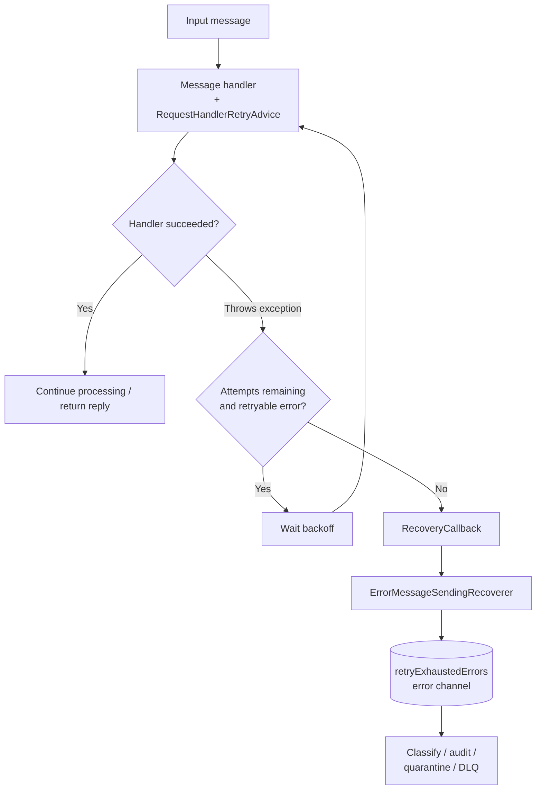
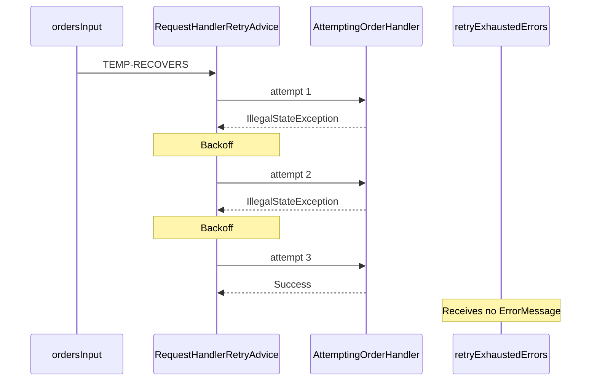
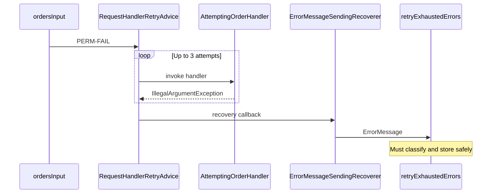

# Retry Advice and Error Channels

## 1. Why Should Retry Be Paired with an Error-Handling Path?

In an order-integration system, a message typically traverses several components: a **Filter** checks data, a **Transformer** normalizes it, a **Router** chooses a branch, a **Gateway** calls a partner, and the result is stored or aggregated. Occasionally the partner returns HTTP 503 or the connection drops briefly. Retrying a few times can allow the message to succeed. Yet if the failure persists, retrying forever ties up workers, raises latency, and blocks other messages.

**Spring Integration** lets you apply `RequestHandlerRetryAdvice` to a message handler. The advice uses **Spring Retry** to re-invoke the handler according to an attempt count and backoff policy. Once retries are exhausted, you can use `ErrorMessageSendingRecoverer` to forward the error as an `ErrorMessage` to a chosen **error channel**, instead of letting the message fall into an endless retry loop.

This lesson, **"Retry Advice and Error Channels,"** belongs to the **Error channel** chapter of the **SPRING_INTEGRATION_PATTERN** module. Within learning Enterprise Integration Patterns with Router, Filter, Transformer, Splitter, Aggregator, Gateway, retry, error channel, and correlation, this lesson focuses on the boundary between **retrying at the handler** and **routing failures to an error-handling branch**.

After this lesson, you will be able to:

1. Distinguish `RequestHandlerRetryAdvice`, `RetryTemplate`, `RecoveryCallback`, and error channels.
2. Configure attempt limits, backoff, and the recovery path after exhaustion.
3. Verify messages succeeding after a few attempts and messages routed to the error channel when still failing.
4. Identify errors that **should not be retried** and how to classify errors before retrying.
5. Understand the impact of retries on messages, transactions, acks, gateways, correlation, and asynchronous systems.
6. Design tests, observability, security, and error-branch operations without equating "sent to error channel" with "business processing succeeded."

## 2. Four Components to Understand

| Component | Responsibility | What It Does Not Do Automatically |
| --- | --- | --- |
| `RequestHandlerRetryAdvice` | Wraps a message handler invocation and performs retries when processing throws an exception | Does not decide business eligibility on its own; does not turn every error into a DLQ |
| `RetryTemplate` | Defines `RetryPolicy`, `BackOffPolicy`, and how attempts execute | Does not configure an error channel on its own |
| `ErrorMessageSendingRecoverer` | When invoked by the recovery callback, publishes error details to a `MessageChannel` | Does not guarantee durable storage at the destination or an active consumer |
| **Error channel** | Receives `ErrorMessage` and feeds it to classification, alerting, quarantine, or DLQ branches | Does not receive all synchronous exceptions by default and does not retry on its own |

Two key milestones:

- **Retries not yet exhausted:** the handler may be re-invoked within the same operation without publishing an `ErrorMessage` to the channel configured for recovery.
- **Retries exhausted:** `RecoveryCallback` triggers. When using `ErrorMessageSendingRecoverer`, the error is published to the target channel; whether the business path continues or terminates depends on the topology and the handler/gateway contract.

Conceptual diagram:



**Important:** when using an error channel inside recovery, understand that the error branch may be treated as a result handled by the recovery callback. A request-reply gateway may **receive no success reply** and may time out unless an explicit error reply is designed. Never promise that merely sending an error to a channel causes the requester to receive an exception immediately.

## 3. Scope of Retry Advice

Retry advice attaches to **one specific handler**, not to every component across the entire `IntegrationFlow`:

```text
ordersInput
    -> validator
    -> paymentHandler [RequestHandlerRetryAdvice]
    -> confirmationHandler
```

If `paymentHandler` fails, the advice retries the `paymentHandler` invocation per policy. It does not automatically re-run upstream `validator` steps that already finished, nor does it necessarily re-run the entire flow from the source.

This brings both benefits and risks:

- **Benefit:** no need to re-process steps that already succeeded or redeliver the same message from a broker just because one partner connection blipped.
- **Risk:** if the handler already caused side effects (such as writing data or charging funds) before throwing an exception, retrying can repeat side effects. Idempotency, transactions, or reconciliation are required depending on business logic.
- **Another risk:** when a handler calls a slow API, attempts and backoff consume execution time. If the flow is synchronous, the original request may time out. If workers are asynchronous, waiting messages may pile up.

Do not treat retry advice as a replacement for a **circuit breaker**, **rate limiter**, **timeout**, **backpressure**, or **dead-letter processing**. These mechanisms solve different problems and usually need to work together.

### 3.1. Stateless vs. Stateful Retry

In basic examples, retry is **stateless**: handler re-invocations occur inside a single message-handling call via `RetryTemplate`. When attempts finish failing and recovery runs, that retry cycle ends.

**Stateful retry** may be needed when a transaction must roll back and re-process the message across multiple deliveries. That requires a stable message/key identifier, managing retry context lifecycle, and understanding the source's transaction/redelivery behavior. Do not turn on stateful retry just to "retry longer"; key mapping, rollback, and recovery must be explicitly designed.

### 3.2. Total Attempts and Backoff

For example, `maxAttempts(3)` typically means **at most three handler calls, including the initial attempt**, not one initial call plus three retries. If all fail, recovery runs after the third attempt.

Example with a fixed 100 ms backoff:

| Relative Time | Operation | Assumed Outcome |
| --- | --- | --- |
| `t0` | Handler attempt 1 | Throws transient error |
| `t0 + 100 ms` | Handler attempt 2 | Throws transient error |
| `t0 + 200 ms` | Handler attempt 3 | Succeeds or keeps failing |
| After final failure | Invoke recovery callback | Publishes `ErrorMessage` to target channel |

This is an illustrative timeline: actual timings also depend on each call's execution duration and scheduler/thread behavior. Production systems should use bounded exponential backoff, appropriate jitter, and an overall retry budget to avoid thundering herds when a partner recovers.

## 4. Java DSL Example: Retry Three Times Then Send ErrorMessage

The example uses Spring Boot and Spring Integration together with Spring Retry. For simplicity, the handler simulates two message types:

- `TEMP-RECOVERS` fails on the first two attempts and succeeds on the third.
- `PERM-FAIL` always fails, and after three attempts is routed to the error channel.

These identifiers are for testing only; production must classify exceptions and decide which ones are retryable.

### 4.1. Dependencies

In a Spring Boot project with managed dependency versions:

```gradle
dependencies {
    implementation("org.springframework.boot:spring-boot-starter-integration")
    implementation("org.springframework.retry:spring-retry")
    testImplementation("org.springframework.boot:spring-boot-starter-test")
}
```

Depending on your setup, Spring Retry might already be pulled in transitively. Align the Spring Retry version with the Spring Boot and Spring Integration versions in use.

### 4.2. Handler Simulating Attempt Counts

Create `AttemptingOrderHandler.java`:

```java
package example.retryerror;

import java.util.concurrent.ConcurrentHashMap;
import java.util.concurrent.ConcurrentMap;
import java.util.concurrent.atomic.AtomicInteger;

import org.springframework.messaging.Message;
import org.springframework.messaging.MessageHandler;

public final class AttemptingOrderHandler implements MessageHandler {

    private final ConcurrentMap<String, AtomicInteger> attempts =
            new ConcurrentHashMap<>();

    @Override
    public void handleMessage(Message<?> message) {
        String orderId = (String) message.getPayload();

        int attempt = attempts
                .computeIfAbsent(orderId, ignored -> new AtomicInteger())
                .incrementAndGet();

        if ("TEMP-RECOVERS".equals(orderId) && attempt < 3) {
            throw new IllegalStateException(
                    "Simulated temporary downstream error");
        }

        if ("PERM-FAIL".equals(orderId)) {
            throw new IllegalArgumentException(
                    "Simulated permanent business error");
        }

        // For TEMP-RECOVERS on attempt 3, the handler finishes normally.
    }

    public int attemptsFor(String orderId) {
        AtomicInteger value = attempts.get(orderId);
        return value == null ? 0 : value.get();
    }
}
```

The handler counts invocations per message key; this is a test observation mechanism, not a production retry counter. Retries in Spring Integration are managed by the advice.

### 4.3. Configuring Channel, Advice, and Recovery

Create `RetryErrorFlowConfiguration.java`:

```java
package example.retryerror;

import org.springframework.beans.factory.annotation.Qualifier;
import org.springframework.context.annotation.Bean;
import org.springframework.context.annotation.Configuration;
import org.springframework.integration.channel.DirectChannel;
import org.springframework.integration.channel.QueueChannel;
import org.springframework.integration.config.EnableIntegration;
import org.springframework.integration.dsl.IntegrationFlow;
import org.springframework.integration.handler.advice.ErrorMessageSendingRecoverer;
import org.springframework.integration.handler.advice.RequestHandlerRetryAdvice;
import org.springframework.messaging.MessageChannel;
import org.springframework.retry.support.RetryTemplate;

@Configuration
@EnableIntegration
public class RetryErrorFlowConfiguration {

    @Bean
    public MessageChannel ordersInput() {
        return new DirectChannel();
    }

    // Holds ErrorMessage after retries are exhausted for testing.
    @Bean
    public QueueChannel retryExhaustedErrors() {
        return new QueueChannel();
    }

    @Bean
    public AttemptingOrderHandler attemptingOrderHandler() {
        return new AttemptingOrderHandler();
    }

    @Bean
    public RequestHandlerRetryAdvice orderRetryAdvice(
            @Qualifier("retryExhaustedErrors")
            QueueChannel retryExhaustedErrors) {

        RetryTemplate retryTemplate = RetryTemplate.builder()
                .maxAttempts(3)
                .fixedBackoff(100)
                .build();

        RequestHandlerRetryAdvice advice =
                new RequestHandlerRetryAdvice();
        advice.setRetryTemplate(retryTemplate);

        // Recovery runs only when retries fail to succeed.
        advice.setRecoveryCallback(
                new ErrorMessageSendingRecoverer(retryExhaustedErrors));

        return advice;
    }

    @Bean
    public IntegrationFlow ordersFlow(
            AttemptingOrderHandler attemptingOrderHandler,
            RequestHandlerRetryAdvice orderRetryAdvice) {

        return IntegrationFlow.from("ordersInput")
                .handle(attemptingOrderHandler,
                        endpoint -> endpoint.advice(orderRetryAdvice))
                .get();
    }
}
```

Here, `retryExhaustedErrors` is declared as a `QueueChannel` so tests can read the `ErrorMessage` directly. It is a **dedicated post-exhaustion error channel**, not the default global `errorChannel`. Spring Integration does not automatically route exceptions from every flow to this channel.

In a real application, you can replace `QueueChannel` with a `DirectChannel` wired to an immediate error flow or a channel/broker with durable storage. When changing channel types, review synchronous/asynchronous semantics and what happens if the error handler fails.

### 4.4. Why Does the Recoverer Need a Target Channel?

The line:

```java
advice.setRecoveryCallback(
        new ErrorMessageSendingRecoverer(retryExhaustedErrors));
```

connects "retries exhausted" to the error destination. If you do **not** configure a recovery callback on the advice, the exception after exhaustion usually propagates back up the call path and is handled according to the calling context (caller, poller error handler, gateway, or adapter). If you **do** configure a recovery callback that sends errors, ensure the destination is actually active and able to handle failed messages.

A recoverer only **publishes** the error. Saving the error to a database, sending the message to a DLQ, classifying permanent/transient errors, alerting, or replaying must be implemented in the corresponding error flow and infrastructure.

## 5. Observing Each Case's Execution Flow

### 5.1. Message Recovers on the Third Attempt



Result: the handler is called three times, yet **no recovery runs**, because the final attempt succeeded. Do not count all three calls as three separate successfully processed orders; use idempotency and metrics distinguishing attempts from business completions.

### 5.2. Message Exhausts Retries



In the example, `PERM-FAIL` is retried all three times **to illustrate the mechanism**. In a real system, validation errors or business rule violations determined to be non-self-recovering should usually go straight to the error/quarantine branch without wasting three futile attempts.

### 5.3. What Can an Error Message Carry?

`ErrorMessage` has a `Throwable` payload. In many messaging contexts, the exception chain may contain a `MessagingException` with `getFailedMessage()`, or the recoverer may carry original message info as configured by the framework.

An error-handling method should never assume `failedMessage` is present every time:

```java
import org.springframework.messaging.Message;
import org.springframework.messaging.MessagingException;
import org.springframework.messaging.support.ErrorMessage;

public void inspectError(ErrorMessage errorMessage) {
    Throwable failure = errorMessage.getPayload();

    Message<?> original = null;
    if (failure instanceof MessagingException messagingException) {
        original = messagingException.getFailedMessage();
    }

    if (original == null) {
        original = errorMessage.getOriginalMessage();
    }

    if (original == null) {
        // Not enough data to replay; raise an alert and store minimal metadata.
        return;
    }

    // Extract permitted metadata only; do not log raw payload.
}
```

Errors can be nested across multiple exception layers; when designing a real error flow, inspect the cause chain, recoverer type, and emission point. Do not assume every source error has an original message—for instance, failures occurring before the source constructs a `Message<?>`.

## 6. Testing: When Does the Error Channel Receive a Message?

Create `RetryErrorFlowTest.java`:

```java
package example.retryerror;

import static org.assertj.core.api.Assertions.assertThat;

import org.junit.jupiter.api.Test;
import org.springframework.beans.factory.annotation.Autowired;
import org.springframework.beans.factory.annotation.Qualifier;
import org.springframework.integration.channel.QueueChannel;
import org.springframework.messaging.Message;
import org.springframework.messaging.MessageChannel;
import org.springframework.messaging.support.ErrorMessage;
import org.springframework.messaging.support.MessageBuilder;
import org.springframework.test.context.junit.jupiter.SpringJUnitConfig;

@SpringJUnitConfig(RetryErrorFlowConfiguration.class)
class RetryErrorFlowTest {

    @Autowired
    @Qualifier("ordersInput")
    MessageChannel ordersInput;

    @Autowired
    @Qualifier("retryExhaustedErrors")
    QueueChannel retryExhaustedErrors;

    @Autowired
    AttemptingOrderHandler handler;

    @Test
    void recoversOnThirdAttemptWithoutSendingErrorMessage() {
        Message<String> order = MessageBuilder
                .withPayload("TEMP-RECOVERS")
                .build();

        assertThat(ordersInput.send(order)).isTrue();
        assertThat(handler.attemptsFor("TEMP-RECOVERS"))
                .isEqualTo(3);
        assertThat(retryExhaustedErrors.receive(0)).isNull();
    }

    @Test
    void sendsErrorMessageAfterRetryIsExhausted() {
        Message<String> order = MessageBuilder
                .withPayload("PERM-FAIL")
                .build();

        assertThat(ordersInput.send(order)).isTrue();
        assertThat(handler.attemptsFor("PERM-FAIL"))
                .isEqualTo(3);

        Message<?> exhausted = retryExhaustedErrors.receive(0);
        assertThat(exhausted).isInstanceOf(ErrorMessage.class);
        assertThat(((ErrorMessage) exhausted).getPayload())
                .isNotNull();

        // One error message is received on the recovery channel in the example.
        assertThat(retryExhaustedErrors.receive(0)).isNull();
    }
}
```

The two tests use different order codes so handler invocation counts can be verified independently. In a complex test suite, ensure no other test shares the Spring context and mutates the queue, handler, or retry config. `QueueChannel.receive(0)` immediately reads an available message; because the `DirectChannel` and recoverer in the example run synchronously, tests do not need to wait for an async message.

This test suite proves one technical path; **it does not prove that failure data was durably persisted, that retrying is safe for payments, or that a gateway received a valid reply**. Those conditions require dedicated tests tailored to your production topology.

Additional scenarios to cover:

1. Handler succeeds on the first try: `attempts = 1`, no error message.
2. Handler succeeds on the second try: `attempts = 2`, no error message.
3. Handler throws a non-retryable error: classify beforehand or configure a retry policy allowing only permitted exceptions.
4. Error channel is broken/unavailable: recovery must not turn failure to persist the error into false success.
5. Handler performs a side effect and then throws: test idempotency and duplicate-execution protection.
6. Gateway is waiting for a reply: verify the caller receives an error/timeout per contract rather than hanging indefinitely.
7. Source has transaction/ack: verify commit, rollback, or redelivery conditions.

## 7. Do Not Retry Every Type of Exception

**Transient** and **permanent** errors require different policies:

| Error Type | Example | Recommended Handling |
| --- | --- | --- |
| Transient | Network timeout, 429 with valid retry-after, 503 | Bounded retry + backoff, consider circuit breaker |
| Invalid data | Missing order ID, invalid schema, unsupported enum | Quarantine or business error reply; generally do not retry |
| Insufficient permissions | 401/403 due to bad credentials or policy | Do not retry blindly; fix permissions or configuration first |
| Resource gone | Order already deleted or business conflict | Decide per business rules; may need reconciliation |
| Programming bug | `NullPointerException` from repeatable bug | Record error, investigate, and handle after code fix |
| Write succeeded but reply lost | Timeout after partner completed side effect | Check status/idempotency before re-attempting |

Classification points:

- **Before the advice:** validate in Filter/Transformer/Router or a dedicated handler to keep data errors off the partner-calling branch.
- **Inside `RetryTemplate`:** use a `RetryPolicy` that distinguishes exception types so only permitted errors are retried.
- **After exhaustion:** the error flow classifies by exception and metadata, routing to DLQ/quarantine/escalation.

Do not rely solely on a simple exception class name while ignoring inner causes. In Spring Integration, errors may be wrapped in `MessagingException` or Spring Retry wrappers; choosing the failure class requires examining the exception chain and side-effect state.

### Backoff and Overall Retry Budget

Retries extend resource hold time. If each API call takes up to 2 seconds, three attempts can already occupy around 6 seconds plus backoff. With hundreds of concurrent messages, a failing partner can stall many threads.

To reduce risk:

- Bound attempts, **per-attempt** timeout, and total retry duration.
- Choose exponential backoff with a max delay, plus jitter when many workers retry concurrently.
- Combine with a circuit breaker so you do not keep hammering a service known to be down.
- Track retry rate, attempt counts, exhausted count, wait time, backlog, and error rate.
- For APIs with tight SLAs, consider returning an "in progress" status and completing via callback/event rather than forcing the requester to wait synchronously through all retries.

## 8. Relationship Between Retry Advice and Global Error Channel

A common question: **"If the advice already has a recovery callback, is the global `errorChannel` still needed?"** The answer depends on design:

- **The dedicated recovery channel** in the example receives errors **only from that specific advice when retries are exhausted**. It enables isolated classification and measurement for a single handler.
- **The global `errorChannel`** typically serves places where the framework publishes `ErrorMessage` via endpoint error-handling mechanisms; it does not automatically collect all exceptions from every synchronous `DirectChannel`.
- **A poller/adapter error channel** can handle exceptions raised during polling or asynchronous ingestion, depending on configuration.
- **The caller/gateway** may directly receive the exception if no recovery callback handles it, or face missing-reply/timeout situations if the recovery callback routed the error away without generating a corresponding reply.

Do not assume a single failed message will appear on **both** the dedicated recovery channel **and** the global `errorChannel`. If you need fan-out for monitoring, build explicit routing or publish-subscribe, handle subscriber failures, and avoid double counting.

### 8.1. If the Error Handler Also Fails

Error-handling channels are not invincible. A quarantine database can run out of disk space, a DLQ broker can become unreachable, or the error flow itself may have a bug.

Therefore:

1. Never swallow an exception from the error-persistence step and ack the source as if the message were preserved.
2. Emit high-severity alerts when the recoverer cannot publish the error message or the destination fails to persist durably.
3. Choose an adapter-appropriate fallback, rollback/redelivery, or temporary intake pause.
4. Avoid letting an error handler send errors **back into its own channel**, creating an infinite loop.
5. Verify that error channels do not leak overly sensitive payloads into logs and enforce access controls.

When using an in-memory error queue, messages can be lost if the application stops. That is purely a learning tool; production must use a durable store or broker if the goal is preserving messages for investigation or replay.

## 9. Impact on Transactions, Acknowledgments, and Replay

A retry advice does not create "exactly-once" semantics on its own. Specifically:

- If the handler wrote data and then failed while sending a reply, re-invoking the handler can create duplicate records.
- If the broker acks the message before the error store commits, a crash can lose the chance to replay.
- If the error store received the message yet the broker still redelivers due to rollback, both a source redelivery and an error record can appear.
- If a message fails after a Splitter already emitted several fragments, retrying at the wrong scope can produce duplicate fragments or an Aggregator group that is hard to resolve.

Design should answer:

1. Which operations does the transaction span? Is the advice inside or outside the transaction boundary?
2. Does each attempt roll back before retrying? Are there non-transactional side effects (HTTP requests, emails, payments)?
3. Once the recovery callback handles the error, will the source ack/commit or roll back?
4. Does quarantine or DLQ retain the **original message** and enough correlation IDs to replay?
5. On replay, which idempotency key is used and is a new correlation needed?

**Note on advice ordering:** When both transaction advice and retry advice sit on the same handler, application order changes which transaction wraps which attempt. Do not prescribe one universal order for every application; design around the source's transaction contract and test in practice.

For flows involving financial or critical side effects, combine stable idempotency keys, partner status checks, outboxes, or reconciliation rather than just increasing attempts.

## 10. Applying Alongside Other EIP Patterns

| EIP Pattern | How Retry and Error Channel Relate | Notes |
| --- | --- | --- |
| **Filter** | Can drop/route invalid data before a retried handler | Do not drop messages unintentionally; define a discard flow or quarantine |
| **Transformer** | Mapping errors can be permanent | Classify before retrying; preserve original payload and schema version |
| **Router** | Routes classified errors to quarantine, DLQ, or alert branch | Avoid routing back to the handler in an infinite loop |
| **Splitter** | One part of a batch may fail after multiple retries | Preserve sequence/correlation and handle each fragment distinctly |
| **Aggregator** | A failed fragment never arriving leaves a group incomplete | Timeout, release strategy, message store, fragment-compensation plan |
| **Gateway** | Handler may retry while caller awaits reply | Total timeout, reply/error channel, and recovery semantics |
| **Retry** | Local retry advice on a single handler | Does not automatically retry the whole flow or broker delivery |
| **Error channel** | Receives `ErrorMessage` after exhaustion or from other error handlers | Verify subscribers, durability, classification, and replay |
| **Correlation** | Links attempts and errors to original message/request | Do not arbitrarily substitute new message IDs for idempotency keys |

For instance, a Splitter breaks an order into five line items. Item 3 hits a handler calling an API, exhausts retries, and moves to quarantine. An Aggregator waiting for all five items may never release. If item 3 is replayed an hour later, determine whether the old group still exists or already expired, and whether to reuse the same correlation ID or start a new aggregation.

## 11. Observing and Auditing the Retry Branch

Useful signals:

| Signal | Meaning |
| --- | --- |
| `handler_attempts_total` | Total times the handler was invoked |
| `retry_success_after_attempts` | Messages that recovered on attempt two or later |
| `retry_exhausted_total` | Messages that exhausted all retry attempts |
| `recovery_publish_failure_total` | Failures delivering the error to the target channel |
| `error_channel_backlog` | Pending error messages waiting to be processed |
| `error_message_age` | Age of unprocessed error messages |
| `downstream_latency` | Partner dependency latency and backoff impact |
| `aggregator_pending_groups` | Number of correlation groups currently waiting |

These are **suggested metric names**, not metrics emitted by Spring Integration by default. When implementing via Micrometer/observability tools, choose low-cardinality labels and avoid putting raw message IDs, payloads, or personal data into tags.

An audit record keyed by correlation ID might look like:

```json
{
  "originalMessageId": "0f2ec4f7-10f3-4a30-83d0-096d5d3ca6b5",
  "correlationId": "order-batch-72",
  "handler": "paymentHandler",
  "attempts": 3,
  "result": "RETRY_EXHAUSTED",
  "errorChannel": "retryExhaustedErrors",
  "failureCategory": "UPSTREAM_UNAVAILABLE",
  "observedAt": "2026-11-21T08:00:00Z"
}
```

These fields must be populated from traces, retry context, headers, and an application-designed audit system. Do not infer attempt counts solely from an `ErrorMessage` if context does not carry enough data. Never log exceptions containing tokens, payment details, or sensitive payloads uncontrolledly.

## 12. Runbook When Retries Spike Suddenly

When the system reports rising `retry_exhausted_total`:

1. **Confirm scope:** which handler, which partner, which instances, and which exception types dominate?
2. **Classify errors:** transient downstream issues or permanent data errors? Did a new error start appearing after a deployment?
3. **Check backoff and attempts:** are retries saturating threads or adding load onto downstream services?
4. **Check the error path:** is `ErrorMessage` being published to the recovery channel? Is the error handler persisting durably?
5. **Check backlogs:** messages at the source, executor, `QueueChannel`, DLQ, Aggregator, and pending retries.
6. **Evaluate mitigations:** rate-limit, trip circuit breaker, temporarily pause inbound polling via an authorized Control Bus, or scale workers appropriately.
7. **Verify idempotency:** before replaying, verify whether messages may already have caused side effects.
8. **Controlled recovery:** rate-limit replays, monitor recurring errors, and close the incident once business states are reconciled.

Do not just raise `maxAttempts` to make an error chart drop; that can shift failures into latency, backlog, and timeouts. If downstream is overloaded, aggressive retries usually make things worse.

## 13. Common Implementation Pitfalls

| Symptom | Possible Cause | How to Address |
| --- | --- | --- |
| Handler never retries | Advice not attached to the right endpoint; exception caught inside handler | Check DSL `.advice(...)` and ensure exception escapes handler |
| Only 2 attempts seen when 3 configured | Misreading `maxAttempts` or exception excluded from `RetryPolicy` | Inspect policy and attempts metric |
| Error message appears even when handler recovers | Error flow triggered before retries finished or from another error source | Verify publishing point and distinguish attempt failures from terminal failures |
| Retries exhausted yet no ErrorMessage | No recovery callback configured, wrong target channel, or publish failed | Inspect recoverer bean, channel, and exceptions |
| Gateway times out after recovery | Recovery routes error to channel without sending reply to gateway | Design explicit error/reply contract and bounded timeout |
| Retry duplicates side effects | Non-idempotent handler, uncoordinated transaction/ack | Add idempotency/reconciliation and test fail-after-commit |
| Error flow backs up | Error store out of capacity or error handler throwing | Monitor, add fallback, and cap backlog |
| Error messages lost after restart | Error `QueueChannel` is in-memory | Use a durable store or broker |
| Aggregator waits forever | Exhausted fragment never reaches group | Add timeout/expiration and compensation/partial-release strategy |
| Transient errors quarantined immediately | Misconfigured `RetryPolicy` or exception classifier | Check root causes and per-error policies |
| Permanent errors still retried multiple times | Configured to retry all exceptions | Classify upfront and configure selective policy |

## 14. Hands-On Exercises

**Exercise 1 — Configuring Retry and Recovery.** Run `RetryErrorFlowConfiguration`, send `TEMP-RECOVERS`, and verify attempt count and an empty error channel. Send `PERM-FAIL` and verify exactly one `ErrorMessage` arrives after three attempts.

**Exercise 2 — Separating Transient and Permanent Errors.** Add exception-classification logic. For validation errors, do not retry; for network timeouts, retry with backoff. Write tests asserting different attempt counts.

**Exercise 3 — Error-Persistence Failure.** Replace the demo error channel with a flow writing to a mock store. Make the store throw an exception and verify the system does not mark the message as durably saved or falsely ack it.

**Exercise 4 — Gateway with Timeout.** Add a request-reply Gateway in front of the handler and send a message that always fails. Design a reply/error contract so the caller gets a deterministic outcome when recovery publishes the error to a dedicated channel.

**Exercise 5 — Duplicate Side Effects.** Simulate a handler persisting a record successfully and then throwing an exception. Observe that retries re-invoke the handler; add an idempotency key so the same order does not produce multiple records.

**Exercise 6 — Splitter/Aggregator.** Split a batch into three parts; make the second part always fail and go to the error channel. Design correlation group state, timeout, and replay that avoids creating duplicate groups.

**Exercise 7 — Operational Monitoring.** Build counters for attempts, exhausted errors, and error channel backlog. During prolonged downstream 503 responses, propose alert thresholds and suitable load-shedding actions.

## 15. Self-Check Questions

1. Does `RequestHandlerRetryAdvice` retry the whole flow or only the handler to which the advice is attached?
2. Does `maxAttempts(3)` mean three additional retries or three total handler invocations?
3. When the handler succeeds on the final attempt, is `ErrorMessageSendingRecoverer` invoked?
4. Why is a dedicated error channel after exhaustion different from the global `errorChannel`?
5. If a recovery callback publishes an error, is the Gateway guaranteed to receive an error reply?
6. Why should permanent errors generally not be retried like transient timeouts?
7. Does an error entering an error channel mean the message was durably persisted?
8. When retries repeat side effects, what else is required beyond attempts and backoff?
9. Why monitor Aggregator correlation groups when one fragment is routed to an error channel?
10. If a synchronous handler throws an exception, does an `ErrorMessage` always appear on the global `errorChannel`?

**Key takeaway:** `RequestHandlerRetryAdvice` retries a **handler** on recoverable failures; `ErrorMessageSendingRecoverer` provides a clean exit path once attempts are exhausted; **error channels** route and govern failures. To operate safely, classify errors, bound retries, observe outcomes, persist data durably where required, and verify transactions, idempotency, and correlation across the entire pipeline.
