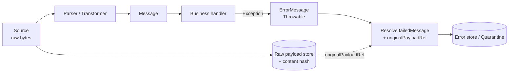
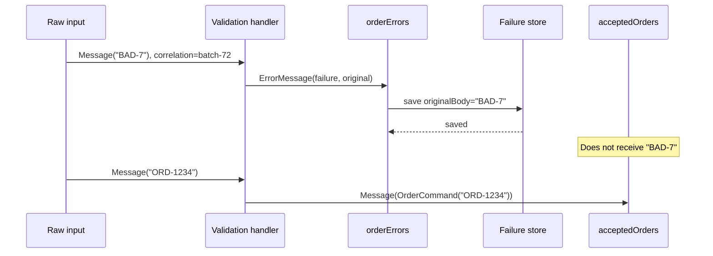
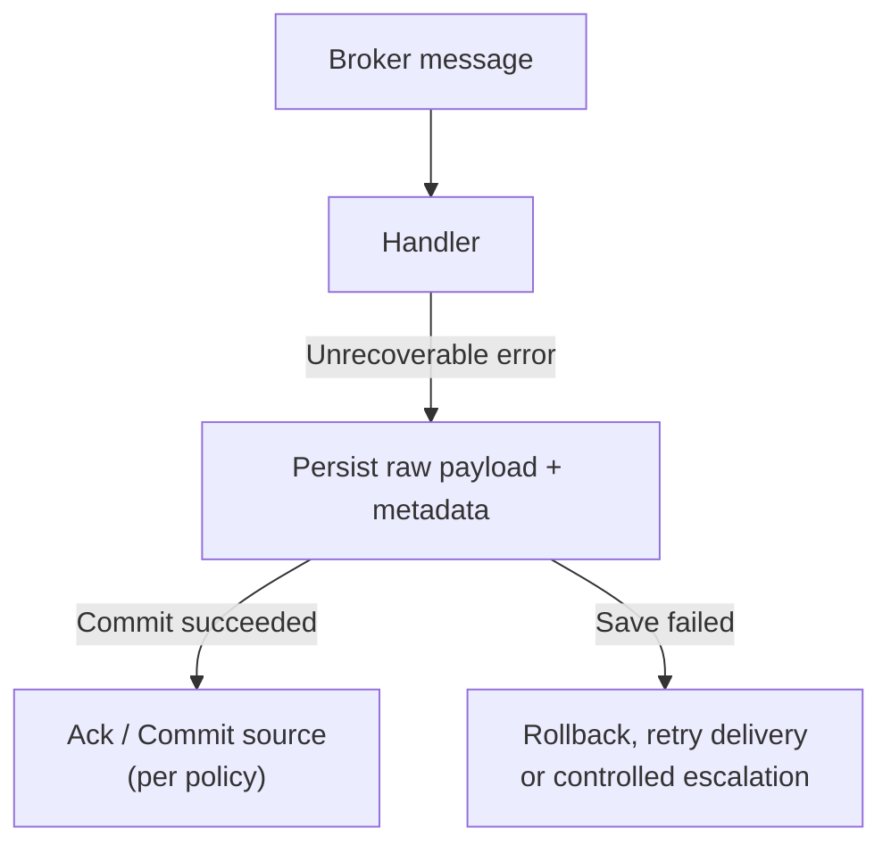

# Preserving the Original Error Payload

## 1. Problem: Having an Error Without Data Left to Investigate

A Spring Integration application ingests orders from HTTP or a broker, parses JSON into objects, normalizes data with a Transformer, branches with a Router, and calls partner services. If a step throws an exception, operators need to know **which message caused the error, what the actual original payload was, and whether it can be safely replayed**.

A common scenario: the original data contains a malformed `orderId` field. A Transformer converts the data into a stripped-down object before a downstream handler reports an error. If only `exception.getMessage()` or `message.getPayload().toString()` is saved at the final handler, we can lose input fields, encoding, correlation context, or the ability to reproduce the initial failure.

**Preserving the original error payload** does not mean dumping all data carelessly into logs. The goals are:

- Retain evidence **accurate enough and safe enough** for investigation, reconciliation, and replay.
- Distinguish the **raw payload at ingress** from the **message payload at the point where the exception occurred**.
- Keep identifiers, necessary headers, and links to the error without leaking secrets.
- Never claim a message was safely stored before it is genuinely committed to durable storage.
- Retry or quarantine in a controlled manner, avoiding duplicate side effects.

This lesson belongs to the **Error channel** chapter of the **SPRING_INTEGRATION_PATTERN** module, focused on implementing Enterprise Integration Patterns with Spring Integration: Router, Filter, Transformer, Splitter, Aggregator, Gateway, retry, error channel, and correlation alongside testing and monitoring branches.

After this lesson, you will be able to identify where payloads are easily lost, use `MessagingException.getFailedMessage()` and `ErrorMessage.getOriginalMessage()` appropriately, proactively preserve data at ingress, and design tests verifying that original content remains retrievable.

## 2. Three Easily Confused Concepts

| Concept | Example | Meaning |
| --- | --- | --- |
| **Raw payload at ingress** | JSON byte array received from broker/HTTP | Evidence of input data **before** parsing, mapping, filtering, or transformation |
| **Failed message** | `Message<Order>` passed into the failing handler | Message directly associated with the exception; may already **differ from the raw payload** |
| **Error message** | `ErrorMessage` with a `Throwable` payload | Message **describing the error**, optionally carrying failed/original message or reference info |

Example of an initial message:

```json
{
  "orderId": "BAD-7",
  "customer": {
    "externalCode": "A-009"
  },
  "schemaVersion": 2
}
```

After a transformation step, the handler might only have:

```java
record OrderCommand(String orderId) {}
```

At that point, `MessagingException.getFailedMessage()` for a handler failure may contain `OrderCommand("BAD-7")`, **without** `customer.externalCode` or `schemaVersion` from the original JSON.

Therefore:

> **Preserving the failed message does not automatically mean preserving the initial raw payload.** To guarantee the original is available, capture or store it **before any step that can drop information**.

### Flow Diagram



Merely sending an exception to a channel does not guarantee the raw data remains retrievable. Keeping a **durable reference** to the original data is usually better than stuffing entire sensitive payloads into every header.

## 3. How Does Spring Integration Propagate Errors?

Spring Messaging has several key types:

- `Message<?>`: carries the payload and headers of a business message.
- `MessagingException`: an exception capable of holding a reference to `failedMessage`.
- `MessageHandlingException`: a `MessagingException` subtype tied to message handling.
- `ErrorMessage`: a `Message<Throwable>`; when constructed with an original message, it is accessible via `getOriginalMessage()`.
- **Error channel**: a channel receiving `ErrorMessage` and forwarding it to an error-handling handler or flow.

Basic lookup:

```java
import org.springframework.messaging.Message;
import org.springframework.messaging.MessagingException;
import org.springframework.messaging.support.ErrorMessage;

public Message<?> findFailedMessage(ErrorMessage error) {
    Throwable problem = error.getPayload();

    if (problem instanceof MessagingException messagingProblem
            && messagingProblem.getFailedMessage() != null) {
        return messagingProblem.getFailedMessage();
    }

    return error.getOriginalMessage();
}
```

This snippet is a **minimal path**, not an algorithm for unwrapping arbitrary nested exceptions. In practice, you may need to walk the `getCause()` chain to find an inner `MessagingException`. When multiple exceptions hold different failed messages, pick the message **from the failure point under investigation**, rather than arbitrarily taking the first one.

A bounded cause traversal:

```java
import org.springframework.messaging.Message;
import org.springframework.messaging.MessagingException;
import org.springframework.messaging.support.ErrorMessage;

public final class FailedMessageResolver {

    private FailedMessageResolver() {
    }

    public static Message<?> resolve(ErrorMessage error) {
        Throwable cursor = error.getPayload();

        while (cursor != null) {
            if (cursor instanceof MessagingException messaging) {
                Message<?> failed = messaging.getFailedMessage();
                if (failed != null) {
                    return failed;
                }
            }
            cursor = cursor.getCause();
        }

        return error.getOriginalMessage();
    }
}
```

**Limitation:** there is no universal rule that every `ErrorMessage` contains a complete failed message or raw payload. Failures can occur **before a Message is even created**, at the source, inside a deserializer, or in an adapter that does not retain the raw body. In such cases, you need a dedicated ingress error path—such as a broker DLQ or a parse-error collector saving raw bytes with metadata.

### 3.1. Synchronous vs. Asynchronous

| Processing Path | Where Errors Typically Surface | Implication for Original Payload |
| --- | --- | --- |
| `DirectChannel` + synchronous handler | Exceptions usually propagate back to the caller | No `ErrorMessage` on global `errorChannel` by default |
| Polling endpoint | The poll task's error handler may publish `ErrorMessage` depending on configuration | May carry failed message; must check where error is emitted |
| `ExecutorChannel` or async consumer | Errors may be handled on another thread via an error flow | The `send()` caller does not necessarily see the error and raw payload may no longer sit at caller |
| Inbound adapter from broker | Depends on adapter, ack, transaction, deserialization | Raw bytes may need to be preserved at the broker or ingestion layer |

Merely creating a channel named `errorChannel` neither guarantees **every** exception reaches it nor turns the channel into durable data storage.

## 4. Points Where the Original Payload Gets Lost

### 4.1. Lossy Transformations

Example:

```text
HTTP JSON:
  {"orderId":"BAD-7","schemaVersion":2,"unknownField":"..."}
    -> JSON parser
    -> Transformer keeping only orderId
    -> Handler throws exception
```

If the error occurs at the handler, the failed message may contain only the transformed object. You cannot reconstruct the original JSON from an object that dropped fields. JSON key ordering, whitespace, encoding, and certain values may also have changed during parsing/serialization.

**How to handle:** store a raw-bytes snapshot or reference to a snapshot at ingress, then propagate `originalPayloadRef`, `originalMessageId`, and correlation metadata through the flow.

### 4.2. Rebuilding Messages While Dropping Headers

A Transformer might build a new message without preserving important headers such as correlation ID, tenant, source, or raw payload reference.

```java
// Only contains the new payload without explicitly attaching required context.
Message<OrderCommand> transformed =
        MessageBuilder.withPayload(new OrderCommand("ORD-101"))
                .build();
```

Creating a new message is not inherently "wrong"; however, if traceability metadata is not retained, the error flow may be unable to link the failed message back to the original input.

### 4.3. Mutable Payloads and In-Place Mutation After Receipt

A `byte[]`, `Map`, or mutable object can be mutated in place:

```java
byte[] incoming = receiveBytes();

// This is the same array; if another caller mutates incoming, snapshot changes too.
byte[] notASnapshot = incoming;

// An independent byte copy is needed when retaining the raw payload in memory.
byte[] snapshot = java.util.Arrays.copyOf(
        incoming, incoming.length);
```

For data requiring durability, the snapshot must also be written to safe storage. An in-memory copy will **not** survive a JVM or node crash.

### 4.4. Logging Payloads with `toString()`

An object's `toString()` is typically a diagnostic representation, not a replayable format. It can omit fields, reorder data, or inadvertently expose personal data and tokens. Never treat logging that string as "persisting the original payload."

### 4.5. Ignoring Errors When Writing to the Quarantine Store

If the error handler swallows persistence exceptions while the source already acked, the original data may be permanently lost. Couple **durable writes** with **ack/commit** according to the adapter/transaction contract. In distributed systems, you may need an outbox, broker DLQ, or another recovery mechanism; never assume exactly-once blindly.

## 5. Strategy: Capture Data at Ingress, Carry a Reference Through the Flow

In production, a viable design includes:

1. Receive raw bytes from the source along with trusted metadata (topic/partition/offset, HTTP request ID, file path, etc.).
2. Compute a checksum to detect unintended tampering/corruption.
3. Save the **raw copy** in encrypted, access-controlled durable storage; confirm success only once persistence meets requirements.
4. Construct the business message carrying `originalPayloadRef`, `originalMessageId`, and `correlationId`.
5. Ensure Transformers and Routers preserve this permitted metadata when creating new messages.
6. The error flow uses `failedMessage` for context, then accesses the original via the reference.
7. The quarantine record stores failure reason, schema version, status, and replay metadata.

### 5.1. Example: Retaining a Reference Before the Transformer

The snippet below illustrates operations at the ingress boundary. `RawPayloadRepository` and `OrderParser` are **application interfaces you implement yourself**, not built-in Spring Integration APIs.

```java
// Illustrates the concept; repository/parser are application components.
byte[] snapshot = java.util.Arrays.copyOf(
        requestBytes, requestBytes.length);

// save(...) must guarantee the required durability before returning rawRef.
String rawRef = rawPayloadRepository.save(snapshot);

OrderCommand order = orderParser.parse(snapshot);

Message<OrderCommand> businessMessage =
        MessageBuilder.withPayload(order)
                .setHeader("originalPayloadRef", rawRef)
                .setHeader("sourceSystem", "orders-http")
                .setHeader("correlationId", correlationId)
                .build();
```

If the parser can throw **before `businessMessage` is created**, the raw save already happened, so the parse-error handler still has `rawRef` to create a quarantine record.

In a real solution, define the transaction/failure boundary between raw storage and the source. For example, an HTTP endpoint can return an error asking the client to retry if raw storage is unavailable; for brokers, decide ack, retry, dead-letter, or rollback per adapter.

### 5.2. Avoid Stuffing Sensitive Raw Payloads into Every Header

Keeping raw JSON or bytes inside an `originalPayload` header is convenient for demos, yet can cause:

- Copying sensitive data across multiple flows and systems.
- Increased message size, impacting brokers and network throughput.
- Serialization/allowlist issues when messages cross process boundaries.
- Header logging exposing payloads.
- Higher memory overhead when many messages or aggregator groups are waiting.

For sensitive data, pass a **reference ID or access-restricted object key**, keeping the raw payload in a dedicated store. Headers may still carry sensitive data such as tenant IDs; enforce proper logging/masking policies.

## 6. Self-Contained Example: ErrorMessage Retaining the Original Message

To illustrate a testable scenario, we use a raw `String` payload inside a `Message<String>`. The handler validates the order ID format. If invalid, it explicitly builds a `MessageHandlingException` attached to **the input message**, then builds an `ErrorMessage` with `originalMessage` and sends it to a dedicated error channel.

This is an **intentional validation error path**, not a claim that Spring Integration automatically catches all synchronous errors and routes them to this channel.

### 6.1. Dependencies

The example is based on Spring Boot 3.x and Java 17+, letting Spring Boot manage the Spring Integration version:

```gradle
dependencies {
    implementation("org.springframework.boot:spring-boot-starter-integration")
    testImplementation("org.springframework.boot:spring-boot-starter-test")
}
```

### 6.2. Success and Failure Data Models

Create `OrderCommand.java`:

```java
package example.originalpayload;

public record OrderCommand(String orderId) {
}
```

Create `OriginalFailureRecord.java`:

```java
package example.originalpayload;

import java.time.Instant;
import java.util.UUID;

public record OriginalFailureRecord(
        UUID quarantineId,
        UUID originalMessageId,
        String originalBody,
        String correlationId,
        String reasonCode,
        Instant recordedAt) {
}
```

Create `InMemoryFailureStore.java`:

```java
package example.originalpayload;

import java.util.List;
import java.util.concurrent.ConcurrentLinkedQueue;

public class InMemoryFailureStore {

    private final ConcurrentLinkedQueue<OriginalFailureRecord> records =
            new ConcurrentLinkedQueue<>();

    public void save(OriginalFailureRecord record) {
        records.add(record);
    }

    public List<OriginalFailureRecord> all() {
        return List.copyOf(records);
    }
}
```

**Important:** storing `originalBody` directly is **for testing only**. Do not use this in-memory store to guarantee zero message loss across restarts. In production, store raw payloads in encrypted durable storage and keep an `originalPayloadRef` in the record.

### 6.3. Configuring Two Flows

Create `OriginalPayloadConfiguration.java`:

```java
package example.originalpayload;

import java.time.Instant;
import java.util.UUID;

import org.springframework.beans.factory.annotation.Qualifier;
import org.springframework.context.annotation.Bean;
import org.springframework.context.annotation.Configuration;
import org.springframework.integration.channel.DirectChannel;
import org.springframework.integration.channel.QueueChannel;
import org.springframework.integration.config.EnableIntegration;
import org.springframework.integration.dsl.IntegrationFlow;
import org.springframework.messaging.Message;
import org.springframework.messaging.MessageChannel;
import org.springframework.messaging.MessageDeliveryException;
import org.springframework.messaging.MessageHandlingException;
import org.springframework.messaging.support.ErrorMessage;
import org.springframework.messaging.support.MessageBuilder;

@Configuration
@EnableIntegration
public class OriginalPayloadConfiguration {

    @Bean
    public MessageChannel rawOrders() {
        return new DirectChannel();
    }

    @Bean
    public MessageChannel orderErrors() {
        return new DirectChannel();
    }

    @Bean
    public QueueChannel acceptedOrders() {
        return new QueueChannel();
    }

    @Bean
    public InMemoryFailureStore failureStore() {
        return new InMemoryFailureStore();
    }

    @Bean
    public IntegrationFlow orderValidationFlow(
            @Qualifier("orderErrors") MessageChannel orderErrors,
            @Qualifier("acceptedOrders") QueueChannel acceptedOrders) {

        return IntegrationFlow.from("rawOrders")
                .handle(message -> {
                    if (!(message.getPayload() instanceof String raw)) {
                        throw new MessageHandlingException(
                                message, "Expected String payload");
                    }

                    if (!raw.matches("ORD-[0-9]{3,}")) {
                        MessageHandlingException failure =
                                new MessageHandlingException(
                                        message, "INVALID_ORDER_ID");

                        // Intentionally preserve the raw message where the error is detected.
                        ErrorMessage error = new ErrorMessage(failure, message);
                        if (!orderErrors.send(error)) {
                            throw new MessageDeliveryException(
                                    message, "Error channel rejected message");
                        }
                        // The validation error path terminates here.
                        return;
                    }

                    Message<OrderCommand> converted = MessageBuilder
                            .withPayload(new OrderCommand(raw))
                            .setHeader(
                                    "originalMessageId",
                                    message.getHeaders().getId().toString())
                            .build();

                    if (!acceptedOrders.send(converted)) {
                        throw new MessageDeliveryException(
                                message, "Accepted channel rejected message");
                    }
                })
                .get();
    }

    @Bean
    public IntegrationFlow orderErrorFlow(
            InMemoryFailureStore failureStore) {

        return IntegrationFlow.from("orderErrors")
                .handle(message -> {
                    if (!(message instanceof ErrorMessage error)) {
                        throw new IllegalArgumentException(
                                "Expected ErrorMessage");
                    }

                    Message<?> original =
                            FailedMessageResolver.resolve(error);

                    if (original == null
                            || !(original.getPayload() instanceof String raw)) {
                        // Do not fabricate a raw payload when none is found.
                        throw new IllegalStateException(
                                "Original String payload unavailable");
                    }

                    Object correlation = original
                            .getHeaders().get("correlationId");

                    failureStore.save(new OriginalFailureRecord(
                            UUID.randomUUID(),
                            original.getHeaders().getId(),
                            raw,
                            correlation == null ? null
                                    : correlation.toString(),
                            "INVALID_ORDER_ID",
                            Instant.now()));
                })
                .get();
    }
}
```

`FailedMessageResolver` is the utility from Section 3; place it in the `example.originalpayload` package or import the matching package.

**Core takeaways from the example:**

- The initial input is `Message<String>` holding the raw value.
- If validation fails, `MessageHandlingException` receives **the input message itself**, not just an error description string.
- `ErrorMessage(failure, message)` carries both the error info and the original message.
- The error flow retrieves the original message, preserving the initial order string, message ID, and correlation.
- Valid messages are converted into `OrderCommand` and sent to `acceptedOrders`; that is a **separate business path** from the error channel.
- Converting valid data into an object illustrates why post-Transformer payloads must be distinguished from initial payloads.

On a synchronous `DirectChannel`, errors thrown by `failureStore.save(...)` or the error flow itself can propagate back to the caller. Do not catch persistence failures and treat the message as safely quarantined. With a broker, design ack/transactions to confirm results only once the error store satisfies requirements.

### 6.4. Concrete Execution Trace



This example retains the raw copy simply because at the validation check, the message still holds the raw String. When a flow has a parser/Transformer upfront, **take a snapshot or store a reference at ingress** as described in Section 5.

## 7. Testing: Never Losing Exact Payload and Correlation

Create `OriginalPayloadTest.java`:

```java
package example.originalpayload;

import static org.assertj.core.api.Assertions.assertThat;

import org.junit.jupiter.api.Test;
import org.springframework.beans.factory.annotation.Autowired;
import org.springframework.beans.factory.annotation.Qualifier;
import org.springframework.integration.channel.QueueChannel;
import org.springframework.messaging.Message;
import org.springframework.messaging.MessageChannel;
import org.springframework.messaging.support.MessageBuilder;
import org.springframework.test.context.junit.jupiter.SpringJUnitConfig;

@SpringJUnitConfig(OriginalPayloadConfiguration.class)
class OriginalPayloadTest {

    @Autowired
    @Qualifier("rawOrders")
    MessageChannel rawOrders;

    @Autowired
    @Qualifier("acceptedOrders")
    QueueChannel acceptedOrders;

    @Autowired
    InMemoryFailureStore failureStore;

    @Test
    void retainsExactOriginalStringAndCorrelationOnValidationFailure() {
        String originalBody = "BAD-7 / unexpected field = x";

        Message<String> invalid = MessageBuilder
                .withPayload(originalBody)
                .setHeader("correlationId", "batch-72")
                .build();

        assertThat(rawOrders.send(invalid)).isTrue();
        assertThat(acceptedOrders.receive(0)).isNull();

        assertThat(failureStore.all()).hasSize(1);
        OriginalFailureRecord record = failureStore.all().get(0);

        assertThat(record.originalMessageId())
                .isEqualTo(invalid.getHeaders().getId());
        assertThat(record.originalBody()).isEqualTo(originalBody);
        assertThat(record.correlationId()).isEqualTo("batch-72");
        assertThat(record.reasonCode()).isEqualTo("INVALID_ORDER_ID");
    }

    @Test
    void validOrderIsConvertedWithoutCreatingFailureRecord() {
        Message<String> valid = MessageBuilder
                .withPayload("ORD-1234")
                .build();

        int before = failureStore.all().size();
        assertThat(rawOrders.send(valid)).isTrue();

        Message<?> converted = acceptedOrders.receive(0);
        assertThat(converted).isNotNull();
        assertThat(converted.getPayload())
                .isEqualTo(new OrderCommand("ORD-1234"));
        assertThat(converted.getHeaders().get("originalMessageId"))
                .isEqualTo(valid.getHeaders().getId().toString());

        assertThat(failureStore.all()).hasSize(before);
    }
}
```

The tests assume an isolated context, no other threads writing to `acceptedOrders`, and controlled initial store counts. When multiple tests share a context, clean the store and queue or isolate contexts to prevent order-dependent tests.

Additional test cases for production systems:

1. Inputs with Unicode, whitespace, escape characters, and varying encodings: the **raw bytes** snapshot must preserve exact initial bytes.
2. Transformer dropping fields: the failed message contains the transformed object, yet `originalPayloadRef` still resolves to raw content.
3. Exception lacking `failedMessage`: the error flow must have a safe fallback or report that replay is unavailable, without fabricating a message.
4. Failure writing to raw/quarantine store: source must not ack as successfully saved.
5. Replay after repair: idempotency prevents duplicate side effects; correlation metadata lets you trace history.
6. Sensitive payloads: logs and dashboards do not accidentally display raw data, even inside stack traces.

## 8. When Errors Happen Before a Message Is Created

A particularly important case is deserializing from bytes to objects:

```text
Broker/HTTP raw bytes
    -> JSON parser throws exception
    -> No valid Message<OrderCommand> exists
```

In this situation, downstream handlers do not yet have a `Message<OrderCommand>`. `MessagingException.getFailedMessage()` may therefore have nothing to return; parse errors at the adapter layer may use a separate error-record mechanism.

Solutions to implement at the **ingestion boundary**:

- Capture raw bytes and source metadata before parsing, when the adapter technology permits.
- If the broker provides a DLQ or raw error-recording mechanism on deserialization errors, explicitly configure retention conditions, TTL, and access control.
- Record the parse failure reason along with necessary charset, content type, and schema version.
- Avoid fabricating a business object from corrupted payloads just to "populate failedMessage," as synthetic data misleads replay or reconciliation.
- Only ack/commit once the error has been handled per source contract and required records are durably stored.

Preserving a syntactically invalid payload also depends on the **encoder/decoder**: parsing and re-serializing an object does not guarantee reproducing identical raw bytes, even when semantically equivalent.

## 9. Retry, ErrorMessageSendingRecoverer, and Original Messages

When using `RequestHandlerRetryAdvice` with `ErrorMessageSendingRecoverer`, errors can be routed to an error channel once retries are exhausted. The recoverer puts error info into an `ErrorMessage`, though accessing the failed/original message must be verified against the exception type and how the handler/advice constructs errors.

Recommended steps:

1. Establish a stable original identifier, such as `originalPayloadRef` or a business idempotency key, right at ingress.
2. Apply bounded retries for transient errors; deterministic validation errors generally should not be retried multiple times.
3. Once exhausted, route errors to an error flow with enough context to identify the message and target entity.
4. The error flow attempts to extract `failedMessage` or `originalMessage`, yet if both are absent, it can still look up the raw copy via the application-held reference.
5. Check business state before replaying to avoid repeating side effects.

Do not treat `ErrorMessageSendingRecoverer` as a payload store: it is an **error-publishing component**, while retention, durability, and replay conditions must be built separately.

### Retries Can Mutate Payload State

If a handler mutates a mutable object directly and then throws an exception, the next attempt may receive the already-mutated object. This can cause bugs that are very hard to reproduce.

- Prefer immutable data objects whenever possible.
- If a handler needs to transform data, create new values instead of mutating shared payloads.
- When retaining mutable raw bytes, copy an unmodifiable snapshot downstream steps cannot alter; persist durably if needed.
- Do not rely on the post-transformation object's `messageId` as the sole evidence of raw input.

## 10. Transactions, Acks, and Payload Persistence

A key principle:

> **Confirming "error handled" must never happen before the required original data has been persisted to the required durability level.**

Example when receiving a broker message:



Note that a **distributed transaction across broker and database** does not exist automatically simply because an application uses Spring Integration. When two systems commit independently, failure windows still exist that lead to redeliveries or duplicate records. Preventing loss/duplication requires appropriate transactions, outbox patterns, deduplication, or proven idempotent mechanisms.

Scenarios to analyze:

| When Failure Occurs | Risk | Handling Direction |
| --- | --- | --- |
| Parsing fails before Message creation | No object retrievable via `failedMessage` | Capture raw data at source/adapter |
| Saving original copy fails | Source might ack erroneously and lose message | Do not mark error handled; rollback/redeliver or fallback |
| Original saved, yet ack fails | Message may be redelivered and written twice | Unique keys and idempotent writes |
| Handler already caused side effect before failing | Replay can repeat business transaction | Reconciliation, idempotency, and auditing |
| App restarts, in-memory store lost | Original missing for replay | Durable storage and retention policies |
| Multiple instances receive same message | Multiple error records for one business event | Correlation/idempotency keys and coordination |

Never claim **exactly-once** without proof. Verify specific guarantees at each boundary: message ingestion, original capture, forwarding, ack, replay, and external side effects.

## 11. Impact on Other EIP Patterns

| EIP Pattern | How Original Payload Can Be Affected | Recommendation |
| --- | --- | --- |
| **Filter** | Message dropped before handler; hard to trace without discard flow | Record drop reason and raw reference when policy requires |
| **Transformer** | Drops fields, converts types, normalizes formats | Snapshot raw before transform; keep `originalPayloadRef` |
| **Router** | Message takes multiple branches; failure on one branch only | Preserve source, route key, and correlation metadata |
| **Splitter** | Message splits into fragments; failing fragment lacks full batch payload | Store batch ID, sequence number, and raw batch reference |
| **Aggregator** | Holds partial collection; may miss fragments or expire group | Preserve correlation ID, group metadata, and message store |
| **Gateway** | Request/reply; exception may propagate to caller or time out | Preserve request ID, reply/error contract, and execution state |
| **Retry** | Handler called multiple times; mutable payload may be altered | Use immutable payloads/snapshots and idempotency |
| **Error channel** | May receive `ErrorMessage` lacking complete failed message | Handle fallbacks cleanly and carry raw reference |
| **Correlation** | Links failed message to source or batch | Keep original keys and consider fresh correlation on replay |

For example, a Splitter divides a batch into five messages. Fragment 3 fails at a Transformer; `getFailedMessage()` may contain only that fragment. If operators need to rebuild the whole batch, the raw store must keep the **original batch**, not only individual fragment payloads. Replaying a fragment must check whether the Aggregator group still exists or has expired; do not mechanically reuse correlation IDs.

## 12. Safe Replay from the Original Payload

Replay is not simply grabbing a raw string from an error log and re-sending it. The workflow should include:

1. **Source verification:** raw payload must match the stored identifier, with checksum or integrity metadata.
2. **Authorization:** someone permitted to view error metadata is not necessarily permitted to read raw payloads, edit data, or replay.
3. **Determine business state:** the message may already have caused side effects before failing; apply reconciliation/idempotency.
4. **Determine schema version:** older data may require a compatible parser or reviewed migration step.
5. **Record decisions:** keep the original record immutable; if edited, save a new version with approver and rationale.
6. **Replay through official entrypoint:** let validation, Transformer, Router, and mandatory steps re-execute.
7. **Track outcomes:** record request ID, replay attempt, timestamp, status, and any post-replay errors.
8. **Prevent loops:** cap replay attempts, classify recurring errors, and quarantine if still unprocessable.

Suggested metadata structure:

```json
{
  "quarantineId": "f86bb67a-9840-48e2-bd0d-e8913a333bc6",
  "originalMessageId": "db2df3fa-a7c3-44dd-90dc-1da2f8a2acbd",
  "originalPayloadRef": "secure-store/orders/2026/11/21/record-8721",
  "source": "orders-inbound",
  "correlationId": "batch-72",
  "reasonCode": "INVALID_ORDER_ID",
  "status": "QUARANTINED",
  "replayAttempt": 0
}
```

This is an **application-designed model**, not a structure built automatically by Spring Integration. Avoid exposing raw storage keys for uncontrolled direct access; enforce access checks when dereferencing.

## 13. Security and Privacy When Retaining Payloads

Retaining the payload does not mean exposing the payload everywhere.

- **Encryption:** use storage encrypted at rest and in transit, managing keys per organizational policy.
- **Access control:** separate roles for viewing metadata, reading raw payloads, editing/replaying, and deleting data.
- **Data minimization:** avoid duplicating large or sensitive payloads across all headers and error logs.
- **Retention:** set storage TTLs, deletion policies, and legal hold handling where applicable.
- **Auditing:** log who accessed raw payloads, who approved replays, and processing outcomes.
- **Masking:** error logs should normally contain only reason code, original message ID, correlation ID, and sanitized diagnostics.
- **Integrity:** store checksums, content types, and schema versions to detect unintended data tampering.

A `Throwable.getMessage()` or stack trace can inadvertently include input data. Error handlers must control log output and monitoring systems; do not put raw JSON or tokens into high-cardinality metric labels.

## 14. Observability and Diagnostics

Signals worth tracking include:

| Metric | Question Answered |
| --- | --- |
| `error_messages_total` by reason code | Which error types are spiking abnormally? |
| `missing_failed_message_total` | How many errors failed to yield a failed message? |
| `missing_original_payload_ref_total` | How many errors could not trace back to a raw payload? |
| `raw_payload_store_failure_total` | Are there failures persisting raw payloads? |
| `quarantine_backlog` | How many messages are awaiting investigation? |
| `quarantine_oldest_age` | How long has the oldest record been waiting? |
| `replay_attempts_total` and `replay_failures_total` | Are replays succeeding or repeating errors? |
| `aggregator_pending_groups` | Are any batches missing fragments due to errors? |

These metric names are **suggestions for application implementation**, not default metrics across every Spring Integration version.

When an error message lacks its original payload, follow this investigation checklist:

1. Did the error happen **before** or **after** a `Message` existed?
2. Does the `Throwable` wrap a `MessagingException`? Is `failedMessage` present?
3. Does `ErrorMessage.getOriginalMessage()` hold any message, and is it ingress data?
4. Did a Transformer/Splitter alter or split the payload prior to the error?
5. Is `originalPayloadRef` present in headers or the storage index?
6. Did raw storage save succeed, is the checksum valid, and are read permissions active?
7. If the original is absent, can it be recovered from the broker, DLQ, or trusted source logs?
8. Should the record be marked **unreplayable** and escalated for manual handling?

Never reconstruct an "approximate" payload from `toString()` and treat it as exact raw data.

## 15. Common Errors and Fixes

| Symptom | Common Cause | Resolution |
| --- | --- | --- |
| `getFailedMessage()` returns `null` | `Throwable` is not a `MessagingException`, error occurred before Message creation, or message was unattached | Use `originalMessage` when available; save raw at ingress |
| Failed message contains only transformed object | Transformer ran before error emission | Capture raw snapshot/ref before transform |
| Original payload mutated during retry | Handler mutates object/`byte[]` in place | Copy or design immutable objects |
| Lost correlation ID | New `Message` constructed without retaining required metadata | Explicitly propagate allowed headers/references |
| Failed messages vanish on JVM restart | In-memory `QueueChannel` or store | Persist durably per source contract |
| Quarantined yet replayed twice | Source redelivered or side effects already committed | Use unique keys, idempotency, and reconciliation |
| Error flow receives nothing | Synchronous error propagated straight to caller; no publisher | Configure ErrorMessage publisher properly or handle at caller |
| Error flow itself throws errors | Raw/quarantine store error, serialization failure | Never swallow errors; fallback/rollback/escalation |
| Header carrying raw payload leaks data | Logs/brokers/traces copy headers | Use references, masking, and access controls |
| Aggregator never releases | Missing failed fragment or expired group | Track correlation groups and expiration policies |
| Replay differs from ingested bytes | Parse then re-serialize altered raw bytes | Save original bytes and encoding metadata |
| Metadata has original ID yet raw missing | Non-durable reference or retention expired | Check save/delete policies, storage, and alerts |

## 16. Hands-On Exercises

**Exercise 1 — Preserving Original String.** Run the example configuration, send `"BAD-7 / unexpected field = x"` with a correlation ID. Verify the error record retains the exact string, original message ID, and correlation ID, and the message never enters `acceptedOrders`.

**Exercise 2 — Lossy Transformer.** Create raw JSON with `schemaVersion` and extra fields. Have a Transformer keep only `orderId`. Make a post-Transformer handler fail and prove `failedMessage` cannot reconstruct the original JSON. Add `originalPayloadRef` at ingress.

**Exercise 3 — Mutable Payload.** Use a `byte[]` or mutable `Map`. Have a handler mutate the payload before failing. Write a test proving a direct reference fails to preserve data while a copied snapshot preserves it.

**Exercise 4 — Ingress Parser Error.** Feed malformed JSON to the parser before object creation. Design how to persist raw bytes, charset/content type, and reason code without requiring `Message<OrderCommand>` to exist.

**Exercise 5 — Error-Store Persistence Failure.** Simulate the store throwing an exception. Determine when the source can be acked, when rollback/redelivery is required, and what logs prevent falsely marking "saved."

**Exercise 6 — Retry and Idempotency.** Have a handler write to a DB successfully and then throw an exception; the message is retried. Show how to use a business key to prevent duplicate writes while preserving the raw payload for investigation.

**Exercise 7 — Splitter/Aggregator.** Split a batch into multiple parts, make one part fail into quarantine. Build a model linking raw batch ID, correlation key, sequence number, and replay attempt, including a policy when the group has already expired.

## 17. Self-Check Questions

1. Why is `MessagingException.getFailedMessage()` not guaranteed to be the rawest initial input?
2. What is the payload of `ErrorMessage`? When is `getOriginalMessage()` used?
3. Why must raw bytes be captured **before** a parser or Transformer if exact reconciliation is needed?
4. How does copying a `byte[]` differ from assigning a second reference variable?
5. Why does logging payloads not replace a durable, access-controlled raw store?
6. When neither failed nor original message is found, should you fabricate a synthetic object for replay?
7. What happens if the broker was acked yet quarantine persistence failed?
8. Does replaying the original payload automatically guarantee zero duplicate side effects?
9. Which metadata must be kept when a Splitter fragment fails while the Aggregator is waiting?
10. Why do not all exceptions from synchronous flows automatically enter the global `errorChannel`?

**Key takeaway:** `ErrorMessage` and `MessagingException.getFailedMessage()` help trace an error back to the associated message, yet **the message at the failure point may already differ from the initial payload**. To preserve data for investigation and recovery, capture the raw payload at ingress via a copy or reference to durable storage, propagate required metadata across transformations, handle error channels in their proper execution context, and replay with authorization, idempotency, and full auditing.
