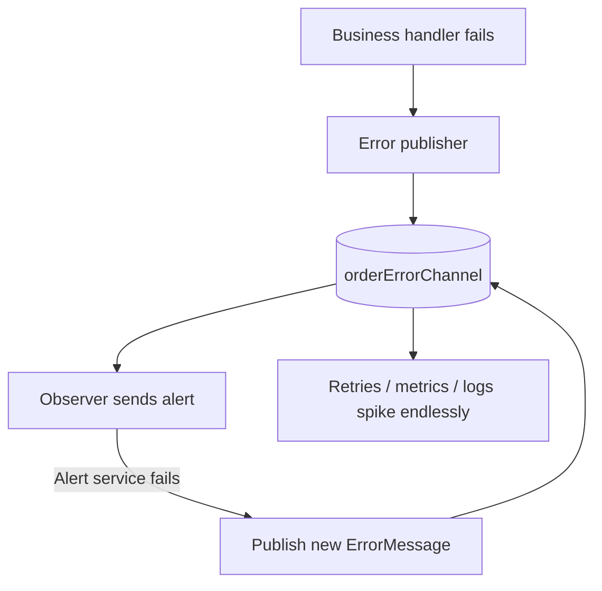
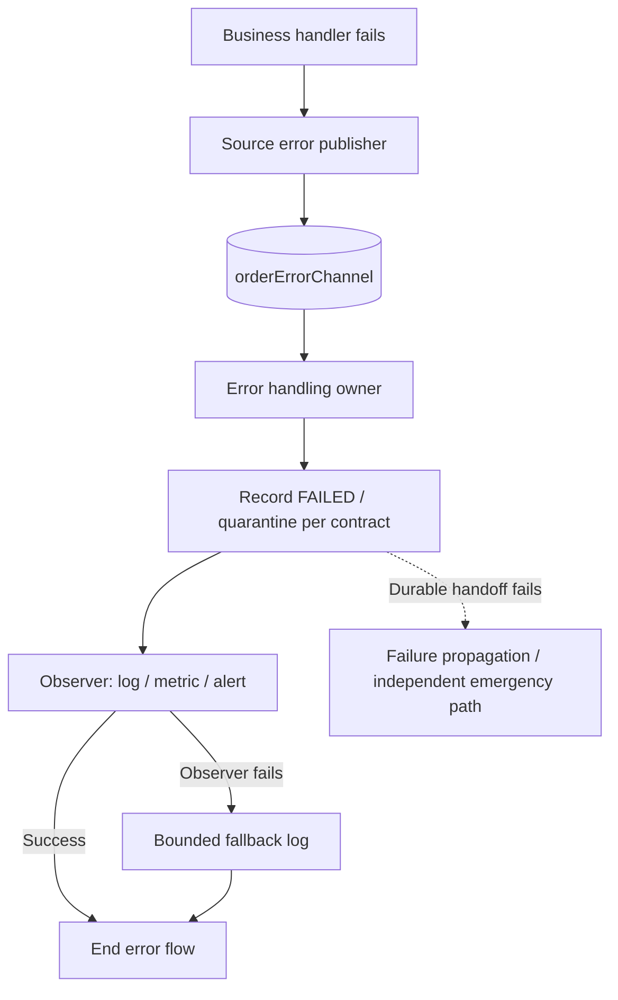

# Observing Errors Without Creating Error Flow Loops in Spring Integration

## 1. Problem: The Error Handler Itself Can Fail

In the `SPRING_INTEGRATION_PATTERN` module, we learn to implement **Enterprise Integration Patterns** with Spring Integration to create loosely coupled, extensible message flows. A message may pass through Router, Filter, Transformer, Splitter, Aggregator, and Gateway; when handling errors, the application also needs retry, Error Channel, correlation, and ways to test and observe each branch.

Suppose an order-processing polling endpoint fails, then creates an `ErrorMessage` and sends it to `orderErrorChannel`. An error flow receives the error message and does three things: records status `FAILED`, increments a metric, and sends an alert. If the metrics backend or alerting service is down, **the error flow itself throws an exception**. If the application wraps that new exception into an `ErrorMessage` and **sends it right back to the same `orderErrorChannel`**, the error can invoke the error flow endlessly.

This phenomenon is an **error flow loop** (recursive error handling / error loop). It can cause:

- Infinite recursion or nested calls leading to `StackOverflowError` on synchronous channels.
- An explosion of `ErrorMessage` instances, logs, retries, alerts, and queue backlogs when asynchronous.
- Monitoring failures obscuring the original business root cause.
- Repeated side effects such as writing dead-letters, sending emails, or updating status multiple times.
- Difficulty determining where the transaction actually failed versus what is merely a secondary error.

**Lesson goal:** Design Error Channels and observers so the system still detects, records, and remediates business failures **without turning the error-handling branch itself into a source of recurring errors**.

After this lesson, you will be able to:

1. Distinguish a **source failure** (*primary/business-processing failure*) from a **secondary failure inside the error flow** (*secondary failure*).
2. Explain why `errorChannel` is not a catch-all for every exception and why rethrowing from an error handler does not automatically return to the original caller.
3. Separate the recovery owner from observers dedicated to recording metrics, logs, or alerts.
4. Write Java DSL with a dedicated error channel, explicit error handling, and an observer that does not republish on failure.
5. Test broken monitors, messages missing context, the success path, and publish counts to catch loops.
6. Design guards via `errorDepth`/error origin, retry limits, deduplication, durable fallbacks, and observability.

## 2. Two Error Layers That Must Not Be Equated

Consider two errors happening in sequence:

| Moment | Event | Question to Resolve |
| --- | --- | --- |
| Layer 1 — business processing | Handler calls backend and times out. | Was the original message completed, rolled back, or needing retry/quarantine? |
| Layer 2 — error handling | Error handler fails to write a metric, log/audit, or alert. | Can error observation be safely skipped in a controlled way, or is this a mandatory handoff failure? |

A Layer 2 error **does not prove the Layer 1 error was resolved**, nor does it automatically call for re-executing business logic. For instance, a metrics counter throwing an exception is not a valid reason to charge a customer or replay an order a second time.

### Dangerous Loop



If `orderErrorChannel` is a `DirectChannel`, re-sending can create a nested call chain on the very same thread. If using an `ExecutorChannel` or queue, the loop can turn into an **asynchronous message storm**. Changing the channel type **does not** fix the design flaw on its own.

### Design with a Stop Condition



The key is that **there is no arrow from an observer failure back to `orderErrorChannel`**. If durable failure persistence is mandatory and fails itself, never silently mark the message as recovered; use a separate, bounded escalation policy that does not endlessly re-emit through the same channel.

## 3. How Does an Error Channel Receive Errors?

In Spring Integration, errors are represented by `ErrorMessage` with a `Throwable` payload. Depending on the emitting source, it may also carry `originalMessage`; a `MessagingException` may have `failedMessage`.

The framework has the conventional `errorChannel`, typically the default destination for components **that actually have an error-publishing mechanism**. Applications can also declare dedicated channels such as `orderErrorChannel`, `paymentErrorChannel`, or `inventoryErrorChannel`.

**Not every exception is automatically published.** With a synchronous `DirectChannel`, exceptions from a handler typically propagate back to the thread calling `send(...)` or the Gateway. With pollers, adapters, or async boundaries, an appropriate error handler/publisher decides whether to construct an `ErrorMessage` and where to send it.

| Error Location | Who Usually Observes the Exception First? | Why Worry About Loops? |
| --- | --- | --- |
| Synchronous handler behind `DirectChannel` | Caller or advice wrapping the handler. | Catching and publishing, then rethrowing to another publisher, can create two errors. |
| Handler executed by a poller | Poller/error handler of the polling endpoint if configured. | Secondary errors from the error subscriber may propagate back to the poller. |
| Handler behind `ExecutorChannel` | Worker/dispatcher/error handler at that boundary. | Does not return to the original sender thread; republishing can amplify asynchronously. |
| Error observer on `errorChannel` | Thread dispatching `ErrorMessage` to subscribers. | Re-emitting the same error into the channel can cause the observer to invoke itself. |

**The global logging subscriber is not recovery.** Having an `ErrorMessage` logged does not prove the job was retried successfully, persisted to quarantine, or rolled back/ACKed at the proper time.

## 4. Architectural Principle: Owner Handles Failures, Observer Only Observes

One way to reduce complexity is to assign **a single owner that decides the final outcome** for each failed message:

| Responsibility | Recovery / Failure-Handling Owner | Observer |
| --- | --- | --- |
| Persist terminal status, quarantine, or compensation | Yes | No |
| Decide retry, backoff, idempotency | Yes | No |
| Classify root cause and preserve correlation | Yes | Reads standardized metadata |
| Emit metrics, tracing, or alerts | May record | Yes |
| When monitoring dependency fails | Must not turn business outcome into false success | Writes controlled fallback; never republishes same error |
| When mandatory failure persistence fails | Fail/escalate per defined contract | Does not take over from owner and loop messages |

Practical guidelines:

1. **Prioritize recovery before non-essential observability.** If persisting a failed message for replay is mandatory, complete durable handoff first before emitting metrics/alerts. In transactional systems, verify that step actually committed.
2. **Observers are secondary side effects.** Never let a temporarily broken metrics client trigger endless business retries.
3. **Never catch all exceptions to silently ignore them.** Isolate only failures in the observation step; failures in durable persistence or status updates must follow contract handling.
4. **One source failure must not be emitted twice by two co-owners.** Avoid manually publishing `ErrorMessage` and then rethrowing to another auto-publisher without deduplication.
5. **Do not use `nullChannel` as a sink for errors.** `nullChannel` discards messages intentionally; it does not preserve errors for investigation or recovery.

### Is "Catch and Do Not Throw" Always Right?

No. It is only justified for **non-essential observer failures**, once the business outcome and failure persistence are already guaranteed per contract. If quarantine persistence fails, never catch and return as if completed. In that case, let the error publisher/caller see that handoff failed, or use a controlled independent fallback.

## 5. Loop-Prone Pattern and How to Fix It

### Bad Pattern: Observer Publishes Errors Back to the Same Channel

```java
// Anti-pattern — illustrative pseudocode, DO NOT put into production.
void onError(ErrorMessage originalError) {
    try {
        alertService.send(originalError);
    } catch (RuntimeException monitoringFailure) {
        // If this same listener is consuming from "orderErrorChannel",
        // publishing back to it can invoke onError infinitely.
        orderErrorChannel.send(new ErrorMessage(monitoringFailure));
    }
}
```

Here, every alert failure generates a new `ErrorMessage`. Secondary exceptions can also lose track of the original message if `eventId` or `correlationId` is not retained.

### Good Pattern for a Non-Essential Observer

```java
void observeWithoutRepublishing(ErrorMessage error) {
    try {
        metrics.recordError(error);
        alertService.notifyIfNeeded(error);
    } catch (RuntimeException observerFailure) {
        // Isolated from the mandatory failure-persistence step.
        fallbackLogger.warn(
            "Error observation failed; do not republish to errorChannel",
            observerFailure);
    }
}
```

This is **illustrative code**; the services must be defined by the application. In production, the fallback logger can also saturate or flood logs; add sampling/rate limiting and an escalation policy. This approach does not imply losing metrics is harmless everywhere: regulatory/audit compliance monitoring may require durable storage or a dedicated outbox.

## 6. Java DSL Example: Failure Journal and Isolated Observer

The example uses **Java 17**, Spring Integration Java DSL, `DirectChannel`, and an **explicit** error publisher to verify the exact error-emitting point. It separates two responsibilities:

- `FailureJournal` acts as the **owner recording failed work**. In the example it is in-memory for testing; production must replace it with durable persistence.
- `ErrorObserver` simulates sending metrics/alerts and can intentionally throw an exception. The error flow catches that failure specifically, logs a fallback **once**, and **does not emit another `ErrorMessage`**.

With Spring Boot, you can use `spring-boot-starter-integration`; tests use JUnit 5, Spring Test, and AssertJ, for example via `spring-boot-starter-test`. The sample intentionally avoids brokers and databases so loops can be demonstrated directly in-process.

```java
import java.util.List;
import java.util.concurrent.ConcurrentLinkedQueue;
import java.util.concurrent.atomic.AtomicBoolean;
import java.util.concurrent.atomic.AtomicInteger;

import org.slf4j.Logger;
import org.slf4j.LoggerFactory;
import org.springframework.beans.factory.annotation.Qualifier;
import org.springframework.context.annotation.Bean;
import org.springframework.context.annotation.Configuration;
import org.springframework.integration.channel.DirectChannel;
import org.springframework.integration.config.EnableIntegration;
import org.springframework.integration.dsl.IntegrationFlow;
import org.springframework.messaging.Message;
import org.springframework.messaging.MessageChannel;
import org.springframework.messaging.MessagingException;
import org.springframework.messaging.support.ErrorMessage;

@Configuration
@EnableIntegration
public class LoopSafeErrorFlowConfig {

    private static final Logger LOG =
        LoggerFactory.getLogger(LoopSafeErrorFlowConfig.class);

    public record WorkItem(String id, boolean fail) {}
    public record FailureRecord(String eventId, String errorType) {}

    public static class BusinessService {
        private final ConcurrentLinkedQueue<String> completed =
            new ConcurrentLinkedQueue<>();

        public void process(WorkItem item) {
            if (item.fail()) {
                throw new IllegalStateException("Order backend unavailable");
            }
            completed.add(item.id());
        }

        public List<String> completedIds() {
            return List.copyOf(completed);
        }

        public void reset() {
            completed.clear();
        }
    }

    // Simulates persisting FAILED status, NOT a durable store.
    public static class FailureJournal {
        private final ConcurrentLinkedQueue<FailureRecord> failures =
            new ConcurrentLinkedQueue<>();

        public void record(FailureRecord record) {
            failures.add(record);
        }

        public List<FailureRecord> snapshot() {
            return List.copyOf(failures);
        }

        public void reset() {
            failures.clear();
        }
    }

    public static class ErrorObserver {
        private final AtomicBoolean broken = new AtomicBoolean();
        private final AtomicInteger calls = new AtomicInteger();
        private final AtomicInteger successes = new AtomicInteger();

        public void setBroken(boolean value) {
            broken.set(value);
        }

        public void observe(FailureRecord record) {
            calls.incrementAndGet();
            if (broken.get()) {
                throw new IllegalStateException("Metrics backend unavailable");
            }
            successes.incrementAndGet();
        }

        public int calls() {
            return calls.get();
        }

        public int successes() {
            return successes.get();
        }

        public void reset() {
            broken.set(false);
            calls.set(0);
            successes.set(0);
        }
    }

    public static class ErrorPublisher {
        private final MessageChannel errors;
        private final AtomicInteger published = new AtomicInteger();

        public ErrorPublisher(MessageChannel errors) {
            this.errors = errors;
        }

        public void publish(RuntimeException failure, Message<?> source) {
            published.incrementAndGet();
            if (!errors.send(new ErrorMessage(failure, source))) {
                throw new IllegalStateException(
                    "Cannot hand off ErrorMessage", failure);
            }
        }

        public int publishedCount() {
            return published.get();
        }

        public void reset() {
            published.set(0);
        }
    }

    @Bean
    public BusinessService businessService() {
        return new BusinessService();
    }

    @Bean
    public FailureJournal failureJournal() {
        return new FailureJournal();
    }

    @Bean
    public ErrorObserver errorObserver() {
        return new ErrorObserver();
    }

    @Bean
    public MessageChannel ordersInput() {
        return new DirectChannel();
    }

    @Bean
    public MessageChannel orderErrorChannel() {
        return new DirectChannel();
    }

    @Bean
    public ErrorPublisher errorPublisher(
            @Qualifier("orderErrorChannel") MessageChannel errors) {
        return new ErrorPublisher(errors);
    }

    @Bean
    public IntegrationFlow businessFlow(
            BusinessService service,
            ErrorPublisher publisher) {

        return IntegrationFlow.from("ordersInput")
            .handle((Message<?> message) -> {
                try {
                    service.process((WorkItem) message.getPayload());
                } catch (RuntimeException originalFailure) {
                    // Single publisher in this example; do not rethrow
                    // once error handoff has succeeded.
                    publisher.publish(originalFailure, message);
                }
            })
            .get();
    }

    @Bean
    public IntegrationFlow orderErrorFlow(
            FailureJournal journal, ErrorObserver observer) {

        return IntegrationFlow.from("orderErrorChannel")
            .handle((Message<?> message) -> {
                if (!(message instanceof ErrorMessage error)) {
                    throw new IllegalArgumentException(
                        "Error flow expects ErrorMessage");
                }

                FailureRecord record = new FailureRecord(
                    findEventId(error),
                    error.getPayload().getClass().getSimpleName());

                // Mandatory step: DO NOT swallow errors if recording FAILED fails.
                journal.record(record);

                // Secondary observation step: if it fails, do not re-emit the same error.
                try {
                    observer.observe(record);
                } catch (RuntimeException monitoringFailure) {
                    LOG.warn(
                        "Error observer failed for event {}; "
                            + "failure already recorded; no republish",
                        record.eventId(), monitoringFailure);
                }
            })
            .get();
    }

    private static String findEventId(ErrorMessage error) {
        String id = header(error.getOriginalMessage(), "eventId");
        if (id != null) {
            return id;
        }

        int depth = 0;
        for (Throwable cause = error.getPayload();
             cause != null && depth++ < 16;
             cause = cause.getCause()) {
            if (cause instanceof MessagingException messaging) {
                id = header(messaging.getFailedMessage(), "eventId");
                if (id != null) {
                    return id;
                }
            }
        }
        return "unknown";
    }

    private static String header(Message<?> message, String name) {
        if (message == null) {
            return null;
        }
        Object value = message.getHeaders().get(name);
        return value == null ? null : value.toString();
    }
}
```

### Tracing a Business Failure

1. The caller sends a message containing `WorkItem("order-501", true)` and header `eventId=evt-501` to `ordersInput`.
2. `BusinessService` throws `IllegalStateException`. `businessFlow` catches it and in **exactly one place** calls `ErrorPublisher.publish(...)`.
3. The publisher creates an `ErrorMessage` holding the exception and original message, then sends it to `orderErrorChannel`.
4. `orderErrorFlow` writes `FailureRecord` into `FailureJournal`.
5. The observer receives the failure summary. If the observer fails, the exception is caught **right at the observation boundary**; the flow writes one fallback log and **sends no message back to `orderErrorChannel`**.
6. Once error handoff succeeds in the demo, the business handler finishes. `send() == true` here **must not be interpreted as order success**: it only reflects that the flow invocation finished; the business outcome remains a recorded failure.

**Important limitation:** `FailureJournal` only stores in memory. The example tests **absence of error loops**, not that `FAILED` status survives a crash/restart. Real systems need a durable DB/quarantine, suitable transactions/outbox, controlled ACK/redelivery, and dedicated reliability tests.

## 7. JUnit: Broken Observer Still Produces No Error Loop

The four tests below verify distinct meaningful scenarios: a source error is published only once; a broken observer does not republish; a successful message emits no error; and an `ErrorMessage` missing its original message is still handled safely.

```java
import org.junit.jupiter.api.BeforeEach;
import org.junit.jupiter.api.Test;
import org.springframework.beans.factory.annotation.Autowired;
import org.springframework.beans.factory.annotation.Qualifier;
import org.springframework.messaging.MessageChannel;
import org.springframework.messaging.support.ErrorMessage;
import org.springframework.messaging.support.MessageBuilder;
import org.springframework.test.context.junit.jupiter.SpringJUnitConfig;

import static org.assertj.core.api.Assertions.assertThat;

@SpringJUnitConfig(LoopSafeErrorFlowConfig.class)
class LoopSafeErrorFlowTest {

    @Autowired
    @Qualifier("ordersInput")
    MessageChannel ordersInput;

    @Autowired
    @Qualifier("orderErrorChannel")
    MessageChannel orderErrors;

    @Autowired
    LoopSafeErrorFlowConfig.BusinessService business;

    @Autowired
    LoopSafeErrorFlowConfig.FailureJournal journal;

    @Autowired
    LoopSafeErrorFlowConfig.ErrorObserver observer;

    @Autowired
    LoopSafeErrorFlowConfig.ErrorPublisher publisher;

    @BeforeEach
    void reset() {
        business.reset();
        journal.reset();
        observer.reset();
        publisher.reset();
    }

    @Test
    void businessFailureIsPublishedAndRecordedExactlyOnce() {
        var job = new LoopSafeErrorFlowConfig.WorkItem("order-501", true);

        assertThat(ordersInput.send(
            MessageBuilder.withPayload(job)
                .setHeader("eventId", "evt-501")
                .build())).isTrue();

        assertThat(journal.snapshot()).containsExactly(
            new LoopSafeErrorFlowConfig.FailureRecord(
                "evt-501", "IllegalStateException"));
        assertThat(publisher.publishedCount()).isEqualTo(1);
        assertThat(observer.calls()).isEqualTo(1);
        assertThat(observer.successes()).isEqualTo(1);
        assertThat(business.completedIds()).isEmpty();
    }

    @Test
    void monitoringFailureDoesNotPublishErrorRecursively() {
        observer.setBroken(true);
        var job = new LoopSafeErrorFlowConfig.WorkItem("order-502", true);

        assertThat(ordersInput.send(
            MessageBuilder.withPayload(job)
                .setHeader("eventId", "evt-502")
                .build())).isTrue();

        assertThat(journal.snapshot()).containsExactly(
            new LoopSafeErrorFlowConfig.FailureRecord(
                "evt-502", "IllegalStateException"));
        assertThat(publisher.publishedCount()).isEqualTo(1);
        assertThat(observer.calls()).isEqualTo(1);
        assertThat(observer.successes()).isZero();
        assertThat(business.completedIds()).isEmpty();
    }

    @Test
    void successfulWorkProducesNoErrorMessage() {
        var job = new LoopSafeErrorFlowConfig.WorkItem("order-503", false);

        assertThat(ordersInput.send(
            MessageBuilder.withPayload(job).build())).isTrue();

        assertThat(business.completedIds()).containsExactly("order-503");
        assertThat(journal.snapshot()).isEmpty();
        assertThat(publisher.publishedCount()).isZero();
        assertThat(observer.calls()).isZero();
    }

    @Test
    void missingOriginalMessageDoesNotCrashObserver() {
        assertThat(orderErrors.send(
            new ErrorMessage(new IllegalArgumentException("Bad input"))))
            .isTrue();

        assertThat(journal.snapshot()).containsExactly(
            new LoopSafeErrorFlowConfig.FailureRecord(
                "unknown", "IllegalArgumentException"));
        assertThat(observer.calls()).isEqualTo(1);
        // Test sends directly to the channel, bypassing ErrorPublisher.
        assertThat(publisher.publishedCount()).isZero();
    }
}
```

### What Does This Test Prove?

- The publisher's publish count into the error flow in the example is **1**, even when the observer throws an exception.
- Failure Journal has exactly **one record** for one handled error message.
- A broken observer does not re-run the error flow, generate duplicate alerts, or produce circular error messages.
- Missing `originalMessage` does not cause the error flow to throw secondary exceptions while resolving correlation.

This is a **synchronous, in-memory test with an explicit publisher**. It does not test auto-publishing of a specific poller/adapter or broker redelivery failures. To evaluate a production pipeline, add integration tests on the actual error-emitting endpoint, multiple consumers, queues/backpressure, and durable failure-state persistence.

## 8. When You Truly Must Handle Secondary Errors

Not every error inside an error flow may be caught and ignored. Separate **secondary monitoring errors** from **errors affecting recoverability**:

| Error in Error Flow | Consequence | Appropriate Policy |
| --- | --- | --- |
| Metrics backend rejects counter | Missing observability data; job may still be recorded as failed. | Catch, write bounded fallback, do not republish same error. |
| Alert provider times out | Immediate alert may be missing. | Retry alert on a separate budgeted path or independent fallback; deduplicate per incident. |
| Log formatter hits invalid payload | Error inside the observer itself. | Log only safe metadata, handle missing/null values, and minimize data. |
| Writing `FAILED` to database fails | Job status may be lost or wrong. | Do not mark completed; fail/escalate per transaction/adapter contract. |
| Writing message to quarantine/DLQ fails | No data left for recovery. | Independent durable fallback or surface handoff failure to publisher. |
| Error handler throws and gets republished to same channel | Creates loops or error storms. | Block re-entry, never republish to source channel; separate bounded escalation route. |

If the recovery owner cannot persist state durably, a `throw` may be necessary so the adapter/poller applies rollback or redelivery per contract. However, **rethrowing from an error subscriber returns to the thread currently sending `ErrorMessage`**, not automatically back to the original business caller. When designing `ExecutorChannel` or pollers, explicitly check how that mechanism treats secondary errors.

### A Separate Escalation Channel Is Not Automatically Safe

Forwarding monitoring errors to `observerFailureChannel` can be useful if it is an **independent** pipeline with bounded attempts, bounded queues, and terminal storage/alerting. If that channel's handler sends exceptions back to the old channel, the loop still exists.

**A final stop condition** must be defined: for example, writing to a sampled local emergency log, persisting to an independent durable store, or reporting operational health outside the pipeline. Never build an infinite ring of error channels calling one another.

## 9. Preventing Loops with Metadata and Limits

Separating owners and observers is the primary measure. You can also add **guards** to stop errors from looping back after an endpoint or adapter emits secondary failures:

| Guard | Role | Notes |
| --- | --- | --- |
| `originEndpoint` | Records the source that emitted the initial error event. | Prevents mistaking observation failures for business errors. |
| `rootErrorId` | Identifies the root error chain for deduplication. | Do not use unique IDs as metric labels. |
| `errorDepth` / hop count | Caps error-handling cycles. | Once threshold is exceeded, transition to a safe stop rather than resending to the same channel. |
| `attempt` | Tracks retry attempts of a specific operation. | Distinguish business retries from alert-sending retries. |
| Timeout/deadline | Avoids holding failed jobs forever. | Control total elapsed time, not just attempts. |
| Bounded queue/rate limiter | Stops error storms when a dependency collapses. | When full, enforce explicit drop or durable spill policies. |

Guard pseudocode:

```text
onError(message):
  if message.origin == "error-observer" or message.errorDepth >= 1:
      escalateOnceToIndependentFallback(message)
      return  // Do not send back to the currently processing errorChannel

  persistBusinessFailure(message)
  try:
      observe(message)
  catch observerFailure:
      recordFallbackWithRateLimit(observerFailure)
      return
```

These metadata fields are **application conventions**; not every `ErrorMessage` automatically carries `errorDepth` or `rootErrorId`. When a publisher creates a new `ErrorMessage`, actively preserve context; ErrorMessage headers do not copy business headers verbatim by default.

**Do not rely on hop count as the sole safeguard.** A loop publishing through a queue can create fresh messages without preserving original headers; if metadata is dropped, the guard fails. The best safeguard remains **having no edge pointing back to the currently handling error channel**.

## 10. Correlation, Retry, and Related EIPs

### Retaining the Right Message Associated with the Error

`ErrorMessage.getOriginalMessage()` may hold the message the publisher chose to supply. `MessagingException.getFailedMessage()` may hold the message at the failing step. Both can be missing or carry **different** data after a Transformer or Splitter.

When extracting `eventId`, `correlationId`, or sequence info, check whichever source is actually present and fall back to `unknown` instead of fabricating a plausible ID. Never call `toString()` on the entire payload for error logs: payloads can be large, sensitive, or formatting itself can throw an exception.

### Business Retries Differ from Observer Retries

A backend 503 error may require **bounded business retries** with backoff and idempotency. An alert/metric delivery error may need a **separate observation retry** with a smaller budget. Never let alert-sending retries inflate payment attempt counts or block a poller for long periods.

In asynchronous flows, `send() == true` only confirms the channel accepted the message, **not** that the worker, recovery, or observer finished. Separate `accepted`, `failed`, `persisted`, and `observed` metrics.

### Gateway and Request-Reply

A Gateway has a contract to return a reply or throw an exception to the caller. An asynchronous error flow emitting alerts does not automatically create an error reply for a waiting Gateway. If the caller needs the outcome, provide an error reply or job status with suitable timeout/correlation.

### Splitter/Aggregator

If a child message fails and enters an Error Channel, the Aggregator may wait short of `sequenceSize`. The error flow must be responsible for deciding whether the group should retry, fail, partial-release, or time out. If that group's observer emits an error message back into the same channel, loops can multiply **per fragment**. Correlation ID helps with deduplication, yet **does not complete the Aggregator automatically**.

### Router and Filter

An Error Router can route by exception type: data errors to quarantine, timeouts to a retry budget, unclassified errors to triage. Unrecognized branches **should not** default `ErrorMessage` to `nullChannel`. A Filter dropping duplicate alerts can be valid, provided the underlying error record was already persisted per contract.

## 11. Observability to Detect Failures of the Error Flow Itself

Do not only count business errors—also monitor **the health and outcomes of the error-handling branch**:

| Illustrative Metric/Signal | Meaning |
| --- | --- |
| `integration_errors_published_total{source,channel}` | Number of source errors published to channels. |
| `integration_failures_persisted_total{flow,result}` | How many error/quarantine states were successfully persisted. |
| `integration_observer_attempts_total{flow,result}` | Number of metric/alert attempts and failure rate. |
| `integration_error_flow_reentry_blocked_total{flow}` | Times the guard blocked an error from re-entering the error flow. |
| `integration_error_handler_failures_total{flow,stage}` | Secondary errors during persistence, classification, alerting, or logging. |
| `integration_error_queue_depth{flow}` | Asynchronous error flow backlog. |
| `integration_error_oldest_age_seconds{flow}` | Age of the oldest error message to detect stalls. |

These metric names are **application implementation suggestions** and do not exist automatically when enabling Spring Integration. Values of `source`, `flow`, and `stage` should form bounded label sets; never use individual `eventId`, `orderId`, or `rootErrorId` values as metric labels due to high cardinality.

If observers fail en masse, logging a stack trace for **every** ErrorMessage can cause a secondary log storm. Consider sampling, rate limiting, grouping alerts by root cause, and incrementing a counter for dropped observations if an independent mechanism remains up. For legally mandated audits, whether data loss is acceptable must be decided by policy, not treated as best-effort.

### Troubleshooting Table

| Symptom | Possible Cause | Check First |
| --- | --- | --- |
| One error generates thousands of logs | Handler sends secondary errors back to the same Error Channel or retries alerts endlessly. | Trace the observer's publish path; look for edges returning to the same channel. |
| Sharp CPU/stack spike when handling ErrorMessage | Recursion over `DirectChannel`. | Check for subscribers re-emitting `ErrorMessage` on the same thread. |
| Error backlog grows endlessly without visible recursion | Republishing via queue/executor or overly slow monitoring sink. | Measure errors published/processed, queue depth, and oldest age. |
| Broken monitor causes business message to re-retry | Monitor exception escapes into the recovery owner. | Isolate the observer block; separate retry policies and transactions. |
| No error logs yet messages disappear | ErrorMessage enters `nullChannel` or is caught and dropped. | Inspect error targets and mandatory failure-persistence steps. |
| `FAILED` status missing despite error flow running | Journal write failed or rolled back. | Check commit/transactions and durable write failure handling. |
| Duplicate alerts for one error | Multiple alerting subscribers, retry/redelivery, or double publishing. | Assign one owner, use dedup keys, and measure actual publish counts. |

## 12. Pre-Production Checklist for Error Flows

1. **Emitting sources:** Does every poller/adapter/handler have a contract-compliant error publisher? Are duplicate publishers avoided?
2. **Ownership:** Which endpoint decides `FAILED`, retry, quarantine, and compensation? Which observers only record logs/metrics?
3. **Failure persistence:** If status or DLQ writing fails, does upstream find out and apply an appropriate rollback/redelivery policy?
4. **No re-entry:** Can any observer send an `ErrorMessage` back to the same channel, directly or through an intermediary service?
5. **Budgets:** Do error observers have timeouts, concurrency limits, bounded queues, and retry/alert caps?
6. **Context:** Are `eventId`, `correlationId`, source endpoint, cause, and terminal status retained when needed?
7. **Integrity:** Are there integration tests for journal/quarantine failures, observer failures, and secondary failures in framework error publishers?
8. **Meta-observability:** Is there a way to tell the metric/alert pipeline broke without triggering a log storm or error loop?

## 13. Hands-On Exercises

**Scenario:** A payment flow runs on a poller. When the payment provider times out, the endpoint creates an `ErrorMessage`. The error flow persists failure status, emits metrics, and notifies an alerting service that frequently returns HTTP 503.

1. Trace the path when the error observer throws an exception and republishes to the same `paymentErrorChannel`. Contrast `DirectChannel` versus an asynchronous queue.
2. Based on `LoopSafeErrorFlowConfig`, force `ErrorObserver` to fail. Explain why `FailureJournal` has one record while `ErrorPublisher` emits no extra `ErrorMessage`.
3. Write a test where the error handler receives an `ErrorMessage` missing `originalMessage`, then add fallback lookup via `MessagingException.getFailedMessage()`.
4. Replace the in-memory `FailureJournal` with a mock durable store that can fail. Show why persistence failures must not be caught and treated as work success.
5. Design an **independent** escalation channel with a bounded queue, finite retries, and a stop condition when the alert provider is also down.
6. Given an order redelivered twice by a broker, propose a `rootErrorId` or dedup key and how to avoid writing two recovery records with non-idempotent side effects.
7. A Splitter child message fails and leaves the Aggregator missing a fragment. Identify metadata to retain so the error flow handles the group without emitting errors continuously.
8. Propose a metric to detect abnormal spikes in secondary errors and a rate-limiting policy for fallback logs.

**Self-check questions:** Why is a monitor throwing an exception different from a failure journal failing to persist data? Which caller does a rethrow from an error subscriber return to? Can you simply add an `errorDepth` header and consider all loops prevented? Why should you not route `ErrorMessage` to `nullChannel` to silence alerts?

## 14. Key Takeaways

**Loop-safe error observation means observing without feeding secondary errors back into the error flow itself.** In Spring Integration, identify the right error publisher, separate business failures from observer failures, assign one owner for recovery, isolate best-effort metrics/alerts, and ensure fallback paths have a stop condition. Never let an observer's rethrow or republish re-trigger the same error channel, and never swallow mandatory status/quarantine persistence failures. Test publish counts, correlation, retry budgets, and broken-observer scenarios so the system stays transparent without creating error storms.
