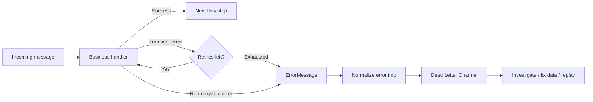

# Dead Letter Channel Retains Unprocessable Messages

In **Spring Integration Pattern** (`SPRING_INTEGRATION_PATTERN`), components exchange messages through message channels to build loosely coupled, extensible messaging flows. However, a message can reach a handler and fail repeatedly: the target system is down, the data violates business rules, or a processing branch no longer satisfies business conditions. A **Dead Letter Channel (DLC)** is where messages that the main flow cannot process are isolated for investigation, remediation, and controlled replay.

This lesson focuses on the role of a DLC, how to combine retry and error channels in Spring Integration, how to preserve original message information, and the scenarios that require testing and monitoring.

## 1. Problem to Solve

Suppose the system receives an `OrderCreated` event and invokes a payment service. When the payment service is temporarily unresponsive, we can retry. However, retrying forever blocks the flow; merely logging and discarding risks data loss; re-injecting immediately at the start of the flow can trap a failing message in an infinite loop.

A DLC addresses the final destination of failed processing:

- Retains a record of the **unprocessable message** along with the failure cause and necessary context.
- Isolates failing messages so valid messages continue to be processed.
- Allows operations teams to investigate, fix the root cause, and replay according to rules.
- Creates an audit trail to track error rates and inspect stuck data.

**A DLC does not fix errors by itself.** It is a *handover channel* transferring responsibility from automated processing to exception-handling workflows. Sending a message to a DLC is only valuable if the destination persists the information and has a clear follow-up process.

### Typical Processing Flow



In a production system, two policies must be clearly defined: **which errors are retried** and **when to route to the DLC**. Retries should be bounded, use backoff, and be classified by cause. Invalid data errors should usually go straight to the exception-handling branch, whereas temporary timeouts can be retried.

## 2. Distinguishing `errorChannel`, Dead Letter Channel, and Broker DLQ

| Component | Role | Things to Keep in Mind |
| --- | --- | --- |
| Spring Integration `errorChannel` | Transports `ErrorMessage` containing the exception for an error flow to handle | It is an error-dispatching mechanism, not automatically a long-term store for failed messages |
| Dead Letter Channel | Logical destination receiving messages determined to be unprocessable | Application-designed; can be a channel, queue, database table, or outbound broker adapter |
| Dead-letter queue (DLQ) in RabbitMQ/JMS or broker equivalent | Destination storing messages according to infrastructure dead-letter/redelivery policies | Requires separate broker configuration, ack/rollback, and consumption policies; does not appear automatically just by declaring a Spring Integration channel |

Spring Integration typically sends exceptions as `org.springframework.messaging.support.ErrorMessage`: **the payload of `ErrorMessage` is a `Throwable`**, usually a `MessagingException`. The original message can be retrieved from `ErrorMessage.getOriginalMessage()` or `MessagingException.getFailedMessage()`, depending on how the error was constructed. Do not assume every `ErrorMessage` has an original message.

An important detail regarding execution context:

- With a `DirectChannel` and a synchronous handler, exceptions normally propagate back to the sender. They are **not automatically** routed to the global `errorChannel`.
- With a poller or asynchronous processing managed by Spring Integration, the framework can publish an `ErrorMessage` to an error channel. If the message has an `errorChannel` header, that channel takes precedence; otherwise, the error-handling mechanism typically uses the global `errorChannel` bean.
- You can proactively use `RequestHandlerRetryAdvice` and `ErrorMessageSendingRecoverer` to route the final exception after retries to a designated channel, even when the initial flow is synchronous.

Therefore, **naming a channel "deadLetters" is not enough to make all exceptions go there**. You must configure the error emission point, routing path, and storage destination.

## 3. Deciding Whether a Message Goes to the DLC

| Error Type | Example | Common Policy |
| --- | --- | --- |
| Transient | Timeout, brief network blip, HTTP 503 | Bounded retry with backoff; route to DLC once exhausted |
| Permanent (unrecoverable by retry) | Missing required field, invalid schema, invalid business code | Skip pointless retries; route to DLC or invalid-data branch |
| Duplicate | Event with an already processed `eventId` | Idempotent handling or controlled skip; not necessarily a dead letter |
| Critical system failure | Misconfiguration, expired credentials, DLC store unwritable | Alert and trigger incident response; never silently treat as successful processing |

Depending on the required reliability level, a **durable store** is needed for the DLC. A default in-memory `QueueChannel` is suitable for demonstration, but does not guarantee messages survive an application restart. For critical data, consider a transactional data store, an appropriate Message Store, or a broker DLQ; verify both when the source message is acknowledged and when the error record is persisted.

## 4. Spring Integration Example: Retry Then Route to DLC

This example uses **Spring Integration 6.x, Spring Retry, and Java 17+**. Each message carries an `orderId` of type `String`. The handler simulates a failing target service for IDs starting with `FAIL-`. After at most **3 handler invocations** (including the initial attempt), `ErrorMessageSendingRecoverer` sends the error to `ordersErrors`; the error flow transforms the error into a `DeadLetterRecord` and delivers it to `ordersDeadLetters`.

Required dependencies in a Spring Boot project using Spring Integration 6.x: `spring-boot-starter-integration` and `org.springframework.retry:spring-retry`. The example uses an in-memory `QueueChannel` solely to observe behavior.

```java
import java.time.Instant;
import java.util.UUID;
import java.util.concurrent.atomic.AtomicInteger;

import org.springframework.beans.factory.annotation.Qualifier;
import org.springframework.context.annotation.Bean;
import org.springframework.context.annotation.Configuration;
import org.springframework.integration.channel.DirectChannel;
import org.springframework.integration.channel.QueueChannel;
import org.springframework.integration.config.EnableIntegration;
import org.springframework.integration.dsl.IntegrationFlow;
import org.springframework.integration.handler.advice.ErrorMessageSendingRecoverer;
import org.springframework.integration.handler.advice.RequestHandlerRetryAdvice;
import org.springframework.messaging.Message;
import org.springframework.messaging.MessageChannel;
import org.springframework.messaging.MessagingException;
import org.springframework.messaging.support.ErrorMessage;
import org.springframework.retry.backoff.FixedBackOffPolicy;
import org.springframework.retry.policy.SimpleRetryPolicy;
import org.springframework.retry.support.RetryTemplate;

@Configuration
@EnableIntegration
public class DeadLetterExample {

    @Bean
    MessageChannel ordersInput() {
        return new DirectChannel();
    }

    @Bean
    MessageChannel ordersErrors() {
        return new DirectChannel();
    }

    @Bean
    QueueChannel ordersDeadLetters() {
        return new QueueChannel(100); // Demo only; not persistent
    }

    @Bean
    OrderProcessor orderProcessor() {
        return new OrderProcessor();
    }

    @Bean
    RequestHandlerRetryAdvice ordersRetry(
            @Qualifier("ordersErrors") MessageChannel errors) {
        RetryTemplate retry = new RetryTemplate();
        retry.setRetryPolicy(new SimpleRetryPolicy(3)); // 3 attempts total

        FixedBackOffPolicy backoff = new FixedBackOffPolicy();
        backoff.setBackOffPeriod(200); // 200 ms between attempts
        retry.setBackOffPolicy(backoff);

        RequestHandlerRetryAdvice advice = new RequestHandlerRetryAdvice();
        advice.setRetryTemplate(retry);
        advice.setRecoveryCallback(new ErrorMessageSendingRecoverer(errors));
        return advice;
    }

    @Bean
    IntegrationFlow ordersFlow(
            OrderProcessor processor, RequestHandlerRetryAdvice ordersRetry) {
        return IntegrationFlow.from("ordersInput")
                .handle(processor, "process", spec -> spec.advice(ordersRetry))
                .get();
    }

    @Bean
    IntegrationFlow ordersDeadLetterFlow() {
        return IntegrationFlow.from("ordersErrors")
                .<ErrorMessage, DeadLetterRecord>transform(
                        DeadLetterExample::toDeadLetter)
                .channel("ordersDeadLetters")
                .get();
    }

    private static DeadLetterRecord toDeadLetter(ErrorMessage error) {
        Message<?> source = error.getOriginalMessage();

        // Some error sources only store the original message inside MessagingException.
        if (source == null) {
            for (Throwable current = error.getPayload();
                    current != null; current = current.getCause()) {
                if (current instanceof MessagingException messagingException
                        && messagingException.getFailedMessage() != null) {
                    source = messagingException.getFailedMessage();
                    break;
                }
            }
        }

        Throwable rootCause = error.getPayload();
        while (rootCause.getCause() != null) {
            rootCause = rootCause.getCause();
        }

        Object correlation = source == null
                ? null : source.getHeaders().get("correlationId");

        return new DeadLetterRecord(
                UUID.randomUUID().toString(),
                source == null ? null : source.getHeaders().getId().toString(),
                correlation == null ? null : correlation.toString(),
                source == null ? null : String.valueOf(source.getPayload()),
                rootCause.getClass().getName(),
                rootCause.getMessage(),
                Instant.now());
    }

    public static class OrderProcessor {
        private final AtomicInteger attempts = new AtomicInteger();

        public void process(String orderId) {
            attempts.incrementAndGet();
            if (orderId.startsWith("FAIL-")) {
                throw new IllegalStateException("Demo: target service temporary failure");
            }
            // Business processing for valid orderId.
        }

        public int attemptCount() {
            return attempts.get();
        }
    }

    public record DeadLetterRecord(
            String deadLetterId,
            String sourceMessageId,
            String correlationId,
            String originalPayload,
            String errorType,
            String errorMessage,
            Instant failedAt) {}
}
```

Key observations from the example:

1. `ordersInput` is a `DirectChannel`. On success, the handler completes normally; no DLC record is created.
2. `ordersRetry` wraps **only the business handler**. Three failed attempts lead to `ErrorMessageSendingRecoverer` publishing an `ErrorMessage` to `ordersErrors`.
3. `ordersDeadLetterFlow` attempts to extract the source message, record trace metadata, and route to `ordersDeadLetters`. `sourceMessageId` and `correlationId` aid traceability, while `deadLetterId` uniquely identifies each recorded failure.
4. `ordersDeadLetters` is a `QueueChannel` bounded to 100 records. When the queue is full, the error-handling flow itself can fail. Production systems must ensure capacity, durable persistence, and alerting.

**Limitations of the example:** `SimpleRetryPolicy(3)` currently retries all exceptions matching the default policy, including the error simulated with `IllegalStateException`. In real applications, classify exceptions to avoid retrying permanent data errors. The example also does not address atomicity between receiving the input message and persisting the DLC record, does not guarantee exactly-once processing, and logging `errorMessage` directly from the exception must be controlled to avoid leaking sensitive data.

### Sending a Test Message

In a test or component invoking the flow:

```java
Message<?> request = org.springframework.messaging.support.MessageBuilder
        .withPayload("FAIL-42")
        .setHeader("correlationId", "order-42")
        .build();

ordersInput.send(request);
Message<?> dead = ordersDeadLetters.receive(1_000);
// dead.getPayload() is a DeadLetterRecord with originalPayload = "FAIL-42".
```

`ordersDeadLetters.receive(...)` **retrieves and removes the item from the queue**; this operation should only be used when testing the example or when an appropriate consumer workflow is in place. Do not use this destructive read as a way to inspect a DLC dashboard in production.

## 5. What Should Be Stored in a Dead Letter?

A useful DLC record must indicate **which message failed, where it failed, why, when, and how it can be reprocessed**.

| Data Group | Suggested Fields | Purpose |
| --- | --- | --- |
| Identity | `deadLetterId`, `messageId`, `eventId`, `correlationId` | Tracing, deduplication, correlating splitter/aggregator/gateway branches |
| Source content | Payload or reference to original payload, schema version, content type | Restoring data in its original format |
| Failure location | Component/flow name, destination, exception class, stable error code | Pinpointing the failing branch and grouping root causes |
| Retry | Attempt count, last attempt timestamp, applied retry policy | Distinguishing transient errors from exhausted retries |
| Lifecycle | `failedAt`, status `NEW / TRIAGED / REPLAYED / DISCARDED`, operator | Managing SLAs and handling lifecycle |
| Replay | `replayCount`, `lastReplayAt`, `replayOf`, idempotency key | Preventing infinite loops and avoiding duplicate business execution |

It is not necessary to store a full serialized Java object: structures may change across versions, or the payload may contain personal data. In large systems, you can store versioned payloads in a separate store and keep an access-controlled reference in the DLC. Log only necessary metadata and error codes; apply retention periods, sensitive data masking, and role-based view/replay permissions.

## 6. Operations, Investigation, and Safe Replay

A practical dead-letter handling workflow can follow this sequence:

1. **Detection:** alert when `dlc_received_total` spikes abnormally, when messages remain in the DLC beyond SLA, or when writing to the DLC fails.
2. **Triage:** group by data error, connectivity error, configuration, or external dependency; determine whether the error is still reproducible or already resolved.
3. **Remediation:** fix data at the authoritative source or repair the target system; document the root cause and impact.
4. **Controlled replay:** select eligible messages, re-inject them into the appropriate flow with rate limiting, increment the replay counter, and preserve correlation.
5. **Closure:** transition status only after verifying the outcome, with an audit trail; enforce retention or deletion policies per data regulations.

Replay requires careful attention to **idempotency**: if the handler partially executed an operation before failing (for example, charging payment but failing to record the response), re-running may trigger side effects a second time. Use a business key such as `orderId + operationType` or `eventId` to check prior completion, and consider transactional outbox/inbox when high reliability is required.

If a message that previously went to the DLC fails again after replay, increment `replayCount`, record the replay session, and enforce a maximum cycle limit. Never configure an unconditional closed loop `deadLetters → ordersInput`.

### Which Signals Should Be Monitored?

- Message intake rate and DLC routing rate by endpoint, error type, and deployment version.
- Age of the oldest message, count of unprocessed messages, and replay success rate.
- Latency from failure detection to durable persistence; number of failed DLC writes.
- `correlationId` and per-branch traces (especially when using Router, Splitter, Aggregator); avoid putting sensitive payloads directly into metric labels.

Metrics should clearly distinguish messages **successfully processed**, **retained in the DLC**, and **awaiting investigation** as separate states. A low error rate does not mean the flow is safe if the dead-letter channel is silently losing data.

## 7. Testing Processing Branches

With the demo configuration above, you can test the Spring Integration flow using `spring-test`, JUnit 5, and AssertJ. Minimum checks:

- A valid message is processed once and does **not** appear in the DLC.
- Message `FAIL-42` is attempted three times, then **one record** appears in the DLC with `sourceMessageId` and `correlationId`.
- When testing error conversion in isolation, a missing `originalMessage` does not cause a `NullPointerException`; the error flow still preserves error details or marks missing source data.
- When the DLC store is unavailable, the system detects the write failure and does not falsely report success.
- Replaying does not recreate a business action that already completed previously.

Example test for the failure branch:

```java
import static org.assertj.core.api.Assertions.assertThat;

import org.junit.jupiter.api.Test;
import org.springframework.beans.factory.annotation.Autowired;
import org.springframework.beans.factory.annotation.Qualifier;
import org.springframework.messaging.Message;
import org.springframework.messaging.MessageChannel;
import org.springframework.messaging.PollableChannel;
import org.springframework.messaging.support.MessageBuilder;
import org.springframework.test.context.junit.jupiter.SpringJUnitConfig;

@SpringJUnitConfig(DeadLetterExample.class)
class DeadLetterExampleTest {
    @Autowired
    @Qualifier("ordersInput")
    MessageChannel input;

    @Autowired
    @Qualifier("ordersDeadLetters")
    PollableChannel deadLetters;

    @Autowired
    DeadLetterExample.OrderProcessor processor;

    @Test
    void exhaustedRetriesGoToDeadLetterChannel() {
        Message<String> request = MessageBuilder.withPayload("FAIL-42")
                .setHeader("correlationId", "order-42")
                .build();
        int attemptsBefore = processor.attemptCount();

        assertThat(input.send(request)).isTrue();

        Message<?> stored = deadLetters.receive(1_000);
        assertThat(stored).isNotNull();
        var record = (DeadLetterExample.DeadLetterRecord) stored.getPayload();

        assertThat(processor.attemptCount() - attemptsBefore).isEqualTo(3);
        assertThat(record.originalPayload()).isEqualTo("FAIL-42");
        assertThat(record.sourceMessageId())
                .isEqualTo(request.getHeaders().getId().toString());
        assertThat(record.correlationId()).isEqualTo("order-42");
        assertThat(deadLetters.receive(0)).isNull();
    }
}
```

This is a **behavioral illustration**; the test requires a project with the corresponding libraries to run. This lesson does not claim the test was executed against a repository. When moving to a real broker or data store, add integration tests covering transactions, redelivery, connection failures, and recovery after application restart.

## 8. Common Implementation Pitfalls

| Mistake | Consequence | Fix |
| --- | --- | --- |
| Assuming global `errorChannel` automatically saves all failed messages | Errors may only be logged, or synchronous errors may throw straight back to the caller | Identify the error-emission mechanism and configure a flow routing to the DLC |
| Infinite retries without error classification | Blocks the flow and overloads the target system | Set a retry budget and backoff; do not retry permanent data errors |
| Treating an in-memory `QueueChannel` as durable storage | Loses messages on restart or when the queue fills up | Use durable storage, verify transactions, and alert on write failures |
| Saving only the stack trace and dropping `messageId/correlationId` | Hard to identify the failing data and processing branch | Store source metadata, error type, and timestamp under a stable schema |
| Replaying immediately without fixing the root cause | Creates a dead-letter loop | Perform triage, cap replay attempts, and keep replay history |
| Replaying without idempotency | Can create duplicate transactions, emails, or payments | Use idempotency keys and check processing status before replaying |

## 9. Self-Check Questions

1. Why do `errorChannel` and a DLC serve different roles? When does an error on a `DirectChannel` propagate straight back to the caller?
2. With `SimpleRetryPolicy(3)`, how many times does the handler fail before the recovery callback is invoked?
3. Why should both `sourceMessageId` and `correlationId` be preserved for a message that failed after a multi-branch flow?
4. What happens if a message was written to an in-memory DLC and the process restarts?
5. Before replaying a payment event from the DLC, what conditions should be checked to avoid charging twice?

## References

- [Spring Integration 6.4 — Error Handling](https://docs.spring.io/spring-integration/reference/6.4/error-handling.html): error channels, `ErrorMessage`, synchronous and asynchronous handling.
- [Spring Integration 6.4 — Provided Advice Classes](https://docs.spring.io/spring-integration/reference/6.4/handler-advice/classes.html): `RequestHandlerRetryAdvice`, retry, and `ErrorMessageSendingRecoverer`.

> **Key Takeaway:** A Dead Letter Channel is an intentionally designed branch to **retain, explain, and handle** messages that the main flow cannot complete. Transferring to a DLC should only be considered successful once the information needed for recovery has actually been persisted at the reliability level the system requires.
