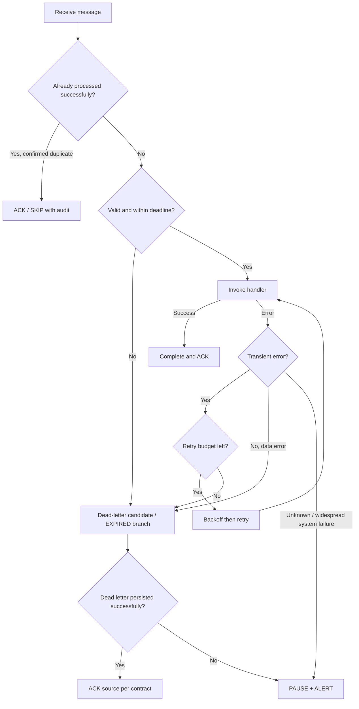

# Conditions for Routing a Message to Dead Letter

In the **SPRING_INTEGRATION_PATTERN** module, we use Spring Integration to implement **Enterprise Integration Patterns** (EIP): Router, Filter, Transformer, Splitter, Aggregator, Gateway, retry, error channel, and correlation. Components are connected via message channels, making processing flows loosely coupled and extensible. However, when a message cannot continue through a processing branch, the system must decide: **retry, intentionally discard, pause for incident handling, or route to dead letter?**

A **Dead Letter Channel (DLC)** is a logical destination used to retain messages that cannot be processed under defined policies, along with information for investigation and *replay*. When this destination is implemented with a broker-managed queue, it is commonly called a **dead-letter queue (DLQ)**. A message should not be sent to a DLC merely because an exception occurred: the decision also depends on **error type, retry budget, business deadline, deduplication capability, and storage reliability**.

Lesson objectives:

1. Identify concrete conditions that cause a message to become a dead letter.
2. Distinguish retryable errors, permanent errors, system-wide errors, and already-processed messages.
3. Design the decision order and map it to a Spring Integration error flow.
4. Test, monitor, and protect the system from message loss or retry/replay loops.

## 1. Dead Letter Is the Result of an Error-Handling Policy

Suppose a flow receives `OrderCreated`, validates the data, and then calls a payment system:

- `orderId` is missing or malformed: resending the exact same message multiple times will not make it valid.
- The payment service times out: retrying with a backoff interval may resolve it.
- The payment service still times out after all attempts: retain the message for investigation and replay once the service recovers.
- The system loses access to the payment service due to a shared misconfiguration: if every message is pushed to the DLQ, the error store will fill up without resolving the incident. Alerting and possibly pausing intake are required.
- A message has an `eventId` that was already processed successfully: it can be confirmed as a duplicate and safely skipped; that is not a reason to automatically send it to the DLC.

The crucial distinction is that **a single failure does not mean all processing options are exhausted**. We only classify a message as a dead letter when an explicit rule states that the current processing branch is not allowed or unable to proceed.

### Four Common Processing Outcomes

| Outcome | When | Action |
| --- | --- | --- |
| `ACK / SKIP` | Already processed, confirmed duplicate, or event permitted to be skipped | Record the outcome and acknowledge the source per policy |
| `RETRY` | Transient error, retry budget remains, and still within processing deadline | Retry with backoff, bounded by max attempts |
| `DEAD_LETTER` | Permanent error, transient error with exhausted retry budget, or deadline exceeded per policy | Persist the original message and failure reason in a reliable DLC store |
| `PAUSE_AND_ALERT` | Widespread system outage, unknown error requiring intervention, or the dead-letter store itself is unavailable | Pause/throttle intake, alert, and preserve source redelivery rights if available |

`ACK` in this table refers to application-level acknowledgment/completion. Actual ack mechanics depend on the adapter and broker (JMS, AMQP, Kafka...), transactions, and consumer configuration.

## 2. Concrete Conditions for Routing a Message to Dead Letter

### 2.1. Input Data Violates Rules That Cannot Self-Heal

**Condition:** the payload cannot be decoded, is missing required fields, violates a schema, or violates a business rule where retrying the exact same data will not change the outcome.

For example: a message requesting order creation has `quantity = -3` or `currency = "XYZ"`, which the system does not accept. Even if the handler is called three times, the data remains invalid.

**Typical decision:** `DEAD_LETTER` right after the first evaluation, with a stable reason code such as `INVALID_PAYLOAD` or `BUSINESS_RULE_REJECTED`; do not retry mechanically.

Note: in some use cases, invalid data is a legitimate rejection that returns an error to the client and records an audit log, **not necessarily** going to a DLC. Choose a DLC when you need to retain the message asynchronously for investigation, fixing at the source, or reprocessing.

### 2.2. Transient Error Has Exhausted the Retry Budget

**Condition:** the handler fails due to a recoverable cause such as a timeout or HTTP 503, but has already been tried the configured number of times and still fails.

For example: configured for **3 total invocations** (initial attempt + 2 retries). If all fail, route to the error flow to create a dead letter with reason `RETRY_EXHAUSTED`.

Keep three distinct values separate:

- `attemptsMade`: number of times the handler **has been invoked**, including the initial attempt.
- `maxAttempts`: limit on total handler invocations at the retry layer under consideration.
- `replayCount`: number of times the message has been re-sent **from the DLC** by an operator or replay mechanism; not identical to `attemptsMade`.

Backoff duration, per-request timeouts, and multiple retry layers can make actual elapsed time much larger than expected. If you retry inside Spring Integration, retry in the HTTP client, and also have broker redelivery, calculate the **total retry budget** to avoid load amplification.

### 2.3. Message Loses Value When Processed Late

**Condition:** the business deadline has passed or the message TTL has expired and business rules forbid further processing.

For example: a ticket price update is only valid until 10:00; at 10:30, pushing that price update event again could produce incorrect results.

**Decision:** depending on the data contract, route to the DLC with code `BUSINESS_DEADLINE_EXCEEDED` for evidence, or route to an `EXPIRED` branch for metrics. **Do not assume** expired messages must go to the broker's DLQ: broker TTL and business deadlines are two different mechanisms.

### 2.4. Message Repeatedly Fails With the Same Unprocessable Error (*Poison Message*)

**Condition:** a message consistently causes deterministic failure, such as a payload that always makes the parser throw an exception or lacks data that downstream cannot consume.

**Decision:** isolate into the DLC/quarantine after identifying the error or exhausting configured attempts; avoid letting the consumer re-read the same message infinitely and block messages behind it.

Conversely, an error appearing across many messages because **the entire target system is down** may require `PAUSE_AND_ALERT` or a circuit breaker. Otherwise, the DLC becomes a dumping ground for all traffic rather than isolating a small number of anomalous messages.

### 2.5. No Valid Route Exists and Cannot Be Recovered in the Current Flow

In a **Router**, if an event type has no matching handler, you can apply a policy that sends it to an `UNROUTABLE`/DLC branch to preserve data. However, many Routers support `defaultOutputChannel` or a discard policy; that is a design choice, **not automatic behavior** for every Router.

In a **Splitter/Aggregator**, missing branches or correlation timeouts can produce incomplete message groups. Whether to send that group to a DLC or use partial results, a timeout flow, or a compensating workflow must be decided by business rules. When persisting, preserve `correlationId` and sequence metadata such as `sequenceNumber` and `sequenceSize` if present.

### 2.6. Replay Still Fails or Hits the Replay Limit

A message placed in the DLC may have its data corrected and be replayed. If it continues to fail, there must be a loop limit, for example:

- Allow at most 2 controlled replays after fixing the root cause.
- Record `replayCount`, `replayOf`, the operator, and the new processing run.
- Once the limit is reached, transition to `QUARANTINED` or `MANUAL_REVIEW` status rather than re-injecting into the start of the flow forever.

Do not wire `deadLetterChannel → inputChannel` as an unconditional closed loop.

## 3. Cases That Should Not Automatically Go to DLC

| Situation | Why Not Auto Dead-Letter? | Appropriate Handling |
| --- | --- | --- |
| Duplicate of an already-completed event | Not an actual processing failure | Idempotent receiver, record `DUPLICATE_HANDLED`, and acknowledge |
| First-time timeout error | Still potentially recoverable | Retry within budget with backoff |
| Shared application credentials lost | Could affect thousands of messages | Alert, pause or throttle the consumer, fix configuration |
| Failed to write to DLC store | Failure data has not been preserved yet | Do not report as handled; apply rollback/redelivery or raise error |
| Intentionally dropped by Filter | Dropping the message is expected success behavior per filter policy | Record metric/audit if needed |
| Aggregator waiting for all valid parts | Not yet concluded to be unprocessable | Wait, apply timeout policy, or process partial result |

In particular, **do not acknowledge success to the source merely because the send-to-DLC method was called**. You must know whether the data was accepted by the store at the required durability level. If acknowledging the source message and writing to the DLC span two separate systems, data loss or duplicate writes can occur when one step succeeds and the other fails; use transactions/outbox/inbox or appropriate idempotency mechanisms.

## 4. Decision Workflow



At step `L`, "success" must match the storage system's guarantees: with an in-memory `QueueChannel`, a successful send does **not** mean durable persistence; with a broker, you must understand confirms/transactions and redelivery. The diagram represents business policy, not a promise of an atomic cross-system transaction.

### Check Order Should Be Explicit

1. **Already processed?** Look up the idempotency key/`eventId` before causing side effects.
2. **Valid and within deadline?** Classify permanently invalid data and expired deadlines.
3. **What kind of error occurred?** Use standardized exceptions, HTTP statuses, or business error codes instead of string-matching stack traces alone.
4. **Is retry budget remaining?** Account for total attempts, duration, backoff, and broker redelivery.
5. **Can the dead-letter destination persist?** Acknowledge only after the error-storage path meets required guarantees.
6. **Is it replayable?** Preserve full metadata, prevent duplicate execution, and keep an intervention audit trail.

## 5. Writing the Decision Policy in Java

Below is a **standalone example on Java 17+**. It clearly expresses business rules before binding them to Spring Integration channels. The thresholds are illustrative assumptions and should be tuned to real SLAs and data contracts.

```java
package demo.integration;

public final class DeadLetterPolicy {
    private DeadLetterPolicy() {}

    public enum Cause {
        INVALID_DATA,
        TRANSIENT_TIMEOUT,
        DUPLICATE_ALREADY_HANDLED,
        SYSTEM_CONFIGURATION,
        UNKNOWN
    }

    public enum Action {
        ACK_SKIP,
        RETRY,
        DEAD_LETTER,
        PAUSE_AND_ALERT
    }

    public record FailureContext(
            Cause cause,
            int attemptsMade,
            boolean businessDeadlineExceeded,
            int replayCount) {
        public FailureContext {
            if (cause == null || attemptsMade < 1 || replayCount < 0) {
                throw new IllegalArgumentException("Invalid failure context");
            }
        }
    }

    public record Decision(Action action, String reasonCode) {}

    private static final int MAX_ATTEMPTS = 3;
    private static final int MAX_REPLAY = 2;

    public static Decision decide(FailureContext context) {
        // Only ACK duplicates when prior successful processing is confirmed.
        if (context.cause() == Cause.DUPLICATE_ALREADY_HANDLED) {
            return new Decision(Action.ACK_SKIP, "DUPLICATE_HANDLED");
        }

        // Cap replays to prevent infinite loops.
        if (context.replayCount() >= MAX_REPLAY) {
            return new Decision(Action.PAUSE_AND_ALERT, "REPLAY_LIMIT");
        }

        // Example business rule: expired deadline must be stored for audit.
        if (context.businessDeadlineExceeded()) {
            return new Decision(Action.DEAD_LETTER, "BUSINESS_EXPIRED");
        }

        return switch (context.cause()) {
            case INVALID_DATA ->
                    new Decision(Action.DEAD_LETTER, "INVALID_DATA");
            case TRANSIENT_TIMEOUT -> context.attemptsMade() < MAX_ATTEMPTS
                    ? new Decision(Action.RETRY, "TRANSIENT_TIMEOUT")
                    : new Decision(Action.DEAD_LETTER, "RETRY_EXHAUSTED");
            case SYSTEM_CONFIGURATION ->
                    new Decision(Action.PAUSE_AND_ALERT, "SYSTEM_CONFIGURATION");
            case UNKNOWN ->
                    new Decision(Action.PAUSE_AND_ALERT, "UNCLASSIFIED_FAILURE");
            case DUPLICATE_ALREADY_HANDLED ->
                    new Decision(Action.ACK_SKIP, "DUPLICATE_HANDLED");
        };
    }
}
```

Usage example:

```java
import static demo.integration.DeadLetterPolicy.*;

Decision invalid = decide(
        new FailureContext(Cause.INVALID_DATA, 1, false, 0));
// invalid.action() == DEAD_LETTER: do not retry invalid data.

Decision timeoutFirst = decide(
        new FailureContext(Cause.TRANSIENT_TIMEOUT, 1, false, 0));
// timeoutFirst.action() == RETRY.

Decision timeoutExhausted = decide(
        new FailureContext(Cause.TRANSIENT_TIMEOUT, 3, false, 0));
// timeoutExhausted.action() == DEAD_LETTER.

Decision replayLoop = decide(
        new FailureContext(Cause.TRANSIENT_TIMEOUT, 3, false, 2));
// replayLoop.action() == PAUSE_AND_ALERT.
```

This is a **decision policy**, not yet the mechanism for routing messages or acknowledging the source. In practice, you also need exception classification, dead-letter persistence, status updates, and error handling for storage failures. In the example, `PAUSE_AND_ALERT` is an outcome for the operations/consumer layer to enforce; returning an enum does not automatically stop a broker consumer.

## 6. Combining the Policy With Spring Integration and Retry

Spring Integration provides `RequestHandlerRetryAdvice` to wrap handler invocations and `ErrorMessageSendingRecoverer` to emit an `ErrorMessage` once retries can no longer continue. The error flow then decides which messages are **persisted to the DLC** and which require **alerting or stopping the consumer**.

The following configuration example uses **Spring Integration 6.x**, **Spring Retry 2.x**, and Java 17+. It demonstrates **retrying only `TransientDependencyException`**, up to 3 handler invocations; other exceptions go directly to the recovery callback as soon as the policy rejects retrying.

```java
import java.util.Map;

import org.springframework.beans.factory.annotation.Qualifier;
import org.springframework.context.annotation.Bean;
import org.springframework.context.annotation.Configuration;
import org.springframework.integration.channel.DirectChannel;
import org.springframework.integration.handler.advice.ErrorMessageSendingRecoverer;
import org.springframework.integration.handler.advice.RequestHandlerRetryAdvice;
import org.springframework.messaging.MessageChannel;
import org.springframework.retry.backoff.ExponentialBackOffPolicy;
import org.springframework.retry.policy.SimpleRetryPolicy;
import org.springframework.retry.support.RetryTemplate;

@Configuration
public class OrderRetryConfiguration {
    @Bean
    MessageChannel orderRecoveryChannel() {
        return new DirectChannel();
    }

    @Bean
    RequestHandlerRetryAdvice orderRetryAdvice(
            @Qualifier("orderRecoveryChannel") MessageChannel recoveryChannel) {

        // Do NOT retry unlisted errors by default; traverse nested causes.
        var retryable = Map.<Class<? extends Throwable>, Boolean>of(
                TransientDependencyException.class, true);
        var retryPolicy = new SimpleRetryPolicy(
                3, retryable, true, false);

        var backoff = new ExponentialBackOffPolicy();
        backoff.setInitialInterval(250);
        backoff.setMultiplier(2.0);
        backoff.setMaxInterval(2_000);

        var template = new RetryTemplate();
        template.setRetryPolicy(retryPolicy);
        template.setBackOffPolicy(backoff);

        var advice = new RequestHandlerRetryAdvice();
        advice.setRetryTemplate(template);
        advice.setRecoveryCallback(
                new ErrorMessageSendingRecoverer(recoveryChannel));
        return advice;
    }

    // Example application-defined exception type.
    public static final class TransientDependencyException
            extends RuntimeException {
        public TransientDependencyException(String message) {
            super(message);
        }
    }
}
```

For the advice to take effect, attach it to a handler endpoint, for example when configuring with Java DSL:

```java
@Bean
IntegrationFlow orderFlow(OrderService service,
                          RequestHandlerRetryAdvice orderRetryAdvice) {
    return IntegrationFlow.from("ordersInput")
            .handle(service, "processOrder",
                    spec -> spec.advice(orderRetryAdvice))
            .get();
}
```

This DSL snippet is an **illustrative configuration fragment**, assuming the application already declares `ordersInput`, `OrderService`, and a flow consuming `orderRecoveryChannel`. You cannot simply add `RequestHandlerRetryAdvice` and assume every error becomes a dead letter. The recovery channel receives errors whose retries are exhausted **or that are not eligible for retry by the policy**; the error flow itself must classify and route:

- `INVALID_DATA` → normalize the error record → write **durably** to the DLC.
- Exhausted `TRANSIENT_TIMEOUT` → write to the DLC with `RETRY_EXHAUSTED`.
- `SYSTEM_CONFIGURATION` or unknown errors → alert and pause/throttle the flow as appropriate; **do not** silently push every message into the DLC.

In Spring Integration, `ErrorMessage` holds the exception in its payload; the source message may be in `getOriginalMessage()` or inside `MessagingException.getFailedMessage()`. The error flow must handle the case where the source message is absent. With synchronous flows using `DirectChannel`, uncaught exceptions normally propagate straight back to the caller; routing to a recovery/error channel must be configured intentionally. With pollers or asynchronous endpoints, Spring Integration has mechanisms to publish errors through the corresponding `errorChannel`. **Channel names do not determine dead-letter conditions; your policy and error-handling path do.**

### Do Not Miscount Retry Attempts

With `SimpleRetryPolicy(3)`, the number 3 **includes the initial attempt**, so a transient error gets at most 3 handler invocations in this retry cycle. If an exception is not in the retryable set, it typically moves to recovery after the first failure (when a recovery callback is set); this does not mean "retried 3 times." When combining with broker redelivery or replay, track each attempt type separately.

## 7. Dead Letter Records Must Contain Enough Context to Explain the Condition

A record containing only an exception message is insufficient to know **why** the message was quarantined. The schema should include:

| Field | Example | Purpose |
| --- | --- | --- |
| `deadLetterId` | New UUID | Identifies the error record, even if the same message fails multiple times |
| `originalMessageId` / `eventId` | `evt-304` | Cross-references the source and supports idempotency |
| `correlationId` | `order-19` | Links Router/Splitter/Aggregator branches |
| `failureCategory` | `PERMANENT`, `RETRY_EXHAUSTED` | Traces the decision |
| `reasonCode` | `INVALID_DATA` | Stable error code for metrics |
| `attemptsMade` / `replayCount` | `3 / 0` | Distinguishes current retries from replays |
| `failedComponent` / `route` | `paymentHandler` | Identifies the failing branch |
| `failedAt` / `businessDeadline` | UTC timestamps | Checks SLAs and message age |
| `payloadRef` / `schemaVersion` | Data reference | Restores the original payload in the right version |
| `status` | `NEW`, `TRIAGED`, `REPLAYED`, `QUARANTINED` | Manages lifecycle and investigation |

If the payload contains sensitive data, store only a reference or an encrypted copy with proper access controls and retention. Do not place sensitive payloads or exception messages into metric labels.

## 8. Testing Decisions and Processing Branches

You must verify **thresholds, precedence order, and consequences** of each outcome, rather than merely asserting that a message appeared in a channel.

| Test Scenario | Expected Handler Calls | Decision | What to Assert |
| --- | ---: | --- | --- |
| Valid message | 1 | Success | No dead letter, side effect happens exactly once |
| Schema-invalid payload | 1 or 0 if rejected at intake | `DEAD_LETTER` per policy | `INVALID_DATA` code, source message attached |
| First timeout, `maxAttempts=3` | 1 failed | `RETRY` | Backoff applied, not yet dead-lettered |
| Timeout after 3 calls | 3 | `DEAD_LETTER` | One `RETRY_EXHAUSTED` record |
| Already-processed event resent | 0 new business calls | `ACK_SKIP` | No duplicate business execution |
| Business deadline passed | Depends on check point | `DEAD_LETTER` or `EXPIRED` | Reason code and timestamp present |
| Replay limit reached | No more automatic replay | `PAUSE_AND_ALERT` | Alert triggered and quarantine state set |
| Widespread configuration error | Depends on detection point | `PAUSE_AND_ALERT` | Does not flood DLC with the same system error |
| DLC write fails | Not treated as saved | Error handling/rollback/alert | No false ack, recovery path exists |
| Failure in one Splitter branch | Per branch policy | May route to dead letter | Preserves `correlationId` and sequence metadata |

JUnit 5 example testing the pure Java policy:

```java
import static org.junit.jupiter.api.Assertions.assertEquals;
import static demo.integration.DeadLetterPolicy.*;

import org.junit.jupiter.api.Test;

class DeadLetterPolicyTest {
    @Test
    void invalidDataGoesStraightToDeadLetter() {
        var decision = decide(
                new FailureContext(Cause.INVALID_DATA, 1, false, 0));
        assertEquals(Action.DEAD_LETTER, decision.action());
        assertEquals("INVALID_DATA", decision.reasonCode());
    }

    @Test
    void timeoutRetriesBeforeExhaustion() {
        assertEquals(Action.RETRY, decide(
                new FailureContext(Cause.TRANSIENT_TIMEOUT, 2, false, 0)
        ).action());
        assertEquals(Action.DEAD_LETTER, decide(
                new FailureContext(Cause.TRANSIENT_TIMEOUT, 3, false, 0)
        ).action());
    }

    @Test
    void replayLimitStopsAutomaticProcessing() {
        var decision = decide(
                new FailureContext(Cause.TRANSIENT_TIMEOUT, 3, false, 2));
        assertEquals(Action.PAUSE_AND_ALERT, decision.action());
    }

    @Test
    void duplicateEventDoesNotBecomeDeadLetter() {
        var decision = decide(new FailureContext(
                Cause.DUPLICATE_ALREADY_HANDLED, 1, false, 0));
        assertEquals(Action.ACK_SKIP, decision.action());
    }
}
```

This tests **pure Java policy logic** and does not replace Spring Integration integration tests. For a real flow, send messages through an inbound adapter or `MessageChannel` and verify the receiving channel, handler invocation count, headers, and error-record state. If the source is a broker, also cover failures between DLC persistence and ack, broker redelivery, and consumer restarts.

## 9. Monitoring and Operations by Root Cause

Do not merely count messages in the DLC. Track distinct groups:

- **Dead-letter rate by reason code**, endpoint, version, and processing branch.
- **Retry exhaustion rate**, total handler attempts, and time to failure.
- **Age of unprocessed messages**, count of records awaiting triage, and replay success rate.
- **DLC write failure count**, broker redelivery count, and blocked replay count.
- **System-wide failure rate**: when many messages share the same configuration/connectivity error, alert operations instead of just growing the DLQ.

An example of an actionable alert: "Within 5 minutes, `RETRY_EXHAUSTED` in `paymentHandler` spiked, and all errors point to the payment service." Alerts should surface the reason code and failure location so operations know what to check. Once the issue is fixed, replays must check idempotency and enforce rate limits rather than blindly re-injecting in bulk.

### Common Pitfalls

| Pitfall | Consequence |
| --- | --- |
| Retrying all exceptions, including permanent data errors | Increases load without any chance of success |
| Checking only the outer exception class and ignoring nested causes | May misclassify retryability when wrapped in `MessagingException` |
| Configuring `maxAttempts` while forgetting HTTP client/broker retries | Total attempts exceed expectations |
| Sending all system-wide errors to the DLC | Overflows the DLQ and masks the root outage |
| Acking the source before durable dead-letter persistence | Loses messages if the DLC store fails |
| Replaying without checking already-executed side effects | Duplicate payments, emails, or data updates |
| Failing to record `reasonCode` / `correlationId` | Difficult to investigate the exact failing branch |

## 10. Self-Check Questions

1. Why is an `HTTP 503` on the first call usually not enough to send a message to the DLC?
2. Should a schema-invalid message be retried 3 times? In what cases is returning an error and logging an audit trail sufficient?
3. With `SimpleRetryPolicy(3)`, at most how many times is the handler invoked in a single retry cycle?
4. If an `orderId` has already been recorded as paid and the event arrives again, what condition confirms it is a duplicate?
5. When authorization to the target system fails on every request, why might `PAUSE_AND_ALERT` be better than dumping batches of messages into the DLC?
6. Is a message placed into an in-memory `QueueChannel` guaranteed to survive a restart?
7. When both retry and broker redelivery are enabled, how do you determine the actual retry budget?
8. Why must you check the result of persisting to the DLC before acknowledging the source message?

## References

- [Spring Integration Reference — Error Handling](https://docs.spring.io/spring-integration/reference/error-handling.html): error emission mechanisms, `ErrorMessage`, and error channels.
- [Spring Integration Reference — Provided Advice Classes](https://docs.spring.io/spring-integration/reference/handler-advice/classes.html): `RequestHandlerRetryAdvice` and `ErrorMessageSendingRecoverer`.
- [Spring Retry API — SimpleRetryPolicy](https://docs.spring.io/spring-retry/docs/current/apidocs/spring.retry/org/springframework/retry/policy/SimpleRetryPolicy.html): max attempts, exception classification, and nested cause traversal.

> **Key Takeaway:** The conditions for routing a message to dead letter must be derived from **unrecoverable errors, exhausted retries, business deadlines, and replay policies**, and then enforced via an error flow and reliable persistence. A single exception or a channel named "dead letter" is not enough to define that decision.
