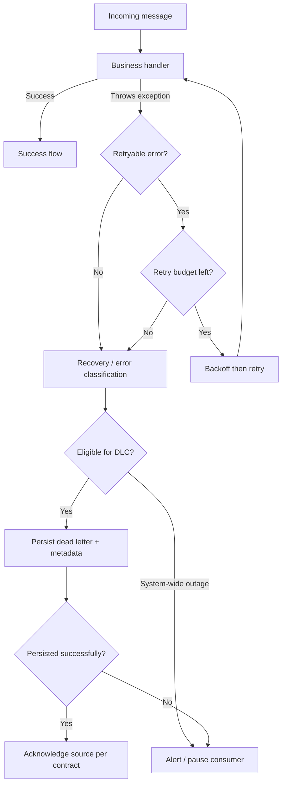

# Retry Before Routing to Dead Letter

In the **SPRING_INTEGRATION_PATTERN** module, we implement **Enterprise Integration Patterns** using Spring Integration to connect Router, Filter, Transformer, Splitter, Aggregator, Gateway, and handlers via message channels. The goal is to build **loosely coupled, extensible** messaging flows while making each processing branch testable and observable. When a handler fails, retry helps overcome transient issues; a **Dead Letter Channel (DLC)** retains messages that the system cannot continue processing under its policy.

The question in this lesson is: **How many times should we retry, for how long, for which errors, and when must we stop retrying and route the message to dead letter?** Answering this requires coordinating **error classification, backoff, retry budget, recovery callbacks, error channels, correlation, and message persistence guarantees**.

> **Foundational Rule:** Retry is a bounded processing step. Send to dead letter only when automated processing cannot or should not continue. "Sent to DLC" only guarantees data preservation if the destination actually persists the message at the required reliability level.

## 1. Why Retry Before Sending to Dead Letter?

Suppose a system receives an `OrderCreated` event and calls a payment gateway. Under normal conditions, the handler succeeds immediately. Occasionally, however, the payment gateway returns HTTP 503, a connection resets, or a request times out; these errors can self-recover within a few hundred milliseconds.

If every error went straight to the DLC, operations teams would have to investigate waves of brief glitches that would have resolved on their own. Conversely, retrying infinitely lets a *poison message* or a long-term downstream outage tie up resources, block consumers, and cause duplicate side effects.

A sensible strategy is:

1. **Identify the error:** distinguish transient errors, permanent data errors, already-processed duplicates, and widespread system failures.
2. **Evaluate conditions:** retry only recoverable errors while attempt/time budget remains.
3. **Pause between attempts:** apply backoff and consider jitter to reduce load spikes.
4. **Stop at the right time:** on success, complete; if the budget is exhausted, emit the error to a recovery flow; if the error is non-retryable, apply the permanent-failure policy.
5. **Preserve context:** store the original message, failure reason, correlation, and attempt counts for investigation or controlled replay.

### Retry-Then-Dead-Letter Flow



In real systems, some adapters perform broker redelivery outside of `RetryAdvice`. The diagram above illustrates **a single in-application retry cycle** and does not by itself define ACK/NACK semantics for every message source.

## 2. Rules for Selecting Retryable Errors

The most important criterion is that **retrying the exact same operation has a reasonable chance of succeeding without unwanted side effects**.

| Error Group | Example | Suggested Decision | Reason |
| --- | --- | --- | --- |
| Transient, recoverable | Timeout, brief disconnect, HTTP 502/503/504 | Bounded retry with backoff | Subsequent calls may succeed |
| Target system overloaded | HTTP 429, rate limit | Retry after requested delay if SLA allows | Must respect `Retry-After`/quota and avoid thundering herds |
| Invalid or missing data | Unparseable JSON, missing order ID, negative quantity | Do not retry; route to appropriate error flow | Re-invoking does not fix bad data |
| Shared auth/config failure | HTTP 401/403 due to expired token, wrong endpoint config | Pause and alert; retry only after remediation | Likely affects every message |
| Already processed previously | Duplicate `eventId`, transaction already completed | Controlled skip once verified | Not an error requiring retry |
| Contested business state | HTTP 409 or optimistic lock | Depends on cause: reload state then retry or reject | Not every `409` is safe to retry |
| Unknown error | Unclassified exception | Alert/triage per policy | Blind retrying can mask bugs |

**Do not classify solely by HTTP status code.** For example, HTTP 400 is usually non-retryable, yet a custom API might define codes differently. Conversely, HTTP 503 can last for hours, so you still need a retry limit and possibly a circuit breaker. Normalize external adapter error codes before applying policies.

### Operations With Side Effects

Suppose the payment gateway already charged the card, but the response timed out. The client sees a timeout even though the transaction succeeded. Retrying a new payment request without an idempotency key could charge the user twice.

Therefore, an operation with side effects should only be retried when at least one of the following holds:

- The endpoint supports an **idempotency key** and the same key is reused across attempts for a single business request.
- The handler can query external state to confirm whether the operation already completed before calling again.
- There is a transaction/outbox/inbox or deduplication mechanism strong enough for the chosen processing contract.

Spring Messaging's `messageId` helps with tracing, though it is not always a durable business key: if an event is replayed as a new message, `messageId` may change. Use `eventId` or a stable business key for idempotency.

## 3. Designing the Retry Budget: Attempts, Time, and Delay

A retry policy should specify these parameters together:

| Parameter | Meaning | Illustrative Example |
| --- | --- | --- |
| `maxAttempts` | **Total** handler invocations in one cycle, including the initial call | 3 attempts |
| `initialInterval` | Wait time after the first failure | 250 ms |
| `multiplier` | Delay growth factor | 2 |
| `maxInterval` | Cap on wait time between two attempts | 2,000 ms |
| `maxElapsedTime` | Maximum duration for the whole cycle if time-bounded | Per SLA; requires separate policy |
| `retryableExceptions` | Exception types eligible for retry | `TemporaryPartnerException` |
| `replayLimit` | Replay cycles **after entering the DLC** | Per operations workflow, separate from retry |

With `maxAttempts = 3`, initial interval = 250 ms, and multiplier = 2:

| Handler Invocation | When | Example Outcome |
| ---: | --- | --- |
| 1 | Immediately upon message arrival | Timeout |
| 2 | After ~250 ms | Timeout |
| 3 | After another ~500 ms | Timeout |
| Recovery | After the 3rd failure | Route to error flow, evaluate dead letter |

Total sleep time is approximately **750 ms**, plus execution/timeout duration per call. This is not three "extra retries": **3 attempts = 1 initial call + 2 retries**.

### Fixed Backoff, Exponential Backoff, and Jitter

- **Fixed backoff:** waits the same interval between attempts; predictable, though it can create synchronized bursts.
- **Exponential backoff:** delays grow progressively, easing pressure on an overloaded service.
- **Exponential backoff + jitter:** adds randomness so multiple consumers do not retry at the exact same instant.

Retrying across many messages can trigger a *retry storm*: as soon as the target recovers, it is hit by a spike exceeding normal traffic. Combine concurrency limits, rate limiting, circuit breakers, and appropriate jitter.

**Account for retries at every layer.** If Spring Integration tries 3 times, the underlying HTTP client tries 2 times per call, and the broker redelivers the message for 2 more cycles, total downstream requests can multiply dramatically. Track handler invocations, HTTP requests, and broker redeliveries separately when measuring.

## 4. Where Does Retry Run in Spring Integration?

Spring Integration organizes retries using **`RequestHandlerRetryAdvice`**: the handler endpoint invocation is wrapped in Spring Retry's `RetryTemplate`. If the error belongs to the allowed set, the template retries per policy. When retries are disallowed or exhausted, **`ErrorMessageSendingRecoverer`** can publish an `ErrorMessage` to a designated recovery channel.

Each component has a distinct responsibility:

| Component | Responsibility |
| --- | --- |
| `RequestHandlerRetryAdvice` | Wraps handler execution to retry per policy |
| `RetryTemplate` | Executes attempts, decides retries and backoff |
| `RetryPolicy` | Chooses which exceptions are retryable and max attempts |
| `BackOffPolicy` | Defines wait intervals between attempts |
| `ErrorMessageSendingRecoverer` | Sends the cycle's final error to a `MessageChannel` |
| `ErrorMessage` | Message holding the `Throwable`; may include original message |
| Error flow | Classifies the error, gathers metadata, routes to DLC or alerts |
| DLC/DLQ | Destination isolating/storing failed data for investigation and replay |

**An error channel is not a DLC.** `ErrorMessageSendingRecoverer` only dispatches failure information; you still need a flow receiving the error and an appropriate store. A default in-memory `QueueChannel` works for experiments, but is not durable storage.

### Synchronous vs. Asynchronous

With `DirectChannel`, the handler call is normally synchronous with the sender. Without a suitable recovery mechanism or error handler, exceptions can propagate straight back to the caller rather than automatically appearing on the global `errorChannel`.

With polling adapters or framework-managed asynchronous processing, errors can be wrapped in an `ErrorMessage` and sent to the configured error channel. If the source is RabbitMQ, Kafka, or JMS, you must also consider broker ACKs, transactions, rollbacks, redelivery, and broker DLQ policies. **In-handler retry** and **broker redelivery** are two independent layers.

## 5. Complete Example: Retry Transient Errors Then Route to Dead Letter

The example below uses **Spring Integration 6.x**, Spring Retry, and Java 17+. It assumes the module has `spring-boot-starter-integration` (or corresponding Spring Integration modules) and `org.springframework.retry:spring-retry`. We create:

- `ordersInput`: receives messages containing an order ID.
- `OrderHandler`: performs business logic, simulating a timeout for IDs starting with `TEMP-` and invalid data for IDs starting with `BAD-`.
- `orderRetryAdvice`: **retries only** `TemporaryPartnerException`, up to 3 attempts.
- `retryErrors`: receives `ErrorMessage` after retries are exhausted or a non-retryable error occurs.
- `deadLetters`: an in-memory `QueueChannel` used to observe test results.

```java
package demo.integration;

import java.time.Instant;
import java.util.Map;
import java.util.UUID;
import java.util.concurrent.atomic.AtomicInteger;

import org.springframework.beans.factory.annotation.Qualifier;
import org.springframework.context.annotation.Bean;
import org.springframework.context.annotation.Configuration;
import org.springframework.integration.channel.DirectChannel;
import org.springframework.integration.channel.QueueChannel;
import org.springframework.integration.config.EnableIntegration;
import org.springframework.integration.dsl.IntegrationFlow;
import org.springframework.integration.handler.advice.ErrorMessageSendingRecoverer;
import org.springframework.integration.handler.advice.RequestHandlerRetryAdvice;
import org.springframework.messaging.Message;
import org.springframework.messaging.MessageChannel;
import org.springframework.messaging.MessagingException;
import org.springframework.messaging.support.ErrorMessage;
import org.springframework.retry.backoff.ExponentialBackOffPolicy;
import org.springframework.retry.policy.SimpleRetryPolicy;
import org.springframework.retry.support.RetryTemplate;

@Configuration
@EnableIntegration
public class RetryThenDeadLetterExample {

    @Bean
    MessageChannel ordersInput() {
        return new DirectChannel();
    }

    @Bean
    MessageChannel retryErrors() {
        return new DirectChannel();
    }

    @Bean
    QueueChannel deadLetters() {
        return new QueueChannel(100); // Demo only, not persistent
    }

    @Bean
    OrderHandler orderHandler() {
        return new OrderHandler();
    }

    @Bean
    RequestHandlerRetryAdvice orderRetryAdvice(
            @Qualifier("retryErrors") MessageChannel errors) {

        // 3 total invocations; retry only transient errors.
        // true: traverse the cause chain for configured exceptions.
        // false: remaining exceptions are not retried by default.
        Map<Class<? extends Throwable>, Boolean> retryable = Map.of(
                TemporaryPartnerException.class, true);
        SimpleRetryPolicy retryPolicy =
                new SimpleRetryPolicy(3, retryable, true, false);

        ExponentialBackOffPolicy backoff = new ExponentialBackOffPolicy();
        backoff.setInitialInterval(250);  // ms
        backoff.setMultiplier(2.0);
        backoff.setMaxInterval(2_000);    // ms

        RetryTemplate template = new RetryTemplate();
        template.setRetryPolicy(retryPolicy);
        template.setBackOffPolicy(backoff);

        RequestHandlerRetryAdvice advice = new RequestHandlerRetryAdvice();
        advice.setRetryTemplate(template);
        advice.setRecoveryCallback(
                new ErrorMessageSendingRecoverer(errors));
        return advice;
    }

    @Bean
    IntegrationFlow orderFlow(
            OrderHandler handler, RequestHandlerRetryAdvice orderRetryAdvice) {
        return IntegrationFlow.from("ordersInput")
                .handle(handler, "process",
                        spec -> spec.advice(orderRetryAdvice))
                .get();
    }

    @Bean
    IntegrationFlow recoveryFlow() {
        return IntegrationFlow.from("retryErrors")
                .<ErrorMessage, DeadLetterRecord>transform(
                        RetryThenDeadLetterExample::toDeadLetter)
                .channel("deadLetters")
                .get();
    }

    private static DeadLetterRecord toDeadLetter(ErrorMessage error) {
        Throwable failure = error.getPayload();
        Message<?> original = error.getOriginalMessage();

        // Some error-handling paths only attach the original message
        // inside MessagingException.getFailedMessage().
        if (original == null) {
            for (Throwable cause = failure;
                    cause != null; cause = cause.getCause()) {
                if (cause instanceof MessagingException me
                        && me.getFailedMessage() != null) {
                    original = me.getFailedMessage();
                    break;
                }
            }
        }

        String reasonCode =
                containsCause(failure, InvalidOrderException.class)
                        ? "INVALID_DATA"
                        : containsCause(failure, TemporaryPartnerException.class)
                                ? "RETRY_EXHAUSTED"
                                : "UNCLASSIFIED_FAILURE";

        Object correlation = original == null ? null
                : original.getHeaders().get("correlationId");

        return new DeadLetterRecord(
                UUID.randomUUID().toString(),
                original == null ? null
                        : String.valueOf(original.getHeaders().getId()),
                correlation == null ? null : correlation.toString(),
                original == null ? null
                        : String.valueOf(original.getPayload()),
                reasonCode,
                failure.getClass().getName(),
                Instant.now());
    }

    private static boolean containsCause(
            Throwable failure, Class<? extends Throwable> target) {
        for (Throwable current = failure;
                current != null; current = current.getCause()) {
            if (target.isInstance(current)) {
                return true;
            }
        }
        return false;
    }

    public static final class OrderHandler {
        private final AtomicInteger attempts = new AtomicInteger();

        public void process(String orderId) {
            attempts.incrementAndGet();

            if (orderId.startsWith("TEMP-")) {
                throw new TemporaryPartnerException(
                        "Partner temporarily unavailable");
            }
            if (orderId.startsWith("BAD-")) {
                throw new InvalidOrderException("Invalid order data");
            }
            // This is the success processing branch.
        }

        public int attemptCount() {
            return attempts.get();
        }
    }

    public static final class TemporaryPartnerException
            extends RuntimeException {
        public TemporaryPartnerException(String message) {
            super(message);
        }
    }

    public static final class InvalidOrderException
            extends RuntimeException {
        public InvalidOrderException(String message) {
            super(message);
        }
    }

    public record DeadLetterRecord(
            String deadLetterId,
            String originalMessageId,
            String correlationId,
            String originalPayload,
            String reasonCode,
            String exceptionType,
            Instant failedAt) {}
}
```

### Walkthrough of the Example

1. A valid message like `OK-100` succeeds in one attempt. No dead letter is emitted.
2. Message `TEMP-100` throws `TemporaryPartnerException`. `RetryTemplate` invokes the handler up to **3 times**, pauses with backoff, and then runs the recovery callback.
3. Message `BAD-100` throws `InvalidOrderException`. Because this exception is not in the retryable set, the recovery callback is invoked **after the first failure**, without waiting for a third attempt.
4. `ErrorMessageSendingRecoverer` sends the error to `retryErrors`. The flow recovers original message details when available, creates a record with `RETRY_EXHAUSTED` or `INVALID_DATA`, and delivers it to `deadLetters`.
5. If an exception outside both categories occurs, the example tags it `UNCLASSIFIED_FAILURE` and routes it to the same queue. **In production**, add a separate classification branch to alert or pause on system-wide errors; never assume every unfamiliar exception is safe to replay.

Technical limitations of the example: `QueueChannel(100)` is an in-memory store that can fill up and lose data on restart; the record does not capture `attemptsMade` from the retry context; and the example does not configure transactions between the source and DLC or guarantee exactly-once processing. Do not write payloads or exceptions containing sensitive data into production logs or metrics.

### Why Classify Exceptions in the Retry Policy?

If you replace `SimpleRetryPolicy(3, retryable, true, false)` with a policy that retries every exception, `InvalidOrderException` will also be retried three times even though invalid data cannot self-heal. That increases load, delays error detection, and can hide failing validation.

At the same time, handlers in Spring Integration may wrap business exceptions inside `MessagingException`. Enabling **traverse causes** allows the policy to inspect nested causes. However, verify how exceptions are actually produced in your application; if an adapter transforms the exception type or strips the root cause, the policy may classify differently than intended.

## 6. Testing Three Branches: Success, Retry Exhausted, Non-Retryable Error

A retry lesson is only meaningful when you prove **how many times the handler actually executed** and **that messages took the expected branch**. For the example above, use JUnit 5, AssertJ, and Spring Test to run integration tests in an `ApplicationContext`.

```java
package demo.integration;

import static org.assertj.core.api.Assertions.assertThat;

import org.junit.jupiter.api.Test;
import org.springframework.beans.factory.annotation.Autowired;
import org.springframework.beans.factory.annotation.Qualifier;
import org.springframework.messaging.Message;
import org.springframework.messaging.MessageChannel;
import org.springframework.messaging.PollableChannel;
import org.springframework.messaging.support.MessageBuilder;
import org.springframework.test.context.junit.jupiter.SpringJUnitConfig;

@SpringJUnitConfig(RetryThenDeadLetterExample.class)
class RetryThenDeadLetterExampleTest {

    @Autowired
    @Qualifier("ordersInput")
    MessageChannel input;

    @Autowired
    @Qualifier("deadLetters")
    PollableChannel deadLetters;

    @Autowired
    RetryThenDeadLetterExample.OrderHandler handler;

    @Test
    void transientFailureRetriesThreeTimesThenDeadLetters() {
        int before = handler.attemptCount();
        Message<String> request = MessageBuilder.withPayload("TEMP-100")
                .setHeader("correlationId", "order-100")
                .build();

        assertThat(input.send(request)).isTrue();

        Message<?> stored = deadLetters.receive(1_000);
        assertThat(stored).isNotNull();
        var record = (RetryThenDeadLetterExample.DeadLetterRecord)
                stored.getPayload();

        assertThat(handler.attemptCount() - before).isEqualTo(3);
        assertThat(record.reasonCode()).isEqualTo("RETRY_EXHAUSTED");
        assertThat(record.originalPayload()).isEqualTo("TEMP-100");
        assertThat(record.correlationId()).isEqualTo("order-100");
        assertThat(deadLetters.receive(0)).isNull();
    }

    @Test
    void invalidDataGoesToRecoveryWithoutRetry() {
        int before = handler.attemptCount();

        assertThat(input.send(
                MessageBuilder.withPayload("BAD-100").build())).isTrue();

        Message<?> stored = deadLetters.receive(1_000);
        assertThat(stored).isNotNull();
        var record = (RetryThenDeadLetterExample.DeadLetterRecord)
                stored.getPayload();

        assertThat(handler.attemptCount() - before).isEqualTo(1);
        assertThat(record.reasonCode()).isEqualTo("INVALID_DATA");
        assertThat(deadLetters.receive(0)).isNull();
    }

    @Test
    void validOrderSucceedsWithoutDeadLetter() {
        int before = handler.attemptCount();

        assertThat(input.send(
                MessageBuilder.withPayload("OK-100").build())).isTrue();

        assertThat(handler.attemptCount() - before).isEqualTo(1);
        assertThat(deadLetters.receive(0)).isNull();
    }
}
```

**How to run properly:** place both classes in package `demo.integration` with Spring Integration, Spring Retry, JUnit Jupiter, Spring Test, and AssertJ dependencies. This example is instructional material; this lesson **does not claim the tests were executed** in a repository. When testing in a real project, isolate test data so tests do not share a queue, and verify timeout behavior if adapters run asynchronously.

### Edge Cases to Add

| Scenario | Test Expectation |
| --- | --- |
| `maxAttempts = 1` | No retry call; recovery runs after the first failure |
| Transient failure on attempt 1, success on attempt 2 | No dead letter created |
| Exception not in the retryable set | Recovery runs immediately after the first attempt |
| Exception wrapped in `MessagingException` | Policy classifies accurately via the cause chain |
| Business deadline expires before the next attempt | Stops retrying per designed time policy |
| DLC store rejects the message | Does not falsely confirm the data was safely retained |
| Consumer restarts between attempts | Source redelivery policy executes properly |
| Two workers process the same `eventId` | Idempotency holds; side effect does not run twice |
| A replayed message fails again | Replay limit and cycle history recorded |

## 7. Retry, Error Channel, and Broker DLQ: Avoid Double-Counting Attempts

Suppose the source is a broker that performs redelivery whenever the handler throws an exception. There are at least **three lifecycles** to track:

1. **In-handler retry:** `RequestHandlerRetryAdvice` uses `RetryTemplate` to re-invoke the same handler during a single delivery.
2. **Broker redelivery:** the message may be redelivered after a rollback/NACK or consumer disconnect; each broker redelivery can start a fresh handler retry cycle.
3. **Replay from DLC:** after isolation, operations or a replay tool intentionally re-sends the message or business request; this is a separate lifecycle.

Do not merge these three counts into a single `retryCount` field. A useful metadata set can include:

- `eventId`, `messageId`, and `correlationId`: business identity and tracing.
- `handlerAttemptCount` and `maxAttempts`: attempts within the **current cycle**.
- `deliveryCount` or broker-supplied delivery tag: redelivery count from the source, if supported by the broker/adapter.
- `deadLetterId`, `replayCount`, and `replayOf`: isolation and replay history.
- `failureCategory`, `reasonCode`, `failedComponent`, `failedAt`: reason retries stopped.

For business logic with duplicate-execution risk, always place **idempotency** where it covers both in-application retries and broker redeliveries.

### Staying Safe at the DLC Handoff Point

A `QueueChannel` send returning true only proves the queue accepted the message in the current process; it does not prove survival across restarts. With durable storage, clarify:

- When is the source message acknowledged?
- Has the dead-letter write been committed/confirmed?
- If the dead-letter write succeeds but the source ACK fails, will the message be redelivered?
- If the source ACK succeeds but the dead-letter write fails, is data lost?
- Are a shared transaction, outbox/inbox, or idempotency keys used to recover from a failure between these two steps?

End-to-end guarantees depend on the adapter and storage architecture. **No retry configuration automatically turns two independent systems into an atomic transaction.**

## 8. When Should Retries Stop Before `maxAttempts`?

Sometimes you should not wait for all attempts to finish. Early-stop conditions include:

- **Permanent data errors:** parsing/validation failure; route straight to the data-error branch or DLC per contract.
- **Business deadline passed:** completing late could yield wrong results (e.g., an expired pricing event).
- **SLA budget exhausted:** attempts remain, but not enough time left to wait for backoff and call downstream.
- **Dependency circuit is open:** avoid adding load to a service already known to be unhealthy.
- **Widespread system outage:** expired auth credentials or every request failing for the same reason; alert and possibly pause intake.
- **Replay limit exceeded:** requires manual triage instead of endless attempts.

`SimpleRetryPolicy` merely caps invocation counts. Time constraints, deadlines, and operational guards must be enforced additionally through appropriate policies, orchestration layers, timeouts, or circuit breakers. Do not document that setting `maxAttempts` alone bounds total elapsed time.

## 9. Monitoring Retries and Dead Letters in Operations

Metrics should distinguish **which errors are self-recovering** from **which errors are landing in the DLC**.

| Metric / Signal | Meaning | Action |
| --- | --- | --- |
| `handler_attempts_total` | Handler invocations by flow and outcome | Detect load spikes caused by retries |
| `retry_success_after_failure_total` | Messages succeeding after at least one failure | Measure real value of retries |
| `retry_exhausted_total` | Messages that exhausted all attempts | Alert on abnormal spikes |
| `dead_letter_persist_failed_total` | Failures writing to durable DLC | High-severity alert to prevent data loss |
| `dead_letter_pending` | Records awaiting investigation | Monitor backlog |
| `dead_letter_oldest_age_seconds` | Age of the oldest pending message | Enforce exception-handling SLAs |
| `replay_failure_total` | Failures during replay from DLC | Enforce loop caps and review root causes |

The metric names above are **naming suggestions**, not built-in Spring Integration metrics. You can use Micrometer and instrument endpoints, advices, and error flows; avoid using `orderId`/`eventId` as metric labels due to high cardinality. Use correlation and trace IDs in access-controlled logs/tracing.

A sample investigation workflow:

1. Inspect `retry_exhausted_total` by endpoint, time window, and error group.
2. Cross-check downstream timeouts, rate limits, and circuit breakers.
3. Inspect DLC records using `correlationId` and the original message/schema version.
4. Fix the root cause, verify idempotency, and replay with rate limiting.
5. Record the replay outcome and close the incident once data is consistent.

## 10. Common Design Mistakes

| Mistake | Consequence | How to Avoid |
| --- | --- | --- |
| Retrying all exceptions | Bad data keeps generating load | Classify retryable vs. non-retryable exceptions |
| Interpreting `maxAttempts=3` as "3 extra retries" | Misjudging the retry budget | Remember 3 total = 1 initial call + 2 retries |
| No backoff or jitter | Retry storm during service outage | Use backoff, rate limiting, and jitter when needed |
| Retrying across multiple layers without accounting | Request amplification | Define an end-to-end budget and track each layer |
| Treating `errorChannel` as a durable DLC | Messages may not be retained | Build an error flow and a reliable storage target |
| Saving only the exception, losing the source message | Cannot investigate or replay | Persist IDs, correlation, and payload/metadata safely |
| Acking the source before writing to the DLC | Risk of message loss | Clarify transactions/confirms and handle write failures |
| Replaying without idempotency | Triggers side effects twice | Use stable business keys and check prior state |
| Retrying a service experiencing a widespread outage | Causes pressure and huge backlogs | Circuit breaker, pause intake, alert |

## 11. Self-Check Questions

1. With `SimpleRetryPolicy(3)`, at most how many times is the handler invoked before the recovery callback runs?
2. Why should an invalid-JSON schema error not be retried the same way as an HTTP 503?
3. What side effect might a handler have already performed before timing out on a payment request? How does an idempotency key help?
4. How do `RequestHandlerRetryAdvice`, `ErrorMessageSendingRecoverer`, and a Dead Letter Channel differ in responsibility?
5. If a broker redelivers a message twice and each delivery allows up to three handler retries, what can happen to total downstream calls?
6. In the example above, how many times is the handler called for `BAD-100` and `TEMP-100` before reaching the error flow?
7. Why is an in-memory queue insufficient for a "zero message loss" requirement?
8. When persisting a dead letter fails, why must the source message not be treated as successfully processed?
9. When is a circuit breaker or pausing the consumer better than continuing to retry?
10. Which metadata fields help distinguish in-handler retries, broker redeliveries, and DLC replays?

## References

- [Spring Integration Reference — Error Handling](https://docs.spring.io/spring-integration/reference/error-handling.html): `ErrorMessage`, error channels, and error-emission mechanics.
- [Spring Integration Reference — Provided Advice Classes](https://docs.spring.io/spring-integration/reference/handler-advice/classes.html): `RequestHandlerRetryAdvice` and `ErrorMessageSendingRecoverer`.
- [Spring Retry — SimpleRetryPolicy API](https://docs.spring.io/spring-retry/docs/current/apidocs/spring.retry/org/springframework/retry/policy/SimpleRetryPolicy.html): configuring retry counts and exception classification.
- [Spring Retry — RetryTemplate API](https://docs.spring.io/spring-retry/docs/current/apidocs/spring.retry/org/springframework/retry/support/RetryTemplate.html): retry execution lifecycle and recovery.

> **Key Takeaway:** Retrying before routing to dead letter requires explicitly answering **which errors are retried**, **at most how many times or for how long**, **how delays work between attempts**, and **how to safely retain the message when processing cannot continue**. Tests must verify handler invocation counts, the recovery path, error metadata, and failure of the DLC store itself.
