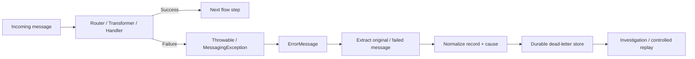

# Preserving the Original Message and Exception

In the **SPRING_INTEGRATION_PATTERN** module, **Enterprise Integration Patterns** are implemented via Spring Integration to build loosely coupled, extensible message flows. A message may pass through Router, Filter, Transformer, Splitter, Aggregator, and Gateway before failing at a handler. Once retries are no longer appropriate or are exhausted, moving the message to a **Dead Letter Channel (DLC)** only accomplishes *isolation*. To investigate the root cause and replay safely, you must also **preserve the original message along with exception details**.

That is the focus of **"Preserving the Original Message and Exception"**: how do we know which message failed, at which step the error occurred, why it failed, and what data must be retained so it can be reprocessed? This lesson covers Spring Integration's error model, durable storage design, Java/JDBC examples, testing, and common pitfalls when tracking processing branches.

## 1. Why Logging Only the Exception Is Not Enough

Suppose an order-processing flow runs as follows:

1. Receives a message with `eventId = evt-1024`, `orderId = ORD-42`.
2. A Transformer converts the data into a payment-service request.
3. The handler calls the service and gets a timeout; subsequent retries all fail.
4. The recovery flow needs to place the failure data into the DLC for operations inspection.

If you record only `TimeoutException: Read timed out`, you do not know which order stalled, what the original data was, which processing branch it belonged to, or whether replay is permitted.

If you retain only the payload `ORD-42`, you lack the failure cause, retry count, failing component, timestamp, and correlation trail.

Therefore, a **useful dead letter** must combine both parts:

- **Original message:** the payload content needed for recovery, identifiers, relevant business headers, and source information.
- **Exception / failure context:** error type, reason code, cause chain, failing handler, timestamp, retry status, and controlled diagnostic details.

You do not necessarily store raw serialized Java objects. In practice, you usually persist a **normalized record** or a reference to the original data, with explicit schema/versioning and security policies.

### Visualizing the Failed Message Lifecycle



**Note:** "Original message" must be defined intentionally. In Spring Integration, a `failedMessage` may be the message at the *failing endpoint*, meaning it has already passed through prior Transformers. It is not necessarily the exact first bytes received by the inbound adapter. If you need to replay from the very beginning, attach an identifier, schema, and initial payload reference as soon as the message enters the system.

## 2. Distinguishing `Message`, `MessagingException`, and `ErrorMessage`

Spring Messaging/Spring Integration uses these related types:

| Component | What It Carries | Key Points to Remember |
| --- | --- | --- |
| `Message<T>` | Payload of type `T` and `MessageHeaders` | The message moving through the flow at a given point |
| `MessagingException` | A `Throwable` that can hold `failedMessage` | Indicates which message was associated with the exception when created |
| `ErrorMessage` | A `Message<Throwable>`, which may hold `originalMessage` | The payload of `ErrorMessage` is the **exception**, not the business payload |
| `errorChannel` | Channel transporting `ErrorMessage` instances | An error-dispatching mechanism; does not guarantee durable storage by itself |
| Dead Letter Channel | Logical destination receiving failed message details | Requires dedicated design for writing, persisting, and investigation |

When an error flow receives an `ErrorMessage`, try in order:

1. `error.getOriginalMessage()`.
2. If that is `null`, walk the `Throwable.getCause()` chain to find `MessagingException.getFailedMessage()`.
3. If still absent, **persist an error record marked as missing source message**, and emit an alert according to severity. Never silently assume every exception carries a message.

Also, in the cause chain, the outermost exception may be a framework-wrapped `MessagingException`, while the deeper cause is a timeout or business failure. For investigation, distinguish the **wrapper exception** from the **root cause**.

### Short Example of the Two Message Sources

```java
Message<String> original = MessageBuilder.withPayload("ORD-42")
        .setHeader("eventId", "evt-1024")
        .setHeader("correlationId", "order-42")
        .build();

// ErrorMessage with originalMessage attached directly.
ErrorMessage withOriginal = new ErrorMessage(
        new IllegalStateException("Payment failed"), original);
Message<?> a = withOriginal.getOriginalMessage(); // original

// Case where originalMessage is absent, but the exception holds failedMessage.
MessagingException failure =
        new MessagingException(original, "Payment failed");
ErrorMessage withoutOriginal = new ErrorMessage(failure);
Message<?> b = ((MessagingException) withoutOriginal.getPayload())
        .getFailedMessage(); // original
```

Corresponding imports: `org.springframework.messaging.Message`, `org.springframework.messaging.MessagingException`, `org.springframework.messaging.support.MessageBuilder`, and `org.springframework.messaging.support.ErrorMessage`.

**Important:** Both `ErrorMessage.getOriginalMessage()` and `MessagingException.getFailedMessage()` can be `null`; custom exceptions, configuration errors, and certain adapters do not guarantee preserving the message. Error-handling code must tolerate this case.

## 3. Which Fields Should Be Stored?

A practical record should separate fields into clear groups:

| Group | Suggested Fields | Meaning |
| --- | --- | --- |
| Record identity | `deadLetterId` | Unique key for each failure write; do not use in place of `eventId` |
| Business identity | `eventId`, `orderId`, idempotency key | Identifies the transaction and prevents duplicate processing |
| Spring Message ID | `originalMessageId` | Traces the framework message |
| Correlation | `correlationId`, `sequenceNumber`, `sequenceSize` | Links Splitter/Aggregator branches and related flows |
| Content | Original payload or `payloadRef`, `contentType`, `schemaVersion` | Accurately restores data |
| Failure location | `flowId`, `componentId`, `sourceTopic`/queue | Pinpoints the failing component |
| Exception | `exceptionType`, `rootCauseType`, `reasonCode`, safe summary | Understands root cause and groups failures |
| Retry | `attemptsMade`, `maxAttempts`, `deliveryCount` | Separates application retries from broker redeliveries |
| Lifecycle | `failedAt`, `status`, `replayCount`, `lastReplayAt` | Manages investigation and replay |
| Security and audit | `payloadClassification`, `retentionUntil`, `lastUpdatedBy` | Controls access and retention period |

Not every field is required for every flow. For example, when a Filter successfully handles a message by dropping it, creating a dead letter makes no sense; when an Aggregator times out, you sometimes need to persist *the entire waiting message group*, rather than a single payload.

### What Does Preserving the Original Payload Mean?

Calling `String.valueOf(message.getPayload())` is **not a reliable way to preserve the original payload**. For an object, the result might just be a class name and object identity; for `byte[]`, the result is usually not the byte contents. For replay, choose an explicit representation:

- Payload is JSON or text: store the raw text/bytes along with `contentType`, encoding, and schema version.
- Payload is `byte[]`: store bytes as a BLOB or explicitly declared Base64 encoding.
- Payload is a business object: serialize via a controlled mechanism (e.g., Jackson with a stable DTO/schema), including version.
- Large or sensitive payloads: store in a dedicated store under access/retention policies; the DLC keeps only `payloadRef` and a checksum.

**Do not arbitrarily serialize Java objects or `Throwable` instances for replay.** The format depends on classpath and version, and deserializing untrusted objects carries security risks. Dead-letter records should use a data schema decoupled from implementation classes.

## 4. Keeping Exception Details Safe and Useful

A `Throwable` contains class name, message, cause chain, stack trace, and sometimes requests, credentials, or sensitive payloads. Separate data needed for operations from data that should not be persisted.

**Should be kept:**

- `exceptionType`: class name of the outermost exception.
- `rootCauseType`: class name of the deepest meaningful cause.
- `reasonCode`: stable application-defined error code such as `PAYMENT_TIMEOUT`, `INVALID_ORDER`.
- `safeSummary`: sanitized summary, e.g., "Downstream timeout".
- `failedAt`, component/flow, and correlation to link with logs/traces.
- Optionally a *list of exception types* in the cause chain if deep triage requires it.

**Handle with caution:**

- `exception.getMessage()` may contain tokens, URLs with keys, SQL statements, and sensitive data.
- Full stack traces bloat storage and may expose internal details.
- Serializing an entire `Throwable` couples persisted records to code versions.
- Putting exception messages into metric labels causes cardinality explosion and potential data leaks.

For errors needing deep investigation, write stack traces to an access-controlled logging/tracing system and store `traceId` in the dead letter. If stack traces must be stored in the DLC, apply redaction, length caps, access controls, and retention limits.

### Wrapper and Root Cause Differ

For example, suppose a flow receives:

```text
MessagingException: failed to handle message
  └─ PaymentGatewayException: payment call failed
       └─ SocketTimeoutException: Read timed out
```

`exceptionType` may be `MessagingException`, while `rootCauseType` is `SocketTimeoutException`. The code `reasonCode = PAYMENT_TIMEOUT` should come from an **application classifier**, rather than using the deepest class name directly as a business contract.

## 5. Java Example: Normalizing `ErrorMessage` Into `DeadLetterEntry`

The next example uses **Java 17+ and Spring Messaging/Spring Integration 6.x**. To focus on data preservation, it assumes **the incoming payload is a `String`**, such as JSON text or an order ID. If your system uses `byte[]` or DTOs, replace the conversion with an appropriate serializer as discussed in section 3.

We define a simple record capturing message ID, correlation, event ID, payload, exception, and failure timestamp. When the original message cannot be found, the record still retains exception details and flags the reason for investigation.

```java
package demo.integration;

import java.time.Instant;

public record DeadLetterEntry(
        String deadLetterId,
        String originalMessageId,
        String eventId,
        String correlationId,
        String payloadText,
        String schemaVersion,
        String exceptionType,
        String rootCauseType,
        String reasonCode,
        String safeSummary,
        Instant failedAt) {}
```

Mapper class:

```java
package demo.integration;

import java.time.Instant;
import java.util.UUID;

import org.springframework.messaging.Message;
import org.springframework.messaging.MessagingException;
import org.springframework.messaging.support.ErrorMessage;

public final class DeadLetterMapper {

    public DeadLetterEntry fromError(ErrorMessage error) {
        Throwable failure = error.getPayload(); // Payload is Throwable!
        Message<?> original = findOriginalMessage(error);
        Throwable root = rootCause(failure);

        // This lesson accepts String payloads. For other types, fail explicitly:
        // operations must handle it or replace with a schema-appropriate serializer.
        String payloadText = null;
        if (original != null) {
            if (!(original.getPayload() instanceof String text)) {
                throw new IllegalArgumentException(
                        "Demo mapper only accepts String payload");
            }
            payloadText = text;
        }

        return new DeadLetterEntry(
                UUID.randomUUID().toString(),
                original == null || original.getHeaders().getId() == null
                        ? null : original.getHeaders().getId().toString(),
                headerText(original, "eventId"),
                headerText(original, "correlationId"),
                payloadText,
                headerText(original, "schemaVersion"),
                failure.getClass().getName(),
                root.getClass().getName(),
                reasonCode(root, original),
                safeSummary(root),
                Instant.now());
    }

    static Message<?> findOriginalMessage(ErrorMessage error) {
        if (error.getOriginalMessage() != null) {
            return error.getOriginalMessage();
        }
        for (Throwable current = error.getPayload();
                current != null; current = current.getCause()) {
            if (current instanceof MessagingException me
                    && me.getFailedMessage() != null) {
                return me.getFailedMessage();
            }
        }
        return null;
    }

    private static Throwable rootCause(Throwable failure) {
        Throwable root = failure;
        while (root.getCause() != null) {
            root = root.getCause();
        }
        return root;
    }

    private static String headerText(Message<?> source, String name) {
        if (source == null) {
            return null;
        }
        Object value = source.getHeaders().get(name);
        return value == null ? null : String.valueOf(value);
    }

    private static String reasonCode(
            Throwable cause, Message<?> original) {
        if (original == null) {
            return "ORIGINAL_MESSAGE_UNAVAILABLE";
        }
        if (cause instanceof IllegalArgumentException) {
            return "INVALID_INPUT";
        }
        if (cause instanceof java.net.SocketTimeoutException) {
            return "DOWNSTREAM_TIMEOUT";
        }
        // Default code: triage is needed if the error is unrecognized.
        return "UNCLASSIFIED_FAILURE";
    }

    private static String safeSummary(Throwable cause) {
        // Do not store Throwable.getMessage() directly without a policy
        // controlling sensitive data.
        if (cause instanceof java.net.SocketTimeoutException) {
            return "Downstream timeout";
        }
        if (cause instanceof IllegalArgumentException) {
            return "Invalid input";
        }
        return "Processing failed; inspect trace with access control";
    }
}
```

In this code, **the source message is recovered via two paths**: `ErrorMessage.getOriginalMessage()` first, then `MessagingException.getFailedMessage()` along the cause chain. As a result, the mapper works across different error wrapper styles.

This example **demonstrates the mechanism**; three aspects must be extended for production:

1. `findOriginalMessage()` only guarantees the message attached to the error, not necessarily the initial payload before any Transformer; to replay from the start, preserve `eventId` or `payloadRef` at ingress.
2. `reasonCode()` maps from the root cause for a few sample exception types. In real applications, use stable business exceptions/error codes and a tested classifier. Do not treat every `IllegalArgumentException` as a source-payload error.
3. If the mapper encounters a non-`String` payload, it **throws**, signaling to the error flow that a serializer is missing. Never catch that and silently save `payloadText = null` while still marking it replayable.

One essential field this example does not guess is **retry count**. `ErrorMessage` does not guarantee a standard "total attempts" field across all sources. To record `attemptsMade`, collect it from a retry listener/context or a dedicated metric/hook; use separate counters for broker redeliveries and replays.

## 6. Persisting Records With JDBC Instead of Keeping Only in Memory

Dead Letter Channel is the error-routing path. The **durable store** sits behind it: a database table, a DLQ topic, or an acknowledged storage service. With JDBC, you can design an example table (PostgreSQL):

```sql
CREATE TABLE dead_letters (
    dead_letter_id       varchar(36) PRIMARY KEY,
    original_message_id  varchar(64),
    event_id             varchar(128),
    correlation_id       varchar(128),
    payload_text         text,
    schema_version       varchar(32),
    exception_type       varchar(255) NOT NULL,
    root_cause_type      varchar(255) NOT NULL,
    reason_code          varchar(64) NOT NULL,
    safe_summary         varchar(255),
    failed_at            timestamptz NOT NULL,
    status               varchar(24) NOT NULL DEFAULT 'NEW'
);

CREATE INDEX idx_dead_letters_status_failed_at
    ON dead_letters (status, failed_at);

CREATE INDEX idx_dead_letters_event_id
    ON dead_letters (event_id);
```

Each record has a unique `deadLetterId` for **each failure write**; the same `eventId` can appear multiple times due to redelivery or replay. Business processing must enforce idempotency using an appropriate business key rather than relying solely on distinct `deadLetterId` values.

JDBC writer class:

```java
package demo.integration;

import org.springframework.jdbc.core.JdbcTemplate;

public final class DeadLetterJdbcStore {
    private final JdbcTemplate jdbc;

    public DeadLetterJdbcStore(JdbcTemplate jdbc) {
        this.jdbc = jdbc;
    }

    public void save(DeadLetterEntry entry) {
        jdbc.update("""
            INSERT INTO dead_letters (
                dead_letter_id, original_message_id, event_id,
                correlation_id, payload_text, schema_version,
                exception_type, root_cause_type, reason_code,
                safe_summary, failed_at
            )
            VALUES (?, ?, ?, ?, ?, ?, ?, ?, ?, ?, ?)
            """,
            entry.deadLetterId(),
            entry.originalMessageId(),
            entry.eventId(),
            entry.correlationId(),
            entry.payloadText(),
            entry.schemaVersion(),
            entry.exceptionType(),
            entry.rootCauseType(),
            entry.reasonCode(),
            entry.safeSummary(),
            java.sql.Timestamp.from(entry.failedAt()));
    }
}
```

Here `JdbcTemplate.update(...)` returns only after the database executes the statement within the current transaction context. If the database is unavailable, let the write failure be detected; never assume or report that the dead letter was saved successfully. To guarantee commit before source ACK, design the inbound adapter's transaction/ack behavior explicitly.

### Wiring the Mapper and Store Into an Error Flow

In Spring Integration configuration, declare an error channel and an `IntegrationFlow` that persists the record:

```java
package demo.integration;

import org.springframework.context.annotation.Bean;
import org.springframework.context.annotation.Configuration;
import org.springframework.integration.channel.DirectChannel;
import org.springframework.integration.config.EnableIntegration;
import org.springframework.integration.dsl.IntegrationFlow;
import org.springframework.jdbc.core.JdbcTemplate;
import org.springframework.messaging.MessageChannel;
import org.springframework.messaging.support.ErrorMessage;

@Configuration
@EnableIntegration
public class DeadLetterPersistenceConfiguration {

    @Bean
    MessageChannel recoveryErrors() {
        return new DirectChannel();
    }

    @Bean
    DeadLetterMapper deadLetterMapper() {
        return new DeadLetterMapper();
    }

    @Bean
    DeadLetterJdbcStore deadLetterJdbcStore(JdbcTemplate jdbc) {
        return new DeadLetterJdbcStore(jdbc);
    }

    @Bean
    IntegrationFlow deadLetterPersistenceFlow(
            DeadLetterMapper mapper, DeadLetterJdbcStore store) {
        return IntegrationFlow.from("recoveryErrors")
                .<ErrorMessage, DeadLetterEntry>transform(mapper::fromError)
                .handle(store, "save")
                .get();
    }
}
```

When configuring `RequestHandlerRetryAdvice` on the main processing endpoint, publish errors to `recoveryErrors` after retries are exhausted:

```java
// Inside RequestHandlerRetryAdvice configuration, once RetryTemplate is created:
advice.setRecoveryCallback(
        new ErrorMessageSendingRecoverer(recoveryErrors));
```

You must import `org.springframework.integration.handler.advice.ErrorMessageSendingRecoverer`. The short snippet above is an **additional configuration fragment**, not automatically applied to the whole application. The handler endpoint must have `RequestHandlerRetryAdvice` attached; the dedicated error channel must have a subscriber; and the retry policy still needs exception classification.

**Key characteristic of this pattern:** `recoveryErrors` is a `DirectChannel`; the transform + JDBC write usually runs synchronously when the error message is sent. If the mapper or database throws an exception, the error flow fails too. Whether that error propagates to the caller or affects the source ACK depends on the endpoint, advice, and inbound adapter. Never catch a DLC write failure and return success unless you have a recovery fallback.

### Example of a Persisted Record

Suppose the incoming message is:

```text
Payload: "ORD-42"
Headers:
  eventId: "evt-1024"
  correlationId: "order-42"
  schemaVersion: "1"
```

The handler throws an exception classified as `DOWNSTREAM_TIMEOUT`. The persisted record might look like:

```json
{
  "deadLetterId": "new-uuid-for-this-failure",
  "originalMessageId": "message-uuid-from-spring",
  "eventId": "evt-1024",
  "correlationId": "order-42",
  "payloadText": "ORD-42",
  "schemaVersion": "1",
  "exceptionType": "org.springframework.messaging.MessagingException",
  "rootCauseType": "java.net.SocketTimeoutException",
  "reasonCode": "DOWNSTREAM_TIMEOUT",
  "safeSummary": "Downstream timeout",
  "failedAt": "2026-11-21T08:00:00Z",
  "status": "NEW"
}
```

The values here only illustrate the schema. Timestamps and UUIDs are generated at the actual failure time. If the exception is not wrapped in `MessagingException`, `exceptionType` will be the actual exception class.

## 7. Headers That Should Not Be Copied Verbatim

In Spring Integration, `MessageHeaders` may contain internal framework objects and sensitive data. Copying the whole map and serializing it to JSON can fail or leak sensitive information.

| Header Category | Example | Policy |
| --- | --- | --- |
| Business headers | `eventId`, `correlationId`, `tenant-neutral business key` | Store only fields needed for tracing, with sensitive-data controls |
| Version and format | `contentType`, `schemaVersion`, encoding | Keep so payloads can be decoded/replayed |
| Internal routing headers | `replyChannel`, `errorChannel` | Often live objects/channels; do not serialize arbitrarily |
| Security headers | Authorization, API token, cookie | Never store directly; strip or replace with a safe reference |
| Broker metadata | Topic, partition, offset, delivery tag | Keep only values needed for audit; do not reuse as an ACK handle |
| Message ID / timestamp | `MessageHeaders.ID`, `TIMESTAMP` | Helpful for tracing, but do not replace business idempotency keys |

In flows with **Splitter/Aggregator**, preserving `correlationId` and related sequence fields is essential; storing a single message without knowing its group makes reconstructing the aggregation very hard. With **Router**, you can store the selected branch name to see which endpoint failed. With **Gateway**, decide explicitly how errors are returned to the caller: saving a dead letter does **not** mean you can return a success response to a synchronous request.

## 8. Testing Message and Exception Persistence

Start with unit tests for the mapper. The cases below test message extraction and exception details directly without needing a database. Example using JUnit 5 and AssertJ:

```java
package demo.integration;

import static org.assertj.core.api.Assertions.assertThat;

import org.junit.jupiter.api.Test;
import org.springframework.messaging.MessagingException;
import org.springframework.messaging.support.ErrorMessage;
import org.springframework.messaging.support.MessageBuilder;

class DeadLetterMapperTest {
    private final DeadLetterMapper mapper = new DeadLetterMapper();

    @Test
    void keepsOriginalMessageFromErrorMessage() {
        var original = MessageBuilder.withPayload("ORD-42")
                .setHeader("eventId", "evt-1024")
                .setHeader("correlationId", "order-42")
                .setHeader("schemaVersion", "1")
                .build();

        var error = new ErrorMessage(
                new IllegalArgumentException("Sensitive detail"), original);
        var record = mapper.fromError(error);

        assertThat(record.originalMessageId())
                .isEqualTo(original.getHeaders().getId().toString());
        assertThat(record.payloadText()).isEqualTo("ORD-42");
        assertThat(record.eventId()).isEqualTo("evt-1024");
        assertThat(record.correlationId()).isEqualTo("order-42");
        assertThat(record.schemaVersion()).isEqualTo("1");
        assertThat(record.reasonCode()).isEqualTo("INVALID_INPUT");
        // Error info uses a controlled summary:
        assertThat(record.safeSummary()).isEqualTo("Invalid input");
    }

    @Test
    void usesFailedMessageFromMessagingExceptionWhenNeeded() {
        var original = MessageBuilder.withPayload("ORD-43")
                .setHeader("eventId", "evt-1025")
                .build();
        var error = new ErrorMessage(
                new MessagingException(original, "Processing failed"));

        var record = mapper.fromError(error);

        assertThat(record.payloadText()).isEqualTo("ORD-43");
        assertThat(record.eventId()).isEqualTo("evt-1025");
    }

    @Test
    void keepsExceptionEvenIfOriginalMessageIsMissing() {
        var error = new ErrorMessage(new IllegalStateException(
                "Unknown failure"));

        var record = mapper.fromError(error);

        assertThat(record.payloadText()).isNull();
        assertThat(record.originalMessageId()).isNull();
        assertThat(record.reasonCode())
                .isEqualTo("ORIGINAL_MESSAGE_UNAVAILABLE");
        assertThat(record.exceptionType())
                .isEqualTo(IllegalStateException.class.getName());
    }
}
```

These are **illustrative tests** following the API, not executed in a repository while authoring this Markdown. In a real system, add integration tests:

- Send an `ErrorMessage` to `recoveryErrors` and verify the record appears in the database with the right `eventId/correlationId`.
- Simulate the database rejecting writes and verify the application does not report safe persistence.
- Simulate `byte[]` or DTO payloads and verify the serializer preserves original data and schema version.
- Use nested exceptions and verify `exceptionType` differs from `rootCauseType` while `reasonCode` remains accurate.
- Create an error with neither `originalMessage` nor `failedMessage` and verify an appropriate error record/alert is still produced.
- Pass a message through a Transformer, fail the handler, and verify the source identifier and payload reference remain traceable.
- If the source is a broker, test restarts/redeliveries and failures between source ACK and dead-letter commit.

## 9. Replay: Why Saving Complete Data Is Still Not Enough

From the DLC store, operators can select messages after fixing the root cause. However, replay is not as simple as reading `payloadText` and sending it back to `ordersInput`:

1. Determine the **replay entry point**: from the original inbound event or from a message already transformed? Choose the matching schema.
2. Verify whether the business operation already completed; if payment might have succeeded, check current state before re-invoking.
3. Use a stable idempotency key such as `eventId` or `orderId + operationType`; never use `deadLetterId` as the sole execution key.
4. Check payload/schema versions and data that may have changed over time; if payload edits are required, keep an audit trail linking the edit to the source data.
5. Enforce a `replayCount` limit and rate limits; keep `replayOf` to trace back to the earlier failure.
6. Transition `NEW → REPLAYED` only after an outcome or confirmed transaction per contract; avoid marking complete immediately upon dispatching an async command.

Do not restore serialized `replyChannel`/`errorChannel` internal objects from an earlier process. When replaying, construct a fresh message with **allowlisted business headers**, and re-establish channel routing and correlation for the current flow.

## 10. Ensuring Durable Persistence, Observability, and Incident Handling

The most common failure is writing a log entry while **losing the message needed for recovery**. To prevent this, specify data durability guarantees:

- Default `QueueChannel` stores messages in memory; data is lost on process restart.
- JDBC writes must account for **commit** timing, transactions, and how the inbound adapter acknowledges messages.
- Broker DLQs have their own delivery/ack mechanics; publisher confirms, transactions, and idempotent consumers may need to be combined.
- If writing to the error store succeeds but source ACK fails, the source may redeliver and create duplicate records; have a detection strategy.
- If source ACK succeeds before writing the error record, unrecoverable message loss can occur; prevent this by design.

Operations should measure **dead letters persisted**, **dead-letter write failures**, **pending message age**, **replay success rate**, and **rate of missing original messages**. Metrics should use low-cardinality labels like flow, reason code, and exception type; use access-controlled trace/correlation IDs in logs to locate specific messages.

### Implementation Mistakes to Avoid

| Mistake | Consequence | Remedy |
| --- | --- | --- |
| Treating `ErrorMessage` payload as business payload | Serializes the exception by mistake | Extract `originalMessage`/`failedMessage` via proper API |
| Storing only `Throwable.toString()` | Missing event ID, payload, correlation | Persist a schema-backed normalized record |
| Assuming the source message is always present | `NullPointerException` or lost trace | Allow `null` and emit an alert |
| Treating `failedMessage` as the initial inbound message | Replays wrong schema or entry point | Attach `eventId` and `payloadRef` at flow ingress |
| Saving the entire headers map | Leaks tokens, fails serializing channel objects | Allowlist headers and sanitize data |
| Storing only `String.valueOf(payload)` | Loses fidelity for DTOs or byte arrays | Use schema-aware serializer or store raw bytes |
| Storing unbounded full stack traces | Sensitive data exposure, store bloat | Redact, cap length, use trace references |
| Assuming `QueueChannel` is durable | May lose errors on restart | Use JDBC/broker/persistent message store |
| Ignoring DLC write failures | False ACK, message loss | Propagate failure and handle transactions/redelivery |
| Replaying without idempotency | Repeats business side effects | Use stable keys and check prior state |

## 11. Self-Check Questions

1. Why is `ErrorMessage.getPayload()` not the business payload?
2. Under what circumstances can `ErrorMessage.getOriginalMessage()` return `null`? What is the fallback?
3. How can a message failing after a Transformer differ from the initial inbound message?
4. Why should `eventId` and `correlationId` be saved in addition to `MessageHeaders.ID`?
5. How do `exceptionType` and `rootCauseType` differ in a nested-exception scenario?
6. Why should `Throwable.getMessage()` and the entire headers map not be saved directly in the DLC?
7. Is `String.valueOf(byte[])` enough to restore the original payload? What should be done instead?
8. When a JDBC dead-letter insert fails after the source has already ACKed the message, what is the consequence?
9. In a flow with Splitter/Aggregator, which metadata helps reassemble the message group?
10. What must be verified before replaying a payment event that previously timed out?

## References

- [Spring Integration Reference — Error Handling](https://docs.spring.io/spring-integration/reference/error-handling.html): how `ErrorMessage` is published and how error channels work.
- [Spring Integration Reference — Provided Advice Classes](https://docs.spring.io/spring-integration/reference/handler-advice/classes.html): retry advice and `ErrorMessageSendingRecoverer`.
- [Spring Framework API — ErrorMessage](https://docs.spring.io/spring-framework/docs/current/javadoc-api/org/springframework/messaging/support/ErrorMessage.html): `getOriginalMessage()` and exception payload.
- [Spring Framework API — MessagingException](https://docs.spring.io/spring-framework/docs/current/javadoc-api/org/springframework/messaging/MessagingException.html): `getFailedMessage()`.
- [Spring Framework API — JdbcTemplate](https://docs.spring.io/spring-framework/docs/current/javadoc-api/org/springframework/jdbc/core/JdbcTemplate.html): database writes via JDBC.

> **Key Takeaway:** When persisting dead letters, preserve **recoverable identifiers and payload**, **flow/correlation tracing metadata**, and **safe, structured exception details**. Spring Integration provides `ErrorMessage`, `originalMessage`, and `failedMessage` to help extraction; durable storage, security, source ACKs, and safe replay remain the responsibility of application design.
