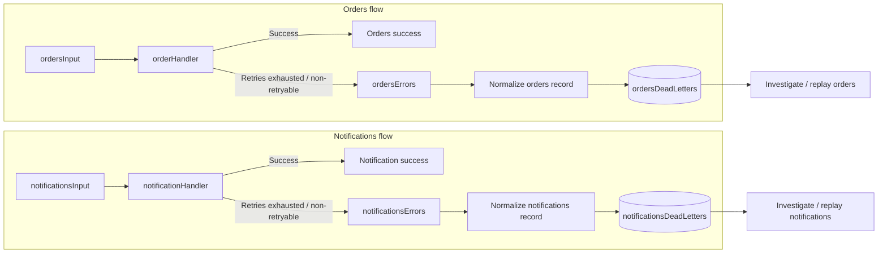

# Scoping Dead Letter Channels Per Flow

In the **SPRING_INTEGRATION_PATTERN** module, we use Spring Integration to implement **Enterprise Integration Patterns** (EIP) such as Router, Filter, Transformer, Splitter, Aggregator, and Gateway through message channels. Connecting components this way keeps the system loosely coupled and extensible, while raising an operational question: **when a message cannot be processed, where should the failure go if the application runs multiple independent flows?**

A **Dead Letter Channel (DLC)** is a logical destination receiving messages that cannot continue processing under application policy. A system can use **one shared channel** or **one dedicated channel per flow**. The topic of this lesson is **scoping dead letter channels per flow**: each business flow gets a clear recovery path, retry policy, error record schema, and operational lifecycle.

Running example: the application has two flows:

- **Orders flow** processes orders. Transient errors are retried up to **2 handler invocations** before routing to `ordersDeadLetters`.
- **Notifications flow** sends notifications. Transient errors are retried up to **3 handler invocations** before routing to `notificationsDeadLetters`.

Both flows can run inside the same Spring Integration application, yet failed order messages must never mix with the notification error store.

## 1. Why Tie Dead Letters to Each Flow?

Suppose there is only one shared `deadLetters` channel for all errors. If that channel receives an `ErrorMessage` from `paymentHandler`, operators have to infer which process failed from headers or exception text. When an application spans multiple business domains, this causes:

1. **Difficult routing and access control:** the payment operations team should not necessarily view user notification payloads.
2. **Blurred policies:** orders may require 30-day retention and manual replay; notifications may expire after a few hours.
3. **Weak observability:** hard to tell which flow has a high failure rate without `flowId` and metadata.
4. **Incident blast radius:** one flow producing a burst of dead letters can exhaust storage capacity for another flow.
5. **Accidental mis-targeted replay:** a notification payload could be mistakenly re-sent to the order handler.

Binding a DLC to a flow establishes clear ownership boundaries. However, **"one channel per flow" does not require "one database per flow."** You can declare multiple logical channels backed by a shared durable persistence service, provided every record carries `flowId` and access/retention/replay policies are enforced per flow.

### Three Layers to Distinguish

| Layer | Function | Example |
| --- | --- | --- |
| Business flow | Processes business messages | `ordersFlow`, `notificationsFlow` |
| Flow-scoped recovery/error channel | Receives `ErrorMessage` when an endpoint fails and enters recovery | `ordersErrors`, `notificationsErrors` |
| Dead letter channel and store | Normalizes, isolates, and persists unprocessable messages | `ordersDeadLetters`, `notificationsDeadLetters`; backing table or broker DLQ |

**Do not treat `errorChannel` and dead letter as the same thing.** An error channel transports failures. A dead letter is the outcome of deciding to isolate and retain a message for investigation. A flow can receive an error and **alert/pause** instead of pushing every exception into a DLC.

## 2. Two Independent Dead Letter Channels Model



Both branches share the same **error-handling structure**, yet use separate channel instances. An issue in notifications must never alter message state in orders.

In Spring Integration, **recovery must be wired to the right endpoint**. Simply declaring two beans named `ordersDeadLetters` and `notificationsDeadLetters` will not make exceptions automatically route to the right channel. You must configure the path from failing handler to error channel, from error channel to dead letter, and the backing persistence mechanism.

### Naming Conventions

A consistent naming convention could look like:

| Flow | Input | Error/recovery | Dead letter |
| --- | --- | --- | --- |
| Orders | `ordersInput` | `ordersErrors` | `ordersDeadLetters` |
| Notifications | `notificationsInput` | `notificationsErrors` | `notificationsDeadLetters` |
| Inventory | `inventoryInput` | `inventoryErrors` | `inventoryDeadLetters` |

Names should convey the **business owner** and **channel role**. For a flow with multiple endpoints and distinct policies, be more specific: `ordersPaymentErrors`, `ordersInventoryErrors`. There is no need to create a new channel per exception class if a single recovery flow can classify errors cleanly.

## 3. Identify Error Emission Points Before Choosing a DLC

Spring Integration handles errors differently depending on endpoint type and execution model. This is a common spot for misconfiguration.

| Error Source | What Normally Happens? | How to Route to Flow-Scoped DLC |
| --- | --- | --- |
| `DirectChannel` + synchronous handler | Exceptions may throw straight back to the caller | Use advice/recovery callback, or have caller catch and route intentionally |
| Handler with `RequestHandlerRetryAdvice` | Handler is retried via `RetryTemplate` | Point `ErrorMessageSendingRecoverer` to **that flow's error channel** |
| Poller or async adapter with error handler | Framework can publish `ErrorMessage` to an error channel | Set an appropriate error channel and route to the flow's error flow |
| Message with `errorChannel` header | Certain error emitters consult this header | Set internally per flow and check execution context; do not assume every sync exception routes there |
| Broker with DLQ support | Broker has its own reject/redelivery/dead-letter policies | Configure at the broker/adapter; does not activate automatically by naming a Spring bean "deadLetters" |

For synchronous flows, **merely setting the `errorChannel` header does not guarantee exceptions will be caught and routed there**. A transparent approach is attaching retry/recovery advice directly to the handler whose failures you want to manage.

For messages traversing multiple steps, clarify **advice scope**: advice on an endpoint wraps only that endpoint. If an upstream Router, Transformer, or downstream handler fails outside the advice scope, that error can take a different path. Inventory all error-emission points of each flow, especially when combining Gateways with asynchronous components.

## 4. Spring Integration Example: Separate DLCs for Orders and Notifications

This example uses **Java 17+, Spring Integration 6.x, and Spring Retry**. To focus on channel wiring, dead letters are placed in **in-memory** `QueueChannel` instances; section 7 shows how to replace them with durable storage.

Both handlers receive `Message<String>`. When the payload starts with `FAIL-`, the handler simulates a transient connectivity failure. The exception is wrapped in `MessageHandlingException` to retain the message at the failing endpoint; the retry policy is configured with nested-cause traversal enabled.

```java
package demo.integration;

import java.time.Instant;
import java.util.Map;
import java.util.UUID;
import java.util.concurrent.atomic.AtomicInteger;

import org.springframework.beans.factory.annotation.Qualifier;
import org.springframework.context.annotation.Bean;
import org.springframework.context.annotation.Configuration;
import org.springframework.integration.channel.DirectChannel;
import org.springframework.integration.channel.QueueChannel;
import org.springframework.integration.config.EnableIntegration;
import org.springframework.integration.dsl.IntegrationFlow;
import org.springframework.integration.handler.advice.ErrorMessageSendingRecoverer;
import org.springframework.integration.handler.advice.RequestHandlerRetryAdvice;
import org.springframework.messaging.Message;
import org.springframework.messaging.MessageChannel;
import org.springframework.messaging.MessageHandlingException;
import org.springframework.messaging.MessagingException;
import org.springframework.messaging.support.ErrorMessage;
import org.springframework.retry.backoff.FixedBackOffPolicy;
import org.springframework.retry.policy.SimpleRetryPolicy;
import org.springframework.retry.support.RetryTemplate;

@Configuration
@EnableIntegration
public class FlowScopedDeadLetterConfiguration {

    // A. Input channel for each flow.
    @Bean
    MessageChannel ordersInput() {
        return new DirectChannel();
    }

    @Bean
    MessageChannel notificationsInput() {
        return new DirectChannel();
    }

    // B. Dedicated recovery channels: each channel receives ErrorMessage.
    @Bean
    MessageChannel ordersErrors() {
        return new DirectChannel();
    }

    @Bean
    MessageChannel notificationsErrors() {
        return new DirectChannel();
    }

    // C. Flow-scoped dead-letter channels.
    // Demo only: default QueueChannel does not persist durably.
    @Bean
    QueueChannel ordersDeadLetters() {
        return new QueueChannel(50);
    }

    @Bean
    QueueChannel notificationsDeadLetters() {
        return new QueueChannel(50);
    }

    @Bean
    DemoHandler orderHandler() {
        return new DemoHandler("orders");
    }

    @Bean
    DemoHandler notificationHandler() {
        return new DemoHandler("notifications");
    }

    // D. Two advices with different retry budgets and recovery destinations.
    @Bean
    RequestHandlerRetryAdvice ordersRetryAdvice(
            @Qualifier("ordersErrors") MessageChannel errors) {
        return adviceFor(errors, 2);
    }

    @Bean
    RequestHandlerRetryAdvice notificationsRetryAdvice(
            @Qualifier("notificationsErrors") MessageChannel errors) {
        return adviceFor(errors, 3);
    }

    private static RequestHandlerRetryAdvice adviceFor(
            MessageChannel errorDestination, int maxAttempts) {
        Map<Class<? extends Throwable>, Boolean> retryable = Map.of(
                TemporaryDependencyException.class, true);

        // traverseCauses=true, defaultValue=false:
        // retry only TemporaryDependencyException, even when wrapped.
        SimpleRetryPolicy policy =
                new SimpleRetryPolicy(
                        maxAttempts, retryable, true, false);

        FixedBackOffPolicy backoff = new FixedBackOffPolicy();
        backoff.setBackOffPeriod(50); // ms, shortened for demo

        RetryTemplate template = new RetryTemplate();
        template.setRetryPolicy(policy);
        template.setBackOffPolicy(backoff);

        RequestHandlerRetryAdvice advice = new RequestHandlerRetryAdvice();
        advice.setRetryTemplate(template);
        advice.setRecoveryCallback(
                new ErrorMessageSendingRecoverer(errorDestination));
        return advice;
    }

    // E. Advice attached directly to each business flow's handler.
    @Bean
    IntegrationFlow ordersFlow(
            @Qualifier("orderHandler") DemoHandler handler,
            @Qualifier("ordersRetryAdvice") RequestHandlerRetryAdvice advice) {
        return IntegrationFlow.from("ordersInput")
                .handle(handler, "process", spec -> spec.advice(advice))
                .get();
    }

    @Bean
    IntegrationFlow notificationsFlow(
            @Qualifier("notificationHandler") DemoHandler handler,
            @Qualifier("notificationsRetryAdvice") RequestHandlerRetryAdvice advice) {
        return IntegrationFlow.from("notificationsInput")
                .handle(handler, "process", spec -> spec.advice(advice))
                .get();
    }

    // F. Each recovery flow receives ErrorMessage for its flow,
    // normalizes with a fixed flowId, and routes to the corresponding DLC.
    @Bean
    IntegrationFlow ordersRecoveryFlow() {
        return IntegrationFlow.from("ordersErrors")
                .<ErrorMessage, DeadLetterRecord>transform(
                        error -> toDeadLetter("orders", error))
                .channel("ordersDeadLetters")
                .get();
    }

    @Bean
    IntegrationFlow notificationsRecoveryFlow() {
        return IntegrationFlow.from("notificationsErrors")
                .<ErrorMessage, DeadLetterRecord>transform(
                        error -> toDeadLetter("notifications", error))
                .channel("notificationsDeadLetters")
                .get();
    }

    private static DeadLetterRecord toDeadLetter(
            String flowId, ErrorMessage error) {
        Message<?> failed = error.getOriginalMessage();

        // If originalMessage is absent, search for failedMessage in the cause chain.
        if (failed == null) {
            for (Throwable current = error.getPayload();
                    current != null; current = current.getCause()) {
                if (current instanceof MessagingException me
                        && me.getFailedMessage() != null) {
                    failed = me.getFailedMessage();
                    break;
                }
            }
        }

        Throwable root = error.getPayload();
        while (root.getCause() != null) {
            root = root.getCause();
        }

        Object event = failed == null
                ? null : failed.getHeaders().get("eventId");
        Object correlation = failed == null
                ? null : failed.getHeaders().get("correlationId");

        String reason = root instanceof TemporaryDependencyException
                ? "RETRY_EXHAUSTED" : "UNCLASSIFIED_FAILURE";

        return new DeadLetterRecord(
                UUID.randomUUID().toString(),
                flowId,
                failed == null || failed.getHeaders().getId() == null
                        ? null : failed.getHeaders().getId().toString(),
                event == null ? null : event.toString(),
                correlation == null ? null : correlation.toString(),
                failed != null && failed.getPayload() instanceof String s
                        ? s : null,
                reason,
                root.getClass().getName(),
                Instant.now());
    }

    public static class DemoHandler {
        private final String flowId;
        private final AtomicInteger attempts = new AtomicInteger();

        DemoHandler(String flowId) {
            this.flowId = flowId;
        }

        public void process(Message<String> message) {
            attempts.incrementAndGet();
            if (message.getPayload().startsWith("FAIL-")) {
                throw new MessageHandlingException(
                        message,
                        "Downstream unavailable for " + flowId,
                        new TemporaryDependencyException("Temporary outage"));
            }
            // Success branch: real business processing goes here.
        }

        public int attemptCount() {
            return attempts.get();
        }
    }

    public static class TemporaryDependencyException
            extends RuntimeException {
        TemporaryDependencyException(String message) {
            super(message);
        }
    }

    public record DeadLetterRecord(
            String deadLetterId,
            String flowId,
            String failedMessageId,
            String eventId,
            String correlationId,
            String payloadText,
            String reasonCode,
            String exceptionType,
            Instant failedAt) {}
}
```

### Tracing Each Flow's Path

**When sending `FAIL-ORDER-1` to `ordersInput`:**

1. Message arrives at `orderHandler.process(...)`.
2. Advice `ordersRetryAdvice` runs with `maxAttempts = 2`; the handler is called at most **2 times including the initial attempt**.
3. `ErrorMessageSendingRecoverer` publishes the error to **`ordersErrors`**.
4. `ordersRecoveryFlow` creates `DeadLetterRecord(flowId="orders", ...)` and sends it to **`ordersDeadLetters`**.
5. `notificationsDeadLetters` receives no record from this failure.

**When sending `FAIL-NOTIFY-1` to `notificationsInput`**, similar steps run inside the **notifications branch**, except its advice allows **3 handler invocations** and recovery routes to `notificationsErrors` and then `notificationsDeadLetters`.

For payloads not starting with `FAIL-`, the handler completes normally; no dead letter is created. The retry counts in the example apply to *transient errors*, because `SimpleRetryPolicy` only permits retrying `TemporaryDependencyException`. Other exceptions can still reach the recovery callback without necessarily being "retry exhausted"; hence the mapper assigns `UNCLASSIFIED_FAILURE` for out-of-pattern cases.

**Guarantee scope of the example:** This is a single-handler-per-flow demo with simulated connectivity errors. Both `QueueChannel` beans are capacity-bounded, in-memory, and lose data when the process stops. In production, add an exception classifier so widespread configuration errors are not dumped indiscriminately into the DLC, and replace the sinks with durable storage matching data guarantees.

## 5. Why Keep `flowId` Even When Separate Channels Exist?

Imagine messages from `ordersDeadLetters` are later forwarded to a centralized storage service, or an operator exports records as JSON for investigation. Once detached from the original channel name, a record loses context without `flowId`.

A dead letter should include these fields:

| Field | Example | Role |
| --- | --- | --- |
| `deadLetterId` | New UUID | Identifies one failure write |
| `flowId` | `orders` | Identifies the owning flow |
| `failedComponent` | `orderHandler` | Identifies the endpoint that threw |
| `failedMessageId` | Spring Message ID | Traces within the flow |
| `eventId` / idempotency key | `evt-1001` | Distinguishes business events and prevents duplicates |
| `correlationId` | `order-42` | Correlates Router/Splitter/Aggregator/Gateway |
| `payloadRef` or schema-typed payload | Original JSON ref | Enables accurate fixing/replaying |
| `reasonCode` | `RETRY_EXHAUSTED` | Aggregates by root cause |
| `attemptsMade` | 2 | Attempts in the cycle (when instrumented) |
| `deliveryCount` / `replayCount` | Source-dependent | Separates broker redelivery from replay |
| `failedAt` / `status` | UTC, `NEW` | Manages lifecycle |

The example uses `payloadText` and omits `failedComponent` and retry counts. That is a simplification for documentation; production deployments need an appropriate schema. Do not infer `attemptsMade` from the exception type: capture it from a retry context/listener or designed instrumentation.

### Where Is the Original Message From?

`ErrorMessage.getOriginalMessage()` and `MessagingException.getFailedMessage()` recover the message associated with the failure, though **not always the payload as received at inbound**. If the flow has already passed through a Transformer, the payload at the handler may differ from the input data. To replay from the start of the flow, preserve `eventId`, schema version, and an input payload reference at ingress.

Do not serialize all headers and replay them blindly. Headers like `replyChannel` and `errorChannel` may be internal objects. Save only allowlisted headers, and on replay construct a new message with reconfigured routing. Never write bearer tokens, cookies, sensitive payloads, or uncontrolled full `Throwable.getMessage()` strings into the error store.

## 6. Setting the Error Channel Per Message in Asynchronous Flows

Beyond recovery callbacks attached to endpoints, some **asynchronous** error emitters or Spring Integration-managed pollers can route `ErrorMessage` via the `errorChannel` header.

Example of setting the flow-specific header from an **application-controlled source**:

```java
import org.springframework.messaging.Message;
import org.springframework.messaging.MessageHeaders;
import org.springframework.messaging.support.MessageBuilder;

Message<String> orderMessage = MessageBuilder.withPayload("ORDER-42")
        .setHeader("eventId", "evt-42")
        .setHeader("correlationId", "order-42")
        .setHeader(MessageHeaders.ERROR_CHANNEL, "ordersErrors")
        .build();
```

A header holding a **channel name** can be resolved by the framework's error handler in suitable contexts. However:

- This header **does not replace** `RequestHandlerRetryAdvice` for synchronous handlers on a `DirectChannel`.
- Actual behavior depends on the endpoint, adapter, and channel type; test with real failures at the execution point.
- Never let clients or untrusted input dictate the error channel; strip or overwrite this header at the ingress boundary.
- When multiple endpoints send errors into the same channel, ensure the subscribing error flow knows which flow the message belongs to and has sufficient source context.
- When a flow sends requests through a Gateway, errors may need to be returned to the caller per the request/reply contract; placing a message in the DLC does not mean the synchronous request succeeded.

**Prefer one clearly defined error-emission path per endpoint group.** If you configure both a recovery callback and broker redelivery/DLQ, document each layer and avoid unintentionally creating multiple dead-letter records for a single failure.

## 7. Separating Logical Channels From Durable Storage

In section 4's example, `ordersDeadLetters` and `notificationsDeadLetters` are two in-memory `QueueChannel` instances. They verify route separation, yet **are not durable stores**. Three implementation styles are common.

| Design | When It Fits | Constraints to Remember |
| --- | --- | --- |
| One channel per flow, separate DLQ/table per flow | Access permissions, SLAs, load, and retention differ sharply | More resources to operate |
| One recovery channel per flow, shared table with `flowId` | Multiple flows share triage tooling while needing data partitioning | Indexes, flow-scoped access control, avoid noisy neighbors |
| One shared recovery channel with a Router on trusted metadata | Many flows share near-identical structure and policies | Metadata must always exist; explicit router fallback; higher coupling risk |

### Replacing Demo Queues With a Database

A common pattern is **replacing** the final recovery flow in the example with a step writing `DeadLetterRecord` to a database:

```java
// Illustrates REPLACING ordersRecoveryFlow() from section 4;
// do not register two competing flows on DirectChannel ordersErrors at the same time.
@Bean
IntegrationFlow ordersRecoveryPersistenceFlow(DeadLetterStore store) {
    return IntegrationFlow.from("ordersErrors")
            .<ErrorMessage, DeadLetterRecord>transform(
                    error -> toDeadLetter("orders", error))
            .handle(store, "save")
            .get();
}
```

In this configuration snippet, `DeadLetterStore` is an **application-implemented service** that accepts `DeadLetterRecord` and persists it durably via JDBC/broker/object storage under appropriate rules. The snippet assumes the service and section 4's mapper are in the same configuration or accessible. It illustrates the integration point, **not a built-in Spring Integration store API**.

Notifications can likewise have its own persistence flow, or share a service accepting records with `flowId`. If multiple subscribers need to receive the same `ErrorMessage`, choose matching channel semantics: `DirectChannel` dispatches to **one subscriber** per send, rather than broadcasting to all subscribers. In a one-destination-per-flow model, a single subscriber handling and persisting the error suffices.

### When Is Writing to the DLC Considered Successful?

A source ACK and a dead-letter write typically involve **two different systems**. Explicitly handle these cases:

1. **Error persisted, source ACK fails:** the broker may redeliver the message; storage must support duplicate detection.
2. **Source ACK succeeds, error write fails:** risk of message loss; prevent via transactions/confirms or an appropriate pattern.
3. **DLC store full or unreachable:** never silently swallow the exception and report success.
4. **Multiple flows sharing a store:** one flow's error spike should not exhaust quota or block another flow's backlog.

No channel-naming convention magically produces **exactly-once** across two infrastructures. Consider transactions, transactional outbox/inbox, idempotent consumers, and ack/redelivery aligned with the source adapter.

## 8. Testing That Flows Do Not Misroute Dead Letters

Verify the **error path**, not just that a message showed up in some queue. With section 4's configuration, below is a JUnit 5 example using Spring Test and AssertJ.

```java
package demo.integration;

import static org.assertj.core.api.Assertions.assertThat;

import org.junit.jupiter.api.Test;
import org.springframework.beans.factory.annotation.Autowired;
import org.springframework.beans.factory.annotation.Qualifier;
import org.springframework.messaging.Message;
import org.springframework.messaging.MessageChannel;
import org.springframework.messaging.PollableChannel;
import org.springframework.messaging.support.MessageBuilder;
import org.springframework.test.context.junit.jupiter.SpringJUnitConfig;

@SpringJUnitConfig(FlowScopedDeadLetterConfiguration.class)
class FlowScopedDeadLetterConfigurationTest {

    @Autowired
    @Qualifier("ordersInput")
    MessageChannel ordersInput;

    @Autowired
    @Qualifier("notificationsInput")
    MessageChannel notificationsInput;

    @Autowired
    @Qualifier("ordersDeadLetters")
    PollableChannel ordersDeadLetters;

    @Autowired
    @Qualifier("notificationsDeadLetters")
    PollableChannel notificationsDeadLetters;

    @Autowired
    @Qualifier("orderHandler")
    FlowScopedDeadLetterConfiguration.DemoHandler orderHandler;

    @Autowired
    @Qualifier("notificationHandler")
    FlowScopedDeadLetterConfiguration.DemoHandler notificationHandler;

    @Test
    void failedOrdersAndNotificationsAreIsolated() {
        int ordersBefore = orderHandler.attemptCount();
        int notificationsBefore = notificationHandler.attemptCount();

        Message<String> order = MessageBuilder
                .withPayload("FAIL-ORDER-1")
                .setHeader("eventId", "evt-order-1")
                .setHeader("correlationId", "order-1")
                .build();

        assertThat(ordersInput.send(order)).isTrue();

        Message<?> orderDead = ordersDeadLetters.receive(1_000);
        assertThat(orderDead).isNotNull();
        var orderRecord =
                (FlowScopedDeadLetterConfiguration.DeadLetterRecord)
                        orderDead.getPayload();

        assertThat(orderRecord.flowId()).isEqualTo("orders");
        assertThat(orderRecord.eventId()).isEqualTo("evt-order-1");
        assertThat(orderRecord.correlationId()).isEqualTo("order-1");
        assertThat(orderRecord.reasonCode()).isEqualTo("RETRY_EXHAUSTED");
        assertThat(orderHandler.attemptCount() - ordersBefore).isEqualTo(2);

        // Orders errors do not leak into notifications.
        assertThat(notificationsDeadLetters.receive(0)).isNull();

        Message<String> notification = MessageBuilder
                .withPayload("FAIL-NOTIFICATION-1")
                .setHeader("eventId", "evt-notification-1")
                .build();

        assertThat(notificationsInput.send(notification)).isTrue();

        Message<?> notificationDead =
                notificationsDeadLetters.receive(1_000);
        assertThat(notificationDead).isNotNull();
        var notificationRecord =
                (FlowScopedDeadLetterConfiguration.DeadLetterRecord)
                        notificationDead.getPayload();

        assertThat(notificationRecord.flowId())
                .isEqualTo("notifications");
        assertThat(notificationRecord.eventId())
                .isEqualTo("evt-notification-1");
        assertThat(notificationHandler.attemptCount() - notificationsBefore)
                .isEqualTo(3);
        assertThat(ordersDeadLetters.receive(0)).isNull();
        assertThat(notificationsDeadLetters.receive(0)).isNull();
    }

    @Test
    void successfulMessageDoesNotBecomeDeadLetter() {
        int before = orderHandler.attemptCount();

        assertThat(ordersInput.send(
                MessageBuilder.withPayload("ORDER-OK-1").build()))
                .isTrue();

        assertThat(orderHandler.attemptCount() - before).isEqualTo(1);
        assertThat(ordersDeadLetters.receive(0)).isNull();
    }
}
```

**Testing limitations:** This is illustrative code to run in a project with Spring Integration, Spring Retry, JUnit Jupiter, Spring Test, and AssertJ. Authoring this Markdown did not run tests in a repository. For parallel tests or multiple tests sharing queues within one `ApplicationContext`, reset fixtures or create isolated contexts to prevent cross-test interference.

### Edge-Case Matrix to Cover

| Test Case | Expected Outcome |
| --- | --- |
| Orders handler exhausts retries | Only `ordersDeadLetters` receives a record with `flowId=orders` |
| Notifications handler exhausts retries | Only `notificationsDeadLetters` receives a record with `flowId=notifications` |
| A message succeeds | Appears in neither flow's DLC |
| `ErrorMessage` lacks both original and failedMessage | Mapper handles missing source message without throwing `NullPointerException` |
| Router sends message to a branch with no handler | Policy-defined fallback or explicit error path runs |
| Error occurs before an endpoint with retry advice | Handled by the actual error path; do not assume advice wraps the whole flow |
| Dead-letter database outage | Write failure is observed; persistence is not falsely acknowledged |
| One flow experiences an error spike | Other flows do not lose data due to shared resource exhaustion |
| Replaying a record with `flowId=orders` | Replays only into the authorized orders flow |
| A message repeatedly fails after replay | Replay limit and triage/quarantine status enforced |

## 9. Operating Each Dead Letter Channel

Flow-scoped channels pay off when paired with **operational ownership**. Each flow needs clear rules on who receives alerts, triage SLAs, replay eligibility, and retention duration.

| Suggested Metric | Labels | Meaning |
| --- | --- | --- |
| `dead_letter_received_total` | `flowId`, `reasonCode` | Total messages routed to DLC |
| `dead_letter_persist_failed_total` | `flowId` | Failures persisting records to store |
| `retry_exhausted_total` | `flowId`, `component` | Endpoints exhausting retry budget |
| `dead_letter_pending` | `flowId` | Count of unhandled records |
| `dead_letter_oldest_age_seconds` | `flowId` | Age of oldest failed message |
| `dead_letter_replay_total` | `flowId`, `result` | Replay outcomes |

These metric names are **suggestions**, not default Spring Integration metrics. Collect them via Micrometer, observations, error flows, JDBC, or brokers depending on deployment. Never use `eventId`, `orderId`, or payloads as metric labels due to high cardinality and data exposure risks; use correlation/trace IDs in access-controlled logs and traces.

### Flow-Scoped Replay Workflow

1. Query records by `flowId`, `reasonCode`, and `NEW / TRIAGED` status.
2. Verify the root cause is resolved and the payload remains valid under the current schema/version.
3. Check idempotency using `eventId` or a stable business key in case the operation already executed before failing.
4. Replay into the **designated entry point** for that specific flow with rate limiting; never reuse serialized channel objects or internal headers from an older process.
5. Record `replayCount`, `replayOf`, timestamp, and outcome; transition status only after appropriate confirmation.
6. If replay continues to fail, quarantine per policy limits; avoid wiring `ordersDeadLetters → ordersInput` as an infinite loop.

Having `flowId` on a dead letter does not mean any caller can replay at will. Actions such as replaying, editing payloads, or deleting records require explicit permissions and an audit trail.

## 10. Common Pitfalls When Scoping DLCs Per Flow

| Pitfall | Impact | Remedy |
| --- | --- | --- |
| Creating `ordersDeadLetters` bean with no recovery flow feeding it | Errors never reach the right DLC | Wire endpoint → recovery/error channel → DLC explicitly |
| Assuming global `errorChannel` durably saves all errors | Errors may only be logged or thrown back to callers | Design scoped error flows and durable stores |
| Setting only the `errorChannel` header on a `DirectChannel` | Synchronous errors can still throw to the caller | Attach advice or catch errors intentionally |
| Using one advice with a fixed recovery destination across flows | Errors from different flows mix together | Create separate advices or route via trusted metadata |
| Registering multiple competing consumers on one `DirectChannel` | Errors go to one subscriber, not all | Pick channel semantics matching requirements; prefer one owner |
| Setting `flowId` from client-supplied data | Risk of misrouting or data exposure | Set `flowId` from trusted flow configuration |
| Persisting entire `ErrorMessage`/headers/`Throwable` | Hard to serialize, risks leaking sensitive data | Use schema-typed records, header allowlists, and sanitized error details |
| Using in-memory `QueueChannel` for critical data | Loses records on restart or queue overflow | Choose durable storage and verify write success |
| One shared DLQ/table with no partitioning or quotas | One noisy flow disrupts other flows | Set per-flow metrics, quotas, partitions/retention |
| Replaying to the wrong entry point or skipping idempotency | Duplicate business actions or wrong flow | Restrict replay per flow, keep stable business keys |

## 11. Self-Check Questions

1. Why does naming a bean `ordersDeadLetters` not cause exceptions to route there automatically?
2. How do `ordersErrors` and `ordersDeadLetters` differ in responsibility?
3. With `ordersRetryAdvice` capped at 2 attempts and `notificationsRetryAdvice` capped at 3 attempts, when both handlers always fail, how many times is each handler invoked?
4. When should each flow get a separate DLC store, and when can a shared store with `flowId` be used?
5. If a flow has three handlers and retry advice is attached only to the last handler, where do errors in the first two handlers go?
6. Why does setting the `errorChannel` header not guarantee catching synchronous exceptions on a `DirectChannel`?
7. Why might a message failing after a Transformer need a separate input payload reference for replay?
8. If the shared store writes a dead letter successfully but the broker misses the ACK, what can happen?
9. Which fields must be preserved to support testing Router/Splitter/Aggregator flows and correlation tracing?
10. What would you test to prove a failed orders message is **not** routed into the notifications DLC?

## References

- [Spring Integration Reference — Error Handling](https://docs.spring.io/spring-integration/reference/error-handling.html): how `ErrorMessage` is published and how error channels are selected.
- [Spring Integration Reference — Provided Advice Classes](https://docs.spring.io/spring-integration/reference/handler-advice/classes.html): `RequestHandlerRetryAdvice`, retry, and `ErrorMessageSendingRecoverer`.
- [Spring Integration Reference — Message Channels](https://docs.spring.io/spring-integration/reference/channel.html): `DirectChannel`, `QueueChannel`, and channel types.
- [Spring Framework API — ErrorMessage](https://docs.spring.io/spring-framework/docs/current/javadoc-api/org/springframework/messaging/support/ErrorMessage.html): `originalMessage` and exception payload.
- [Spring Retry API — SimpleRetryPolicy](https://docs.spring.io/spring-retry/docs/current/apidocs/spring.retry/org/springframework/retry/policy/SimpleRetryPolicy.html): attempt counts and retryable exception groups.

> **Key Takeaway:** Scoping dead letter channels per flow means **defining an error-handling path owned by each flow**, from exception emission, retry/recovery, and record normalization to storage and replay procedures. Keep channel names, `flowId`, correlation, and policies explicit; test that failures from a given flow reach only that flow's dead letter store, while ensuring storage meets business reliability requirements.
