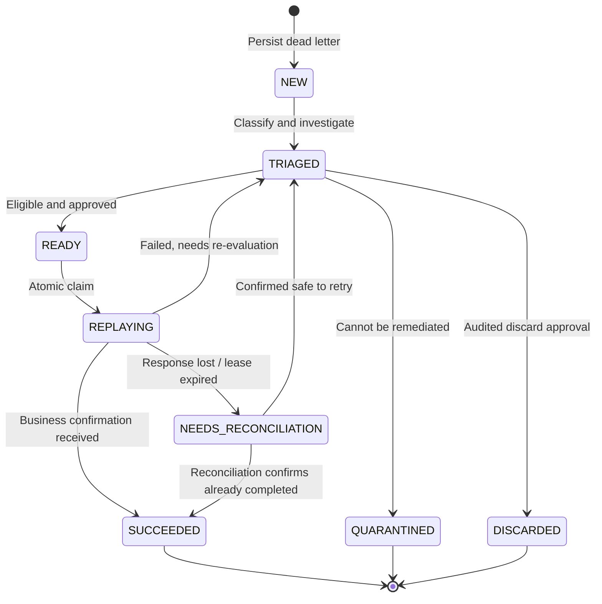
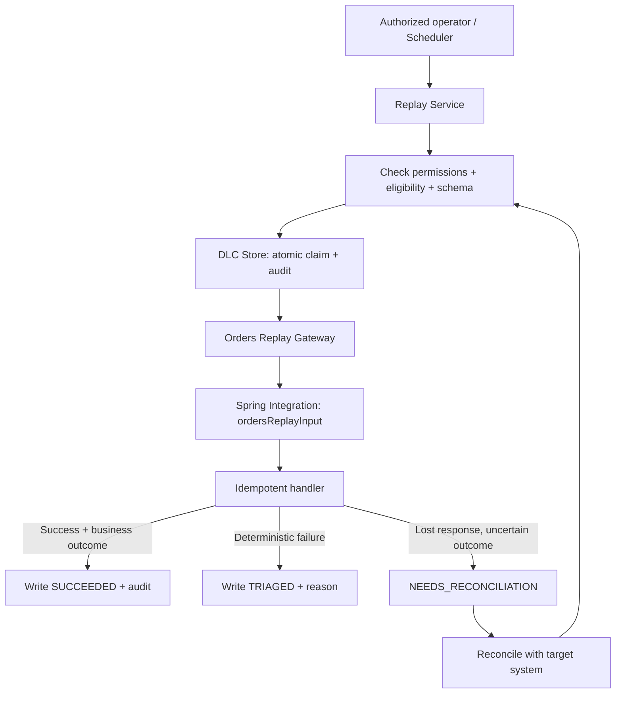

# Controlled Dead Letter Replay

In the **SPRING_INTEGRATION_PATTERN** module, Spring Integration is used to implement **Enterprise Integration Patterns** such as Router, Filter, Transformer, Splitter, Aggregator, and Gateway to build loosely coupled, extensible messaging flows. When a message cannot be processed, the system can retry, route the error through `errorChannel`, and persist it to a **Dead Letter Channel (DLC)** or broker dead-letter queue (DLQ).

However, **persisting a dead letter does not mean the business operation is finished**. After the root cause is fixed, operators may want to reprocess the message. If replayed carelessly, the system might charge a payment twice, send duplicate notifications, process expired data, or create an infinite loop. This lesson focuses on **controlled dead letter replay**: determining when replay is allowed, who is authorized to perform it, how to prevent concurrency conflicts and duplication, tracking results, and recovering from failures.

Objectives after this lesson:

1. Distinguish **in-flow retry**, **broker redelivery**, and **replay from the DLC**.
2. Build replay eligibility conditions based on state, data, permissions, and limits.
3. Design an **atomic claim** mechanism so two workers never pick up the same error record.
4. Replay into the right Spring Integration flow with controlled headers and idempotency.
5. Test success, failure, timeout, concurrent replay, and state-persistence failure branches.

## 1. Replay Is Not Simply Sending the Message Back to the Start of the Flow

Suppose an order has event `OrderCreated(eventId="evt-42")`:

- The handler sends a payment request to a partner system.
- The partner executes the transaction, but the response back to the application times out.
- In-handler retries fail; the message is stored in the DLC with reason `PAYMENT_TIMEOUT`.
- Once the outage passes, an operator considers clicking "Replay".

If replay issues a **new payment request** without checking the previous transaction, the customer could be charged a second time. Having the same payload does not guarantee the same outcome as the first run. Replay is **a new business execution linked to a prior failure**.

Therefore, clarify the following:

| Question | Minimum Requirement Before Replay |
| --- | --- |
| Should it be reprocessed? | Root cause has been resolved; the message still holds business value |
| Who is allowed to decide? | Operator or service authorized to replay for the relevant flow |
| Which data will be used? | Correctly versioned payload, trusted source, and appropriate replay entry point |
| Did it already succeed previously? | Idempotency / business state check performed |
| Is another worker already replaying? | Atomic claim or lease held |
| What if it fails again? | Retry/replay cap and quarantine/alerting path |
| When is it complete? | Business confirmation per contract, durably recorded |

### Three Concepts to Keep Separate

| Mechanism | When It Occurs | Counter | Unit to Control |
| --- | --- | --- | --- |
| `RequestHandlerRetryAdvice` / Spring Retry | Handler is executing within a single message delivery | `attemptsMade` | Handler invocations, backoff, and exceptions |
| Broker redelivery | Consumer rollback, NACK, or disconnect | `deliveryCount` if adapter supports | ACK, transactions, delay, and broker policies |
| Replay from DLC | Message was isolated, then approved for reprocessing | `replayCount` | Permissions, business state, idempotency, and audit |

Do not sum these three numbers into a single `retryCount` field. A replay creates a new message delivery, which itself can trigger in-handler retries. Without limits at **each layer**, downstream call counts will grow unexpectedly.

## 2. Lifecycle of a Replayed Dead Letter

An error store must manage state rather than offering only a "pop from queue and resend" action.



Meaning of each state:

| State | Meaning and Action |
| --- | --- |
| `NEW` | Newly written to the DLC; requires root-cause investigation |
| `TRIAGED` | Cause classified; not yet approved for automatic replay |
| `READY` | Passed checks and approved per workflow |
| `REPLAYING` | Claimed by a worker and currently executing |
| `SUCCEEDED` | Evidence of business completion recorded |
| `NEEDS_RECONCILIATION` | Uncertain whether business action completed; needs reconciliation |
| `QUARANTINED` | Blocked from replay until a new decision is made |
| `DISCARDED` | Closed by an audited discard decision |

These state names are an **illustrative application-defined model**, not a built-in Spring Integration enum.

**Crucial point:** never automatically transition `REPLAYING → READY` just because a lease expired. The previous worker may have executed the side effect and disconnected before writing the result. Before trying again, **reconcile business state** and enforce idempotency.

## 3. Conditions for a Dead Letter to Be Eligible for Replay

Build an *eligibility gate* before claiming and re-verify conditions atomically at the store.

### 3.1. Right Message, Right Flow, and Right Actor

Accept only `deadLetterId` from the caller to identify the record. `flowId`, `eventId`, payload type, and permissions must come from the **trusted store**, never from an arbitrary request body.

For example, a record with `flowId = "orders"` may only be replayed into the authorized Orders replay entry point—never pick a `MessageChannel` name from client-supplied data. Replay permissions for Orders and Notifications may differ.

The operator needs an identity/audit context, replay rationale, and matching permissions. For financial data or sensitive actions, dual approval may be required; that is a business policy the application must enforce.

### 3.2. Root Cause Has Been Resolved

If the failure was an invalid schema, fix the data at the source or produce an audited correction. If a downstream service timed out, verify the service has recovered. If a token expired, fix configuration first.

Replaying while the root cause is unchanged merely sends the message into another failure cycle.

### 3.3. Message Still Has Value and Matches Data Version

A record should retain `schemaVersion`, `contentType`, encoding, or a reference to the original payload. When a newer system version is deployed, apply a safe schema migration or reject replay if no longer supported.

Also check the **business deadline**: an expired OTP notification or expired promotional price may no longer be valid to apply. Broker TTL does not substitute for business deadline rules.

### 3.4. Side Effects Have Not Already Completed

Before replaying, check a stable idempotency key such as `eventId`, `paymentRequestId`, or `orderId + operationType`.

If a completed payment is found, mark the dead letter **reconciled** with business completion instead of calling payment again. Checking prior to invocation is not enough under concurrency; the **target handler** must also enforce idempotency atomically or call a partner API supporting idempotency keys.

### 3.5. Replay Limit Has Not Been Reached

Example policy: at most **2 intentional replays** per record. Upon reaching the limit, move to `QUARANTINED` or manual review. Retry counts inside each replay are still managed independently.

### Decision Table

| Situation | Decision |
| --- | --- |
| `READY`, matching flow, not expired, root cause fixed | Eligible to claim for replay |
| `REPLAYING` claimed by another worker | Do not start a new attempt |
| Past business deadline | Do not replay; investigate/quarantine or handle via alternate business rule |
| `replayCount >= maxReplays` | Block replay, alert, or require exception approval |
| Payload schema no longer supported | Controlled transformation or reject |
| Side effect already completed | Reconcile/mark succeeded, do not re-execute |
| Unknown whether prior replay completed | Transition to `NEEDS_RECONCILIATION` |
| State/DLC store unwritable | Abort operation; do not treat replay as successful |

## 4. Controlled Replay Architecture With Spring Integration



Separate responsibilities across two components:

- **Replay Service:** checks eligibility, enforces permissions, claims one record, invokes the gateway, and records status and audit entries.
- **Business Handler:** executes business logic with a stable idempotency key and returns a meaningful result. The handler may use Router, Transformer, Gateway, or other branches, but must have a clear contract for when processing is considered complete.

**Never wire `deadLetters → originalInput` directly as an automatic loop.** The replay entry point should be a controlled endpoint receiving trusted source data and allowlisted headers. For synchronous request/reply, `@MessagingGateway` can return the outcome. For asynchronous processing, require a completion event or durable business state to confirm; `send()` returning `true` does not prove business completion.

## 5. Persisting State and Atomic Claiming

In the example below, **PostgreSQL** stores dead letters, replay state, and audit logs. This is a minimal schema illustrating the mechanism. For sensitive payloads, store a reference to encrypted, access-controlled object storage instead of raw JSON.

```sql
CREATE TABLE dead_letter_events (
    dead_letter_id   uuid PRIMARY KEY,
    flow_id          varchar(64) NOT NULL,
    event_id         varchar(128) NOT NULL,
    correlation_id   varchar(128),
    payload_json     text NOT NULL,
    schema_version   varchar(32) NOT NULL,
    reason_code      varchar(64) NOT NULL,
    status           varchar(32) NOT NULL DEFAULT 'NEW',
    replay_count     integer NOT NULL DEFAULT 0 CHECK (replay_count >= 0),
    max_replays      integer NOT NULL DEFAULT 2 CHECK (max_replays >= 0),
    business_deadline timestamptz,
    lease_token      uuid,
    lease_until      timestamptz,
    last_error_code  varchar(64),
    created_at       timestamptz NOT NULL DEFAULT now(),
    updated_at       timestamptz NOT NULL DEFAULT now()
);

CREATE INDEX idx_dead_letter_status
    ON dead_letter_events (flow_id, status, created_at);

CREATE TABLE dead_letter_replay_audit (
    replay_attempt_id uuid PRIMARY KEY,
    dead_letter_id    uuid NOT NULL
        REFERENCES dead_letter_events(dead_letter_id),
    actor_id          varchar(128) NOT NULL,
    rationale         text NOT NULL,
    outcome           varchar(32) NOT NULL,
    reason_code       varchar(64),
    started_at        timestamptz NOT NULL DEFAULT now(),
    finished_at       timestamptz
);
```

### Claiming With a Conditional Statement

Two workers may read the same `READY` row. "SELECT first, then UPDATE" does not guarantee only one worker acquires it. A PostgreSQL `UPDATE ... WHERE ... RETURNING` statement acquires processing ownership **atomically at row level**:

```sql
UPDATE dead_letter_events
SET status = 'REPLAYING',
    replay_count = replay_count + 1,
    lease_token = :lease_token,
    lease_until = now() + interval '2 minutes',
    updated_at = now()
WHERE dead_letter_id = :dead_letter_id
  AND flow_id = :expected_flow_id
  AND status = 'READY'
  AND replay_count < max_replays
  AND (business_deadline IS NULL OR business_deadline > now())
RETURNING dead_letter_id, flow_id, event_id, correlation_id,
          payload_json, schema_version, replay_count, lease_token;
```

- **One row returned:** the worker claimed the record.
- **Zero rows returned:** the record's state changed, replay eligibility expired under SQL rules, or another worker claimed it first; do not proceed to send.
- Keep the claim transaction short. Write the `STARTED` audit entry in the **same transaction** as the claim so ownership is never taken without a start record.
- Additional checks such as permissions, schema, and approvals should run beforehand, then **re-enforce** critical conditions inside the claim transaction. Where multiple actors edit records concurrently, add a `version` column for optimistic locking.

**A lease does not stop an old worker from executing business logic after its lease expires.** When a record stays `REPLAYING` too long, move it to `NEEDS_RECONCILIATION` to determine the outcome; only after that allow a new attempt. If lease renewal exists, attach fencing tokens to writes and still rely on idempotency in the business system.

### Only the Lease Holder Updates the Outcome

```sql
UPDATE dead_letter_events
SET status = 'SUCCEEDED',
    lease_token = NULL,
    lease_until = NULL,
    updated_at = now()
WHERE dead_letter_id = :dead_letter_id
  AND status = 'REPLAYING'
  AND lease_token = :lease_token;
```

Verify that the updated row count equals **1**. If it is 0, ownership may have changed or the record was modified externally; alert and reconcile instead of blindly overwriting state.

In the same transaction that writes the outcome, update the audit entry with `outcome = 'SUCCEEDED'` and `finished_at`. When a failure is known for certain to have **caused no side effects**, transition to `TRIAGED` for re-evaluation. When it is unknown whether the target system executed (timeout/lost response), prefer `NEEDS_RECONCILIATION`.

## 6. Spring Integration Example: Replay Gateway Returning Business Outcome

This example uses **Spring Integration 6.x, Java 17+**. It illustrates sending an **approved `ReplayCommand`** through a gateway to an idempotent Orders handler.

Key point: a replay command must route to the **exact right flow** and carry only application-approved headers/data. This example assumes the business service `OrderService` exposes `processOnce` keyed by `eventId` to enforce idempotency where business state is written.

```java
package demo.integration.replay;

import java.util.UUID;

import org.springframework.context.annotation.Bean;
import org.springframework.context.annotation.Configuration;
import org.springframework.integration.annotation.Gateway;
import org.springframework.integration.annotation.IntegrationComponentScan;
import org.springframework.integration.annotation.MessagingGateway;
import org.springframework.integration.config.EnableIntegration;
import org.springframework.integration.dsl.IntegrationFlow;

// Command built from a trusted record after a successful claim.
record ReplayCommand(
        UUID deadLetterId,
        UUID replayAttemptId,
        String eventId,
        String correlationId,
        String payloadJson,
        String schemaVersion) {}

record ReplayOutcome(boolean completed, String businessReference) {}

interface OrderService {
    // processOnce must enforce idempotency by eventId at the business layer.
    ReplayOutcome processOnce(
            String eventId, String payloadJson, String schemaVersion);
}

final class OrderReplayHandler {
    private final OrderService service;

    OrderReplayHandler(OrderService service) {
        this.service = service;
    }

    public ReplayOutcome replay(ReplayCommand command) {
        return service.processOnce(
                command.eventId(),
                command.payloadJson(),
                command.schemaVersion());
    }
}

@MessagingGateway
interface OrdersReplayGateway {
    @Gateway(requestChannel = "ordersReplayInput")
    ReplayOutcome replay(ReplayCommand command);
}

@Configuration
@EnableIntegration
@IntegrationComponentScan
class OrdersReplayConfiguration {

    @Bean
    OrderReplayHandler orderReplayHandler(OrderService service) {
        return new OrderReplayHandler(service);
    }

    @Bean
    IntegrationFlow ordersReplayFlow(OrderReplayHandler handler) {
        return IntegrationFlow.from("ordersReplayInput")
                .handle(handler, "replay")
                .get();
    }
}
```

In this flow, `OrdersReplayGateway.replay(...)` invokes the handler synchronously and receives `ReplayOutcome`. This is a **request/reply contract**: `completed=true` is valid only if `OrderService.processOnce` confirmed the business action at the required reliability level. If the handler merely enqueues work asynchronously and replies, that cannot be treated as "completed"; use `ACCEPTED / PENDING_CONFIRMATION` and wait for a completion event or reconcile durable state.

**Routing note:** if the system has multiple flows, use a statically defined registry/router, e.g., `orders → ordersReplayGateway` and `notifications → notificationsReplayGateway`. Never use a `flowId` from an external request as an arbitrary bean/channel name and dispatch directly.

### Constructing a New Message and Preserving Intentional Headers

Another option when calling a `MessageChannel` directly is building a fresh message from the claimed record:

```java
Message<String> replayMessage = MessageBuilder
        .withPayload(trustedRecord.payloadJson())
        .setHeader("eventId", trustedRecord.eventId())
        .setHeader("correlationId", trustedRecord.correlationId())
        .setHeader("replayOf", trustedRecord.deadLetterId().toString())
        .setHeader("replayAttemptId", attemptId.toString())
        .build();

// Use the exact replay entry point configured for the flow.
ordersReplayInput.send(replayMessage);
```

This snippet assumes `trustedRecord`, `attemptId`, and `ordersReplayInput` are provided by the replay mechanism. Import `org.springframework.messaging.Message` and `org.springframework.messaging.support.MessageBuilder`.

**Do not copy all headers from the failed message.** `replyChannel`, `errorChannel`, ACK handles, tokens, credentials, or channel objects from the prior run must not be reused. `send()` returning `true` only indicates the channel accepted the message under its current semantics; it is **not** proof of business completion.

## 7. Replay Coordinator: Validate, Claim, Replay, Record Outcome

An orchestration service should sit outside the business flow. Below is **strongly typed Java pseudocode** for the main steps; `ReplayStore`, `AuthorizationService`, and `OrdersReplayGateway` are application interfaces to implement or supply as real beans.

```java
public ReplayOutcome replayOrder(UUID deadLetterId,
                                 String actorId,
                                 String rationale) {
    if (rationale == null || rationale.isBlank()) {
        throw new IllegalArgumentException("Replay rationale is required");
    }

    // Do not trust flowId, payload, or eventId from an external request.
    DeadLetterSnapshot record = store.get(deadLetterId);
    authorization.requireReplayPermission(actorId, record.flowId());

    if (!"orders".equals(record.flowId())) {
        throw new IllegalArgumentException("Record is not an orders event");
    }
    if (!"READY".equals(record.status())
            || record.replayCount() >= record.maxReplays()
            || record.isBusinessExpired()
            || !schemaRegistry.supports(record.schemaVersion())) {
        throw new IllegalStateException("Dead letter is not eligible");
    }

    // Important: check whether the business action already completed. The handler
    // must also be idempotent because a race can occur after this check.
    if (orderService.alreadyCompleted(record.eventId())) {
        store.reconcileAsSucceeded(deadLetterId, actorId);
        return new ReplayOutcome(true, "ALREADY_COMPLETED");
    }

    UUID leaseToken = UUID.randomUUID();
    UUID attemptId = UUID.randomUUID();

    // Claim and record audit STARTED in a single short transaction.
    // The claim itself must re-check status, deadline, and replayCount.
    DeadLetterSnapshot claimed = store.claimReady(
            deadLetterId, "orders", leaseToken, attemptId,
            actorId, rationale);
    if (claimed == null) {
        throw new IllegalStateException("Already claimed or not eligible");
    }

    try {
        ReplayOutcome outcome = ordersReplayGateway.replay(
                new ReplayCommand(
                        claimed.deadLetterId(),
                        attemptId,
                        claimed.eventId(),
                        claimed.correlationId(),
                        claimed.payloadJson(),
                        claimed.schemaVersion()));

        if (!outcome.completed()) {
            // May have only accepted the command without completing the business action.
            store.markNeedsReconciliation(deadLetterId, leaseToken,
                    attemptId, "NO_FINAL_CONFIRMATION");
            return outcome;
        }

        // Mark success and audit in the same short transaction.
        store.markSucceeded(deadLetterId, leaseToken, attemptId);
        return outcome;
    } catch (Exception failure) {
        // If it is unknown whether downstream completed,
        // keep the record for reconciliation; do not auto-replay again.
        store.markNeedsReconciliation(deadLetterId, leaseToken,
                attemptId, "REPLAY_RESULT_UNCERTAIN");
        throw failure;
    }
}
```

In this example, `ReplayStore` methods carry **mandatory contracts**:

- `claimReady(...)` performs the conditional database update and writes the `STARTED` audit entry in one short transaction.
- `markSucceeded(...)` and `markNeedsReconciliation(...)` verify `leaseToken`, update status, and write the audit entry in the same transaction; if the update fails, they must raise an error.
- `reconcileAsSucceeded(...)` runs only after **verifying** business completion via a trusted source; record the decision-maker and evidence.
- Do not wrap the network call to `ordersReplayGateway` inside a long JDBC transaction; keep database transactions confined to the claim and outcome-update steps.

If `store.markNeedsReconciliation(...)` also fails, the system must emit an alert and preserve logs/traces for recovery. A handler may have completed while marking `SUCCEEDED` failed; subsequent handling must **reconcile business state** before trying again.

### What Happens on Timeout?

A timeout is not proof that the transaction failed. If the gateway called an external service and received no response, that service may have persisted state before the connection dropped. In that case:

1. Mark `NEEDS_RECONCILIATION` or equivalent status, if writable.
2. Query the target system using `eventId`/idempotency key or transaction ID.
3. If already completed, record success and audit; **do not call again**.
4. If confirmed not executed and the root cause is resolved, move back to `READY` after policy checks.
5. If still unverifiable, retain the record for investigation and alert.

Do not let a scheduler automatically handle every expired lease by immediately resending; doing so can trigger duplicate side effects.

## 8. Replaying With Router, Splitter, Aggregator, and Gateway

In real integration flows, the replay entry point determines processing semantics:

| Pattern | Replay Risk | Control |
| --- | --- | --- |
| Router | Route/schema changed; message enters wrong branch | Use versioned routes or validated entry points |
| Transformer | Payload in DLC is post-transform, not raw ingress data | Store `payloadRef` and `schemaVersion` at ingress, or replay only from the exact step |
| Splitter | Replaying the whole group may re-process already-succeeded parts | Identify each part and track completed parts |
| Aggregator | Partial replay can leave a group incomplete or double-count sequences | Store `correlationId`, `sequenceNumber`, and group state |
| Gateway | Caller may have timed out even though side effects completed | Enforce idempotency and query state before replay; uphold reply contract |
| Filter | Dropped messages per rule are not errors | Do not generate dead letters for replay |
| Retry / error channel | Replay can re-enter retry and land in DLC again | Bound both retries and replays; retain `replayOf` |

If a record failed mid-flow, it does not necessarily have to replay **from the beginning**. Choose the replay point by business semantics: replay normalized source data, replay one part after verification, or run a compensating action. Each option requires its own data contract and idempotency guarantees.

## 9. Testing Controlled Replay

Tests should verify **business outcomes and state consistency**, rather than only checking that a message was sent to a channel.

### Test Matrix

| Scenario | Expected Result |
| --- | --- |
| Valid `READY` record, business handler succeeds | Claimed once, `replayCount` increments by 1, status `SUCCEEDED`, audited |
| Unapproved `NEW` or `TRIAGED` record | Rejected, no message sent |
| Caller lacks replay permission for flow | Rejected with appropriate security audit |
| `replayCount = maxReplays` | Claim denied, moved to triage/quarantine per policy |
| Past business deadline | Not replayed |
| Payload version no longer supported | Rejected or requires audited transformation |
| Two workers claim the same record | Only one worker receives a row from `UPDATE ... RETURNING` |
| Prior run succeeded, DLC state not yet updated | Reconciles to succeeded without re-invoking the business handler |
| Gateway timeout with uncertain outcome | `NEEDS_RECONCILIATION`; no automatic replay |
| Failure before claim | `replayCount` does not increment |
| Failure after claim before recording outcome | Audit/lease exists and investigation path handles uncertain state |
| Outcome update rejected due to wrong `leaseToken` | Does not overwrite another worker's state |
| Replay fails again and returns to DLC | Preserves `replayOf`, prevents infinite loop, keeps trail |
| System uses asynchronous processing | Status does not become `SUCCEEDED` until verified completion arrives |

### Pure Java Eligibility Policy Test Example

To test logic ahead of the claim step, isolate a standalone policy. The example below uses Java 17 and JUnit Jupiter:

```java
package demo.integration.replay;

import java.time.Instant;

record ReplayCandidate(
        String flowId,
        String status,
        int replayCount,
        int maxReplays,
        Instant businessDeadline,
        String schemaVersion) {}

final class ReplayPolicy {
    private ReplayPolicy() {}

    static void requireEligible(
            ReplayCandidate c, String expectedFlow, Instant now) {
        if (!expectedFlow.equals(c.flowId())) {
            throw new IllegalStateException("Wrong flow");
        }
        if (!"READY".equals(c.status())) {
            throw new IllegalStateException("Not approved");
        }
        if (c.replayCount() >= c.maxReplays()) {
            throw new IllegalStateException("Replay limit reached");
        }
        if (c.businessDeadline() != null
                && !c.businessDeadline().isAfter(now)) {
            throw new IllegalStateException("Business deadline expired");
        }
        if (!"v1".equals(c.schemaVersion())) {
            throw new IllegalStateException("Unsupported schema");
        }
    }
}
```

```java
package demo.integration.replay;

import static org.junit.jupiter.api.Assertions.assertDoesNotThrow;
import static org.junit.jupiter.api.Assertions.assertThrows;

import java.time.Instant;
import org.junit.jupiter.api.Test;

class ReplayPolicyTest {
    private static final Instant NOW =
            Instant.parse("2026-11-21T08:00:00Z");

    @Test
    void readyRecordCanBeReplayed() {
        var record = new ReplayCandidate(
                "orders", "READY", 0, 2, NOW.plusSeconds(3600), "v1");

        assertDoesNotThrow(() ->
                ReplayPolicy.requireEligible(record, "orders", NOW));
    }

    @Test
    void expiredRecordCannotBeReplayed() {
        var record = new ReplayCandidate(
                "orders", "READY", 0, 2, NOW, "v1");

        assertThrows(IllegalStateException.class, () ->
                ReplayPolicy.requireEligible(record, "orders", NOW));
    }

    @Test
    void replayLimitAndWrongFlowAreRejected() {
        var limit = new ReplayCandidate(
                "orders", "READY", 2, 2, null, "v1");
        var otherFlow = new ReplayCandidate(
                "notifications", "READY", 0, 2, null, "v1");

        assertThrows(IllegalStateException.class, () ->
                ReplayPolicy.requireEligible(limit, "orders", NOW));
        assertThrows(IllegalStateException.class, () ->
                ReplayPolicy.requireEligible(otherFlow, "orders", NOW));
    }

    @Test
    void triagedRecordNeedsApprovalFirst() {
        var record = new ReplayCandidate(
                "orders", "TRIAGED", 0, 2, null, "v1");

        assertThrows(IllegalStateException.class, () ->
                ReplayPolicy.requireEligible(record, "orders", NOW));
    }
}
```

This is **illustrative code**, not executed in a repository during authoring. Policy unit tests prove input rules only; they do **not** prove atomic claiming or idempotent execution. Those requirements demand integration tests against a real database and end-to-end tests with source adapters/handlers, including two concurrent workers, network faults, and mid-step restarts.

## 10. Observability, Auditing, and Operational Boundaries

Controlled replay must leave an audit trail for each attempt:

- **Actor identity:** operator/service, role/permissions, and approval rationale.
- **Links:** `deadLetterId`, `replayAttemptId`, `eventId`, `correlationId`, `replayOf`.
- **State:** claim timestamp, lease token (hidden from public logs), outcome, update timestamp.
- **Data source:** schema version, payload reference/checksum, approved edits if any.
- **Result:** business confirmation, target system reference, safe error code, reconciler.

Never write sensitive payloads, access tokens, unsanitized exception messages, or raw headers into audit logs or metrics. Keep detailed data in a store with strict access controls, retention limits, and encryption.

Suggested metrics (the application must configure/collect them):

| Metric | Meaning |
| --- | --- |
| `dead_letter_ready` by `flowId` | Eligible messages awaiting replay |
| `replay_started_total` | Replay attempts claimed |
| `replay_succeeded_total` | Attempts with confirmed completion |
| `replay_reconciliation_required_total` | Attempts with uncertain outcomes |
| `replay_claim_conflict_total` | Two or more workers contending for the same record |
| `replay_limit_reached_total` | Attempts blocked by replay budget |
| `dead_letter_oldest_age_seconds` | Age of oldest failed message |
| `dead_letter_state_update_failed_total` | Failures writing outcomes or audit records |

Do not place `eventId`, `deadLetterId`, or `orderId` into metric labels due to high cardinality. Use access-controlled traces and logs to inspect a specific case. Set alerts if a record stays `REPLAYING` too long, `NEEDS_RECONCILIATION` rises, or audit persistence fails.

### Sample Operational Runbook

1. Filter dead letters by flow and reason code to scope the incident.
2. Check whether the business action already completed and whether the root cause is fixed.
3. Verify schema/version and business deadline; prepare audited data corrections if needed.
4. Obtain permissioned approval, decide batch size, and set a maximum replay rate.
5. Claim each record and dispatch through the authorized replay entry point for that flow.
6. Track outcomes; do not mark succeeded merely on command acceptance.
7. Reconcile timed-out/unresponsive runs; update status and cap further replays.
8. Summarize audit logs, success rates, and remaining dead letters requiring manual handling.

## 11. Common Pitfalls

| Pitfall | Consequence | Remedy |
| --- | --- | --- |
| Popping from queue and resending immediately | Can lose records and lose auditability | Persist state, claims, and audit durably |
| Two workers reading the same `READY` record | Duplicate replay | Use atomic database claiming |
| Auto-replaying as soon as a lease expires | Old worker may have succeeded | Reconcile business state before allowing a new run |
| Treating `send() == true` as business completion | False success reporting | Require business outcome or completion event |
| Copying all headers from dead letter | Misuses `replyChannel`/`errorChannel`, leaks data | Rebuild only allowlisted headers |
| Using client-supplied `flowId` directly as a channel name | Replays to the wrong destination | Fixed router/registry keyed on trusted metadata |
| Lacking idempotency in the handler | Double payments or duplicate emails | Stable business key and atomic processing |
| Checking only in-handler retries | Replay + broker redelivery can loop forever | Enforce limits at every layer |
| Marking `SUCCEEDED` before side effects commit | Inconsistent state, hard recovery | Mark only upon trusted confirmation |
| Ignoring state-update failure after business success | Unclear whether another replay is safe | Audit, reconcile, and idempotent handlers |
| Replaying expired data or unsupported version | Business violation or corrupt data | Check deadline and schema before claiming |
| No access control or audit | No accountability or blast-radius control | Flow-scoped permissions, rationale, evidence, and logs |

## 12. Self-Check Questions

1. Why does replaying from a DLC differ from `RequestHandlerRetryAdvice` within a single message delivery?
2. If a timeout occurred after the partner already charged payment, what must you check before replaying?
3. Why must `replayCount` stay separate from `attemptsMade` and broker `deliveryCount`?
4. Why is `SELECT status='READY'` followed by `UPDATE` insufficient to stop two workers from replaying the same record?
5. When a lease expires and the business outcome is unknown, what state should the record transition to and what should happen next?
6. Why must a `SUCCEEDED` record depend on business confirmation rather than just `send() = true`?
7. When replaying after a Transformer, how do you know whether to replay from ingress or from an intermediate endpoint?
8. How do you preserve `correlationId` and `eventId` without reusing internal channel headers?
9. Which situations require putting a dead letter into `QUARANTINED` rather than continuing to replay?
10. If the business handler succeeded but updating dead-letter status failed, what is the safe recovery path?

## References

- [Spring Integration Reference — Error Handling](https://docs.spring.io/spring-integration/reference/error-handling.html): emitting `ErrorMessage` and building error flows.
- [Spring Integration Reference — Messaging Gateways](https://docs.spring.io/spring-integration/reference/gateway.html): request/reply model via Gateway.
- [Spring Integration Reference — Message Channels](https://docs.spring.io/spring-integration/reference/channel.html): semantics of `DirectChannel` and other channels.
- [Spring Integration Reference — Provided Advice Classes](https://docs.spring.io/spring-integration/reference/handler-advice/classes.html): retry advice and recovery.
- [PostgreSQL Documentation — UPDATE](https://www.postgresql.org/docs/current/sql-update.html): `UPDATE ... RETURNING` for conditional claiming.

> **Key Takeaway:** Controlled dead letter replay is **a stateful business workflow** encompassing investigation, eligibility checks, atomic claiming, flow-accurate routing, idempotent execution, outcome verification, and auditing. Never auto-replay simply because a message sits in the DLC, and never mark succeeded before verifying the operation truly completed.
